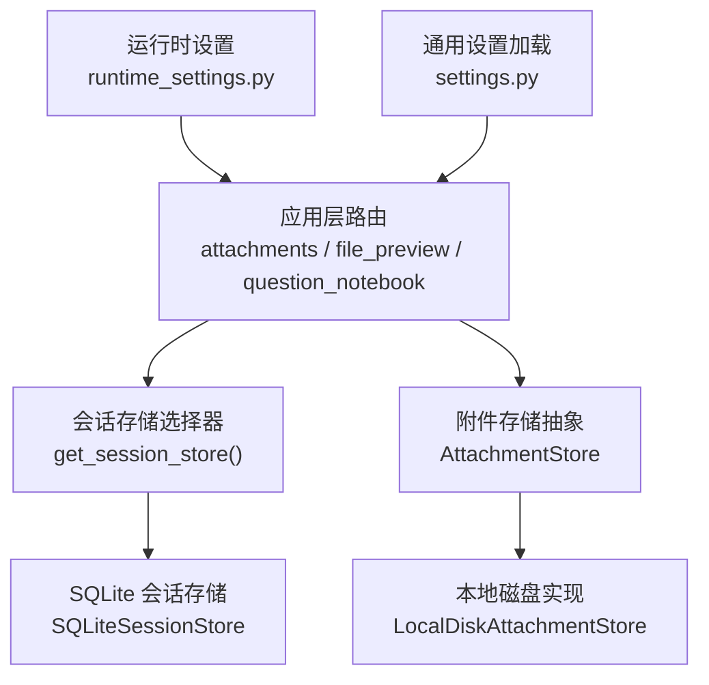
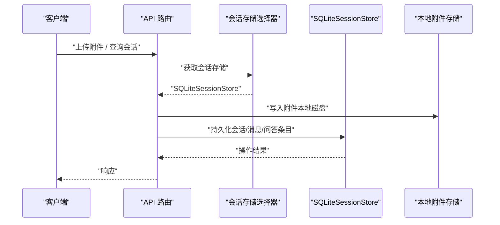
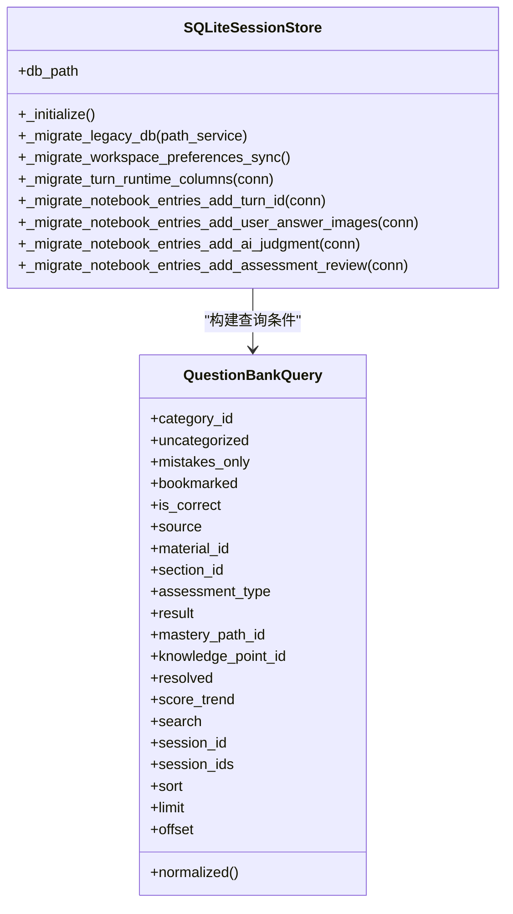
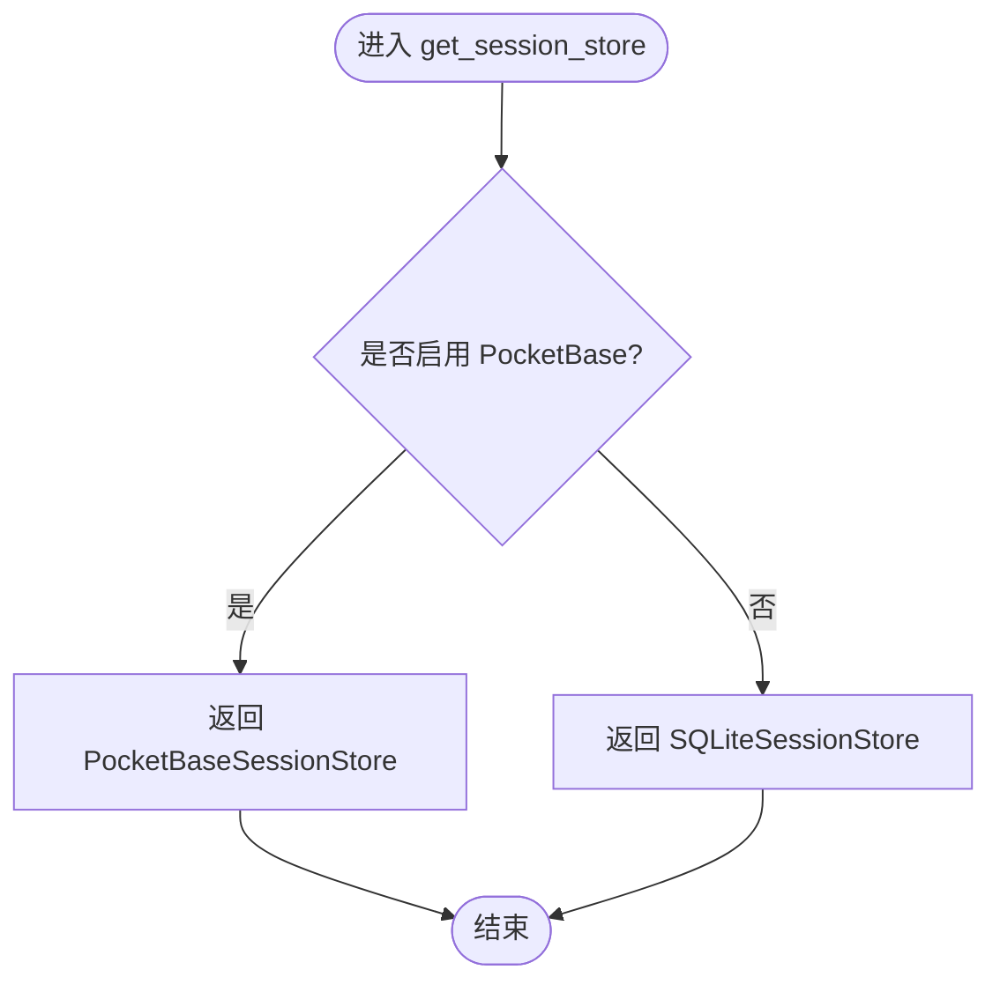
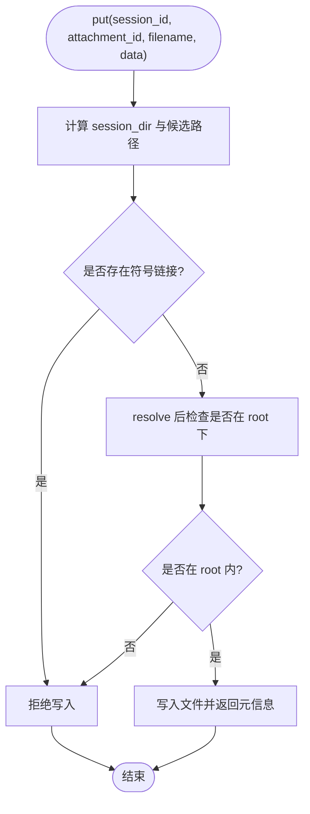
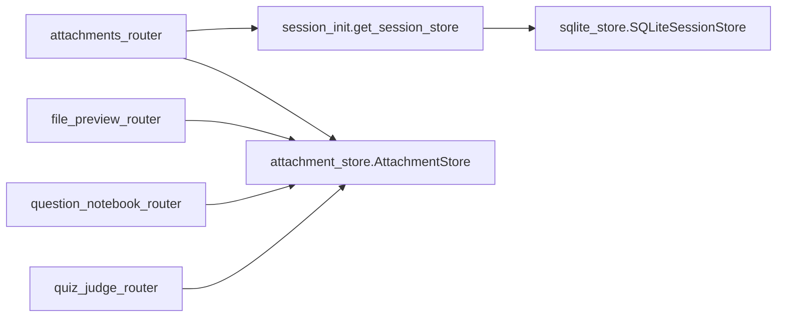
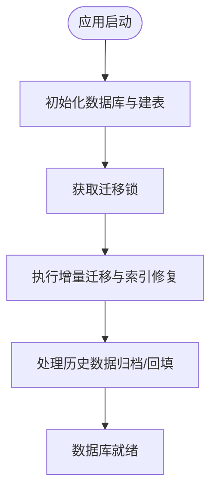

# 数据库配置

<cite>
**本文引用的文件**   
- [sqlite_store.py](file://deeptutor/services/session/sqlite_store.py)
- [session_init.py](file://deeptutor/services/session/__init__.py)
- [attachment_store.py](file://deeptutor/services/storage/attachment_store.py)
- [storage_init.py](file://deeptutor/services/storage/__init__.py)
- [settings.py](file://deeptutor/config/settings.py)
- [runtime_settings.py](file://deeptutor/services/config/runtime_settings.py)
- [attachments_router.py](file://deeptutor/api/routers/attachments.py)
- [file_preview_router.py](file://deeptutor/api/routers/file_preview.py)
- [question_notebook_router.py](file://deeptutor/api/routers/question_notebook.py)
- [quiz_judge_router.py](file://deeptutor/api/routers/quiz_judge.py)
- .gitignore
</cite>

## 目录
1. [简介](#简介)
2. [项目结构](#项目结构)
3. [核心组件](#核心组件)
4. [架构总览](#架构总览)
5. [详细组件分析](#详细组件分析)
6. [依赖关系分析](#依赖关系分析)
7. [性能与连接池](#性能与连接池)
8. [数据迁移、版本管理与恢复](#数据迁移版本管理与恢复)
9. [安全配置、访问控制与审计日志](#安全配置访问控制与审计日志)
10. [高可用、主从复制与灾难恢复](#高可用主从复制与灾难恢复)
11. [监控、性能分析与故障诊断](#监控性能分析与故障诊断)
12. [结论](#结论)

## 简介
本文件面向 DeepTutor 的“数据库与持久化”配置，聚焦以下目标：
- SQLite 会话存储的连接与优化；说明为何当前实现未使用连接池。
- 文件附件存储（本地磁盘）的配置与安全策略；说明云存储扩展点。
- 数据迁移机制、版本管理、备份与恢复流程。
- 安全配置、访问控制与审计日志建议。
- 高可用、主从复制与灾难恢复的实践建议。
- 监控、性能分析与故障诊断方法。

本项目默认使用 SQLite 作为会话与问答记录等数据的持久化后端，并通过可插拔的附件存储抽象支持本地文件系统，同时为未来接入云存储预留接口。

## 项目结构
与数据库和文件存储相关的核心代码位于以下模块：
- 会话与问答数据存储：`deeptutor/services/session/sqlite_store.py`
- 会话存储选择器（SQLite 或 PocketBase）：`deeptutor/services/session/__init__.py`
- 附件存储抽象与本地实现：`deeptutor/services/storage/attachment_store.py`
- 附件存储导出入口：`deeptutor/services/storage/__init__.py`
- 通用设置加载（示例展示环境变量前缀）：`deeptutor/config/settings.py`
- 运行时设置读写（JSON 文件）：`deeptutor/services/config/runtime_settings.py`
- 附件上传路由（校验是否为本地存储）：`deeptutor/api/routers/attachments.py`
- 文件预览路由（校验是否为本地存储）：`deeptutor/api/routers/file_preview.py`
- 问答笔记本路由（引用附件存储）：`deeptutor/api/routers/question_notebook.py`
- 测验判题路由（解析图片附件）：`deeptutor/api/routers/quiz_judge.py`
- Git 忽略规则（排除 SQLite 数据库文件）：`.gitignore`

**图表来源**
- [session_init.py:15-38](file://deeptutor/services/session/__init__.py#L15-L38)
- [sqlite_store.py:245-256](file://deeptutor/services/session/sqlite_store.py#L245-L256)
- [attachment_store.py:66-154](file://deeptutor/services/storage/attachment_store.py#L66-L154)
- [storage_init.py:1-14](file://deeptutor/services/storage/__init__.py#L1-L14)
- [settings.py:27-50](file://deeptutor/config/settings.py#L27-L50)
- [runtime_settings.py:678-690](file://deeptutor/services/config/runtime_settings.py#L678-L690)

**章节来源**
- [session_init.py:15-38](file://deeptutor/services/session/__init__.py#L15-L38)
- [sqlite_store.py:245-256](file://deeptutor/services/session/sqlite_store.py#L245-L256)
- [attachment_store.py:66-154](file://deeptutor/services/storage/attachment_store.py#L66-L154)
- [storage_init.py:1-14](file://deeptutor/services/storage/__init__.py#L1-L14)
- [settings.py:27-50](file://deeptutor/config/settings.py#L27-L50)
- [runtime_settings.py:678-690](file://deeptutor/services/config/runtime_settings.py#L678-L690)

## 核心组件
- SQLite 会话存储：负责会话、消息、轮次、事件、问答条目、评估尝试等数据的持久化，包含初始化、索引、迁移与并发保护。
- 会话存储选择器：根据集成开关返回 PocketBase 会话存储或本地 SQLite 会话存储。
- 附件存储抽象与本地实现：定义统一的附件写入/读取协议，并提供基于本地磁盘的实现，包含路径安全校验。
- 运行时设置：以 JSON 文件形式保存系统运行时的可编辑设置。
- 通用设置加载：通过环境变量加载配置（示例展示了 LLM 重试相关的环境变量前缀）。

**章节来源**
- [sqlite_store.py:245-256](file://deeptutor/services/session/sqlite_store.py#L245-L256)
- [session_init.py:15-38](file://deeptutor/services/session/__init__.py#L15-L38)
- [attachment_store.py:66-154](file://deeptutor/services/storage/attachment_store.py#L66-L154)
- [runtime_settings.py:678-690](file://deeptutor/services/config/runtime_settings.py#L678-L690)
- [settings.py:27-50](file://deeptutor/config/settings.py#L27-L50)

## 架构总览
下图展示请求从 API 路由到会话存储与附件存储的调用链，以及 SQLite 在初始化阶段的关键行为。

**图表来源**
- [attachments_router.py:28-54](file://deeptutor/api/routers/attachments.py#L28-L54)
- [session_init.py:15-38](file://deeptutor/services/session/__init__.py#L15-L38)
- [sqlite_store.py:274-529](file://deeptutor/services/session/sqlite_store.py#L274-L529)
- [attachment_store.py:120-154](file://deeptutor/services/storage/attachment_store.py#L120-L154)

## 详细组件分析

### SQLite 会话存储
职责与特性：
- 单例缓存：按数据库路径缓存实例，避免重复创建连接对象。
- 进程级迁移锁：使用外部文件锁序列化跨进程的 schema 升级。
- WAL 模式：启用写前日志以提升并发读能力。
- 表结构与索引：会话、消息、轮次、事件、问答条目、评估尝试、分类等，并建立常用查询索引。
- 字段迁移：对历史库进行增量 ALTER TABLE、重建唯一约束、回填缺失列等。
- 并发保护：通过部分唯一索引与 fencing token 防止同一会话多个活跃轮次。

**图表来源**
- [sqlite_store.py:137-242](file://deeptutor/services/session/sqlite_store.py#L137-L242)
- [sqlite_store.py:245-256](file://deeptutor/services/session/sqlite_store.py#L245-L256)
- [sqlite_store.py:274-529](file://deeptutor/services/session/sqlite_store.py#L274-L529)
- [sqlite_store.py:532-656](file://deeptutor/services/session/sqlite_store.py#L532-L656)
- [sqlite_store.py:658-800](file://deeptutor/services/session/sqlite_store.py#L658-L800)

关键实现要点：
- 初始化时启用 WAL 并执行建表脚本，随后进行字段与索引的增量迁移。
- 通过 `_migration_lock` 保证多进程环境下的迁移串行化。
- 对 `turns` 表增加 owner_id、fencing_token、state_version 等并发字段，并创建部分唯一索引限制每会话仅一个活跃轮次。
- 对 `notebook_entries` 表逐步添加 turn_id、user_answer_images_json、ai_judgment、source/material_id/section_id/score_trend/resolved 等字段，并重建唯一约束以避免不同会话/轮次的问答冲突。

**章节来源**
- [sqlite_store.py:245-256](file://deeptutor/services/session/sqlite_store.py#L245-L256)
- [sqlite_store.py:274-529](file://deeptutor/services/session/sqlite_store.py#L274-L529)
- [sqlite_store.py:532-656](file://deeptutor/services/session/sqlite_store.py#L532-L656)
- [sqlite_store.py:658-800](file://deeptutor/services/session/sqlite_store.py#L658-L800)

### 会话存储选择器
- 当启用 PocketBase 集成时，返回远程会话存储；否则返回本地 SQLite 会话存储。
- 该选择器决定了系统是否使用本地 SQLite 作为默认零配置后端。

**图表来源**
- [session_init.py:15-38](file://deeptutor/services/session/__init__.py#L15-L38)

**章节来源**
- [session_init.py:15-38](file://deeptutor/services/session/__init__.py#L15-L38)

### 附件存储（本地文件系统）
- 提供统一协议 `AttachmentStore`，默认实现为本地磁盘存储。
- 路径安全校验：拒绝符号链接、确保写入路径始终位于根目录下。
- 路由层对非本地存储进行保护，避免直接暴露非本地附件路径。

**图表来源**
- [attachment_store.py:120-154](file://deeptutor/services/storage/attachment_store.py#L120-L154)

**章节来源**
- [attachment_store.py:66-154](file://deeptutor/services/storage/attachment_store.py#L66-L154)
- [storage_init.py:1-14](file://deeptutor/services/storage/__init__.py#L1-L14)
- [attachments_router.py:28-54](file://deeptutor/api/routers/attachments.py#L28-L54)
- [file_preview_router.py:84-87](file://deeptutor/api/routers/file_preview.py#L84-L87)
- [question_notebook_router.py:31-31](file://deeptutor/api/routers/question_notebook.py#L31-L31)
- [question_notebook_router.py:147-147](file://deeptutor/api/routers/question_notebook.py#L147-L147)
- [question_notebook_router.py:214-224](file://deeptutor/api/routers/question_notebook.py#L214-L224)
- [quiz_judge_router.py:247-247](file://deeptutor/api/routers/quiz_judge.py#L247-L247)

### 运行时设置与通用设置
- 运行时设置：以 JSON 文件形式保存系统运行时的可编辑设置（如 IMA、查询重写等），提供加载与保存方法。
- 通用设置：通过环境变量加载配置，示例展示了 LLM 重试相关的环境变量前缀与嵌套分隔符。

**章节来源**
- [runtime_settings.py:678-690](file://deeptutor/services/config/runtime_settings.py#L678-L690)
- [settings.py:27-50](file://deeptutor/config/settings.py#L27-L50)

## 依赖关系分析
- 路由层依赖会话存储选择器与附件存储抽象。
- 会话存储选择器依赖集成开关与具体实现（PocketBase 或 SQLite）。
- SQLite 会话存储依赖路径服务、迁移锁、工作区偏好迁移、练习存储初始化等。
- 附件存储被多个路由与工具模块引用，用于图片与附件的持久化。

**图表来源**
- [attachments_router.py:28-54](file://deeptutor/api/routers/attachments.py#L28-L54)
- [file_preview_router.py:84-87](file://deeptutor/api/routers/file_preview.py#L84-L87)
- [question_notebook_router.py:31-31](file://deeptutor/api/routers/question_notebook.py#L31-L31)
- [quiz_judge_router.py:247-247](file://deeptutor/api/routers/quiz_judge.py#L247-L247)
- [session_init.py:15-38](file://deeptutor/services/session/__init__.py#L15-L38)
- [sqlite_store.py:245-256](file://deeptutor/services/session/sqlite_store.py#L245-L256)

**章节来源**
- [attachments_router.py:28-54](file://deeptutor/api/routers/attachments.py#L28-L54)
- [file_preview_router.py:84-87](file://deeptutor/api/routers/file_preview.py#L84-L87)
- [question_notebook_router.py:31-31](file://deeptutor/api/routers/question_notebook.py#L31-L31)
- [quiz_judge_router.py:247-247](file://deeptutor/api/routers/quiz_judge.py#L247-L247)
- [session_init.py:15-38](file://deeptutor/services/session/__init__.py#L15-L38)
- [sqlite_store.py:245-256](file://deeptutor/services/session/sqlite_store.py#L245-L256)

## 性能与连接池
- SQLite 连接池：当前 SQLite 会话存储未显式维护连接池，而是通过进程内实例缓存减少重复构造开销；WAL 模式提升并发读能力。
- 索引优化：针对会话更新时间、消息会话+时间、轮次会话+状态、问答条目会话+时间、评估尝试会话+时间等建立索引，提高常见查询性能。
- 并发保护：通过部分唯一索引与 fencing token 避免同一会话多个活跃轮次，降低竞争与死锁风险。
- 建议：
  - 在高并发场景下，优先使用 WAL 模式并确保磁盘 IO 性能良好。
  - 合理设计查询条件以命中已有索引，避免全表扫描。
  - 如需更高并发与连接池，可考虑引入外部 PostgreSQL 后端（见“高可用、主从复制与灾难恢复”一节）。

**章节来源**
- [sqlite_store.py:274-529](file://deeptutor/services/session/sqlite_store.py#L274-L529)
- [sqlite_store.py:532-656](file://deeptutor/services/session/sqlite_store.py#L532-L656)

## 数据迁移、版本管理与恢复
- 迁移机制：
  - 启动时执行建表脚本，随后进行字段与索引的增量迁移。
  - 使用外部文件锁序列化跨进程迁移，避免并发破坏 schema。
  - 对历史库进行 ALTER TABLE、重建唯一约束、回填缺失列等操作。
- 版本管理：
  - 通过 `_migrate_*` 系列方法维护向后兼容，确保旧库能平滑升级到新 schema。
  - 对 `turns` 表增加并发字段与部分唯一索引，解决历史重复活跃轮次问题。
  - 对 `notebook_entries` 表逐步扩展字段，保持问答条目隔离与可检索性。
- 恢复机制：
  - 逻辑删除与会话归档：通过 `deleted_at` 与 `preferences_json.archived` 标记隐藏或删除会话，保留内容以便恢复。
  - 工作区偏好迁移：将历史 deleted 会话转为归档，同时清理逻辑删除标记。

**图表来源**
- [sqlite_store.py:274-529](file://deeptutor/services/session/sqlite_store.py#L274-L529)
- [sqlite_store.py:532-656](file://deeptutor/services/session/sqlite_store.py#L532-L656)

**章节来源**
- [sqlite_store.py:274-529](file://deeptutor/services/session/sqlite_store.py#L274-L529)
- [sqlite_store.py:532-656](file://deeptutor/services/session/sqlite_store.py#L532-L656)

## 安全配置、访问控制与审计日志
- 路径安全：
  - 附件存储拒绝符号链接，确保写入路径始终位于根目录下。
  - 路由层对非本地存储进行保护，避免直接暴露非本地附件路径。
- 访问控制：
  - 会话存储选择器根据集成开关决定后端；若启用 PocketBase，则使用远程会话存储。
  - 建议在部署层面结合身份认证与权限控制，限制对敏感端点的访问。
- 审计日志：
  - 当前代码未内置数据库审计日志；可在应用层记录关键操作（上传、删除、迁移）到独立日志系统。
  - 建议对附件写入、会话归档/恢复、迁移执行等关键路径添加审计记录。

**章节来源**
- [attachment_store.py:120-154](file://deeptutor/services/storage/attachment_store.py#L120-L154)
- [attachments_router.py:28-54](file://deeptutor/api/routers/attachments.py#L28-L54)
- [file_preview_router.py:84-87](file://deeptutor/api/routers/file_preview.py#L84-L87)
- [session_init.py:15-38](file://deeptutor/services/session/__init__.py#L15-L38)

## 高可用、主从复制与灾难恢复
- SQLite 高可用：
  - 当前实现未提供主从复制；可通过 WAL 模式与定期备份提升可用性。
  - 建议使用外部备份策略（如定时快照、增量备份）保障数据安全。
- PostgreSQL 高可用：
  - 当前代码未包含 PostgreSQL 后端；如需高可用与连接池，可引入 PostgreSQL 作为替代后端，并结合连接池管理器（如 PgBouncer）与主从复制。
- 灾难恢复：
  - 利用会话归档与逻辑删除标记，结合备份恢复策略，实现数据回滚与恢复。
  - 建议在迁移完成后验证 schema 一致性，并在恢复后执行完整性检查。

**章节来源**
- [sqlite_store.py:274-529](file://deeptutor/services/session/sqlite_store.py#L274-L529)

## 监控、性能分析与故障诊断
- 监控指标：
  - 会话创建/更新频率、消息写入延迟、问答条目数量、评估尝试次数。
  - 附件存储写入成功率、路径校验失败率。
- 性能分析：
  - 使用 SQLite 内置 PRAGMA 与 EXPLAIN QUERY PLAN 分析慢查询。
  - 关注索引命中率与全表扫描情况。
- 故障诊断：
  - 检查迁移锁文件是否存在异常，确认迁移是否被阻塞。
  - 检查附件存储路径是否越界或被符号链接绕过。
  - 查看路由层对非本地存储的保护逻辑是否生效。

**章节来源**
- [sqlite_store.py:274-529](file://deeptutor/services/session/sqlite_store.py#L274-L529)
- [attachment_store.py:120-154](file://deeptutor/services/storage/attachment_store.py#L120-L154)

## 结论
DeepTutor 当前默认使用 SQLite 作为会话与问答记录的持久化后端，并通过可插拔的附件存储抽象支持本地文件系统。系统在初始化阶段启用 WAL 模式、执行增量迁移与索引优化，并通过外部文件锁保证跨进程迁移的串行化。附件存储实现了路径安全校验与路由层保护，避免潜在的安全风险。对于高可用与连接池需求，可考虑引入 PostgreSQL 后端与连接池管理器，并结合外部备份与监控体系提升整体稳定性与可观测性。