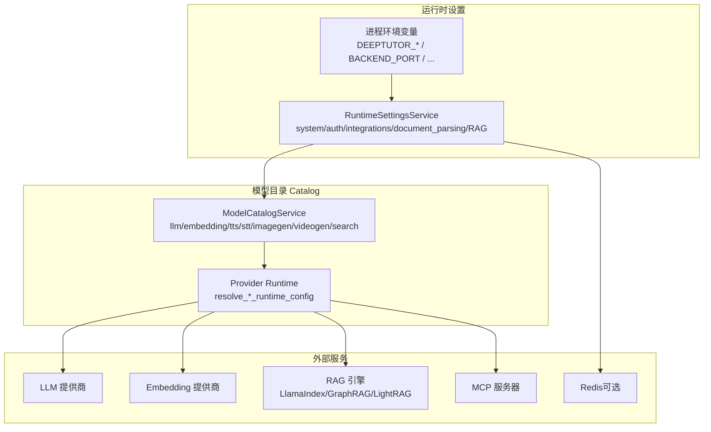
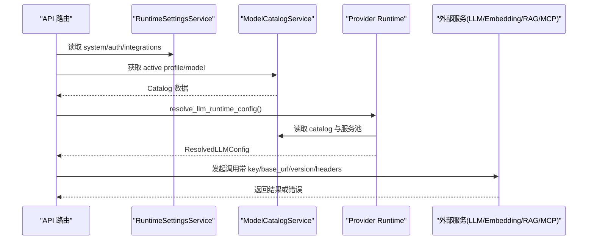
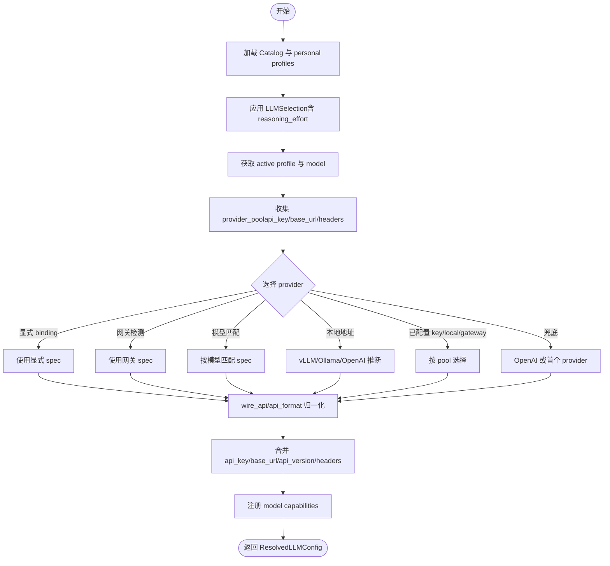
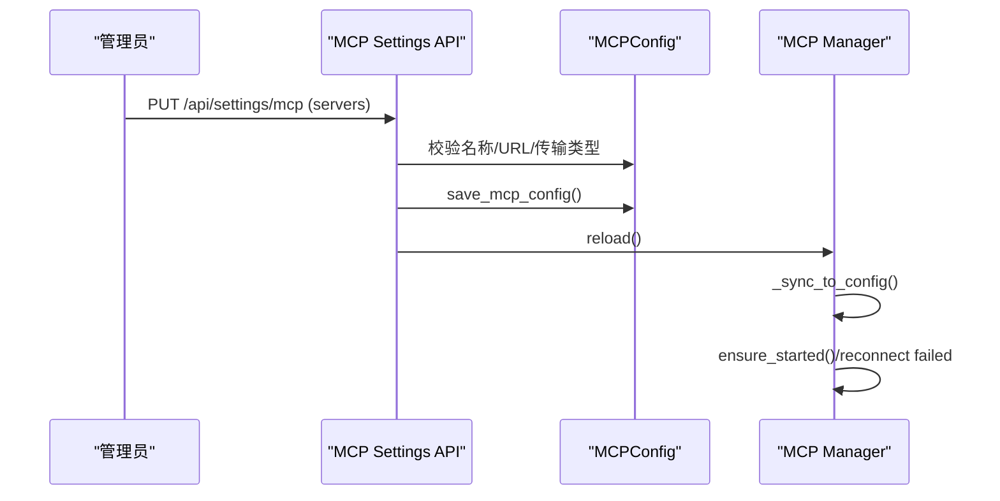
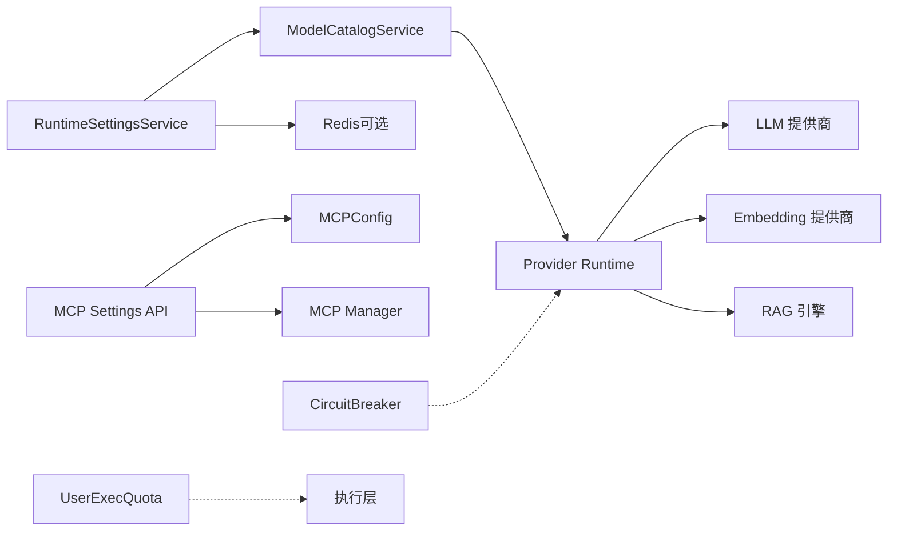
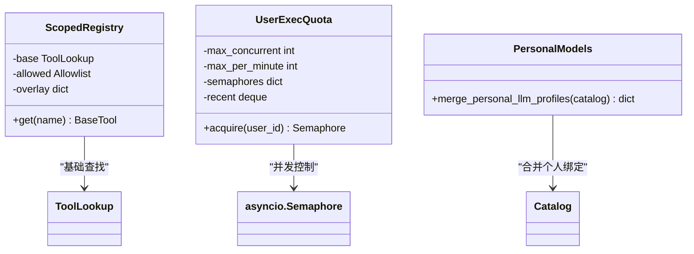

# 服务配置

<cite>
**本文引用的文件**   
- [deeptutor/services/config/provider_runtime.py](file://deeptutor/services/config/provider_runtime.py)
- [deeptutor/services/config/runtime_settings.py](file://deeptutor/services/config/runtime_settings.py)
- [deeptutor/services/config/knowledge_base_config.py](file://deeptutor/services/config/knowledge_base_config.py)
- [deeptutor/services/config/model_catalog.py](file://deeptutor/services/config/model_catalog.py)
- [deeptutor/services/mcp/manager.py](file://deeptutor/services/mcp/manager.py)
- [deeptutor/services/mcp/config.py](file://deeptutor/services/mcp/config.py)
- [deeptutor/api/routers/mcp_settings.py](file://deeptutor/api/routers/mcp_settings.py)
- [deeptutor/utils/network/circuit_breaker.py](file://deeptutils/network/circuit_breaker.py)
- [deeptutor/services/sandbox/quota.py](file://deeptutor/services/sandbox/quota.py)
- [deeptutor/runtime/registry/scoped_registry.py](file://deeptutor/runtime/registry/scoped_registry.py)
- [deeptutor/logging/config.py](file://deeptutor/logging/config.py)
</cite>

## 目录
1. [简介](#简介)
2. [项目结构](#项目结构)
3. [核心组件](#核心组件)
4. [架构总览](#架构总览)
5. [详细组件分析](#详细组件分析)
6. [依赖关系分析](#依赖关系分析)
7. [性能与可靠性](#性能与可靠性)
8. [多租户隔离与资源分配](#多租户隔离与资源分配)
9. [监控、日志与指标](#监控日志与指标)
10. [常见集成示例](#常见集成示例)
11. [故障诊断指南](#故障诊断指南)
12. [结论](#结论)

## 简介
本文面向 DeepTutor 的服务配置，覆盖 LLM 提供商、RAG 引擎、向量数据库、缓存与会话协调、MCP 服务发现、负载均衡与健康检查、连接池与重试、熔断器、多租户隔离、以及监控日志与性能指标的收集方式。文档以代码级实现为依据，提供架构图、流程图和可操作的排错建议。

## 项目结构
DeepTutor 的配置体系由“运行时设置”和“模型目录（Catalog）”两部分组成：
- 运行时设置：持久化 JSON 文件 + 进程环境变量覆盖，负责系统端口、CORS、附件策略、安全网关、文档解析引擎、RAG 引擎参数、会话协调等。
- 模型目录：LLM/Embedding/Voice/Imagegen/Videogen/Search 等服务的 Profile 与 Model 选择、凭据、协议绑定、能力开关等。

**图表来源**  
- [deeptutor/services/config/runtime_settings.py:16-127](file://deeptutor/services/config/runtime_settings.py#L16-L127)  
- [deeptutor/services/config/provider_runtime.py:915-1024](file://deeptutor/services/config/provider_runtime.py#L915-L1024)

**章节来源**  
- [deeptutor/services/config/runtime_settings.py:16-127](file://deeptutor/services/config/runtime_settings.py#L16-L127)  
- [deeptutor/services/config/provider_runtime.py:915-1024](file://deeptutor/services/config/provider_runtime.py#L915-L1024)

## 核心组件
- 运行时设置服务：加载 system.json、auth.json、integrations.json、document_parsing.json、llamaindex.json、graphrag.json、lightrag.json、lightrag_server.json 等，并应用进程环境变量覆盖。
- 模型目录服务：管理 llm/embedding/tts/stt/imagegen/videogen/search 的 active profile 与 model，支持个人绑定与能力覆盖。
- Provider Runtime：将 Catalog 中的 Profile/Model 规范化为 Resolved*Config，用于下游客户端调用。
- MCP 管理器：根据 mcp.json 启动/重载/重连外部 MCP 服务器，支持按 owner 隔离连接与冷连接回收。
- 搜索提供者表：声明各搜索引擎的凭据要求、软回退策略与是否自带答案。

**章节来源**  
- [deeptutor/services/config/runtime_settings.py:509-763](file://deeptutor/services/config/runtime_settings.py#L509-L763)  
- [deeptutor/services/config/provider_runtime.py:845-1024](file://deeptutor/services/config/provider_runtime.py#L845-L1024)  
- [deeptutor/services/mcp/manager.py:262-387](file://deeptutor/services/mcp/manager.py#L262-L387)  
- [deeptutor/services/config/provider_runtime.py:87-130](file://deeptutor/services/config/provider_runtime.py#L87-L130)

## 架构总览
下图展示从请求到后端服务的关键路径：API 路由读取运行时设置与 Catalog，Provider Runtime 解析出最终连接参数，再访问 LLM/Embedding/RAG/MCP 等外部服务；同时通过 Redis 进行跨实例会话协调。

**图表来源**  
- [deeptutor/services/config/runtime_settings.py:554-597](file://deeptutor/services/config/runtime_settings.py#L554-L597)  
- [deeptutor/services/config/provider_runtime.py:915-1024](file://deeptutor/services/config/provider_runtime.py#L915-L1024)

## 详细组件分析

### LLM 提供商配置
- 入口函数：`resolve_llm_runtime_config` 从 Catalog 中解析 active profile 与 model，合并 selection（含 reasoning_effort），选择 provider，计算 wire_api/api_format，填充 api_key/base_url/api_version/extra_headers，并注册能力覆盖。
- Provider 选择优先级：显式 binding → 网关检测 → 模型名匹配 → 本地 base_url 推断（Ollama/vLLM/OpenAI）→ 已配置的 gateway/local/keyed providers → 默认 OpenAI。
- 本地地址识别：对 localhost/127.0.0.1/::1/.local 等判定为本地基址，便于自动选择 vLLM/Ollama。
- 能力覆盖：Catalog 中每个 model 的 capabilities 会被注册到 LLM 能力表，影响后续工具/管线行为。

**图表来源**  
- [deeptutor/services/config/provider_runtime.py:808-832](file://deeptutor/services/config/provider_runtime.py#L808-L832)  
- [deeptutor/services/config/provider_runtime.py:845-912](file://deeptutor/services/config/provider_runtime.py#L845-L912)  
- [deeptutor/services/config/provider_runtime.py:915-1024](file://deeptutor/services/config/provider_runtime.py#L915-L1024)

**章节来源**  
- [deeptutor/services/config/provider_runtime.py:808-832](file://deeptutor/services/config/provider_runtime.py#L808-L832)  
- [deeptutor/services/config/provider_runtime.py:845-912](file://deeptutor/services/config/provider_runtime.py#L845-L912)  
- [deeptutor/services/config/provider_runtime.py:915-1024](file://deeptutor/services/config/provider_runtime.py#L915-L1024)

### Embedding 提供商配置
- 入口函数：`resolve_embedding_runtime_config` 解析 embedding profile/model，确定 provider_name（支持别名与关键词匹配）、dimension、send_dimensions、batch_size/batch_delay、request_timeout。
- 特殊处理：Gemini 原生端点、DashScope 按模型推导端点、Lemonade 旧版根路径补全为 embeddings 路径。
- 本地地址与 Ollama/vLLM 推断：基于 base_url 与路径/端口判断。

**章节来源**  
- [deeptutor/services/config/provider_runtime.py:1027-1060](file://deeptutor/services/config/provider_runtime.py#L1027-L1060)  
- [deeptutor/services/config/provider_runtime.py:1157-1293](file://deeptutor/services/config/provider_runtime.py#L1157-L1293)

### Voice（TTS/STT）与图像/视频生成
- TTS/STT：`resolve_tts_runtime_config` / `resolve_stt_runtime_config` 从 Catalog 解析 provider、adapter、auth_style、request_style、base_url、model、voice/language/response_format 等。
- Imagegen/Videogen：`resolve_imagegen_runtime_config` / `resolve_videogen_runtime_config` 解析对应 provider 与模型参数（size/quality/style/aspect_ratio/duration/resolution）。

**章节来源**  
- [deeptutor/services/config/provider_runtime.py:1307-1394](file://deeptutor/services/config/provider_runtime.py#L1307-L1394)  
- [deeptutor/services/config/provider_runtime.py:1397-1475](file://deeptutor/services/config/provider_runtime.py#L1397-L1475)

### Web Search 提供商与回退
- 搜索提供者元数据：定义 requires_api_key/requires_base_url/soft_fallback/supports_answer。
- 凭据解析：search_provider_credentials 按 provider 查找 active profile 的 api_key/base_url。
- 缺失凭据诊断：search_missing_credential 指出缺少的字段。
- 回退候选：search_fallback_candidates 列出其他已配置且凭据完整的 provider，最后追加免费 fallback（duckduckgo）。

**章节来源**  
- [deeptutor/services/config/provider_runtime.py:87-130](file://deeptutor/services/config/provider_runtime.py#L87-L130)  
- [deeptutor/services/config/provider_runtime.py:1478-1599](file://deeptutor/services/config/provider_runtime.py#L1478-L1599)

### RAG 引擎与向量数据库
- LlamaIndex：DEFAULT_LLAMAINDEX_SETTINGS 包含 retrieval_profile/top_k/multipliers/reranker/vector_index_type/HNSW 参数/chunking/multimodal image description concurrency。
- GraphRAG：response_type/community_level/dynamic_community_selection。
- LightRAG：top_k/response_type/max_concurrent_files/llm_model_max_async/entity_extract_max_gleaning/llm_timeout/role_models。
- LightRAG Server：server_url/api_key。
- PageIndex：托管树构建与检索，独立凭证文件。
- IMA：腾讯 IMA 账户凭证。

**章节来源**  
- [deeptutor/services/config/runtime_settings.py:289-417](file://deeptutor/services/config/runtime_settings.py#L289-L417)  
- [deeptutor/services/config/runtime_settings.py:695-750](file://deeptutor/services/config/runtime_settings.py#L695-L750)

### 文档解析引擎
- 多引擎支持：text_only/mineru/docling/markitdown/pymupdf4llm/liteparse/tika。
- MinerU：mode(api_base_url/token/local_cli_path)、模型下载源/版本、语言、公式/表格/OCR、最大页数、允许本地下载。
- Docling：mode(api_base_url/token)、OCR/表格结构、允许本地下载。
- PyMuPDF4LLM：图片格式/DPI。
- LiteParse：图片模式/链接提取/图片提取/最大页数。
- Tika：server_url。

**章节来源**  
- [deeptutor/services/config/runtime_settings.py:129-283](file://deeptutor/services/config/runtime_settings.py#L129-L283)  
- [deeptutor/services/config/runtime_settings.py:1189-1347](file://deeptutor/services/config/runtime_settings.py#L1189-L1347)

### 会话协调与缓存（Redis）
- integrations.turn_coordination.backend 支持 memory 与 redis。
- Redis 相关键：redis_url/key_prefix/lease_ttl_seconds/renew_interval_seconds/recovery_interval_seconds/stream_retention_seconds。
- 进程环境变量覆盖：DEEPTUTOR_TURN_COORDINATION_BACKEND、DEEPTUTOR_REDIS_URL、DEEPTUTOR_REDIS_KEY_PREFIX。

**章节来源**  
- [deeptutor/services/config/runtime_settings.py:111-127](file://deeptutor/services/config/runtime_settings.py#L111-L127)  
- [deeptutor/services/config/runtime_settings.py:968-988](file://deeptutor/services/config/runtime_settings.py#L968-L988)

### MCP 服务发现与生命周期
- 配置文件：mcp.json，包含 servers 字典，名称需符合正则校验。
- API：GET/PUT/DELETE /api/settings/mcp，POST /api/settings/mcp/test 测试连接。
- 管理器：ensure_started/reload/_retry_failed/_evict_cold_scopes，按 owner 隔离连接，支持失败重试与冷连接回收。

**图表来源**  
- [deeptutor/services/mcp/config.py:101-135](file://deeptutor/services/mcp/config.py#L101-L135)  
- [deeptutor/api/routers/mcp_settings.py:57-133](file://deeptutor/api/routers/mcp_settings.py#L57-L133)  
- [deeptutor/services/mcp/manager.py:262-387](file://deeptutor/services/mcp/manager.py#L262-L387)

**章节来源**  
- [deeptutor/services/mcp/config.py:101-135](file://deeptutor/services/mcp/config.py#L101-L135)  
- [deeptutor/api/routers/mcp_settings.py:57-133](file://deeptutor/api/routers/mcp_settings.py#L57-L133)  
- [deeptutor/services/mcp/manager.py:262-387](file://deeptutor/services/mcp/manager.py#L262-L387)

### 知识库配置与默认值
- KnowledgeBaseConfigService 维护 kb_config.json，包含 defaults.rag_provider/search_mode/provider_modes 与 knowledge_bases 列表。
- 默认 rag_provider 来自 DEFAULT_PROVIDER，search_mode 默认为 hybrid。

**章节来源**  
- [deeptutor/services/config/knowledge_base_config.py:1-44](file://deeptutor/services/config/knowledge_base_config.py#L1-L44)

## 依赖关系分析
- RuntimeSettingsService 是运行时设置的唯一入口，负责加载/保存/标准化/环境覆盖。
- ModelCatalogService 与 Provider Runtime 协作，将 Catalog 的 profile/model 映射为具体 provider 的连接参数。
- MCP Manager 依赖 MCPConfig 与 API 路由，管理外部 MCP 服务器的连接状态。
- CircuitBreaker 与 Quota 提供通用容错与限流能力，供上层调用方组合使用。

**图表来源**  
- [deeptutor/services/config/runtime_settings.py:509-763](file://deeptutor/services/config/runtime_settings.py#L509-L763)  
- [deeptutor/services/config/provider_runtime.py:915-1024](file://deeptutor/services/config/provider_runtime.py#L915-L1024)  
- [deeptutor/services/mcp/manager.py:262-387](file://deeptutor/services/mcp/manager.py#L262-L387)  
- [deeptutils/network/circuit_breaker.py:13-68](file://deeptutils/network/circuit_breaker.py#L13-L68)  
- [deeptutor/services/sandbox/quota.py:27-39](file://deeptutor/services/sandbox/quota.py#L27-L39)

**章节来源**  
- [deeptutor/services/config/runtime_settings.py:509-763](file://deeptutor/services/config/runtime_settings.py#L509-L763)  
- [deeptutor/services/config/provider_runtime.py:915-1024](file://deeptutor/services/config/provider_runtime.py#L915-L1024)  
- [deeptutor/services/mcp/manager.py:262-387](file://deeptutor/services/mcp/manager.py#L262-L387)  
- [deeptutils/network/circuit_breaker.py:13-68](file://deeptutils/network/circuit_breaker.py#L13-L68)  
- [deeptutor/services/sandbox/quota.py:27-39](file://deeptutor/services/sandbox/quota.py#L27-L39)

## 性能与可靠性

### 连接池与超时
- WebSocket 帧上限：compute_ws_max_size 根据 chat_attachment_max_total_mb 计算，确保大附件上传不被 uvicorn 帧限制截断。
- HTTP keep-alive：HTTP_KEEP_ALIVE_TIMEOUT=300，避免代理侧与后端空闲超时竞争导致 ECONNRESET。

**章节来源**  
- [deeptutor/services/config/runtime_settings.py:1547-1556](file://deeptutor/services/config/runtime_settings.py#L1547-L1556)  
- [deeptutor/services/config/runtime_settings.py:1581-1593](file://deeptutor/services/config/runtime_settings.py#L1581-L1593)

### 重试策略
- LLM 重试：Settings.retry.max_retries/base_delay/exponential_backoff，通过 pydantic-settings 从 LLM_RETRY__* 环境变量注入。
- MCP 重连：MCP Manager 对失败连接按 backoff 延迟重试，避免启动时短暂不可用导致永久失效。

**章节来源**  
- [deeptutor/config/settings.py:19-46](file://deeptutor/config/settings.py#L19-L46)  
- [deeptutor/services/mcp/manager.py:367-387](file://deeptutor/services/mcp/manager.py#L367-L387)

### 熔断器
- CircuitBreaker：按 provider 统计失败次数，超过阈值进入 open 状态，recovery_timeout 后进入 half-open 探测，成功则关闭。

**章节来源**  
- [deeptutils/network/circuit_breaker.py:13-68](file://deeptutils/network/circuit_breaker.py#L13-L68)

### 健康检查
- MCP 状态：API 返回 manager.status()，可用于探针。
- RAG 索引健康：当嵌入向量无效时，错误响应标记 needs_reindex=True，提示重新索引。

**章节来源**  
- [deeptutor/api/routers/mcp_settings.py:57-65](file://deeptutor/api/routers/mcp_settings.py#L57-L65)  
- [deeptutor/services/rag/pipelines/llamaindex/errors.py:30-59](file://deeptutor/services/rag/pipelines/llamaindex/errors.py#L30-L59)

## 多租户隔离与资源分配
- 工具注册作用域：ScopedRegistry 防止不同租户的工具名冲突，拒绝覆盖共享工具。
- 执行配额：UserExecQuota 按用户维度并发与速率限制，单容器部署足够；多副本需迁移至共享存储。
- Catalog 个人绑定：personal models/profiles 在 Catalog 解析时合并，使普通用户的私有绑定不污染共享目录。

**图表来源**  
- [deeptutor/runtime/registry/scoped_registry.py:48-80](file://deeptutor/runtime/registry/scoped_registry.py#L48-L80)  
- [deeptutor/services/sandbox/quota.py:27-39](file://deeptutor/services/sandbox/quota.py#L27-L39)  
- [deeptutor/services/config/provider_runtime.py:783-798](file://deeptutor/services/config/provider_runtime.py#L783-L798)

**章节来源**  
- [deeptutor/runtime/registry/scoped_registry.py:48-80](file://deeptutor/runtime/registry/scoped_registry.py#L48-L80)  
- [deeptutor/services/sandbox/quota.py:27-39](file://deeptutor/services/sandbox/quota.py#L27-L39)  
- [deeptutor/services/config/provider_runtime.py:783-798](file://deeptutor/services/config/provider_runtime.py#L783-L798)

## 监控、日志与指标
- 日志配置：logging/config.py 提供日志适配器与桥接，结合 loguru_bridge 统一输出。
- 任务日志：知识初始化等长任务通过 task_stream_manager 与 capture_task_logs 记录进度与日志。
- 安全网关：security_guard 提供速率限制、白名单/黑名单、可信代理 IP 等，可作为请求级监控与防护面。

**章节来源**  
- [deeptutor/logging/config.py](file://deeptutor/logging/config.py)  
- [deeptutor/api/routers/knowledge.py:1019-1050](file://deeptutor/api/routers/knowledge.py#L1019-L1050)  
- [deeptutor/services/config/runtime_settings.py:69-88](file://deeptutor/services/config/runtime_settings.py#L69-L88)

## 常见集成示例

### 配置 OpenAI LLM
- 在 Catalog 的 llm service 下添加 profile，binding=openai，填写 api_key/base_url/api_version/extra_headers，选择 active model。
- Provider Runtime 会据此生成 ResolvedLLMConfig，并自动选择 wire_api/api_format。

**章节来源**  
- [deeptutor/services/config/provider_runtime.py:915-1024](file://deeptutor/services/config/provider_runtime.py#L915-L1024)

### 配置本地 Ollama/vLLM Embedding
- 设置 embedding profile 的 base_url 指向本地服务（如 http://localhost:11434 或 /v1/embeddings），provider 会自动推断为 ollama 或 vllm。
- 若为 Lemonade 旧版根路径，会自动补全为 embeddings 端点。

**章节来源**  
- [deeptutor/services/config/provider_runtime.py:1157-1293](file://deeptutor/services/config/provider_runtime.py#L1157-L1293)

### 启用 Redis 会话协调
- 在 integrations.turn_coordination.backend 设置为 redis，配置 redis_url/key_prefix/lease_ttl_seconds 等。
- 可通过 DEEPTUTOR_TURN_COORDINATION_BACKEND/DEEPTUTOR_REDIS_URL/DEEPTUTOR_REDIS_KEY_PREFIX 环境变量覆盖。

**章节来源**  
- [deeptutor/services/config/runtime_settings.py:111-127](file://deeptutor/services/config/runtime_settings.py#L111-L127)  
- [deeptutor/services/config/runtime_settings.py:968-988](file://deeptutor/services/config/runtime_settings.py#L968-L988)

### 接入 MCP 服务器
- 在 mcp.json 中添加 servers，name 符合命名规范，transport/url 正确。
- 通过 /api/settings/mcp 更新配置，调用 test 接口验证连通性。

**章节来源**  
- [deeptutor/services/mcp/config.py:101-135](file://deeptutor/services/mcp/config.py#L101-L135)  
- [deeptutor/api/routers/mcp_settings.py:57-133](file://deeptutor/api/routers/mcp_settings.py#L57-L133)

## 故障诊断指南

- LLM 调用失败
  - 检查 Catalog 中 active profile/model 是否正确，binding 与 provider 是否匹配。
  - 确认 api_key/base_url/api_version/extra_headers 是否完整。
  - 查看 retry 配置是否生效（LLM_RETRY__MAX_RETRIES/BASE_DELAY/EXPONENTIAL_BACKOFF）。

- Embedding 维度不匹配
  - 确认 embedding model 的 dimension 是否为 0（未知）或与实际一致。
  - 若为 Gemini/DashScope/Lemonade，注意端点推导逻辑。

- RAG 索引损坏
  - 错误响应包含 needs_reindex=True，需在知识库页面执行 Re-index。

- MCP 连接不稳定
  - 检查 mcp.json 中 server name/url/transport 是否有效。
  - 观察 manager.status()，必要时触发 reload 或等待 backoff 重试。

- 附件上传失败
  - 调整 chat_attachment_max_file_mb/chat_attachment_max_total_mb，并确保 compute_ws_max_size 计算的帧上限足够。

**章节来源**  
- [deeptutor/services/config/provider_runtime.py:915-1024](file://deeptutor/services/config/provider_runtime.py#L915-L1024)  
- [deeptutor/services/config/provider_runtime.py:1157-1293](file://deeptutor/services/config/provider_runtime.py#L1157-L1293)  
- [deeptutor/services/rag/pipelines/llamaindex/errors.py:30-59](file://deeptutor/services/rag/pipelines/llamaindex/errors.py#L30-L59)  
- [deeptutor/services/mcp/manager.py:367-387](file://deeptutor/services/mcp/manager.py#L367-L387)  
- [deeptutor/services/config/runtime_settings.py:1547-1556](file://deeptutor/services/config/runtime_settings.py#L1547-L1556)

## 结论
DeepTutor 的服务配置以“运行时设置 + Catalog”双轨驱动，既保证可运维性与可观测性，又提供灵活的供应商适配与多租户隔离。通过 Provider Runtime 的规范化解析、MCP 的动态发现与重连、Redis 的会话协调、以及熔断与重试机制，系统在多云/多供应商环境下具备高可用与可扩展性。建议在生产环境中结合 security_guard、日志与任务追踪，持续优化性能与稳定性。