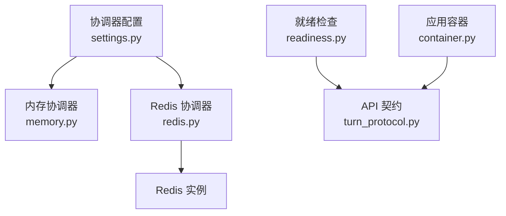
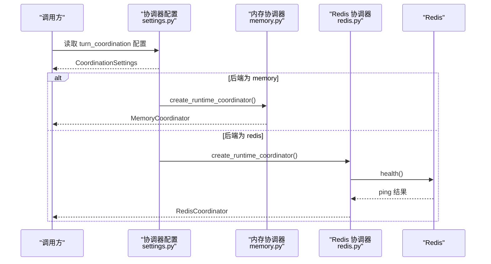
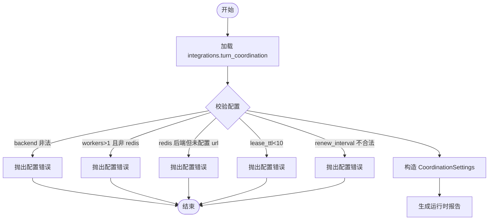
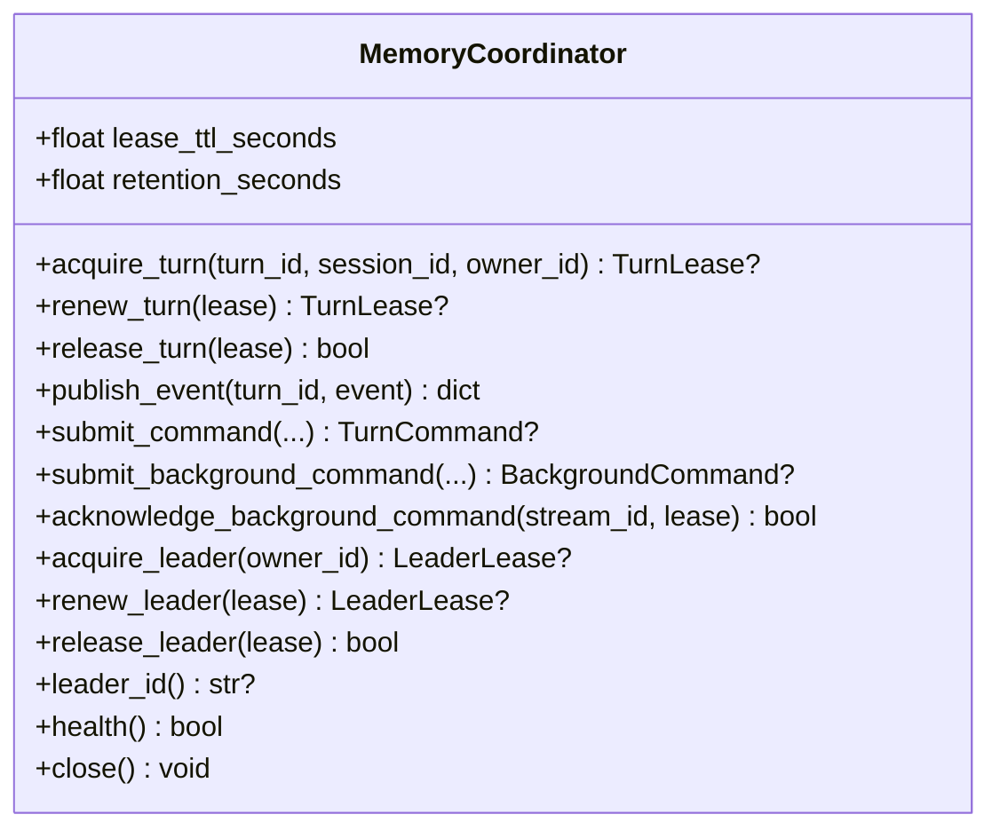
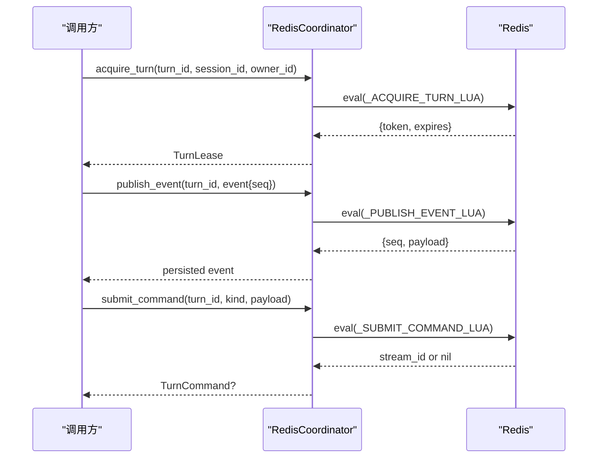
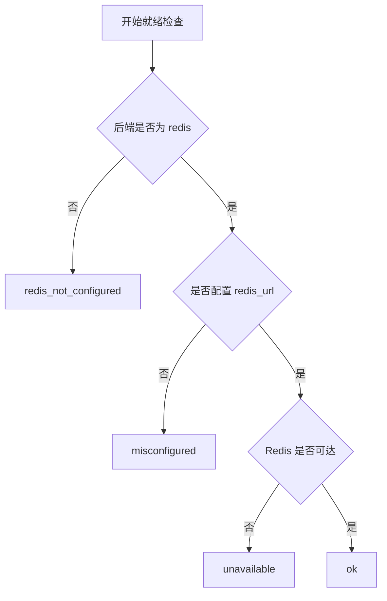
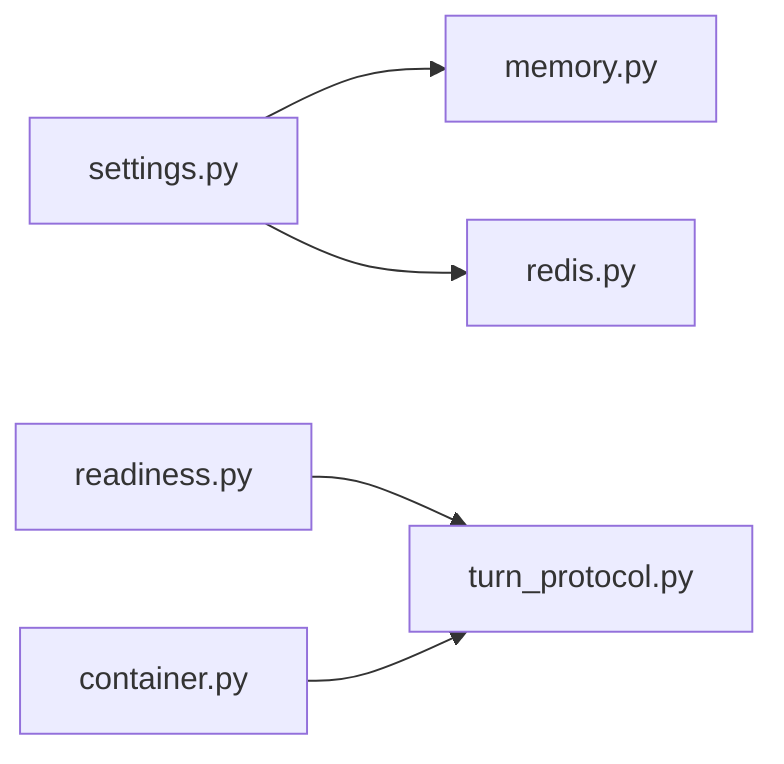
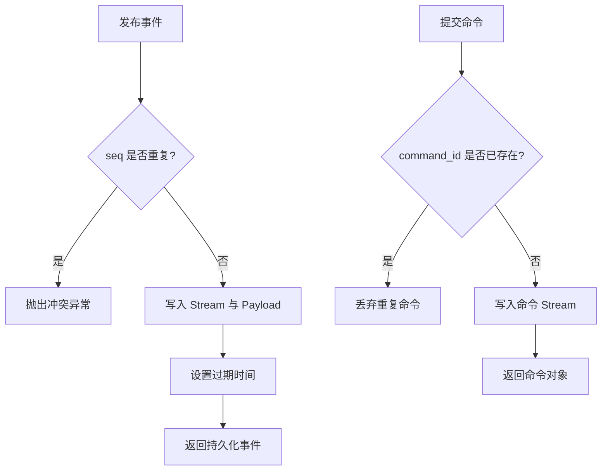

# 缓存服务配置

<cite>
**本文引用的文件**   
- [deeptutor/runtime/coordination/settings.py](file://deeptutor/runtime/coordination/settings.py)
- [deeptutor/runtime/coordination/memory.py](file://deeptutor/runtime/coordination/memory.py)
- [deeptutor/runtime/coordination/redis.py](file://deeptutor/runtime/coordination/redis.py)
- [deeptutor/services/config/readiness.py](file://deeptutor/services/config/readiness.py)
- [deeptutor/api/contracts/turn_protocol.py](file://deeptutor/api/contracts/turn_protocol.py)
- [deeptutor/app/container.py](file://deeptutor/app/container.py)
- [assets/releases/past_releases/ver1-5-8.md](file://assets/releases/past_releases/ver1-5-8.md)
</cite>

## 目录
1. [简介](#简介)
2. [项目结构](#项目结构)
3. [核心组件](#核心组件)
4. [架构总览](#架构总览)
5. [详细组件分析](#详细组件分析)
6. [依赖关系分析](#依赖关系分析)
7. [性能与容量调优](#性能与容量调优)
8. [故障恢复、一致性与数据同步](#故障恢复一致性与数据同步)
9. [监控指标与可观测性](#监控指标与可观测性)
10. [常见问题诊断与排障](#常见问题诊断与排障)
11. [结论](#结论)

## 简介
本文件聚焦于 DeepTutor 的“缓存与协调”子系统，重点说明：
- 进程内内存协调器与 Redis 分布式协调器的配置项、行为差异与适用场景。
- 基于 Redis Streams 的事件流、命令队列、分布式锁（租约）与主从选举机制。
- 会话级事件与命令的幂等、去重、过期与清理策略。
- 健康检查、就绪状态与运行时报告如何暴露 Redis 配置与可用性。
- 面向生产环境的容量规划、命中率优化、内存使用控制与常见问题的定位方法。

需要特别说明的是：当前仓库未提供通用“内存缓存/Redis 缓存”的键值存储配置（如 TTL、最大条目数、淘汰算法）。本项目的“缓存”更多体现在：
- 进程内数据结构作为短期事件尾与命令队列；
- Redis 作为分布式协调与持久化事件流；
- 其他模块中零散的本地结果缓存（例如 LLM 客户端、应用更新版本等），但不在本次文档范围内展开。

## 项目结构
与缓存和协调相关的核心代码位于 runtime/coordination 子包，以及 readiness 健康检查与 API 契约：
- coordination/settings.py：协调器配置加载、校验与工厂创建。
- coordination/memory.py：单进程内存协调器实现。
- coordination/redis.py：基于 Redis 的分布式协调器实现。
- services/config/readiness.py：就绪检查与 Redis 可用性诊断。
- api/contracts/turn_protocol.py：对外暴露的 Redis 配置与状态字段。
- app/container.py：容器层根据后端类型输出 Redis 状态。

图表来源
- [deeptutor/runtime/coordination/settings.py:17-96](file://deeptutor/runtime/coordination/settings.py#L17-L96)
- [deeptutor/runtime/coordination/memory.py:19-54](file://deeptutor/runtime/coordination/memory.py#L19-L54)
- [deeptutor/runtime/coordination/redis.py:185-208](file://deeptutor/runtime/coordination/redis.py#L185-L208)
- [deeptutor/services/config/readiness.py:699-757](file://deeptutor/services/config/readiness.py#L699-L757)
- [deeptutor/api/contracts/turn_protocol.py:263-264](file://deeptutor/api/contracts/turn_protocol.py#L263-L264)
- [deeptutor/app/container.py:383-383](file://deeptutor/app/container.py#L383-L383)

章节来源
- [deeptutor/runtime/coordination/settings.py:17-96](file://deeptutor/runtime/coordination/settings.py#L17-L96)
- [deeptutor/runtime/coordination/memory.py:19-54](file://deeptutor/runtime/coordination/memory.py#L19-L54)
- [deeptutor/runtime/coordination/redis.py:185-208](file://deeptutor/runtime/coordination/redis.py#L185-L208)

## 核心组件
本节概述三类关键能力：分布式锁（租约）、事件流与命令队列、健康与就绪检查。

- 分布式锁（租约）
  - 支持两种后端：内存与 Redis。
  - 通过“获取-续租-释放”三阶段保证同一会话在同一时刻只有一个工作单元持有执行权。
  - Redis 端使用 Lua 脚本原子操作，避免竞态条件。

- 事件流与命令队列
  - 每个 turn 拥有独立的事件流与命令队列。
  - 事件带有序列号 seq，支持幂等发布与冲突检测。
  - 命令具备 command_id 去重，防止重复消费。

- 健康与就绪
  - 启动时若选择 Redis 后端，会进行连通性检查。
  - 就绪检查会输出 Redis 是否已配置、是否可达，以及错误分类。

章节来源
- [deeptutor/runtime/coordination/memory.py:87-166](file://deeptutor/runtime/coordination/memory.py#L87-L166)
- [deeptutor/runtime/coordination/redis.py:217-339](file://deeptutor/runtime/coordination/redis.py#L217-L339)
- [deeptutor/services/config/readiness.py:699-757](file://deeptutor/services/config/readiness.py#L699-L757)

## 架构总览
下图展示协调器在运行时的角色与交互：

图表来源
- [deeptutor/runtime/coordination/settings.py:81-96](file://deeptutor/runtime/coordination/settings.py#L81-L96)
- [deeptutor/runtime/coordination/memory.py:36-54](file://deeptutor/runtime/coordination/memory.py#L36-L54)
- [deeptutor/runtime/coordination/redis.py:185-208](file://deeptutor/runtime/coordination/redis.py#L185-L208)

## 详细组件分析

### 协调器配置（CoordinationSettings）
- 主要配置项
  - backend_workers：后端工作进程数。当大于 1 时必须使用 Redis 后端。
  - backend：协调后端，可选 memory 或 redis。
  - redis_url：Redis 连接地址，使用 Redis 后端时必填。
  - key_prefix：Redis 键前缀，用于多租户或多部署隔离。
  - lease_ttl_seconds：租约过期时间（毫秒由内部换算）。
  - renew_interval_seconds：续租间隔，必须为正且小于租约 TTL。
  - recovery_interval_seconds：恢复扫描间隔。
  - stream_retention_seconds：事件流与命令保留时长。

- 校验规则
  - backend 仅允许 memory 或 redis。
  - backend_workers > 1 且 backend != redis 将报错。
  - backend == redis 且未设置 redis_url 将报错。
  - lease_ttl_seconds 至少为 10。
  - renew_interval_seconds 必须为正且小于 lease_ttl_seconds。

- 运行时报告
  - 返回 worker_count、coordination_mode、redis_configured、lease_ttl_seconds、renew_interval_seconds、recovery_interval_seconds。
  - 不暴露 Redis URL 等敏感信息。

图表来源
- [deeptutor/runtime/coordination/settings.py:17-67](file://deeptutor/runtime/coordination/settings.py#L17-L67)
- [deeptutor/runtime/coordination/settings.py:69-78](file://deeptutor/runtime/coordination/settings.py#L69-L78)

章节来源
- [deeptutor/runtime/coordination/settings.py:17-96](file://deeptutor/runtime/coordination/settings.py#L17-L96)

### 内存协调器（MemoryCoordinator）
- 设计要点
  - 单进程并发安全：使用 asyncio.Lock 保护所有共享状态。
  - 会话级独占：同一 session_id 只能有一个活跃 turn 租约。
  - 事件序列：按 seq 递增写入，重复 seq 会触发冲突异常。
  - 命令去重：command_id 全局唯一，重复提交直接丢弃。
  - 后台命令：维护有界 ID 集合，超过上限后淘汰最旧 ID。
  - 生命周期管理：turn 释放后进入“退休”队列，按 retention_seconds 清理事件与命令。

- 关键行为
  - acquire_turn/renew_turn/release_turn：确保 owner_id、fencing_token、session_id 一致性。
  - publish_event：幂等写入，冲突时抛错。
  - submit_command/read_commands：基于列表模拟 Stream，after_id 游标推进。
  - submit_background_command/read_background_commands：有界 ID 去重 + 游标推进。
  - acquire_leader/renew_leader/release_leader：单进程主节点租约。

图表来源
- [deeptutor/runtime/coordination/memory.py:19-54](file://deeptutor/runtime/coordination/memory.py#L19-L54)
- [deeptutor/runtime/coordination/memory.py:87-349](file://deeptutor/runtime/coordination/memory.py#L87-L349)

章节来源
- [deeptutor/runtime/coordination/memory.py:19-359](file://deeptutor/runtime/coordination/memory.py#L19-L359)

### Redis 协调器（RedisCoordinator）
- 设计要点
  - 使用 Redis Hash、ZSET、Stream 与 Lua 脚本实现原子性。
  - 事件流 per-turn：events/{turn_id} 与 payloads/{turn_id} 分离，seq 原子分配。
  - 命令队列 per-turn：commands/{turn_id}，command_dedupe 去重。
  - 后台命令：commands/background，cursor 持久化。
  - 租约与主从：leases/turns、leases/leader、fence/* 防抖与过期。

- 关键行为
  - acquire_turn/renew_turn/release_turn：Lua 原子更新 session_key、turn_key、leases_key。
  - publish_event：插入 payload 并追加到 Stream，同时设置过期。
  - read_events：按 seq 过滤并按序返回。
  - submit_command/read_commands：基于 XADD/XRANGE 与 dedupe key。
  - submit_background_command/read_background_commands：带 cursor 的增量消费。
  - acquire_leader/renew_leader/release_leader：Leader 租约与 fence token。
  - list_expired_turn_ids/acknowledge_expired_turn：基于 ZSET 扫描过期租约。

图表来源
- [deeptutor/runtime/coordination/redis.py:16-122](file://deeptutor/runtime/coordination/redis.py#L16-L122)
- [deeptutor/runtime/coordination/redis.py:217-339](file://deeptutor/runtime/coordination/redis.py#L217-L339)
- [deeptutor/runtime/coordination/redis.py:354-446](file://deeptutor/runtime/coordination/redis.py#L354-L446)

章节来源
- [deeptutor/runtime/coordination/redis.py:185-576](file://deeptutor/runtime/coordination/redis.py#L185-L576)

### 就绪检查与 API 暴露
- readiness 检查
  - 当选择 Redis 后端时，若未配置 redis_url，标记为 misconfigured。
  - 若已配置但不可达，标记为 unavailable。
  - 正常可用时标记为 ok。
  - 输出包含 configured、reachable、detail 等字段。

- API 契约
  - turn_protocol 暴露 redis_configured 与 redis_status 字段。
  - container 根据后端类型与可用性填充 status。

图表来源
- [deeptutor/services/config/readiness.py:699-757](file://deeptutor/services/config/readiness.py#L699-L757)
- [deeptutor/api/contracts/turn_protocol.py:263-264](file://deeptutor/api/contracts/turn_protocol.py#L263-L264)
- [deeptutor/app/container.py:383-383](file://deeptutor/app/container.py#L383-L383)

章节来源
- [deeptutor/services/config/readiness.py:699-757](file://deeptutor/services/config/readiness.py#L699-L757)
- [deeptutor/api/contracts/turn_protocol.py:263-264](file://deeptutor/api/contracts/turn_protocol.py#L263-L264)
- [deeptutor/app/container.py:383-383](file://deeptutor/app/container.py#L383-L383)

## 依赖关系分析
- settings.py 依赖 memory.py 与 redis.py 以创建具体协调器实例。
- redis.py 依赖外部 Redis 客户端库（异步 Redis）。
- readiness.py 依赖系统配置与集成配置，输出 Redis 状态。
- container.py 根据后端类型与可用性填充对外状态。

图表来源
- [deeptutor/runtime/coordination/settings.py:8-10](file://deeptutor/runtime/coordination/settings.py#L8-L10)
- [deeptutor/runtime/coordination/redis.py:205-208](file://deeptutor/runtime/coordination/redis.py#L205-L208)
- [deeptutor/services/config/readiness.py:699-757](file://deeptutor/services/config/readiness.py#L699-L757)
- [deeptutor/api/contracts/turn_protocol.py:263-264](file://deeptutor/api/contracts/turn_protocol.py#L263-L264)
- [deeptutor/app/container.py:383-383](file://deeptutor/app/container.py#L383-L383)

章节来源
- [deeptutor/runtime/coordination/settings.py:8-10](file://deeptutor/runtime/coordination/settings.py#L8-L10)
- [deeptutor/runtime/coordination/redis.py:205-208](file://deeptutor/runtime/coordination/redis.py#L205-L208)

## 性能与容量调优
- 进程内内存协调器
  - 事件尾与命令队列仅在进程内存中保留，并在 turn 释放后按 retention_seconds 清理。
  - 后台命令 ID 集合有上限（默认 4096），超出后淘汰最旧 ID，避免无限增长。
  - 建议：在高吞吐场景下优先使用 Redis 后端，避免长驻进程内存膨胀。

- Redis 协调器
  - 事件流与命令保留时长由 stream_retention_seconds 控制，建议结合业务回放窗口设置。
  - 租约 TTL 与续租间隔需合理匹配网络延迟与工作负载，避免频繁续租或过早过期。
  - 键空间隔离：通过 key_prefix 区分不同部署或租户，减少键冲突与误删风险。

- 容量与命中率
  - 本项目未提供通用键值缓存的容量限制与淘汰算法配置。
  - 对于事件流与命令队列，命中率可通过减少重复请求、合理使用 after_seq/after_id 游标提升。
  - 对长会话与高并发场景，建议：
    - 增大 stream_retention_seconds 以满足回放需求；
    - 调整 lease_ttl_seconds 与 renew_interval_seconds 平衡稳定性与资源占用；
    - 使用 Redis 集群或分片扩展 I/O 能力。

章节来源
- [deeptutor/runtime/coordination/memory.py:32-34](file://deeptutor/runtime/coordination/memory.py#L32-L34)
- [deeptutor/runtime/coordination/memory.py:256-273](file://deeptutor/runtime/coordination/memory.py#L256-L273)
- [deeptutor/runtime/coordination/redis.py:188-202](file://deeptutor/runtime/coordination/redis.py#L188-L202)
- [assets/releases/past_releases/ver1-5-8.md:5-5](file://assets/releases/past_releases/ver1-5-8.md#L5-L5)

## 故障恢复、一致性与数据同步
- 一致性保障
  - 事件幂等：重复 seq 会触发冲突异常，调用方可据此重试或回退。
  - 命令去重：command_id 全局唯一，重复提交被忽略。
  - 租约一致性：owner_id、fencing_token、session_id 三者校验失败即拒绝续租或释放。

- 故障恢复
  - Redis 模式：list_expired_turn_ids 扫描过期租约，acknowledge_expired_turn 清理已确认的过期项。
  - 内存模式：list_expired_turn_ids 返回已知 turn 中过期的项，acknowledge_expired_turn 清理状态并回收事件与命令。

- 数据同步
  - 事件流：read_events 按 seq 过滤，保证顺序回放。
  - 命令队列：read_commands/read_background_commands 基于游标增量消费，避免重复处理。

图表来源
- [deeptutor/runtime/coordination/redis.py:314-339](file://deeptutor/runtime/coordination/redis.py#L314-L339)
- [deeptutor/runtime/coordination/redis.py:354-386](file://deeptutor/runtime/coordination/redis.py#L354-L386)
- [deeptutor/runtime/coordination/memory.py:167-187](file://deeptutor/runtime/coordination/memory.py#L167-L187)
- [deeptutor/runtime/coordination/memory.py:223-240](file://deeptutor/runtime/coordination/memory.py#L223-L240)

章节来源
- [deeptutor/runtime/coordination/redis.py:294-312](file://deeptutor/runtime/coordination/redis.py#L294-L312)
- [deeptutor/runtime/coordination/memory.py:141-166](file://deeptutor/runtime/coordination/memory.py#L141-L166)

## 监控指标与可观测性
- 运行时报告
  - 包含 worker_count、coordination_mode、redis_configured、lease_ttl_seconds、renew_interval_seconds、recovery_interval_seconds。
  - 不包含敏感信息（如 Redis URL）。

- 就绪状态
  - redis_configured：是否已配置 Redis。
  - redis_status：ok / unavailable / not_configured。
  - detail：更细粒度的错误分类，如 redis_not_configured。

- 建议采集
  - Redis 连接成功率、延迟、键空间大小、Stream 长度、过期租约数量。
  - 事件发布冲突次数、命令重复提交次数。
  - 内存协调器的事件尾长度、命令队列长度、后台命令 ID 集合大小。

章节来源
- [deeptutor/runtime/coordination/settings.py:69-78](file://deeptutor/runtime/coordination/settings.py#L69-L78)
- [deeptutor/services/config/readiness.py:699-757](file://deeptutor/services/config/readiness.py#L699-L757)
- [deeptutor/api/contracts/turn_protocol.py:263-264](file://deeptutor/api/contracts/turn_protocol.py#L263-L264)

## 常见问题诊断与排障
- Redis 未配置或不可用
  - 现象：就绪检查返回 not_configured 或 unavailable。
  - 排查：
    - 确认 backend=redis 且 redis_url 已正确设置。
    - 检查 Redis 服务可达性与网络策略。
    - 查看容器日志中的健康检查失败信息。

- 租约频繁过期或续租失败
  - 现象：turn 无法续租，导致任务中断。
  - 排查：
    - 检查 lease_ttl_seconds 与 renew_interval_seconds 配置是否合理。
    - 观察 Redis 延迟与 CPU 使用率。
    - 确认业务逻辑是否在租约到期前完成续租。

- 事件冲突或命令重复
  - 现象：发布事件时报冲突异常，或命令被丢弃。
  - 排查：
    - 检查调用方是否正确维护 seq 与 command_id。
    - 确认重试逻辑不会破坏幂等性。
    - 查看 Redis Stream 与命令队列的状态。

- 内存增长过快
  - 现象：进程内存持续增长。
  - 排查：
    - 评估是否应切换到 Redis 后端。
    - 检查事件尾与命令队列的清理策略是否生效。
    - 参考历史发布说明中对无界缓存与 HTTP 客户端复用的改进。

章节来源
- [deeptutor/services/config/readiness.py:699-757](file://deeptutor/services/config/readiness.py#L699-L757)
- [deeptutor/runtime/coordination/redis.py:217-339](file://deeptutor/runtime/coordination/redis.py#L217-L339)
- [deeptutor/runtime/coordination/memory.py:167-187](file://deeptutor/runtime/coordination/memory.py#L167-L187)
- [assets/releases/past_releases/ver1-5-8.md:5-5](file://assets/releases/past_releases/ver1-5-8.md#L5-L5)

## 结论
- 本项目通过 coordination 子包提供了进程内与 Redis 两种协调器实现，覆盖分布式锁、事件流与命令队列的核心能力。
- 配置集中在 CoordinationSettings，提供严格的校验与安全的运行时报告。
- Redis 后端通过 Lua 脚本保证原子性，配合 Stream 与 ZSET 实现幂等、去重与过期清理。
- 就绪检查与 API 契约暴露 Redis 配置与可用性，便于运维监控。
- 针对生产环境，建议优先使用 Redis 后端，并结合业务特征调整 TTL、续租间隔与流保留时长，以实现稳定、可扩展的缓存与协调能力。