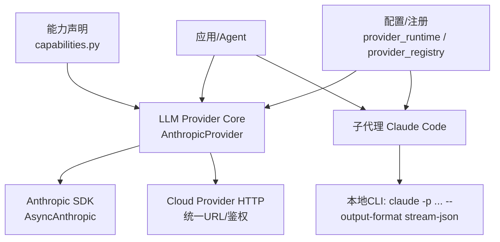
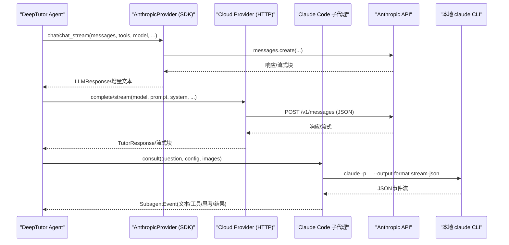
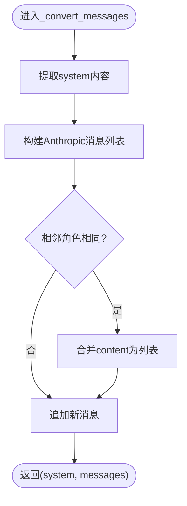
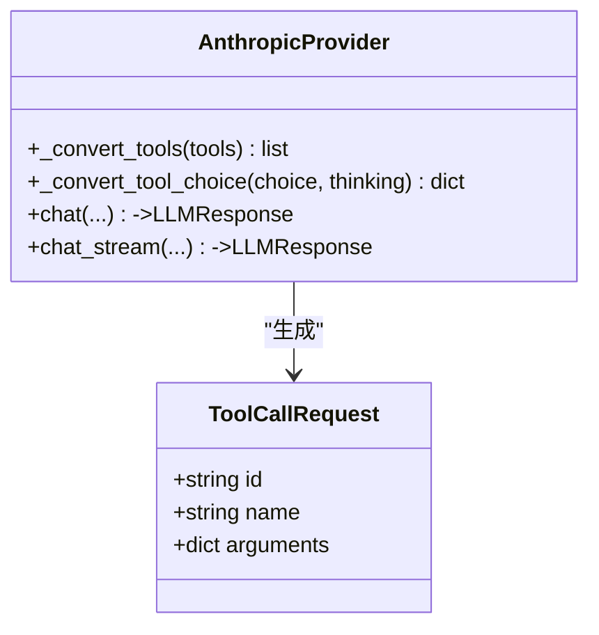
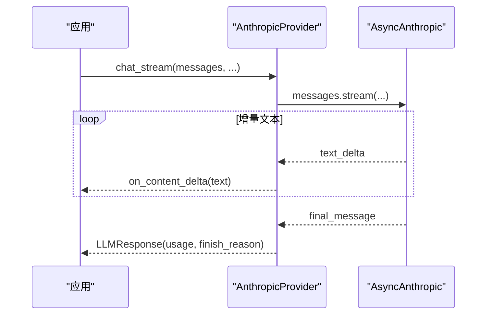
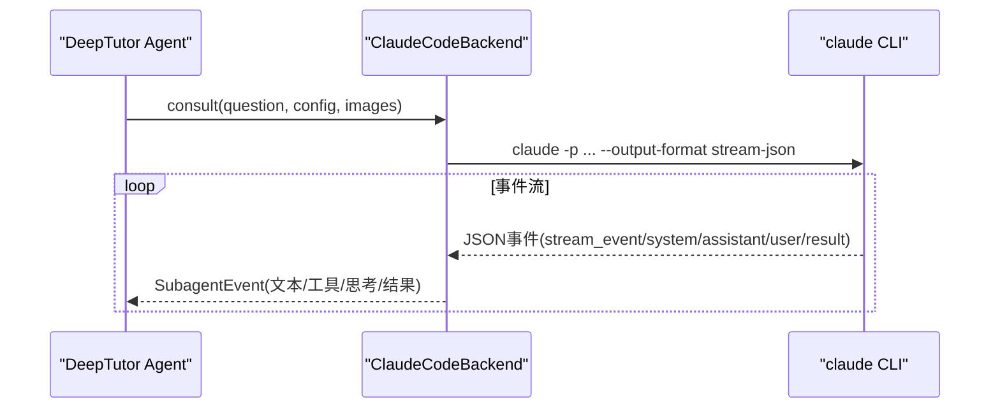
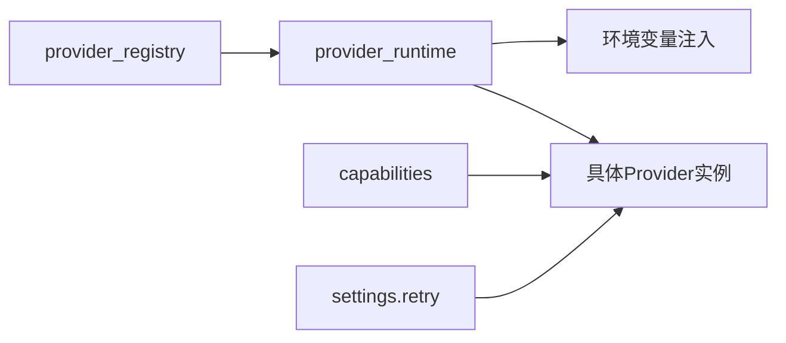

# Anthropic提供商集成

<cite>
**本文引用的文件**
- [anthropic_provider.py](file://deeptutor/services/llm/provider_core/anthropic_provider.py)
- [anthropic.py](file://deeptutor/services/llm/providers/anthropic.py)
- [capabilities.py](file://deeptutor/services/llm/capabilities.py)
- [cloud_provider.py](file://deeptutor/services/llm/cloud_provider.py)
- [claude_code.py](file://deeptutor/services/subagent/claude_code.py)
- [claude_models.py](file://deeptutor/services/subagent/claude_models.py)
- [settings.py](file://deeptutor/config/settings.py)
- [provider_runtime.py](file://deeptutor/services/config/provider_runtime.py)
- [provider_registry.py](file://deeptutor/services/provider_registry.py)
</cite>

## 目录
1. [简介](#简介)
2. [项目结构](#项目结构)
3. [核心组件](#核心组件)
4. [架构总览](#架构总览)
5. [详细组件分析](#详细组件分析)
6. [依赖关系分析](#依赖关系分析)
7. [性能考虑](#性能考虑)
8. [故障排查指南](#故障排查指南)
9. [结论](#结论)
10. [附录](#附录)

## 简介
本文件面向DeepTutor智能体系统，系统性说明Anthropic（Claude）提供商的集成方式与使用要点。内容涵盖认证配置、API访问设置、支持的模型版本与能力、消息格式转换、系统提示词处理、工具调用支持、流式响应、超时与错误恢复、性能调优与安全注意事项，以及与DeepTutor子代理（Claude Code）的集成方法。

## 项目结构
DeepTutor对Anthropic的支持由多层组成：
- 原生SDK适配层：通过AsyncAnthropic直接调用Messages API，负责消息格式转换、工具定义、缓存控制、思考模式与流式输出。
- 通用云提供商适配层：基于HTTP请求封装统一URL与鉴权头，提供非SDK路径的兼容实现。
- 能力声明层：声明各提供商及模型的能力（流式、工具、视觉等）。
- 子代理集成：通过本地Claude CLI进行headless流式交互，解析事件并映射为内部事件通道。
- 配置与注册：集中管理提供商元数据、环境变量注入、运行时参数解析。

图表来源
- [anthropic_provider.py:48-83](file://deeptutor/services/llm/provider_core/anthropic_provider.py#L48-L83)
- [cloud_provider.py:652-789](file://deeptutor/services/llm/cloud_provider.py#L652-L789)
- [capabilities.py:50-89](file://deeptutor/services/llm/capabilities.py#L50-L89)
- [claude_code.py:60-120](file://deeptutor/services/subagent/claude_code.py#L60-L120)
- [provider_runtime.py:655-684](file://deeptutor/services/config/provider_runtime.py#L655-L684)
- [provider_registry.py:1-34](file://deeptutor/services/provider_registry.py#L1-L34)

章节来源
- [anthropic_provider.py:48-83](file://deeptutor/services/llm/provider_core/anthropic_provider.py#L48-L83)
- [cloud_provider.py:652-789](file://deeptutor/services/llm/cloud_provider.py#L652-L789)
- [capabilities.py:50-89](file://deeptutor/services/llm/capabilities.py#L50-L89)
- [claude_code.py:60-120](file://deeptutor/services/subagent/claude_code.py#L60-L120)
- [provider_runtime.py:655-684](file://deeptutor/services/config/provider_runtime.py#L655-L684)
- [provider_registry.py:1-34](file://deeptutor/services/provider_registry.py#L1-L34)

## 核心组件
- 原生SDK适配（AnthropicProvider）
  - 负责OpenAI风格消息到Anthropic Messages API的转换、系统提示词分离、工具定义与选择、提示缓存控制、思考模式（thinking）与推理努力（reasoning_effort）映射、流式与非流式调用、错误归一化。
- 通用云提供商适配（cloud_provider）
  - 提供统一的URL构建与鉴权头构造，封装对Anthropic REST的直接调用（含流式），用于不依赖SDK的场景或兼容路径。
- 能力声明（capabilities）
  - 声明“anthropic”“claude”等绑定的能力矩阵（流式、工具、视觉、system_in_messages等），以及按模型前缀的覆盖规则（如claude-前缀支持视觉）。
- 子代理集成（Claude Code）
  - 通过本地claude CLI以stream-json模式运行，解析事件流（assistant文本、tool_use、thinking、result等），将中间步骤实时推送到前端。
- 配置与注册（provider_runtime、provider_registry、settings）
  - 从配置文件中解析绑定、模型、API Key/Base URL、额外头部；按提供商规范注入环境变量；提供重试策略配置。

章节来源
- [anthropic_provider.py:108-428](file://deeptutor/services/llm/provider_core/anthropic_provider.py#L108-L428)
- [cloud_provider.py:652-789](file://deeptutor/services/llm/cloud_provider.py#L652-L789)
- [capabilities.py:50-89](file://deeptutor/services/llm/capabilities.py#L50-L89)
- [claude_code.py:60-120](file://deeptutor/services/subagent/claude_code.py#L60-L120)
- [provider_runtime.py:655-684](file://deeptutor/services/config/provider_runtime.py#L655-L684)
- [provider_registry.py:1-34](file://deeptutor/services/provider_registry.py#L1-L34)
- [settings.py:1-51](file://deeptutor/config/settings.py#L1-L51)

## 架构总览
下图展示了从上层Agent到Anthropic的不同路径：原生SDK直连、HTTP通用适配、以及本地Claude CLI子代理。

图表来源
- [anthropic_provider.py:487-566](file://deeptutor/services/llm/provider_core/anthropic_provider.py#L487-L566)
- [cloud_provider.py:652-789](file://deeptutor/services/llm/cloud_provider.py#L652-L789)
- [claude_code.py:122-173](file://deeptutor/services/subagent/claude_code.py#L122-L173)

## 详细组件分析

### 消息格式转换与系统提示词处理
- 系统提示词分离：Anthropic要求system作为独立参数，不在messages中传递。适配层在转换时提取role=system的内容，放入system字段，其余消息转为Anthropic格式。
- 角色合并：Anthropic要求user/assistant交替出现，适配层会合并连续的同角色消息。
- 多模态图片：支持base64 data URL与url两种形式，自动转换为Anthropic image block。
- 工具结果：将OpenAI风格的tool结果转换为tool_result块，并追加到上一个user消息中。

图表来源
- [anthropic_provider.py:112-156](file://deeptutor/services/llm/provider_core/anthropic_provider.py#L112-L156)
- [anthropic_provider.py:247-264](file://deeptutor/services/llm/provider_core/anthropic_provider.py#L247-L264)

章节来源
- [anthropic_provider.py:112-156](file://deeptutor/services/llm/provider_core/anthropic_provider.py#L112-L156)
- [anthropic_provider.py:212-245](file://deeptutor/services/llm/provider_core/anthropic_provider.py#L212-L245)
- [anthropic_provider.py:247-264](file://deeptutor/services/llm/provider_core/anthropic_provider.py#L247-L264)

### 工具调用支持
- 工具定义转换：将OpenAI风格的function schema转换为Anthropic tool input_schema，支持description与cache_control。
- 工具选择：根据thinking开关与tool_choice参数映射为auto/any/指定工具或None。
- 工具调用解析：将tool_use块转换为ToolCallRequest，包含id、name、arguments。

图表来源
- [anthropic_provider.py:270-306](file://deeptutor/services/llm/provider_core/anthropic_provider.py#L270-L306)
- [anthropic_provider.py:434-481](file://deeptutor/services/llm/provider_core/anthropic_provider.py#L434-L481)

章节来源
- [anthropic_provider.py:270-306](file://deeptutor/services/llm/provider_core/anthropic_provider.py#L270-L306)
- [anthropic_provider.py:434-481](file://deeptutor/services/llm/provider_core/anthropic_provider.py#L434-L481)

### 提示缓存控制
- 为system、最后一条消息、工具定义添加ephemeral缓存标记，限制最多4个断点以避免API拒绝。
- 当启用提示缓存时，自动在合适位置插入cache_control以提升重复对话的性能。

章节来源
- [anthropic_provider.py:312-356](file://deeptutor/services/llm/provider_core/anthropic_provider.py#L312-L356)

### 思考模式与推理努力
- 对于“effort-based”家族（如opus-4-7/4-8、sonnet-5、fable-5、mythos-5），仅支持adaptive thinking；关闭时省略thinking参数。
- 旧家族支持enabled+budget_tokens，会根据low/medium/high映射预算，并相应调整max_tokens与temperature。
- reasoning_effort为空或none/minimal/minimum视为关闭思考。

章节来源
- [anthropic_provider.py:22-41](file://deeptutor/services/llm/provider_core/anthropic_provider.py#L22-L41)
- [anthropic_provider.py:383-417](file://deeptutor/services/llm/provider_core/anthropic_provider.py#L383-L417)

### 流式响应处理
- SDK流式：使用messages.stream，按text_stream增量回调，最终获取完整消息；空闲超时保护避免卡死。
- HTTP流式：通过aiohttp发送stream=True请求，逐块读取并组装累积内容。

图表来源
- [anthropic_provider.py:516-566](file://deeptutor/services/llm/provider_core/anthropic_provider.py#L516-L566)
- [cloud_provider.py:728-789](file://deeptutor/services/llm/cloud_provider.py#L728-L789)

章节来源
- [anthropic_provider.py:516-566](file://deeptutor/services/llm/provider_core/anthropic_provider.py#L516-L566)
- [cloud_provider.py:728-789](file://deeptutor/services/llm/cloud_provider.py#L728-L789)

### 超时配置与错误恢复
- 流式空闲超时：SDK路径使用wait_for等待下一个增量或最终消息，默认空闲超时90秒，防止长时间无响应。
- HTTP超时：非SDK路径使用aiohttp ClientTimeout(total=...)，流式默认300秒，普通请求120秒。
- 错误恢复：异常被捕获并转换为标准LLMResponse（finish_reason="error"），或在HTTP层抛出带状态码的LLMAPIError。

章节来源
- [anthropic_provider.py:541-566](file://deeptutor/services/llm/provider_core/anthropic_provider.py#L541-L566)
- [cloud_provider.py:698-710](file://deeptutor/services/llm/cloud_provider.py#L698-L710)
- [cloud_provider.py:777-789](file://deeptutor/services/llm/cloud_provider.py#L777-L789)

### 支持的模型版本与能力
- 能力矩阵：anthropic/claude绑定支持流式、工具、视觉；system_in_messages=False（system单独参数）。
- 模型前缀覆盖：claude-前缀均视为支持视觉（多模态）。
- 默认模型：SDK适配层默认模型为claude-sonnet-4-20250514；HTTP适配层默认模型为claude-3-sonnet-20240229。

章节来源
- [capabilities.py:50-89](file://deeptutor/services/llm/capabilities.py#L50-L89)
- [capabilities.py:303-312](file://deeptutor/services/llm/capabilities.py#L303-L312)
- [anthropic_provider.py:51-62](file://deeptutor/services/llm/provider_core/anthropic_provider.py#L51-L62)
- [anthropic.py:151-156](file://deeptutor/services/llm/providers/anthropic.py#L151-L156)

### 与DeepTutor智能体系统的集成
- 子代理（Claude Code）：通过本地claude CLI以stream-json模式运行，解析事件流（assistant文本、tool_use、thinking、result），将中间步骤实时推送至前端。
- 模型清单同步：通过伪终端抓取claude TUI的/model选择器，解析可用模型并缓存，供界面展示。

图表来源
- [claude_code.py:60-120](file://deeptutor/services/subagent/claude_code.py#L60-L120)
- [claude_code.py:122-173](file://deeptutor/services/subagent/claude_code.py#L122-L173)
- [claude_models.py:69-90](file://deeptutor/services/subagent/claude_models.py#L69-L90)

章节来源
- [claude_code.py:60-120](file://deeptutor/services/subagent/claude_code.py#L60-L120)
- [claude_code.py:122-173](file://deeptutor/services/subagent/claude_code.py#L122-L173)
- [claude_models.py:69-90](file://deeptutor/services/subagent/claude_models.py#L69-L90)

## 依赖关系分析
- 提供商注册与环境变量注入：
  - provider_registry定义提供商元数据（名称、关键字、环境变量键、后端类型）。
  - provider_runtime从配置解析绑定、模型、API Key/Base URL、extra_headers，并按spec注入环境变量。
- 重试与退避：
  - settings提供LLM重试配置（最大重试次数、基础延迟、指数退避）。
- 能力与模型覆盖：
  - capabilities定义提供商能力与模型前缀覆盖，指导上层如何构造请求与处理特性。

图表来源
- [provider_registry.py:1-34](file://deeptutor/services/provider_registry.py#L1-L34)
- [provider_runtime.py:655-684](file://deeptutor/services/config/provider_runtime.py#L655-L684)
- [capabilities.py:50-89](file://deeptutor/services/llm/capabilities.py#L50-L89)
- [settings.py:19-29](file://deeptutor/config/settings.py#L19-L29)

章节来源
- [provider_registry.py:1-34](file://deeptutor/services/provider_registry.py#L1-L34)
- [provider_runtime.py:655-684](file://deeptutor/services/config/provider_runtime.py#L655-L684)
- [capabilities.py:50-89](file://deeptutor/services/llm/capabilities.py#L50-L89)
- [settings.py:19-29](file://deeptutor/config/settings.py#L19-L29)

## 性能考虑
- 提示缓存：在system、最近消息与工具定义上添加ephemeral缓存标记，减少重复计算开销。
- 思考模式预算：对旧家族模型设置合理的budget_tokens，并相应提升max_tokens，避免截断。
- 流式传输：优先使用流式接口降低首字延迟；合理设置空闲超时避免资源占用。
- 重试策略：通过settings.retry配置最大重试次数、基础延迟与指数退避，平衡稳定性与延迟。
- 连接复用：共享HTTP客户端（SDK或aiohttp）减少握手开销。

[本节为通用性能建议，无需特定文件引用]

## 故障排查指南
- 认证失败
  - 检查API Key是否从配置或环境变量正确注入；确认binding与provider匹配。
  - 若使用自定义base_url，确保末尾不带/v1（适配层会自动拼接）。
- 流式卡顿
  - 检查空闲超时配置；确认网络连通性与服务端限流。
- 工具调用异常
  - 校验工具schema与input_schema一致性；确认tool_choice设置是否符合预期。
- 模型不可用
  - 通过子代理同步模型清单；或检查云端可用性；必要时回退到备用模型。
- 错误信息定位
  - 查看LLMAPIError的状态码与消息；在SDK路径查看异常body/doc/response文本。

章节来源
- [anthropic_provider.py:86-100](file://deeptutor/services/llm/provider_core/anthropic_provider.py#L86-L100)
- [cloud_provider.py:698-710](file://deeptutor/services/llm/cloud_provider.py#L698-L710)
- [cloud_provider.py:777-789](file://deeptutor/services/llm/cloud_provider.py#L777-L789)

## 结论
DeepTutor对Anthropic的集成提供了双路径支持：原生SDK适配与HTTP通用适配，覆盖消息转换、工具调用、流式响应、思考模式与提示缓存等关键能力。结合子代理（Claude Code）可实现更丰富的本地交互体验。通过统一的配置与注册机制，可灵活切换提供商与模型，并在性能与稳定性之间取得平衡。

[本节为总结性内容，无需特定文件引用]

## 附录

### 认证配置与API访问设置
- 通过配置文件或环境变量设置：
  - binding：选择“anthropic”或“claude”。
  - api_key：Anthropic API密钥。
  - base_url：可选自定义端点（注意去除末尾/v1）。
  - extra_headers：可选附加请求头。
- 运行时解析：
  - provider_runtime从配置中提取上述参数，并按spec注入环境变量，供底层SDK或HTTP客户端使用。

章节来源
- [provider_runtime.py:655-684](file://deeptutor/services/config/provider_runtime.py#L655-L684)
- [provider_registry.py:1-34](file://deeptutor/services/provider_registry.py#L1-L34)

### 完整的配置示例与使用模式
- 使用SDK适配：
  - 初始化AnthropicProvider，传入api_key、base_url、default_model等。
  - 调用chat或chat_stream，传入messages、tools、model、max_tokens、temperature、reasoning_effort、tool_choice。
- 使用HTTP适配：
  - 调用cloud_provider中的complete或stream函数，传入model、prompt、system_prompt、api_key、base_url等。
- 子代理模式：
  - 调用ClaudeCodeBackend.consult，传入question、config（model、effort、system_prompt等）、images。

章节来源
- [anthropic_provider.py:48-83](file://deeptutor/services/llm/provider_core/anthropic_provider.py#L48-L83)
- [anthropic_provider.py:487-566](file://deeptutor/services/llm/provider_core/anthropic_provider.py#L487-L566)
- [cloud_provider.py:652-789](file://deeptutor/services/llm/cloud_provider.py#L652-L789)
- [claude_code.py:60-120](file://deeptutor/services/subagent/claude_code.py#L60-L120)

### 安全考虑
- 密钥管理：避免在日志中打印敏感信息；使用环境变量或安全存储。
- Base URL校验：确保自定义端点合法，避免拼接错误导致404。
- 最小权限：按需授予API Key权限，避免过度授权。
- 输入过滤：对用户输入与工具参数进行必要校验，防止注入攻击。

[本节为通用安全建议，无需特定文件引用]