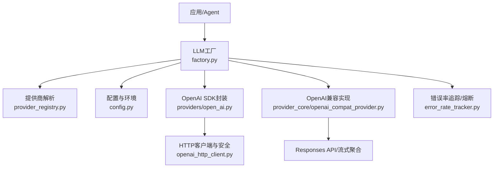
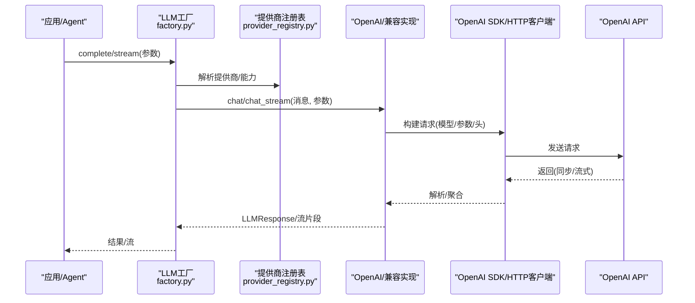
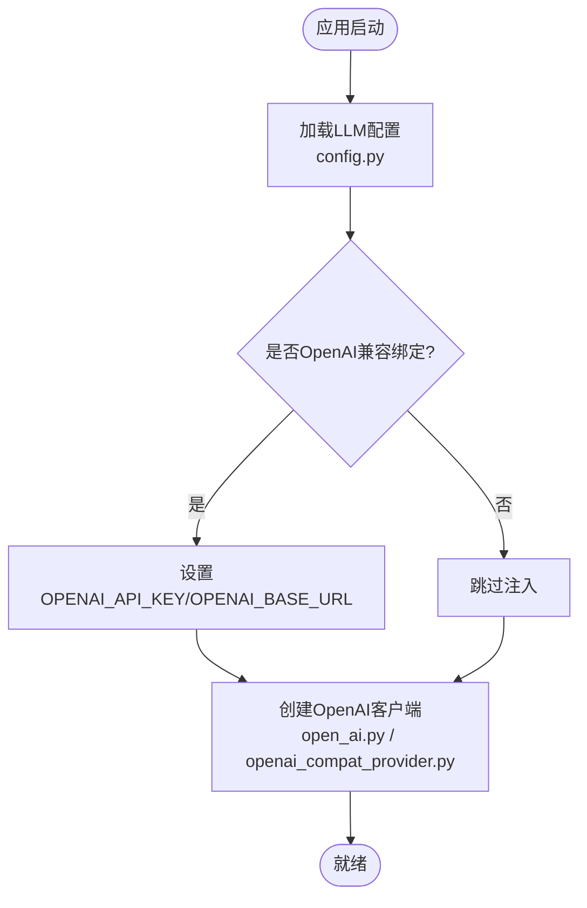
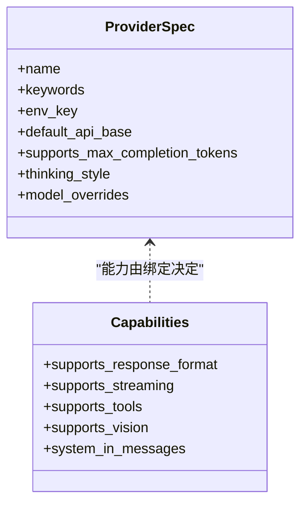
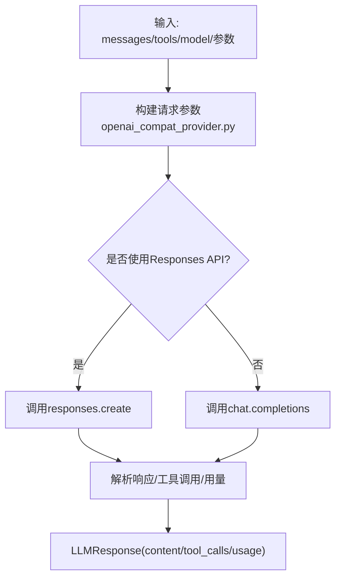
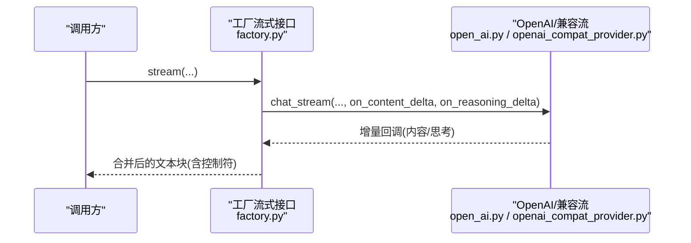
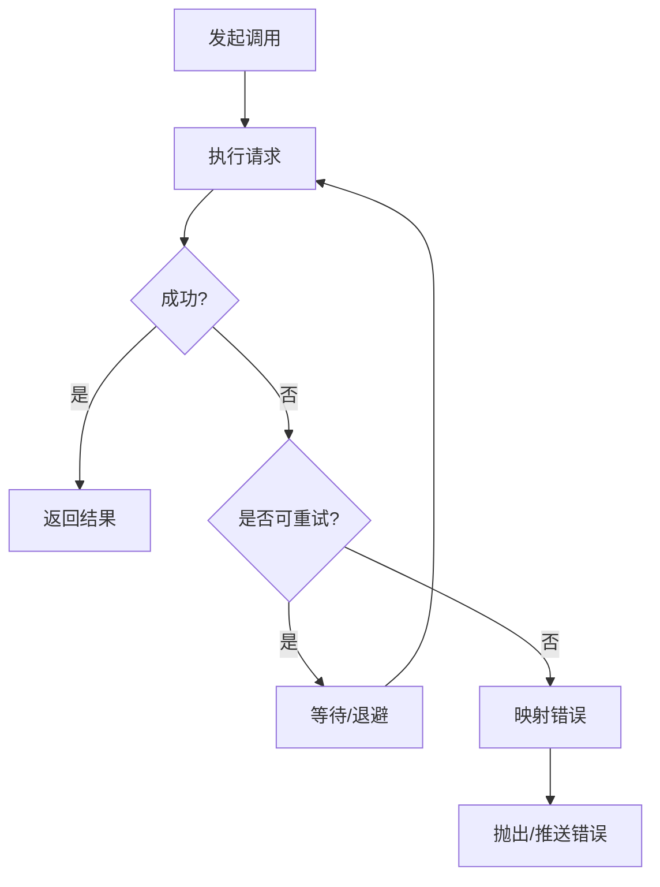
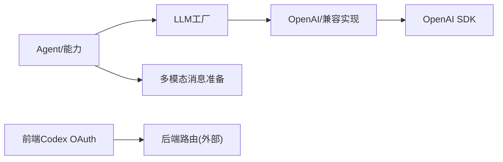
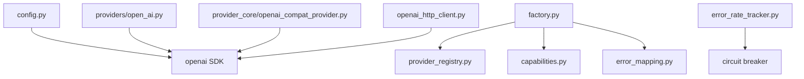

# OpenAI提供商集成

<cite>
**本文引用的文件**
- [deeptutor/services/provider_registry.py](file://deeptutor/services/provider_registry.py)
- [deeptutor/services/llm/config.py](file://deeptutor/services/llm/config.py)
- [deeptutor/services/llm/factory.py](file://deeptutor/services/llm/factory.py)
- [deeptutor/services/llm/capabilities.py](file://deeptutor/services/llm/capabilities.py)
- [deeptutor/services/llm/openai_http_client.py](file://deeptutor/services/llm/openai_http_client.py)
- [deeptutor/services/llm/providers/open_ai.py](file://deeptutor/services/llm/providers/open_ai.py)
- [deeptutor/services/llm/provider_core/openai_compat_provider.py](file://deeptutor/services/llm/provider_core/openai_compat_provider.py)
- [deeptutor/utils/error_rate_tracker.py](file://deeptutor/utils/error_rate_tracker.py)
- [web/lib/codex-oauth.ts](file://web/lib/codex-oauth.ts)
</cite>

## 目录
1. [简介](#简介)
2. [项目结构](#项目结构)
3. [核心组件](#核心组件)
4. [架构总览](#架构总览)
5. [详细组件分析](#详细组件分析)
6. [依赖关系分析](#依赖关系分析)
7. [性能考虑](#性能考虑)
8. [故障排查指南](#故障排查指南)
9. [结论](#结论)
10. [附录](#附录)

## 简介
本文件面向DeepTutor中OpenAI提供商的集成与使用，覆盖认证配置、API密钥与端点设置、支持的模型类型与差异、请求参数映射、响应格式处理、流式输出实现、错误处理与重试策略、速率限制与熔断、性能优化建议，以及与DeepTutor其他组件的集成方式。文档基于仓库源码进行梳理，确保内容与实际实现一致。

## 项目结构
围绕OpenAI集成的关键目录与文件：
- 提供商注册与能力声明：provider_registry.py、capabilities.py
- LLM配置与环境变量注入：config.py
- 统一工厂与调用入口：factory.py
- OpenAI官方SDK封装：providers/open_ai.py
- OpenAI兼容通用实现（含Responses API、工具调用、流式聚合）：provider_core/openai_compat_provider.py
- HTTP客户端与安全选项：openai_http_client.py
- 错误率追踪与熔断联动：utils/error_rate_tracker.py
- 前端OAuth状态管理（OpenAI Codex）：web/lib/codex-oauth.ts

**图表来源**
- [deeptutor/services/llm/factory.py:337-498](file://deeptutor/services/llm/factory.py#L337-L498)
- [deeptutor/services/provider_registry.py:118-310](file://deeptutor/services/provider_registry.py#L118-L310)
- [deeptutor/services/llm/config.py:62-92](file://deeptutor/services/llm/config.py#L62-L92)
- [deeptutor/services/llm/providers/open_ai.py:54-171](file://deeptutor/services/llm/providers/open_ai.py#L54-L171)
- [deeptutor/services/llm/provider_core/openai_compat_provider.py:106-148](file://deeptutor/services/llm/provider_core/openai_compat_provider.py#L106-L148)
- [deeptutor/services/llm/openai_http_client.py:21-48](file://deeptutor/services/llm/openai_http_client.py#L21-L48)
- [deeptutor/utils/error_rate_tracker.py:94-111](file://deeptutor/utils/error_rate_tracker.py#L94-L111)

**章节来源**
- [deeptutor/services/provider_registry.py:118-310](file://deeptutor/services/provider_registry.py#L118-L310)
- [deeptutor/services/llm/config.py:62-92](file://deeptutor/services/llm/config.py#L62-L92)
- [deeptutor/services/llm/factory.py:337-498](file://deeptutor/services/llm/factory.py#L337-L498)

## 核心组件
- 提供商注册表：集中定义各提供商元数据、默认端点、鉴权方式、能力开关与匹配规则。OpenAI通过名称“openai”或关键词“gpt”匹配，默认端点为官方地址，支持max_completion_tokens等新参数。
- LLM配置：负责加载运行时配置、设置OPENAI_*环境变量、提供统一的LLMConfig对象，并缓存当前上下文中的配置。
- 工厂层：统一解析调用参数、选择提供商、构建消息、处理图像多模态、执行重试与流式聚合，并将异常映射为统一错误。
- OpenAI提供者：基于官方AsyncOpenAI SDK，完成完整文本生成与流式输出，自动标记Azure/OpenAI来源。
- OpenAI兼容提供者：统一适配所有OpenAI兼容接口，包含消息清洗、工具调用、Responses API切换、流式分块聚合、错误降级与重试。
- HTTP客户端：在禁用SSL校验时安全地构造httpx客户端，生产环境强制拒绝禁用校验。
- 错误率追踪：记录提供商调用成功率，达到阈值触发熔断回调。

**章节来源**
- [deeptutor/services/provider_registry.py:254-271](file://deeptutor/services/provider_registry.py#L254-L271)
- [deeptutor/services/llm/config.py:95-127](file://deeptutor/services/llm/config.py#L95-L127)
- [deeptutor/services/llm/factory.py:337-498](file://deeptutor/services/llm/factory.py#L337-L498)
- [deeptutor/services/llm/providers/open_ai.py:54-171](file://deeptutor/services/llm/providers/open_ai.py#L54-L171)
- [deeptutor/services/llm/provider_core/openai_compat_provider.py:106-148](file://deeptutor/services/llm/provider_core/openai_compat_provider.py#L106-L148)
- [deeptutor/services/llm/openai_http_client.py:21-48](file://deeptutor/services/llm/openai_http_client.py#L21-L48)
- [deeptutor/utils/error_rate_tracker.py:94-111](file://deeptutor/utils/error_rate_tracker.py#L94-L111)

## 架构总览
OpenAI集成由“配置—工厂—提供商—SDK/兼容层—HTTP客户端”构成，上层Agent通过工厂发起调用，工厂根据绑定、模型、密钥与端点解析具体提供商，再交由OpenAI或兼容实现完成请求与响应处理。

**图表来源**
- [deeptutor/services/llm/factory.py:337-498](file://deeptutor/services/llm/factory.py#L337-L498)
- [deeptutor/services/provider_registry.py:118-310](file://deeptutor/services/provider_registry.py#L118-L310)
- [deeptutor/services/llm/provider_core/openai_compat_provider.py:665-800](file://deeptutor/services/llm/provider_core/openai_compat_provider.py#L665-L800)
- [deeptutor/services/llm/providers/open_ai.py:72-171](file://deeptutor/services/llm/providers/open_ai.py#L72-L171)

## 详细组件分析

### 认证配置、API密钥与端点
- 环境变量注入：模块导入时即尝试将当前LLM配置的api_key与effective_url写入OPENAI_API_KEY与OPENAI_BASE_URL，保证下游SDK能正确读取。
- 运行时初始化：启动阶段可显式调用initialize_environment以对齐环境变量。
- 提供商默认端点：OpenAI默认端点为官方地址；也可通过base_url/effective_url覆盖。
- 安全选项：当系统设置允许且非生产环境时可禁用SSL校验，否则抛出配置错误。

**图表来源**
- [deeptutor/services/llm/config.py:62-92](file://deeptutor/services/llm/config.py#L62-L92)
- [deeptutor/services/llm/config.py:146-159](file://deeptutor/services/llm/config.py#L146-L159)
- [deeptutor/services/llm/providers/open_ai.py:58-70](file://deeptutor/services/llm/providers/open_ai.py#L58-L70)
- [deeptutor/services/llm/provider_core/openai_compat_provider.py:139-145](file://deeptutor/services/llm/provider_core/openai_compat_provider.py#L139-L145)
- [deeptutor/services/llm/openai_http_client.py:21-48](file://deeptutor/services/llm/openai_http_client.py#L21-L48)

**章节来源**
- [deeptutor/services/llm/config.py:62-92](file://deeptutor/services/llm/config.py#L62-L92)
- [deeptutor/services/llm/config.py:146-159](file://deeptutor/services/llm/config.py#L146-L159)
- [deeptutor/services/llm/openai_http_client.py:21-48](file://deeptutor/services/llm/openai_http_client.py#L21-L48)

### 支持的模型类型与特性差异
- 模型识别：通过provider_registry中的keywords与default_api_base匹配OpenAI；同时支持gpt系列关键词。
- 新模型参数：对o1/o3/gpt-4o/gpt-5+等模型使用max_completion_tokens而非max_tokens。
- 能力声明：OpenAI绑定支持response_format、streaming、tools、vision、system_in_messages等。
- 温度控制：部分推理模型（如o1/o3/gpt-5）不支持temperature，实现层会按需剔除该参数。
- Responses API：对特定模型或reasoning_effort开启Responses API路径，并在失败时回退到chat.completions。

**图表来源**
- [deeptutor/services/provider_registry.py:254-271](file://deeptutor/services/provider_registry.py#L254-L271)
- [deeptutor/services/llm/capabilities.py:20-50](file://deeptutor/services/llm/capabilities.py#L20-L50)
- [deeptutor/services/llm/config.py:236-282](file://deeptutor/services/llm/config.py#L236-L282)
- [deeptutor/services/llm/provider_core/openai_compat_provider.py:246-315](file://deeptutor/services/llm/provider_core/openai_compat_provider.py#L246-L315)

**章节来源**
- [deeptutor/services/provider_registry.py:254-271](file://deeptutor/services/provider_registry.py#L254-L271)
- [deeptutor/services/llm/capabilities.py:20-50](file://deeptutor/services/llm/capabilities.py#L20-L50)
- [deeptutor/services/llm/config.py:236-282](file://deeptutor/services/llm/config.py#L236-L282)
- [deeptutor/services/llm/provider_core/openai_compat_provider.py:246-315](file://deeptutor/services/llm/provider_core/openai_compat_provider.py#L246-L315)

### 请求参数映射与响应格式处理
- 参数映射：根据模型与能力动态选择max_tokens或max_completion_tokens；按spec.model_overrides覆盖或移除参数（如Moonshot kimi系列锁定temperature）。
- 消息清洗：仅保留允许的消息键，规范化tool_call_id，避免不兼容ID导致错误。
- 工具调用：支持tools与tool_choice，解析函数名与参数，必要时转为短ID兼容不同后端。
- 响应解析：统一提取content、tool_calls、finish_reason、usage；对reasoning_content进行兼容提取。
- Responses API：对指定模型或reasoning_effort优先使用responses.create，失败时按错误特征回退至chat.completions。

**图表来源**
- [deeptutor/services/llm/provider_core/openai_compat_provider.py:256-315](file://deeptutor/services/llm/provider_core/openai_compat_provider.py#L256-L315)
- [deeptutor/services/llm/provider_core/openai_compat_provider.py:404-438](file://deeptutor/services/llm/provider_core/openai_compat_provider.py#L404-L438)
- [deeptutor/services/llm/provider_core/openai_compat_provider.py:503-556](file://deeptutor/services/llm/provider_core/openai_compat_provider.py#L503-L556)
- [deeptutor/services/llm/provider_core/openai_compat_provider.py:665-733](file://deeptutor/services/llm/provider_core/openai_compat_provider.py#L665-L733)

**章节来源**
- [deeptutor/services/llm/provider_core/openai_compat_provider.py:256-315](file://deeptutor/services/llm/provider_core/openai_compat_provider.py#L256-L315)
- [deeptutor/services/llm/provider_core/openai_compat_provider.py:503-556](file://deeptutor/services/llm/provider_core/openai_compat_provider.py#L503-L556)
- [deeptutor/services/llm/provider_core/openai_compat_provider.py:665-733](file://deeptutor/services/llm/provider_core/openai_compat_provider.py#L665-L733)

### 流式输出实现
- OpenAI官方流：迭代chunk，累积delta并逐条yield，结束时发送is_complete=true的终止块。
- 兼容流：对chat_stream与responses.stream均支持，内部聚合content与reasoning_content，并通过on_content_delta/on_reasoning_delta回调推送增量。
- 流合并：工厂层对流式数据进行字符数与时间窗口合并，减少UI抖动；遇到<think>/</think>控制符立即透传。

**图表来源**
- [deeptutor/services/llm/providers/open_ai.py:123-171](file://deeptutor/services/llm/providers/open_ai.py#L123-L171)
- [deeptutor/services/llm/provider_core/openai_compat_provider.py:735-800](file://deeptutor/services/llm/provider_core/openai_compat_provider.py#L735-L800)
- [deeptutor/services/llm/factory.py:401-587](file://deeptutor/services/llm/factory.py#L401-L587)

**章节来源**
- [deeptutor/services/llm/providers/open_ai.py:123-171](file://deeptutor/services/llm/providers/open_ai.py#L123-L171)
- [deeptutor/services/llm/provider_core/openai_compat_provider.py:735-800](file://deeptutor/services/llm/provider_core/openai_compat_provider.py#L735-L800)
- [deeptutor/services/llm/factory.py:401-587](file://deeptutor/services/llm/factory.py#L401-L587)

### 错误处理机制、重试策略与速率限制
- 重试策略：工厂层根据配置计算重试延迟（支持指数退避），调用provider.chat_with_retry与chat_stream_with_retry。
- 错误映射：捕获异常后统一映射为业务错误，便于上层处理。
- 流式错误：若流结束未产生任何可见输出且finish_reason为error，则推送映射后的错误事件。
- 速率限制与熔断：错误率追踪器记录每次调用成功/失败，超过阈值触发熔断回调；兼容层对Responses API失败计数，并在冷却期内避免频繁尝试。
- 图片降级：当非瞬态错误且消息包含图片但模型不被认定为视觉能力时，尝试去除图片重试一次。

**图表来源**
- [deeptutor/services/llm/factory.py:62-74](file://deeptutor/services/llm/factory.py#L62-L74)
- [deeptutor/services/llm/factory.py:337-398](file://deeptutor/services/llm/factory.py#L337-L398)
- [deeptutor/services/llm/factory.py:401-513](file://deeptutor/services/llm/factory.py#L401-L513)
- [deeptutor/services/llm/provider_core/base.py:318-347](file://deeptutor/services/llm/provider_core/base.py#L318-L347)
- [deeptutor/services/llm/provider_core/openai_compat_provider.py:345-385](file://deeptutor/services/llm/provider_core/openai_compat_provider.py#L345-L385)
- [deeptutor/utils/error_rate_tracker.py:94-111](file://deeptutor/utils/error_rate_tracker.py#L94-L111)

**章节来源**
- [deeptutor/services/llm/factory.py:62-74](file://deeptutor/services/llm/factory.py#L62-L74)
- [deeptutor/services/llm/factory.py:337-398](file://deeptutor/services/llm/factory.py#L337-L398)
- [deeptutor/services/llm/factory.py:401-513](file://deeptutor/services/llm/factory.py#L401-L513)
- [deeptutor/services/llm/provider_core/base.py:318-347](file://deeptutor/services/llm/provider_core/base.py#L318-L347)
- [deeptutor/services/llm/provider_core/openai_compat_provider.py:345-385](file://deeptutor/services/llm/provider_core/openai_compat_provider.py#L345-L385)
- [deeptutor/utils/error_rate_tracker.py:94-111](file://deeptutor/utils/error_rate_tracker.py#L94-L111)

### 与DeepTutor其他组件的集成方式
- Agent与能力：Agent通过工厂发起complete/stream，能力层依据绑定与模型启用response_format、vision、tools等特性。
- 多模态：工厂层将内联图片转换为多模态消息，按绑定与模型准备合适格式。
- 前端OAuth：OpenAI Codex通过前端状态机管理授权流程，后端提供对应路由（与本文件主题相关的前端类型定义位于web/lib/codex-oauth.ts）。

**图表来源**
- [deeptutor/services/llm/factory.py:262-308](file://deeptutor/services/llm/factory.py#L262-L308)
- [deeptutor/services/llm/capabilities.py:20-50](file://deeptutor/services/llm/capabilities.py#L20-L50)
- [web/lib/codex-oauth.ts:1-55](file://web/lib/codex-oauth.ts#L1-L55)

**章节来源**
- [deeptutor/services/llm/factory.py:262-308](file://deeptutor/services/llm/factory.py#L262-L308)
- [deeptutor/services/llm/capabilities.py:20-50](file://deeptutor/services/llm/capabilities.py#L20-L50)
- [web/lib/codex-oauth.ts:1-55](file://web/lib/codex-oauth.ts#L1-L55)

## 依赖关系分析
- 配置依赖：config.py在导入时即尝试设置OPENAI_*环境变量，确保后续SDK可用。
- 工厂依赖：factory.py依赖provider_registry解析提供商，依赖capabilities判断能力，依赖error_mapping统一错误。
- 提供商依赖：open_ai.py依赖openai SDK与httpx；openai_compat_provider.py依赖openai SDK与内部converters/parsing。
- 安全依赖：openai_http_client.py在禁用SSL校验时构造httpx客户端，生产环境禁止。
- 监控依赖：error_rate_tracker.py与circuit breaker联动，记录提供商错误率。

**图表来源**
- [deeptutor/services/llm/config.py:62-92](file://deeptutor/services/llm/config.py#L62-L92)
- [deeptutor/services/llm/factory.py:1-33](file://deeptutor/services/llm/factory.py#L1-L33)
- [deeptutor/services/llm/providers/open_ai.py:54-70](file://deeptutor/services/llm/providers/open_ai.py#L54-L70)
- [deeptutor/services/llm/provider_core/openai_compat_provider.py:106-148](file://deeptutor/services/llm/provider_core/openai_compat_provider.py#L106-L148)
- [deeptutor/services/llm/openai_http_client.py:21-48](file://deeptutor/services/llm/openai_http_client.py#L21-L48)
- [deeptutor/utils/error_rate_tracker.py:84-111](file://deeptutor/utils/error_rate_tracker.py#L84-L111)

**章节来源**
- [deeptutor/services/llm/config.py:62-92](file://deeptutor/services/llm/config.py#L62-L92)
- [deeptutor/services/llm/factory.py:1-33](file://deeptutor/services/llm/factory.py#L1-L33)
- [deeptutor/services/llm/providers/open_ai.py:54-70](file://deeptutor/services/llm/providers/open_ai.py#L54-L70)
- [deeptutor/services/llm/provider_core/openai_compat_provider.py:106-148](file://deeptutor/services/llm/provider_core/openai_compat_provider.py#L106-L148)
- [deeptutor/services/llm/openai_http_client.py:21-48](file://deeptutor/services/llm/openai_http_client.py#L21-L48)
- [deeptutor/utils/error_rate_tracker.py:84-111](file://deeptutor/utils/error_rate_tracker.py#L84-L111)

## 性能考虑
- 流式合并：通过字符数与时间窗口合并小块，降低UI渲染压力，提升用户体验。
- 参数裁剪：对新模型使用max_completion_tokens，避免无效参数导致的额外开销。
- 工具调用优化：对工具参数进行JSON修复与短ID标准化，提高兼容性并减少重试。
- 熔断保护：错误率过高时快速失败，避免雪崩。
- 图片降级：在非视觉模型上自动去除图片重试，减少不必要失败。

[本节为通用性能指导，不直接分析具体文件]

## 故障排查指南
- 认证问题：检查OPENAI_API_KEY与OPENAI_BASE_URL是否正确设置；确认非生产环境禁用SSL校验。
- 模型参数错误：确认是否使用了max_completion_tokens；对不支持temperature的模型移除该参数。
- 流式无输出：检查是否在流结束前收到错误事件；确认<think>/</think>控制符未被误过滤。
- 速率限制/熔断：查看错误率追踪与熔断状态；适当降低并发或调整重试策略。
- 工具调用失败：检查工具参数是否为合法JSON；必要时切换到流式以避免严格校验。

**章节来源**
- [deeptutor/services/llm/openai_http_client.py:21-48](file://deeptutor/services/llm/openai_http_client.py#L21-L48)
- [deeptutor/services/llm/config.py:236-282](file://deeptutor/services/llm/config.py#L236-L282)
- [deeptutor/services/llm/factory.py:401-513](file://deeptutor/services/llm/factory.py#L401-L513)
- [deeptutor/utils/error_rate_tracker.py:94-111](file://deeptutor/utils/error_rate_tracker.py#L94-L111)

## 结论
DeepTutor的OpenAI集成通过统一的配置、工厂与提供商抽象，实现了高内聚、低耦合的调用链路。它既支持官方OpenAI SDK的直接调用，也兼容各类OpenAI兼容接口，具备完善的流式输出、错误处理、重试与熔断机制。结合能力声明与参数裁剪，能够灵活适配多种模型与场景，并提供良好的性能与稳定性保障。

[本节为总结性内容，不直接分析具体文件]

## 附录
- 配置示例要点（基于源码行为）：
  - 设置OPENAI_API_KEY与可选的OPENAI_BASE_URL，或在运行时通过LLMConfig传入api_key与base_url。
  - 对gpt-4o、o1、o3、gpt-5+等模型，系统将自动使用max_completion_tokens。
  - 如需自定义HTTP行为（如禁用SSL校验），需在非生产环境启用相应系统设置。
- 代码片段路径（用于定位实现）：
  - 环境变量注入与初始化：[config.py:62-92](file://deeptutor/services/llm/config.py#L62-L92)、[config.py:146-159](file://deeptutor/services/llm/config.py#L146-L159)
  - 完整调用与重试：[factory.py:337-398](file://deeptutor/services/llm/factory.py#L337-L398)
  - 流式调用与合并：[factory.py:401-587](file://deeptutor/services/llm/factory.py#L401-L587)
  - OpenAI提供者实现：[providers/open_ai.py:54-171](file://deeptutor/services/llm/providers/open_ai.py#L54-L171)
  - 兼容提供者实现：[provider_core/openai_compat_provider.py:106-800](file://deeptutor/services/llm/provider_core/openai_compat_provider.py#L106-L800)
  - HTTP客户端与安全：[openai_http_client.py:21-48](file://deeptutor/services/llm/openai_http_client.py#L21-L48)
  - 错误率追踪：[error_rate_tracker.py:94-111](file://deeptutor/utils/error_rate_tracker.py#L94-L111)
  - 前端Codex OAuth类型：[web/lib/codex-oauth.ts:1-55](file://web/lib/codex-oauth.ts#L1-L55)

[本节为参考指引，不直接分析具体文件]