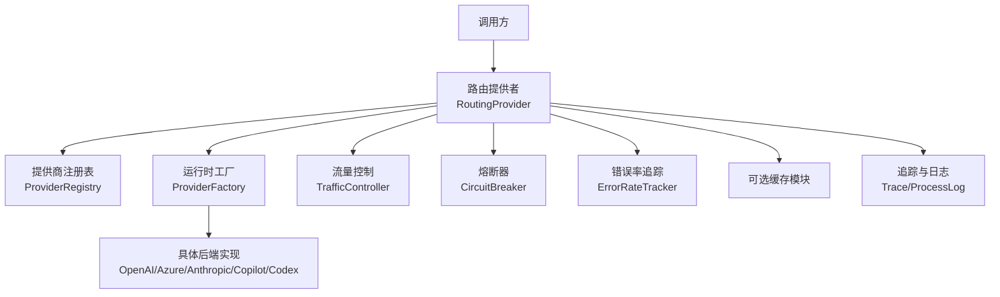
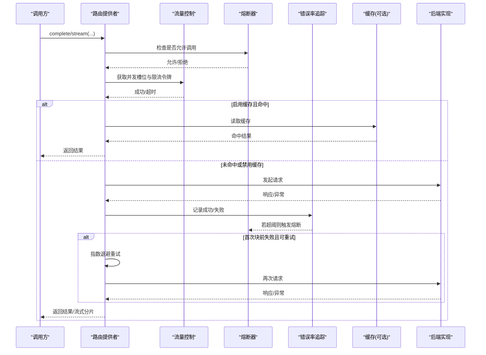
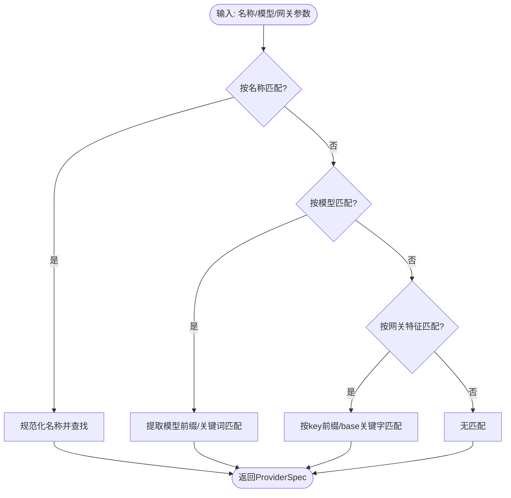
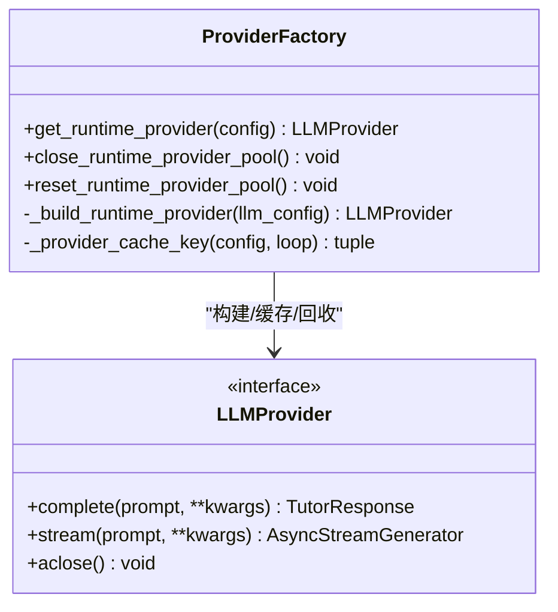
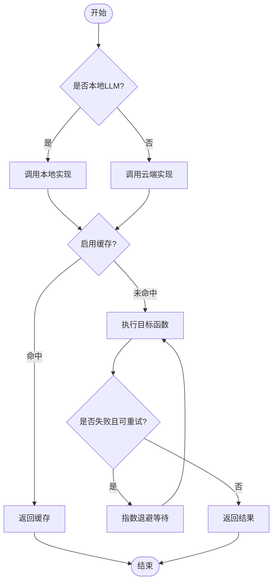
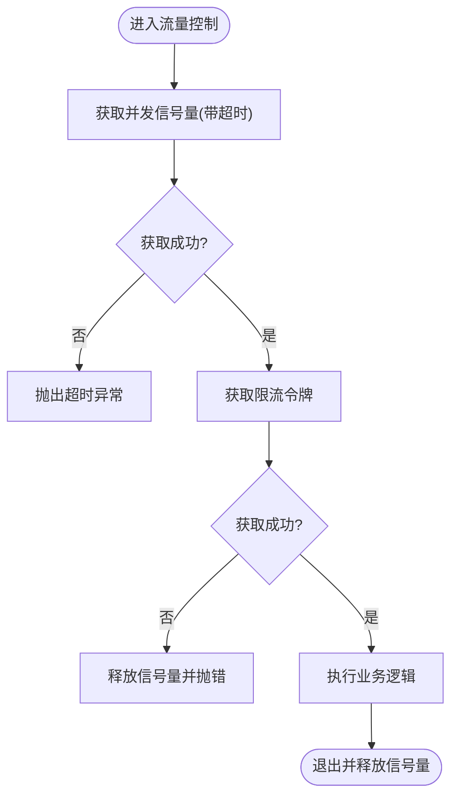
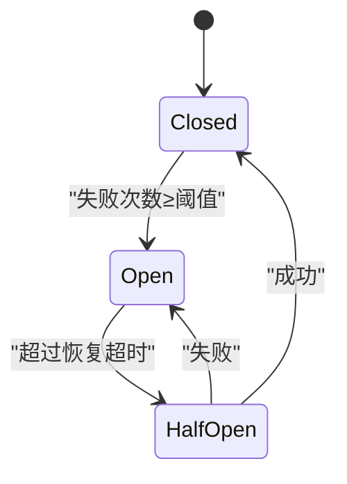
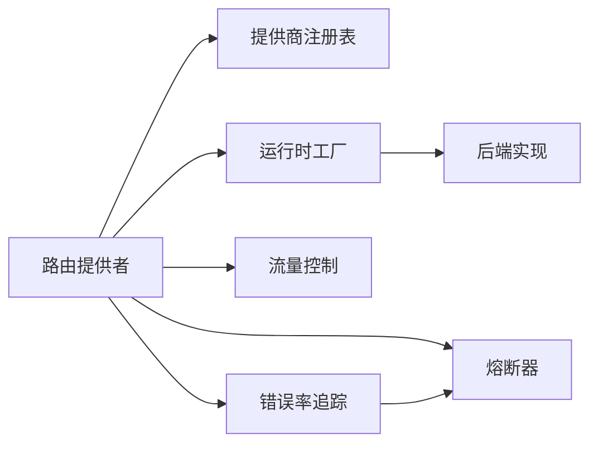

# 提供商路由与负载均衡

<cite>
**本文引用的文件**
- [deeptutor/services/llm/providers/routing.py](file://deeptutor/services/llm/providers/routing.py)
- [deeptutor/services/provider_registry.py](file://deeptutor/services/provider_registry.py)
- [deeptutor/services/llm/provider_factory.py](file://deeptutor/services/llm/provider_factory.py)
- [deeptutor/utils/network/circuit_breaker.py](file://deeptutor/utils/network/circuit_breaker.py)
- [deeptutor/utils/error_rate_tracker.py](file://deeptutor/utils/error_rate_tracker.py)
- [deeptutor/services/llm/traffic_control.py](file://deeptutor/services/llm/traffic_control.py)
- [deeptutor/core/trace.py](file://deeptutor/core/trace.py)
- [deeptutor/logging/process_stream.py](file://deeptutor/logging/process_stream.py)
- [tests/utils/test_circuit_breaker.py](file://tests/utils/test_circuit_breaker.py)
</cite>

## 目录
1. [简介](#简介)
2. [项目结构](#项目结构)
3. [核心组件](#核心组件)
4. [架构总览](#架构总览)
5. [详细组件分析](#详细组件分析)
6. [依赖关系分析](#依赖关系分析)
7. [性能考量](#性能考量)
8. [故障排查指南](#故障排查指南)
9. [结论](#结论)
10. [附录](#附录)

## 简介
本文件围绕 DeepTutor 的“提供商路由与负载均衡”能力，系统阐述多提供商路由策略、权重分配与故障转移机制；解释负载均衡算法、健康检查与自动切换逻辑；说明请求分发规则、优先级设置与成本优化策略；并给出监控指标收集、性能分析与决策日志方法。同时提供路由配置示例与调试方法，覆盖高可用架构设计与灾难恢复方案，以及动态配置更新与热重载支持。

## 项目结构
DeepTutor 在 LLM 调用路径上采用“注册表 + 工厂 + 路由提供者 + 流量控制/熔断/错误率统计”的分层设计：
- 提供商注册表集中声明所有支持的提供商元数据（名称、关键词、默认端点、鉴权方式、是否网关/本地等），并提供按名称、模型或网关特征匹配的能力。
- 运行时工厂根据配置构建具体后端实现（OpenAI 兼容、Anthropic、Azure OpenAI、GitHub Copilot、OpenAI Codex 等），并对 SDK 连接池进行生命周期管理。
- 路由提供者负责在“云端/本地”之间选择目标，并统一接入重试、缓存、流式输出等通用能力。
- 流量控制器提供并发与速率限制；熔断器基于错误率触发开/半开/闭状态；错误率追踪器记录窗口内错误比例并与熔断器联动。
- 追踪与日志为可观测性提供基础，便于定位问题与优化。

图表来源
- [deeptutor/services/llm/providers/routing.py:66-183](file://deeptutor/services/llm/providers/routing.py#L66-L183)
- [deeptutor/services/provider_registry.py:118-479](file://deeptutor/services/provider_registry.py#L118-L479)
- [deeptutor/services/llm/provider_factory.py:110-136](file://deeptutor/services/llm/provider_factory.py#L110-L136)
- [deeptutor/services/llm/traffic_control.py:78-125](file://deeptutor/services/llm/traffic_control.py#L78-L125)
- [deeptutor/utils/network/circuit_breaker.py:13-89](file://deeptutor/utils/network/circuit_breaker.py#L13-L89)
- [deeptutor/utils/error_rate_tracker.py:71-111](file://deeptutor/utils/error_rate_tracker.py#L71-L111)
- [deeptutor/core/trace.py:44-90](file://deeptutor/core/trace.py#L44-L90)
- [deeptutor/logging/process_stream.py:17-49](file://deeptutor/logging/process_stream.py#L17-L49)

章节来源
- [deeptutor/services/llm/providers/routing.py:66-183](file://deeptutor/services/llm/providers/routing.py#L66-L183)
- [deeptutor/services/provider_registry.py:118-479](file://deeptutor/services/provider_registry.py#L118-L479)
- [deeptutor/services/llm/provider_factory.py:110-136](file://deeptutor/services/llm/provider_factory.py#L110-L136)

## 核心组件
- 提供商注册表：维护 ProviderSpec 列表，定义名称、关键词、默认端点、鉴权模式、是否网关/本地、检测规则等，并提供按名称、模型、网关特征的查找能力。
- 运行时工厂：根据 LLMConfig 构建具体后端实例，按事件循环局部缓存 provider 对象，避免重复创建 SDK 连接池，支持关闭与重置。
- 路由提供者：封装对本地/云端的统一调用，支持重试、缓存、流式输出，并在流式场景下对首块前失败进行重试。
- 流量控制：并发信号量 + 令牌桶式限速，防止过载；获取失败时抛出超时异常。
- 熔断器：按提供商维度维护 closed/open/half-open 状态，达到失败阈值后打开，超时后进入半开探测，成功则闭合。
- 错误率追踪：滑动窗口统计错误率，超过阈值触发熔断器回调。
- 追踪与日志：标准化 trace metadata 与进程级日志事件，便于端到端可观测。

章节来源
- [deeptutor/services/provider_registry.py:18-55](file://deeptutor/services/provider_registry.py#L18-L55)
- [deeptutor/services/provider_registry.py:485-529](file://deeptutor/services/provider_registry.py#L485-L529)
- [deeptutor/services/llm/provider_factory.py:22-49](file://deeptutor/services/llm/provider_factory.py#L22-L49)
- [deeptutor/services/llm/provider_factory.py:110-136](file://deeptutor/services/llm/provider_factory.py#L110-L136)
- [deeptutor/services/llm/providers/routing.py:66-183](file://deeptutor/services/llm/providers/routing.py#L66-L183)
- [deeptutor/services/llm/traffic_control.py:78-125](file://deeptutor/services/llm/traffic_control.py#L78-L125)
- [deeptutor/utils/network/circuit_breaker.py:13-89](file://deeptutor/utils/network/circuit_breaker.py#L13-L89)
- [deeptutor/utils/error_rate_tracker.py:71-111](file://deeptutor/utils/error_rate_tracker.py#L71-L111)
- [deeptutor/core/trace.py:44-90](file://deeptutor/core/trace.py#L44-L90)
- [deeptutor/logging/process_stream.py:17-49](file://deeptutor/logging/process_stream.py#L17-L49)

## 架构总览
下图展示一次完整请求从路由到后端执行的流程，包括重试、缓存、流量控制、熔断与错误率统计的协作。

图表来源
- [deeptutor/services/llm/providers/routing.py:76-183](file://deeptutor/services/llm/providers/routing.py#L76-L183)
- [deeptutor/services/llm/providers/routing.py:185-265](file://deeptutor/services/llm/providers/routing.py#L185-L265)
- [deeptutor/services/llm/traffic_control.py:78-125](file://deeptutor/services/llm/traffic_control.py#L78-L125)
- [deeptutor/utils/network/circuit_breaker.py:13-89](file://deeptutor/utils/network/circuit_breaker.py#L13-L89)
- [deeptutor/utils/error_rate_tracker.py:71-111](file://deeptutor/utils/error_rate_tracker.py#L71-L111)

## 详细组件分析

### 提供商注册表与路由策略
- 注册表集中声明所有提供商元数据，包含名称、关键词、默认端点、鉴权模式、是否网关/本地、检测规则（如 key 前缀、base URL 关键字）等。
- 提供三种匹配方式：
  - 按名称：规范化名称后精确匹配。
  - 按模型：通过模型名中的厂商/系列关键词匹配标准提供商。
  - 按网关：根据 API Key 前缀或 base URL 关键字自动识别网关型提供商。
- 顺序即优先级：注册表顺序决定匹配优先级，网关优先于标准提供商。

图表来源
- [deeptutor/services/provider_registry.py:118-479](file://deeptutor/services/provider_registry.py#L118-L479)
- [deeptutor/services/provider_registry.py:485-529](file://deeptutor/services/provider_registry.py#L485-L529)

章节来源
- [deeptutor/services/provider_registry.py:18-55](file://deeptutor/services/provider_registry.py#L18-L55)
- [deeptutor/services/provider_registry.py:118-479](file://deeptutor/services/provider_registry.py#L118-L479)
- [deeptutor/services/provider_registry.py:485-529](file://deeptutor/services/provider_registry.py#L485-L529)

### 运行时工厂与连接池
- 工厂根据 LLMConfig 动态导入并构建具体后端实现（OpenAI 兼容、Anthropic、Azure OpenAI、GitHub Copilot、OpenAI Codex）。
- 以事件循环为粒度缓存 provider 实例，键由 loop、provider_name/mode/model、api_key 指纹、effective_url、api_version、extra_headers、temperature、max_tokens、reasoning_effort 组成。
- 池大小有限（默认 2），超出时驱逐最久未使用项并异步关闭其资源。
- 提供关闭与重置接口，用于配置热重载或进程退出时的资源清理。

图表来源
- [deeptutor/services/llm/provider_factory.py:22-49](file://deeptutor/services/llm/provider_factory.py#L22-L49)
- [deeptutor/services/llm/provider_factory.py:110-136](file://deeptutor/services/llm/provider_factory.py#L110-L136)
- [deeptutor/services/llm/provider_factory.py:139-169](file://deeptutor/services/llm/provider_factory.py#L139-L169)

章节来源
- [deeptutor/services/llm/provider_factory.py:22-49](file://deeptutor/services/llm/provider_factory.py#L22-L49)
- [deeptutor/services/llm/provider_factory.py:110-136](file://deeptutor/services/llm/provider_factory.py#L110-L136)
- [deeptutor/services/llm/provider_factory.py:139-169](file://deeptutor/services/llm/provider_factory.py#L139-L169)

### 路由提供者：云端/本地选择与重试
- 路由提供者根据 base_url 判断是否为本地 LLM 服务，若是则走本地实现，否则走云端实现。
- 支持可选缓存：计算缓存键（包含 model、binding、base_url、system_prompt、prompt、messages 及其他非敏感参数），命中直接返回。
- 统一重试：complete 使用 execute_with_retry；stream 在首个分片前失败时进行指数退避重试。
- 流式输出：累积 delta 并逐块发送，结束时发送完成标记。

图表来源
- [deeptutor/services/llm/providers/routing.py:66-183](file://deeptutor/services/llm/providers/routing.py#L66-L183)
- [deeptutor/services/llm/providers/routing.py:185-265](file://deeptutor/services/llm/providers/routing.py#L185-L265)

章节来源
- [deeptutor/services/llm/providers/routing.py:66-183](file://deeptutor/services/llm/providers/routing.py#L66-L183)
- [deeptutor/services/llm/providers/routing.py:185-265](file://deeptutor/services/llm/providers/routing.py#L185-L265)

### 流量控制：并发与速率限制
- 通过信号量控制并发上限，获取失败时抛出超时异常，避免系统过载。
- 在获取并发槽位后再尝试获取限流令牌，确保不长时间占用并发槽位等待令牌。
- 上下文管理器保证释放并发槽位，即使异常也能正确释放。

图表来源
- [deeptutor/services/llm/traffic_control.py:78-125](file://deeptutor/services/llm/traffic_control.py#L78-L125)

章节来源
- [deeptutor/services/llm/traffic_control.py:78-125](file://deeptutor/services/llm/traffic_control.py#L78-L125)

### 熔断器与健康检查
- 熔断器按提供商维度维护状态：closed → open → half-open → closed。
- 达到失败阈值后进入 open 状态，阻止后续调用；超过恢复超时后进入 half-open 允许试探；成功后回到 closed。
- 错误率追踪器在窗口内统计错误率，超过阈值时调用熔断器回调，触发熔断。

图表来源
- [deeptutor/utils/network/circuit_breaker.py:13-89](file://deeptutor/utils/network/circuit_breaker.py#L13-L89)
- [deeptutor/utils/error_rate_tracker.py:71-111](file://deeptutor/utils/error_rate_tracker.py#L71-L111)
- [tests/utils/test_circuit_breaker.py:21-80](file://tests/utils/test_circuit_breaker.py#L21-L80)

章节来源
- [deeptutor/utils/network/circuit_breaker.py:13-89](file://deeptutor/utils/network/circuit_breaker.py#L13-L89)
- [deeptutor/utils/error_rate_tracker.py:71-111](file://deeptutor/utils/error_rate_tracker.py#L71-L111)
- [tests/utils/test_circuit_breaker.py:21-80](file://tests/utils/test_circuit_breaker.py#L21-L80)

### 监控指标与决策日志
- 追踪元数据：统一生成 call_id、phase、label、call_kind、trace_id、trace_role、trace_group、trace_kind 等字段，便于跨链路追踪。
- 进程日志：将日志记录转换为结构化事件，包含级别、消息、logger、时间戳与上下文，便于前端或监控系统消费。
- 错误率与熔断：错误率追踪器记录每次调用结果，超限触发熔断；熔断器记录状态转换日志。

章节来源
- [deeptutor/core/trace.py:44-90](file://deeptutor/core/trace.py#L44-L90)
- [deeptutor/logging/process_stream.py:17-49](file://deeptutor/logging/process_stream.py#L17-L49)
- [deeptutor/utils/network/circuit_breaker.py:13-89](file://deeptutor/utils/network/circuit_breaker.py#L13-L89)
- [deeptutor/utils/error_rate_tracker.py:71-111](file://deeptutor/utils/error_rate_tracker.py#L71-L111)

## 依赖关系分析
- 路由提供者依赖注册表确定目标提供商，依赖工厂获取运行时后端实例，依赖流量控制与熔断器保障稳定性，依赖错误率追踪进行健康评估。
- 工厂依赖注册表解析后端类型，按需导入具体实现，避免启动时加载全部 SDK。
- 熔断器与错误率追踪解耦：错误率追踪器仅负责统计与阈值判定，熔断器负责状态机与开关逻辑。

图表来源
- [deeptutor/services/llm/providers/routing.py:66-183](file://deeptutor/services/llm/providers/routing.py#L66-L183)
- [deeptutor/services/provider_registry.py:118-479](file://deeptutor/services/provider_registry.py#L118-L479)
- [deeptutor/services/llm/provider_factory.py:110-136](file://deeptutor/services/llm/provider_factory.py#L110-L136)
- [deeptutor/utils/network/circuit_breaker.py:13-89](file://deeptutor/utils/network/circuit_breaker.py#L13-L89)
- [deeptutor/utils/error_rate_tracker.py:71-111](file://deeptutor/utils/error_rate_tracker.py#L71-L111)

章节来源
- [deeptutor/services/llm/providers/routing.py:66-183](file://deeptutor/services/llm/providers/routing.py#L66-L183)
- [deeptutor/services/provider_registry.py:118-479](file://deeptutor/services/provider_registry.py#L118-L479)
- [deeptutor/services/llm/provider_factory.py:110-136](file://deeptutor/services/llm/provider_factory.py#L110-L136)
- [deeptutor/utils/network/circuit_breaker.py:13-89](file://deeptutor/utils/network/circuit_breaker.py#L13-L89)
- [deeptutor/utils/error_rate_tracker.py:71-111](file://deeptutor/utils/error_rate_tracker.py#L71-L111)

## 性能考量
- 连接复用：运行时工厂按事件循环缓存 provider，减少 SDK 连接创建开销，提升吞吐。
- 并发与限流：流量控制避免雪崩，保护后端与自身资源。
- 缓存命中：路由提供者支持可选缓存，降低重复请求成本。
- 重试策略：仅在首块前失败时重试，避免流式中间失败的重试放大。
- 熔断保护：错误率过高时快速失败，减少无效请求与资源消耗。

[本节为通用性能建议，无需特定文件引用]

## 故障排查指南
- 查看熔断状态：确认提供商是否处于 open/half-open，结合错误率阈值与恢复超时调整。
- 检查流量控制：若频繁出现超时，考虑提高并发上限或放宽限流。
- 验证缓存键：确认缓存键生成逻辑是否包含必要参数，避免误命中或缓存污染。
- 追踪链路：利用 trace metadata 与进程日志定位问题阶段（选择、调用、重试、缓存）。
- 单元测试参考：熔断器状态机行为可通过测试用例复现与验证。

章节来源
- [deeptutor/utils/network/circuit_breaker.py:13-89](file://deeptutor/utils/network/circuit_breaker.py#L13-L89)
- [tests/utils/test_circuit_breaker.py:21-80](file://tests/utils/test_circuit_breaker.py#L21-L80)
- [deeptutor/core/trace.py:44-90](file://deeptutor/core/trace.py#L44-L90)
- [deeptutor/logging/process_stream.py:17-49](file://deeptutor/logging/process_stream.py#L17-L49)

## 结论
DeepTutor 的提供商路由与负载均衡体系通过注册表驱动的策略匹配、工厂化的后端构建、统一的流量控制与熔断保护，实现了高可用、可扩展且易观测的多提供商调用能力。结合错误率追踪与结构化日志，可在复杂环境下保持稳定性与可维护性。

[本节为总结性内容，无需特定文件引用]

## 附录

### 路由配置示例与优先级
- 名称匹配：直接使用规范后的提供商名称（如 openai、anthropic、azure_openai）。
- 模型匹配：通过模型名中的厂商/系列关键词自动匹配（如 gpt、claude、gemini）。
- 网关匹配：根据 API Key 前缀或 base URL 关键字自动识别（如 openrouter、edenai、siliconflow）。
- 优先级：注册表顺序决定匹配优先级，网关优先于标准提供商。

章节来源
- [deeptutor/services/provider_registry.py:118-479](file://deeptutor/services/provider_registry.py#L118-L479)
- [deeptutor/services/provider_registry.py:485-529](file://deeptutor/services/provider_registry.py#L485-L529)

### 权重分配与成本优化策略
- 权重分配：当前代码未实现显式权重轮询；可通过上层调度（如业务层选择不同 binding/model）间接实现。
- 成本优化：
  - 使用缓存减少重复请求。
  - 合理设置 temperature/max_tokens/reasoning_effort 控制输出长度与推理强度。
  - 选择更经济的后端或网关（如 openai_compat 指向低成本端点）。
  - 利用模型前缀剥离与模型覆盖（如 moonshot 的温度固定策略）避免无效参数导致失败。

章节来源
- [deeptutor/services/llm/providers/routing.py:111-163](file://deeptutor/services/llm/providers/routing.py#L111-L163)
- [deeptutor/services/provider_registry.py:329-343](file://deeptutor/services/provider_registry.py#L329-L343)
- [deeptutor/services/llm/provider_factory.py:94-99](file://deeptutor/services/llm/provider_factory.py#L94-L99)

### 高可用架构与灾难恢复
- 高可用：
  - 多提供商冗余：通过注册表配置多个提供商，上层可按需切换。
  - 熔断与错误率：快速隔离故障提供商，避免雪崩。
  - 流量控制：防止过载导致的连锁故障。
- 灾难恢复：
  - 配置热重载：通过工厂的 reset/close 接口重建 provider 池，应用新配置。
  - 回滚策略：保留上一版本配置，出现问题时快速回滚。
  - 降级策略：当云端不可用时切换到本地实现（路由提供者已支持本地/云端选择）。

章节来源
- [deeptutor/services/llm/provider_factory.py:139-169](file://deeptutor/services/llm/provider_factory.py#L139-L169)
- [deeptutor/services/llm/providers/routing.py:102-109](file://deeptutor/services/llm/providers/routing.py#L102-L109)
- [deeptutor/utils/network/circuit_breaker.py:13-89](file://deeptutor/utils/network/circuit_breaker.py#L13-L89)

### 动态配置更新与热重载
- 动态更新：修改 LLMConfig（如 provider_name、model、base_url、api_key、extra_headers）后，调用工厂的 reset/close 接口重建 provider 池。
- 热重载：在运行中关闭旧池并创建新池，确保新配置生效而不中断服务。
- 注意事项：确保事件循环安全，避免跨循环共享 provider 实例。

章节来源
- [deeptutor/services/llm/provider_factory.py:110-136](file://deeptutor/services/llm/provider_factory.py#L110-L136)
- [deeptutor/services/llm/provider_factory.py:139-169](file://deeptutor/services/llm/provider_factory.py#L139-L169)