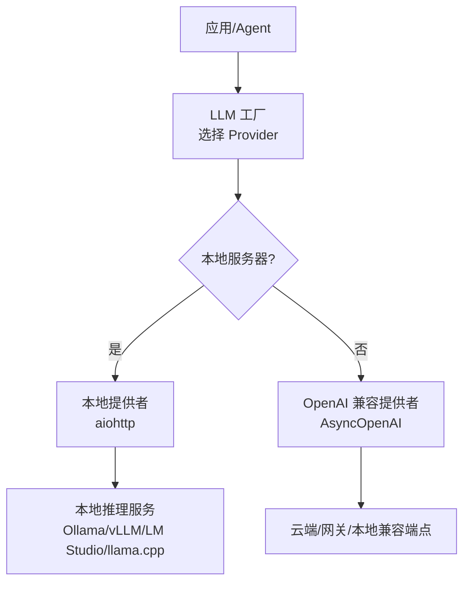
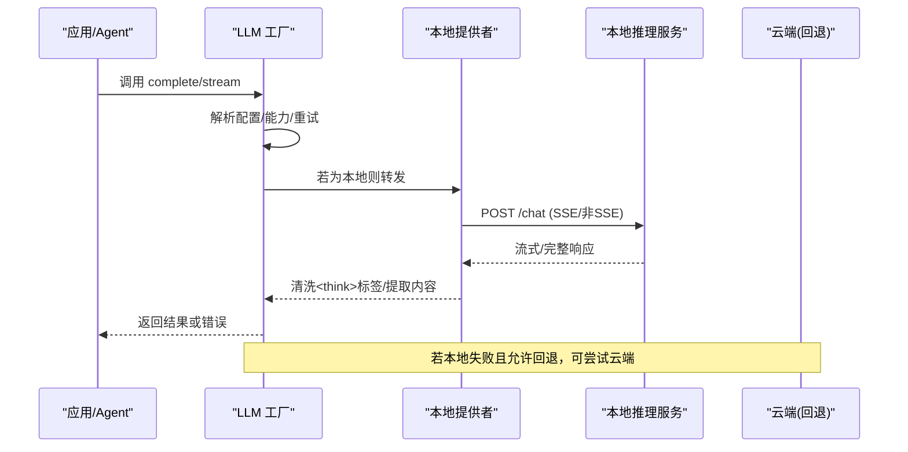
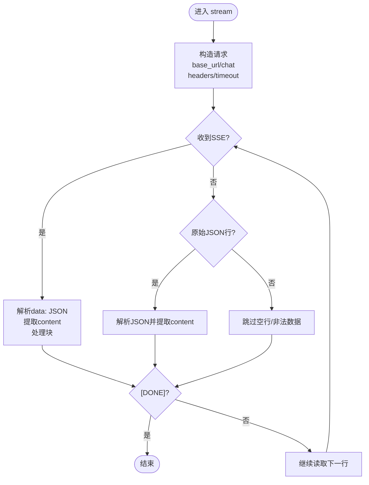
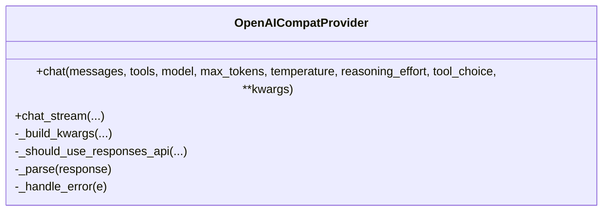
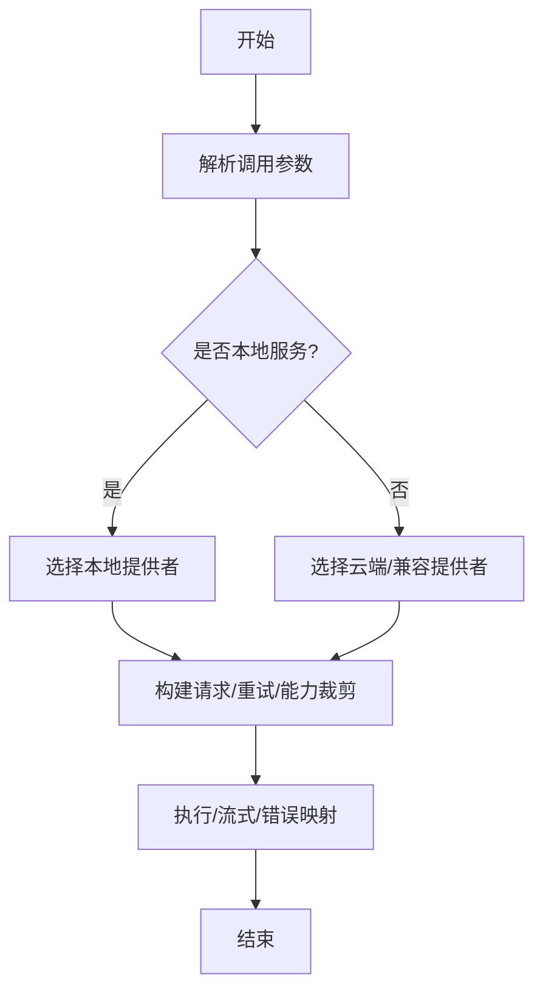
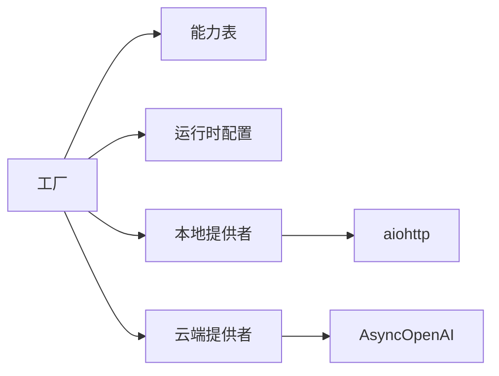

# 本地模型提供商

<cite>
**本文引用的文件**
- [factory.py](file://deeptutor/services/llm/factory.py)
- [local_provider.py](file://deeptutor/services/llm/local_provider.py)
- [openai_compat_provider.py](file://deeptutor/services/llm/provider_core/openai_compat_provider.py)
- [capabilities.py](file://deeptutor/services/llm/capabilities.py)
- [provider_runtime.py](file://deeptutor/services/config/provider_runtime.py)
- [model_catalog.py](file://deeptutor/services/config/model_catalog.py)
- [cloud_provider.py](file://deeptutor/services/llm/cloud_provider.py)
- [error_rate_tracker.py](file://deeptutor/utils/error_rate_tracker.py)
- [test_memory_reclaim.py](file://tests/runtime/test_memory_reclaim.py)
- [test_launcher_allocator_env.py](file://tests/runtime/test_launcher_allocator_env.py)
</cite>

## 目录
1. [简介](#简介)
2. [项目结构](#项目结构)
3. [核心组件](#核心组件)
4. [架构总览](#架构总览)
5. [详细组件分析](#详细组件分析)
6. [依赖关系分析](#依赖关系分析)
7. [性能与资源管理](#性能与资源管理)
8. [故障排查指南](#故障排查指南)
9. [结论](#结论)
10. [附录：配置示例与最佳实践](#附录：配置示例与最佳实践)

## 简介
本文件面向在本地部署推理引擎（如 Ollama、vLLM、LM Studio、llama.cpp 等）的用户，系统说明 DeepTutor 如何识别、连接并调用本地 LLM 服务。内容涵盖：
- 本地模型加载与运行时配置解析
- 内存管理与超时策略
- GPU 加速与量化技术的对接方式
- 支持的模型文件格式与 API 适配
- 请求格式转换与响应处理
- 不同本地推理框架的配置要点
- 资源监控、负载均衡与故障转移策略
- 与云端提供商的混合使用模式

## 项目结构
DeepTutor 将“本地 LLM”作为一类 OpenAI 兼容端点统一接入，同时提供专用本地客户端以增强对本地服务器的兼容性。关键路径如下：
- 工厂与路由：负责根据 binding、base_url、model 自动选择本地或云端实现
- 本地提供者：基于 aiohttp 的轻量 HTTP 客户端，支持流式与非流式
- OpenAI 兼容提供者：通过官方 SDK 访问任意 OpenAI 兼容端点（含本地）
- 能力声明：声明各 provider 的能力（流式、工具、视觉、JSON 输出等）
- 运行时配置：从模型目录与服务目录解析出最终生效的 provider、模型、URL、密钥等
- 云侧回退：当本地不可用时，按策略回退到云端

图表来源
- [factory.py:77-107](file://deeptutor/services/llm/factory.py#L77-L107)
- [local_provider.py:1-12](file://deeptutor/services/llm/local_provider.py#L1-L12)
- [openai_compat_provider.py:1-5](file://deeptutor/services/llm/provider_core/openai_compat_provider.py#L1-L5)

章节来源
- [factory.py:77-107](file://deeptutor/services/llm/factory.py#L77-L107)
- [provider_runtime.py:589-636](file://deeptutor/services/config/provider_runtime.py#L589-L636)

## 核心组件
- 工厂层（factory）：统一入口，解析调用参数，决定走本地还是云端；构建重试、消息拼装、能力裁剪与错误映射。
- 本地提供者（local_provider）：针对本地服务的 HTTP 客户端，默认更长超时，支持 SSE 流式与非流式，兼容多种返回格式，内置思考标签清理。
- OpenAI 兼容提供者（openai_compat_provider）：基于 AsyncOpenAI 的通用适配器，覆盖更多能力（工具、响应格式、缓存控制、Reasoning 参数等）。
- 能力声明（capabilities）：声明各 provider 是否支持 JSON 输出、流式、工具、视觉、system 消息等。
- 运行时配置（provider_runtime + model_catalog）：从模型目录与服务目录中解析 active profile/model，结合 base_url/api_key/binding 推断实际 provider。

章节来源
- [factory.py:337-499](file://deeptutor/services/llm/factory.py#L337-L499)
- [local_provider.py:68-149](file://deeptutor/services/llm/local_provider.py#L68-L149)
- [openai_compat_provider.py:106-148](file://deeptutor/services/llm/provider_core/openai_compat_provider.py#L106-L148)
- [capabilities.py:186-231](file://deeptutor/services/llm/capabilities.py#L186-L231)
- [provider_runtime.py:639-699](file://deeptutor/services/config/provider_runtime.py#L639-L699)
- [model_catalog.py:53-84](file://deeptutor/services/config/model_catalog.py#L53-L84)

## 架构总览
下图展示一次本地推理请求从应用到本地服务的完整流程，包括配置解析、Provider 选择、请求构造、流式传输与错误处理。

图表来源
- [factory.py:337-499](file://deeptutor/services/llm/factory.py#L337-L499)
- [local_provider.py:151-318](file://deeptutor/services/llm/local_provider.py#L151-L318)
- [cloud_provider.py:384-562](file://deeptutor/services/llm/cloud_provider.py#L384-L562)

## 详细组件分析

### 本地提供者（local_provider）
- 设计目标：用 aiohttp 提升与本地服务器的兼容性，延长默认超时，处理 SSE 与非 SSE 两种流式格式，清理思考标签，兼容多种响应体结构。
- 关键行为：
  - 非流式：POST /chat，读取 choices/message/delta/text 等字段，提取文本后清理 <think> 标签。
  - 流式：逐行解析 data: ...，遇到 [DONE] 结束；支持在流中识别 <think>...</think> 片段并正确输出。
  - 模型列表：优先 Ollama /api/tags，其次 OpenAI 兼容 /models，兼容多种返回结构。
  - 错误：将 HTTP 错误包装为统一异常，便于上层映射。

图表来源
- [local_provider.py:151-318](file://deeptutor/services/llm/local_provider.py#L151-L318)

章节来源
- [local_provider.py:68-149](file://deeptutor/services/llm/local_provider.py#L68-L149)
- [local_provider.py:151-318](file://deeptutor/services/llm/local_provider.py#L151-L318)
- [local_provider.py:321-383](file://deeptutor/services/llm/local_provider.py#L321-L383)

### OpenAI 兼容提供者（openai_compat_provider）
- 设计目标：通过官方 SDK 访问任意 OpenAI 兼容端点（含本地），提供更丰富的能力（工具调用、响应格式、缓存控制、Reasoning 参数等）。
- 关键行为：
  - 自动探测 Responses API 的使用条件，并在失败时回退到 chat.completions。
  - 对 response_format 不支持的情况进行运行时禁用并重试。
  - 消息与工具参数标准化，支持 system 提示与工具调用。
  - 流式消费与聚合，提取 content/reasoning_content/tool_calls/usage。

图表来源
- [openai_compat_provider.py:106-148](file://deeptutor/services/llm/provider_core/openai_compat_provider.py#L106-L148)
- [openai_compat_provider.py:665-733](file://deeptutor/services/llm/provider_core/openai_compat_provider.py#L665-L733)
- [openai_compat_provider.py:735-800](file://deeptutor/services/llm/provider_core/openai_compat_provider.py#L735-L800)

章节来源
- [openai_compat_provider.py:106-148](file://deeptutor/services/llm/provider_core/openai_compat_provider.py#L106-L148)
- [openai_compat_provider.py:665-733](file://deeptutor/services/llm/provider_core/openai_compat_provider.py#L665-L733)
- [openai_compat_provider.py:735-800](file://deeptutor/services/llm/provider_core/openai_compat_provider.py#L735-L800)

### 工厂与 Provider 选择（factory）
- 选择逻辑：
  - 显式 binding > 网关检测 > 模型匹配 > 本地 base_url 检测（端口 11434 优先 Ollama，否则 vLLM）> 回退到 openai。
  - 对本地服务，优先使用 local_provider；否则走 cloud_provider。
- 能力裁剪：根据 capability 表移除不支持的参数（如 response_format）。
- 重试与合并：支持指数退避、流式分片合并、错误映射。

图表来源
- [factory.py:77-107](file://deeptutor/services/llm/factory.py#L77-L107)
- [factory.py:337-499](file://deeptutor/services/llm/factory.py#L337-L499)

章节来源
- [factory.py:77-107](file://deeptutor/services/llm/factory.py#L77-L107)
- [factory.py:337-499](file://deeptutor/services/llm/factory.py#L337-L499)

### 能力声明（capabilities）
- 本地 provider 能力：
  - ollama：支持 JSON 输出、流式；工具支持有限；视觉取决于模型。
  - vllm/lm_studio/llama_cpp：均支持 JSON 输出与流式；工具支持有限；视觉关闭。
- 这些能力影响工厂层对参数的裁剪与回退策略。

章节来源
- [capabilities.py:186-231](file://deeptutor/services/llm/capabilities.py#L186-L231)

### 运行时配置与模型目录（provider_runtime + model_catalog）
- 运行时解析：
  - 从模型目录加载 active profile/model，结合 base_url/api_key/binding 推断 provider。
  - 本地 base_url 判定：localhost/127.0.0.1/.local 或包含特定端口（如 11434）。
  - 若未配置 key 且为本地 provider，注入占位 key。
- 模型目录：
  - 维护 llm/embedding/tts/stt/imagegen/videogen 等服务配置，支持多 profile 与 active 选择。
  - 保存采用原子写入，保证并发安全。

章节来源
- [provider_runtime.py:527-636](file://deeptutor/services/config/provider_runtime.py#L527-L636)
- [provider_runtime.py:639-699](file://deeptutor/services/config/provider_runtime.py#L639-L699)
- [model_catalog.py:53-84](file://deeptutor/services/config/model_catalog.py#L53-L84)
- [model_catalog.py:95-125](file://deeptutor/services/config/model_catalog.py#L95-L125)

## 依赖关系分析
- 工厂依赖：
  - 能力表（capabilities）用于参数裁剪
  - 运行时配置（provider_runtime）用于解析 active profile/model
  - 本地/云端提供者二选一
- 本地提供者依赖：
  - aiohttp 网络库
  - 统一工具函数（URL 构建、鉴权头、思考标签清理等）
- 云端提供者依赖：
  - AsyncOpenAI SDK
  - 错误映射与重试机制

图表来源
- [factory.py:77-107](file://deeptutor/services/llm/factory.py#L77-L107)
- [local_provider.py:14-28](file://deeptutor/services/llm/local_provider.py#L14-L28)
- [openai_compat_provider.py:1-33](file://deeptutor/services/llm/provider_core/openai_compat_provider.py#L1-L33)

章节来源
- [factory.py:77-107](file://deeptutor/services/llm/factory.py#L77-L107)
- [local_provider.py:14-28](file://deeptutor/services/llm/local_provider.py#L14-L28)
- [openai_compat_provider.py:1-33](file://deeptutor/services/llm/provider_core/openai_compat_provider.py#L1-L33)

## 性能与资源管理
- 超时与重试：
  - 本地默认超时较长（约 5 分钟），适合本地推理较慢场景。
  - 工厂层支持指数退避重试，避免瞬时抖动导致失败。
- 内存与分配器：
  - 单用户模式下设置内存分配器环境变量以减少碎片化（如 MALLOC_ARENA_MAX、MALLOC_TRIM_THRESHOLD_）。
  - 支持计划性内存回收任务，合并重复调度，降低开销。
- 流式优化：
  - 流式分片合并减少前端渲染压力。
  - 本地流式失败时自动降级为非流式。
- GPU 加速与量化：
  - 通过本地推理服务（vLLM/Ollama/LM Studio/llama.cpp）启用 GPU 与量化；DeepTutor 仅负责 HTTP 适配与参数传递。
  - 建议根据模型大小与显存选择合适的量化精度（如 Q4_K_M、Q8_0 等），并调整 batch_size/max_tokens。

章节来源
- [local_provider.py:64-66](file://deeptutor/services/llm/local_provider.py#L64-L66)
- [test_memory_reclaim.py:10-28](file://tests/runtime/test_memory_reclaim.py#L10-L28)
- [test_launcher_allocator_env.py:4-18](file://tests/runtime/test_launcher_allocator_env.py#L4-L18)

## 故障排查指南
- 常见错误定位：
  - 本地服务不可达：检查 base_url、端口、防火墙与 CORS。
  - 流式失败：查看日志中的“Streaming failed”，确认服务端是否支持 SSE。
  - response_format 不被支持：云端/本地可能拒绝该参数，工厂会尝试移除并重试。
- 错误率与熔断：
  - 使用错误率跟踪器记录 provider 调用成功/失败，超过阈值触发熔断回调。
- 调试建议：
  - 开启更详细的日志，观察请求 URL、头部与响应体。
  - 使用 /models 接口验证模型列表是否可获取。
  - 逐步缩小参数范围（temperature、max_tokens、response_format）定位问题。

章节来源
- [cloud_provider.py:384-562](file://deeptutor/services/llm/cloud_provider.py#L384-L562)
- [error_rate_tracker.py:71-111](file://deeptutor/utils/error_rate_tracker.py#L71-L111)

## 结论
DeepTutor 将本地 LLM 视为 OpenAI 兼容端点进行统一接入，既提供了专用的本地客户端以提升兼容性，又保留了强大的云端/兼容适配器以支持丰富能力。通过运行时配置与模型目录，系统能自动识别本地服务并选择合适的 Provider。配合合理的超时、重试、流式与内存管理策略，可在本地环境中获得稳定高效的推理体验。对于复杂场景，可与云端提供商组合使用，实现弹性与成本优化。

## 附录：配置示例与最佳实践
- 本地推理框架配置要点
  - Ollama：确保 base_url 指向 http://localhost:11434，模型名称与本地一致；可通过 /api/tags 获取模型列表。
  - vLLM/LM Studio：暴露 OpenAI 兼容 /v1/chat/completions 与 /v1/models；注意跨域与鉴权头。
  - llama.cpp：提供 OpenAI 兼容接口；关注最大上下文与量化格式。
- 模型文件格式与量化
  - GGUF（llama.cpp）、safetensors（vLLM）、Ollama 模型包；根据显存与延迟需求选择量化等级。
- API 适配与请求格式
  - 标准 OpenAI 兼容请求：{model, messages, temperature, max_tokens, stream, response_format...}
  - 本地提供者会自动处理 SSE 与非 SSE 响应，并清理思考标签。
- 资源监控与负载均衡
  - 使用错误率跟踪器监控各 provider 的健康度；在高可用场景中可对多个本地实例做负载均衡。
- 故障转移策略
  - 本地不可用时，可按策略回退到云端；云端也可在 response_format 不被支持时自动降级。
- 与云端混合使用
  - 通过绑定与 base_url 切换 provider；同一会话内可依据模型/能力选择最优后端。

章节来源
- [provider_runtime.py:589-636](file://deeptutor/services/config/provider_runtime.py#L589-L636)
- [local_provider.py:321-383](file://deeptutor/services/llm/local_provider.py#L321-L383)
- [capabilities.py:186-231](file://deeptutor/services/llm/capabilities.py#L186-L231)
- [cloud_provider.py:384-562](file://deeptutor/services/llm/cloud_provider.py#L384-L562)