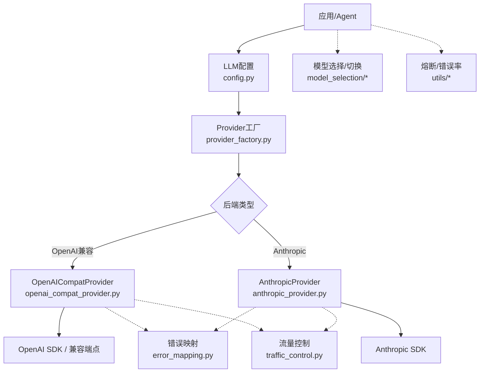
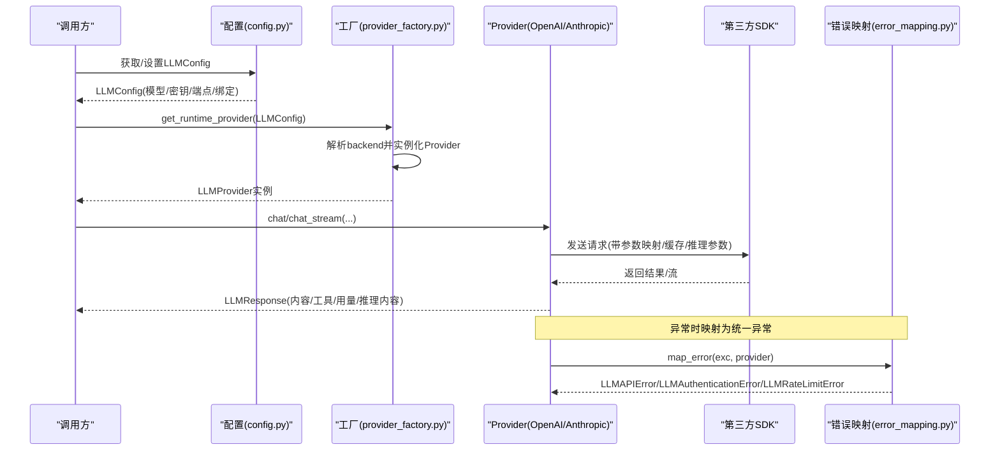
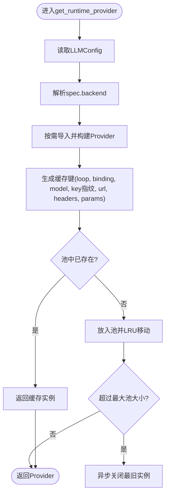
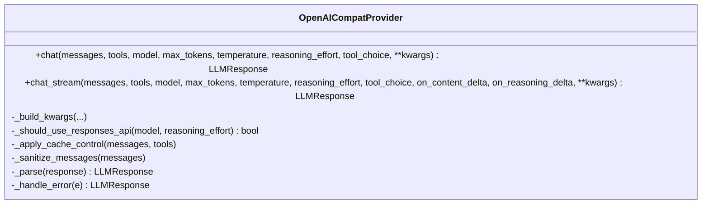
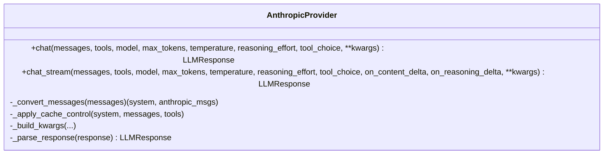
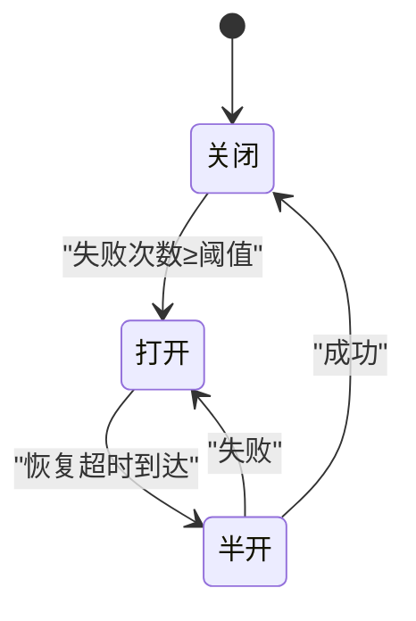
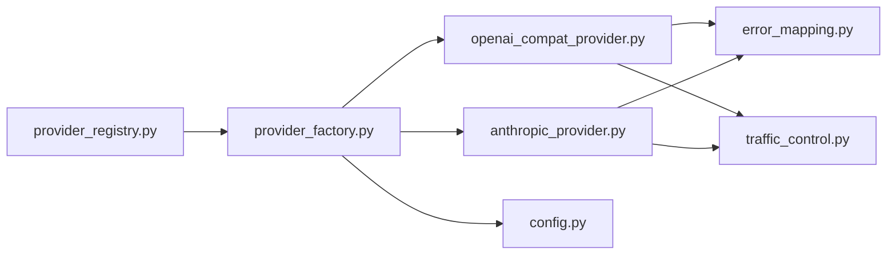

# 模型提供商支持

<cite>
**本文引用的文件**
- [provider_registry.py](file://deeptutor/services/provider_registry.py)
- [provider_factory.py](file://deeptutor/services/llm/provider_factory.py)
- [config.py](file://deeptutor/services/llm/config.py)
- [openai_compat_provider.py](file://deeptutor/services/llm/provider_core/openai_compat_provider.py)
- [anthropic_provider.py](file://deeptutor/services/llm/provider_core/anthropic_provider.py)
- [error_mapping.py](file://deeptutor/services/llm/error_mapping.py)
- [traffic_control.py](file://deeptutor/services/llm/traffic_control.py)
- [llm.py](file://deeptutor/services/model_selection/llm.py)
- [runtime.py](file://deeptutor/services/model_selection/runtime.py)
- [circuit_breaker.py](file://deeptutor/utils/network/circuit_breaker.py)
- [error_rate_tracker.py](file://deeptutor/utils/error_rate_tracker.py)
</cite>

## 目录
1. [简介](#简介)
2. [项目结构](#项目结构)
3. [核心组件](#核心组件)
4. [架构总览](#架构总览)
5. [详细组件分析](#详细组件分析)
6. [依赖关系分析](#依赖关系分析)
7. [性能与适用场景](#性能与适用场景)
8. [故障排查指南](#故障排查指南)
9. [结论](#结论)
10. [附录：配置与扩展清单](#附录：配置与扩展清单)

## 简介
本文件面向DeepTutor的“模型提供商”能力，系统性说明如何接入OpenAI、Anthropic、本地模型以及各类网关与云厂商。文档覆盖认证配置、API端点设置、参数映射、provider绑定与动态切换、自定义提供商注册与扩展接口、错误处理与重试、多提供商负载均衡与故障转移策略等主题，帮助读者快速理解并安全地集成多种LLM后端。

## 项目结构
DeepTutor在运行时通过统一的抽象层屏蔽不同提供商差异，关键路径如下：
- 提供商元数据与匹配：provider_registry.py
- 运行时提供者构建与池化：provider_factory.py
- 配置加载与环境变量注入：config.py
- OpenAI兼容实现（涵盖OpenAI、Gemini、Moonshot、MiniMax、DashScope、Groq、vLLM/Ollama/LM Studio等）：openai_compat_provider.py
- Anthropic原生实现（Claude系列）：anthropic_provider.py
- 统一错误映射：error_mapping.py
- 并发与速率限制：traffic_control.py
- 请求级模型选择与切换：model_selection/*
- 熔断器与错误率追踪：utils/network/circuit_breaker.py、utils/error_rate_tracker.py

图表来源
- [provider_factory.py:45-99](file://deeptutor/services/llm/provider_factory.py#L45-L99)
- [openai_compat_provider.py:106-146](file://deeptutor/services/llm/provider_core/openai_compat_provider.py#L106-L146)
- [anthropic_provider.py:48-83](file://deeptutor/services/llm/provider_core/anthropic_provider.py#L48-L83)
- [config.py:95-185](file://deeptutor/services/llm/config.py#L95-L185)

章节来源
- [provider_registry.py:118-479](file://deeptutor/services/provider_registry.py#L118-L479)
- [provider_factory.py:45-99](file://deeptutor/services/llm/provider_factory.py#L45-L99)
- [config.py:95-185](file://deeptutor/services/llm/config.py#L95-L185)

## 核心组件
- ProviderSpec与PROVIDERS：集中声明所有支持的提供商元数据（名称、关键词、环境变量、默认端点、是否网关/本地、特性开关等），并提供按名称/模型/网关自动匹配的查询方法。
- LLMConfig：封装当前请求或会话的模型、密钥、端点、绑定、推理努力等；支持上下文作用域内切换。
- ProviderFactory：根据配置动态导入并实例化具体Provider，维护事件循环内的轻量连接池，避免频繁创建SDK客户端。
- OpenAICompatProvider：统一适配OpenAI兼容生态（含OpenAI、Gemini、Moonshot、MiniMax、DashScope、Groq、vLLM、Ollama、LM Studio等），负责消息/工具/流式/缓存/推理参数等适配。
- AnthropicProvider：原生适配Claude系列，处理系统提示、消息块、工具定义、思考模式、缓存等。
- ErrorMapping：将各SDK异常映射为统一异常类型（鉴权失败、限流、上下文超限等）。
- TrafficController：基于信号量+令牌桶的并发与RPM控制，保护本地资源与远端配额。
- Model Selection：提供请求级模型选择与目录应用能力，支撑动态切换。
- 熔断与错误率：通过CircuitBreaker与ErrorRateTracker实现跨提供商的故障隔离与告警。

章节来源
- [provider_registry.py:18-112](file://deeptutor/services/provider_registry.py#L18-L112)
- [provider_registry.py:118-479](file://deeptutor/services/provider_registry.py#L118-L479)
- [config.py:95-185](file://deeptutor/services/llm/config.py#L95-L185)
- [provider_factory.py:45-99](file://deeptutor/services/llm/provider_factory.py#L45-L99)
- [openai_compat_provider.py:106-146](file://deeptutor/services/llm/provider_core/openai_compat_provider.py#L106-L146)
- [anthropic_provider.py:48-83](file://deeptutor/services/llm/provider_core/anthropic_provider.py#L48-L83)
- [error_mapping.py:54-87](file://deeptutor/services/llm/error_mapping.py#L54-L87)
- [traffic_control.py:13-122](file://deeptutor/services/llm/traffic_control.py#L13-L122)
- [llm.py](file://deeptutor/services/model_selection/llm.py)
- [runtime.py](file://deeptutor/services/model_selection/runtime.py)
- [circuit_breaker.py](file://deeptutor/utils/network/circuit_breaker.py)
- [error_rate_tracker.py:71-111](file://deeptutor/utils/error_rate_tracker.py#L71-L111)

## 架构总览
下图展示了从配置到具体调用的一条典型链路，包括提供商匹配、运行时构建、参数映射、流式响应与错误处理。

图表来源
- [config.py:95-185](file://deeptutor/services/llm/config.py#L95-L185)
- [provider_factory.py:45-99](file://deeptutor/services/llm/provider_factory.py#L45-L99)
- [openai_compat_provider.py:665-733](file://deeptutor/services/llm/provider_core/openai_compat_provider.py#L665-L733)
- [anthropic_provider.py:487-566](file://deeptutor/services/llm/provider_core/anthropic_provider.py#L487-L566)
- [error_mapping.py:54-87](file://deeptutor/services/llm/error_mapping.py#L54-L87)

## 详细组件分析

### 提供商注册与匹配（ProviderSpec/PROVIDERS）
- 统一入口：PROVIDERS元组定义了所有可用提供商及其行为特征，顺序即优先级。
- 三类模式：
  - 直连（is_direct=True）：如custom、azure_openai，用户完全控制端点与密钥。
  - 网关（is_gateway=True）：如openrouter、edenai、aihubmix、siliconflow、novita、atlascloud、volcengine、byteplus、nvidia_nim、groq、qianfan等，支持按api_key前缀或base_url关键字自动识别。
  - 本地（is_local=True）：如vllm、ollama、lm_studio、llama.cpp、lemonade、ovms等，通常指向localhost端口。
- 匹配函数：
  - find_by_name：按规范化名称查找。
  - find_by_model：按模型名关键词或前缀匹配标准提供商。
  - find_gateway：按api_key前缀或base_url关键字匹配网关。
- 别名与归一化：PROVIDER_ALIASES支持常见别名转换；canonical_provider_name用于标准化名称。
- 特性标记：supports_max_completion_tokens、supports_prompt_caching、thinking_style、reasoning_model_patterns等用于参数映射与行为控制。

章节来源
- [provider_registry.py:18-112](file://deeptutor/services/provider_registry.py#L18-L112)
- [provider_registry.py:118-479](file://deeptutor/services/provider_registry.py#L118-L479)
- [provider_registry.py:485-538](file://deeptutor/services/provider_registry.py#L485-L538)

### 运行时Provider构建与池化（ProviderFactory）
- 动态后端选择：根据LLMConfig.provider_name/binding解析spec.backend，再按需导入对应Provider类（openai_codex、github_copilot、azure_openai、anthropic、openai_compat）。
- 参数传递：将api_key、effective_url/base_url、extra_headers、default_model、spec等传入Provider构造。
- 连接池：按事件循环维度缓存Provider实例，限制最大池大小，避免重复创建SDK客户端导致的内存增长与连接丢失。
- 生命周期：提供关闭与重置接口，便于配置热更新或进程优雅退出。

图表来源
- [provider_factory.py:28-42](file://deeptutor/services/llm/provider_factory.py#L28-L42)
- [provider_factory.py:45-99](file://deeptutor/services/llm/provider_factory.py#L45-L99)
- [provider_factory.py:110-136](file://deeptutor/services/llm/provider_factory.py#L110-L136)

章节来源
- [provider_factory.py:45-99](file://deeptutor/services/llm/provider_factory.py#L45-L99)
- [provider_factory.py:110-136](file://deeptutor/services/llm/provider_factory.py#L110-L136)

### OpenAI兼容提供商（OpenAICompatProvider）
- 适用范围：OpenAI、Gemini、Moonshot、MiniMax、DashScope、Groq、vLLM、Ollama、LM Studio、各类网关等。
- 关键能力：
  - 消息与工具清洗、ID规范化、空内容清理。
  - 提示词缓存（对支持的系统/消息末尾/工具进行cache_control标记）。
  - 推理参数映射：根据spec.reasoning_model_patterns与thinking_style自动注入推理相关字段。
  - Responses API探测与降级：针对特定模型/推理需求尝试Responses API，失败则回退至chat.completions。
  - 温度控制：对部分模型（如o1/o3/gpt-5等）在开启推理时禁用temperature。
  - 流式与非流式：统一封装stream与parse逻辑，支持content与reasoning双通道增量回调。
  - 错误处理：对tool格式错误、response_format不支持等情况做自动降级或重试。

图表来源
- [openai_compat_provider.py:106-146](file://deeptutor/services/llm/provider_core/openai_compat_provider.py#L106-L146)
- [openai_compat_provider.py:256-315](file://deeptutor/services/llm/provider_core/openai_compat_provider.py#L256-L315)
- [openai_compat_provider.py:317-355](file://deeptutor/services/llm/provider_core/openai_compat_provider.py#L317-L355)
- [openai_compat_provider.py:665-733](file://deeptutor/services/llm/provider_core/openai_compat_provider.py#L665-L733)

章节来源
- [openai_compat_provider.py:106-146](file://deeptutor/services/llm/provider_core/openai_compat_provider.py#L106-L146)
- [openai_compat_provider.py:256-315](file://deeptutor/services/llm/provider_core/openai_compat_provider.py#L256-L315)
- [openai_compat_provider.py:317-355](file://deeptutor/services/llm/provider_core/openai_compat_provider.py#L317-L355)
- [openai_compat_provider.py:665-733](file://deeptutor/services/llm/provider_core/openai_compat_provider.py#L665-L733)

### Anthropic提供商（AnthropicProvider）
- 适用范围：Claude系列（Opus/Sonnet/Fable/Mythos等）。
- 关键能力：
  - 消息格式转换：将OpenAI风格消息转换为Anthropic Messages API所需结构（system、user/assistant交替、工具结果合并）。
  - 思考模式：对“effort-based”家族使用adaptive thinking；对老家族使用enabled+budget_tokens，并相应调整max_tokens与temperature。
  - 提示词缓存：对system、倒数第二条消息、工具定义进行cache_control标记，严格控制断点数。
  - 工具定义与选择：将function schema转为input_schema，并按thinking状态与tool_choice策略转换。
  - 流式：text_stream增量回调与最终消息聚合，空闲超时保护。

图表来源
- [anthropic_provider.py:48-83](file://deeptutor/services/llm/provider_core/anthropic_provider.py#L48-L83)
- [anthropic_provider.py:112-157](file://deeptutor/services/llm/provider_core/anthropic_provider.py#L112-L157)
- [anthropic_provider.py:312-356](file://deeptutor/services/llm/provider_core/anthropic_provider.py#L312-L356)
- [anthropic_provider.py:362-428](file://deeptutor/services/llm/provider_core/anthropic_provider.py#L362-L428)
- [anthropic_provider.py:487-566](file://deeptutor/services/llm/provider_core/anthropic_provider.py#L487-L566)

章节来源
- [anthropic_provider.py:48-83](file://deeptutor/services/llm/provider_core/anthropic_provider.py#L48-L83)
- [anthropic_provider.py:112-157](file://deeptutor/services/llm/provider_core/anthropic_provider.py#L112-L157)
- [anthropic_provider.py:312-356](file://deeptutor/services/llm/provider_core/anthropic_provider.py#L312-L356)
- [anthropic_provider.py:362-428](file://deeptutor/services/llm/provider_core/anthropic_provider.py#L362-L428)
- [anthropic_provider.py:487-566](file://deeptutor/services/llm/provider_core/anthropic_provider.py#L487-L566)

### 配置与环境变量（LLMConfig）
- 作用域切换：支持set_scoped_llm_config/reset_scoped_llm_config在当前异步上下文中临时替换配置。
- 早期环境注入：模块导入时为OpenAI兼容绑定提前设置OPENAI_API_KEY/OPENAI_BASE_URL，保证下游SDK能正确读取。
- 配置校验：若未配置有效模型或端点，抛出统一配置错误。
- 参数选择：根据模型族自动决定使用max_tokens或max_completion_tokens。

章节来源
- [config.py:54-92](file://deeptutor/services/llm/config.py#L54-L92)
- [config.py:95-185](file://deeptutor/services/llm/config.py#L95-L185)
- [config.py:236-282](file://deeptutor/services/llm/config.py#L236-L282)

### 错误处理与重试
- 统一映射：error_mapping.py将SDK异常映射为LLMAPIError、LLMAuthenticationError、LLMRateLimitError、ProviderContextWindowError等。
- 状态码优先：401直接映射为鉴权错误，429映射为限流错误。
- 重试策略：底层SDK客户端默认不启用重试（max_retries=0），由上层TrafficController与熔断器控制整体稳定性与恢复。
- 兼容性降级：OpenAICompatProvider对tool格式错误、response_format不支持等场景自动降级或重试。

章节来源
- [error_mapping.py:54-87](file://deeptutor/services/llm/error_mapping.py#L54-L87)
- [openai_compat_provider.py:665-733](file://deeptutor/services/llm/provider_core/openai_compat_provider.py#L665-L733)
- [openai_compat_provider.py:139-145](file://deeptutor/services/llm/provider_core/openai_compat_provider.py#L139-L145)
- [anthropic_provider.py:64-83](file://deeptutor/services/llm/provider_core/anthropic_provider.py#L64-L83)

### 流量控制与并发/限速
- TrafficController提供：
  - 并发上限（信号量）：防止本地资源耗尽。
  - RPM令牌桶：平滑限流，避免触发远端配额限制。
  - 获取超时：当并发或限速等待过久时主动失败，避免长时间阻塞。
- 使用方式：在调用Provider前后以异步上下文管理器包裹，确保并发槽释放。

章节来源
- [traffic_control.py:13-122](file://deeptutor/services/llm/traffic_control.py#L13-L122)

### 模型选择与动态切换
- 服务层提供LLMSelection与apply_llm_selection_to_catalog，可在请求或会话级别动态选择/切换模型，并与模型目录联动。
- 结合LLMConfig的作用域机制，可实现同一进程内不同请求路由到不同提供商/模型。

章节来源
- [llm.py](file://deeptutor/services/model_selection/llm.py)
- [runtime.py](file://deeptutor/services/model_selection/runtime.py)
- [config.py:136-143](file://deeptutor/services/llm/config.py#L136-L143)

### 多提供商负载均衡与故障转移
- 负载均衡：可通过上层调度器（如业务编排或外部网关）结合Model Selection在不同提供商间轮询或加权分配。
- 故障转移：
  - 熔断器：CircuitBreaker按提供商独立维护状态（closed/open/half-open），达到阈值后快速失败，并在恢复期试探性放行。
  - 错误率追踪：ErrorRateTracker统计窗口内错误比例，可触发告警或联动熔断。
  - 提供商探测：find_gateway可根据api_key前缀或base_url自动识别网关，便于在网关不可用时回退到其他提供商。

图表来源
- [circuit_breaker.py](file://deeptutor/utils/network/circuit_breaker.py)
- [error_rate_tracker.py:71-111](file://deeptutor/utils/error_rate_tracker.py#L71-L111)

章节来源
- [circuit_breaker.py](file://deeptutor/utils/network/circuit_breaker.py)
- [error_rate_tracker.py:71-111](file://deeptutor/utils/error_rate_tracker.py#L71-L111)
- [provider_registry.py:515-529](file://deeptutor/services/provider_registry.py#L515-L529)

## 依赖关系分析
- 低耦合：ProviderFactory仅依赖配置与ProviderSpec，运行时按需导入具体Provider，降低启动开销与依赖污染。
- 高内聚：每个Provider内部封装了消息/工具/流式/缓存/推理参数等细节，对外暴露统一LLMProvider接口。
- 外部依赖：OpenAI SDK、Anthropic SDK，以及可选的Responses API；通过兼容层屏蔽差异。
- 横向扩展：新增提供商只需在PROVIDERS中注册ProviderSpec，必要时实现对应backend或复用现有backend。

图表来源
- [provider_registry.py:118-479](file://deeptutor/services/provider_registry.py#L118-L479)
- [provider_factory.py:45-99](file://deeptutor/services/llm/provider_factory.py#L45-L99)
- [openai_compat_provider.py:106-146](file://deeptutor/services/llm/provider_core/openai_compat_provider.py#L106-L146)
- [anthropic_provider.py:48-83](file://deeptutor/services/llm/provider_core/anthropic_provider.py#L48-L83)
- [error_mapping.py:54-87](file://deeptutor/services/llm/error_mapping.py#L54-L87)
- [traffic_control.py:13-122](file://deeptutor/services/llm/traffic_control.py#L13-L122)

## 性能与适用场景
- OpenAI/GPT系列：通用对话、工具调用、JSON输出；适合大多数任务。注意新模型可能要求max_completion_tokens。
- Anthropic/Claude：强推理与长上下文；适合复杂推理、代码生成、结构化输出。
- 本地模型（vLLM/Ollama/LM Studio等）：隐私敏感、离线部署、成本可控；延迟与质量取决于模型与硬件。
- 网关（OpenRouter/Eden AI/AiHubMix等）：聚合多家模型，便于统一计费与路由；注意网关自身限流与可用性。
- 国内厂商（DashScope/Moonshot/MiniMax/Zhipu/Gemini China等）：合规与网络优化；注意各自参数差异（如温度锁定、推理参数）。
- 建议：
  - 高吞吐场景：优先本地或高性能网关，配合TrafficController限流。
  - 高质量推理：优先Claude或OpenAI最新模型，合理设置推理努力与token上限。
  - 成本敏感：优先本地或性价比高的网关/厂商，结合缓存与精简提示词。

[本节为通用指导，无需引用具体文件]

## 故障排查指南
- 鉴权失败（401）：检查API Key是否正确、是否过期；确认绑定与端点匹配。
- 限流（429）：降低并发或RPM，启用TrafficController；考虑切换到备用提供商。
- 上下文超限：缩短历史或拆分任务；使用提示词缓存减少重复输入。
- 工具参数格式错误：OpenAICompatProvider会自动降级到流式；也可检查工具schema与参数。
- 流式卡顿：检查idle_timeout与网络状况；必要时增大超时或切换非流式。
- 熔断触发：查看错误率与熔断状态，等待恢复或人工介入。

章节来源
- [error_mapping.py:54-87](file://deeptutor/services/llm/error_mapping.py#L54-L87)
- [openai_compat_provider.py:665-733](file://deeptutor/services/llm/provider_core/openai_compat_provider.py#L665-L733)
- [traffic_control.py:78-122](file://deeptutor/services/llm/traffic_control.py#L78-L122)
- [error_rate_tracker.py:71-111](file://deeptutor/utils/error_rate_tracker.py#L71-L111)

## 结论
DeepTutor通过ProviderSpec集中管理提供商元数据，结合ProviderFactory的动态构建与池化、OpenAI兼容与Anthropic原生实现、统一的错误映射与流量控制，提供了稳定、可扩展、易用的多提供商接入能力。借助模型选择与作用域配置，可实现请求级动态切换；结合熔断与错误率追踪，可构建健壮的负载均衡与故障转移方案。

[本节为总结，无需引用具体文件]

## 附录：配置与扩展清单
- 认证与端点
  - OpenAI：设置OPENAI_API_KEY与可选base_url；或通过绑定选择openai。
  - Anthropic：设置ANTHROPIC_API_KEY；如需自定义端点，注意去除末尾/v1以避免重复拼接。
  - 本地模型：设置对应环境变量与默认端口（如Ollama 11434、LM Studio 1234、vLLM等）。
  - 网关：按提供商要求设置KEY与前缀/域名关键字，或使用显式绑定。
- 参数映射
  - 新模型使用max_completion_tokens；推理努力与thinking_style按spec自动注入。
  - 部分模型（如Kimi）会锁定temperature，需移除该参数。
- 动态切换
  - 使用set_scoped_llm_config在请求上下文内切换模型/提供商。
  - 结合Model Selection与目录配置，实现A/B测试或灰度发布。
- 扩展接口
  - 新增提供商：在PROVIDERS中添加ProviderSpec；如需特殊行为，实现对应backend或复用现有backend。
  - 自定义Header/Env：通过extra_headers与env_extras注入。
- 可靠性
  - 启用TrafficController限制并发与RPM。
  - 结合CircuitBreaker与ErrorRateTracker实现熔断与告警。
  - 利用find_gateway进行自动识别与回退。

[本节为操作清单，无需引用具体文件]