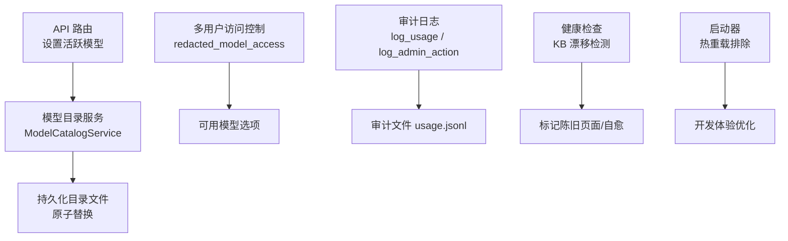
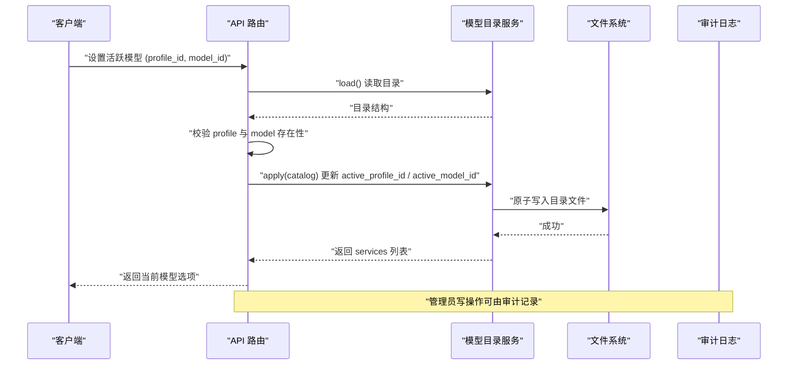
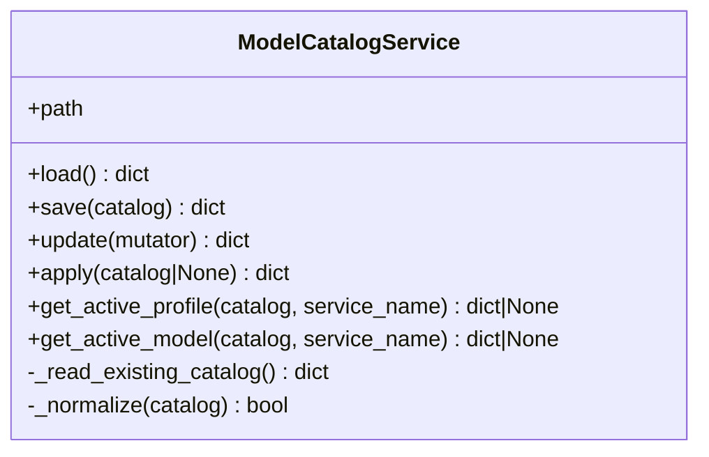
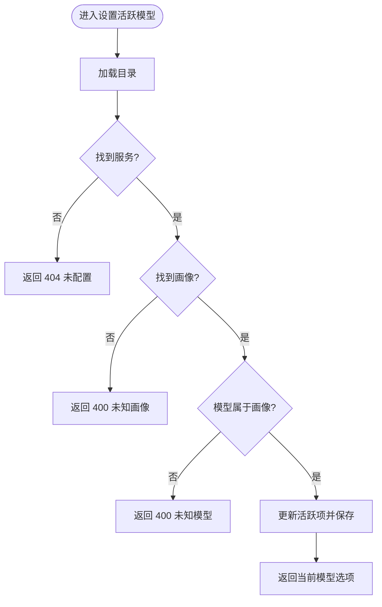
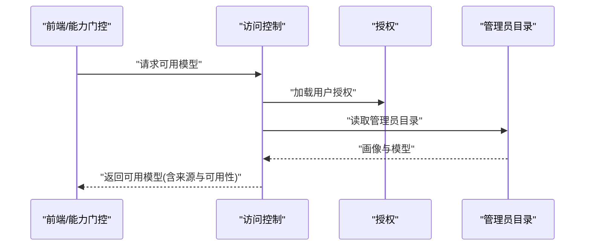
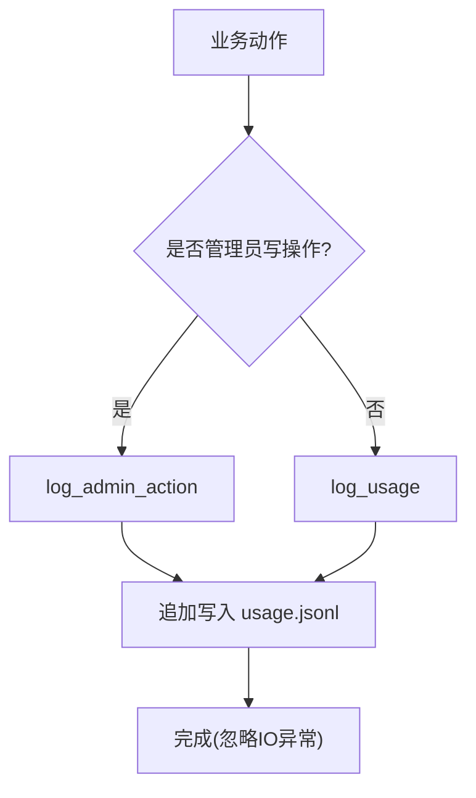
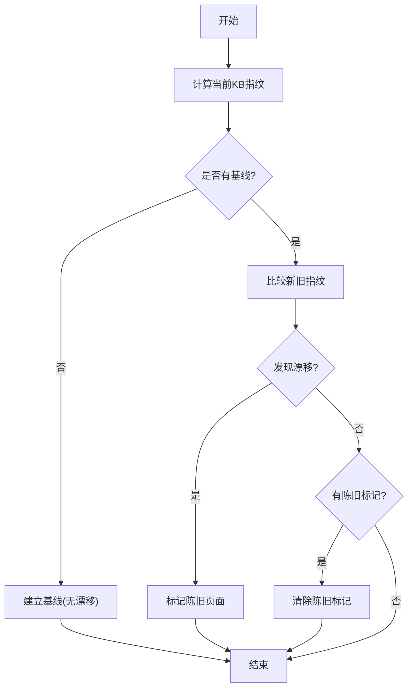
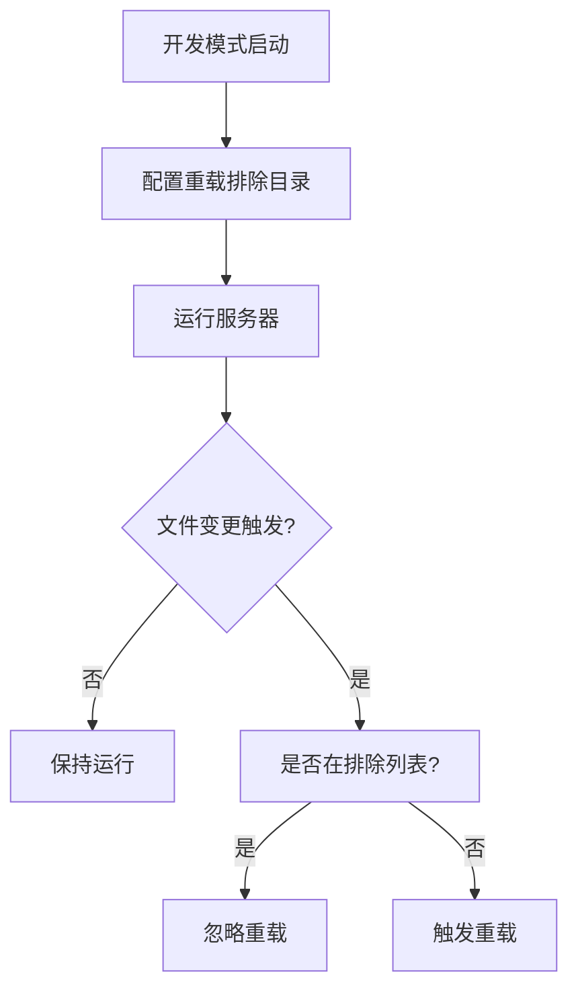
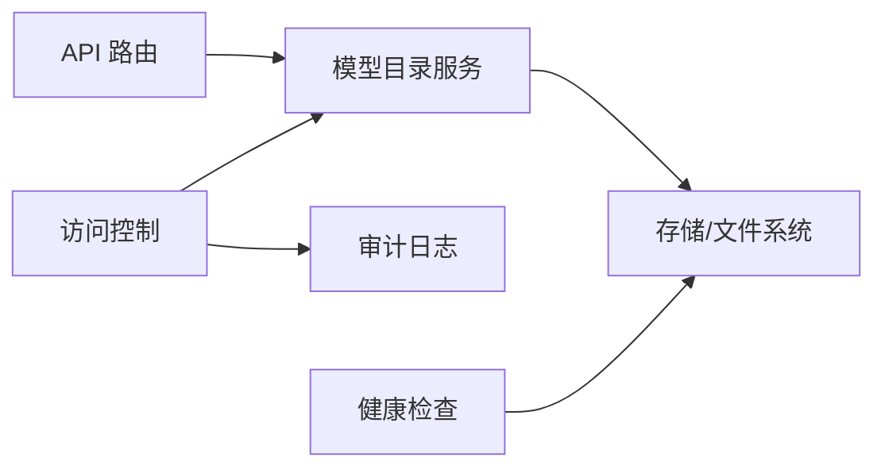

# 模型生命周期管理

<cite>
**本文引用的文件**
- [model_catalog.py](file://deeptutor/services/config/model_catalog.py)
- [knowledge.py](file://deeptutor/api/routers/knowledge.py)
- [model_access.py](file://deeptutor/multi_user/model_access.py)
- [audit.py](file://deeptutor/multi_user/audit.py)
- [kb_health.py](file://deeptutor/book/kb_health.py)
- [run_server.py](file://deeptutor/api/run_server.py)
- [router.py](file://deeptutor/multi_user/router.py)
</cite>

## 目录
1. [简介](#简介)
2. [项目结构](#项目结构)
3. [核心组件](#核心组件)
4. [架构总览](#架构总览)
5. [详细组件分析](#详细组件分析)
6. [依赖关系分析](#依赖关系分析)
7. [性能考虑](#性能考虑)
8. [故障排查指南](#故障排查指南)
9. [结论](#结论)
10. [附录](#附录)

## 简介
本文件面向DeepTutor的“模型生命周期管理”，覆盖模型的注册、更新、禁用与删除，版本控制与兼容性检查，热重载与动态配置更新，批量操作与脚本化工具，健康检查与自动修复，审计日志与变更追踪，以及备份恢复与数据迁移策略。内容基于代码库中的模型目录服务、API路由、多用户权限与审计、知识库健康检查等实现进行系统化说明。

## 项目结构
围绕模型生命周期管理的核心路径如下：
- 模型目录服务：负责加载、归一化、持久化模型目录（包含服务、画像、活跃模型等），并提供线程安全的原子写入。
- API路由：提供设置活跃模型、查询支持能力等接口，驱动目录服务的更新。
- 多用户访问控制：根据授权与个人绑定规则，决定普通用户可见可用的模型选项。
- 审计日志：记录资源使用与管理员写操作，便于追踪与合规。
- 健康检查：检测知识基线漂移并标记陈旧页面，辅助系统自愈。
- 启动与热重载：开发模式下通过排除目录避免误触发重载，提升迭代效率。

**图示来源**
- [model_catalog.py:53-125](file://deeptutor/services/config/model_catalog.py#L53-L125)
- [knowledge.py:1340-1363](file://deeptutor/api/routers/knowledge.py#L1340-L1363)
- [model_access.py:59-126](file://deeptutor/multi_user/model_access.py#L59-L126)
- [audit.py:19-81](file://deeptutor/multi_user/audit.py#L19-L81)
- [kb_health.py:102-222](file://deeptutor/book/kb_health.py#L102-L222)
- [run_server.py:41-59](file://deeptutor/api/run_server.py#L41-L59)

**章节来源**
- [model_catalog.py:53-125](file://deeptutor/services/config/model_catalog.py#L53-L125)
- [knowledge.py:1340-1363](file://deeptutor/api/routers/knowledge.py#L1340-L1363)
- [model_access.py:59-126](file://deeptutor/multi_user/model_access.py#L59-L126)
- [audit.py:19-81](file://deeptutor/multi_user/audit.py#L19-L81)
- [kb_health.py:102-222](file://deeptutor/book/kb_health.py#L102-L222)
- [run_server.py:41-59](file://deeptutor/api/run_server.py#L41-L59)

## 核心组件
- 模型目录服务（ModelCatalogService）
  - 职责：加载默认目录结构、合并已有配置、归一化字段、原子保存、获取活跃画像与模型。
  - 关键特性：线程锁保护、临时文件+原子替换、缺失字段补全、活跃项校验与回退。
- API路由（知识模块）
  - 职责：接收设置活跃模型请求，校验画像与模型存在性，更新目录并返回当前选项。
- 多用户访问控制
  - 职责：聚合管理员授权与个人绑定画像，生成去重且脱敏的可用模型列表；限制非管理员选择。
- 审计日志
  - 职责：记录普通用户对受管资源的访问与管理员写操作，确保可追溯且不中断请求。
- 健康检查
  - 职责：计算知识库指纹、检测漂移、标记陈旧页面、清理残留标记，必要时自愈。
- 启动与热重载
  - 职责：在开发模式排除特定目录，避免无关变更触发重载，提高调试效率。

**章节来源**
- [model_catalog.py:53-235](file://deeptutor/services/config/model_catalog.py#L53-L235)
- [knowledge.py:1340-1363](file://deeptutor/api/routers/knowledge.py#L1340-L1363)
- [model_access.py:59-156](file://deeptutor/multi_user/model_access.py#L59-L156)
- [audit.py:19-81](file://deeptutor/multi_user/audit.py#L19-L81)
- [kb_health.py:102-222](file://deeptutor/book/kb_health.py#L102-L222)
- [run_server.py:41-59](file://deeptutor/api/run_server.py#L41-L59)

## 架构总览
下图展示从API到目录服务再到持久化的完整调用链，以及多用户访问控制与审计的协作关系。

**图示来源**
- [knowledge.py:1340-1363](file://deeptutor/api/routers/knowledge.py#L1340-L1363)
- [model_catalog.py:68-125](file://deeptutor/services/config/model_catalog.py#L68-L125)
- [audit.py:57-81](file://deeptutor/multi_user/audit.py#L57-L81)

## 详细组件分析

### 模型目录服务（ModelCatalogService）
- 设计要点
  - 单例实例按路径隔离，避免跨工作区污染。
  - load() 合并默认结构与已有配置，缺失字段自动补齐，保证向后兼容。
  - save() 使用临时文件+os.replace实现原子写入，防止并发损坏。
  - update()/apply() 封装修改与持久化，统一入口。
  - get_active_profile/get_active_model 提供稳定读取活跃项的能力。
- 复杂度与性能
  - 读写为I/O密集型，采用线程锁串行化；目录较小，JSON序列化开销低。
  - 归一化过程遍历profiles/models，时间复杂度近似O(P+M)。
- 错误处理
  - 读取失败或格式异常时回退为空目录；保存失败时保留原文件。
- 扩展点
  - _normalize 可扩展新服务类型与字段；_service_shell/_search_shell 定义默认结构。

**图示来源**
- [model_catalog.py:53-235](file://deeptutor/services/config/model_catalog.py#L53-L235)

**章节来源**
- [model_catalog.py:53-235](file://deeptutor/services/config/model_catalog.py#L53-L235)

### API路由：设置活跃模型
- 流程
  - 解析请求体（kind, profile_id, model_id）。
  - 加载目录，定位服务与画像，校验模型属于该画像。
  - 更新active_profile_id与active_model_id，应用并返回当前选项。
- 兼容性检查
  - 若画像或模型不存在，返回明确错误码与消息。
- 幂等性
  - 重复设置相同活跃项不会产生副作用。

**图示来源**
- [knowledge.py:1340-1363](file://deeptutor/api/routers/knowledge.py#L1340-L1363)

**章节来源**
- [knowledge.py:1340-1363](file://deeptutor/api/routers/knowledge.py#L1340-L1363)

### 多用户访问控制与模型可用性
- 聚合来源
  - 管理员授权（grant）中的LLM画像与模型。
  - 个人绑定的画像（owner_bound）仅本人可用。
- 输出
  - redacted_model_access 返回去重、脱敏的可用模型列表，供前端与能力门控一致使用。
- 安全约束
  - 非管理员的选择会被apply_allowed_llm_selection校验，拒绝未授权模型。

**图示来源**
- [model_access.py:59-126](file://deeptutor/multi_user/model_access.py#L59-L126)
- [router.py:37-67](file://deeptutor/multi_user/router.py#L37-L67)

**章节来源**
- [model_access.py:59-156](file://deeptutor/multi_user/model_access.py#L59-L156)
- [router.py:37-67](file://deeptutor/multi_user/router.py#L37-L67)

### 审计日志与变更追踪
- 普通用户访问记录：log_usage 记录资源类型、ID、动作与额外信息。
- 管理员写操作：log_admin_action 记录执行者、目标用户与摘要。
- 可靠性：写入失败不中断请求，确保高可用。

**图示来源**
- [audit.py:19-81](file://deeptutor/multi_user/audit.py#L19-L81)

**章节来源**
- [audit.py:19-81](file://deeptutor/multi_user/audit.py#L19-L81)

### 健康检查与自动修复
- 知识库漂移检测：计算raw文档指纹并与基线对比，识别新增、移除、变更的知识库。
- 陈旧页面标记：检测到漂移后，将引用这些知识库的READY页面标记为陈旧。
- 自愈机制：若无漂移但缺少基线，自动建立基线；漂移清除后清理陈旧标记。

**图示来源**
- [kb_health.py:102-222](file://deeptutor/book/kb_health.py#L102-L222)

**章节来源**
- [kb_health.py:102-222](file://deeptutor/book/kb_health.py#L102-L222)

### 热重载与动态配置更新
- 开发模式热重载：通过reload_excludes排除虚拟环境、数据目录、构建产物等，避免误触发。
- 动态配置：通过API设置活跃模型即时生效（目录服务原子写入），无需重启服务。

**图示来源**
- [run_server.py:41-59](file://deeptutor/api/run_server.py#L41-L59)

**章节来源**
- [run_server.py:41-59](file://deeptutor/api/run_server.py#L41-L59)

## 依赖关系分析
- 组件耦合
  - API路由依赖模型目录服务进行状态更新。
  - 多用户访问控制依赖管理员目录与授权，形成统一的可用模型视图。
  - 健康检查独立于目录服务，关注知识库一致性。
  - 审计日志作为横切关注点，被管理面与业务面共同使用。
- 外部依赖
  - 文件系统：目录文件的读写与原子替换。
  - 多线程：RLock保障并发安全。

**图示来源**
- [model_catalog.py:53-125](file://deeptutor/services/config/model_catalog.py#L53-L125)
- [model_access.py:59-126](file://deeptutor/multi_user/model_access.py#L59-L126)
- [audit.py:19-81](file://deeptutor/multi_user/audit.py#L19-L81)
- [kb_health.py:102-222](file://deeptutor/book/kb_health.py#L102-L222)

**章节来源**
- [model_catalog.py:53-125](file://deeptutor/services/config/model_catalog.py#L53-L125)
- [model_access.py:59-126](file://deeptutor/multi_user/model_access.py#L59-L126)
- [audit.py:19-81](file://deeptutor/multi_user/audit.py#L19-L81)
- [kb_health.py:102-222](file://deeptutor/book/kb_health.py#L102-L222)

## 性能考虑
- 目录服务
  - 使用线程锁串行化写操作，避免竞争条件；读操作无锁，适合高频读取。
  - 原子写入减少崩溃风险；小文件JSON序列化开销可忽略。
- API路由
  - 设置活跃模型为轻量操作，主要开销在磁盘I/O。
- 健康检查
  - 指纹计算遍历raw文件，建议对大型知识库定期异步执行。
- 热重载
  - 合理配置排除目录，降低不必要的进程重启成本。

[本节为通用指导，不直接分析具体文件]

## 故障排查指南
- 设置活跃模型失败
  - 检查画像与模型是否存在；确认服务已配置；查看错误码与消息。
- 目录文件损坏
  - 目录服务读取失败会回退为空目录；检查持久化路径权限与磁盘空间。
- 审计日志缺失
  - 审计写入失败不会中断请求；检查SYSTEM_ROOT/audit目录是否存在与可写。
- 健康检查异常
  - 日志扫描失败会记录警告；检查book log.md可读性与格式。

**章节来源**
- [knowledge.py:1340-1363](file://deeptutor/api/routers/knowledge.py#L1340-L1363)
- [model_catalog.py:86-125](file://deeptutor/services/config/model_catalog.py#L86-L125)
- [audit.py:19-81](file://deeptutor/multi_user/audit.py#L19-L81)
- [kb_health.py:255-296](file://deeptutor/book/kb_health.py#L255-L296)

## 结论
DeepTutor的模型生命周期管理以模型目录服务为核心，结合API路由、多用户访问控制、审计日志与健康检查，实现了安全、可靠、可观测的模型注册、更新、禁用与删除能力。通过原子写入与归一化机制保障配置一致性，通过健康检查与自愈提升系统韧性，配合热重载与审计追踪优化开发与运维体验。

[本节为总结，不直接分析具体文件]

## 附录

### 版本控制与兼容性检查
- 版本字段：目录包含version字段用于标识目录结构版本。
- 兼容性：_normalize确保新增字段与服务类型被正确初始化，旧配置可平滑升级。

**章节来源**
- [model_catalog.py:38-50](file://deeptutor/services/config/model_catalog.py#L38-L50)
- [model_catalog.py:127-210](file://deeptutor/services/config/model_catalog.py#L127-L210)

### 批量操作与脚本化工具
- 批量更新：可通过多次调用设置活跃模型接口或使用update/apply方法进行批处理。
- 脚本化：利用目录服务的load/update/save方法编写自动化脚本，实现批量配置变更。

**章节来源**
- [model_catalog.py:117-125](file://deeptutor/services/config/model_catalog.py#L117-L125)
- [knowledge.py:1340-1363](file://deeptutor/api/routers/knowledge.py#L1340-L1363)

### 备份恢复与数据迁移策略
- 备份：目录文件为JSON文本，可直接复制备份；建议定期快照。
- 恢复：将备份文件替换为目标目录文件，服务下次加载即生效。
- 迁移：升级目录结构时，_normalize会自动补齐缺失字段；如需强制迁移，可在应用层增加迁移钩子。

**章节来源**
- [model_catalog.py:95-125](file://deeptutor/services/config/model_catalog.py#L95-L125)
- [model_catalog.py:127-210](file://deeptutor/services/config/model_catalog.py#L127-L210)