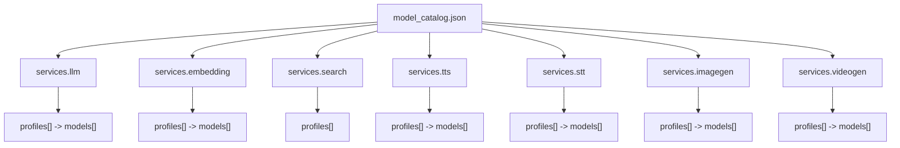
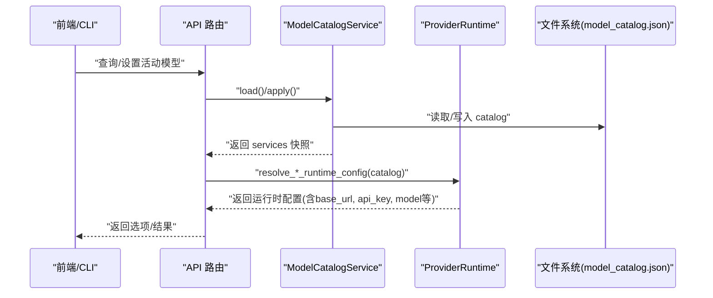
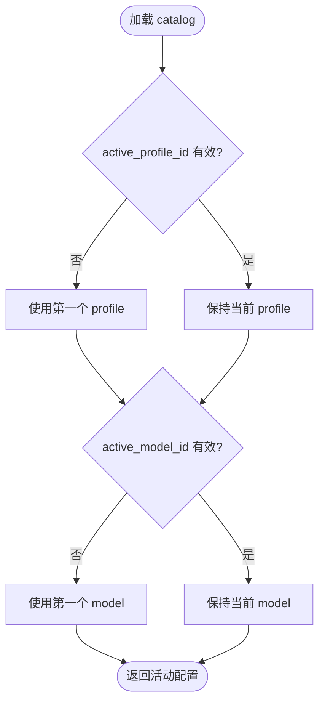
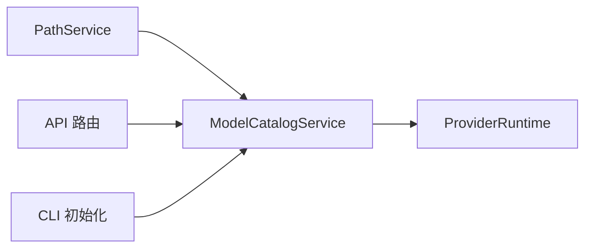

# 模型目录结构

<cite>
**本文引用的文件**
- [model_catalog.py](file://deeptutor/services/config/model_catalog.py)
- [embedding_endpoint.py](file://deeptutor/services/config/embedding_endpoint.py)
- [provider_runtime.py](file://deeptutor/services/config/provider_runtime.py)
- [knowledge.py](file://deeptutor/api/routers/knowledge.py)
- [settings.py](file://deeptutor/api/routers/settings.py)
- [init_cmd.py](file://deeptutor_cli/init_cmd.py)
- [test_model_catalog.py](file://tests/services/test_model_catalog.py)
- [voice_config.py](file://deeptutor/services/voice/config.py)
- [imagegen_config.py](file://deeptutor/services/imagegen/config.py)
</cite>

## 目录
1. [简介](#简介)
2. [项目结构](#项目结构)
3. [核心组件](#核心组件)
4. [架构总览](#架构总览)
5. [详细组件分析](#详细组件分析)
6. [依赖关系分析](#依赖关系分析)
7. [性能考虑](#性能考虑)
8. [故障排查指南](#故障排查指南)
9. [结论](#结论)
10. [附录](#附录)

## 简介
本文件系统性说明 DeepTutor 的模型目录配置文件 model_catalog.json 的整体架构与层次结构，覆盖 services 对象中各服务类型（llm、embedding、search、tts、stt、imagegen、videogen）的配置格式；profiles 与 models 的定义方式、必需与可选字段；active_profile_id 与 active_model_id 的作用机制；并提供完整配置示例、字段校验规则、版本管理与向后兼容性策略，以及最佳实践与常见错误避免方法。

## 项目结构
DeepTutor 通过 ModelCatalogService 统一加载、归一化并持久化 model_catalog.json。该文件位于用户或管理员的设置目录下，由 PathService 解析具体路径。顶层包含 version 与 services 两个关键部分：
- version：当前目录结构的版本号，用于兼容演进。
- services：按服务类型划分的配置集合，每个服务包含 active_profile_id、active_model_id（search 无 active_model_id）、profiles 列表。

图表来源
- [model_catalog.py:38-50](file://deeptutor/services/config/model_catalog.py#L38-L50)

章节来源
- [model_catalog.py:38-50](file://deeptutor/services/config/model_catalog.py#L38-L50)

## 核心组件
- ModelCatalogService：负责读取、合并默认值、规范化、并发安全保存与获取活动配置。
- embedding_endpoint：为 embedding 服务的 base_url 提供显示与校验辅助，确保不同提供商的端点路径正确。
- provider_runtime：将 catalog 中的 profile 与 model 解析为运行时配置数据类（如 TTSConfig、ImagegenConfig、VideogenConfig）。
- API 路由：暴露查询与设置活动模型的接口，驱动 UI/CLI 修改 catalog。

章节来源
- [model_catalog.py:53-125](file://deeptutor/services/config/model_catalog.py#L53-L125)
- [embedding_endpoint.py:185-268](file://deeptutor/services/config/embedding_endpoint.py#L185-L268)
- [provider_runtime.py:1003-1056](file://deeptutor/services/config/provider_runtime.py#L1003-L1056)
- [knowledge.py:1274-1363](file://deeptutor/api/routers/knowledge.py#L1274-L1363)
- [settings.py:471-502](file://deeptutor/api/routers/settings.py#L471-L502)

## 架构总览
下图展示从 API 到 Catalog 再到运行时配置的调用链，体现 active_profile_id 与 active_model_id 如何决定最终使用的模型与端点。

图表来源
- [knowledge.py:1274-1363](file://deeptutor/api/routers/knowledge.py#L1274-L1363)
- [model_catalog.py:68-125](file://deeptutor/services/config/model_catalog.py#L68-L125)
- [provider_runtime.py:1003-1056](file://deeptutor/services/config/provider_runtime.py#L1003-L1056)

## 详细组件分析

### model_catalog.json 整体结构与层次
- 顶层字段
  - version：目录结构版本，当前默认值为 1。
  - services：服务字典，键为服务类型名称。
- 每个服务对象
  - active_profile_id：当前激活的 profile 标识。
  - active_model_id：当前激活的模型标识（search 服务不包含此字段）。
  - profiles：profile 数组，每个 profile 描述一个提供商/端点绑定及一组模型。
- profile 通用字段
  - id：唯一标识（缺失时自动生成）。
  - name：人类可读名称（缺失时生成默认名）。
  - binding：提供商别名（如 openai、gemini、openrouter 等），search 使用 provider。
  - base_url：端点地址（embedding 会按提供商规范自动补齐/修正）。
  - api_key：认证密钥。
  - api_version：可选，特定提供商的版本号。
  - extra_headers：可选，附加请求头。
- model 通用字段
  - id：唯一标识（缺失时自动生成）。
  - name：显示名称（缺失时使用 model 或默认名）。
  - model：实际模型名（字符串）。
- 服务特有字段
  - search：profile.provider 指定搜索引擎（如 brave、tavily、jina、searxng、duckduckgo、perplexity、serper、none），models 为空数组。
  - embedding：model.dimension、model.supported_dimensions 用于维度信息与 UI 提示。
  - tts：model.voice、model.response_format。
  - imagegen：model.size、model.quality、model.style、model.response_format。
  - videogen：model.aspect_ratio、model.duration、model.resolution。

章节来源
- [model_catalog.py:23-50](file://deeptutor/services/config/model_catalog.py#L23-L50)
- [model_catalog.py:127-210](file://deeptutor/services/config/model_catalog.py#L127-L210)
- [embedding_endpoint.py:185-268](file://deeptutor/services/config/embedding_endpoint.py#L185-L268)
- [voice_config.py:27-73](file://deeptutor/services/voice/config.py#L27-L73)
- [imagegen_config.py:17-40](file://deeptutor/services/imagegen/config.py#L17-L40)

### services 各服务类型配置格式
- llm
  - 使用 binding 指向 LLM 提供商（如 openai、openrouter、ollama、vllm 等）。
  - base_url 通常为聊天补全端点根路径。
  - models 中 model 字段为聊天模型名。
- embedding
  - base_url 必须匹配提供商要求的嵌入端点路径（如 /embeddings、/embed 或 Gemini 原生路径）。
  - 支持 dimension 与 supported_dimensions 字段，便于 UI 展示与校验。
- search
  - 使用 provider 字段选择搜索引擎，models 为空数组。
  - 支持 proxy 字段（在初始化时默认存在）。
- tts
  - voice 与 response_format 控制语音合成参数。
- stt
  - 使用 OpenAI 兼容适配器，支持 multipart/base64_json 两种请求风格。
- imagegen
  - size、quality、style、response_format 控制图像生成参数。
- videogen
  - aspect_ratio、duration、resolution 控制视频生成参数。

章节来源
- [model_catalog.py:127-210](file://deeptutor/services/config/model_catalog.py#L127-L210)
- [embedding_endpoint.py:185-268](file://deeptutor/services/config/embedding_endpoint.py#L185-L268)
- [provider_runtime.py:1003-1056](file://deeptutor/services/config/provider_runtime.py#L1003-L1056)
- [voice_config.py:27-73](file://deeptutor/services/voice/config.py#L27-L73)
- [imagegen_config.py:17-40](file://deeptutor/services/imagegen/config.py#L17-L40)

### profiles 与 models 定义方式
- 必需字段
  - profile.id：若缺失，系统自动生成唯一 id。
  - model.id：若缺失，系统自动生成唯一 id。
  - model.model：实际模型名（字符串）。
- 可选字段
  - profile.name、api_version、base_url、api_key、extra_headers。
  - model.name、dimension、supported_dimensions、voice、size、quality、style、response_format、aspect_ratio、duration、resolution。
- 默认值与归一化
  - 加载时会合并默认 shell，确保所有服务与字段存在。
  - 对 embedding 的 base_url 进行显示规范化，保证与提供商要求一致。
  - 当 active_profile_id 或 active_model_id 指向不存在项时，回退到第一个可用项。

章节来源
- [model_catalog.py:23-50](file://deeptutor/services/config/model_catalog.py#L23-L50)
- [model_catalog.py:127-210](file://deeptutor/services/config/model_catalog.py#L127-L210)

### active_profile_id 与 active_model_id 的作用机制
- 作用范围
  - llm、embedding、tts、stt、imagegen、videogen：同时维护 active_profile_id 与 active_model_id。
  - search：仅维护 active_profile_id，无 active_model_id。
- 选择逻辑
  - 读取 catalog 后，若 active 标识无效或缺失，则回退到 profiles/models 的第一个元素。
  - 更新接口允许设置新的 active 组合，随后立即持久化。
- 运行时解析
  - provider_runtime 根据 active 标识解析出最终的 base_url、api_key、model 与模型级参数。

图表来源
- [model_catalog.py:200-210](file://deeptutor/services/config/model_catalog.py#L200-L210)
- [model_catalog.py:212-235](file://deeptutor/services/config/model_catalog.py#L212-L235)

章节来源
- [model_catalog.py:200-235](file://deeptutor/services/config/model_catalog.py#L200-L235)

### 完整配置文件示例与字段验证规则
- 示例结构要点
  - version: 1
  - services 下包含 llm、embedding、search、tts、stt、imagegen、videogen
  - 每个服务至少有一个 profile，且包含 models 列表
  - embedding 的 base_url 需符合提供商端点规范
  - search 的 provider 需为支持的搜索引擎之一
- 验证规则
  - embedding 端点校验：Gemini 必须为 /embeddings 或原生 :batchEmbedContents 路径；OpenAI/OpenRouter/Jina/vLLM/SiliconFlow 必须以 /embeddings 结尾；Ollama 必须为 /api/embed；Cohere 必须以 /embed 结尾。
  - 搜索提供商状态：支持集包括 brave、tavily、jina、searxng、duckduckgo、perplexity、serper、none；exa、baidu、openrouter 标记为已弃用。
  - 活动标识一致性：若 active 指向不存在的 profile/model，将被自动修复为第一个可用项。

章节来源
- [embedding_endpoint.py:185-268](file://deeptutor/services/config/embedding_endpoint.py#L185-L268)
- [provider_runtime.py:42-52](file://deeptutor/services/config/provider_runtime.py#L42-L52)
- [model_catalog.py:127-210](file://deeptutor/services/config/model_catalog.py#L127-L210)

### 版本管理与向后兼容性处理
- 版本字段
  - catalog.version 用于标识目录结构版本，当前默认值为 1。
- 兼容策略
  - 加载时合并默认 shell，确保新增字段与服务存在。
  - 对旧版或不完整 catalog 进行归一化，必要时自动修复 active 标识。
  - 保存采用原子写入（临时文件 + os.replace），避免损坏。
  - 测试覆盖：损坏 JSON 恢复、环境变量不覆盖现有 active、Gemini 端点自动修正等场景。

章节来源
- [model_catalog.py:38-50](file://deeptutor/services/config/model_catalog.py#L38-L50)
- [model_catalog.py:68-125](file://deeptutor/services/config/model_catalog.py#L68-L125)
- [test_model_catalog.py:8-248](file://tests/services/test_model_catalog.py#L8-L248)

### 最佳实践与常见错误避免
- 最佳实践
  - 明确设置每个服务的 active_profile_id 与 active_model_id，避免回退到默认项导致意外行为。
  - embedding 的 base_url 严格遵循提供商端点规范，避免连接失败。
  - 使用 extra_headers 传递必要头部（如 Azure OpenAI 的 api-key 头）。
  - 为每个 model 设置清晰的 name 与 model 字段，便于 UI 展示与调试。
  - 定期备份 model_catalog.json，并在变更前后记录差异。
- 常见错误
  - embedding 端点路径不正确（如缺少 /embeddings 或使用错误的 Gemini 路径）。
  - search 的 provider 未设置为支持值，导致状态为 unsupported/deprecated。
  - active 标识指向不存在的 profile/model，导致自动回退。
  - 并发写入冲突：应通过 update/apply 接口操作，避免直接写文件。
  - 敏感信息泄露：避免在 base_url 查询参数中携带密钥，系统会进行脱敏显示。

章节来源
- [embedding_endpoint.py:185-268](file://deeptutor/services/config/embedding_endpoint.py#L185-L268)
- [provider_runtime.py:42-52](file://deeptutor/services/config/provider_runtime.py#L42-L52)
- [model_catalog.py:95-125](file://deeptutor/services/config/model_catalog.py#L95-L125)

## 依赖关系分析
- ModelCatalogService 依赖 PathService 确定 catalog 文件路径。
- provider_runtime 依赖 ModelCatalogService 与 provider_registry，解析运行时配置。
- API 路由依赖 ModelCatalogService 暴露查询与设置能力。
- CLI 初始化命令创建默认 profile 与 model 行，便于后续编辑。

图表来源
- [model_catalog.py:13-20](file://deeptutor/services/config/model_catalog.py#L13-L20)
- [model_catalog.py:238-249](file://deeptutor/services/config/model_catalog.py#L238-L249)
- [provider_runtime.py:1003-1056](file://deeptutor/services/config/provider_runtime.py#L1003-L1056)
- [knowledge.py:1274-1363](file://deeptutor/api/routers/knowledge.py#L1274-L1363)
- [init_cmd.py:51-85](file://deeptutor_cli/init_cmd.py#L51-L85)

章节来源
- [model_catalog.py:13-20](file://deeptutor/services/config/model_catalog.py#L13-L20)
- [model_catalog.py:238-249](file://deeptutor/services/config/model_catalog.py#L238-L249)
- [provider_runtime.py:1003-1056](file://deeptutor/services/config/provider_runtime.py#L1003-L1056)
- [knowledge.py:1274-1363](file://deeptutor/api/routers/knowledge.py#L1274-L1363)
- [init_cmd.py:51-85](file://deeptutor_cli/init_cmd.py#L51-L85)

## 性能考虑
- 并发安全：save/update 使用线程锁保护，避免竞态条件。
- 原子写入：临时文件 + os.replace 确保文件完整性。
- 最小化 IO：仅在需要时合并默认值并持久化，减少磁盘写入频率。
- 缓存与实例复用：get_instance 基于路径复用服务实例，降低重复初始化开销。

章节来源
- [model_catalog.py:95-125](file://deeptutor/services/config/model_catalog.py#L95-L125)
- [model_catalog.py:60-66](file://deeptutor/services/config/model_catalog.py#L60-L66)

## 故障排查指南
- 症状：embedding 连接失败
  - 检查 base_url 是否符合提供商端点规范（参考 embedding_endpoint 校验）。
  - 确认 model.dimension 与 supported_dimensions 是否合理。
- 症状：search 不可用
  - 检查 provider 是否在支持列表中，避免使用已弃用提供商。
- 症状：活动模型未生效
  - 确认 active_profile_id 与 active_model_id 指向有效的 profile/model。
  - 通过 API 查询 services 快照，核对 active 字段。
- 症状：catalog 损坏
  - 系统会自动恢复默认结构，检查 version 与 services 是否完整。
  - 查看是否存在临时文件残留（正常情况下会被清理）。

章节来源
- [embedding_endpoint.py:185-268](file://deeptutor/services/config/embedding_endpoint.py#L185-L268)
- [provider_runtime.py:42-52](file://deeptutor/services/config/provider_runtime.py#L42-L52)
- [model_catalog.py:68-125](file://deeptutor/services/config/model_catalog.py#L68-L125)
- [test_model_catalog.py:102-119](file://tests/services/test_model_catalog.py#L102-L119)

## 结论
model_catalog.json 是 DeepTutor 多模态服务配置的核心，通过统一的 schema 与严格的归一化流程，确保不同提供商与模型的可插拔性与稳定性。active_profile_id 与 active_model_id 提供了灵活的活动配置切换机制，结合 API 与 CLI 工具，可实现动态管理。遵循最佳实践与校验规则，可显著降低配置错误与运行风险。

## 附录
- 常用服务与字段速查
  - llm：binding、base_url、api_key、models[].model
  - embedding：binding、base_url（/embeddings 或原生路径）、models[].dimension
  - search：provider（brave/tavily/jina/searxng/duckduckgo/perplexity/serper/none）
  - tts：models[].voice、models[].response_format
  - stt：multipart/base64_json 请求风格
  - imagegen：models[].size、quality、style、response_format
  - videogen：models[].aspect_ratio、duration、resolution

章节来源
- [model_catalog.py:127-210](file://deeptutor/services/config/model_catalog.py#L127-L210)
- [voice_config.py:27-73](file://deeptutor/services/voice/config.py#L27-L73)
- [imagegen_config.py:17-40](file://deeptutor/services/imagegen/config.py#L17-L40)
- [provider_runtime.py:42-52](file://deeptutor/services/config/provider_runtime.py#L42-L52)