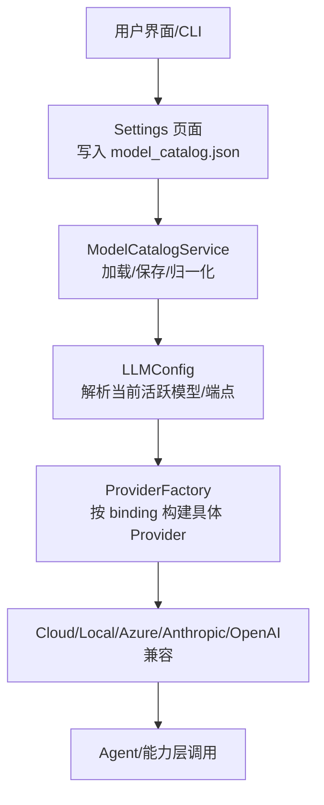
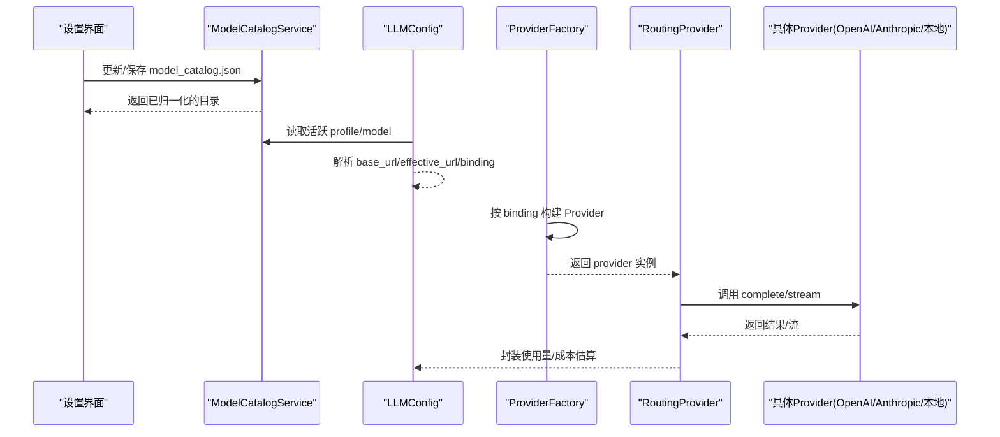
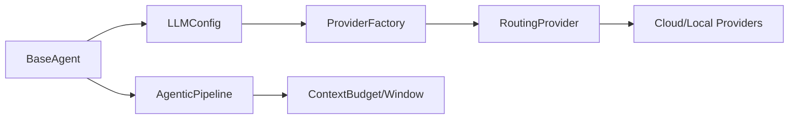
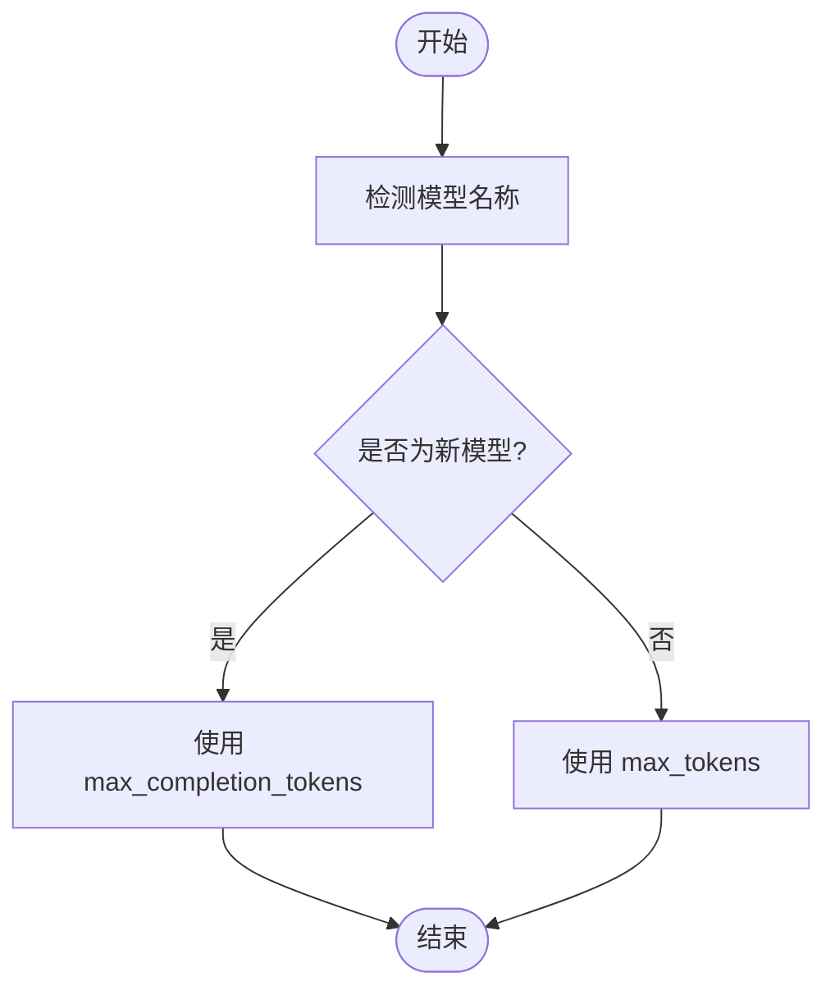
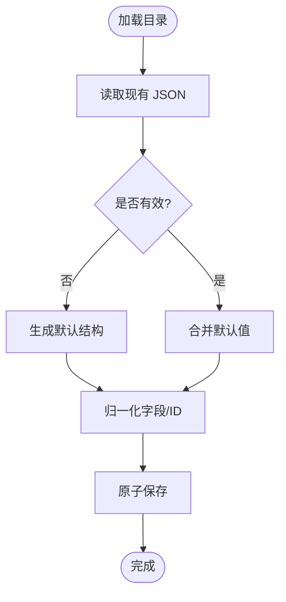

# 模型目录配置

<cite>
**本文引用的文件**
- [model_catalog.py](file://deeptutor/services/config/model_catalog.py)
- [config.py](file://deeptutor/services/llm/config.py)
- [provider_factory.py](file://deeptutor/services/llm/provider_factory.py)
- [routing.py](file://deeptutor/services/llm/providers/routing.py)
- [base_agent.py](file://deeptutor/agents/base_agent.py)
- [chat_agent.py](file://deeptutor/agents/chat/chat_agent.py)
- [agentic_pipeline.py](file://deeptutor/agents/chat/agentic_pipeline.py)
- [context_budget.py](file://deeptutor/agents/chat/context_budget.py)
- [test_model_catalog.py](file://tests/services/test_model_catalog.py)
- [README.md](file://README.md)
- [Dockerfile](file://Dockerfile)
</cite>

## 目录
1. [简介](#简介)
2. [项目结构](#项目结构)
3. [核心组件](#核心组件)
4. [架构总览](#架构总览)
5. [详细组件分析](#详细组件分析)
6. [依赖关系分析](#依赖关系分析)
7. [性能考虑](#性能考虑)
8. [故障排查指南](#故障排查指南)
9. [结论](#结论)
10. [附录](#附录)

## 简介
本文件系统性说明 DeepTutor 的“模型目录配置”机制，围绕 model_catalog.json 的结构、模型定义格式、支持的模型提供商（OpenAI、Anthropic、本地模型等）配置方法、能力声明与参数映射、路由与多模型切换策略、版本管理与兼容性检查、自定义模型添加与最佳实践、性能调优与错误处理配置，以及通过 API 动态注册与管理模型的方式展开。目标是帮助读者在不深入源码的情况下也能正确配置、扩展与维护模型目录。

## 项目结构
DeepTutor 将“模型目录”作为运行时可编辑的配置中心，默认位于 data/user/settings/model_catalog.json。该文件集中管理 LLM、Embedding、Search、TTS、STT、ImageGen、VideoGen 等服务的能力与活跃模型选择。系统启动时会将这些设置导出为环境变量并注入到后端服务中，确保各模块以统一视角读取配置。

图表来源
- [model_catalog.py:53-125](file://deeptutor/services/config/model_catalog.py#L53-L125)
- [config.py:162-185](file://deeptutor/services/llm/config.py#L162-L185)
- [provider_factory.py:45-99](file://deeptutor/services/llm/provider_factory.py#L45-L99)

章节来源
- [README.md:434-447](file://README.md#L434-L447)
- [Dockerfile:369-402](file://Dockerfile#L369-L402)

## 核心组件
- 模型目录服务：负责加载、合并默认值、持久化、并发安全地读写 model_catalog.json，并提供“活跃 Profile/模型”查询。
- LLM 配置：从目录服务解析出当前活跃的 LLM 配置（模型名、密钥、端点、绑定、头信息、推理强度、上下文窗口、并发与速率限制等）。
- 提供者工厂：根据配置中的 binding/provider_name 动态构建具体的 Provider（OpenAI 兼容、Azure OpenAI、Anthropic、GitHub Copilot、Codex 等），并进行连接池缓存。
- 路由提供者：在旧有函数式接口与新对象式 Provider 之间桥接，支持本地/云端自动路由、重试、熔断与流式输出。
- Agent 接入：Agent 通过统一接口获取模型、温度、最大 token 等参数，并调用底层 Provider。

章节来源
- [model_catalog.py:53-235](file://deeptutor/services/config/model_catalog.py#L53-L235)
- [config.py:95-185](file://deeptutor/services/llm/config.py#L95-L185)
- [provider_factory.py:110-136](file://deeptutor/services/llm/provider_factory.py#L110-L136)
- [routing.py:66-183](file://deeptutor/services/llm/providers/routing.py#L66-L183)
- [base_agent.py:167-213](file://deeptutor/agents/base_agent.py#L167-L213)

## 架构总览
下图展示了从配置到调用的完整链路：UI/CLI 修改目录 → 目录服务归一化并持久化 → LLM 配置解析 → Provider 工厂构建 → 实际云/本地调用。

图表来源
- [model_catalog.py:68-125](file://deeptutor/services/config/model_catalog.py#L68-L125)
- [config.py:162-185](file://deeptutor/services/llm/config.py#L162-L185)
- [provider_factory.py:45-99](file://deeptutor/services/llm/provider_factory.py#L45-L99)
- [routing.py:76-183](file://deeptutor/services/llm/providers/routing.py#L76-L183)

## 详细组件分析

### model_catalog.json 结构与模型定义格式
- 顶层字段
  - version：目录版本（用于演进兼容）
  - services：包含 llm、embedding、search、tts、stt、imagegen、videogen 等服务域
- 每个服务域
  - active_profile_id：当前激活的 Profile ID
  - active_model_id：当前激活的模型 ID（搜索服务除外）
  - profiles：Profile 列表，每个 Profile 包含
    - id/name：唯一标识与显示名
    - binding：绑定类型（如 openai、anthropic、azure_openai、github_copilot、openai_codex 等）
    - base_url/api_key/api_version/extra_headers：端点、密钥、API 版本与额外请求头
    - models：模型列表，每个模型包含
      - id/name/model：内部标识、显示名、供应商模型名
      - 其他字段随服务而异（如 embedding 的 dimension/supported_dimensions；tts 的 voice/response_format；imagegen/videogen 的尺寸/质量/时长等）
- 归一化规则
  - 缺失字段会被补齐（id、name、base_url、api_key、models 等）
  - 若 active_profile_id/active_model_id 指向不存在项，会自动回退到首个可用项
  - Embedding 的 base_url 会根据 binding 和活跃模型进行规范化（例如 Gemini 原生路径或 OpenAI 兼容路径）

章节来源
- [model_catalog.py:38-50](file://deeptutor/services/config/model_catalog.py#L38-L50)
- [model_catalog.py:127-210](file://deeptutor/services/config/model_catalog.py#L127-L210)
- [test_model_catalog.py:155-177](file://tests/services/test_model_catalog.py#L155-L177)

### 支持的模型提供商与配置要点
- OpenAI 兼容（默认）
  - binding=openai 或任何标记为 openai_compat 的提供方
  - 需要 base_url 与 api_key；可通过 extra_headers 注入鉴权头
  - 新模型可能要求 max_completion_tokens 而非 max_tokens（见下文兼容性）
- Azure OpenAI
  - binding=azure_openai；需配置 base_url、api_key、api_version
- Anthropic
  - binding=anthropic；支持 prompt caching（由 spec 决定）
- GitHub Copilot / Codex
  - 对应 backend 分支，按需启用
- 本地模型
  - 当 base_url 被识别为本地 LLM 服务器时，路由层会走本地实现
  - Docker 部署建议使用 host.docker.internal 作为 base_url

章节来源
- [provider_factory.py:45-99](file://deeptutor/services/llm/provider_factory.py#L45-L99)
- [routing.py:70-109](file://deeptutor/services/llm/providers/routing.py#L70-L109)
- [Dockerfile:369-402](file://Dockerfile#L369-L402)

### 能力声明、参数映射与路由配置
- 能力声明
  - 通过 service 域的 profiles 与 models 声明可用能力（文本生成、嵌入、语音、图像、视频等）
  - 搜索服务使用 provider 字段（如 brave）与 models 列表
- 参数映射
  - temperature/max_tokens/reasoning_effort 等生成参数由 LLMConfig 承载并传入 Provider
  - 对部分新模型，系统自动将 max_tokens 映射为 max_completion_tokens
- 路由配置
  - routing 提供者根据 base_url 判断本地/云端，并在云端时按 binding/api_version 转发
  - 支持可选缓存（命中则直接返回）、重试与熔断

章节来源
- [config.py:236-282](file://deeptutor/services/llm/config.py#L236-L282)
- [routing.py:76-183](file://deeptutor/services/llm/providers/routing.py#L76-L183)

### 多模型切换与负载均衡策略
- 多模型切换
  - 通过设置 services.llm.active_profile_id 与 active_model_id 完成切换
  - 目录服务会在加载时校验并修复无效引用
- 负载均衡
  - 当前目录层未内置多端点轮询；如需多端点高可用，可在上层（网关/代理）实现
  - Provider 工厂维护小尺寸的连接池，减少重复创建开销

章节来源
- [model_catalog.py:212-235](file://deeptutor/services/config/model_catalog.py#L212-L235)
- [provider_factory.py:110-136](file://deeptutor/services/llm/provider_factory.py#L110-L136)

### 版本管理与兼容性检查
- 版本字段
  - catalog.version 用于目录结构演进
- 兼容性检查
  - 加载时自动补齐缺失字段并修正无效 active 引用
  - Embedding 的 base_url 会根据活跃模型自动切换到更合适的端点（如 Gemini 原生 vs OpenAI 兼容）
  - 对新模型自动采用正确的 token 限制参数

章节来源
- [model_catalog.py:68-84](file://deeptutor/services/config/model_catalog.py#L68-L84)
- [model_catalog.py:127-210](file://deeptutor/services/config/model_catalog.py#L127-L210)
- [config.py:236-282](file://deeptutor/services/llm/config.py#L236-L282)

### 自定义模型添加方法与最佳实践
- 步骤
  - 在对应服务的 profiles 中添加新的 Profile，填写 binding、base_url、api_key、extra_headers
  - 在 models 中添加模型条目，填写 model（供应商模型名）及必要参数（如 dimension、voice、size 等）
  - 将 active_profile_id/active_model_id 指向新增项
- 最佳实践
  - 为每个环境（开发/测试/生产）维护独立目录或使用多用户隔离路径
  - 敏感信息（api_key）建议通过外部密钥管理并结合 extra_headers 传递
  - 对 Embedding 模型，优先使用适配器已知维度，避免索引不匹配

章节来源
- [model_catalog.py:127-210](file://deeptutor/services/config/model_catalog.py#L127-L210)
- [test_model_catalog.py:155-177](file://tests/services/test_model_catalog.py#L155-L177)

### 性能调优与错误处理配置
- 性能
  - Provider 工厂维护进程内连接池，减少握手开销
  - 合理设置 max_concurrency/requests_per_minute（在 LLMConfig 中）
  - 对稳定输入可使用路由层的可选缓存降低重复计算
- 错误处理
  - 路由层提供重试、熔断与异常映射
  - 流式调用在首次失败前不会触发重试，避免中间状态污染
  - 目录保存采用原子写入（临时文件 + 替换），防止损坏

章节来源
- [provider_factory.py:110-136](file://deeptutor/services/llm/provider_factory.py#L110-L136)
- [routing.py:165-183](file://deeptutor/services/llm/providers/routing.py#L165-L183)
- [routing.py:217-264](file://deeptutor/services/llm/providers/routing.py#L217-L264)
- [model_catalog.py:95-115](file://deeptutor/services/config/model_catalog.py#L95-L115)

### 通过 API 动态注册与管理模型
- 目录服务暴露 update/apply/save/load 等方法，可用于在服务运行期动态更新目录
- 典型流程
  - 读取当前目录 → 修改 profiles/models/active 引用 → 保存
  - 随后刷新 LLM 配置缓存，使新配置生效
- 注意
  - 并发更新已通过锁保护
  - 建议在批量变更后一次性保存，减少 I/O 压力

章节来源
- [model_catalog.py:117-125](file://deeptutor/services/config/model_catalog.py#L117-L125)
- [config.py:223-233](file://deeptutor/services/llm/config.py#L223-L233)

## 依赖关系分析

图表来源
- [base_agent.py:167-213](file://deeptutor/agents/base_agent.py#L167-L213)
- [config.py:162-185](file://deeptutor/services/llm/config.py#L162-L185)
- [provider_factory.py:45-99](file://deeptutor/services/llm/provider_factory.py#L45-L99)
- [routing.py:66-183](file://deeptutor/services/llm/providers/routing.py#L66-L183)
- [context_budget.py:74-99](file://deeptutor/agents/chat/context_budget.py#L74-L99)

章节来源
- [base_agent.py:348-556](file://deeptutor/agents/base_agent.py#L348-L556)
- [chat_agent.py:272-320](file://deeptutor/agents/chat/chat_agent.py#L272-L320)
- [agentic_pipeline.py:459-505](file://deeptutor/agents/chat/agentic_pipeline.py#L459-L505)

## 性能考虑
- 连接池复用：Provider 工厂按配置键缓存实例，避免频繁创建 SDK 客户端
- 流式优化：路由层在流式场景下仅对首包前的失败进行重试，减少不必要延迟
- 上下文窗口：通过 context_budget 解析有效窗口，避免历史规划预算过大导致性能下降
- 目录 I/O：目录保存采用原子写入，避免并发写导致的损坏

[本节为通用指导，无需特定文件来源]

## 故障排查指南
- 常见错误
  - 未配置活跃模型：LLMConfig 解析时会抛出配置错误，需在 Settings > Catalog 中激活模型
  - 端点未解析：若 effective_url 为空且非 OAuth 模式，需配置 base_url 或 provider 默认值
  - 目录损坏：加载失败时会自动恢复默认结构并重新保存
- 定位步骤
  - 检查 model_catalog.json 是否包含有效的 active_profile_id/active_model_id
  - 确认 binding 与 base_url 匹配目标供应商
  - 查看路由层日志中的重试与熔断记录
- 恢复手段
  - 使用目录服务的 load/save 恢复默认结构
  - 清理 LLM 配置缓存后重新加载

章节来源
- [config.py:162-185](file://deeptutor/services/llm/config.py#L162-L185)
- [model_catalog.py:86-93](file://deeptutor/services/config/model_catalog.py#L86-L93)
- [routing.py:165-183](file://deeptutor/services/llm/providers/routing.py#L165-L183)

## 结论
DeepTutor 的模型目录配置以 model_catalog.json 为核心，结合目录服务、LLM 配置与 Provider 工厂，实现了统一的模型接入、路由与生命周期管理。通过标准化结构、自动归一化与兼容性处理，用户可便捷地添加、切换和管理多种模型与提供商。配合路由层的重试、熔断与缓存，系统在稳定性与性能上具备良好保障。对于高级需求，可在上层网关实现多端点负载均衡，或在目录服务层进行动态更新。

[本节为总结性内容，无需特定文件来源]

## 附录

### 关键流程图：Token 限制参数适配

图表来源
- [config.py:236-282](file://deeptutor/services/llm/config.py#L236-L282)

### 关键流程图：目录加载与归一化

图表来源
- [model_catalog.py:68-115](file://deeptutor/services/config/model_catalog.py#L68-L115)