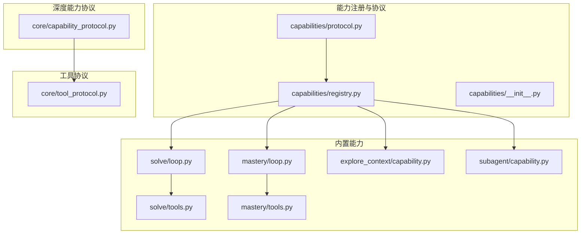
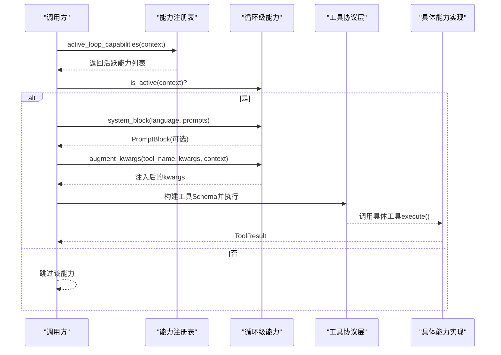
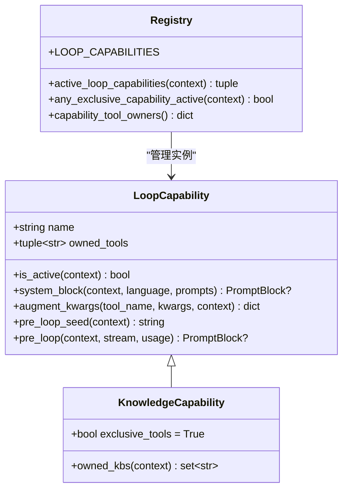
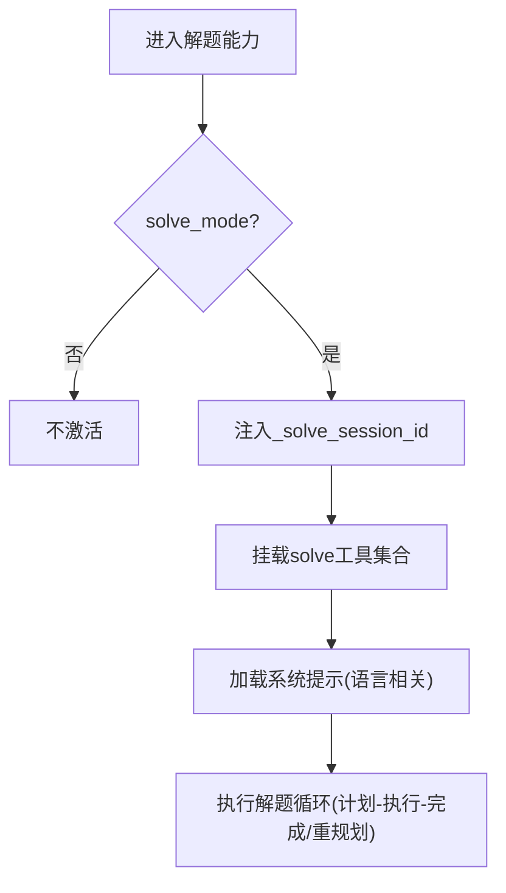
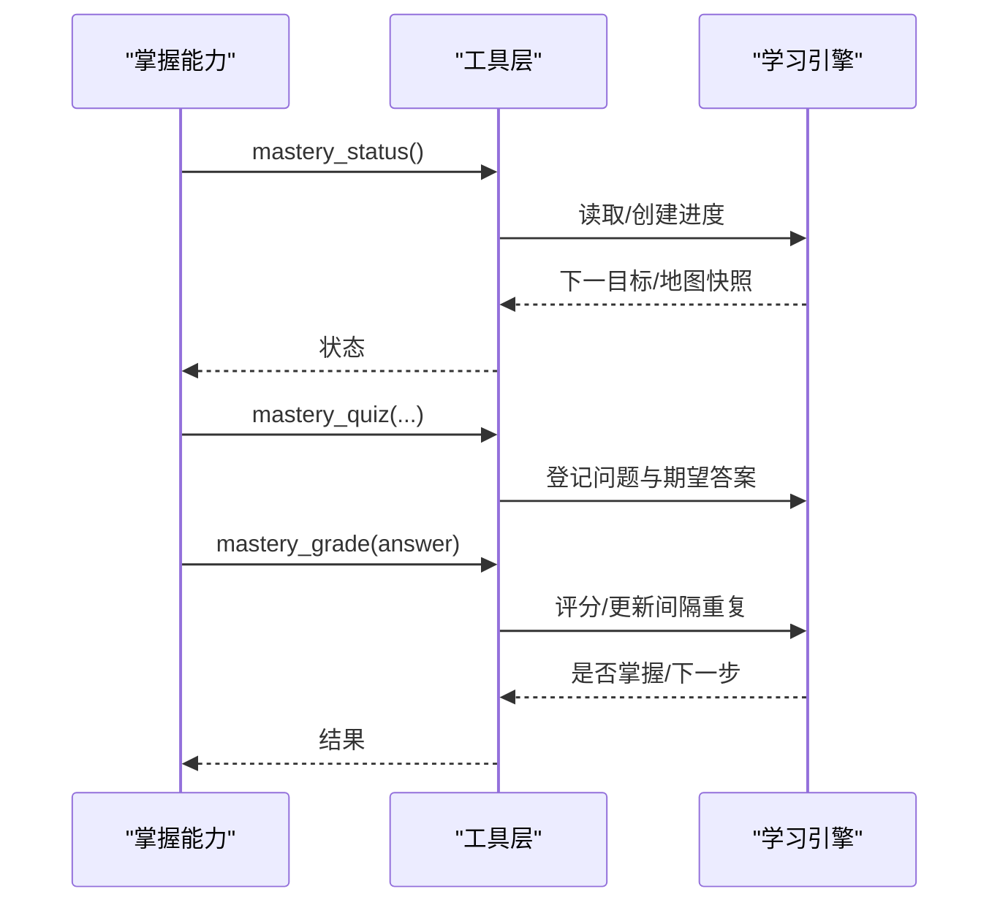
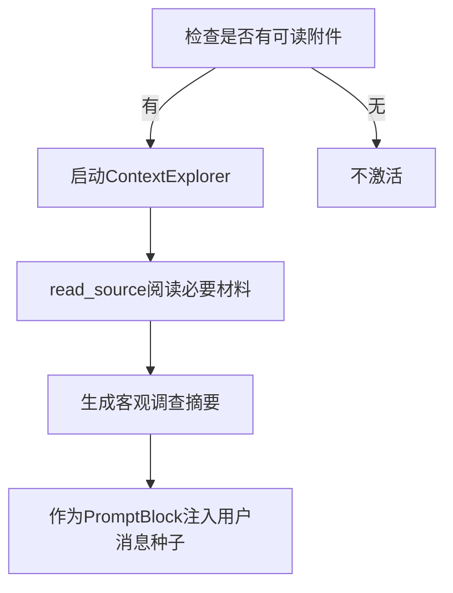
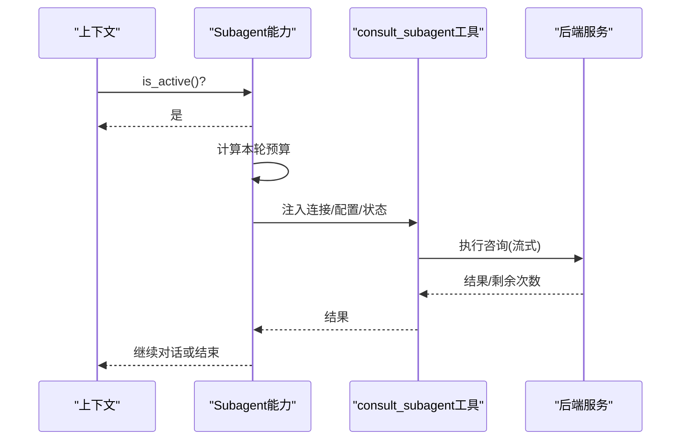
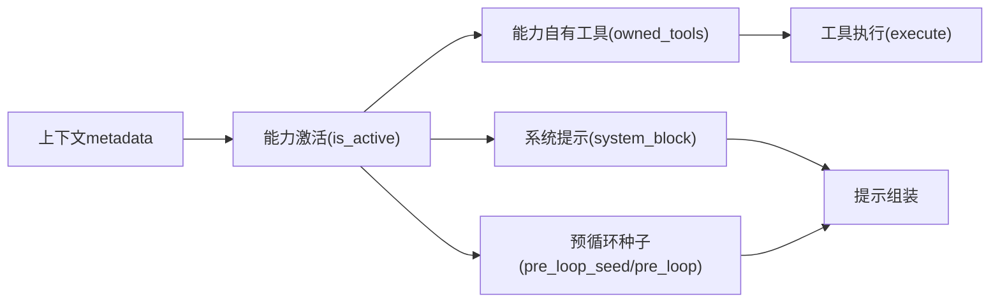

# 模型能力声明

<cite>
**本文引用的文件**
- [deeptutor/capabilities/protocol.py](file://deeptutor/capabilities/protocol.py)
- [deeptutor/capabilities/registry.py](file://deeptutor/capabilities/registry.py)
- [deeptutor/capabilities/__init__.py](file://deeptutor/capabilities/__init__.py)
- [deeptutor/core/capability_protocol.py](file://deeptutor/core/capability_protocol.py)
- [deeptutor/core/tool_protocol.py](file://deeptutor/core/tool_protocol.py)
- [deeptutor/capabilities/solve/loop.py](file://deeptutor/capabilities/solve/loop.py)
- [deeptutor/capabilities/solve/tools.py](file://deeptutor/capabilities/solve/tools.py)
- [deeptutor/capabilities/mastery/loop.py](file://deeptutor/capabilities/mastery/loop.py)
- [deeptutor/capabilities/mastery/tools.py](file://deeptutor/capabilities/mastery/tools.py)
- [deeptutor/capabilities/explore_context/capability.py](file://deeptutor/capabilities/explore_context/capability.py)
- [deeptutor/capabilities/subagent/capability.py](file://deeptutor/capabilities/subagent/capability.py)
</cite>

## 目录
1. [简介](#简介)
2. [项目结构](#项目结构)
3. [核心组件](#核心组件)
4. [架构总览](#架构总览)
5. [详细组件分析](#详细组件分析)
6. [依赖关系分析](#依赖关系分析)
7. [性能与降级策略](#性能与降级策略)
8. [故障排查指南](#故障排查指南)
9. [结论](#结论)
10. [附录：自定义能力实现指南](#附录自定义能力实现指南)

## 简介
本文件面向DeepTutor的“模型能力声明系统”，聚焦以下目标：
- 解释能力检测机制与自动发现流程
- 说明文本生成、图像生成、语音合成等能力的声明方式（以现有能力为蓝本，给出可复用的模式）
- 定义能力参数的结构与验证规则
- 描述能力之间的依赖关系与条件启用机制
- 展示如何为自定义模型声明能力
- 提供能力测试与验证方法
- 给出能力降级与回退策略的配置选项

## 项目结构
DeepTutor将“能力”分为两层：
- 循环级能力（Loop Capability）：在聊天轮次中按需激活，复用聊天工具集合并叠加自身工具与系统提示块。
- 深度能力（Capability，Level 2）：多步骤智能体流水线，用于“深度模式”（如深度解题、掌握路径教学）。

**图表来源**
- [deeptutor/capabilities/protocol.py:19-116](file://deeptutor/capabilities/protocol.py#L19-L116)
- [deeptutor/capabilities/registry.py:13-44](file://deeptutor/capabilities/registry.py#L13-L44)
- [deeptutor/capabilities/solve/loop.py:21-73](file://deeptutor/capabilities/solve/loop.py#L21-L73)
- [deeptutor/capabilities/mastery/loop.py:13-55](file://deeptutor/capabilities/mastery/loop.py#L13-L55)
- [deeptutor/capabilities/explore_context/capability.py:82-141](file://deeptutor/capabilities/explore_context/capability.py#L82-L141)
- [deeptutor/capabilities/subagent/capability.py:32-117](file://deeptutor/capabilities/subagent/capability.py#L32-L117)

**章节来源**
- [deeptutor/capabilities/protocol.py:19-116](file://deeptutor/capabilities/protocol.py#L19-L116)
- [deeptutor/capabilities/registry.py:13-44](file://deeptutor/capabilities/registry.py#L13-L44)
- [deeptutor/core/capability_protocol.py:20-69](file://deeptutor/core/capability_protocol.py#L20-L69)
- [deeptutor/core/tool_protocol.py:16-94](file://deeptutor/core/tool_protocol.py#L16-L94)

## 核心组件
- 循环级能力协议：定义能力接口、是否独占工具面、系统提示块注入、参数增强、预循环种子等。
- 能力注册表：集中维护所有循环级能力实例，并提供按上下文筛选活跃能力、判断是否独占工具面、能力-工具归属映射。
- 深度能力协议：定义能力清单（名称、描述、阶段、使用工具、CLI别名、请求Schema、配置默认值）及运行入口。
- 工具协议：统一工具定义、参数Schema、执行结果、提示词辅助信息、延迟加载等。

关键要点
- 能力通过 is_active(context) 决定是否参与当前轮次。
- 知识类能力（KnowledgeCapability）会替换工具面；普通能力仅叠加自身工具。
- 能力可通过 system_block 注入系统提示，或通过 pre_loop_seed/pre_loop 注入用户消息种子或前置探索。
- 能力通过 augment_kwargs 向自身工具注入服务端私有参数（如会话ID、路径ID等），模型不直接提供。

**章节来源**
- [deeptutor/capabilities/protocol.py:19-116](file://deeptutor/capabilities/protocol.py#L19-L116)
- [deeptutor/capabilities/registry.py:22-44](file://deeptutor/capabilities/registry.py#L22-L44)
- [deeptutor/core/capability_protocol.py:20-69](file://deeptutor/core/capability_protocol.py#L20-L69)
- [deeptutor/core/tool_protocol.py:16-94](file://deeptutor/core/tool_protocol.py#L16-L94)

## 架构总览
下图展示了“能力检测—工具装配—执行”的整体流程：

**图表来源**
- [deeptutor/capabilities/registry.py:22-35](file://deeptutor/capabilities/registry.py#L22-L35)
- [deeptutor/capabilities/protocol.py:57-85](file://deeptutor/capabilities/protocol.py#L57-L85)
- [deeptutor/core/tool_protocol.py:206-254](file://deeptutor/core/tool_protocol.py#L206-L254)

## 详细组件分析

### 循环级能力协议与注册
- LoopCapability：定义 name、owned_tools、is_active、system_block、augment_kwargs、pre_loop_seed，以及可选的异步 pre_loop。
- KnowledgeCapability：继承 LoopCapability 语义，但设置 exclusive_tools=True，表示该能力独占工具面，并可通过 owned_kbs 排除被其占用的知识库引用。
- 注册表：维护 LOOP_CAPABILITIES 元组，提供 active_loop_capabilities、any_exclusive_capability_active、capability_tool_owners 等查询。

**图表来源**
- [deeptutor/capabilities/protocol.py:19-116](file://deeptutor/capabilities/protocol.py#L19-L116)
- [deeptutor/capabilities/registry.py:13-44](file://deeptutor/capabilities/registry.py#L13-L44)

**章节来源**
- [deeptutor/capabilities/protocol.py:19-116](file://deeptutor/capabilities/protocol.py#L19-L116)
- [deeptutor/capabilities/registry.py:13-44](file://deeptutor/capabilities/registry.py#L13-L44)

### 深度解题能力（Solve）
- 激活条件：上下文标记 solve_mode。
- 行为：叠加 solve_plan / solve_finish_step / solve_replan 三个工具；注入 _solve_session_id；根据配置限制重规划次数。
- 系统提示：按语言加载对应 system.md，支持覆盖。

**图表来源**
- [deeptutor/capabilities/solve/loop.py:21-73](file://deeptutor/capabilities/solve/loop.py#L21-L73)
- [deeptutor/capabilities/solve/tools.py:26-30](file://deeptutor/capabilities/solve/tools.py#L26-L30)

**章节来源**
- [deeptutor/capabilities/solve/loop.py:21-73](file://deeptutor/capabilities/solve/loop.py#L21-L73)
- [deeptutor/capabilities/solve/tools.py:77-282](file://deeptutor/capabilities/solve/tools.py#L77-L282)

### 掌握路径教学能力（Mastery）
- 激活条件：上下文标记 mastery_mode。
- 行为：叠加 mastery_status / mastery_quiz / mastery_grade / mastery_assess / mastery_build 五个工具；注入路径ID、会话ID、轮次ID。
- 系统提示：按语言加载 system.md，支持覆盖。

**图表来源**
- [deeptutor/capabilities/mastery/loop.py:13-55](file://deeptutor/capabilities/mastery/loop.py#L13-L55)
- [deeptutor/capabilities/mastery/tools.py:59-65](file://deeptutor/capabilities/mastery/tools.py#L59-L65)
- [deeptutor/capabilities/mastery/tools.py:176-643](file://deeptutor/capabilities/mastery/tools.py#L176-L643)

**章节来源**
- [deeptutor/capabilities/mastery/loop.py:13-55](file://deeptutor/capabilities/mastery/loop.py#L13-L55)
- [deeptutor/capabilities/mastery/tools.py:59-65](file://deeptutor/capabilities/mastery/tools.py#L59-L65)
- [deeptutor/capabilities/mastery/tools.py:176-643](file://deeptutor/capabilities/mastery/tools.py#L176-L643)

### 上下文探索能力（Explore Context）
- 激活条件：当轮次携带可读（非图片）附件时触发。
- 行为：在首轮LLM调用前进行只读前置探索，将客观摘要折叠为用户消息种子，避免模型混淆视角。
- 特点：不拥有回答轮次的工具，也不注入系统提示块，完全通过 pre_loop 钩子工作。

**图表来源**
- [deeptutor/capabilities/explore_context/capability.py:68-79](file://deeptutor/capabilities/explore_context/capability.py#L68-L79)
- [deeptutor/capabilities/explore_context/capability.py:82-141](file://deeptutor/capabilities/explore_context/capability.py#L82-L141)

**章节来源**
- [deeptutor/capabilities/explore_context/capability.py:68-141](file://deeptutor/capabilities/explore_context/capability.py#L68-L141)

### 子代理能力（Subagent）
- 激活条件：选中的知识库为已连接的本地子代理（如Claude Code/Codex）。
- 行为：作为 KnowledgeCapability 独占工具面，仅暴露 consult_subagent（及 ask_user 地板），在服务端注入连接、配置、预算与跨轮会话状态。
- 预算控制：支持每轮咨询上限，并在系统提示中告知剩余次数。

**图表来源**
- [deeptutor/capabilities/subagent/capability.py:32-117](file://deeptutor/capabilities/subagent/capability.py#L32-L117)
- [deeptutor/capabilities/subagent/capability.py:148-162](file://deeptutor/capabilities/subagent/capability.py#L148-L162)

**章节来源**
- [deeptutor/capabilities/subagent/capability.py:32-117](file://deeptutor/capabilities/subagent/capability.py#L32-L117)
- [deeptutor/capabilities/subagent/capability.py:148-162](file://deeptutor/capabilities/subagent/capability.py#L148-L162)

## 依赖关系分析
- 能力与工具：每个能力声明 own_tools 列表，注册表据此建立“工具名→能力名”的归属映射，便于UI分组与权限控制。
- 能力与上下文：能力通过 is_active 读取上下文元数据（如 solve_mode、mastery_mode、source_index、所选KB类型）决定激活。
- 能力与知识库：知识类能力通过 owned_kbs 排除被其占用的KB引用，确保其他KB仍可通过通用检索表面访问。
- 能力与提示：能力可按语言加载系统提示，并支持运行时覆盖。

**图表来源**
- [deeptutor/capabilities/registry.py:22-44](file://deeptutor/capabilities/registry.py#L22-L44)
- [deeptutor/capabilities/protocol.py:57-85](file://deeptutor/capabilities/protocol.py#L57-L85)

**章节来源**
- [deeptutor/capabilities/registry.py:22-44](file://deeptutor/capabilities/registry.py#L22-L44)
- [deeptutor/capabilities/protocol.py:57-85](file://deeptutor/capabilities/protocol.py#L57-L85)

## 性能与降级策略
- 预循环优化：Explore Context 在首轮LLM调用前完成只读探索，减少主循环负担并提升质量。
- 预算控制：
  - 解题能力：通过 metadata 注入 max_replans，限制重规划次数，防止无限重试。
  - 子代理能力：通过 per-turn 配置或默认配置限制 consult_budget，保证最终回答轮次空间。
- 资源隔离：知识类能力通过 owned_kbs 排除被其占用的KB，避免与其他KB检索竞争。
- 延迟加载：部分能力在 pre_loop 中惰性导入重型模块，避免包导入时的循环依赖与冷启动开销。
- 降级建议（基于现有模式）：
  - 若某能力不可用（如外部代理未连接），则 is_active 返回 False，自动回退到普通聊天模式。
  - 若工具失败，工具内部返回 ToolResult(success=False) 并附带错误信息，由上层循环决定是否重试或终止。
  - 对于需要外部服务的图像/语音能力，可在能力层增加开关与回退路径（例如降级为文本描述或静态资源）。

[本节为通用指导，不直接分析具体文件]

## 故障排查指南
常见问题与定位思路
- 能力未激活
  - 检查上下文元数据是否正确设置（如 solve_mode、mastery_mode、source_index、所选KB类型）。
  - 确认能力 is_active 逻辑与预期一致。
- 工具未挂载
  - 核对能力 owned_tools 列表与注册表映射。
  - 确认能力处于活跃状态且未被知识类能力独占工具面所覆盖。
- 参数缺失或校验失败
  - 查看工具的 ToolParameter 定义与 execute 中的参数解析逻辑。
  - 关注 ToolResult.success 与 content 中的错误提示。
- 预算耗尽
  - 解题能力：检查 replan 次数是否达到上限。
  - 子代理能力：检查 consult_budget 与 _min_loop_rounds 预留。
- 提示异常
  - 检查 system_block 加载的语言分支与覆盖逻辑。
  - 检查 pre_loop_seed/pre_loop 是否返回空或无效内容。

**章节来源**
- [deeptutor/capabilities/solve/tools.py:109-136](file://deeptutor/capabilities/solve/tools.py#L109-L136)
- [deeptutor/capabilities/solve/tools.py:166-203](file://deeptutor/capabilities/solve/tools.py#L166-L203)
- [deeptutor/capabilities/solve/tools.py:237-275](file://deeptutor/capabilities/solve/tools.py#L237-L275)
- [deeptutor/capabilities/mastery/tools.py:192-214](file://deeptutor/capabilities/mastery/tools.py#L192-L214)
- [deeptutor/capabilities/mastery/tools.py:276-349](file://deeptutor/capabilities/mastery/tools.py#L276-L349)
- [deeptutor/capabilities/mastery/tools.py:374-427](file://deeptutor/capabilities/mastery/tools.py#L374-L427)
- [deeptutor/capabilities/subagent/capability.py:148-162](file://deeptutor/capabilities/subagent/capability.py#L148-L162)

## 结论
DeepTutor的能力声明系统通过“协议+注册表+工具”的分层设计，实现了：
- 能力按上下文动态激活与组合
- 工具按需挂载与参数安全注入
- 系统提示与用户消息种子的灵活扩展
- 对复杂场景（解题、教学、外部代理）的可插拔支持
同时，通过预算控制、资源隔离与延迟加载等手段保障性能与稳定性。

[本节为总结性内容，不直接分析具体文件]

## 附录：自定义能力实现指南

### 如何声明新能力
- 选择能力类型
  - 循环级能力：适用于在聊天轮次中叠加工具与提示的场景。
  - 深度能力：适用于多步骤、强流程化的任务（如课程编排、评测流水线）。
- 实现要点
  - 循环级能力：实现 name、owned_tools、is_active、system_block、augment_kwargs、pre_loop_seed，可选 pre_loop。
  - 深度能力：定义 CapabilityManifest（name、description、stages、tools_used、request_schema、config_defaults），实现 run(context, stream)。
- 工具定义
  - 使用 BaseTool.get_definition 声明 ToolDefinition 与 ToolParameter，确保参数Schema兼容严格提供商。
  - 在 execute 中返回 ToolResult，包含 content、success、metadata 等。
- 注册与发现
  - 将能力实例加入 LOOP_CAPABILITIES 或使用注册表机制，使 active_loop_capabilities 能发现并激活。
- 参数与验证
  - 通过 ToolParameter 的 type、enum、required、items 等字段约束输入。
  - 在 execute 中进行业务校验，失败时返回 success=False 与清晰错误信息。
- 依赖与条件启用
  - 在 is_active 中读取上下文元数据或配置，决定能力是否激活。
  - 如需独占工具面，继承 KnowledgeCapability 并实现 owned_kbs。
- 提示与国际化
  - 使用 system_block 按语言加载提示，支持运行时覆盖。
  - 使用 pre_loop_seed/pre_loop 注入用户消息种子或前置探索结果。
- 测试与验证
  - 单元测试：模拟 UnifiedContext 与 StreamBus，断言 is_active、system_block、augment_kwargs 的行为。
  - 工具测试：构造合法/非法参数，验证 ToolResult 的结构与业务逻辑。
  - 集成测试：端到端验证能力激活、工具挂载、提示注入与执行结果。
- 降级与回退
  - 在 is_active 中检测依赖可用性，不可用时返回 False。
  - 在 execute 中捕获异常并返回降级结果（如文本替代媒体输出）。
  - 通过配置项（如 budget、max_replans、forward_images）控制能力强度与资源消耗。

**章节来源**
- [deeptutor/core/capability_protocol.py:20-69](file://deeptutor/core/capability_protocol.py#L20-L69)
- [deeptutor/core/tool_protocol.py:16-94](file://deeptutor/core/tool_protocol.py#L16-L94)
- [deeptutor/core/tool_protocol.py:206-254](file://deeptutor/core/tool_protocol.py#L206-L254)
- [deeptutor/capabilities/protocol.py:19-116](file://deeptutor/capabilities/protocol.py#L19-L116)
- [deeptutor/capabilities/registry.py:13-44](file://deeptutor/capabilities/registry.py#L13-L44)