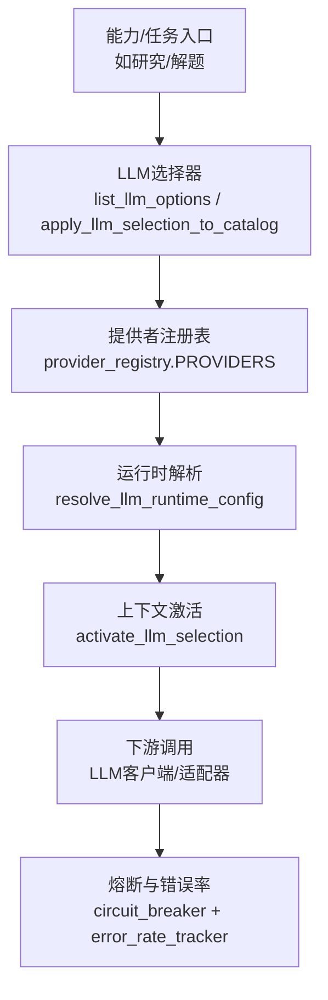
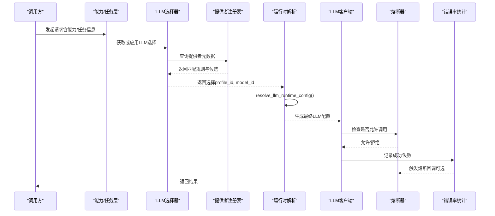
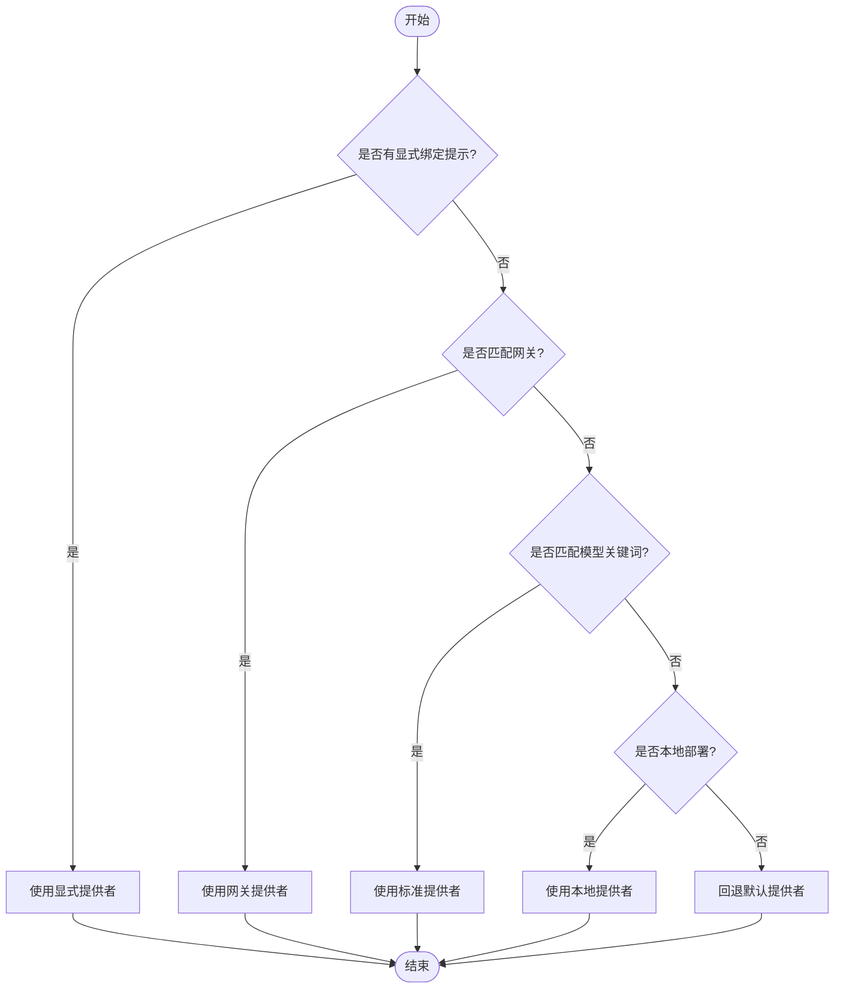
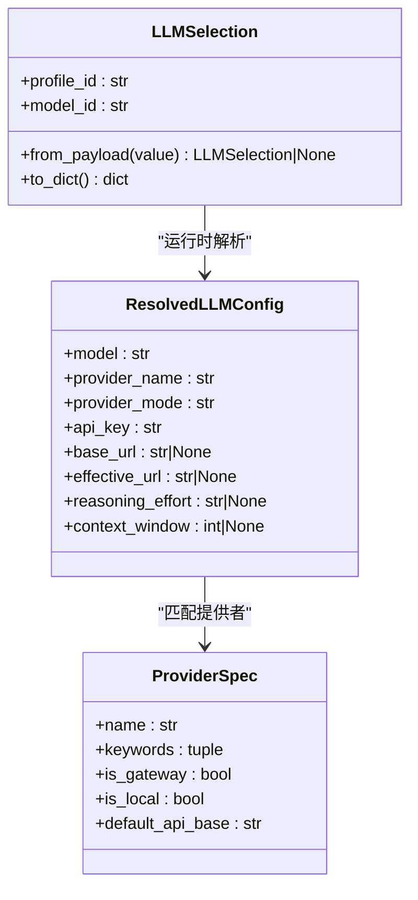
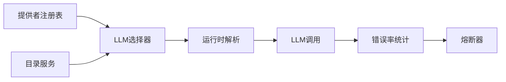

# 模型路由配置

<cite>
**本文引用的文件**
- [deeptutor/services/model_selection/llm.py](file://deeptutor/services/model_selection/llm.py)
- [deeptutor/services/model_selection/runtime.py](file://deeptutor/services/model_selection/runtime.py)
- [deeptutor/services/config/provider_runtime.py](file://deeptutor/services/config/provider_runtime.py)
- [deeptutor/services/provider_registry.py](file://deeptutor/services/provider_registry.py)
- [deeptutor/utils/network/circuit_breaker.py](file://deeptutor/utils/network/circuit_breaker.py)
- [deeptutor/utils/error_rate_tracker.py](file://deeptutor/utils/error_rate_tracker.py)
- [tests/utils/test_circuit_breaker.py](file://tests/utils/test_circuit_breaker.py)
- [deeptutor/api/routers/settings.py](file://deeptutor/api/routers/settings.py)
- [deeptutor/agents/research/pipeline.py](file://deeptutor/agents/research/pipeline.py)
- [deeptutor/agents/research/utils/token_tracker.py](file://deeptutor/agents/research/utils/token_tracker.py)
- [web/lib/research-types.ts](file://web/lib/research-types.ts)
</cite>

## 目录
1. [简介](#简介)
2. [项目结构](#项目结构)
3. [核心组件](#核心组件)
4. [架构总览](#架构总览)
5. [详细组件分析](#详细组件分析)
6. [依赖关系分析](#依赖关系分析)
7. [性能与延迟优化](#性能与延迟优化)
8. [成本与预算控制](#成本与预算控制)
9. [A/B测试与灰度发布](#ab测试与灰度发布)
10. [监控与可观测性](#监控与可观测性)
11. [故障转移与熔断机制](#故障转移与熔断机制)
12. [结论](#结论)

## 简介
本文件面向DeepTutor的“模型路由配置”，聚焦以下目标：
- 解释智能路由算法与负载分配策略
- 说明基于任务类型的模型选择规则
- 介绍地理区域优化与延迟最小化配置
- 说明成本控制与预算限制设置方法
- 展示A/B测试与灰度发布的实现方式
- 提供路由监控与性能分析工具使用指南
- 给出故障转移与熔断机制的配置选项

## 项目结构
围绕模型路由，系统由“目录与选择”“运行时解析”“提供者注册表”“熔断与错误率”“能力与任务配置”等模块组成。请求进入后，先通过能力层确定任务类型，再在LLM选择层根据目录、绑定提示、模型名与网关特征选择具体提供者与模型；随后在运行时将选择结果注入到当前异步上下文，供下游调用。

图表来源
- [deeptutor/services/model_selection/llm.py:59-135](file://deeptutor/services/model_selection/llm.py#L59-L135)
- [deeptutor/services/config/provider_runtime.py:589-699](file://deeptutor/services/config/provider_runtime.py#L589-L699)
- [deeptutor/services/provider_registry.py:118-479](file://deeptutor/services/provider_registry.py#L118-L479)
- [deeptutor/services/model_selection/runtime.py:30-46](file://deeptutor/services/model_selection/runtime.py#L30-L46)
- [deeptutor/utils/network/circuit_breaker.py:13-89](file://deeptutor/utils/network/circuit_breaker.py#L13-L89)
- [deeptutor/utils/error_rate_tracker.py:83-111](file://deeptutor/utils/error_rate_tracker.py#L83-L111)

章节来源
- [deeptutor/services/model_selection/llm.py:59-135](file://deeptutor/services/model_selection/llm.py#L59-L135)
- [deeptutor/services/config/provider_runtime.py:589-699](file://deeptutor/services/config/provider_runtime.py#L589-L699)
- [deeptutor/services/provider_registry.py:118-479](file://deeptutor/services/provider_registry.py#L118-L479)
- [deeptutor/services/model_selection/runtime.py:30-46](file://deeptutor/services/model_selection/runtime.py#L30-L46)
- [deeptutor/utils/network/circuit_breaker.py:13-89](file://deeptutor/utils/network/circuit_breaker.py#L13-L89)
- [deeptutor/utils/error_rate_tracker.py:83-111](file://deeptutor/utils/error_rate_tracker.py#L83-L111)

## 核心组件
- LLM选择器：提供可选模型列表、按profile/model_id安全切换活跃模型，不修改全局设置。
- 运行时解析：将选择结果解析为最终可调用的LLM配置（含绑定、密钥、端点、版本、推理强度、上下文窗口）。
- 提供者注册表：集中声明所有可用提供者及其匹配规则（名称、关键词、网关检测、默认端点、特性开关）。
- 熔断与错误率：统计失败并触发熔断，保护后端服务。
- 能力与任务配置：不同能力（如research/solve）携带运行时参数，影响重试、超时、队列等。

章节来源
- [deeptutor/services/model_selection/llm.py:12-135](file://deeptutor/services/model_selection/llm.py#L12-L135)
- [deeptutor/services/config/provider_runtime.py:443-699](file://deeptutor/services/config/provider_runtime.py#L443-L699)
- [deeptutor/services/provider_registry.py:18-479](file://deeptutor/services/provider_registry.py#L18-L479)
- [deeptutor/utils/network/circuit_breaker.py:13-89](file://deeptutor/utils/network/circuit_breaker.py#L13-L89)
- [deeptutor/agents/research/pipeline.py:330-353](file://deeptutor/agents/research/pipeline.py#L330-L353)

## 架构总览
下图展示了从请求进入、任务识别、模型选择、运行时解析到实际调用的完整链路，以及熔断与错误率的反馈闭环。

图表来源
- [deeptutor/services/model_selection/llm.py:59-135](file://deeptutor/services/model_selection/llm.py#L59-L135)
- [deeptutor/services/config/provider_runtime.py:589-699](file://deeptutor/services/config/provider_runtime.py#L589-L699)
- [deeptutor/services/provider_registry.py:485-529](file://deeptutor/services/provider_registry.py#L485-L529)
- [deeptutor/utils/network/circuit_breaker.py:27-89](file://deeptutor/utils/network/circuit_breaker.py#L27-L89)
- [deeptutor/utils/error_rate_tracker.py:94-111](file://deeptutor/utils/error_rate_tracker.py#L94-L111)

## 详细组件分析

### 智能路由算法与负载分配策略
- 提供者匹配优先级：
  - 显式绑定提示（binding_hint）优先
  - 网关自动检测（API Key前缀、base_url关键字）
  - 模型名关键词匹配（标准提供者）
  - 本地部署检测（localhost/127.0.0.1/.local）
  - 兜底回退至默认提供者
- 负载分配：
  - 通过多profile与多model组合，可在目录层定义多个候选
  - 结合能力层运行时参数（如重试、超时、队列）进行弹性调度
  - 熔断与错误率统计作为动态分流依据（高错误率时快速熔断）

图表来源
- [deeptutor/services/config/provider_runtime.py:589-699](file://deeptutor/services/config/provider_runtime.py#L589-L699)
- [deeptutor/services/provider_registry.py:485-529](file://deeptutor/services/provider_registry.py#L485-L529)

章节来源
- [deeptutor/services/config/provider_runtime.py:589-699](file://deeptutor/services/config/provider_runtime.py#L589-L699)
- [deeptutor/services/provider_registry.py:485-529](file://deeptutor/services/provider_registry.py#L485-L529)

### 基于任务类型的模型选择规则
- 能力层（如research/solve）通过运行时配置块（researching/planning/reporting/queue等）决定重试、超时、轮次等策略
- 这些参数与LLM选择解耦：选择器仅负责profile/model_id切换，能力层负责行为参数
- 研究任务的深度/模式标签在前端显示，便于用户理解与选择

图表来源
- [deeptutor/services/model_selection/llm.py:12-41](file://deeptutor/services/model_selection/llm.py#L12-L41)
- [deeptutor/services/config/provider_runtime.py:443-459](file://deeptutor/services/config/provider_runtime.py#L443-L459)
- [deeptutor/services/provider_registry.py:18-75](file://deeptutor/services/provider_registry.py#L18-L75)

章节来源
- [deeptutor/agents/research/pipeline.py:330-353](file://deeptutor/agents/research/pipeline.py#L330-L353)
- [web/lib/research-types.ts:107-125](file://web/lib/research-types.ts#L107-L125)
- [deeptutor/services/model_selection/llm.py:12-41](file://deeptutor/services/model_selection/llm.py#L12-L41)

### 地理区域优化与延迟最小化配置
- 通过提供者注册表的默认端点与网关检测，可将请求路由到就近或低延迟的提供商
- 支持本地部署（vLLM/Ollama/LM Studio等）以最小化网络延迟
- 可通过自定义base_url与extra_headers对接企业内网或边缘节点

章节来源
- [deeptutor/services/provider_registry.py:118-479](file://deeptutor/services/provider_registry.py#L118-L479)
- [deeptutor/services/config/provider_runtime.py:527-536](file://deeptutor/services/config/provider_runtime.py#L527-L536)

### 成本控制与预算限制设置方法
- 子代理咨询预算：通过上下文覆盖项subagent_consult_budget限制单次咨询预算
- 令牌用量追踪：按代理、模型、计算方式汇总token与费用，用于审计与限流
- 建议结合能力层max_rounds/max_replans与队列参数控制整体开销

章节来源
- [deeptutor/capabilities/subagent/capability.py:155-162](file://deeptutor/capabilities/subagent/capability.py#L155-L162)
- [deeptutor/agents/research/utils/token_tracker.py:171-209](file://deeptutor/agents/research/utils/token_tracker.py#L171-L209)
- [deeptutor/agents/research/pipeline.py:330-353](file://deeptutor/agents/research/pipeline.py#L330-L353)

### A/B测试与灰度发布实现方式
- 通过settings路由提供的测试接口启动服务测试，并以事件流形式实时观察运行过程
- 结合LLM选择器的apply_llm_selection_to_catalog，可对特定请求或会话应用不同的profile/model组合，实现灰度
- 前端可配合能力层配置摘要展示，辅助验证不同策略的效果

章节来源
- [deeptutor/api/routers/settings.py:1240-1276](file://deeptutor/api/routers/settings.py#L1240-L1276)
- [deeptutor/services/model_selection/llm.py:114-135](file://deeptutor/services/model_selection/llm.py#L114-L135)
- [web/lib/research-types.ts:114-125](file://web/lib/research-types.ts#L114-L125)

### 路由监控与性能分析工具
- 错误率跟踪：记录每次调用成功/失败，支持阈值检查与熔断回调
- 熔断器：维护每个提供者的状态机（closed/open/half-open），防止雪崩
- 单元测试覆盖：验证状态转换与独立提供者隔离

章节来源
- [deeptutor/utils/error_rate_tracker.py:83-111](file://deeptutor/utils/error_rate_tracker.py#L83-L111)
- [deeptutor/utils/network/circuit_breaker.py:13-89](file://deeptutor/utils/network/circuit_breaker.py#L13-L89)
- [tests/utils/test_circuit_breaker.py:21-80](file://tests/utils/test_circuit_breaker.py#L21-L80)

## 依赖关系分析
- LLM选择器依赖提供者注册表与目录服务，输出安全的选择引用
- 运行时解析依赖选择器与目录服务，产出最终LLM配置
- 熔断与错误率统计与调用侧耦合，形成健康度反馈
- 能力层通过运行时配置影响重试与超时，间接影响路由稳定性

图表来源
- [deeptutor/services/model_selection/llm.py:59-135](file://deeptutor/services/model_selection/llm.py#L59-L135)
- [deeptutor/services/config/provider_runtime.py:589-699](file://deeptutor/services/config/provider_runtime.py#L589-L699)
- [deeptutor/utils/error_rate_tracker.py:83-111](file://deeptutor/utils/error_rate_tracker.py#L83-L111)
- [deeptutor/utils/network/circuit_breaker.py:13-89](file://deeptutor/utils/network/circuit_breaker.py#L13-L89)

章节来源
- [deeptutor/services/model_selection/llm.py:59-135](file://deeptutor/services/model_selection/llm.py#L59-L135)
- [deeptutor/services/config/provider_runtime.py:589-699](file://deeptutor/services/config/provider_runtime.py#L589-L699)
- [deeptutor/utils/error_rate_tracker.py:83-111](file://deeptutor/utils/error_rate_tracker.py#L83-L111)
- [deeptutor/utils/network/circuit_breaker.py:13-89](file://deeptutor/utils/network/circuit_breaker.py#L13-L89)

## 性能与延迟优化
- 就近路由：利用网关与默认端点将请求导向低延迟节点
- 本地部署：对低延迟敏感场景启用本地模型（vLLM/Ollama）
- 批量与批大小：嵌入与向量检索可按提供者限制调整batch_size与delay
- 重试与超时：能力层配置合理重试次数与工具超时，避免长尾阻塞

章节来源
- [deeptutor/services/config/provider_runtime.py:527-536](file://deeptutor/services/config/provider_runtime.py#L527-L536)
- [deeptutor/agents/research/pipeline.py:330-353](file://deeptutor/agents/research/pipeline.py#L330-L353)

## 成本与预算控制
- 子代理咨询预算：通过上下文覆盖限制单次咨询预算
- 用量与费用汇总：按代理/模型/方法维度统计token与费用，支撑预算告警
- 能力层参数：控制最大轮次与重规划次数，降低总体开销

章节来源
- [deeptutor/capabilities/subagent/capability.py:155-162](file://deeptutor/capabilities/subagent/capability.py#L155-L162)
- [deeptutor/agents/research/utils/token_tracker.py:171-209](file://deeptutor/agents/research/utils/token_tracker.py#L171-L209)
- [deeptutor/agents/research/pipeline.py:330-353](file://deeptutor/agents/research/pipeline.py#L330-L353)

## A/B测试与灰度发布
- 使用设置路由的服务测试接口启动测试，并通过事件流观察执行过程
- 在请求级应用LLM选择（apply_llm_selection_to_catalog），对不同用户或会话灰度不同模型
- 前端能力配置摘要帮助验证不同策略的用户体验差异

章节来源
- [deeptutor/api/routers/settings.py:1240-1276](file://deeptutor/api/routers/settings.py#L1240-L1276)
- [deeptutor/services/model_selection/llm.py:114-135](file://deeptutor/services/model_selection/llm.py#L114-L135)
- [web/lib/research-types.ts:114-125](file://web/lib/research-types.ts#L114-L125)

## 监控与可观测性
- 错误率跟踪：记录调用成功/失败，支持阈值检查与熔断回调
- 熔断器：按提供者维度维护状态机，防止级联故障
- 单元测试：覆盖状态转换与隔离性，确保可靠性

章节来源
- [deeptutor/utils/error_rate_tracker.py:83-111](file://deeptutor/utils/error_rate_tracker.py#L83-L111)
- [deeptutor/utils/network/circuit_breaker.py:13-89](file://deeptutor/utils/network/circuit_breaker.py#L13-L89)
- [tests/utils/test_circuit_breaker.py:21-80](file://tests/utils/test_circuit_breaker.py#L21-L80)

## 故障转移与熔断机制
- 熔断状态机：closed → open → half-open → closed，支持恢复超时与成功复位
- 错误率回调：当错误率超过阈值时触发熔断，减少无效调用
- 独立提供者隔离：各提供者熔断互不影响，避免误伤

章节来源
- [deeptutor/utils/network/circuit_breaker.py:13-89](file://deeptutor/utils/network/circuit_breaker.py#L13-L89)
- [deeptutor/utils/error_rate_tracker.py:83-111](file://deeptutor/utils/error_rate_tracker.py#L83-L111)
- [tests/utils/test_circuit_breaker.py:21-80](file://tests/utils/test_circuit_breaker.py#L21-L80)

## 结论
DeepTutor的模型路由体系以“目录+选择+运行时解析+提供者注册表”为核心，结合能力层运行时参数与熔断/错误率监控，实现了灵活、可控且健壮的模型路由。通过网关与本地部署支持地理与延迟优化，借助预算与用量统计实现成本控制，并通过测试接口与选择器实现A/B与灰度发布。建议在关键路径上持续完善监控指标与告警策略，确保在高负载与异常场景下的稳定性与可观测性。