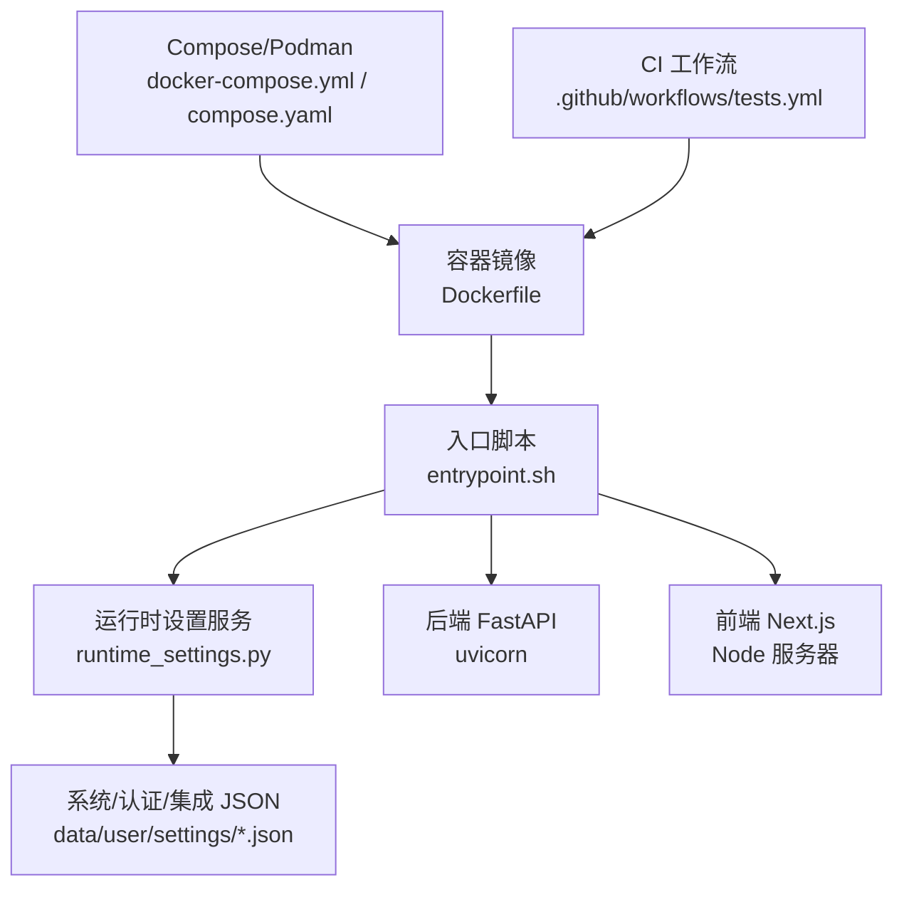
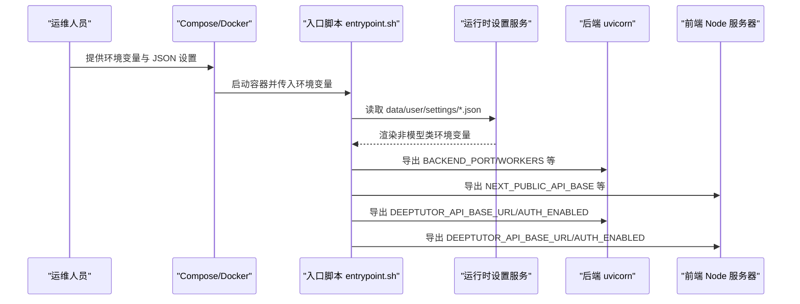
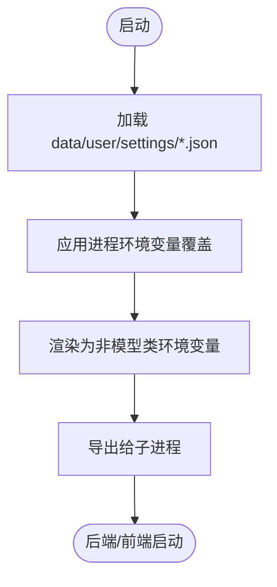
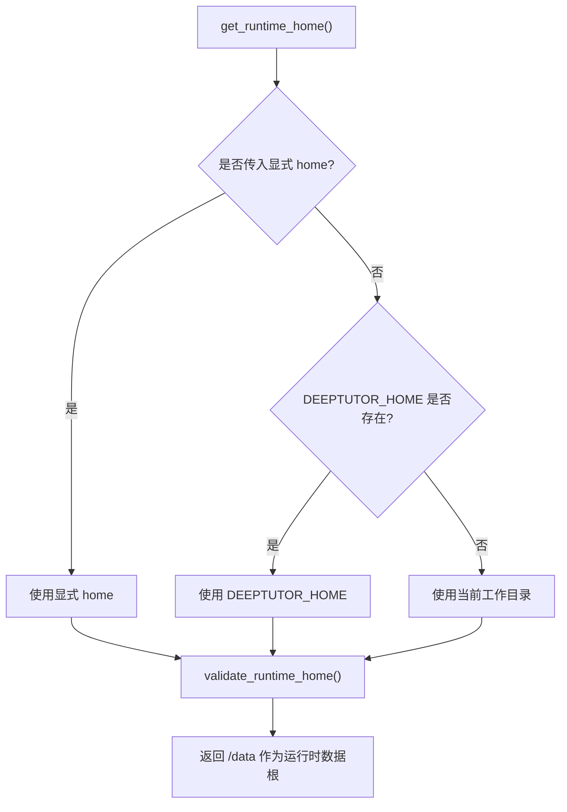
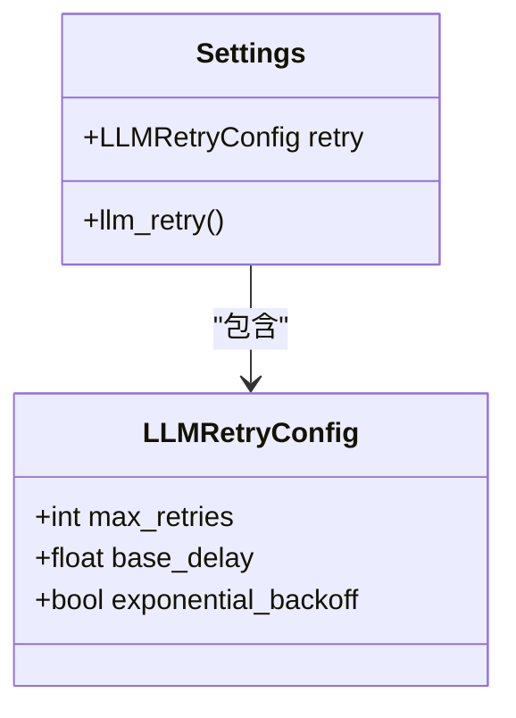
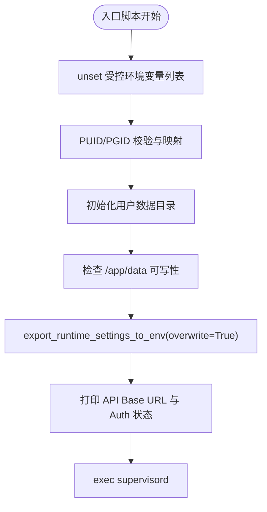
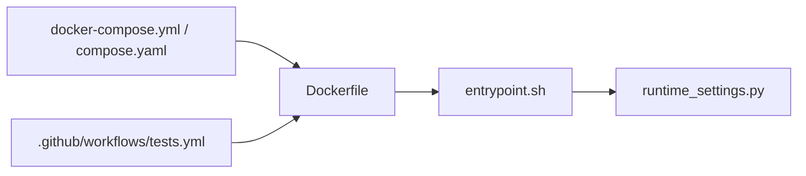

# 环境变量配置

<cite>
**本文引用的文件**   
- [Dockerfile](file://Dockerfile)
- [docker-compose.yml](file://docker-compose.yml)
- [compose.yaml](file://compose.yaml)
- [deeptutor/runtime/home.py](file://deeptutor/runtime/home.py)
- [deeptutor/services/config/runtime_settings.py](file://deeptutor/services/config/runtime_settings.py)
- [deeptutor/services/config/__init__.py](file://deeptutor/services/config/__init__.py)
- [deeptutor/config/settings.py](file://deeptutor/config/settings.py)
- [.github/workflows/tests.yml](file://.github/workflows/tests.yml)
</cite>

## 目录
1. [简介](#简介)
2. [项目结构](#项目结构)
3. [核心组件](#核心组件)
4. [架构总览](#架构总览)
5. [详细组件分析](#详细组件分析)
6. [依赖关系分析](#依赖关系分析)
7. [性能与容量考虑](#性能与容量考虑)
8. [故障排查指南](#故障排查指南)
9. [结论](#结论)
10. [附录：环境变量参考表](#附录环境变量参考表)

## 简介
本文档为 DeepTutor 的环境变量配置完整参考，覆盖以下范围：
- DEEPTUTOR_* 系列环境变量
- 第三方服务集成变量（如 PocketBase、Redis）
- LLM/重试等运行时开关
- 环境变量加载顺序、优先级与继承机制
- Docker、Podman Compose、Kubernetes 等部署场景的配置示例
- 敏感信息安全管理最佳实践
- 环境变量验证与调试方法

DeepTutor 的运行时设置主要来源于 data/user/settings/*.json 文件；进程环境变量作为“显式部署覆盖”在启动时注入并导出给子进程。容器镜像通过入口脚本统一处理这些变量，确保后端、前端和代理行为一致。

## 项目结构
从环境变量的角度，关键位置如下：
- 容器构建与运行：Dockerfile、docker-compose.yml、compose.yaml
- 运行时设置与导出：deeptutor/services/config/runtime_settings.py
- 工作区根目录解析：deeptutor/runtime/home.py
- LLM 重试配置：deeptutor/config/settings.py
- CI 中使用的测试变量：.github/workflows/tests.yml

**图表来源**
- [Dockerfile:337-524](file://Dockerfile#L337-L524)
- [deeptutor/services/config/runtime_settings.py:765-800](file://deeptutor/services/config/runtime_settings.py#L765-L800)
- [docker-compose.yml:74-142](file://docker-compose.yml#L74-L142)
- [compose.yaml:137-206](file://compose.yaml#L137-L206)

**章节来源**
- [Dockerfile:106-127](file://Dockerfile#L106-L127)
- [docker-compose.yml:1-24](file://docker-compose.yml#L1-L24)
- [compose.yaml:1-63](file://compose.yaml#L1-L63)

## 核心组件
- 运行时设置服务：负责读取 JSON 设置、应用进程环境变量覆盖、向子进程导出环境变量。
- 入口脚本：清理可能冲突的环境变量，按 JSON 设置重新导出，并启动 supervisord。
- 工作区根目录解析：根据参数或 DEEPTUTOR_HOME 决定运行时数据根目录。
- LLM 重试配置：基于 pydantic-settings 的命名空间前缀与环境变量映射。

**章节来源**
- [deeptutor/services/config/runtime_settings.py:509-562](file://deeptutor/services/config/runtime_settings.py#L509-L562)
- [Dockerfile:337-524](file://Dockerfile#L337-L524)
- [deeptutor/runtime/home.py:8-41](file://deeptutor/runtime/home.py#L8-L41)
- [deeptutor/config/settings.py:15-50](file://deeptutor/config/settings.py#L15-L50)

## 架构总览
下图展示环境变量从 Compose/Docker 到应用进程的流转路径，以及 JSON 设置与进程环境之间的优先级关系。

**图表来源**
- [Dockerfile:337-524](file://Dockerfile#L337-L524)
- [deeptutor/services/config/runtime_settings.py:765-800](file://deeptutor/services/config/runtime_settings.py#L765-L800)

## 详细组件分析

### 运行时设置与导出流程
- 默认值定义：系统、认证、集成、文档解析、RAG 引擎等默认结构。
- 进程覆盖：支持将进程环境变量映射到 JSON 字段，实现“部署覆盖”。
- 导出函数：将非模型类设置渲染为环境变量，供子进程使用。

**图表来源**
- [deeptutor/services/config/runtime_settings.py:16-127](file://deeptutor/services/config/runtime_settings.py#L16-L127)
- [deeptutor/services/config/runtime_settings.py:765-800](file://deeptutor/services/config/runtime_settings.py#L765-L800)

**章节来源**
- [deeptutor/services/config/runtime_settings.py:16-127](file://deeptutor/services/config/runtime_settings.py#L16-L127)
- [deeptutor/services/config/runtime_settings.py:509-562](file://deeptutor/services/config/runtime_settings.py#L509-L562)
- [deeptutor/services/config/runtime_settings.py:765-800](file://deeptutor/services/config/runtime_settings.py#L765-L800)

### 工作区根目录与 DEEPTUTOR_HOME
- 解析优先级：显式参数 > DEEPTUTOR_HOME > 当前工作目录。
- 安全校验：拒绝指向仓库 data 树的非法 home。
- 用途：确定运行时数据根目录，实际数据位于 <home>/data。

**图表来源**
- [deeptutor/runtime/home.py:8-41](file://deeptutor/runtime/home.py#L8-L41)

**章节来源**
- [deeptutor/runtime/home.py:8-41](file://deeptutor/runtime/home.py#L8-L41)

### LLM 重试配置
- 使用 pydantic-settings 的 env_prefix 与嵌套分隔符。
- 支持通过环境变量覆盖最大重试次数、基础延迟、指数退避开关。

**图表来源**
- [deeptutor/config/settings.py:19-50](file://deeptutor/config/settings.py#L19-L50)

**章节来源**
- [deeptutor/config/settings.py:1-50](file://deeptutor/config/settings.py#L1-L50)

### 容器入口与变量清洗
- 清理可能由宿主或旧 Compose 提供的变量，避免覆盖 JSON 设置。
- 导出 DEEPTUTOR_API_BASE_URL 与 DEEPTUTOR_AUTH_ENABLED，供前端代理与鉴权逻辑使用。
- 支持 PUID/PGID 用户映射，适配 Unraid/NAS 挂载。

**图表来源**
- [Dockerfile:337-524](file://Dockerfile#L337-L524)

**章节来源**
- [Dockerfile:337-524](file://Dockerfile#L337-L524)

## 依赖关系分析
- 入口脚本依赖运行时设置服务导出环境变量。
- Compose/Podman 编排文件声明端口、卷、网络与可选服务（PocketBase、Redis）。
- CI 工作流使用 DEEPTUTOR_* 变量驱动测试矩阵。

**图表来源**
- [docker-compose.yml:74-142](file://docker-compose.yml#L74-L142)
- [compose.yaml:137-206](file://compose.yaml#L137-L206)
- [Dockerfile:337-524](file://Dockerfile#L337-L524)
- [.github/workflows/tests.yml:95-104](file://.github/workflows/tests.yml#L95-L104)

**章节来源**
- [docker-compose.yml:74-142](file://docker-compose.yml#L74-L142)
- [compose.yaml:137-206](file://compose.yaml#L137-L206)
- [.github/workflows/tests.yml:95-104](file://.github/workflows/tests.yml#L95-L104)

## 性能与容量考虑
- WebSocket 帧大小与附件策略：后端启动时会计算 ws-max-size，避免大附件被截断。
- Keep-Alive 超时：前后端代理与 uvicorn 保持一致，减少连接竞争导致的请求失败。
- 沙箱执行：可通过 runner sidecar 或受限子进程模式执行不受信代码，降低主进程风险。

**章节来源**
- [Dockerfile:283-315](file://Dockerfile#L283-L315)
- [docker-compose.yml:144-199](file://docker-compose.yml#L144-L199)

## 故障排查指南
- 无法写入 /app/data：检查 PUID/PGID 与宿主机挂载权限；入口脚本会尝试 chown，但某些文件系统不支持。
- 前端无法访问后端：确认 DEEPTUTOR_API_BASE_URL 与 NEXT_PUBLIC_API_BASE_EXTERNAL 是否正确；注意双栈主机上 localhost 与 127.0.0.1 的差异。
- 鉴权未生效：检查 AUTH_ENABLED 与 auth.json 中的 enabled 字段；容器入口会导出 DEEPTUTOR_AUTH_ENABLED。
- 附件上传失败：检查 chat_attachment_dir 与 WS_MAX_SIZE；必要时重启以应用新的帧上限。

**章节来源**
- [Dockerfile:378-439](file://Dockerfile#L378-L439)
- [Dockerfile:494-514](file://Dockerfile#L494-L514)
- [deeptutor/services/config/runtime_settings.py:765-800](file://deeptutor/services/config/runtime_settings.py#L765-L800)

## 结论
DeepTutor 的环境变量体系以 JSON 设置为权威源，进程环境变量作为显式部署覆盖，并通过入口脚本统一导出给子进程。该设计使 Docker、Podman、Kubernetes 等不同部署形态保持一致的行为，同时便于运维人员在运行时调整端口、跨域、附件策略、沙箱模式与鉴权开关。

## 附录：环境变量参考表

### DEEPTUTOR_* 系列
- DEEPTUTOR_HOME
  - 作用：指定运行时工作区根目录
  - 类型：字符串路径
  - 默认值：无（回退到当前工作目录）
  - 有效范围：CLI/源码运行、容器内
  - 说明：优先级高于当前目录；会被 validate_runtime_home 校验

- DEEPTUTOR_IGNORE_PROCESS_ENV_OVERRIDES
  - 作用：忽略父进程的环境覆盖，强制使用 JSON 设置
  - 类型：布尔（1/true/yes/on 为真）
  - 默认值：容器镜像中设为 1
  - 有效范围：容器入口脚本与运行时设置服务

- DEEPTUTOR_WORKSPACE_ROOT
  - 作用：内容工作区根目录
  - 类型：字符串路径
  - 默认值：compose 中映射为 /workspace
  - 有效范围：后端与沙箱 runner

- DEEPTUTOR_WORKSPACE_ALLOWED_ROOTS
  - 作用：允许的工作区根白名单
  - 类型：逗号分隔字符串或列表
  - 默认值：compose 中为 /workspace
  - 有效范围：后端与工作区工具

- DEEPTUTOR_SANDBOX_RUNNER_URL
  - 作用：沙箱 runner 侧车地址
  - 类型：URL
  - 默认值：compose 中为 http://sandbox-runner:8900
  - 有效范围：后端沙箱后端选择

- DEEPTUTOR_SANDBOX_ALLOW_SUBPROCESS
  - 作用：允许受限子进程执行（当无 runner 侧车时使用）
  - 类型：布尔
  - 默认值：system.json 中 sandbox_allow_subprocess 默认为 True
  - 有效范围：后端沙箱后端选择

- DEEPTUTOR_API_BASE_URL
  - 作用：前端代理用于重写 /api/* 与 /ws/* 的后端地址
  - 类型：URL
  - 默认值：http://localhost:BACKEND_PORT
  - 有效范围：前端代理与后端中间件

- DEEPTUTOR_AUTH_ENABLED
  - 作用：控制登录重定向与鉴权开关
  - 类型：布尔
  - 默认值：来自 auth.json 的 enabled
  - 有效范围：前端代理与后端鉴权

- DEEPTUTOR_VERSION_CHECK_ENABLED
  - 作用：控制版本检查开关
  - 类型：布尔
  - 默认值：system.json 中 version_check_enabled 默认为 True
  - 有效范围：后端更新检查

- DEEPTUTOR_EXTRAS
  - 作用：按需安装 Python 扩展包（幂等）
  - 类型：逗号分隔包名
  - 默认值：空
  - 有效范围：容器入口脚本

- DEEPTUTOR_APT_PACKAGES
  - 作用：按需安装系统包（幂等）
  - 类型：逗号分隔包名
  - 默认值：空
  - 有效范围：容器入口脚本

- DEEPTUTOR_PUID / DEEPTUTOR_PGID
  - 作用：运行时用户 UID/GID 映射
  - 类型：整数
  - 默认值：1000
  - 有效范围：容器入口脚本

- DEEPTUTOR_MULTI_WORKER_E2E / DEEPTUTOR_MULTI_WORKER_CONTROL_URL
  - 作用：多 worker E2E 测试相关
  - 类型：布尔/URL
  - 默认值：CI 中设置
  - 有效范围：CI 工作流

- DEEPTUTOR_TEST_REDIS_URL
  - 作用：测试 Redis 连接串
  - 类型：URL
  - 默认值：CI 中 redis://127.0.0.1:6379/0
  - 有效范围：测试

- DEEPTUTOR_TEST_VIDEO_SANDBOX / DEEPTUTOR_REMOTION_RUNTIME
  - 作用：视频生成与 Remotion 测试相关
  - 类型：布尔/路径
  - 默认值：CI 中设置
  - 有效范围：测试

**章节来源**
- [deeptutor/runtime/home.py:8-41](file://deeptutor/runtime/home.py#L8-L41)
- [Dockerfile:112-127](file://Dockerfile#L112-L127)
- [Dockerfile:337-524](file://Dockerfile#L337-L524)
- [docker-compose.yml:100-124](file://docker-compose.yml#L100-L124)
- [.github/workflows/tests.yml:95-104](file://.github/workflows/tests.yml#L95-L104)
- [.github/workflows/tests.yml:383-405](file://.github/workflows/tests.yml#L383-L405)

### 后端与前端端口
- BACKEND_PORT
  - 作用：后端监听端口
  - 类型：端口号
  - 默认值：8001
  - 有效范围：后端 uvicorn

- BACKEND_HOST
  - 作用：后端绑定地址
  - 类型：IP/主机名
  - 默认值：0.0.0.0
  - 有效范围：后端 uvicorn

- BACKEND_WORKERS / DEEPTUTOR_BACKEND_WORKERS
  - 作用：后端工作进程数
  - 类型：整数
  - 默认值：1
  - 有效范围：后端 uvicorn

- FRONTEND_PORT
  - 作用：前端监听端口
  - 类型：端口号
  - 默认值：3782
  - 有效范围：前端 Node 服务器

- FRONTEND_HOST
  - 作用：前端绑定地址
  - 类型：IP/主机名
  - 默认值：0.0.0.0
  - 有效范围：前端 Node 服务器

**章节来源**
- [Dockerfile:283-335](file://Dockerfile#L283-L335)
- [Dockerfile:491-504](file://Dockerfile#L491-L504)

### 前端代理与跨域
- NEXT_PUBLIC_API_BASE
  - 作用：前端代理后端 API 的基础路径
  - 类型：URL
  - 默认值：system.json 中 next_public_api_base
  - 有效范围：前端代理

- NEXT_PUBLIC_API_BASE_EXTERNAL
  - 作用：外部访问的前端代理基础路径
  - 类型：URL
  - 默认值：system.json 中 next_public_api_base_external
  - 有效范围：前端代理

- CORS_ORIGIN / CORS_ORIGINS
  - 作用：跨域来源配置
  - 类型：字符串/列表
  - 默认值：system.json 中 cors_origin/cors_origins
  - 有效范围：后端与前端

- DISABLE_SSL_VERIFY
  - 作用：禁用 SSL 证书校验
  - 类型：布尔
  - 默认值：system.json 中 disable_ssl_verify
  - 有效范围：后端 HTTP 客户端

**章节来源**
- [deeptutor/services/config/runtime_settings.py:765-800](file://deeptutor/services/config/runtime_settings.py#L765-L800)

### 聊天附件与安全守卫
- CHAT_ATTACHMENT_DIR
  - 作用：聊天附件存储目录
  - 类型：路径
  - 默认值：system.json 中 chat_attachment_dir
  - 有效范围：后端

- DEEPTUTOR_GUARD_ENABLED / RATE_LIMIT / WINDOW / TRUSTED_PROXIES / EXEMPT_IPS / WHITELIST / BLACKLIST
  - 作用：FastAPI Guard 请求筛查与速率限制
  - 类型：布尔/整数/列表
  - 默认值：system.json 中 security_guard
  - 有效范围：后端

**章节来源**
- [deeptutor/services/config/runtime_settings.py:765-800](file://deeptutor/services/config/runtime_settings.py#L765-L800)

### 认证与集成
- AUTH_ENABLED / AUTH_USERNAME / AUTH_PASSWORD_HASH / AUTH_TOKEN_EXPIRE_HOURS / AUTH_COOKIE_SECURE / AUTH_PRIVATE_LOGIN_HOSTS
  - 作用：内置认证开关、用户名、密码哈希、令牌过期时间、Cookie 安全标志、私有登录主机
  - 类型：布尔/字符串/整数/列表
  - 默认值：auth.json
  - 有效范围：后端与前端

- POCKETBASE_URL / POCKETBASE_PORT / POCKETBASE_EXTERNAL_URL / POCKETBASE_ADMIN_EMAIL / POCKETBASE_ADMIN_PASSWORD
  - 作用：PocketBase 集成地址、端口、外部访问地址与管理员凭据
  - 类型：URL/端口/字符串
  - 默认值：integrations.json
  - 有效范围：后端与集成模块

**章节来源**
- [deeptutor/services/config/runtime_settings.py:765-800](file://deeptutor/services/config/runtime_settings.py#L765-L800)

### LLM 重试
- LLM_RETRY__MAX_RETRIES
  - 作用：LLM 调用最大重试次数
  - 类型：整数
  - 默认值：8
  - 有效范围：LLM 客户端

- LLM_RETRY__BASE_DELAY
  - 作用：重试基础延迟（秒）
  - 类型：浮点数
  - 默认值：5.0
  - 有效范围：LLM 客户端

- LLM_RETRY__EXPONENTIAL_BACKOFF
  - 作用：是否启用指数退避
  - 类型：布尔
  - 默认值：True
  - 有效范围：LLM 客户端

**章节来源**
- [deeptutor/config/settings.py:19-50](file://deeptutor/config/settings.py#L19-L50)

### 部署场景配置示例

#### Docker
- 基本运行
  - 暴露端口：8001（后端）、3782（前端）
  - 数据卷：/app/data
  - 环境变量：BACKEND_PORT、FRONTEND_PORT、DEEPTUTOR_API_BASE_URL、DEEPTUTOR_AUTH_ENABLED

- 自定义用户
  - 设置 PUID/PGID 以匹配宿主机挂载所有者

**章节来源**
- [Dockerfile:491-514](file://Dockerfile#L491-L514)
- [Dockerfile:378-439](file://Dockerfile#L378-L439)

#### Podman Compose
- 使用 compose.yaml
  - 服务：deeptutor、pocketbase、redis
  - 端口：HOST_PORT_BACKEND、HOST_PORT_FRONTEND
  - 工作区：DEEPTUTOR_WORKSPACE_HOST 映射到 /workspace
  - 本地 LLM：provider base_url 使用 host.containers.internal

**章节来源**
- [compose.yaml:137-206](file://compose.yaml#L137-L206)

#### Docker Compose
- 使用 docker-compose.yml
  - 服务：deeptutor、pocketbase、redis、sandbox-runner
  - 端口：DEEPTUTOR_DOCKER_BACKEND_PORT、DEEPTUTOR_DOCKER_FRONTEND_PORT
  - 沙箱 runner：DEEPTUTOR_SANDBOX_RUNNER_URL=http://sandbox-runner:8900
  - 工作区：DEEPTUTOR_WORKSPACE_HOST 映射到 /workspace

**章节来源**
- [docker-compose.yml:74-142](file://docker-compose.yml#L74-L142)

#### Kubernetes
- 建议
  - 使用 ConfigMap 管理 system.json、auth.json、integrations.json
  - 使用 Secret 管理敏感字段（password_hash、admin_password、API keys）
  - 通过环境变量注入 DEEPTUTOR_API_BASE_URL、DEEPTUTOR_AUTH_ENABLED、PUID/PGID
  - 使用 PersistentVolume 挂载 /app/data

[本节为概念性指导，不直接分析具体文件]

### 敏感信息安全管理最佳实践
- 密钥轮换
  - 定期轮换 PocketBase 管理员密码、LLM API Key、PageIndex API Key
  - 使用外部密钥管理服务（如云厂商 KMS、HashiCorp Vault）注入 Secret
- 加密存储
  - 对持久化卷启用磁盘加密（如 LUKS、云盘加密）
  - 对备份进行加密与访问控制
- 最小权限
  - 使用非 root 用户运行（PUID/PGID）
  - 沙箱 runner 只暴露必要卷与端口
- 审计与日志脱敏
  - 避免在日志中输出密码哈希、API Key
  - 使用 redact_catalog_secrets 等工具对敏感字段脱敏

[本节为通用安全实践，不直接分析具体文件]

### 环境变量验证与调试工具
- 查看已导出环境变量
  - 在容器内执行 printenv 或 echo $DEEPTUTOR_API_BASE_URL
- 检查 JSON 设置
  - 查看 data/user/settings/system.json、auth.json、integrations.json
- 健康检查
  - curl http://localhost:8001/health/ready
- 日志
  - docker logs deeptutor 或 podman logs deeptutor

**章节来源**
- [Dockerfile:526-548](file://Dockerfile#L526-L548)