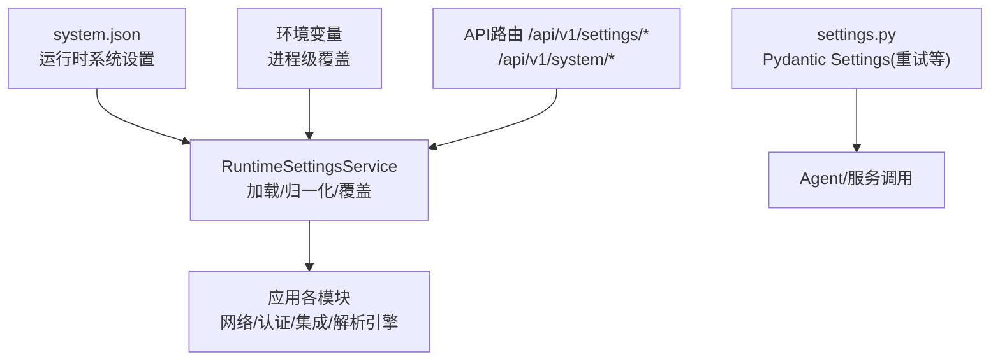
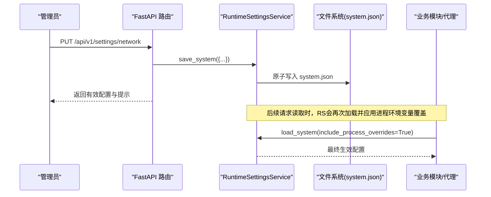
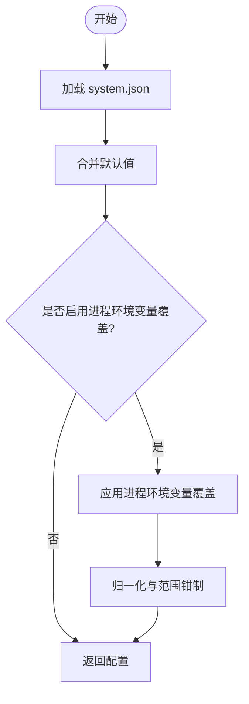
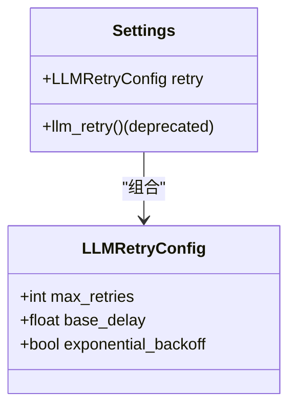
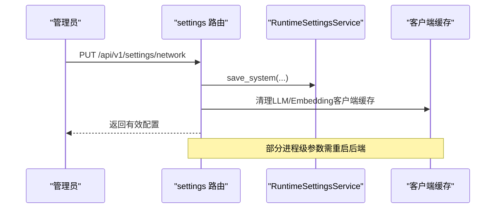
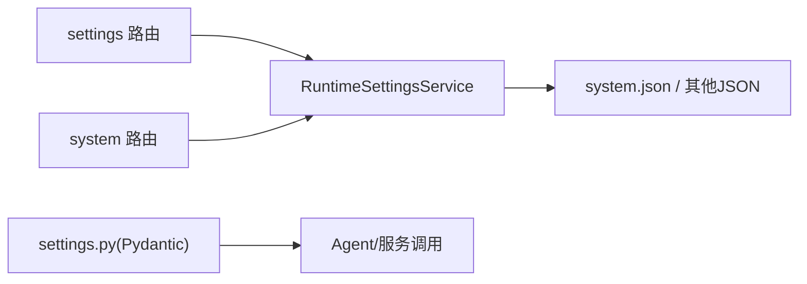

# 系统配置

<cite>
**本文引用的文件**
- [deeptutor/config/settings.py](file://deeptutor/config/settings.py)
- [deeptutor/config/schema.py](file://deeptutor/config/schema.py)
- [deeptutor/config/defaults.py](file://deeptutor/config/defaults.py)
- [deeptutor/services/config/runtime_settings.py](file://deeptutor/services/config/runtime_settings.py)
- [deeptutor/api/routers/settings.py](file://deeptutor/api/routers/settings.py)
- [deeptutor/api/routers/system.py](file://deeptutor/api/routers/system.py)
- [Dockerfile](file://Dockerfile)
</cite>

## 目录
1. [简介](#简介)
2. [项目结构](#项目结构)
3. [核心组件](#核心组件)
4. [架构总览](#架构总览)
5. [详细组件分析](#详细组件分析)
6. [依赖关系分析](#依赖关系分析)
7. [性能考量](#性能考量)
8. [故障排除指南](#故障排除指南)
9. [结论](#结论)
10. [附录](#附录)

## 简介
本文件面向DeepTutor的系统配置，聚焦以下目标：
- 解释运行时系统配置文件system.json的结构与字段含义
- 说明环境变量加载机制（含LLM_RETRY__MAX_RETRIES、LLM_RETRY__BASE_DELAY等）
- 阐述Pydantic Settings的加载与验证规则
- 明确默认值、类型约束与校验逻辑
- 介绍配置热重载的实现原理与使用方法
- 提供常见配置场景的最佳实践与排障建议
- 展示如何通过API动态修改系统配置

## 项目结构
DeepTutor的配置体系由“运行时JSON设置 + Pydantic模型 + API路由”共同构成：
- 运行时设置持久化于 data/user/settings 下的多个JSON文件，其中 system.json 承载系统级参数（端口、CORS、附件策略等）
- Pydantic模型负责类型校验、默认值填充与环境变量映射
- API路由暴露读取与更新接口，支持管理员在线调整并触发客户端缓存失效

图表来源
- [deeptutor/services/config/runtime_settings.py:15-42](file://deeptutor/services/config/runtime_settings.py#L15-L42)
- [deeptutor/services/config/runtime_settings.py:309-363](file://deeptutor/services/config/runtime_settings.py#L309-L363)
- [deeptutor/config/settings.py:19-46](file://deeptutor/config/settings.py#L19-L46)
- [deeptutor/api/routers/settings.py:614-635](file://deeptutor/api/routers/settings.py#L614-L635)

章节来源
- [deeptutor/services/config/runtime_settings.py:15-42](file://deeptutor/services/config/runtime_settings.py#L15-L42)
- [deeptutor/services/config/runtime_settings.py:309-363](file://deeptutor/services/config/runtime_settings.py#L309-L363)
- [deeptutor/config/settings.py:19-46](file://deeptutor/config/settings.py#L19-L46)
- [deeptutor/api/routers/settings.py:614-635](file://deeptutor/api/routers/settings.py#L614-L635)

## 核心组件
- RuntimeSettingsService：以JSON为持久化的运行时设置中心，负责加载、合并默认值、应用进程环境变量覆盖、归一化校验与原子写入。
- Pydantic Settings（settings.py）：定义LLM重试等运行期可调参数，通过env_prefix与env_nested_delimiter将环境变量映射到嵌套模型。
- 配置Schema与默认值（schema.py、defaults.py）：定义结构化配置模型与初始默认值，用于迁移与校验。
- API路由（settings.py、system.py）：提供管理员可操作的REST接口，实现配置的读取、更新与生效。

章节来源
- [deeptutor/services/config/runtime_settings.py:309-363](file://deeptutor/services/config/runtime_settings.py#L309-L363)
- [deeptutor/config/settings.py:19-46](file://deeptutor/config/settings.py#L19-L46)
- [deeptutor/config/schema.py:6-31](file://deeptutor/config/schema.py#L6-L31)
- [deeptutor/config/defaults.py:10-17](file://deeptutor/config/defaults.py#L10-L17)
- [deeptutor/api/routers/settings.py:614-635](file://deeptutor/api/routers/settings.py#L614-L635)
- [deeptutor/api/routers/system.py:61-145](file://deeptutor/api/routers/system.py#L61-L145)

## 架构总览
下图展示了系统配置从“文件+环境变量”到“应用使用”的全链路：

图表来源
- [deeptutor/api/routers/settings.py:620-635](file://deeptutor/api/routers/settings.py#L620-L635)
- [deeptutor/services/config/runtime_settings.py:350-363](file://deeptutor/services/config/runtime_settings.py#L350-L363)
- [deeptutor/services/config/runtime_settings.py:612-642](file://deeptutor/services/config/runtime_settings.py#L612-L642)

## 详细组件分析

### system.json 结构与字段说明
system.json 是系统级运行时配置的核心文件，包含但不限于：
- 版本控制：version
- 网络与前端：backend_port、frontend_port、next_public_api_base_external、next_public_api_base、cors_origin、cors_origins
- 安全与沙箱：disable_ssl_verify、sandbox_allow_subprocess
- 聊天附件策略：chat_attachment_dir、chat_attachment_max_file_mb、chat_attachment_max_total_mb、chat_attachment_max_chars_per_doc、chat_attachment_max_chars_total

这些字段在加载时会被归一化与范围钳制，并通过进程环境变量进行部署级覆盖。

章节来源
- [deeptutor/services/config/runtime_settings.py:15-42](file://deeptutor/services/config/runtime_settings.py#L15-L42)
- [deeptutor/services/config/runtime_settings.py:612-642](file://deeptutor/services/config/runtime_settings.py#L612-L642)

### 环境变量加载机制与优先级
- 进程环境变量作为“部署级覆盖”，在load_system/include_process_overrides=True时生效
- 支持的覆盖键包括端口、API Base、CORS、SSL校验开关、附件策略等
- 可通过DEEPTUTOR_IGNORE_PROCESS_ENV_OVERRIDES关闭进程环境变量覆盖（便于测试或容器内隔离）
- Docker入口会将运行时设置导出为环境变量，供前后端一致消费

图表来源
- [deeptutor/services/config/runtime_settings.py:350-363](file://deeptutor/services/config/runtime_settings.py#L350-L363)
- [deeptutor/services/config/runtime_settings.py:609-642](file://deeptutor/services/config/runtime_settings.py#L609-L642)
- [Dockerfile:369-389](file://Dockerfile#L369-L389)

章节来源
- [deeptutor/services/config/runtime_settings.py:609-642](file://deeptutor/services/config/runtime_settings.py#L609-L642)
- [Dockerfile:369-389](file://Dockerfile#L369-L389)

### LLM 重试配置（Pydantic Settings）
- settings.py 定义了LLM重试相关配置类与全局实例
- 通过 env_prefix="LLM_" 与 env_nested_delimiter="__" 将环境变量映射到嵌套字段
- 示例环境变量：
  - LLM_RETRY__MAX_RETRIES：最大重试次数
  - LLM_RETRY__BASE_DELAY：基础延迟（秒）
  - LLM_RETRY__EXPONENTIAL_BACKOFF：是否使用指数退避
- 旧属性 llm_retry 已弃用，建议使用 retry

图表来源
- [deeptutor/config/settings.py:19-46](file://deeptutor/config/settings.py#L19-L46)

章节来源
- [deeptutor/config/settings.py:19-46](file://deeptutor/config/settings.py#L19-L46)

### 配置默认值、类型约束与验证逻辑
- defaults.py 提供LLM与路径等默认值
- schema.py 定义配置模型与字段校验（如必填字段、类型检查）
- runtime_settings.py 对数值型字段进行范围钳制（例如端口、附件大小、字符预算），并对布尔值进行宽松转换
- 所有写操作采用原子写入，避免并发损坏

章节来源
- [deeptutor/config/defaults.py:10-17](file://deeptutor/config/defaults.py#L10-L17)
- [deeptutor/config/schema.py:6-31](file://deeptutor/config/schema.py#L6-L31)
- [deeptutor/services/config/runtime_settings.py:259-289](file://deeptutor/services/config/runtime_settings.py#L259-L289)
- [deeptutor/services/config/runtime_settings.py:350-363](file://deeptutor/services/config/runtime_settings.py#L350-L363)

### 配置热重载的实现原理与使用方法
- 管理员通过API更新配置后，服务端会清理LLM/Embedding客户端缓存，使新配置在后续请求中生效
- 对于需要进程级启动参数的配置（如WebSocket帧大小），需重启后端服务才能完全生效
- 开发环境可通过uvicorn --reload实现代码级热重载；生产环境建议滚动重启

图表来源
- [deeptutor/api/routers/settings.py:269-284](file://deeptutor/api/routers/settings.py#L269-L284)
- [deeptutor/api/routers/settings.py:620-635](file://deeptutor/api/routers/settings.py#L620-L635)

章节来源
- [deeptutor/api/routers/settings.py:269-284](file://deeptutor/api/routers/settings.py#L269-L284)
- [deeptutor/api/routers/settings.py:620-635](file://deeptutor/api/routers/settings.py#L620-L635)

### 通过API动态修改系统配置
- 获取系统状态：GET /api/v1/system/status
- 测试连接：POST /api/v1/system/test/{llm|embeddings|search}
- 网络设置：GET/PUT /api/v1/settings/network
- 聊天附件策略：GET/PUT /api/v1/settings/chat-attachments
- MinerU解析器：GET/PUT /api/v1/settings/mineru
- 文档解析多引擎：GET/PUT /api/v1/settings/document-parsing

注意：非管理员无法访问敏感配置；部分操作需要管理员权限。

章节来源
- [deeptutor/api/routers/system.py:61-145](file://deeptutor/api/routers/system.py#L61-L145)
- [deeptutor/api/routers/system.py:148-213](file://deeptutor/api/routers/system.py#L148-L213)
- [deeptutor/api/routers/system.py:216-270](file://deeptutor/api/routers/system.py#L216-L270)
- [deeptutor/api/routers/system.py:273-323](file://deeptutor/api/routers/system.py#L273-L323)
- [deeptutor/api/routers/settings.py:614-635](file://deeptutor/api/routers/settings.py#L614-L635)
- [deeptutor/api/routers/settings.py:669-690](file://deeptutor/api/routers/settings.py#L669-L690)
- [deeptutor/api/routers/settings.py:769-800](file://deeptutor/api/routers/settings.py#L769-L800)

## 依赖关系分析
- 运行时设置服务依赖路径服务与文件IO，确保数据目录存在与原子写入
- API路由依赖运行时设置服务与模型目录服务，提供统一的管理入口
- Pydantic Settings独立于运行时JSON设置，主要用于LLM重试等轻量级运行参数

图表来源
- [deeptutor/api/routers/settings.py:614-635](file://deeptutor/api/routers/settings.py#L614-L635)
- [deeptutor/services/config/runtime_settings.py:309-363](file://deeptutor/services/config/runtime_settings.py#L309-L363)
- [deeptutor/config/settings.py:19-46](file://deeptutor/config/settings.py#L19-L46)

章节来源
- [deeptutor/api/routers/settings.py:614-635](file://deeptutor/api/routers/settings.py#L614-L635)
- [deeptutor/services/config/runtime_settings.py:309-363](file://deeptutor/services/config/runtime_settings.py#L309-L363)
- [deeptutor/config/settings.py:19-46](file://deeptutor/config/settings.py#L19-L46)

## 性能考量
- WebSocket帧大小受附件策略影响，过大上传可能需要重启后端以应用新的帧上限
- 配置变更会清理客户端缓存，避免不一致；但进程级参数（如keep-alive、ws-max-size）需重启
- 频繁读写JSON时使用原子写入，降低并发风险

[本节为通用指导，不直接分析具体文件]

## 故障排除指南
- 无法连接LLM/Embeddings/Search：使用 /api/v1/system/test/* 诊断，查看错误信息
- CORS跨域问题：检查 cors_origin/cors_origins 与 next_public_api_base 配置
- 附件上传失败：确认 chat_attachment_max_* 与 ws-max-size 匹配，必要时重启后端
- 环境变量未生效：确认 DEEPTUTOR_IGNORE_PROCESS_ENV_OVERRIDES 未误开启；检查进程环境变量名与值
- 管理员权限不足：确保当前用户具备管理员角色

章节来源
- [deeptutor/api/routers/system.py:61-145](file://deeptutor/api/routers/system.py#L61-L145)
- [deeptutor/api/routers/system.py:148-213](file://deeptutor/api/routers/system.py#L148-L213)
- [deeptutor/api/routers/system.py:216-270](file://deeptutor/api/routers/system.py#L216-L270)
- [deeptutor/api/routers/system.py:273-323](file://deeptutor/api/routers/system.py#L273-L323)
- [deeptutor/services/config/runtime_settings.py:609-642](file://deeptutor/services/config/runtime_settings.py#L609-L642)

## 结论
DeepTutor通过“JSON持久化 + Pydantic校验 + 环境变量覆盖 + API管理”的组合，实现了灵活、安全且可观测的系统配置能力。推荐在生产环境中：
- 使用API进行配置变更，保留审计痕迹
- 通过环境变量进行部署级覆盖，保持环境一致性
- 谨慎调整附件策略与WebSocket帧大小，必要时重启后端
- 利用系统健康检查接口快速定位问题

[本节为总结性内容，不直接分析具体文件]

## 附录
- 常用环境变量（系统级）：BACKEND_PORT、FRONTEND_PORT、NEXT_PUBLIC_API_BASE_EXTERNAL、NEXT_PUBLIC_API_BASE、CORS_ORIGIN、CORS_ORIGINS、DISABLE_SSL_VERIFY、CHAT_ATTACHMENT_DIR、DEEPTUTOR_SANDBOX_ALLOW_SUBPROCESS、CHAT_ATTACHMENT_MAX_FILE_MB、CHAT_ATTACHMENT_MAX_TOTAL_MB、CHAT_ATTACHMENT_MAX_CHARS_PER_DOC、CHAT_ATTACHMENT_MAX_CHARS_TOTAL
- LLM重试环境变量：LLM_RETRY__MAX_RETRIES、LLM_RETRY__BASE_DELAY、LLM_RETRY__EXPONENTIAL_BACKOFF

章节来源
- [deeptutor/services/config/runtime_settings.py:612-642](file://deeptutor/services/config/runtime_settings.py#L612-L642)
- [deeptutor/config/settings.py:19-46](file://deeptutor/config/settings.py#L19-L46)