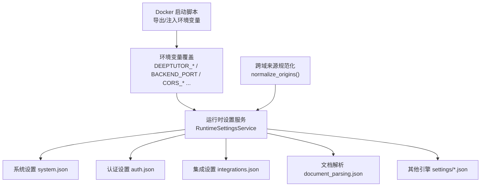
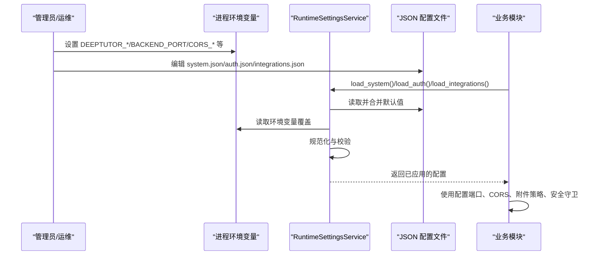
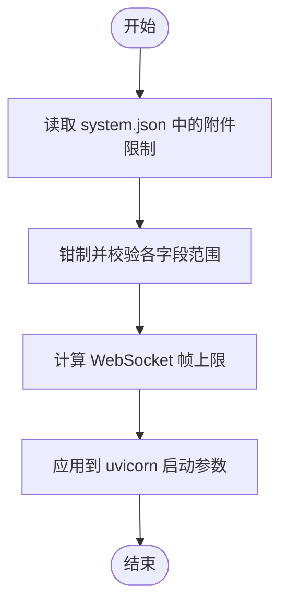
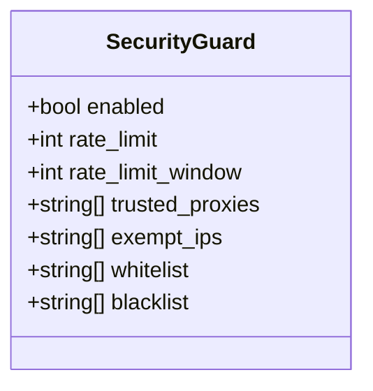
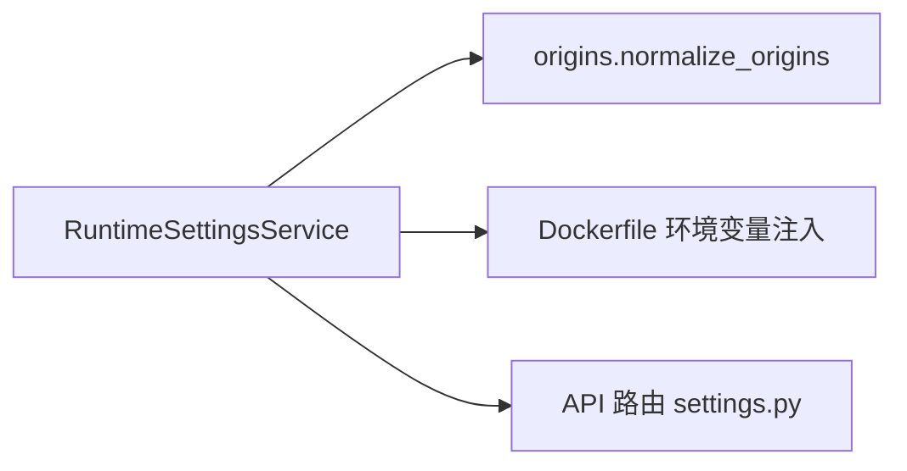

# 系统配置

<cite>
**本文引用的文件**   
- [runtime_settings.py](file://deeptutor/services/config/runtime_settings.py)
- [origins.py](file://deeptutor/services/config/origins.py)
- [Dockerfile](file://Dockerfile)
- [settings.py](file://deeptutor/api/routers/settings.py)
- [network.py](file://deeptutor/services/mcp/network.py)
</cite>

## 目录
1. [简介](#简介)
2. [项目结构](#项目结构)
3. [核心组件](#核心组件)
4. [架构总览](#架构总览)
5. [详细组件分析](#详细组件分析)
6. [依赖关系分析](#依赖关系分析)
7. [性能与容量规划](#性能与容量规划)
8. [故障排除指南](#故障排除指南)
9. [结论](#结论)
10. [附录：环境变量与部署最佳实践](#附录环境变量与部署最佳实践)

## 简介
本文件聚焦 DeepTutor 的系统级配置，覆盖端口、跨域（CORS）、安全守卫、聊天附件策略、SSL 校验、代理信任列表、IP 白名单/黑名单等关键系统参数。文档说明每个配置的默认值、有效范围与验证规则，解释配置的加载机制、环境变量覆盖与环境变量映射关系，并给出开发、测试、生产环境的部署建议与安全注意事项。

## 项目结构
DeepTutor 的系统配置由运行时设置服务集中管理，核心位于 services/config 模块；前端与后端通过 API 暴露部分可观测能力；容器化部署在 Dockerfile 中透传关键环境变量。

**图示来源**
- [runtime_settings.py:16-89](file://deeptutor/services/config/runtime_settings.py#L16-L89)
- [runtime_settings.py:509-567](file://deeptutor/services/config/runtime_settings.py#L509-L567)
- [origins.py:21-55](file://deeptutor/services/config/origins.py#L21-L55)
- [Dockerfile:287-361](file://Dockerfile#L287-L361)

**章节来源**
- [runtime_settings.py:16-89](file://deeptutor/services/config/runtime_settings.py#L16-L89)
- [runtime_settings.py:509-567](file://deeptutor/services/config/runtime_settings.py#L509-L567)
- [origins.py:21-55](file://deeptutor/services/config/origins.py#L21-L55)
- [Dockerfile:287-361](file://Dockerfile#L287-L361)

## 核心组件
- 运行时设置服务 RuntimeSettingsService：负责读取 JSON 配置文件、应用环境变量覆盖、规范化字段、持久化变更，并向子进程导出环境变量。
- 跨域来源规范化 normalize_origins：将用户输入的 Origin 字符串标准化为浏览器发送的 scheme://host[:port] 形式，支持逗号/分号/换行分隔。
- 系统默认配置 DEFAULT_SYSTEM_SETTINGS：定义端口、CORS、SSL、附件策略、安全守卫等默认值与约束。
- MCP 网络安全校验 validate_mcp_url：对远程 MCP 服务器 URL 进行严格校验，防止 SSRF。

**章节来源**
- [runtime_settings.py:509-567](file://deeptutor/services/config/runtime_settings.py#L509-L567)
- [origins.py:21-55](file://deeptutor/services/config/origins.py#L21-L55)
- [runtime_settings.py:16-89](file://deeptutor/services/config/runtime_settings.py#L16-L89)
- [network.py:75-109](file://deeptutor/services/mcp/network.py#L75-L109)

## 架构总览
系统配置加载与生效流程如下：

**图示来源**
- [runtime_settings.py:554-567](file://deeptutor/services/config/runtime_settings.py#L554-L567)
- [runtime_settings.py:901-947](file://deeptutor/services/config/runtime_settings.py#L901-L947)
- [runtime_settings.py:1349-1434](file://deeptutor/services/config/runtime_settings.py#L1349-L1434)

## 详细组件分析

### 系统设置（system.json）
系统设置包含后端/前端端口、CORS、SSL 校验开关、聊天附件策略、安全守卫、搜索源过滤等。

| 配置项 | 默认值 | 有效范围/规则 | 说明 |
|---|---:|---|---|
| version_check_enabled | true | 布尔 | 是否检查更新；可通过环境变量关闭 |
| backend_port | 8001 | 1-65535 | 后端服务端口 |
| backend_workers | 1 | 1-64 | Uvicorn worker 数量 |
| frontend_port | 3782 | 1-65535 | 前端服务端口 |
| next_public_api_base_external | "" | 字符串 | 外部可见的 Next.js API Base |
| next_public_api_base | "" | 字符串 | 内部使用的 Next.js API Base |
| cors_origin | "" | 字符串 | 单个允许的来源（兼容 host:port 或带协议） |
| cors_origins | [] | 列表，元素为规范化后的 origin | 多个允许的来源，按逗号/分号/换行分割后去重 |
| disable_ssl_verify | false | 布尔 | 全局禁用 SSL 证书校验（谨慎开启） |
| chat_attachment_dir | "" | 字符串 | 聊天附件存储目录 |
| sandbox_allow_subprocess | true | 布尔 | 是否允许受限子进程执行（文档生成相关） |
| capability_routing_enabled | false | 布尔 | 是否启用能力路由（如 deep_question） |
| web_search_source_filtering.* | 见下 | 见下 | 网页搜索结果过滤策略 |
| chat_attachment_max_file_mb | 20 | 1-1024 | 单文件最大大小（MB） |
| chat_attachment_max_total_mb | 25 | 1-2048 | 单次上传总大小（MB），且不小于单文件大小 |
| chat_attachment_max_chars_per_doc | 200000 | 10000-5000000 | 每文档提取文本字符上限 |
| chat_attachment_max_chars_total | 150000 | 10000-5000000 | 每次对话提取文本字符上限 |
| chat_prior_image_reinject_max | 4 | 0-20 | 后续轮次重新注入的历史图片数量 |
| security_guard.enabled | false | 布尔 | 启用请求筛查中间件 |
| security_guard.rate_limit | 300 | 1-1000000 | 限流计数阈值 |
| security_guard.rate_limit_window | 60 | 1-86400 | 限流窗口（秒） |
| security_guard.trusted_proxies | ["127.0.0.1","::1"] | 主机列表 | 可信反向代理地址 |
| security_guard.exempt_ips | ["127.0.0.1","::1"] | 主机列表 | 豁免限流的 IP |
| security_guard.whitelist | [] | 主机列表 | 白名单（放行） |
| security_guard.blacklist | [] | 主机列表 | 黑名单（拒绝） |

web_search_source_filtering 子项：
- enabled: 布尔，默认 true
- blocked_domains: 字符串或列表，默认空
- trusted_domains: 字符串或列表，默认空
- content_filtering: 布尔，默认 true
- use_educational_trusted_domains: 布尔，默认 false
- use_moderation: 布尔，默认 false

**章节来源**
- [runtime_settings.py:16-89](file://deeptutor/services/config/runtime_settings.py#L16-L89)
- [runtime_settings.py:901-947](file://deeptutor/services/config/runtime_settings.py#L901-L947)
- [runtime_settings.py:1349-1434](file://deeptutor/services/config/runtime_settings.py#L1349-L1434)

### 认证设置（auth.json）
| 配置项 | 默认值 | 有效范围/规则 | 说明 |
|---|---:|---|---|
| enabled | false | 布尔 | 是否启用内置认证 |
| username | admin | 非空字符串 | 用户名 |
| password_hash | "" | 字符串 | 密码哈希 |
| token_expire_hours | 24 | ≥1 整数 | Token 过期时间（小时） |
| cookie_secure | false | 布尔 | Cookie Secure 标志 |
| private_login_hosts | [] | 主机列表 | 仅允许的内网登录来源 |

**章节来源**
- [runtime_settings.py:101-109](file://deeptutor/services/config/runtime_settings.py#L101-L109)
- [runtime_settings.py:949-966](file://deeptutor/services/config/runtime_settings.py#L949-L966)
- [runtime_settings.py:1436-1445](file://deeptutor/services/config/runtime_settings.py#L1436-L1445)

### 集成设置（integrations.json）
| 配置项 | 默认值 | 有效范围/规则 | 说明 |
|---|---:|---|---|
| pocketbase_url | "" | 字符串 | PocketBase 服务地址 |
| pocketbase_port | 8090 | 1-65535 | PocketBase 端口 |
| pocketbase_external_url | "" | 字符串 | 外部访问地址 |
| pocketbase_admin_email | "" | 字符串 | 管理员邮箱 |
| pocketbase_admin_password | "" | 字符串 | 管理员密码 |
| turn_coordination.backend | memory | memory/redis | 会话协调后端 |
| turn_coordination.redis_url | "" | 字符串 | Redis 连接串 |
| turn_coordination.key_prefix | deeptutor | 字符串 | Redis Key 前缀 |
| turn_coordination.lease_ttl_seconds | 30 | 10-300 | 租约 TTL |
| turn_coordination.renew_interval_seconds | 10 | 1-100 | 续期间隔 |
| turn_coordination.recovery_interval_seconds | 10 | 1-300 | 恢复间隔 |
| turn_coordination.stream_retention_seconds | 86400 | 60-2592000 | 流保留时长 |

**章节来源**
- [runtime_settings.py:111-127](file://deeptutor/services/config/runtime_settings.py#L111-L127)
- [runtime_settings.py:968-988](file://deeptutor/services/config/runtime_settings.py#L968-L988)
- [runtime_settings.py:1447-1478](file://deeptutor/services/config/runtime_settings.py#L1447-L1478)

### 聊天附件策略与 WebSocket 帧上限
- 附件策略由 system.json 控制，并在调用时实时读取，无需重启即可生效。
- 若 base64 载荷超过 WebSocket 帧上限，需要重启后端以调整 uvicorn 的 --ws-max-size。
- 计算逻辑：ws_max_size = max(16MB, 膨胀后的附件总量 + 8MB 缓冲)。

**图示来源**
- [runtime_settings.py:90-99](file://deeptutor/services/config/runtime_settings.py#L90-L99)
- [runtime_settings.py:1517-1578](file://deeptutor/services/config/runtime_settings.py#L1517-L1578)

**章节来源**
- [runtime_settings.py:90-99](file://deeptutor/services/config/runtime_settings.py#L90-L99)
- [runtime_settings.py:1517-1578](file://deeptutor/services/config/runtime_settings.py#L1517-L1578)

### 安全守卫（security_guard）
- 默认关闭，需显式启用。
- 支持速率限制、可信代理、豁免 IP、白名单/黑名单。
- 可通过环境变量逐项覆盖，便于部署时精细控制。

**图示来源**
- [runtime_settings.py:69-88](file://deeptutor/services/config/runtime_settings.py#L69-L88)
- [runtime_settings.py:1415-1433](file://deeptutor/services/config/runtime_settings.py#L1415-L1433)

**章节来源**
- [runtime_settings.py:69-88](file://deeptutor/services/config/runtime_settings.py#L69-L88)
- [runtime_settings.py:1415-1433](file://deeptutor/services/config/runtime_settings.py#L1415-L1433)

### 跨域来源规范化（CORS）
- 支持 host:port 或 scheme://host[:port] 输入，自动补全 http://。
- 支持多来源用逗号/分号/换行分隔，输出为去重后的精确 origin 列表。
- 特殊值 * 和 null 原样保留。

**章节来源**
- [origins.py:21-55](file://deeptutor/services/config/origins.py#L21-L55)

### MCP 网络安全校验
- 对远程 MCP 服务器 URL 进行严格校验，禁止内网、回环、云元数据等危险目标。
- 区分“部署服务器”与“自服务服务器”两种信任姿态。

**章节来源**
- [network.py:1-26](file://deeptutor/services/mcp/network.py#L1-L26)
- [network.py:75-109](file://deeptutor/services/mcp/network.py#L75-L109)

## 依赖关系分析
- RuntimeSettingsService 是系统配置的核心入口，统一处理 JSON 文件与环境变量覆盖。
- origins.normalize_origins 被用于规范化 CORS 来源。
- Dockerfile 将关键环境变量注入到后端与前端启动流程。
- API 路由 settings.py 暴露部分配置能力（例如附件限制范围）。

**图示来源**
- [runtime_settings.py:509-567](file://deeptutor/services/config/runtime_settings.py#L509-L567)
- [origins.py:21-55](file://deeptutor/services/config/origins.py#L21-L55)
- [Dockerfile:287-361](file://Dockerfile#L287-L361)
- [settings.py:402-405](file://deeptutor/api/routers/settings.py#L402-L405)

**章节来源**
- [runtime_settings.py:509-567](file://deeptutor/services/config/runtime_settings.py#L509-L567)
- [origins.py:21-55](file://deeptutor/services/config/origins.py#L21-L55)
- [Dockerfile:287-361](file://Dockerfile#L287-L361)
- [settings.py:402-405](file://deeptutor/api/routers/settings.py#L402-L405)

## 性能与容量规划
- backend_workers：根据 CPU 核数与并发需求调优，范围 1-64。
- chat_attachment_max_total_mb：影响 WebSocket 帧上限，过大需提高 uvicorn --ws-max-size。
- HTTP_KEEP_ALIVE_TIMEOUT：固定为 300 秒，避免与前端代理空闲超时竞争导致连接重置。
- RAG/LightRAG 等检索引擎的参数（如 top_k、chunk_size、hnsw_*）可在对应 settings 文件中调整，遵循各自规范化范围。

[本节为通用指导，不直接分析具体文件]

## 故障排除指南
- CORS 报错：检查 cors_origin/cors_origins 是否为合法 origin；确认浏览器发送的 Origin 与配置一致。
- SSL 错误：如需绕过证书校验，设置 disable_ssl_verify=true（仅限受控环境）。
- 附件上传失败：确认 chat_attachment_max_total_mb 与 ws-max-size 匹配；必要时重启后端。
- 安全守卫误拦截：检查 trusted_proxies/exempt_ips/whitelist/blacklist；确保反向代理正确传递 X-Forwarded-For。
- 端口冲突：修改 backend_port/frontend_port 并确保未被占用。
- 环境变量未生效：确认 DEEPTUTOR_IGNORE_PROCESS_ENV_OVERRIDES 未意外开启；检查父进程导出的 DEEPTUTOR_SETTINGS_DERIVED_ENV_KEYS。

**章节来源**
- [runtime_settings.py:901-947](file://deeptutor/services/config/runtime_settings.py#L901-L947)
- [runtime_settings.py:1349-1434](file://deeptutor/services/config/runtime_settings.py#L1349-L1434)
- [runtime_settings.py:1576-1593](file://deeptutor/services/config/runtime_settings.py#L1576-L1593)

## 结论
DeepTutor 的系统配置以 RuntimeSettingsService 为中心，采用“JSON 文件 + 环境变量覆盖”的双层模型，既保证可审计的可变配置，又支持部署时的强覆盖。通过严格的规范化与范围校验，系统在安全性与可用性之间取得平衡。运维人员应依据部署环境选择合适的默认值与覆盖策略，并关注安全守卫、CORS、SSL 与附件策略等关键风险点。

[本节为总结性内容，不直接分析具体文件]

## 附录：环境变量与部署最佳实践

### 环境变量覆盖与映射
以下环境变量会覆盖 system.json 中的对应字段（仅列出与系统配置相关的常用项）：

| 环境变量 | 覆盖字段 | 说明 |
|---|---|---|
| DEEPTUTOR_VERSION_CHECK_ENABLED | version_check_enabled | 控制更新检查 |
| BACKEND_PORT | backend_port | 后端端口 |
| FRONTEND_PORT | frontend_port | 前端端口 |
| NEXT_PUBLIC_API_BASE_EXTERNAL | next_public_api_base_external | 外部 API Base |
| PUBLIC_API_BASE | next_public_api_base_external | 别名 |
| NEXT_PUBLIC_API_BASE | next_public_api_base | 内部 API Base |
| CORS_ORIGIN | cors_origin | 单个来源 |
| CORS_ORIGINS | cors_origins | 多来源（逗号/分号/换行） |
| DISABLE_SSL_VERIFY | disable_ssl_verify | 禁用 SSL 校验 |
| CHAT_ATTACHMENT_DIR | chat_attachment_dir | 附件目录 |
| DEEPTUTOR_BACKEND_WORKERS / BACKEND_WORKERS | backend_workers | Worker 数量 |
| DEEPTUTOR_SANDBOX_ALLOW_SUBPROCESS | sandbox_allow_subprocess | 子进程沙箱 |
| DEEPTUTOR_CAPABILITY_ROUTING_ENABLED | capability_routing_enabled | 能力路由 |
| CHAT_ATTACHMENT_MAX_FILE_MB | chat_attachment_max_file_mb | 单文件大小 |
| CHAT_ATTACHMENT_MAX_TOTAL_MB | chat_attachment_max_total_mb | 总大小 |
| CHAT_ATTACHMENT_MAX_CHARS_PER_DOC | chat_attachment_max_chars_per_doc | 每文档字符上限 |
| CHAT_ATTACHMENT_MAX_CHARS_TOTAL | chat_attachment_max_chars_total | 总字符上限 |
| CHAT_PRIOR_IMAGE_REINJECT_MAX | chat_prior_image_reinject_max | 历史图片重注入上限 |
| DEEPTUTOR_GUARD_ENABLED | security_guard.enabled | 安全守卫开关 |
| DEEPTUTOR_GUARD_RATE_LIMIT | security_guard.rate_limit | 限流阈值 |
| DEEPTUTOR_GUARD_RATE_LIMIT_WINDOW | security_guard.rate_limit_window | 限流窗口 |
| DEEPTUTOR_GUARD_TRUSTED_PROXIES | security_guard.trusted_proxies | 可信代理 |
| DEEPTUTOR_GUARD_EXEMPT_IPS | security_guard.exempt_ips | 豁免 IP |
| DEEPTUTOR_GUARD_WHITELIST | security_guard.whitelist | 白名单 |
| DEEPTUTOR_GUARD_BLACKLIST | security_guard.blacklist | 黑名单 |

**章节来源**
- [runtime_settings.py:901-947](file://deeptutor/services/config/runtime_settings.py#L901-L947)

### 不同环境的最佳实践
- 开发环境
  - 启用本地调试，关闭安全守卫；允许 localhost 作为 CORS 来源。
  - 适当放宽附件大小，便于调试大文件。
  - 使用默认端口或自定义端口，确保不与本机服务冲突。
- 测试环境
  - 启用安全守卫，但放宽限流阈值；配置可信代理为测试网关。
  - 明确 CORS 来源为测试域名。
  - 限制附件大小，避免资源耗尽。
- 生产环境
  - 启用安全守卫，收紧限流与窗口；配置可信代理与实际反向代理一致。
  - 明确 CORS 来源为生产域名；禁用 wildcard。
  - 谨慎开启 disable_ssl_verify；建议使用受信任证书。
  - 合理设置 backend_workers 与附件上限，结合 ws-max-size 调整。

[本节为通用指导，不直接分析具体文件]