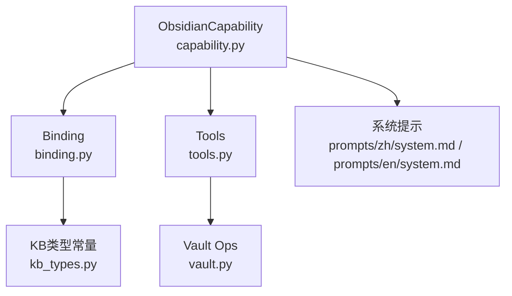
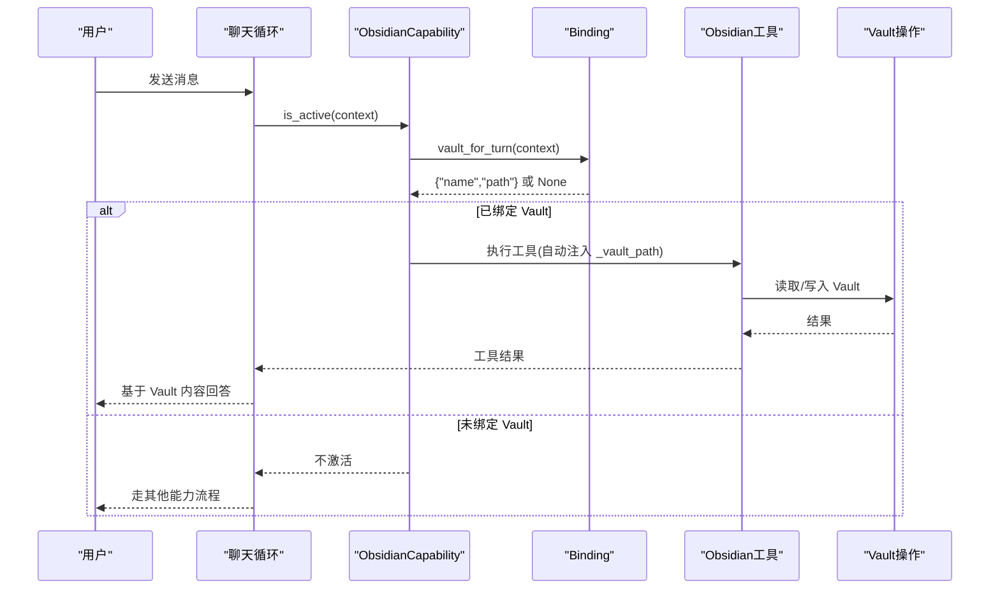
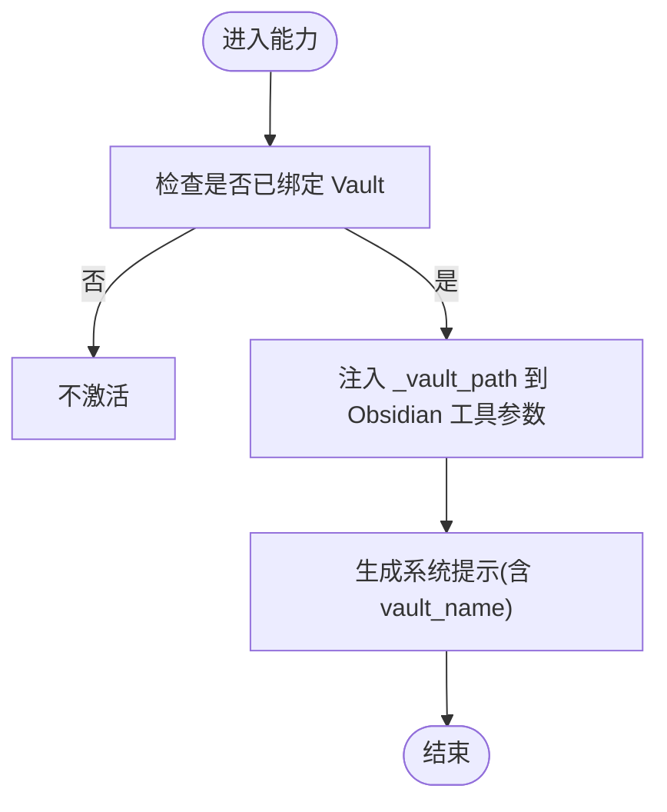
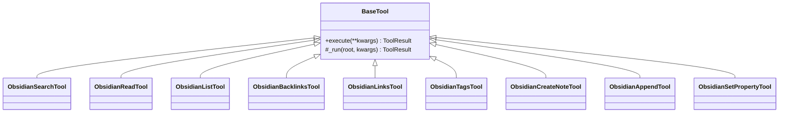
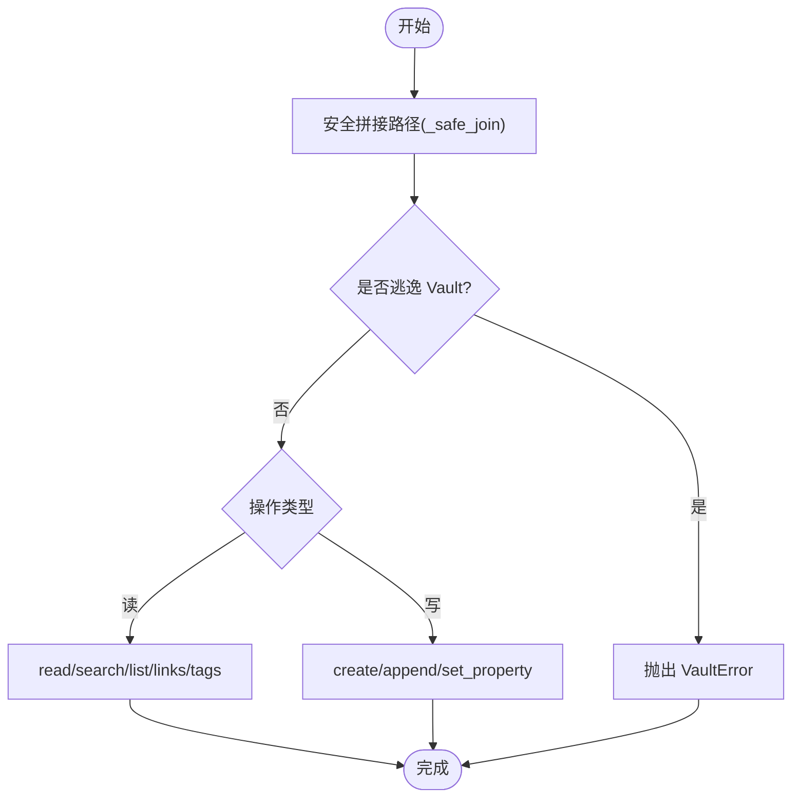
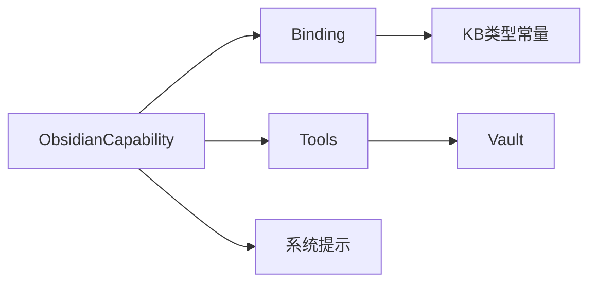

# Obsidian能力

<cite>
**本文引用的文件**
- [capability.py](file://deeptutor/capabilities/obsidian/capability.py)
- [binding.py](file://deeptutor/capabilities/obsidian/binding.py)
- [tools.py](file://deeptutor/capabilities/obsidian/tools.py)
- [vault.py](file://deeptutor/capabilities/obsidian/vault.py)
- [kb_types.py](file://deeptutor/knowledge/kb_types.py)
- [system.md（中文）](file://deeptutor/capabilities/obsidian/prompts/zh/system.md)
- [system.md（英文）](file://deeptutor/capabilities/obsidian/prompts/en/system.md)
- [test_obsidian_capability.py](file://tests/capabilities/test_obsidian_capability.py)
</cite>

## 目录
1. [简介](#简介)
2. [项目结构](#项目结构)
3. [核心组件](#核心组件)
4. [架构总览](#架构总览)
5. [详细组件分析](#详细组件分析)
6. [依赖关系分析](#依赖关系分析)
7. [性能考虑](#性能考虑)
8. [故障排除指南](#故障排除指南)
9. [结论](#结论)
10. [附录：配置示例与最佳实践](#附录：配置示例与最佳实践)

## 简介
本文件面向需要在 DeepTutor 中启用并配置“Obsidian能力”的用户与开发者，系统性说明 ObsidianCapability 的知识库集成机制、工具集合、Vault 管理方式、与 DeepTutor 的集成要点、配置示例、故障排除与性能调优建议。Obsidian 能力将用户的本地 Obsidian Vault 作为“连接型知识库”，在对话轮次中以“独占模式”直接读写 Vault 中的 Markdown 笔记，并通过双链图谱进行检索与导航，无需对 Vault 建立外部索引。

## 项目结构
Obsidian 能力位于 capabilities/obsidian 下，由四个核心模块组成：
- capability.py：定义 ObsidianCapability，负责激活判断、系统提示注入、工具参数增强（注入 vault_path）、以及声明拥有的工具集。
- binding.py：从当前上下文的知识库选择中解析出目标 Obsidian Vault（名称与路径），并在上下文元数据中缓存结果。
- tools.py：暴露九项 Obsidian 工具（搜索、读取、列举、反向链接、正向链接、标签、创建、追加、设置属性），统一封装错误处理与 vault_root 解析。
- vault.py：纯文件系统操作层，实现 Obsidian 约定下的读/写/索引逻辑（忽略 .obsidian/.trash/.git，支持 frontmatter、wikilink、inline tag）。

图表来源
- [capability.py:24-68](file://deeptutor/capabilities/obsidian/capability.py#L24-L68)
- [binding.py:22-45](file://deeptutor/capabilities/obsidian/binding.py#L22-L45)
- [tools.py:24-36](file://deeptutor/capabilities/obsidian/tools.py#L24-L36)
- [vault.py:24-33](file://deeptutor/capabilities/obsidian/vault.py#L24-L33)
- [kb_types.py:50-53](file://deeptutor/knowledge/kb_types.py#L50-L53)
- [system.md（中文）:1-29](file://deeptutor/capabilities/obsidian/prompts/zh/system.md#L1-L29)

章节来源
- [capability.py:24-68](file://deeptutor/capabilities/obsidian/capability.py#L24-L68)
- [binding.py:22-45](file://deeptutor/capabilities/obsidian/binding.py#L22-L45)
- [tools.py:24-36](file://deeptutor/capabilities/obsidian/tools.py#L24-L36)
- [vault.py:24-33](file://deeptutor/capabilities/obsidian/vault.py#L24-L33)
- [kb_types.py:50-53](file://deeptutor/knowledge/kb_types.py#L50-L53)
- [system.md（中文）:1-29](file://deeptutor/capabilities/obsidian/prompts/zh/system.md#L1-L29)

## 核心组件
- ObsidianCapability：决定本轮是否激活、注入系统提示、为 Obsidian 工具强制注入 _vault_path，并声明拥有的工具集。
- Binding：从上下文的 knowledge_bases 中解析第一个类型为 obsidian 且包含 vault_path 的条目，返回 {"name","path"} 并缓存。
- Tools：九项工具，覆盖搜索、读取、列举、反向链接、正向链接、标签、创建、追加、设置属性；所有写操作均为“只增不改”。
- Vault：纯文件系统操作，遵循 Obsidian 约定（frontmatter、wikilink、inline tag），提供安全的路径拼接与遍历。

章节来源
- [capability.py:24-68](file://deeptutor/capabilities/obsidian/capability.py#L24-L68)
- [binding.py:22-45](file://deeptutor/capabilities/obsidian/binding.py#L22-L45)
- [tools.py:78-337](file://deeptutor/capabilities/obsidian/tools.py#L78-L337)
- [vault.py:68-274](file://deeptutor/capabilities/obsidian/vault.py#L68-L274)

## 架构总览
Obsidian 能力以“连接型知识库”的方式工作：当用户选择的某个 KB 类型为 obsidian 时，本轮对话进入 Obsidian 独占模式，仅挂载 Obsidian 工具，直接对 Vault 文件进行检索与写入。Vault 路径在服务端通过 augment_kwargs 注入到每个 Obsidian 工具的调用参数中，模型无法伪造或越权访问。

图表来源
- [capability.py:30-68](file://deeptutor/capabilities/obsidian/capability.py#L30-L68)
- [binding.py:22-45](file://deeptutor/capabilities/obsidian/binding.py#L22-L45)
- [tools.py:39-75](file://deeptutor/capabilities/obsidian/tools.py#L39-L75)
- [vault.py:55-61](file://deeptutor/capabilities/obsidian/vault.py#L55-L61)

## 详细组件分析

### ObsidianCapability（能力入口）
- 激活条件：当 vault_for_turn(context) 返回非空时激活。
- 系统提示：根据语言加载 prompts/zh/system.md 或 prompts/en/system.md，并将 {vault_name} 替换为实际 Vault 名称。
- 工具增强：对 Obsidian 工具强制注入 _vault_path，防止模型伪造路径。
- 拥有知识基：仅报告 Obsidian Vault 引用，避免与其他 RAG 知识库冲突。

图表来源
- [capability.py:30-68](file://deeptutor/capabilities/obsidian/capability.py#L30-L68)
- [capability.py:75-87](file://deeptutor/capabilities/obsidian/capability.py#L75-L87)

章节来源
- [capability.py:24-87](file://deeptutor/capabilities/obsidian/capability.py#L24-L87)

### Binding（Vault 解析与缓存）
- 解析策略：遍历 context.knowledge_bases，找到第一个 type == obsidian 且包含 vault_path 的条目。
- 缓存策略：将结果缓存至 context.metadata["_obsidian_vault"]，避免重复解析。
- 多 Vault 枚举：obsidian_vault_refs 返回所有被选中的 Obsidian Vault 引用，用于从 RAG 表面排除这些 KB。

章节来源
- [binding.py:22-69](file://deeptutor/capabilities/obsidian/binding.py#L22-L69)
- [kb_types.py:50-53](file://deeptutor/knowledge/kb_types.py#L50-L53)

### Tools（九项工具）
- 读取类：obsidian_search、obsidian_read、obsidian_list、obsidian_backlinks、obsidian_links、obsidian_tags。
- 写入类：obsidian_create_note、obsidian_append、obsidian_set_property。
- 统一行为：若无 _vault_path，返回失败结果；若底层抛出 VaultError，则转为失败结果；所有写操作均为“只增不改”。

图表来源
- [tools.py:62-75](file://deeptutor/capabilities/obsidian/tools.py#L62-L75)
- [tools.py:78-337](file://deeptutor/capabilities/obsidian/tools.py#L78-L337)

章节来源
- [tools.py:24-36](file://deeptutor/capabilities/obsidian/tools.py#L24-L36)
- [tools.py:78-337](file://deeptutor/capabilities/obsidian/tools.py#L78-L337)

### Vault（文件系统操作）
- 安全路径：_safe_join 拒绝任何逃逸 Vault 根目录的路径。
- 忽略目录：.obsidian、.trash、.git 不参与扫描。
- 读取：read_note 解析 frontmatter 与正文；search_notes 全文匹配；list_notes 列举路径；outgoing_links/backlinks 解析 wikilink；collect_tags 统计 inline 与 frontmatter 标签。
- 写入：create_note 新建（不覆盖）；append_note 追加；set_property 设置单个 frontmatter 字段。

图表来源
- [vault.py:55-61](file://deeptutor/capabilities/obsidian/vault.py#L55-L61)
- [vault.py:130-274](file://deeptutor/capabilities/obsidian/vault.py#L130-L274)

章节来源
- [vault.py:24-33](file://deeptutor/capabilities/obsidian/vault.py#L24-L33)
- [vault.py:68-274](file://deeptutor/capabilities/obsidian/vault.py#L68-L274)

## 依赖关系分析
- ObsidianCapability 依赖 binding 解析 Vault，依赖 tools 暴露能力，依赖 prompts 提供系统提示。
- Tools 依赖 vault 实现具体文件操作。
- Binding 依赖 kb_types 中的 OBSIDIAN_KB_TYPE 常量识别连接型知识库。
- 测试用例验证了能力激活、工具注入、路径安全、只增不改等关键行为。

图表来源
- [capability.py:24-68](file://deeptutor/capabilities/obsidian/capability.py#L24-L68)
- [binding.py:22-45](file://deeptutor/capabilities/obsidian/binding.py#L22-L45)
- [tools.py:24-36](file://deeptutor/capabilities/obsidian/tools.py#L24-L36)
- [vault.py:24-33](file://deeptutor/capabilities/obsidian/vault.py#L24-L33)
- [kb_types.py:50-53](file://deeptutor/knowledge/kb_types.py#L50-L53)

章节来源
- [test_obsidian_capability.py:102-138](file://tests/capabilities/test_obsidian_capability.py#L102-L138)
- [test_obsidian_capability.py:179-219](file://tests/capabilities/test_obsidian_capability.py#L179-L219)

## 性能考虑
- 搜索与列举限制：search_notes 与 list_notes 支持 limit 参数，避免全量扫描导致延迟。
- 标签统计：collect_tags 按出现次数排序并限制返回数量，减少大 Vault 的计算开销。
- 路径安全：_safe_join 立即校验路径合法性，避免无效 I/O。
- 缓存：binding 将解析结果缓存在上下文元数据中，减少重复解析。
- 只增不改：写入操作不重写已有正文，降低并发冲突风险。

[本节为通用性能建议，不直接分析具体文件]

## 故障排除指南
- 无 Vault 连接：若工具返回“本轮未连接 Obsidian Vault”，请确认当前上下文选择了类型为 obsidian 的 KB，且其 metadata 包含 vault_path。
- 找不到笔记：read_note/backlinks 等会抛出 VaultError，表示引用不存在；请使用 search_notes 或 list_notes 定位正确路径。
- 路径穿越防护：尝试使用 ../ 等路径会被拒绝；请确保相对路径在 Vault 根目录下。
- 覆盖保护：create_note 不会覆盖已存在的笔记；如需更新，请使用 append_note 或 set_property。
- 权限问题：服务端强制注入 _vault_path，模型无法越权访问；如遇权限错误，检查服务器对 Vault 目录的读取/写入权限。

章节来源
- [tools.py:39-75](file://deeptutor/capabilities/obsidian/tools.py#L39-L75)
- [vault.py:55-61](file://deeptutor/capabilities/obsidian/vault.py#L55-L61)
- [vault.py:130-274](file://deeptutor/capabilities/obsidian/vault.py#L130-L274)
- [test_obsidian_capability.py:145-173](file://tests/capabilities/test_obsidian_capability.py#L145-L173)

## 结论
Obsidian 能力将用户的本地 Vault 作为“连接型知识库”，在对话轮次中以独占模式直接读写 Markdown 笔记，利用双链图谱进行检索与导航。通过严格的 Vault 路径注入与安全校验，确保模型只能访问指定 Vault；通过只增不改的写入策略，保障数据可追溯与可恢复。配合合理的 limit 与缓存策略，可在大规模 Vault 上保持良好性能。

[本节为总结性内容，不直接分析具体文件]

## 附录：配置示例与最佳实践

### 知识库集成机制
- Vault 连接：在知识基元数据中将 type 设置为 obsidian，并提供 vault_path 指向用户 Vault 根目录。
- 文档同步：能力不复制 Vault 内容，也不建立外部索引；所有检索与写入均直接作用于 Vault 文件。
- 内容索引：不使用向量索引；通过全文搜索、wikilink 解析与标签统计进行检索。

章节来源
- [kb_types.py:50-53](file://deeptutor/knowledge/kb_types.py#L50-L53)
- [capability.py:30-37](file://deeptutor/capabilities/obsidian/capability.py#L30-L37)
- [binding.py:22-45](file://deeptutor/capabilities/obsidian/binding.py#L22-L45)

### 工具集合与用法
- 检索工具：obsidian_search（全文搜索）、obsidian_read（读取 frontmatter 与正文）、obsidian_list（列举路径）、obsidian_backlinks（反向链接）、obsidian_links（正向链接）、obsidian_tags（标签统计）。
- 写入工具：obsidian_create_note（新建）、obsidian_append（追加）、obsidian_set_property（设置 frontmatter 字段）。
- 最佳实践：先搜索或列举，再读取有价值笔记；使用 backlinks/links 沿图谱导航；结构化元数据放入 frontmatter，正文保持可读性。

章节来源
- [tools.py:78-337](file://deeptutor/capabilities/obsidian/tools.py#L78-L337)
- [vault.py:130-274](file://deeptutor/capabilities/obsidian/vault.py#L130-L274)

### Vault 管理方式
- 多 Vault 支持：obsidian_vault_refs 可枚举所有被选中的 Obsidian Vault 引用；能力仅对第一个绑定的 Vault 进行操作。
- 权限控制：服务端强制注入 _vault_path，模型无法伪造路径；路径穿越将被拒绝。
- 数据备份：由于能力不复制 Vault 内容，建议使用 Vault 自身的备份方案（如 Git、云盘同步）进行备份。

章节来源
- [binding.py:48-69](file://deeptutor/capabilities/obsidian/binding.py#L48-L69)
- [capability.py:53-68](file://deeptutor/capabilities/obsidian/capability.py#L53-L68)
- [vault.py:55-61](file://deeptutor/capabilities/obsidian/vault.py#L55-L61)

### 与 DeepTutor 的集成配置
- 元数据映射：KB 元数据需包含 type=obsidian 与 vault_path；能力通过 binding 解析并缓存。
- 双向同步：能力直接读写 Vault 文件，无需额外同步步骤；注意并发写入可能导致的竞争，建议串行化写入或使用版本控制。
- 冲突解决：采用“只增不改”策略，避免覆盖；如需合并修改，建议在外部编辑器中进行，或通过多次 append 累积变更。

章节来源
- [binding.py:22-45](file://deeptutor/capabilities/obsidian/binding.py#L22-L45)
- [vault.py:234-274](file://deeptutor/capabilities/obsidian/vault.py#L234-L274)

### 配置示例与优化建议
- 基本配置：在知识基元数据中设置 type=obsidian 与 vault_path，并确保服务器对该目录有读写权限。
- 检索优化：使用 search_notes 的 limit 参数限制结果数量；使用 collect_tags 的 limit 参数限制标签数量。
- 写入优化：优先使用 append_note 与 set_property 进行增量更新；避免频繁 create_note 造成碎片化。
- 提示词优化：根据 prompts/zh/system.md 或 prompts/en/system.md 调整引导语，强调从 Vault 检索与写入规范。

章节来源
- [tools.py:101-107](file://deeptutor/capabilities/obsidian/tools.py#L101-L107)
- [tools.py:238-241](file://deeptutor/capabilities/obsidian/tools.py#L238-L241)
- [vault.py:140-156](file://deeptutor/capabilities/obsidian/vault.py#L140-L156)
- [vault.py:204-228](file://deeptutor/capabilities/obsidian/vault.py#L204-L228)
- [system.md（中文）:1-29](file://deeptutor/capabilities/obsidian/prompts/zh/system.md#L1-L29)