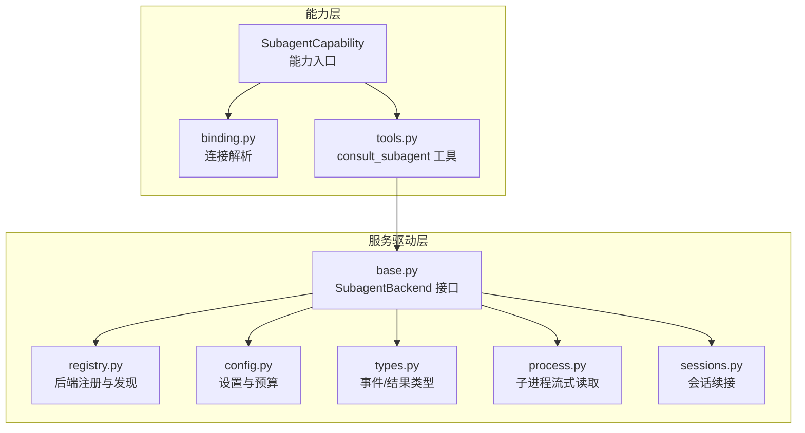
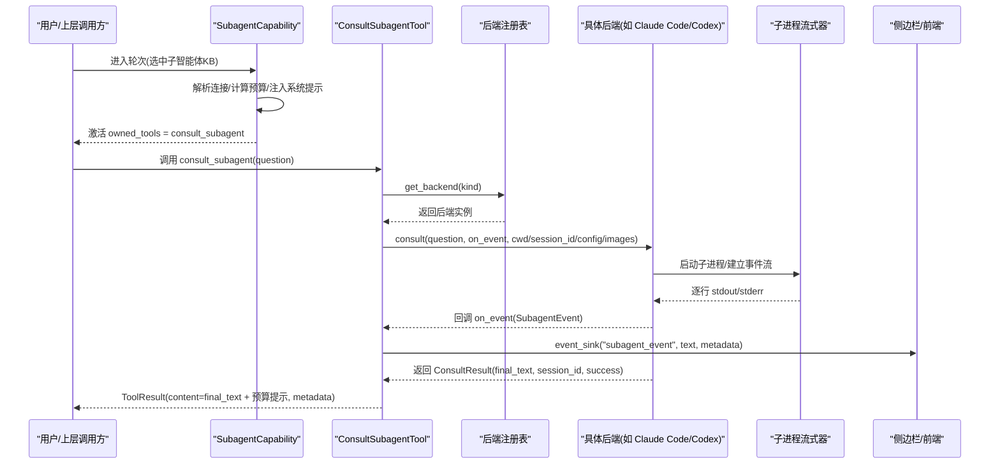
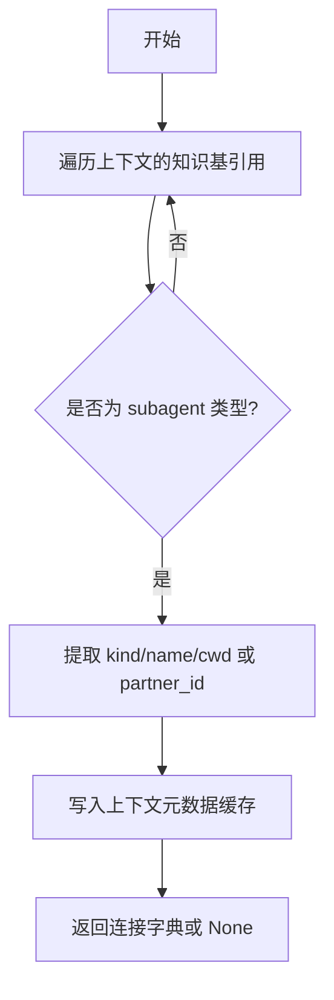
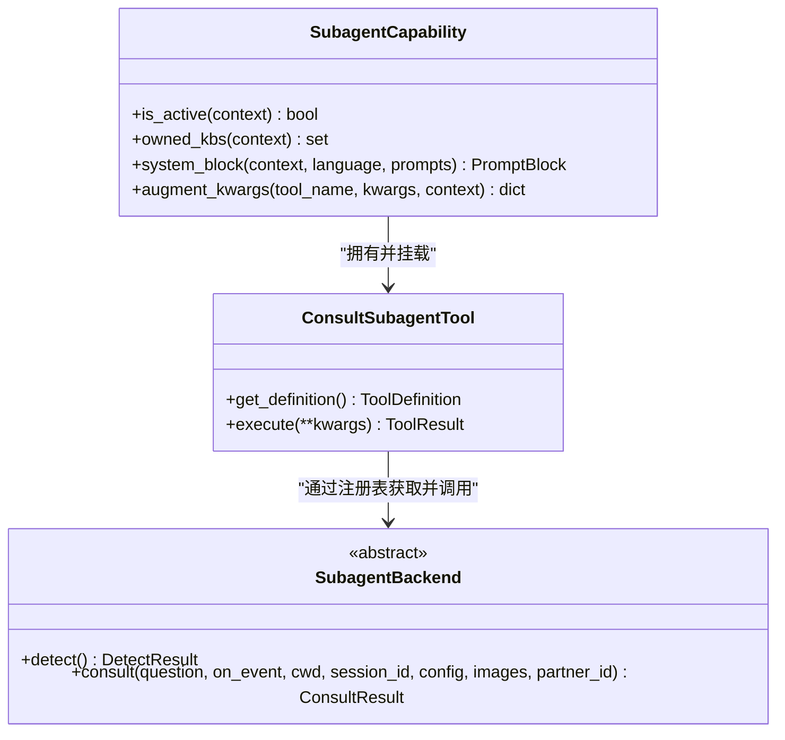
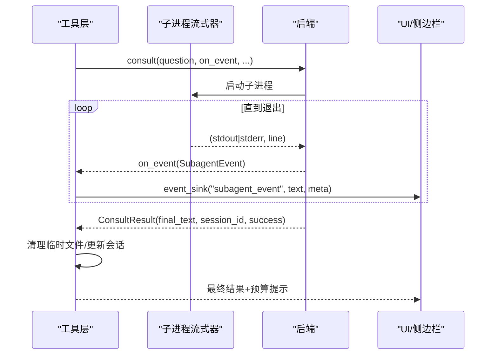
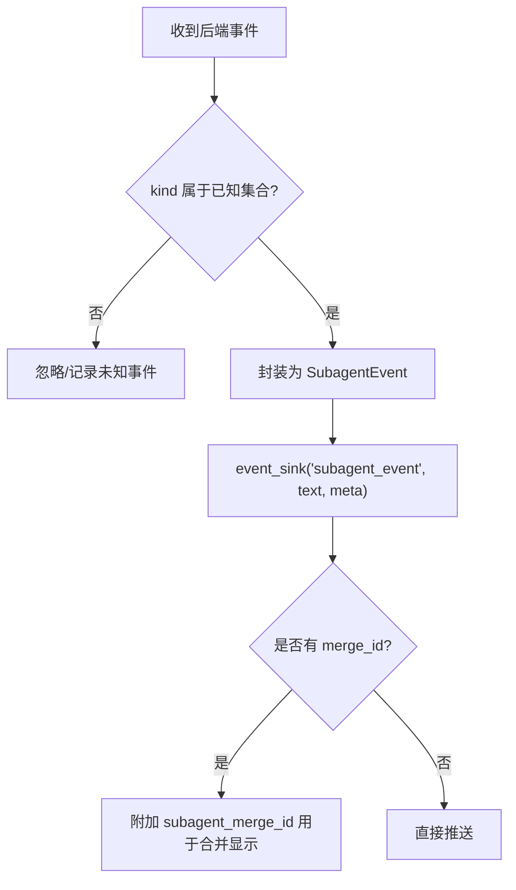
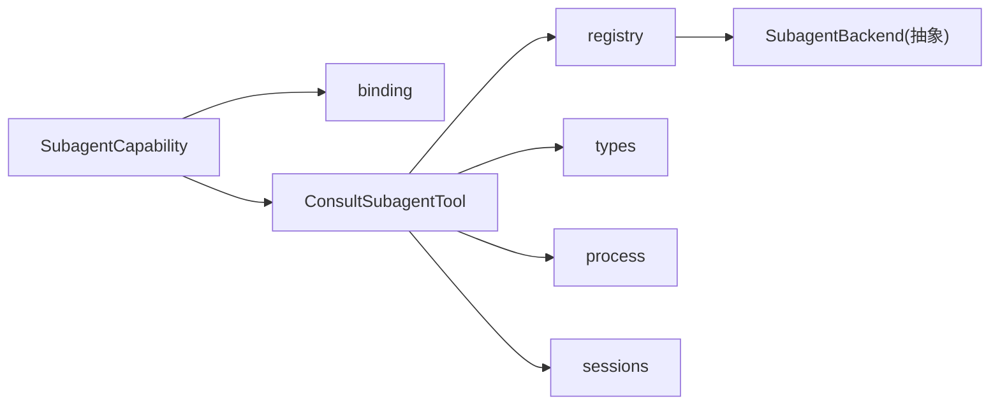

# 子智能体能力

<cite>
**本文引用的文件**
- [capabilities/subagent/__init__.py](file://deeptutor/capabilities/subagent/__init__.py)
- [capabilities/subagent/capability.py](file://deeptutor/capabilities/subagent/capability.py)
- [capabilities/subagent/binding.py](file://deeptutor/capabilities/subagent/binding.py)
- [capabilities/subagent/tools.py](file://deeptutor/capabilities/subagent/tools.py)
- [services/subagent/__init__.py](file://deeptutor/services/subagent/__init__.py)
- [services/subagent/base.py](file://deeptutor/services/subagent/base.py)
- [services/subagent/config.py](file://deeptutor/services/subagent/config.py)
- [services/subagent/registry.py](file://deeptutor/services/subagent/registry.py)
- [services/subagent/types.py](file://deeptutor/services/subagent/types.py)
- [services/subagent/process.py](file://deeptutor/services/subagent/process.py)
- [services/subagent/sessions.py](file://deeptutor/services/subagent/sessions.py)
</cite>

## 目录
1. [简介](#简介)
2. [项目结构](#项目结构)
3. [核心组件](#核心组件)
4. [架构总览](#架构总览)
5. [详细组件分析](#详细组件分析)
6. [依赖关系分析](#依赖关系分析)
7. [性能与资源限制](#性能与资源限制)
8. [故障排查指南](#故障排查指南)
9. [结论](#结论)
10. [附录：配置示例与最佳实践](#附录配置示例与最佳实践)

## 简介
本文件面向“子智能体能力”（SubagentCapability）的完整配置与使用，覆盖以下主题：
- 子智能体调用机制：智能体发现、参数绑定、执行调度
- 生命周期管理：启动、运行、监控、终止
- 通信协议：消息格式、事件处理、错误传播
- 资源限制：CPU、内存、时间配额（结合系统默认与可配置项）
- 配置示例：不同类型子智能体的调用方式与参数传递
- 调试与性能监控：日志、流式事件、会话连续性

## 项目结构
子智能体能力由“能力层”和“服务驱动层”组成：
- 能力层（capabilities/subagent）：负责在对话轮次中激活、解析连接、注入工具参数、控制预算与系统提示。
- 服务驱动层（services/subagent）：提供后端抽象、注册表、配置、类型定义、进程流式输出与会话持久化。

**图表来源**
- [capabilities/subagent/capability.py:32-117](file://deeptutor/capabilities/subagent/capability.py#L32-L117)
- [capabilities/subagent/binding.py:23-52](file://deeptutor/capabilities/subagent/binding.py#L23-L52)
- [capabilities/subagent/tools.py:42-202](file://deeptutor/capabilities/subagent/tools.py#L42-L202)
- [services/subagent/base.py:24-61](file://deeptutor/services/subagent/base.py#L24-L61)
- [services/subagent/registry.py:24-76](file://deeptutor/services/subagent/registry.py#L24-L76)
- [services/subagent/config.py:36-83](file://deeptutor/services/subagent/config.py#L36-L83)
- [services/subagent/types.py:38-71](file://deeptutor/services/subagent/types.py#L38-L71)
- [services/subagent/process.py:33-91](file://deeptutor/services/subagent/process.py#L33-L91)
- [services/subagent/sessions.py:28-69](file://deeptutor/services/subagent/sessions.py#L28-L69)

**章节来源**
- [capabilities/subagent/__init__.py:1-27](file://deeptutor/capabilities/subagent/__init__.py#L1-L27)
- [services/subagent/__init__.py:1-55](file://deeptutor/services/subagent/__init__.py#L1-L55)

## 核心组件
- SubagentCapability：在选中的知识库类型为子智能体时激活，注入系统提示、计算预算、将连接信息注入工具参数。
- binding：从当前上下文的“知识基引用”解析出目标子智能体连接（名称、种类、工作目录或伙伴ID），并缓存于上下文元数据。
- tools.ConsultSubagentTool：唯一对外暴露的工具，负责校验预算、选择后端、流式转发事件、返回最终答案与剩余次数。
- services.subagent.base.SubagentBackend：统一后端接口，要求实现 detect 与 consult。
- registry：集中注册所有可用后端（本地 CLI 与伙伴），并提供检测与获取。
- config：存储与加载子智能体设置（咨询预算、各后端权限/沙箱/网络等开关）。
- types：定义事件、检测结果、咨询结果等跨层数据结构。
- process：统一的子进程流式读取原语，保证行级实时输出与优雅终止。
- sessions：跨轮次持久化后端会话 ID，实现上下文延续。

**章节来源**
- [capabilities/subagent/capability.py:32-117](file://deeptutor/capabilities/subagent/capability.py#L32-L117)
- [capabilities/subagent/binding.py:23-76](file://deeptutor/capabilities/subagent/binding.py#L23-L76)
- [capabilities/subagent/tools.py:42-202](file://deeptutor/capabilities/subagent/tools.py#L42-L202)
- [services/subagent/base.py:24-61](file://deeptutor/services/subagent/base.py#L24-L61)
- [services/subagent/registry.py:24-76](file://deeptutor/services/subagent/registry.py#L24-L76)
- [services/subagent/config.py:36-83](file://deeptutor/services/subagent/config.py#L36-L83)
- [services/subagent/types.py:38-71](file://deeptutor/services/subagent/types.py#L38-L71)
- [services/subagent/process.py:33-91](file://deeptutor/services/subagent/process.py#L33-L91)
- [services/subagent/sessions.py:28-69](file://deeptutor/services/subagent/sessions.py#L28-L69)

## 架构总览
子智能体能力通过“能力—工具—后端”三层解耦：
- 能力层决定何时启用、如何注入参数与预算。
- 工具层封装一次“提问—流式事件—返回结果”的原子操作。
- 后端层屏蔽不同 CLI/伙伴的差异，统一事件模型。

**图表来源**
- [capabilities/subagent/capability.py:32-117](file://deeptutor/capabilities/subagent/capability.py#L32-L117)
- [capabilities/subagent/tools.py:76-202](file://deeptutor/capabilities/subagent/tools.py#L76-L202)
- [services/subagent/registry.py:43-76](file://deeptutor/services/subagent/registry.py#L43-L76)
- [services/subagent/base.py:40-61](file://deeptutor/services/subagent/base.py#L40-L61)
- [services/subagent/process.py:33-91](file://deeptutor/services/subagent/process.py#L33-L91)

## 详细组件分析

### 智能体发现与连接绑定
- 发现：通过注册表探测本地 CLI 是否可用；非 CLI 的伙伴后端不参与本机探测。
- 绑定：从当前上下文的“知识基引用”中查找 type=subagent 的条目，提取 agent_kind、name、cwd/partner_id，并缓存到上下文元数据，避免重复解析。

**图表来源**
- [capabilities/subagent/binding.py:23-52](file://deeptutor/capabilities/subagent/binding.py#L23-L52)
- [services/subagent/registry.py:51-76](file://deeptutor/services/subagent/registry.py#L51-L76)

**章节来源**
- [capabilities/subagent/binding.py:23-76](file://deeptutor/capabilities/subagent/binding.py#L23-L76)
- [services/subagent/registry.py:24-76](file://deeptutor/services/subagent/registry.py#L24-L76)

### 参数绑定与执行调度
- 能力层在 augment_kwargs 中将 _subagent 注入工具调用参数，包含后端种类、工作目录、伙伴ID、预算、每后端配置、图像附件、会话键等。
- 工具层校验 question 与预算，选择后端，构造 on_event 回调以桥接后端事件到 UI 的事件总线。
- 后端按接口约定执行 consult，流式回调事件，最后返回最终文本与会话 ID。

**图表来源**
- [capabilities/subagent/capability.py:32-117](file://deeptutor/capabilities/subagent/capability.py#L32-L117)
- [capabilities/subagent/tools.py:42-202](file://deeptutor/capabilities/subagent/tools.py#L42-L202)
- [services/subagent/base.py:24-61](file://deeptutor/services/subagent/base.py#L24-L61)

**章节来源**
- [capabilities/subagent/capability.py:65-117](file://deeptutor/capabilities/subagent/capability.py#L65-L117)
- [capabilities/subagent/tools.py:76-202](file://deeptutor/capabilities/subagent/tools.py#L76-L202)

### 生命周期管理（启动、运行、监控、终止）
- 启动：能力层确定连接与预算后，工具层调用后端 consult。
- 运行：后端通过子进程流式器逐行读取 stdout/stderr，转换为标准事件模型并回调。
- 监控：工具层将每个事件通过 event_sink 推送到 UI，附带 subagent_kind、channel、consult_index、merge_id 等元数据。
- 终止：子进程结束后，工具层清理临时图片目录，更新会话 ID，返回最终结果与剩余预算提示。

**图表来源**
- [capabilities/subagent/tools.py:114-176](file://deeptutor/capabilities/subagent/tools.py#L114-L176)
- [services/subagent/process.py:33-91](file://deeptutor/services/subagent/process.py#L33-L91)
- [services/subagent/sessions.py:63-69](file://deeptutor/services/subagent/sessions.py#L63-L69)

**章节来源**
- [capabilities/subagent/tools.py:114-176](file://deeptutor/capabilities/subagent/tools.py#L114-L176)
- [services/subagent/process.py:33-91](file://deeptutor/services/subagent/process.py#L33-L91)
- [services/subagent/sessions.py:63-69](file://deeptutor/services/subagent/sessions.py#L63-L69)

### 通信协议：消息格式、事件处理、错误传播
- 事件模型：统一为 SubagentEvent，包含 kind（text/reasoning/tool/tool_result/log/result/error）、text、raw、meta。
- 事件通道：UI 通过单一 trace_kind “subagent_event” 接收，细粒度 channel 与 merge_id 在元数据中区分。
- 错误传播：后端异常被捕获并转为失败结果；无最终文本时返回失败并附带错误详情；预算耗尽时拒绝继续调用。

**图表来源**
- [services/subagent/types.py:14-35](file://deeptutor/services/subagent/types.py#L14-L35)
- [capabilities/subagent/tools.py:114-133](file://deeptutor/capabilities/subagent/tools.py#L114-L133)

**章节来源**
- [services/subagent/types.py:38-71](file://deeptutor/services/subagent/types.py#L38-L71)
- [capabilities/subagent/tools.py:114-133](file://deeptutor/capabilities/subagent/tools.py#L114-L133)

### 资源限制与配额
- 咨询预算：每轮最多可调用 consult_subagent 的次数，默认值与最小/最大值在配置中定义；可在上下文覆盖。
- 后端权限/沙箱/网络：各后端支持 permission_mode、sandbox、approval、network_access、auto_approve、thinking、forward_images 等开关，用于控制非交互模式下的行为，避免阻塞。
- 时间与进程：子进程流式器不设置等待超时，遵循“等待子智能体自行结束”的产品契约；取消时会优雅终止子进程。
- CPU/内存：未在此层显式限制；建议通过操作系统/容器层面的 cgroup/limits 进行约束。

**章节来源**
- [services/subagent/config.py:31-83](file://deeptutor/services/subagent/config.py#L31-L83)
- [capabilities/subagent/capability.py:148-162](file://deeptutor/capabilities/subagent/capability.py#L148-L162)
- [services/subagent/process.py:9-13](file://deeptutor/services/subagent/process.py#L9-L13)
- [services/subagent/process.py:94-110](file://deeptutor/services/subagent/process.py#L94-L110)

## 依赖关系分析
- 能力层依赖 binding 解析连接，依赖 tools 暴露工具，依赖 capability 自身控制轮次。
- 工具层依赖注册表获取后端，依赖类型定义与进程流式器。
- 后端抽象与具体实现通过注册表解耦；配置与会话独立维护。

**图表来源**
- [capabilities/subagent/capability.py:32-117](file://deeptutor/capabilities/subagent/capability.py#L32-L117)
- [capabilities/subagent/tools.py:42-202](file://deeptutor/capabilities/subagent/tools.py#L42-L202)
- [services/subagent/registry.py:24-76](file://deeptutor/services/subagent/registry.py#L24-L76)
- [services/subagent/base.py:24-61](file://deeptutor/services/subagent/base.py#L24-L61)

**章节来源**
- [capabilities/subagent/capability.py:32-117](file://deeptutor/capabilities/subagent/capability.py#L32-L117)
- [capabilities/subagent/tools.py:42-202](file://deeptutor/capabilities/subagent/tools.py#L42-L202)
- [services/subagent/registry.py:24-76](file://deeptutor/services/subagent/registry.py#L24-L76)

## 性能与资源限制
- 流式输出：子进程行级读取，减少首字节延迟，提升用户体验。
- 事件合并：通过 merge_id 将同一工具的起止事件合并为一行，降低 UI 渲染压力。
- 预算控制：严格限制 per-turn 调用次数，防止无限循环。
- 资源建议：
  - CPU/内存：建议在容器或系统层面通过 cgroup/ulimit 限制子进程资源。
  - 时间：遵循“等待子进程结束”的契约；如需强制中断，应在上层取消轮次并依赖优雅终止逻辑。
  - I/O：避免同时发起过多并发子进程；必要时在上层做限流。

[本节为通用指导，不直接分析具体文件]

## 故障排查指南
- 无法连接子智能体：检查 binding 是否正确解析 KB 引用；确认 agent_kind 有效且后端已注册。
- 工具不可用：确认能力 is_active 为真；确保 owned_tools 已挂载。
- 预算耗尽：查看返回内容中的剩余次数提示；调整 consult_budget 或上下文覆盖。
- 事件未显示：检查 event_sink 是否传入；核对 metadata 中的 subagent_channel 与 merge_id。
- 子进程卡住：确认后端 consult 是否等待子进程结束；检查取消流程是否触发优雅终止。
- 会话丢失：检查 sessions 持久化是否成功；确认 session_key 生成正确。

**章节来源**
- [capabilities/subagent/tools.py:76-108](file://deeptutor/capabilities/subagent/tools.py#L76-L108)
- [capabilities/subagent/tools.py:154-176](file://deeptutor/capabilities/subagent/tools.py#L154-L176)
- [services/subagent/process.py:94-110](file://deeptutor/services/subagent/process.py#L94-L110)
- [services/subagent/sessions.py:55-69](file://deeptutor/services/subagent/sessions.py#L55-L69)

## 结论
子智能体能力通过清晰的分层与统一的协议，实现了多类本地 CLI/伙伴的统一接入与流式交互。能力层负责轮次控制与参数注入，工具层负责预算与事件桥接，后端层屏蔽差异。通过配置化的预算与权限控制，以及跨轮次的会话续接，系统在可用性、可控性与可观测性之间取得平衡。

[本节为总结，不直接分析具体文件]

## 附录：配置示例与最佳实践

### 配置项说明（节选）
- 全局设置
  - consult_budget：每轮最大咨询次数（默认与范围见配置模块）
- 后端设置（按 kind 区分）
  - enabled：是否启用该后端
  - model / effort：指定模型与推理强度（空则使用 CLI 默认）
  - system_prompt：注入的系统提示（为空时使用产品默认）
  - permission_mode / sandbox / approval：控制非交互模式下的权限与审批策略
  - network_access：是否允许模型运行的 shell 命令访问网络
  - ephemeral：是否不持久化会话
  - auto_approve：自动同意权限询问（避免阻塞）
  - thinking：是否流式输出思考过程
  - forward_images：是否转发图片附件
  - extra_args：额外命令行参数

**章节来源**
- [services/subagent/config.py:36-83](file://deeptutor/services/subagent/config.py#L36-L83)
- [services/subagent/config.py:117-136](file://deeptutor/services/subagent/config.py#L117-L136)

### 调用方式与参数传递
- 选择子智能体 KB：在聊天中选择 type=subagent 的知识库，能力层将激活并注入 consult_subagent 工具。
- 工具参数：仅需提供 question；_subagent 由能力层注入（kind、cwd、partner_id、budget、config、images、session_key 等）。
- 预算控制：可通过上下文覆盖 subagent_consult_budget；工具层会校验并在达到上限时拒绝后续调用。
- 图片转发：若后端配置开启 forward_images，能力层会将本轮图片附件暂存并传递给后端。

**章节来源**
- [capabilities/subagent/capability.py:65-117](file://deeptutor/capabilities/subagent/capability.py#L65-L117)
- [capabilities/subagent/tools.py:45-74](file://deeptutor/capabilities/subagent/tools.py#L45-L74)
- [capabilities/subagent/tools.py:76-108](file://deeptutor/capabilities/subagent/tools.py#L76-L108)

### 调试与性能监控
- 事件追踪：所有子智能体事件以 trace_kind="subagent_event" 推送，metadata 包含 subagent_kind、subagent_channel、consult_index、subagent_merge_id。
- 日志定位：后端异常会被记录警告日志；子进程泵异常会记录调试日志。
- 会话连续性：通过 sessions 持久化后端会话 ID，跨轮次恢复上下文。
- 性能建议：合理设置 consult_budget；避免过多并发子进程；利用 merge_id 减少 UI 渲染开销。

**章节来源**
- [capabilities/subagent/tools.py:114-133](file://deeptutor/capabilities/subagent/tools.py#L114-L133)
- [capabilities/subagent/tools.py:154-176](file://deeptutor/capabilities/subagent/tools.py#L154-L176)
- [services/subagent/sessions.py:55-69](file://deeptutor/services/subagent/sessions.py#L55-L69)
- [services/subagent/process.py:57-70](file://deeptutor/services/subagent/process.py#L57-L70)