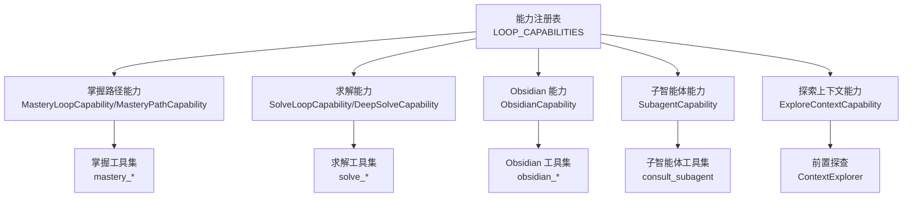
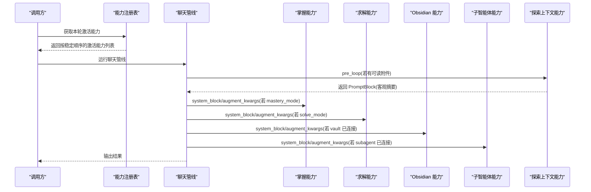
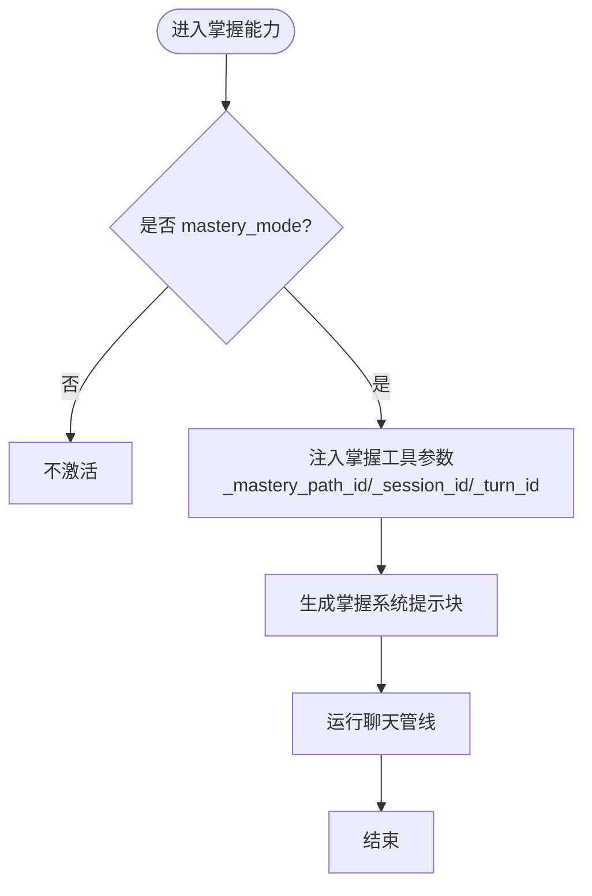
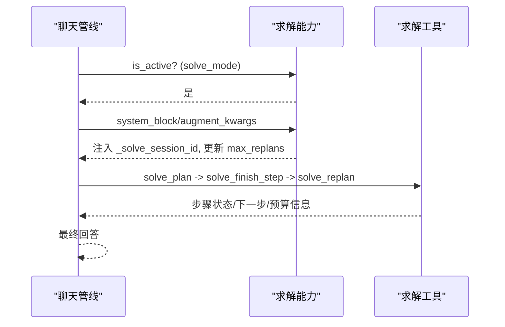
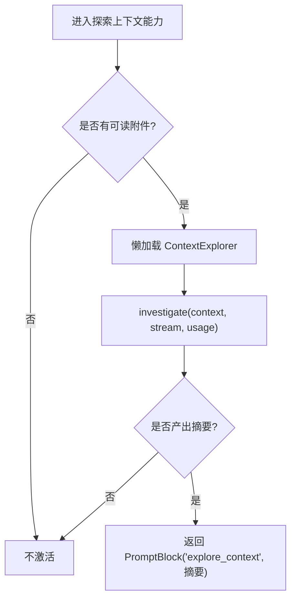
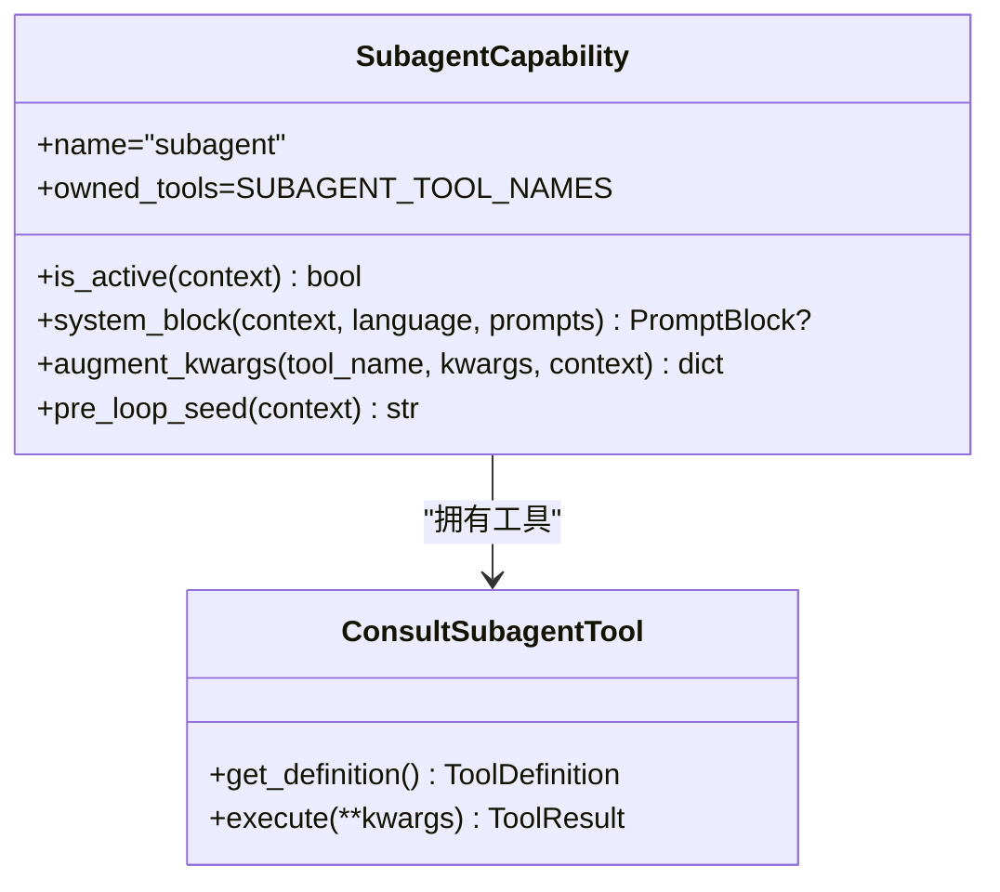
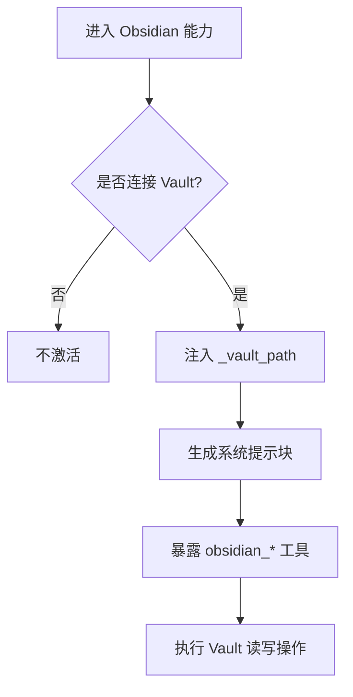
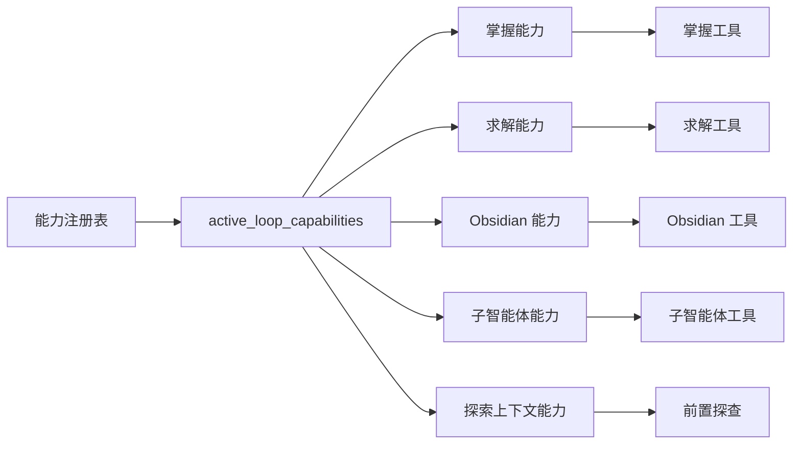

# 循环能力配置

<cite>
**本文引用的文件**
- [capabilities/__init__.py](file://deeptutor/capabilities/__init__.py)
- [capabilities/registry.py](file://deeptutor/capabilities/registry.py)
- [capabilities/protocol.py](file://deeptutor/capabilities/protocol.py)
- [capabilities/mastery/capability.py](file://deeptutor/capabilities/mastery/capability.py)
- [capabilities/mastery/loop.py](file://deeptutor/capabilities/mastery/loop.py)
- [capabilities/mastery/tools.py](file://deeptutor/capabilities/mastery/tools.py)
- [capabilities/solve/capability.py](file://deeptutor/capabilities/solve/capability.py)
- [capabilities/solve/loop.py](file://deeptutor/capabilities/solve/loop.py)
- [capabilities/solve/tools.py](file://deeptutor/capabilities/solve/tools.py)
- [capabilities/explore_context/capability.py](file://deeptutor/capabilities/explore_context/capability.py)
- [capabilities/subagent/capability.py](file://deeptutor/capabilities/subagent/capability.py)
- [capabilities/subagent/tools.py](file://deeptutor/capabilities/subagent/tools.py)
- [capabilities/obsidian/capability.py](file://deeptutor/capabilities/obsidian/capability.py)
- [capabilities/obsidian/tools.py](file://deeptutor/capabilities/obsidian/tools.py)
</cite>

## 目录
1. [简介](#简介)
2. [项目结构](#项目结构)
3. [核心组件](#核心组件)
4. [架构总览](#架构总览)
5. [详细组件分析](#详细组件分析)
6. [依赖关系分析](#依赖关系分析)
7. [性能与资源管理](#性能与资源管理)
8. [故障排查指南](#故障排查指南)
9. [结论](#结论)
10. [附录](#附录)

## 简介
本文件聚焦 DeepTutor 的“循环能力”（Loop Capabilities）配置，覆盖以下能力：
- 掌握路径能力（MasteryLoopCapability / MasteryPathCapability）：学习策略、难度调整与评估参数。
- 求解能力（SolveLoopCapability / DeepSolveCapability）：问题解决模式、工具选择与约束条件。
- 探索上下文能力（ExploreContextCapability）：上下文感知的前置探查。
- 子智能体能力（SubagentCapability）：调用参数、预算与资源限制。
- Obsidian 能力（ObsidianCapability）：知识库集成与安全边界。
并说明各能力的 is_active 判断逻辑、能力间协作模式与通信协议、以及性能调优与资源管理最佳实践。

## 项目结构
DeepTutor 将“循环能力”以插件式注册到统一的能力注册表中；每个能力在自身子包内提供：
- 能力类（实现 LoopCapability/KnowledgeCapability 协议）
- 专属工具集（tools.py）
- 可选的系统提示块与前置钩子（pre_loop/system_block/augment_kwargs）
- 绑定解析（如 subagent/obsidian 的连接解析）

图表来源
- [capabilities/registry.py:13-19](file://deeptutor/capabilities/registry.py#L13-L19)
- [capabilities/mastery/loop.py:13-21](file://deeptutor/capabilities/mastery/loop.py#L13-L21)
- [capabilities/solve/loop.py:21-31](file://deeptutor/capabilities/solve/loop.py#L21-L31)
- [capabilities/obsidian/capability.py:24-28](file://deeptutor/capabilities/obsidian/capability.py#L24-L28)
- [capabilities/subagent/capability.py:32-36](file://deeptutor/capabilities/subagent/capability.py#L32-L36)
- [capabilities/explore_context/capability.py:82-88](file://deeptutor/capabilities/explore_context/capability.py#L82-L88)

章节来源
- [capabilities/__init__.py:1-30](file://deeptutor/capabilities/__init__.py#L1-L30)
- [capabilities/registry.py:1-53](file://deeptutor/capabilities/registry.py#L1-L53)

## 核心组件
- 协议层：定义 LoopCapability/KnowledgeCapability/PromptBlock，规范能力的生命周期钩子与工具注入方式。
- 注册表：集中维护所有内置循环能力实例，并提供 active_loop_capabilities 与 exclusive 能力检测。
- 能力实现：
  - 掌握路径：标记 mastery_mode，注入掌握工具，驱动标准聊天管线。
  - 求解：标记 solve_mode，注入求解工具，设置会话与重规划预算。
  - 探索上下文：当存在可读附件时，执行前置探查，产出客观摘要作为用户消息种子。
  - 子智能体：当选中连接的外部智能体为 KB 时独占本轮工具面，注入 consult_subagent。
  - Obsidian：当选中连接的 Vault 为 KB 时独占本轮工具面，注入 obsidian_* 工具。

章节来源
- [capabilities/protocol.py:19-117](file://deeptutor/capabilities/protocol.py#L19-L117)
- [capabilities/registry.py:22-44](file://deeptutor/capabilities/registry.py#L22-L44)
- [capabilities/mastery/capability.py:57-73](file://deeptutor/capabilities/mastery/capability.py#L57-L73)
- [capabilities/solve/capability.py:59-88](file://deeptutor/capabilities/solve/capability.py#L59-L88)
- [capabilities/explore_context/capability.py:68-141](file://deeptutor/capabilities/explore_context/capability.py#L68-L141)
- [capabilities/subagent/capability.py:32-121](file://deeptutor/capabilities/subagent/capability.py#L32-L121)
- [capabilities/obsidian/capability.py:24-72](file://deeptutor/capabilities/obsidian/capability.py#L24-L72)

## 架构总览
循环能力通过“能力 + 工具 + 提示块 + 钩子”的组合，复用聊天代理循环，按需增强或替换工具面。

图表来源
- [capabilities/registry.py:22-35](file://deeptutor/capabilities/registry.py#L22-L35)
- [capabilities/explore_context/capability.py:118-141](file://deeptutor/capabilities/explore_context/capability.py#L118-L141)
- [capabilities/mastery/loop.py:23-55](file://deeptutor/capabilities/mastery/loop.py#L23-L55)
- [capabilities/solve/loop.py:33-73](file://deeptutor/capabilities/solve/loop.py#L33-L73)
- [capabilities/obsidian/capability.py:30-72](file://deeptutor/capabilities/obsidian/capability.py#L30-L72)
- [capabilities/subagent/capability.py:38-121](file://deeptutor/capabilities/subagent/capability.py#L38-L121)

## 详细组件分析

### 掌握路径能力（MasteryLoopCapability / MasteryPathCapability）
- 目标与职责
  - 将本轮标记为掌握模式，解析掌握路径 ID，挂载掌握工具，驱动标准聊天管线完成自适应教学与测验。
- 关键配置项
  - 学习策略：由掌握引擎决定下一步目标、门限与间隔复习；工具暴露状态查询、测验登记、评分与定性评估。
  - 难度调整：通过知识点的类型与阈值控制推进；可通过构建模块/知识点树来设计难度梯度。
  - 评估参数：问题类型（choice/short/open）、期望答案、选项内容、评分门限与是否掌握等。
- 工具集
  - mastery_status、mastery_quiz、mastery_grade、mastery_assess、mastery_build。
- 系统提示与参数注入
  - 注入 _mastery_path_id、_session_id、_turn_id 给掌握工具使用。
- is_active 判断
  - 基于 context.metadata["mastery_mode"] 是否为真。

图表来源
- [capabilities/mastery/loop.py:23-55](file://deeptutor/capabilities/mastery/loop.py#L23-L55)
- [capabilities/mastery/tools.py:57-65](file://deeptutor/capabilities/mastery/tools.py#L57-L65)
- [capabilities/mastery/capability.py:57-73](file://deeptutor/capabilities/mastery/capability.py#L57-L73)

章节来源
- [capabilities/mastery/capability.py:57-73](file://deeptutor/capabilities/mastery/capability.py#L57-L73)
- [capabilities/mastery/loop.py:13-55](file://deeptutor/capabilities/mastery/loop.py#L13-L55)
- [capabilities/mastery/tools.py:57-65](file://deeptutor/capabilities/mastery/tools.py#L57-L65)

### 求解能力（SolveLoopCapability / DeepSolveCapability）
- 目标与职责
  - 将本轮标记为求解模式，挂载求解工具，驱动聊天管线进行多步问题解决，保持计划、步骤门限与重规划预算。
- 关键配置项
  - 问题解决模式：先制定计划（solve_plan），逐步完成（solve_finish_step），必要时重规划（solve_replan）。
  - 工具选择：复用聊天内置工具（rag/code_execution/geogebra_analysis/reason 等），叠加求解三件套。
  - 约束条件：最大重规划次数（max_replans）、最大轮次（max_rounds）、温度与令牌上限（temperature/max_tokens）。
- 系统提示与参数注入
  - 注入 _solve_session_id，并在 augment_kwargs 中根据 metadata 中的 solve_max_replans 更新会话的重规划预算。
- is_active 判断
  - 基于 context.metadata["solve_mode"] 是否为真。

图表来源
- [capabilities/solve/capability.py:59-88](file://deeptutor/capabilities/solve/capability.py#L59-L88)
- [capabilities/solve/loop.py:33-73](file://deeptutor/capabilities/solve/loop.py#L33-L73)
- [capabilities/solve/tools.py:26-30](file://deeptutor/capabilities/solve/tools.py#L26-L30)

章节来源
- [capabilities/solve/capability.py:59-88](file://deeptutor/capabilities/solve/capability.py#L59-L88)
- [capabilities/solve/loop.py:21-73](file://deeptutor/capabilities/solve/loop.py#L21-L73)
- [capabilities/solve/tools.py:77-275](file://deeptutor/capabilities/solve/tools.py#L77-L275)

### 探索上下文能力（ExploreContextCapability）
- 目标与职责
  - 当本轮携带可读附件（文档/笔记/书节/题库条目/对话历史）时，在首轮 LLM 调用前进行一次只读探查，产出客观第三人称摘要，避免模型误用第一人称。
- 关键配置项
  - 上下文感知：检查 context.metadata["source_index"] 是否存在且非空。
  - 前置钩子：pre_loop 懒加载 ContextExplorer，产出 PromptBlock 注入用户消息种子。
- 工具与系统提示
  - 不拥有答案循环工具；read_source 在探查阶段内部使用，不暴露给答案循环。
- is_active 判断
  - 当存在可读附件时为真。

图表来源
- [capabilities/explore_context/capability.py:68-141](file://deeptutor/capabilities/explore_context/capability.py#L68-L141)

章节来源
- [capabilities/explore_context/capability.py:68-141](file://deeptutor/capabilities/explore_context/capability.py#L68-L141)

### 子智能体能力（SubagentCapability）
- 目标与职责
  - 当选定的知识库为已连接的外部智能体（本地 CLI 或伙伴）时，独占本轮工具面，仅允许 consult_subagent（及 ask_user），委派任务并实时展示其运行过程。
- 关键配置项
  - 调用参数：question（由模型提供），服务端注入 _subagent（后端类型、工作目录、伙伴ID、名称、预算、配置、状态、图片、会话键）。
  - 资源限制：每轮咨询预算（consult_budget），可被 chat composer 的 config_overrides.subagent_consult_budget 覆盖；保留至少两轮用于最终回答。
  - 会话连续性：跨轮复用同一外部智能体会话（通过 session_key 持久化）。
- 系统提示与参数注入
  - 注入最小轮数保障（budget + 收尾缓冲），并为每次工具调用注入 _subagent。
- is_active 判断
  - 当 connection_for_turn(context) 不为空时为真。

图表来源
- [capabilities/subagent/capability.py:32-121](file://deeptutor/capabilities/subagent/capability.py#L32-L121)
- [capabilities/subagent/tools.py:42-202](file://deeptutor/capabilities/subagent/tools.py#L42-L202)

章节来源
- [capabilities/subagent/capability.py:32-218](file://deeptutor/capabilities/subagent/capability.py#L32-L218)
- [capabilities/subagent/tools.py:1-231](file://deeptutor/capabilities/subagent/tools.py#L1-L231)

### Obsidian 能力（ObsidianCapability）
- 目标与职责
  - 当选定的知识库为已连接的 Obsidian Vault 时，独占本轮工具面，直接导航与编辑 Markdown，而非检索扁平片段。
- 关键配置项
  - 工具集：搜索、读取、列出、反向链接、正向链接、标签、创建笔记、追加内容、设置属性。
  - 安全边界：服务端强制注入 _vault_path，模型不可伪造路径，确保仅在 Vault 根目录下操作。
  - 系统提示：支持语言相关默认提示，并可被 prompts 覆盖。
- is_active 判断
  - 当 vault_for_turn(context) 不为空时为真。

图表来源
- [capabilities/obsidian/capability.py:24-72](file://deeptutor/capabilities/obsidian/capability.py#L24-L72)
- [capabilities/obsidian/tools.py:24-36](file://deeptutor/capabilities/obsidian/tools.py#L24-L36)

章节来源
- [capabilities/obsidian/capability.py:24-91](file://deeptutor/capabilities/obsidian/capability.py#L24-L91)
- [capabilities/obsidian/tools.py:1-362](file://deeptutor/capabilities/obsidian/tools.py#L1-L362)

## 依赖关系分析
- 能力注册与激活
  - LOOP_CAPABILITIES 集中声明所有能力实例；active_loop_capabilities 依据 is_active 过滤出本轮激活能力。
  - any_exclusive_capability_active 检测 KnowledgeCapability（exclusive_tools=True）是否激活，决定是否替换工具面。
- 能力与工具
  - 每个能力通过 owned_tools 声明其拥有的工具名；capability_tool_owners 建立工具到能力名的映射，便于设置 UI 分组。
- 能力与上下文
  - 各能力通过 context.metadata 传递模式标志（mastery_mode/solve_mode）、会话标识（solve_session_id/mastery_path_id）与预算（solve_max_replans、_min_loop_rounds）。
- 能力与提示
  - 通过 system_block 注入系统提示块；pre_loop 可在首轮 LLM 调用前插入客观上下文。

图表来源
- [capabilities/registry.py:13-44](file://deeptutor/capabilities/registry.py#L13-L44)
- [capabilities/protocol.py:19-117](file://deeptutor/capabilities/protocol.py#L19-L117)

章节来源
- [capabilities/registry.py:13-44](file://deeptutor/capabilities/registry.py#L13-L44)
- [capabilities/protocol.py:19-117](file://deeptutor/capabilities/protocol.py#L19-L117)

## 性能与资源管理
- 预算与轮次
  - 求解：通过 get_solve_params 读取 max_rounds、max_replans、temperature、max_tokens，并注入到聊天管线与 SolveSession。
  - 子智能体：consult_budget 可被 per-turn 覆盖；预留至少两轮用于最终回答，避免预算耗尽无法收尾。
- 上下文与内存
  - 探索上下文：懒加载 explorer，避免启动期循环导入；只在有可读附件时执行，减少不必要开销。
  - 求解：每步完成后折叠中间工具输出为摘要（_context_checkpoint），节省上下文窗口。
- 工具与 I/O
  - Obsidian：严格限制在 _vault_path 下操作，避免越权访问；批量操作限制 limit 范围。
  - 子智能体：图片转发按需物化到临时目录，运行结束后清理，防止磁盘泄漏。
- 提示与缓存
  - 探索上下文：按语言缓存提示，避免重复 IO。
  - 各能力：优先使用 prompts 覆盖默认提示，减少硬编码成本。

[本节为通用指导，无需具体文件引用]

## 故障排查指南
- 能力未激活
  - 检查对应模式标志是否设置（mastery_mode/solve_mode），或连接是否就绪（vault_for_turn/connection_for_turn）。
- 工具不可用
  - 确认当前轮是否属于该能力独占（KnowledgeCapability 会替换工具面），或是否满足前置条件（如可读附件）。
- 预算耗尽
  - 求解：replan 预算耗尽时，应停止重规划并基于现有结果作答。
  - 子智能体：consult 预算达到上限后，应停止调用并自行回答。
- 上下文异常
  - 探索上下文：若无 source_index 或为空，不会触发前置探查。
  - Obsidian：若 _vault_path 无效，工具将返回不可用提示。
- 错误日志
  - 关注能力内部的 warning/error 日志，尤其是加载配置、提示、LLM 调用失败时的防御性处理。

章节来源
- [capabilities/solve/tools.py:237-275](file://deeptutor/capabilities/solve/tools.py#L237-L275)
- [capabilities/subagent/tools.py:76-202](file://deeptutor/capabilities/subagent/tools.py#L76-L202)
- [capabilities/explore_context/capability.py:68-141](file://deeptutor/capabilities/explore_context/capability.py#L68-L141)
- [capabilities/obsidian/tools.py:39-75](file://deeptutor/capabilities/obsidian/tools.py#L39-L75)

## 结论
DeepTutor 的循环能力通过统一的协议与注册表机制，将掌握路径、求解、探索上下文、子智能体与 Obsidian 等能力无缝接入聊天代理循环。各能力以“模式标志 + 工具注入 + 提示块 + 前置钩子”的方式协作，既保证了灵活性，又通过预算、轮次与安全边界实现了可控性与稳定性。合理配置这些能力，可在不同场景下获得高效、可靠的学习与问题解决体验。

## 附录
- 能力间协作要点
  - 普通能力（LoopCapability）增强工具面；知识能力（KnowledgeCapability）独占工具面。
  - 探索上下文能力通过 pre_loop 在不干扰答案循环的前提下注入客观上下文。
  - 子智能体与 Obsidian 通过 augment_kwargs 注入服务端私有参数，确保安全性与一致性。
- 通信协议
  - 能力通过 PromptBlock 与 StreamBus 与聊天管线交互；工具通过 ToolDefinition/ToolResult 标准化输入输出。
- 配置建议
  - 根据任务复杂度调节求解的 max_rounds 与 max_replans。
  - 为子智能体设置合理的 consult_budget，并启用必要的图片转发。
  - 对 Obsidian 使用合适的 limit 与路径约束，避免过大 I/O。

[本节为概念性补充，无需具体文件引用]