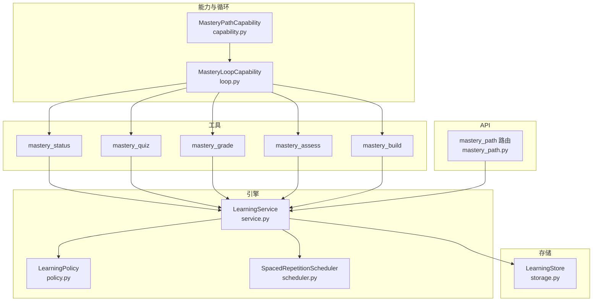
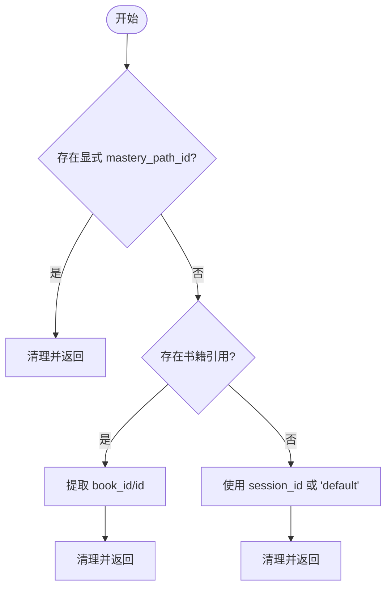
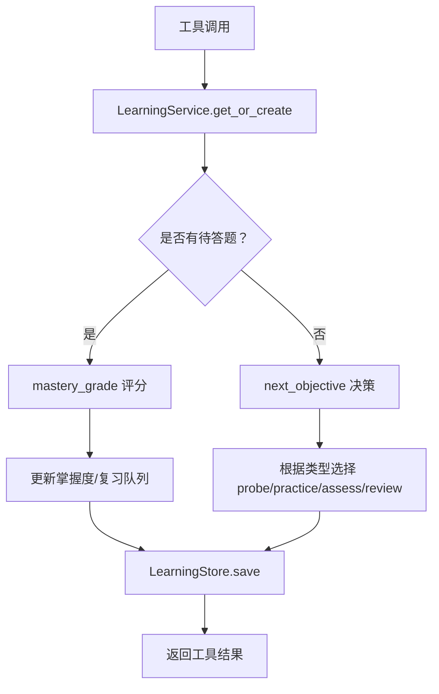
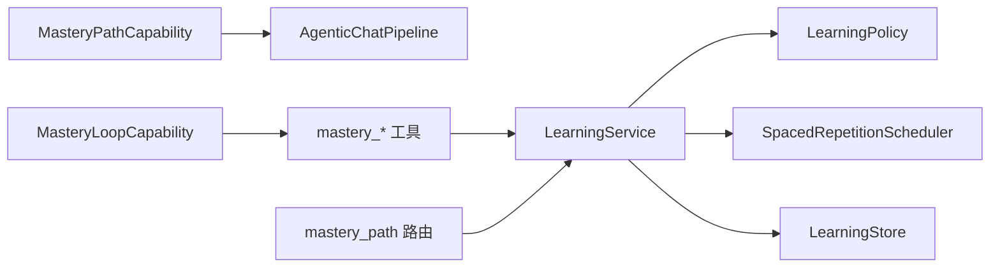

# 掌握路径能力

<cite>
**本文引用的文件**
- [capability.py](file://deeptutor/capabilities/mastery/capability.py)
- [tools.py](file://deeptutor/capabilities/mastery/tools.py)
- [loop.py](file://deeptutor/capabilities/mastery/loop.py)
- [choices.py](file://deeptutor/capabilities/mastery/choices.py)
- [mastery_path.py](file://deeptutor/api/routers/mastery_path.py)
- [models.py](file://deeptutor/learning/models.py)
- [service.py](file://deeptutor/learning/service.py)
- [storage.py](file://deeptutor/learning/storage.py)
- [policy.py](file://deeptutor/learning/policy.py)
- [scheduler.py](file://deeptutor/learning/scheduler.py)
- [mastery_tool.py](file://deeptutor/tools/mastery_tool.py)
- [system.md（中文）](file://deeptutor/capabilities/mastery/prompts/zh/system.md)
</cite>

## 目录
1. [简介](#简介)
2. [项目结构](#项目结构)
3. [核心组件](#核心组件)
4. [架构总览](#架构总览)
5. [详细组件分析](#详细组件分析)
6. [依赖关系分析](#依赖关系分析)
7. [性能考虑](#性能考虑)
8. [故障排除指南](#故障排除指南)
9. [结论](#结论)
10. [附录：配置与使用示例](#附录配置与使用示例)

## 简介
本文件面向“掌握路径能力”的完整配置与使用，覆盖以下要点：
- MasteryPathCapability 的实现原理：掌握模式切换、路径ID解析、智能体管道集成。
- 掌握工具集：mastery_status、mastery_quiz、mastery_grade、mastery_assess、mastery_build 的参数与返回值约定。
- 存储键生成规则与安全字符过滤机制。
- 掌握路径与书籍引用、会话ID的关联关系。
- 学习策略设置、难度调整参数、评估阈值配置的完整示例。
- 性能优化建议与故障排除指南。

## 项目结构
掌握路径能力由“能力层 + 工具层 + 引擎层 + 存储层 + API 路由”构成：
- 能力层：MasteryPathCapability 负责开启掌握模式并注入路径ID；MasteryLoopCapability 在对话循环中挂载系统提示与工具上下文。
- 工具层：五个 mastery_* 工具封装了状态读取、题目注册、评分、定性评估、路径构建等能力。
- 引擎层：LearningService、LearningPolicy、SpacedRepetitionScheduler 提供掌握判定、下一步决策与间隔复习调度。
- 存储层：LearningStore 以 book_id 为键持久化 LearningProgress。
- API 路由：提供进度查询、模块初始化、从书本导入、删除/重做等管理接口。



**图表来源**
- [capability.py:57-73](file://deeptutor/capabilities/mastery/capability.py#L57-L73)
- [loop.py:13-51](file://deeptutor/capabilities/mastery/loop.py#L13-L51)
- [tools.py:176-643](file://deeptutor/capabilities/mastery/tools.py#L176-L643)
- [service.py:25-296](file://deeptutor/learning/service.py#L25-L296)
- [policy.py:1-290](file://deeptutor/learning/policy.py#L1-L290)
- [scheduler.py:28-102](file://deeptutor/learning/scheduler.py#L28-L102)
- [storage.py:16-56](file://deeptutor/learning/storage.py#L16-L56)
- [mastery_path.py:105-309](file://deeptutor/api/routers/mastery_path.py#L105-L309)

**章节来源**
- [capability.py:1-77](file://deeptutor/capabilities/mastery/capability.py#L1-L77)
- [loop.py:1-74](file://deeptutor/capabilities/mastery/loop.py#L1-L74)
- [tools.py:1-655](file://deeptutor/capabilities/mastery/tools.py#L1-L655)
- [service.py:1-296](file://deeptutor/learning/service.py#L1-L296)
- [policy.py:1-290](file://deeptutor/learning/policy.py#L1-L290)
- [scheduler.py:1-102](file://deeptutor/learning/scheduler.py#L1-L102)
- [storage.py:1-56](file://deeptutor/learning/storage.py#L1-L56)
- [mastery_path.py:1-309](file://deeptutor/api/routers/mastery_path.py#L1-L309)

## 核心组件
- MasteryPathCapability：将当前对话标记为掌握模式，解析并写入 mastery_path_id，然后委托给 AgenticChatPipeline 执行标准对话流程。
- MasteryLoopCapability：当 mastery_mode 激活时，注入系统提示（按语言选择中英文），并在调用 mastery_* 工具时自动注入 _mastery_path_id、_session_id、_turn_id。
- 掌握工具集：
  - mastery_status：读取当前目标、待答题、到期复习与整图快照。
  - mastery_quiz：登记一道题及其期望答案（服务端保存，避免模型跨轮回忆）。
  - mastery_grade：对 pending question 进行确定性评分，更新掌握度与间隔复习队列。
  - mastery_assess：记录概念/设计类知识点的定性通过结果。
  - mastery_build：创建或扩展模块与知识点树。
- 引擎与服务：
  - LearningService：统一入口，负责加载/创建进度、评分、更新掌握度、维护复习队列、定性评估记录等。
  - LearningPolicy：纯函数式策略，决定“是否已掌握”“下一步做什么”“地图快照”。
  - SpacedRepetitionScheduler：基于类型与正确/错误序列计算下次复习时间。
- 存储：LearningStore 以 book_id.json 形式原子写入，带版本号和并发锁。

**章节来源**
- [capability.py:35-73](file://deeptutor/capabilities/mastery/capability.py#L35-L73)
- [loop.py:23-51](file://deeptutor/capabilities/mastery/loop.py#L23-L51)
- [tools.py:176-643](file://deeptutor/capabilities/mastery/tools.py#L176-L643)
- [service.py:25-296](file://deeptutor/learning/service.py#L25-L296)
- [policy.py:52-234](file://deeptutor/learning/policy.py#L52-L234)
- [scheduler.py:28-102](file://deeptutor/learning/scheduler.py#L28-L102)
- [storage.py:16-56](file://deeptutor/learning/storage.py#L16-L56)

## 架构总览
下图展示一次“掌握路径”对话回合的关键交互：能力启用 → 工具挂载 → 工具调用 → 引擎决策 → 存储持久化。

```mermaid
sequenceDiagram
participant U as "用户"
participant Cap as "MasteryPathCapability"
participant Loop as "MasteryLoopCapability"
participant Tool as "mastery_* 工具"
participant Svc as "LearningService"
participant Pol as "LearningPolicy"
participant Sto as "LearningStore"
U->>Cap : 发起掌握模式对话
Cap->>Cap : 设置 mastery_mode / mastery_path_id
Cap->>Loop : 进入对话循环
Loop-->>Tool : 注入 _mastery_path_id/_session_id/_turn_id
Tool->>Svc : 读取/更新进度
Svc->>Pol : 计算 next_objective / is_mastered
Pol-->>Svc : 返回下一步与门限
Svc->>Sto : 原子写入进度
Tool-->>Loop : 返回工具结果
Loop-->>U : 呈现教学/提问/反馈
```

**图表来源**
- [capability.py:69-73](file://deeptutor/capabilities/mastery/capability.py#L69-L73)
- [loop.py:39-51](file://deeptutor/capabilities/mastery/loop.py#L39-L51)
- [tools.py:192-214](file://deeptutor/capabilities/mastery/tools.py#L192-L214)
- [service.py:161-210](file://deeptutor/learning/service.py#L161-L210)
- [policy.py:158-234](file://deeptutor/learning/policy.py#L158-L234)
- [storage.py:26-33](file://deeptutor/learning/storage.py#L26-L33)

## 详细组件分析

### 掌握模式切换与路径ID解析
- 模式切换：MasteryPathCapability.run 将 context.metadata 中的 mastery_mode 置为 True，并写入 mastery_path_id，随后启动 AgenticChatPipeline。
- 路径ID解析优先级：
  1) 显式 mastery_path_id（前端传入，保证构建向导/仪表板与导师共享同一存储键）
  2) 书籍引用 book_references（字符串或含 book_id/id 的对象）
  3) 会话ID session_id（兜底）
- 安全过滤：使用正则移除不安全字符，确保存储键仅包含字母、数字、下划线、连字符，且去除首尾下划线；空串回退到 "default"。



**图表来源**
- [capability.py:29-54](file://deeptutor/capabilities/mastery/capability.py#L29-L54)

**章节来源**
- [capability.py:29-73](file://deeptutor/capabilities/mastery/capability.py#L29-L73)

### 智能体管道集成
- MasteryLoopCapability 在 mastery_mode 激活时：
  - 注入系统提示（按语言选择 prompts/zh 或 prompts/en 下的 system.md）
  - 在调用 mastery_* 工具前，向 kwargs 注入 _mastery_path_id、_session_id、_turn_id，供工具内部解析
- 工具清单：MASTERY_TOOL_NAMES 与 MASTERY_TOOL_TYPES 集中声明，便于能力与注册表保持一致。

**章节来源**
- [loop.py:13-74](file://deeptutor/capabilities/mastery/loop.py#L13-L74)
- [tools.py:57-65](file://deeptutor/capabilities/mastery/tools.py#L57-L65)
- [mastery_tool.py:1-28](file://deeptutor/tools/mastery_tool.py#L1-L28)

### 掌握工具集详解

#### mastery_status
- 作用：读取当前目标、待答题、到期复习与整图快照。若路径为空，返回 empty 并提示先调用 mastery_build。
- 关键流程：
  - 解析 path_id → 获取/创建进度 → 若无知识点则返回 empty → 否则返回 next/map。

**章节来源**
- [tools.py:176-214](file://deeptutor/capabilities/mastery/tools.py#L176-L214)

#### mastery_quiz
- 作用：登记一道题及期望答案（服务端保存），用于后续确定性评分。
- 参数：
  - knowledge_point_id：来自 mastery_status 的知识点ID
  - question：题干
  - expected_answer：正确答案（服务端用）
  - question_type：choice/short/open，默认 short
  - options：选择题选项数组，必须包含完整正文并按标签顺序排列
- 行为：
  - choice 类型需校验选项包含真实正文，并将 expected_answer 归一化为稳定标签
  - 将 PendingQuestion 存入进度，返回 instruction 指导后续 ask_user 与 mastery_grade

**章节来源**
- [tools.py:217-349](file://deeptutor/capabilities/mastery/tools.py#L217-L349)
- [choices.py:36-95](file://deeptutor/capabilities/mastery/choices.py#L36-L95)

#### mastery_grade
- 作用：对 pending question 进行确定性评分，更新掌握度与间隔复习，并返回是否掌握与下一步。
- 参数：answer（学习者作答）
- 行为：
  - 解析 pending → 处理选择题选项恢复 → 调用 service.grade_and_record → 同步到问题库 → 清除 pending → 计算是否掌握与下一步

**章节来源**
- [tools.py:352-427](file://deeptutor/capabilities/mastery/tools.py#L352-L427)
- [service.py:161-210](file://deeptutor/learning/service.py#L161-L210)

#### mastery_assess
- 作用：记录概念/设计类知识点的定性通过结果（Feynman检查）。
- 参数：knowledge_point_id、passed（布尔）、feedback（可选证据）
- 行为：
  - 校验知识点类型属于 CONCEPT/DESIGN
  - 记录 qualitative_mastery 并调整 mastery_levels 显示值

**章节来源**
- [tools.py:430-498](file://deeptutor/capabilities/mastery/tools.py#L430-L498)
- [policy.py:42-76](file://deeptutor/learning/policy.py#L42-L76)

#### mastery_build
- 作用：创建或扩展模块与知识点树。支持 replace（新建）与 append（追加）。
- 参数：modules（有序模块数组）、mode（replace/append）
- 行为：
  - 校验模块与知识点名称、类型
  - 生成服务器端ID（path_id_m<i>_kp<j>），防止模型控制存储键
  - 替换或合并模块，重置当前指针，保存进度

**章节来源**
- [tools.py:501-634](file://deeptutor/capabilities/mastery/tools.py#L501-L634)

### 存储键生成规则与安全字符过滤
- 路径ID解析后通过 _sanitize_path_id 清理，仅允许字母、数字、下划线、连字符，并去除首尾下划线；空串回退到 "default"。
- 存储层进一步拒绝包含路径穿越字符的 book_id，并以 book_id.json 命名文件。

**章节来源**
- [capability.py:29-54](file://deeptutor/capabilities/mastery/capability.py#L29-L54)
- [storage.py:21-24](file://deeptutor/learning/storage.py#L21-L24)

### 掌握路径与书籍引用、会话ID的关联
- 路径ID优先使用显式 mastery_path_id，其次取书籍引用（book_references 的第一个元素，支持字符串或对象），最后回退到 session_id。
- API 路由也使用 book_id 作为路径标识，所有端点均校验非法字符。

**章节来源**
- [capability.py:35-54](file://deeptutor/capabilities/mastery/capability.py#L35-L54)
- [mastery_path.py:34-37](file://deeptutor/api/routers/mastery_path.py#L34-L37)

### 数据流与处理逻辑
- 工具调用 → LearningService → 策略判断 → 存储持久化 → 返回工具结果
- 选择题选项解析与恢复：parse_options/format_options/resolve_answer/recover_options_from_turn 确保多边界一致。



**图表来源**
- [tools.py:192-214](file://deeptutor/capabilities/mastery/tools.py#L192-L214)
- [tools.py:374-427](file://deeptutor/capabilities/mastery/tools.py#L374-L427)
- [service.py:161-210](file://deeptutor/learning/service.py#L161-L210)
- [policy.py:158-234](file://deeptutor/learning/policy.py#L158-L234)
- [storage.py:26-33](file://deeptutor/learning/storage.py#L26-L33)

**章节来源**
- [choices.py:36-144](file://deeptutor/capabilities/mastery/choices.py#L36-L144)
- [service.py:161-210](file://deeptutor/learning/service.py#L161-L210)
- [policy.py:158-234](file://deeptutor/learning/policy.py#L158-L234)

## 依赖关系分析
- 能力与循环：
  - MasteryPathCapability 依赖 AgenticChatPipeline 与 tools 清单
  - MasteryLoopCapability 依赖 prompt 资源与工具名集合
- 工具与引擎：
  - 工具通过 _new_service() 构造 LearningService(LearningStore())，避免并发竞争
  - 工具调用 policy 与 scheduler 完成掌握判定与复习调度
- API 路由：
  - 直接操作 LearningService/LearningStore，提供进度管理与模块初始化



**图表来源**
- [capability.py:57-73](file://deeptutor/capabilities/mastery/capability.py#L57-L73)
- [loop.py:13-51](file://deeptutor/capabilities/mastery/loop.py#L13-L51)
- [tools.py:72-77](file://deeptutor/capabilities/mastery/tools.py#L72-L77)
- [mastery_path.py:28-31](file://deeptutor/api/routers/mastery_path.py#L28-L31)

**章节来源**
- [capability.py:57-73](file://deeptutor/capabilities/mastery/capability.py#L57-L73)
- [loop.py:13-51](file://deeptutor/capabilities/mastery/loop.py#L13-L51)
- [tools.py:72-77](file://deeptutor/capabilities/mastery/tools.py#L72-L77)
- [mastery_path.py:28-31](file://deeptutor/api/routers/mastery_path.py#L28-L31)

## 性能考虑
- 每请求/每回合构造独立的 LearningStore/LearningService，避免对象级竞态。
- 存储采用原子写入与CAS锁，保证并发安全。
- 策略层无I/O与LLM调用，保持高性能决策。
- 选择题选项恢复仅在必要时回溯 turn events，降低常规路径开销。
- 复习队列按需重建，减少不必要的全量扫描。

[本节为通用性能建议，不直接分析具体文件]

## 故障排除指南
- “No mastery path is active on this turn”：
  - 确认已在能力层设置 mastery_mode 与 mastery_path_id
  - 检查 loop 是否正确注入 _mastery_path_id/_session_id/_turn_id
- “Unknown objective”：
  - 使用 mastery_status 获取有效 knowledge_point_id
- “Choice questions need full option bodies”：
  - 确保 mastery_quiz.options 包含完整选项正文，而非仅标签
  - 若历史路径仅有标签，系统将尝试从 ask_user 事件恢复
- “Invalid book_id”：
  - 避免包含 ..、/、\、: 等危险字符
- 进度未更新：
  - 检查 LearningStore 写入是否成功（atomic_write_text）
  - 查看服务日志中的异常与警告

**章节来源**
- [tools.py:169-173](file://deeptutor/capabilities/mastery/tools.py#L169-L173)
- [tools.py:276-349](file://deeptutor/capabilities/mastery/tools.py#L276-L349)
- [mastery_path.py:34-37](file://deeptutor/api/routers/mastery_path.py#L34-L37)
- [storage.py:26-33](file://deeptutor/learning/storage.py#L26-L33)

## 结论
掌握路径能力通过“能力层 + 工具层 + 引擎层 + 存储层”的分层设计，实现了可验证的掌握门槛、自适应的下一步决策与稳定的间隔复习。工具层将教学编排留给模型，而将“何时推进”的决定权交给确定性引擎，从而兼顾灵活性与严谨性。配合清晰的存储键规则与安全过滤，以及完善的API与提示词，可在多场景下可靠运行。

[本节为总结性内容，不直接分析具体文件]

## 附录：配置与使用示例

### 学习策略设置
- 知识点类型：memory（记忆/事实）、procedure（程序/步骤技能）、concept（概念/需理解）、design（设计/开放判断）
- 掌握门限：
  - memory/procedure：定量门限约 0.9（可通过策略层调整）
  - concept/design：定性门限（通过 mastery_assess 记录 passed=true）
- 复习间隔：不同知识类型的间隔序列与优先级由调度器定义

**章节来源**
- [policy.py:31-57](file://deeptutor/learning/policy.py#L31-L57)
- [scheduler.py:13-25](file://deeptutor/learning/scheduler.py#L13-L25)

### 难度调整参数
- 模块通过 pass_threshold 控制通过阈值（API 导入时默认 0.7）
- 掌握分数受最近尝试加权与置信度上限影响，避免单次幸运答对即“掌握”

**章节来源**
- [mastery_path.py:163-170](file://deeptutor/api/routers/mastery_path.py#L163-L170)
- [mastery.py:15-37](file://deeptutor/learning/mastery.py#L15-L37)

### 评估阈值配置
- 定量门限：MEMORY/PROCEDURE 默认 0.9
- 定性门限：CONCEPT/DESIGN 显示为 1.0（通过 passed=true 达成）
- 下一步决策依据：pending question → due reviews → 首个未掌握目标 → complete

**章节来源**
- [policy.py:31-57](file://deeptutor/learning/policy.py#L31-L57)
- [policy.py:158-234](file://deeptutor/learning/policy.py#L158-L234)

### 完整调用流程示例（文字描述）
- 第一步：调用 mastery_status 获取 next 与 map，若为空则调用 mastery_build 创建模块与知识点
- 第二步：针对 next 行动：
  - probe：先用简短问题探查，若未掌握则继续
  - practice：使用 mastery_quiz 登记题目与期望答案，再用 ask_user 呈现卡片让学习者作答，收到答案后调用 mastery_grade 评分
  - assess：对于 concept/design，让学习者解释并调用 mastery_assess 记录 passed
  - review：若有到期复习项，再次考查巩固
- 第三步：重复直到 mastery_grade 返回 mastered=true 或 next.action=complete

**章节来源**
- [tools.py:176-643](file://deeptutor/capabilities/mastery/tools.py#L176-L643)
- [system.md（中文）:1-15](file://deeptutor/capabilities/mastery/prompts/zh/system.md#L1-L15)