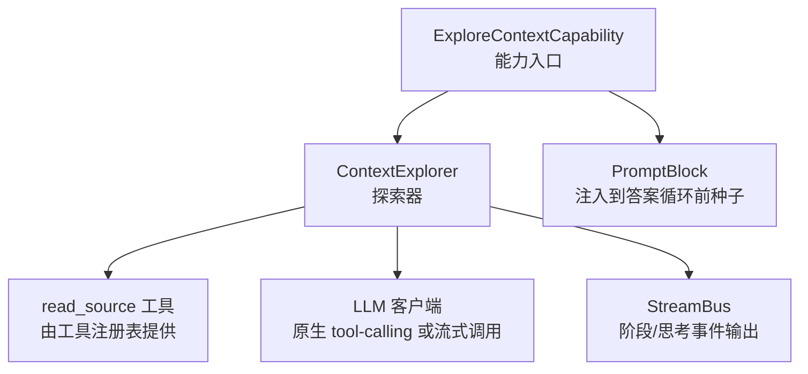
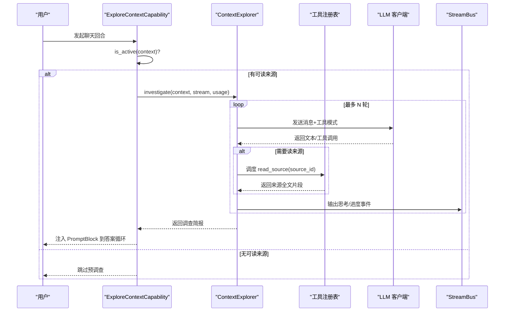
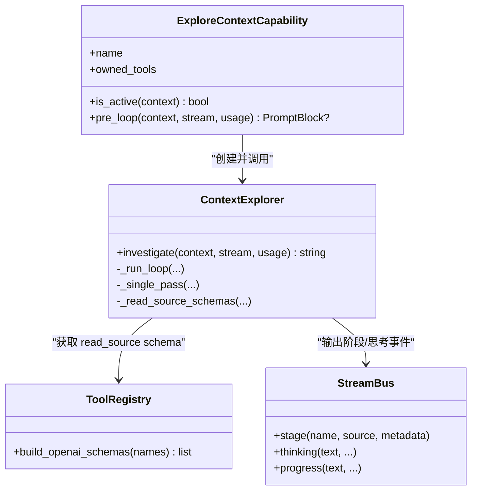

# 探索上下文能力

<cite>
**本文引用的文件**
- [capability.py](file://deeptutor/capabilities/explore_context/capability.py)
- [explorer.py](file://deeptutor/capabilities/explore_context/explorer.py)
- [explore_context.yaml（英文）](file://deeptutor/capabilities/explore_context/prompts/en/explore_context.yaml)
- [explore_context.yaml（中文）](file://deeptutor/capabilities/explore_context/prompts/zh/explore_context.yaml)
- [test_explore_context_capability.py](file://tests/capabilities/test_explore_context_capability.py)
- [tool_dispatch.py](file://deeptutor/core/agentic/tool_dispatch.py)
- [provider_runtime.py](file://deeptutor/services/config/provider_runtime.py)
- [system.py](file://deeptutor/api/routers/system.py)
</cite>

## 目录
1. [简介](#简介)
2. [项目结构](#项目结构)
3. [核心组件](#核心组件)
4. [架构总览](#架构总览)
5. [详细组件分析](#详细组件分析)
6. [依赖关系分析](#依赖关系分析)
7. [性能考量](#性能考量)
8. [故障排查指南](#故障排查指南)
9. [结论](#结论)
10. [附录：配置与使用示例](#附录配置与使用示例)

## 简介
本文件面向“探索上下文能力”的配置与实现，聚焦 ExploreContextCapability 的上下文感知机制、探索器 ContextExplorer 的实现原理、结构化信息处理方式、可配置项、使用示例以及性能优化与调试技巧。该能力在聊天回合进入答案循环之前执行一次只读“预调查”，通过工具调用按需读取附带来源，产出客观、第三人称的调查简报，作为后续回答的可靠依据。

## 项目结构
探索上下文能力位于 capabilities/explore_context 目录下，包含能力入口、探索器实现与多语言提示词；测试覆盖主路径与兜底路径的行为。

图表来源
- [capability.py:82-141](file://deeptutor/capabilities/explore_context/capability.py#L82-L141)
- [explorer.py:87-147](file://deeptutor/capabilities/explore_context/explorer.py#L87-L147)

章节来源
- [capability.py:1-145](file://deeptutor/capabilities/explore_context/capability.py#L1-L145)
- [explorer.py:1-532](file://deeptutor/capabilities/explore_context/explorer.py#L1-L532)

## 核心组件
- ExploreContextCapability：能力注册与生命周期钩子，负责判断是否激活、构建并运行探索器，将调查结果以 PromptBlock 形式注入答案循环前。
- ContextExplorer：实现两种执行路径
  - 原生工具调用循环：最多若干轮 LLM 调用 + read_source 工具调度，直到模型停止调用工具并写出调查结论。
  - 单趟兜底：当不支持原生工具调用或循环失败时，将来源文本裁剪后一次性输入模型，产出调查简报。
- 提示词：中英文两套 prompt，定义系统指令、用户模板、强制结束指令、状态文案等。

章节来源
- [capability.py:82-141](file://deeptutor/capabilities/explore_context/capability.py#L82-L141)
- [explorer.py:87-147](file://deeptutor/capabilities/explore_context/explorer.py#L87-L147)
- [explore_context.yaml（英文）:1-115](file://deeptutor/capabilities/explore_context/prompts/en/explore_context.yaml#L1-L115)
- [explore_context.yaml（中文）:1-89](file://deeptutor/capabilities/explore_context/prompts/zh/explore_context.yaml#L1-L89)

## 架构总览
探索上下文能力在答案循环之前执行，遵循“先理解材料，再回答问题”的原则，避免模型直接混入第三方对话内容导致人称混淆。

图表来源
- [capability.py:118-141](file://deeptutor/capabilities/explore_context/capability.py#L118-L141)
- [explorer.py:151-241](file://deeptutor/capabilities/explore_context/explorer.py#L151-L241)
- [tool_dispatch.py:514-543](file://deeptutor/core/agentic/tool_dispatch.py#L514-L543)

## 详细组件分析

### 上下文发现与激活
- 激活条件：当前回合存在可读来源（非图片），通过 context.metadata["source_index"] 是否为非空字典判定。
- 行为：若激活，则在 pre_loop 中构造 ContextExplorer 并执行 investigate；否则直接返回 None，不触发任何 LLM 调用。

章节来源
- [capability.py:68-91](file://deeptutor/capabilities/explore_context/capability.py#L68-L91)
- [capability.py:118-141](file://deeptutor/capabilities/explore_context/capability.py#L118-L141)

### 信息提取与知识整合
- 原生路径：通过 LLM 的工具调用能力，按需调用 read_source 读取来源全文，跨来源追踪线索，最终写出客观、第三人称的调查结论。
- 兜底路径：将来源按类型标签和 ID 渲染为块，限制数量与字符数，拼接成用户提示，单次生成调查简报。
- 输出：统一以 PromptBlock("explore_context", 调查文本) 注入答案循环前，作为背景依据。

章节来源
- [explorer.py:112-147](file://deeptutor/capabilities/explore_context/explorer.py#L112-L147)
- [explorer.py:365-439](file://deeptutor/capabilities/explore_context/explorer.py#L365-L439)
- [capability.py:118-141](file://deeptutor/capabilities/explore_context/capability.py#L118-L141)

### 搜索策略、结果过滤与相关性评分
- 搜索策略：由 LLM 驱动的工具选择策略，结合 source_manifest 与用户请求，决定读取哪些来源；最后强制结束轮次以避免无限循环。
- 结果过滤：单趟路径对来源进行裁剪与上限控制（最大来源数、每来源字符数、总字符数）。
- 相关性评分：探索上下文能力本身不实现向量检索或评分；GraphRAG 等其他模块具备检索与评分能力，但与本能力的预调查流程解耦。

章节来源
- [explorer.py:151-241](file://deeptutor/capabilities/explore_context/explorer.py#L151-L241)
- [explorer.py:441-469](file://deeptutor/capabilities/explore_context/explorer.py#L441-L469)
- [provider_runtime.py:1059-1091](file://deeptutor/services/config/provider_runtime.py#L1059-L1091)

### 结构化处理：实体识别、关系映射与知识图谱
- 本能力不直接执行实体识别、关系抽取或知识图谱构建；其目标是产出“客观、第三人称”的调查文本，供后续环节消费。
- 如需构建知识图谱，可在下游基于该调查文本进一步处理；本能力保持只读、无副作用的设计。

章节来源
- [explorer.py:112-147](file://deeptutor/capabilities/explore_context/explorer.py#L112-L147)

### 配置选项：搜索范围、深度控制与缓存策略
- 搜索范围：由 source_index 与 source_manifest 限定；read_source 的 source_id 枚举由工具注册表动态注入，确保只能访问当前回合可见的来源。
- 深度控制：原生路径设置最大轮次与每轮 token 上限；最后一轮禁用工具强制结束，防止无限调用。
- 缓存策略：提示词加载采用进程内缓存；探索过程未引入外部缓存，所有读取均为实时。

章节来源
- [capability.py:48-65](file://deeptutor/capabilities/explore_context/capability.py#L48-L65)
- [explorer.py:57-68](file://deeptutor/capabilities/explore_context/explorer.py#L57-L68)
- [explorer.py:333-351](file://deeptutor/capabilities/explore_context/explorer.py#L333-L351)

### 使用示例与最佳实践
- 典型场景：用户附带对话记录、笔记、书籍摘录、题库条目或文档，希望导师在回答前先理解这些材料。
- 配置建议：
  - 确保会话携带可读来源（source_index 非空）。
  - 根据模型能力选择路径：支持原生工具调用的模型走高效循环路径；否则自动降级到单趟兜底。
  - 关注 StreamBus 的 THINKING 与 STAGE 事件用于前端展示“上下文调查”状态。
- 最佳实践：
  - 控制来源规模，避免过大上下文导致响应变慢。
  - 利用 source_manifest 明确来源类型与标识，便于调查员精准定位。
  - 在弱模型环境下，优先精简来源摘要，提高兜底路径效果。

章节来源
- [test_explore_context_capability.py:34-60](file://tests/capabilities/test_explore_context_capability.py#L34-L60)
- [test_explore_context_capability.py:82-155](file://tests/capabilities/test_explore_context_capability.py#L82-L155)
- [test_explore_context_capability.py:231-295](file://tests/capabilities/test_explore_context_capability.py#L231-L295)

## 依赖关系分析
- 能力层：ExploreContextCapability 仅持有名称、工具列表为空、系统块为空，完全通过 pre_loop 钩子工作。
- 探索器层：依赖工具注册表获取 read_source 工具 schema，依赖 LLM 客户端进行流式调用，依赖 StreamBus 输出阶段与思考事件。
- 工具层：read_source 由工具注册表提供，支持 source_index 增强参数，确保只读访问当前回合来源。
- 配置层：提示词来自包资源，按语言加载并缓存；LLM 配置从全局服务获取。

图表来源
- [capability.py:82-141](file://deeptutor/capabilities/explore_context/capability.py#L82-L141)
- [explorer.py:87-147](file://deeptutor/capabilities/explore_context/explorer.py#L87-L147)
- [explorer.py:333-351](file://deeptutor/capabilities/explore_context/explorer.py#L333-L351)

章节来源
- [capability.py:82-141](file://deeptutor/capabilities/explore_context/capability.py#L82-L141)
- [explorer.py:87-147](file://deeptutor/capabilities/explore_context/explorer.py#L87-L147)

## 性能考量
- 预算控制：
  - 原生路径：最大轮次与每轮 token 上限，最后一轮禁用工具强制结束。
  - 兜底路径：限制来源数量、每来源字符数与总字符数，避免上下文爆炸。
- 流式输出：所有中间结果通过 thinking 通道输出，不污染 CONTENT 通道，减少前端误判。
- 提示词缓存：按语言缓存提示词，降低重复加载开销。
- 工具调用开销：read_source 仅在必要时调用，且受 source_index 约束，避免无关读取。

章节来源
- [explorer.py:57-68](file://deeptutor/capabilities/explore_context/explorer.py#L57-L68)
- [explorer.py:243-331](file://deeptutor/capabilities/explore_context/explorer.py#L243-L331)
- [explorer.py:441-469](file://deeptutor/capabilities/explore_context/explorer.py#L441-L469)
- [capability.py:48-65](file://deeptutor/capabilities/explore_context/capability.py#L48-L65)

## 故障排查指南
- 现象：预调查未触发
  - 检查 context.metadata["source_index"] 是否为非空字典；图片附件不会进入 source_index。
- 现象：原生路径失败，回退到单趟
  - 查看日志中的警告信息；确认 can_use_native_tool_calling 返回值与 LLM 客户端初始化是否正常。
- 现象：前端未显示“上下文调查”
  - 确认 StreamBus 输出了 STAGE_START 与 THINKING 事件；CONTENT 事件不应出现。
- 现象：read_source 调用异常
  - 检查工具注册表是否正确提供 read_source；确认 source_id 是否在枚举范围内。
- 现象：响应过长或超时
  - 调整来源规模与裁剪阈值；考虑在业务侧精简 source_manifest。

章节来源
- [test_explore_context_capability.py:34-60](file://tests/capabilities/test_explore_context_capability.py#L34-L60)
- [test_explore_context_capability.py:107-155](file://tests/capabilities/test_explore_context_capability.py#L107-L155)
- [test_explore_context_capability.py:275-295](file://tests/capabilities/test_explore_context_capability.py#L275-L295)
- [explorer.py:112-147](file://deeptutor/capabilities/explore_context/explorer.py#L112-L147)
- [explorer.py:365-439](file://deeptutor/capabilities/explore_context/explorer.py#L365-L439)

## 结论
探索上下文能力通过“预调查”机制，将“理解材料”与“回答问题”解耦，提升回答准确性与人称一致性。其设计强调只读、可控预算、流式输出与健壮降级，适用于多种来源类型与模型能力组合。配合合理的来源管理与提示词配置，可在保证性能的同时获得高质量的上下文依据。

## 附录：配置与使用示例

### 配置要点
- 来源清单：确保 source_manifest 清晰列出来源类型与 id，便于调查员定位。
- 模型能力：优先启用原生工具调用以获得更高效的多轮调查；否则自动降级。
- 提示词语言：根据 context.language 自动选择中英文提示词。
- 搜索范围与深度：通过 source_index 与 MAX_LOOP_ROUNDS、LOOP_MAX_TOKENS 控制；单趟路径通过 MAX_SOURCES、CHARS_PER_SOURCE、TOTAL_CHARS 控制。

章节来源
- [explorer.py:57-68](file://deeptutor/capabilities/explore_context/explorer.py#L57-L68)
- [explorer.py:333-351](file://deeptutor/capabilities/explore_context/explorer.py#L333-L351)
- [explore_context.yaml（英文）:11-64](file://deeptutor/capabilities/explore_context/prompts/en/explore_context.yaml#L11-L64)
- [explore_context.yaml（中文）:9-48](file://deeptutor/capabilities/explore_context/prompts/zh/explore_context.yaml#L9-L48)

### 使用示例
- 示例一：附带对话记录
  - 行为：调查员读取对话记录，总结关键事实与决策，输出第三人称调查结论。
  - 验证：测试用例覆盖了 read_source 调用与最终调查文本注入。
- 示例二：附带多来源混合
  - 行为：根据用户请求选择性读取相关来源，跨来源追踪线索，最终写出综合结论。
  - 验证：测试用例验证了来源裁剪与上限控制。
- 示例三：弱模型环境
  - 行为：无法使用原生工具调用时，自动切换到单趟兜底，仍能提供调查简报。
  - 验证：测试用例模拟了客户端异常并确认回退路径有效。

章节来源
- [test_explore_context_capability.py:82-155](file://tests/capabilities/test_explore_context_capability.py#L82-L155)
- [test_explore_context_capability.py:231-295](file://tests/capabilities/test_explore_context_capability.py#L231-L295)