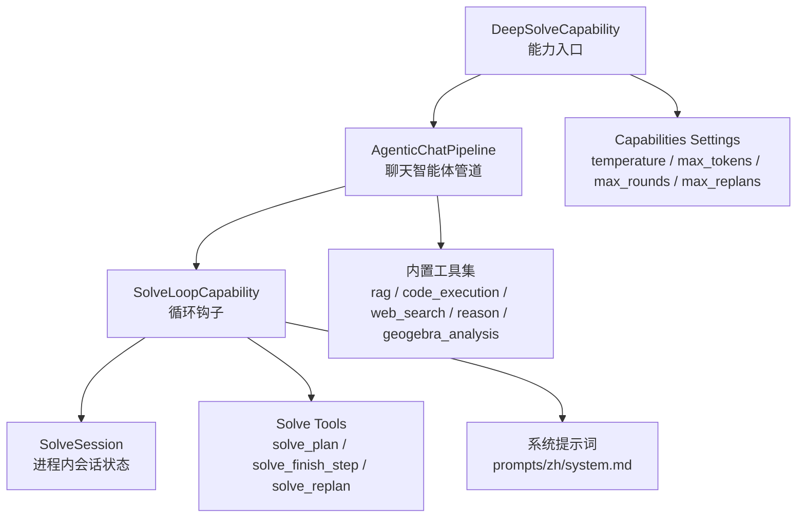
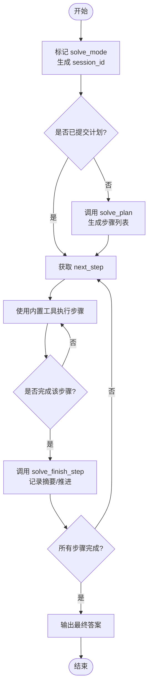
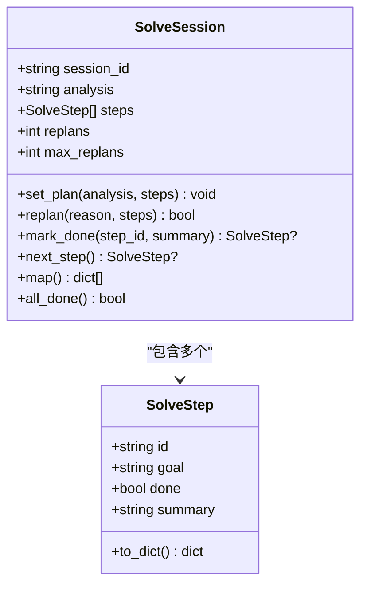
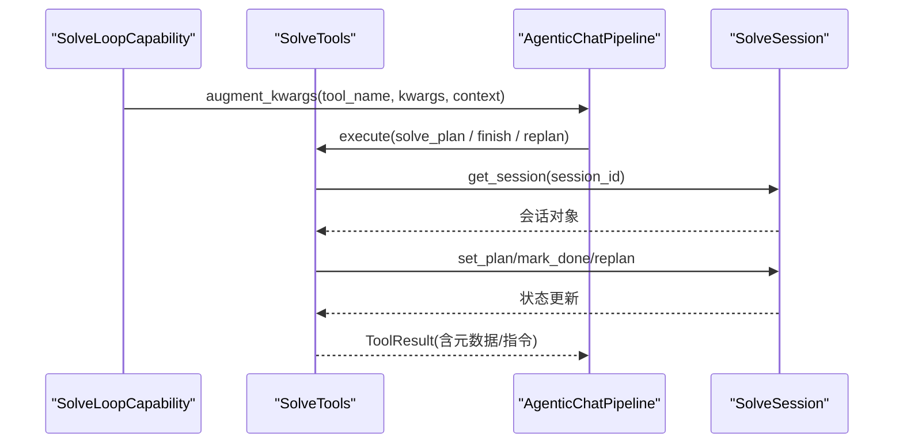
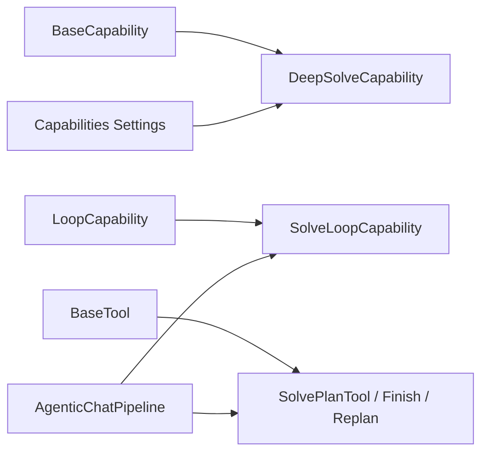

# 求解能力

<cite>
**本文引用的文件**
- [capability.py](file://deeptutor/capabilities/solve/capability.py)
- [loop.py](file://deeptutor/capabilities/solve/loop.py)
- [session.py](file://deeptutor/capabilities/solve/session.py)
- [tools.py](file://deeptutor/capabilities/solve/tools.py)
- [protocol.py](file://deeptutor/capabilities/protocol.py)
- [capability_protocol.py](file://deeptutor/core/capability_protocol.py)
- [tool_protocol.py](file://deeptutor/core/tool_protocol.py)
- [capabilities_settings.py](file://deeptutor/services/config/capabilities_settings.py)
- [agentic_pipeline.py](file://deeptutor/agents/chat/agentic_pipeline.py)
- [solve_tool.py](file://deeptutor/tools/solve_tool.py)
- [system.md](file://deeptutor/capabilities/solve/prompts/zh/system.md)
</cite>

## 目录
1. [简介](#简介)
2. [项目结构](#项目结构)
3. [核心组件](#核心组件)
4. [架构总览](#架构总览)
5. [详细组件分析](#详细组件分析)
6. [依赖关系分析](#依赖关系分析)
7. [性能与约束配置](#性能与约束配置)
8. [监控指标与错误处理](#监控指标与错误处理)
9. [故障排查指南](#故障排查指南)
10. [结论](#结论)
11. [附录：配置示例](#附录：配置示例)

## 简介
本文件面向“Deep Solve”求解能力的配置与使用，覆盖以下目标：
- 问题解决流程：问题识别、工具选择与执行策略。
- 求解会话生命周期：初始化、状态跟踪与资源清理。
- 求解工具集成：代码执行、文件操作、网络请求等工具的配置与使用方式。
- 求解约束设置：时间限制、内存限制与安全策略（通过沙箱与参数边界）。
- 配置示例：不同问题类型的策略与性能调优参数。
- 监控指标与错误处理：过程可观测性与异常恢复。

## 项目结构
求解能力由“能力入口 + 循环钩子 + 会话状态 + 求解工具 + 配置中心 + 提示词”构成，并与聊天智能体管道协同工作。



图表来源
- [capability.py:59-88](file://deeptutor/capabilities/solve/capability.py#L59-L88)
- [loop.py:21-73](file://deeptutor/capabilities/solve/loop.py#L21-L73)
- [session.py:25-92](file://deeptutor/capabilities/solve/session.py#L25-L92)
- [tools.py:26-30](file://deeptutor/capabilities/solve/tools.py#L26-L30)
- [capabilities_settings.py:435-448](file://deeptutor/services/config/capabilities_settings.py#L435-L448)
- [system.md:1-14](file://deeptutor/capabilities/solve/prompts/zh/system.md#L1-L14)

章节来源
- [capability.py:59-88](file://deeptutor/capabilities/solve/capability.py#L59-L88)
- [loop.py:21-73](file://deeptutor/capabilities/solve/loop.py#L21-L73)
- [session.py:25-92](file://deeptutor/capabilities/solve/session.py#L25-L92)
- [tools.py:26-30](file://deeptutor/capabilities/solve/tools.py#L26-L30)
- [capabilities_settings.py:435-448](file://deeptutor/services/config/capabilities_settings.py#L435-L448)
- [system.md:1-14](file://deeptutor/capabilities/solve/prompts/zh/system.md#L1-L14)

## 核心组件
- DeepSolveCapability：将当前轮次标记为“求解模式”，解析会话键并启动 AgenticChatPipeline，同时注入求解参数（温度、最大令牌数、最大轮次、重规划预算）。
- SolveLoopCapability：在聊天循环中激活时，挂载求解专属工具，注入会话上下文，并提供系统提示词以规范模型行为。
- SolveSession：进程内单轮会话，维护计划、步骤完成状态与重规划预算；提供“下一步”“全部完成”等查询。
- 求解工具：solve_plan（提交计划）、solve_finish_step（标记步骤完成并推进）、solve_replan（在预算内重新规划）。
- 配置中心：统一读取 agents.yaml 与主配置，暴露 temperature、max_tokens、max_rounds、max_replans 等可调参数。
- 系统提示词：中文/英文两套，指导模型先规划、再逐步求解、最后输出答案。

章节来源
- [capability.py:59-88](file://deeptutor/capabilities/solve/capability.py#L59-L88)
- [loop.py:21-73](file://deeptutor/capabilities/solve/loop.py#L21-L73)
- [session.py:25-92](file://deeptutor/capabilities/solve/session.py#L25-L92)
- [tools.py:77-275](file://deeptutor/capabilities/solve/tools.py#L77-L275)
- [capabilities_settings.py:435-448](file://deeptutor/services/config/capabilities_settings.py#L435-L448)
- [system.md:1-14](file://deeptutor/capabilities/solve/prompts/zh/system.md#L1-L14)

## 架构总览
求解能力复用聊天智能体管道，通过“循环能力钩子”在每轮对话中注入求解骨架（计划-执行-完成-必要时重规划），而具体解题逻辑由模型调用共享工具完成。

```mermaid
sequenceDiagram
participant U as "用户"
participant Cap as "DeepSolveCapability"
participant Pipe as "AgenticChatPipeline"
participant Loop as "SolveLoopCapability"
participant Tool as "求解工具"
participant Sess as "SolveSession"
U->>Cap : 发起求解请求
Cap->>Pipe : 设置 solve_mode / session_id / 参数
Pipe->>Loop : 检测 is_active()
Loop-->>Pipe : 返回系统提示块 + owned_tools
Pipe->>Tool : 首次调用 solve_plan
Tool->>Sess : set_plan(analysis, steps)
Sess-->>Tool : 返回 next step
Tool-->>Pipe : 计划结果
loop 逐步求解
Pipe->>Tool : 调用内置工具完成步骤
Pipe->>Tool : 调用 solve_finish_step(step_id, summary)
Tool->>Sess : mark_done(step_id, summary)
Sess-->>Tool : 返回 next/all_done
Tool-->>Pipe : 推进或结束
end
Pipe-->>U : 最终答案
```

图表来源
- [capability.py:69-88](file://deeptutor/capabilities/solve/capability.py#L69-L88)
- [loop.py:33-73](file://deeptutor/capabilities/solve/loop.py#L33-L73)
- [tools.py:109-203](file://deeptutor/capabilities/solve/tools.py#L109-L203)
- [session.py:48-76](file://deeptutor/capabilities/solve/session.py#L48-L76)

## 详细组件分析

### 问题解决流程（识别-工具选择-执行策略）
- 问题识别：DeepSolveCapability 将当前轮次标记为 solve_mode，并生成稳定的 solve_session_id，用于隔离本轮会话。
- 工具选择：SolveLoopCapability 在激活时挂载 solve_plan / solve_finish_step / solve_replan，同时保留聊天内置工具（如 rag、code_execution、web_search、reason、geogebra_analysis）。
- 执行策略：模型必须先调用 solve_plan 提交有序步骤；随后按步骤使用内置工具执行；每步完成后调用 solve_finish_step；若思路受阻可在预算内调用 solve_replan 调整计划。



图表来源
- [capability.py:69-88](file://deeptutor/capabilities/solve/capability.py#L69-L88)
- [loop.py:33-73](file://deeptutor/capabilities/solve/loop.py#L33-L73)
- [tools.py:109-203](file://deeptutor/capabilities/solve/tools.py#L109-L203)
- [session.py:48-76](file://deeptutor/capabilities/solve/session.py#L48-L76)

章节来源
- [capability.py:69-88](file://deeptutor/capabilities/solve/capability.py#L69-L88)
- [loop.py:33-73](file://deeptutor/capabilities/solve/loop.py#L33-L73)
- [tools.py:109-203](file://deeptutor/capabilities/solve/tools.py#L109-L203)
- [session.py:48-76](file://deeptutor/capabilities/solve/session.py#L48-L76)

### 求解会话的生命周期管理
- 初始化：DeepSolveCapability 设置 solve_mode 与 solve_session_id，并从配置中心读取 temperature、max_tokens、max_rounds、max_replans 注入上下文。
- 状态跟踪：SolveSession 维护 analysis、steps、replans、max_replans；支持 set_plan、mark_done、next_step、all_done。
- 资源清理：进程内字典存储，最多保留固定数量会话；每个 turn 独立 key，避免并发冲突；turn 结束后自然释放。



图表来源
- [session.py:25-76](file://deeptutor/capabilities/solve/session.py#L25-L76)

章节来源
- [capability.py:69-88](file://deeptutor/capabilities/solve/capability.py#L69-L88)
- [session.py:25-92](file://deeptutor/capabilities/solve/session.py#L25-L92)

### 求解工具的集成方式
- 挂载机制：SolveLoopCapability 的 owned_tools 声明了三个求解工具名称；is_active 基于 context.metadata.solve_mode 判断。
- 参数注入：augment_kwargs 为求解工具注入 _solve_session_id，并同步 max_replans 到会话。
- 工具实现：
  - solve_plan：校验步骤列表，写入计划，返回下一步。
  - solve_finish_step：标记步骤完成，折叠中间消息为摘要，推进到下一步或结束。
  - solve_replan：在预算内替换计划，超预算返回受限提示。
- 内置工具：聊天管道会按用户开关挂载 rag、code_execution、web_search、reason、geogebra_analysis 等，供模型在步骤中按需调用。



图表来源
- [loop.py:49-69](file://deeptutor/capabilities/solve/loop.py#L49-L69)
- [tools.py:109-275](file://deeptutor/capabilities/solve/tools.py#L109-L275)
- [session.py:83-92](file://deeptutor/capabilities/solve/session.py#L83-L92)

章节来源
- [loop.py:49-69](file://deeptutor/capabilities/solve/loop.py#L49-L69)
- [tools.py:109-275](file://deeptutor/capabilities/solve/tools.py#L109-L275)
- [session.py:83-92](file://deeptutor/capabilities/solve/session.py#L83-L92)

### 求解约束条件的设置方法
- 时间与轮次限制：max_rounds 控制一轮求解的最大 LLM 交互轮数，防止长时间运行。
- 重规划预算：max_replans 限制 solve_replan 的使用次数，避免无限改计划。
- 安全策略：代码执行通过沙箱服务隔离执行，工作目录与产物受控；工具参数经配置层强类型转换与范围裁剪，避免越界。
- 提示词约束：系统提示词明确要求“先规划、再执行、后总结”，减少跳步与无效重试。

章节来源
- [capabilities_settings.py:62-71](file://deeptutor/services/config/capabilities_settings.py#L62-L71)
- [capabilities_settings.py:230-248](file://deeptutor/services/config/capabilities_settings.py#L230-L248)
- [agentic_pipeline.py:218-242](file://deeptutor/agents/chat/agentic_pipeline.py#L218-L242)
- [system.md:1-14](file://deeptutor/capabilities/solve/prompts/zh/system.md#L1-L14)

### 配置示例（不同问题类型与性能调优）
- 简单计算题：降低 temperature，适度提高 max_tokens，保持默认 max_rounds 与 max_replans。
- 复杂推理题：适当提高 temperature 与 max_tokens，增加 max_rounds；谨慎提升 max_replans。
- 带图几何题：启用 geogebra_analysis，结合 code_execution 进行数值验证；合理设置 max_rounds。
- 需要外部知识的题：启用 rag/web_search，配合 reason 做推导；根据知识量调整 max_tokens。

说明：以上为策略性建议，实际参数通过 capabilities settings 的 solve 区块进行读写。

章节来源
- [capabilities_settings.py:435-448](file://deeptutor/services/config/capabilities_settings.py#L435-L448)
- [capabilities_settings.py:230-248](file://deeptutor/services/config/capabilities_settings.py#L230-L248)

## 依赖关系分析
- 能力协议：BaseCapability 定义 deep mode 的统一接口；LoopCapability 定义聊天循环扩展点。
- 工具协议：BaseTool 定义工具注册与执行契约；ToolDefinition/ToolParameter/ToolResult 描述工具 schema 与结果。
- 配置协议：capabilities_settings 聚合 agents.yaml 与主配置，提供统一的读取/写入路径。
- 管道集成：AgenticChatPipeline 负责调度工具与循环，接收能力注入的参数与提示词。



图表来源
- [capability_protocol.py:33-69](file://deeptutor/core/capability_protocol.py#L33-L69)
- [protocol.py:19-85](file://deeptutor/capabilities/protocol.py#L19-L85)
- [tool_protocol.py:206-254](file://deeptutor/core/tool_protocol.py#L206-L254)
- [capabilities_settings.py:435-448](file://deeptutor/services/config/capabilities_settings.py#L435-L448)
- [agentic_pipeline.py:218-242](file://deeptutor/agents/chat/agentic_pipeline.py#L218-L242)

章节来源
- [capability_protocol.py:33-69](file://deeptutor/core/capability_protocol.py#L33-L69)
- [protocol.py:19-85](file://deeptutor/capabilities/protocol.py#L19-L85)
- [tool_protocol.py:206-254](file://deeptutor/core/tool_protocol.py#L206-L254)
- [capabilities_settings.py:435-448](file://deeptutor/services/config/capabilities_settings.py#L435-L448)
- [agentic_pipeline.py:218-242](file://deeptutor/agents/chat/agentic_pipeline.py#L218-L242)

## 性能与约束配置
- 关键参数
  - temperature：影响模型创造性与稳定性，求解场景建议较低值。
  - max_tokens：控制回答长度，复杂题可适当提高。
  - max_rounds：控制一轮求解的总交互轮数，避免超时。
  - max_replans：限制重规划次数，保证收敛。
- 安全与隔离
  - 代码执行走沙箱，工作目录与产物受控，避免对宿主环境造成影响。
  - 工具参数经强类型转换与范围裁剪，防止非法输入。
- 资源上限
  - 会话字典有最大容量限制，避免长期运行导致内存泄漏。
  - 步骤列表有最大长度限制，防止过度拆分。

章节来源
- [capabilities_settings.py:62-71](file://deeptutor/services/config/capabilities_settings.py#L62-L71)
- [capabilities_settings.py:230-248](file://deeptutor/services/config/capabilities_settings.py#L230-L248)
- [session.py:21-22](file://deeptutor/capabilities/solve/session.py#L21-L22)
- [session.py:79-92](file://deeptutor/capabilities/solve/session.py#L79-L92)
- [agentic_pipeline.py:218-242](file://deeptutor/agents/chat/agentic_pipeline.py#L218-L242)

## 监控指标与错误处理
- 监控指标
  - 轮次计数：max_rounds 作为上限，可用于统计实际消耗。
  - 重规划计数：replans 与 max_replans 对比，反映计划稳定性。
  - 步骤完成率：通过 all_done 与 next_step 判断进度。
  - 工具调用轨迹：ToolResult.metadata 携带结构化信息，便于追踪。
- 错误处理
  - 无会话：当未处于求解模式或缺少 session_id 时，工具返回失败结果与明确提示。
  - 参数校验：步骤列表为空、step_id 不存在等情况返回失败与修正指引。
  - 预算耗尽：solve_replan 超过 max_replans 时返回受限提示，引导收尾。
  - 配置读取异常：读取配置失败时降级为默认值并记录警告。

章节来源
- [tools.py:50-54](file://deeptutor/capabilities/solve/tools.py#L50-L54)
- [tools.py:166-203](file://deeptutor/capabilities/solve/tools.py#L166-L203)
- [tools.py:237-275](file://deeptutor/capabilities/solve/tools.py#L237-L275)
- [capability.py:76-81](file://deeptutor/capabilities/solve/capability.py#L76-L81)

## 故障排查指南
- 现象：求解工具不可用
  - 检查是否处于 solve_mode；确认 SolveLoopCapability.is_active 返回 True。
  - 检查 _solve_session_id 是否正确注入。
- 现象：无法提交计划
  - 检查 steps 是否为非空数组且每项包含 goal。
- 现象：步骤无法标记完成
  - 检查 step_id 是否在计划中；确保先调用 solve_plan。
- 现象：反复重规划导致超时
  - 降低 max_replans 或 max_rounds；优化提示词与工具使用策略。
- 现象：代码执行失败
  - 检查沙箱工作目录权限与命令；查看 ToolResult 中的 stdout/stderr 与 artifacts。

章节来源
- [loop.py:33-69](file://deeptutor/capabilities/solve/loop.py#L33-L69)
- [tools.py:109-203](file://deeptutor/capabilities/solve/tools.py#L109-L203)
- [tools.py:237-275](file://deeptutor/capabilities/solve/tools.py#L237-L275)

## 结论
Deep Solve 通过“聊天智能体管道 + 循环能力钩子 + 进程内会话 + 求解工具”的组合，实现了可控、可观测、可配置的求解流程。借助配置中心与系统提示词，可以在不同问题类型下灵活调整策略与性能参数，并通过沙箱与参数裁剪保障安全性与稳定性。

## 附录：配置示例
以下为常见场景下的参数建议（通过 capabilities settings 的 solve 区块设置）：
- 简单计算题
  - temperature: 0.2–0.3
  - max_tokens: 4096–8192
  - max_rounds: 8–12
  - max_replans: 0–1
- 复杂推理题
  - temperature: 0.3–0.5
  - max_tokens: 8192–16384
  - max_rounds: 12–20
  - max_replans: 1–2
- 带图几何题
  - temperature: 0.2–0.3
  - max_tokens: 8192–12000
  - max_rounds: 10–16
  - max_replans: 0–1
- 需要外部知识的题
  - temperature: 0.3–0.5
  - max_tokens: 8192–16384
  - max_rounds: 12–20
  - max_replans: 1–2

说明：上述值为经验区间，需结合实际模型与任务复杂度微调。

章节来源
- [capabilities_settings.py:62-71](file://deeptutor/services/config/capabilities_settings.py#L62-L71)
- [capabilities_settings.py:230-248](file://deeptutor/services/config/capabilities_settings.py#L230-L248)
- [capabilities_settings.py:435-448](file://deeptutor/services/config/capabilities_settings.py#L435-L448)