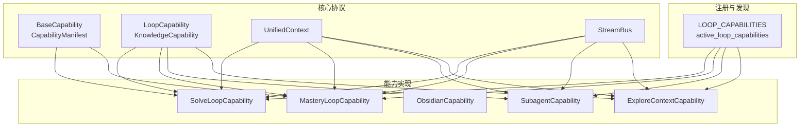
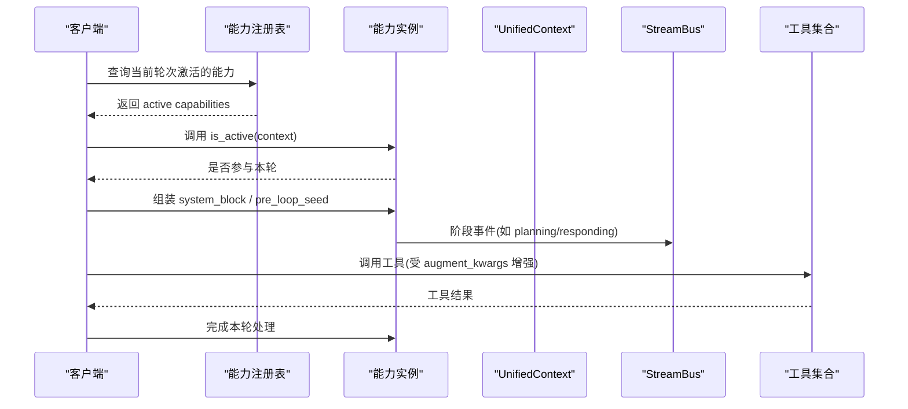
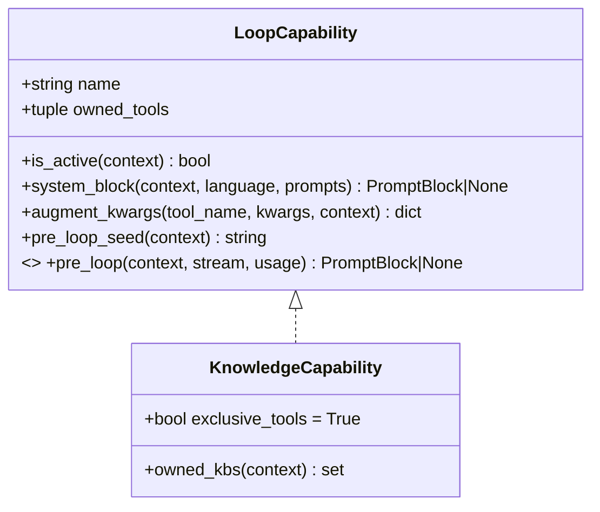
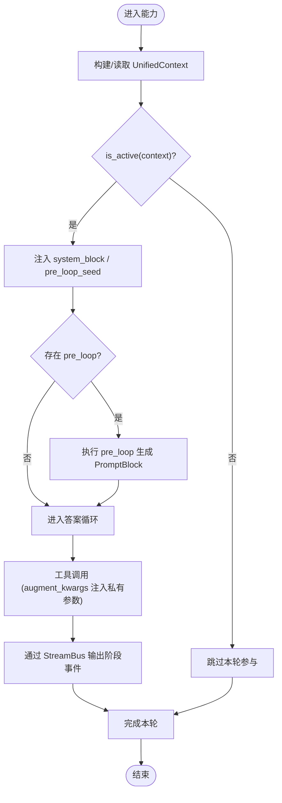
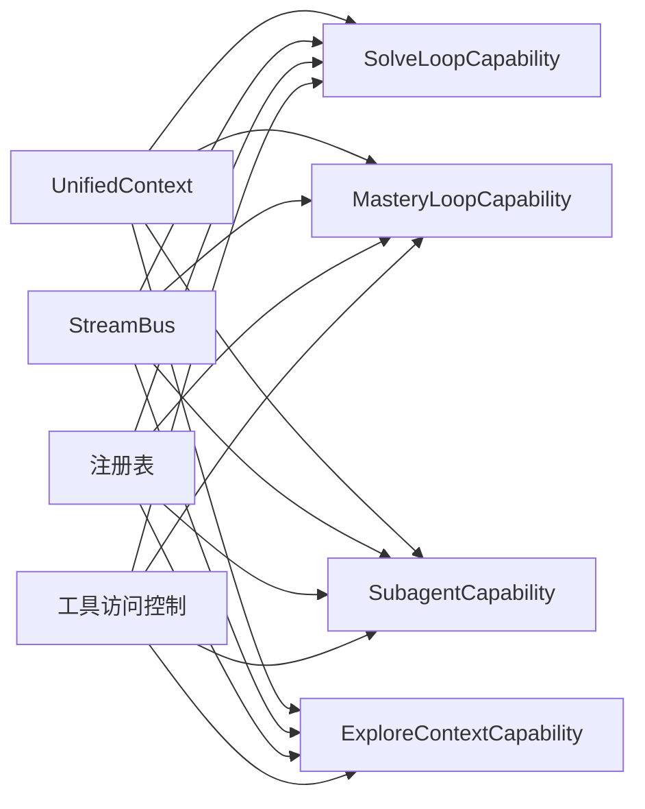

# 能力协议定义

<cite>
**本文引用的文件**
- [deeptutor/core/capability_protocol.py](file://deeptutor/core/capability_protocol.py)
- [deeptutor/capabilities/protocol.py](file://deeptutor/capabilities/protocol.py)
- [deeptutor/capabilities/registry.py](file://deeptutor/capabilities/registry.py)
- [deeptutor/core/context.py](file://deeptutor/core/context.py)
- [deeptutor/core/errors.py](file://deeptutor/core/errors.py)
- [deeptutor/multi_user/tool_access.py](file://deeptutor/multi_user/tool_access.py)
- [deeptutor/capabilities/solve/capability.py](file://deeptutor/capabilities/solve/capability.py)
- [deeptutor/capabilities/explore_context/capability.py](file://deeptutor/capabilities/explore_context/capability.py)
- [deeptutor/capabilities/mastery/capability.py](file://deeptutor/capabilities/mastery/capability.py)
- [deeptutor/capabilities/subagent/capability.py](file://deeptutor/capabilities/subagent/capability.py)
</cite>

## 目录
1. [简介](#简介)
2. [项目结构](#项目结构)
3. [核心组件](#核心组件)
4. [架构总览](#架构总览)
5. [详细组件分析](#详细组件分析)
6. [依赖关系分析](#依赖关系分析)
7. [性能考量](#性能考量)
8. [故障排查指南](#故障排查指南)
9. [结论](#结论)
10. [附录](#附录)

## 简介
本文件系统化阐述 DeepTutor 的“能力协议”（Capability Protocol），覆盖以下目标：
- 明确 LoopCapability 接口的核心方法与属性，以及其与知识型能力的区别。
- 说明能力生命周期管理：初始化、执行与销毁（含上下文与流式事件）。
- 描述能力间通信的数据结构与消息格式（统一上下文、流总线、提示块等）。
- 解释能力状态管理与错误处理机制。
- 给出能力发现与服务注册的标准协议（内置能力注册表）。
- 说明权限控制与访问验证的实现方式（工具白名单、MCP/CLI应用授权）。
- 提供自定义能力开发的完整接口规范与最佳实践。
- 讨论能力协议的版本兼容性与向后兼容策略。
- 展示实际应用示例与典型工作流。

## 项目结构
DeepTutor 的能力协议由“核心协议层”和“具体能力实现层”组成：
- 核心协议层：定义通用抽象、数据模型与运行时契约。
- 能力实现层：以 LoopCapability/KnowledgeCapability 为扩展点，挂载工具、注入系统提示、参与对话循环。
- 注册与发现：集中维护内置能力列表，按当前上下文筛选激活的能力。
- 上下文与流：通过 UnifiedContext 传递请求级信息，通过 StreamBus 输出阶段化事件。

图表来源
- [deeptutor/core/capability_protocol.py:20-69](file://deeptutor/core/capability_protocol.py#L20-L69)
- [deeptutor/capabilities/protocol.py:11-116](file://deeptutor/capabilities/protocol.py#L11-L116)
- [deeptutor/capabilities/registry.py:13-44](file://deeptutor/capabilities/registry.py#L13-L44)
- [deeptutor/core/context.py:15-85](file://deeptutor/core/context.py#L15-L85)

章节来源
- [deeptutor/core/capability_protocol.py:20-69](file://deeptutor/core/capability_protocol.py#L20-L69)
- [deeptutor/capabilities/protocol.py:11-116](file://deeptutor/capabilities/protocol.py#L11-L116)
- [deeptutor/capabilities/registry.py:13-44](file://deeptutor/capabilities/registry.py#L13-L44)
- [deeptutor/core/context.py:15-85](file://deeptutor/core/context.py#L15-L85)

## 核心组件
- BaseCapability 与 CapabilityManifest
  - 用于声明静态元数据（名称、描述、阶段、使用工具、CLI别名、请求Schema、配置默认值）并强制实现 run(context, stream)。
- LoopCapability 与 KnowledgeCapability
  - LoopCapability：可选的每轮扩展点，复用聊天工具的完整表面，并可追加 owned_tools；支持 is_active、system_block、augment_kwargs、pre_loop_seed 及可选 pre_loop。
  - KnowledgeCapability：知识型能力，拥有本轮工具表面（exclusive_tools=True），可声明 owned_kbs 以排除被其工具独占的知识库引用。
- UnifiedContext
  - 贯穿 orchestrator、工具、能力、插件的统一上下文对象，包含会话ID、用户消息、历史、工具开关、知识库、附件、语言、技能清单、源清单、元数据等。
- StreamBus
  - 能力在运行期间通过阶段化事件（stage）向调用方推送进度与中间结果。

章节来源
- [deeptutor/core/capability_protocol.py:20-69](file://deeptutor/core/capability_protocol.py#L20-L69)
- [deeptutor/capabilities/protocol.py:11-116](file://deeptutor/capabilities/protocol.py#L11-L116)
- [deeptutor/core/context.py:15-85](file://deeptutor/core/context.py#L15-L85)

## 架构总览
能力协议将“能力声明”、“能力发现”、“能力执行”解耦：
- 声明：BaseCapability 定义 deep mode 的 run 入口；LoopCapability/KnowledgeCapability 定义 per-turn 扩展点。
- 发现：registry 维护 LOOP_CAPABILITIES，并按上下文过滤 active 能力。
- 执行：能力通过 augment_kwargs 注入私有参数，通过 system_block/pre_loop_seed 注入系统/用户种子文本，通过 StreamBus 输出阶段事件。
- 权限：tool_access 提供工具/MCP/CLI应用/执行的白名单与合并策略。

图表来源
- [deeptutor/capabilities/registry.py:22-44](file://deeptutor/capabilities/registry.py#L22-L44)
- [deeptutor/capabilities/protocol.py:57-85](file://deeptutor/capabilities/protocol.py#L57-L85)
- [deeptutor/core/context.py:33-85](file://deeptutor/core/context.py#L33-L85)

## 详细组件分析

### LoopCapability 接口详解
- name: 能力标识，用于日志、UI分组与路由。
- owned_tools: 能力在本轮挂载的工具名集合（叠加到聊天标准工具集之上）。
- is_active(context): 判断能力是否参与当前轮次。
- system_block(context, language, prompts): 可选的系统提示块，作为系统提示的一部分注入。
- augment_kwargs(tool_name, kwargs, context): 为特定工具调用注入服务端私有关键字（如连接信息、预算、会话ID等）。
- pre_loop_seed(context): 可选地追加到首轮用户消息种子中，作为 grounding 上下文。
- 可选 pre_loop(context, stream, usage): 在答案循环首次 LLM 调用前执行一次预遍历，产出 PromptBlock 注入用户种子。

图表来源
- [deeptutor/capabilities/protocol.py:19-116](file://deeptutor/capabilities/protocol.py#L19-L116)

章节来源
- [deeptutor/capabilities/protocol.py:19-116](file://deeptutor/capabilities/protocol.py#L19-L116)

### 能力生命周期管理
- 初始化
  - 模块加载时构造内置能力实例（见 registry）。
  - 能力通过 manifest/name/owned_tools 暴露静态元数据，供设置界面分组与校验。
- 执行
  - 对 BaseCapability：run(context, stream) 负责编排整个能力流水线，并通过 StreamBus.stage 输出阶段事件。
  - 对 LoopCapability：在聊天循环中，先计算 is_active，再注入 system_block/pre_loop_seed，并在必要时执行 pre_loop；随后进入答案循环，工具调用通过 augment_kwargs 注入私有参数。
- 销毁
  - 能力无显式 destroy 方法；资源释放由 Python GC 与上下文作用域管理。对于需要跨轮状态的能力（如 subagent），通过 context.metadata 保存临时状态，并在轮次结束后自然回收。

章节来源
- [deeptutor/core/capability_protocol.py:33-69](file://deeptutor/core/capability_protocol.py#L33-L69)
- [deeptutor/capabilities/registry.py:13-44](file://deeptutor/capabilities/registry.py#L13-L44)
- [deeptutor/capabilities/subagent/capability.py:65-117](file://deeptutor/capabilities/subagent/capability.py#L65-L117)

### 能力间通信的数据结构与消息格式
- 统一上下文 UnifiedContext
  - 关键字段：session_id、user_message、conversation_history、enabled_tools、allowed_builtin_tools、active_capability、knowledge_bases、attachments、config_overrides、language、memory_context、persona_context、skills_manifest、source_manifest、metadata。
  - 用途：承载能力所需的一切请求级信息，包括能力专属元数据（如 solve_mode、mastery_path_id、solve_session_id 等）。
- 流式事件 StreamBus
  - 能力通过 stage(name, source) 输出阶段性事件，便于前端渲染与追踪。
- 提示块 PromptBlock
  - 用于将能力产出的结构化文本（如探索摘要、系统指令）注入到系统或用户种子中。

图表来源
- [deeptutor/core/context.py:33-85](file://deeptutor/core/context.py#L33-L85)
- [deeptutor/capabilities/protocol.py:57-85](file://deeptutor/capabilities/protocol.py#L57-L85)
- [deeptutor/capabilities/explore_context/capability.py:118-141](file://deeptutor/capabilities/explore_context/capability.py#L118-L141)

章节来源
- [deeptutor/core/context.py:33-85](file://deeptutor/core/context.py#L33-L85)
- [deeptutor/capabilities/protocol.py:57-85](file://deeptutor/capabilities/protocol.py#L57-L85)
- [deeptutor/capabilities/explore_context/capability.py:118-141](file://deeptutor/capabilities/explore_context/capability.py#L118-L141)

### 能力状态管理与错误处理
- 状态管理
  - 通过 context.metadata 存储能力专属状态（例如 solve_session_id、mastery_path_id、_subagent_state 等），确保跨轮次一致性。
  - 对需要限制的资源（如 subagent 咨询次数），通过配置与上下文共同约束。
- 错误处理
  - 统一异常体系：DeepTutorError 及其子类（ConfigurationError、ValidationError、ServiceError、LLMServiceError、LLMContextError、EnvironmentConfigError）。
  - 建议在能力内部捕获可恢复错误并降级，抛出领域异常以便上层统一处理。

章节来源
- [deeptutor/core/errors.py:10-58](file://deeptutor/core/errors.py#L10-L58)
- [deeptutor/capabilities/solve/capability.py:69-88](file://deeptutor/capabilities/solve/capability.py#L69-L88)
- [deeptutor/capabilities/subagent/capability.py:65-117](file://deeptutor/capabilities/subagent/capability.py#L65-L117)

### 能力发现与服务注册标准协议
- 内置能力注册表
  - LOOP_CAPABILITIES：集中声明所有内置 loop 能力实例。
  - active_loop_capabilities(context)：按稳定顺序返回当前轮次激活的能力。
  - any_exclusive_capability_active(context)：判断是否存在“独占工具表面”的知识型能力。
  - capability_tool_owners()：建立“工具名 -> 能力名”的映射，用于设置界面分组。
- 扩展方式
  - 新增能力后，将其实例加入 LOOP_CAPABILITIES，并确保 is_active 逻辑正确。

章节来源
- [deeptutor/capabilities/registry.py:13-44](file://deeptutor/capabilities/registry.py#L13-L44)

### 权限控制与访问验证
- 工具白名单
  - allowed_optional_tools：用户可切换的可选工具白名单（None=不限制）。
  - allowed_mcp_tools：MCP 工具白名单（非管理员缺失时为拒绝）。
  - allowed_cli_apps：已安装 CLI 应用白名单（非管理员缺失时为拒绝）。
  - exec_override：执行权限的用户级覆盖。
  - combine_whitelists：合并调用方与用户的白名单（None 表示不限制）。
- 能力侧配合
  - 知识型能力通过 exclusive_tools=True 替换工具表面，避免与聊天内置工具冲突。
  - 通过 augment_kwargs 注入服务端私有参数，防止客户端伪造关键参数。

章节来源
- [deeptutor/multi_user/tool_access.py:36-104](file://deeptutor/multi_user/tool_access.py#L36-L104)
- [deeptutor/capabilities/protocol.py:87-116](file://deeptutor/capabilities/protocol.py#L87-L116)

### 自定义能力开发接口规范
- 若需实现 deep mode（独立流水线）：
  - 继承 BaseCapability，提供 manifest（name/description/stages/tools_used/request_schema/config_defaults），实现 run(context, stream)。
- 若需扩展聊天循环（per-turn）：
  - 实现 LoopCapability（或 KnowledgeCapability），提供 name、owned_tools、is_active，按需实现 system_block/augment_kwargs/pre_loop_seed，可选 pre_loop。
- 注册能力：
  - 将能力实例加入 LOOP_CAPABILITIES，确保 is_active 行为符合预期。
- 最佳实践：
  - 使用 StreamBus.stage 输出阶段事件，便于前端渲染。
  - 通过 context.metadata 传递能力专属状态，避免全局变量。
  - 严格遵循权限白名单，不在能力内绕过 tool_access。

章节来源
- [deeptutor/core/capability_protocol.py:20-69](file://deeptutor/core/capability_protocol.py#L20-L69)
- [deeptutor/capabilities/protocol.py:19-116](file://deeptutor/capabilities/protocol.py#L19-L116)
- [deeptutor/capabilities/registry.py:13-44](file://deeptutor/capabilities/registry.py#L13-L44)

### 版本兼容性与向后兼容保证
- 向后兼容策略
  - LoopCapability 的 pre_loop、system_block、pre_loop_seed 均为可选钩子，通过 getattr 默认值读取，旧实现无需改动即可继续工作。
  - KnowledgeCapability 的 exclusive_tools 与 owned_kbs 为可选扩展，不影响普通 LoopCapability。
- 建议
  - 新增字段时保持默认值兼容；对必需字段变更应提供迁移路径。
  - 在 manifest.request_schema 中声明请求结构，便于前后端契约校验。

章节来源
- [deeptutor/capabilities/protocol.py:34-55](file://deeptutor/capabilities/protocol.py#L34-L55)
- [deeptutor/capabilities/protocol.py:87-116](file://deeptutor/capabilities/protocol.py#L87-L116)

### 实际应用示例与最佳实践
- 深度解题（Deep Solve）
  - 通过 BaseCapability 标记 solve_mode，设置 solve_session_id，并调用 AgenticChatPipeline 驱动标准智能体循环。
- 掌握路径（Mastery Path）
  - 通过 BaseCapability 标记 mastery_mode，解析 mastery_path_id，并调用 AgenticChatPipeline。
- 探索上下文（Explore Context）
  - 通过 LoopCapability 的 pre_loop 钩子在首轮 LLM 调用前进行只读探索，产出客观摘要注入用户种子。
- 子代理（Subagent）
  - 作为 KnowledgeCapability 独占本轮工具表面，通过 augment_kwargs 注入后端连接、预算、会话状态等私有参数。

章节来源
- [deeptutor/capabilities/solve/capability.py:59-88](file://deeptutor/capabilities/solve/capability.py#L59-L88)
- [deeptutor/capabilities/mastery/capability.py:57-73](file://deeptutor/capabilities/mastery/capability.py#L57-L73)
- [deeptutor/capabilities/explore_context/capability.py:82-141](file://deeptutor/capabilities/explore_context/capability.py#L82-L141)
- [deeptutor/capabilities/subagent/capability.py:32-117](file://deeptutor/capabilities/subagent/capability.py#L32-L117)

## 依赖关系分析
- 能力与上下文
  - 所有能力均依赖 UnifiedContext 获取会话、工具开关、语言、附件、源清单与元数据。
- 能力与流总线
  - 能力通过 StreamBus 输出阶段事件，便于前端与监控消费。
- 能力与注册表
  - 注册表集中管理能力实例，并提供激活能力筛选与工具归属映射。
- 权限与能力
  - 工具访问控制通过 tool_access 在 turn_runtime 与工具路由处生效，能力不应绕过该机制。

图表来源
- [deeptutor/core/context.py:33-85](file://deeptutor/core/context.py#L33-L85)
- [deeptutor/capabilities/registry.py:13-44](file://deeptutor/capabilities/registry.py#L13-L44)
- [deeptutor/multi_user/tool_access.py:36-104](file://deeptutor/multi_user/tool_access.py#L36-L104)

章节来源
- [deeptutor/core/context.py:33-85](file://deeptutor/core/context.py#L33-L85)
- [deeptutor/capabilities/registry.py:13-44](file://deeptutor/capabilities/registry.py#L13-L44)
- [deeptutor/multi_user/tool_access.py:36-104](file://deeptutor/multi_user/tool_access.py#L36-L104)

## 性能考量
- 延迟优化
  - 使用 pre_loop 将只读探索前置，减少主循环中的重复读取。
  - 通过 augment_kwargs 在服务端注入私有参数，避免客户端往返。
- 资源控制
  - 通过配置与上下文限制最大轮次、重规划次数、咨询预算等，防止无限循环。
- 缓存与惰性加载
  - 提示词等资源可按语言缓存，避免重复 IO。
- 流式输出
  - 通过 StreamBus.stage 及时推送中间结果，提升用户体验与可观测性。

[本节为通用指导，不直接分析具体文件]

## 故障排查指南
- 常见问题定位
  - 能力未激活：检查 is_active 条件与上下文字段（如 source_index、selected KB）。
  - 工具不可用：核对 tool_access 白名单与 allowed_builtin_tools。
  - 上下文缺失：确认 UnifiedContext 字段是否正确填充（如 metadata、language）。
  - 错误类型识别：根据异常层次（DeepTutorError 及其子类）快速定位问题域。
- 调试建议
  - 在能力中增加阶段事件输出，结合前端与日志定位瓶颈。
  - 对配置读取失败做防御性处理，记录警告并使用默认值。

章节来源
- [deeptutor/core/errors.py:10-58](file://deeptutor/core/errors.py#L10-L58)
- [deeptutor/multi_user/tool_access.py:36-104](file://deeptutor/multi_user/tool_access.py#L36-L104)
- [deeptutor/capabilities/explore_context/capability.py:68-79](file://deeptutor/capabilities/explore_context/capability.py#L68-L79)

## 结论
DeepTutor 的能力协议通过清晰的抽象（BaseCapability、LoopCapability、KnowledgeCapability）、统一的上下文（UnifiedContext）与流式事件（StreamBus），实现了能力声明、发现、执行与权限控制的解耦与可扩展。基于注册表的集中管理与向后兼容的可选钩子设计，使得新增能力与演进协议更加稳健。实践中应遵循权限白名单、合理划分能力职责、充分利用预遍历与阶段事件，以获得更好的性能与可观测性。

[本节为总结性内容，不直接分析具体文件]

## 附录
- 术语
  - 能力（Capability）：封装特定业务场景的推理与工具编排。
  - 循环（Loop）：指聊天智能体的多轮交互循环。
  - 知识型能力（KnowledgeCapability）：独占本轮工具表面的能力，通常绑定知识库或外部代理。
- 参考实现
  - 深度解题：[deeptutor/capabilities/solve/capability.py](file://deeptutor/capabilities/solve/capability.py)
  - 掌握路径：[deeptutor/capabilities/mastery/capability.py](file://deeptutor/capabilities/mastery/capability.py)
  - 探索上下文：[deeptutor/capabilities/explore_context/capability.py](file://deeptutor/capabilities/explore_context/capability.py)
  - 子代理：[deeptutor/capabilities/subagent/capability.py](file://deeptutor/capabilities/subagent/capability.py)

[本节为补充说明，不直接分析具体文件]