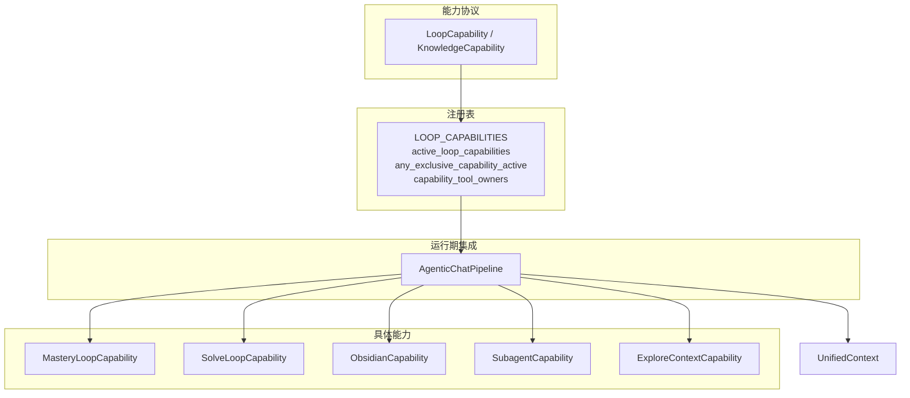
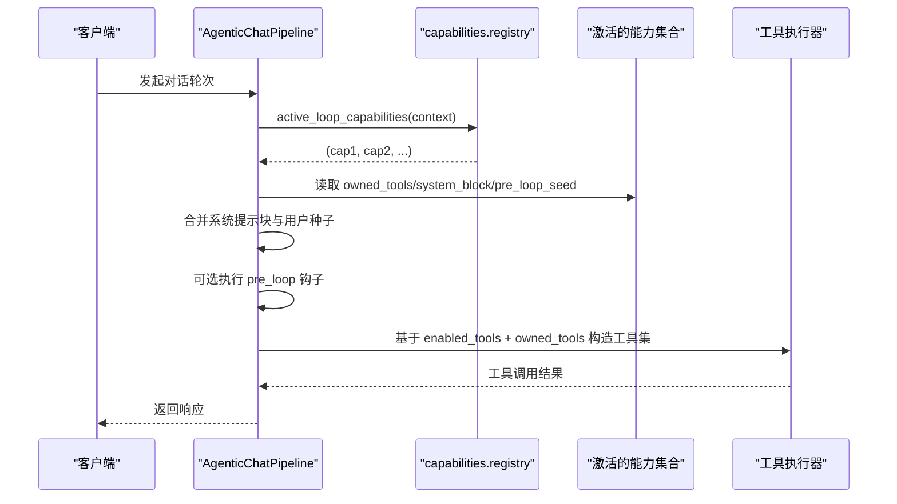
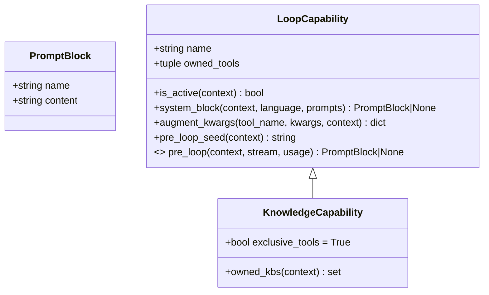
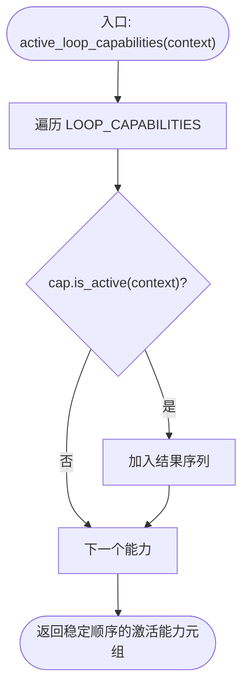
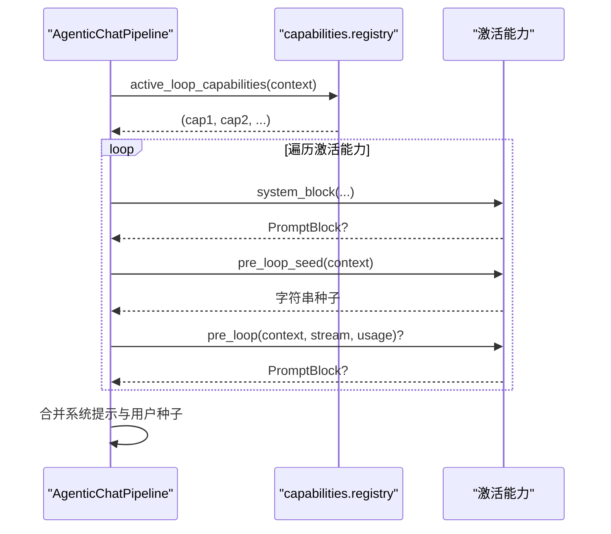
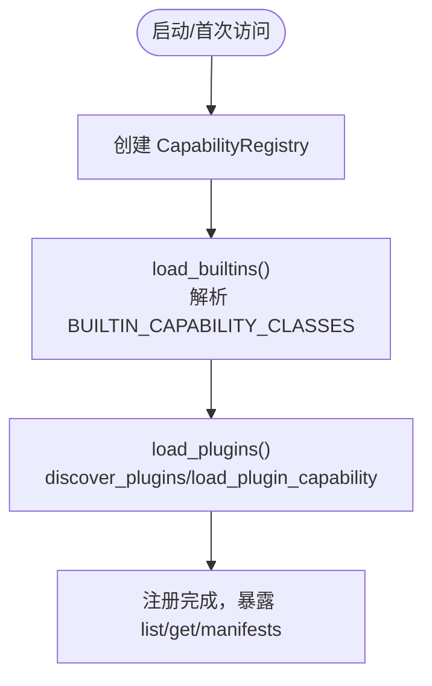
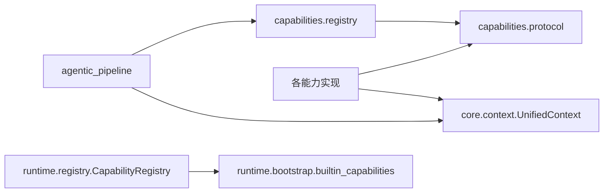

# 能力注册表

<cite>
**本文引用的文件**
- [deeptutor/capabilities/registry.py](file://deeptutor/capabilities/registry.py)
- [deeptutor/capabilities/protocol.py](file://deeptutor/capabilities/protocol.py)
- [deeptutor/capabilities/__init__.py](file://deeptutor/capabilities/__init__.py)
- [deeptutor/agents/chat/agentic_pipeline.py](file://deeptutor/agents/chat/agentic_pipeline.py)
- [deeptutor/core/context.py](file://deeptutor/core/context.py)
- [deeptutor/runtime/registry/capability_registry.py](file://deeptutor/runtime/registry/capability_registry.py)
- [deeptutor/runtime/bootstrap/builtin_capabilities.py](file://deeptutor/runtime/bootstrap/builtin_capabilities.py)
- [deeptutor/capabilities/mastery/loop.py](file://deeptutor/capabilities/mastery/loop.py)
- [deeptutor/capabilities/solve/loop.py](file://deeptutor/capabilities/solve/loop.py)
- [deeptutor/capabilities/obsidian/capability.py](file://deeptutor/capabilities/obsidian/capability.py)
- [deeptutor/capabilities/subagent/capability.py](file://deeptutor/capabilities/subagent/capability.py)
- [deeptutor/capabilities/explore_context/capability.py](file://deeptutor/capabilities/explore_context/capability.py)
</cite>

## 目录
1. [简介](#简介)
2. [项目结构](#项目结构)
3. [核心组件](#核心组件)
4. [架构总览](#架构总览)
5. [详细组件分析](#详细组件分析)
6. [依赖关系分析](#依赖关系分析)
7. [性能考量](#性能考量)
8. [故障排查指南](#故障排查指南)
9. [结论](#结论)
10. [附录](#附录)

## 简介
本文件面向 DeepTutor 的“能力注册表”子系统，聚焦于 LOOP_CAPABILITIES 元组的构建与初始化、运行时按上下文筛选激活能力、工具独占性判断、能力与工具的映射关系、能力发现与加载流程，以及扩展点与最佳实践。该子系统将“聊天循环（chat loop）”与“能力逻辑”解耦：能力在活跃时复用完整的聊天工具面并叠加自身工具与系统提示块；知识类能力可独占工具面，替代内置工具集。

## 项目结构
围绕能力注册表的关键位置如下：
- 协议与数据契约：LoopCapability/KnowledgeCapability/PromptBlock
- 注册表与筛选：LOOP_CAPABILITIES、active_loop_capabilities、any_exclusive_capability_active、capability_tool_owners
- 运行期集成：AgenticChatPipeline 调用注册表以组装工具、系统提示块、pre_loop 种子等
- 运行时能力注册中心：CapabilityRegistry（Level 2 深度模式能力）
- 具体能力实现：mastery、solve、obsidian、subagent、explore_context 等

图表来源
- [deeptutor/capabilities/protocol.py:19-116](file://deeptutor/capabilities/protocol.py#L19-L116)
- [deeptutor/capabilities/registry.py:13-44](file://deeptutor/capabilities/registry.py#L13-L44)
- [deeptutor/agents/chat/agentic_pipeline.py:626-697](file://deeptutor/agents/chat/agentic_pipeline.py#L626-L697)
- [deeptutor/core/context.py:34-84](file://deeptutor/core/context.py#L34-L84)

章节来源
- [deeptutor/capabilities/registry.py:13-44](file://deeptutor/capabilities/registry.py#L13-L44)
- [deeptutor/capabilities/protocol.py:19-116](file://deeptutor/capabilities/protocol.py#L19-L116)
- [deeptutor/agents/chat/agentic_pipeline.py:626-697](file://deeptutor/agents/chat/agentic_pipeline.py#L626-L697)
- [deeptutor/core/context.py:34-84](file://deeptutor/core/context.py#L34-L84)

## 核心组件
- 协议层
  - LoopCapability：定义 name、owned_tools、is_active、system_block、augment_kwargs、pre_loop_seed 等接口，支持可选 pre_loop 钩子。
  - KnowledgeCapability：继承 LoopCapability 的结构约定，设置 exclusive_tools=True，表示“独占工具面”。
- 注册表层
  - LOOP_CAPABILITIES：静态元组，集中声明所有循环能力实例。
  - active_loop_capabilities(context)：按稳定顺序过滤出当前 turn 激活的能力。
  - any_exclusive_capability_active(context)：判断是否存在“独占工具面”的能力。
  - capability_tool_owners()：建立“能力拥有的工具名 -> 能力名”的静态映射。
- 运行期集成
  - AgenticChatPipeline：调用注册表获取激活能力，合并 owned_tools、系统提示块、pre_loop 种子与异步 pre_loop 结果，参与工具执行与提示组装。
- 运行时能力注册中心（Level 2 深度模式）
  - CapabilityRegistry：统一注册内置与插件能力，提供清单查询。

章节来源
- [deeptutor/capabilities/protocol.py:19-116](file://deeptutor/capabilities/protocol.py#L19-L116)
- [deeptutor/capabilities/registry.py:13-44](file://deeptutor/capabilities/registry.py#L13-L44)
- [deeptutor/agents/chat/agentic_pipeline.py:626-697](file://deeptutor/agents/chat/agentic_pipeline.py#L626-L697)
- [deeptutor/runtime/registry/capability_registry.py:39-114](file://deeptutor/runtime/registry/capability_registry.py#L39-L114)

## 架构总览
下图展示从请求进入聊天管道到能力筛选、工具装配与执行的端到端流程。

图表来源
- [deeptutor/agents/chat/agentic_pipeline.py:626-697](file://deeptutor/agents/chat/agentic_pipeline.py#L626-L697)
- [deeptutor/capabilities/registry.py:22-44](file://deeptutor/capabilities/registry.py#L22-L44)

## 详细组件分析

### 能力协议与数据模型
- PromptBlock：用于向系统提示注入命名片段。
- LoopCapability：定义能力在聊天循环中的生命周期钩子与工具贡献方式。
- KnowledgeCapability：通过 exclusive_tools=True 标记“独占工具面”，并可通过 owned_kbs 排除被能力自有工具消费的 KB 引用，避免与 rag 表面冲突。

图表来源
- [deeptutor/capabilities/protocol.py:11-116](file://deeptutor/capabilities/protocol.py#L11-L116)

章节来源
- [deeptutor/capabilities/protocol.py:11-116](file://deeptutor/capabilities/protocol.py#L11-L116)

### LOOP_CAPABILITIES 元组与初始化
- 位置与职责：在 capabilities.registry 中集中声明所有循环能力实例，形成稳定的注册顺序。
- 包含能力：mastery、solve、obsidian、subagent、explore_context。
- 设计要点：
  - 使用元组保证顺序稳定，便于确定性行为。
  - 能力实例化在模块导入时完成，属于轻量级对象，避免重复创建。

章节来源
- [deeptutor/capabilities/registry.py:13-19](file://deeptutor/capabilities/registry.py#L13-L19)

### active_loop_capabilities：按上下文动态筛选
- 输入：UnifiedContext（携带 session_id、metadata、enabled_tools、knowledge_bases 等）。
- 输出：按注册表顺序返回 is_active(context)==True 的能力元组。
- 典型判定依据：
  - mastery_mode、solve_mode 等标志位。
  - 是否连接了 Obsidian vault 或 Subagent。
  - 是否附带可读源（explore_context）。

图表来源
- [deeptutor/capabilities/registry.py:22-24](file://deeptutor/capabilities/registry.py#L22-L24)
- [deeptutor/core/context.py:34-84](file://deeptutor/core/context.py#L34-L84)

章节来源
- [deeptutor/capabilities/registry.py:22-24](file://deeptutor/capabilities/registry.py#L22-L24)
- [deeptutor/core/context.py:34-84](file://deeptutor/core/context.py#L34-L84)

### any_exclusive_capability_active：能力优先级与工具独占性
- 作用：若任一激活能力设置了 exclusive_tools=True，则视为“知识类能力接管本轮”，走独占工具分支，抑制 rag 脚手架（KB seed/kb note），仅使用该能力的 own tools。
- 实现要点：对 active_loop_capabilities 的结果进行 any(getattr(cap, "exclusive_tools", False)) 判断，默认值保证普通能力不进入此分支。

章节来源
- [deeptutor/capabilities/registry.py:27-35](file://deeptutor/capabilities/registry.py#L27-L35)
- [deeptutor/capabilities/protocol.py:87-102](file://deeptutor/capabilities/protocol.py#L87-L102)

### capability_tool_owners：工具与能力映射
- 作用：生成“工具名 -> 能力名”的静态映射，供设置 UI 分组显示能力自有工具。
- 范围：仅包含能力声明的 owned_tools，不包含系统/内置工具。

章节来源
- [deeptutor/capabilities/registry.py:38-44](file://deeptutor/capabilities/registry.py#L38-L44)

### 运行期集成：AgenticChatPipeline 如何消费注册表
- 获取激活能力：_active_loop_capabilities(context) 委托给 registry.active_loop_capabilities。
- 工具装配：_capability_owned_tools 汇总各激活能力的 owned_tools，叠加至聊天标准工具面。
- 系统提示：_capability_system_blocks 收集各能力的 system_block 片段。
- 预循环种子：_capability_pre_loop_seed 拼接 pre_loop_seed 文本。
- 异步 pre_loop：_capability_pre_loop_briefings 依次调用可选 pre_loop 钩子，失败不影响主流程。

图表来源
- [deeptutor/agents/chat/agentic_pipeline.py:626-697](file://deeptutor/agents/chat/agentic_pipeline.py#L626-L697)
- [deeptutor/capabilities/registry.py:22-24](file://deeptutor/capabilities/registry.py#L22-L24)

章节来源
- [deeptutor/agents/chat/agentic_pipeline.py:626-697](file://deeptutor/agents/chat/agentic_pipeline.py#L626-L697)

### 具体能力实现要点
- MasteryLoopCapability：当 metadata.mastery_mode 为真时激活；注入 mastery 工具与系统提示；为工具注入路径与会话标识。
- SolveLoopCapability：当 metadata.solve_mode 为真时激活；注入 solve 工具与系统提示；维护 replan 预算与会话。
- ObsidianCapability：当存在 vault 绑定且可访问时激活；设置 exclusive_tools=True；排除 vault 相关 KB 以避免与 rag 冲突；强制覆盖 _vault_path 保障安全。
- SubagentCapability：当存在本地子代理连接时激活；设置 exclusive_tools=True；维护跨轮次的会话状态与图像转发策略。
- ExploreContextCapability：当存在可读附件源时激活；通过 pre_loop 异步调查源并产出引导文本，不直接拥有 answer-loop 工具。

章节来源
- [deeptutor/capabilities/mastery/loop.py:13-74](file://deeptutor/capabilities/mastery/loop.py#L13-L74)
- [deeptutor/capabilities/solve/loop.py:21-92](file://deeptutor/capabilities/solve/loop.py#L21-L92)
- [deeptutor/capabilities/obsidian/capability.py:24-72](file://deeptutor/capabilities/obsidian/capability.py#L24-L72)
- [deeptutor/capabilities/subagent/capability.py:32-121](file://deeptutor/capabilities/subagent/capability.py#L32-L121)
- [deeptutor/capabilities/explore_context/capability.py:82-141](file://deeptutor/capabilities/explore_context/capability.py#L82-L141)

### 能力发现机制与运行时加载（Level 2 深度模式）
- CapabilityRegistry：集中管理所有能力（内置与插件）。
- load_builtins：从 BUILTIN_CAPABILITY_CLASSES 动态导入并注册。
- load_plugins：尝试加载插件发现与加载钩子，跳过 tool.py 条目，注册能力。
- get_capability_registry：单例式懒加载，首次调用时完成内置与插件加载。

图表来源
- [deeptutor/runtime/registry/capability_registry.py:39-114](file://deeptutor/runtime/registry/capability_registry.py#L39-L114)
- [deeptutor/runtime/bootstrap/builtin_capabilities.py:1-12](file://deeptutor/runtime/bootstrap/builtin_capabilities.py#L1-L12)

章节来源
- [deeptutor/runtime/registry/capability_registry.py:39-114](file://deeptutor/runtime/registry/capability_registry.py#L39-L114)
- [deeptutor/runtime/bootstrap/builtin_capabilities.py:1-12](file://deeptutor/runtime/bootstrap/builtin_capabilities.py#L1-L12)

### 扩展点与自定义能力注册方法
- 循环能力扩展（Level 1）：
  - 实现 LoopCapability 或 KnowledgeCapability 接口，定义 name、owned_tools、is_active、system_block、augment_kwargs、pre_loop_seed，可选 pre_loop。
  - 将其实例加入 LOOP_CAPABILITIES 元组（或通过包导出并在注册处引入），即可在聊天循环中生效。
- 深度模式能力扩展（Level 2）：
  - 实现 BaseCapability 并提供 manifest，遵循 run(context, stream) 协议。
  - 在 BUILTIN_CAPABILITY_CLASSES 或通过插件机制注册，由 CapabilityRegistry 统一管理。
- 工具与能力映射：
  - 通过 owned_tools 声明能力自有的工具，capability_tool_owners 自动建立映射，便于 UI 分组。
- 独占工具面：
  - 继承 KnowledgeCapability 或设置 exclusive_tools=True，使本轮仅使用该能力的工具，并可通过 owned_kbs 排除被其工具消费的 KB 引用。

章节来源
- [deeptutor/capabilities/protocol.py:19-116](file://deeptutor/capabilities/protocol.py#L19-L116)
- [deeptutor/capabilities/registry.py:13-44](file://deeptutor/capabilities/registry.py#L13-L44)
- [deeptutor/core/capability_protocol.py:20-69](file://deeptutor/core/capability_protocol.py#L20-L69)
- [deeptutor/runtime/registry/capability_registry.py:39-114](file://deeptutor/runtime/registry/capability_registry.py#L39-L114)

## 依赖关系分析
- 耦合与内聚
  - 注册表与协议强内聚，屏蔽具体能力实现细节。
  - AgenticChatPipeline 仅依赖注册表提供的函数与能力协议，保持低耦合。
- 外部依赖
  - UnifiedContext 作为能力判定的唯一上下文载体。
  - CapabilityRegistry 依赖内置能力清单与插件发现钩子。
- 潜在循环依赖
  - explore_context 的 pre_loop 延迟导入 explorer 以避免循环依赖。

图表来源
- [deeptutor/capabilities/registry.py:13-44](file://deeptutor/capabilities/registry.py#L13-L44)
- [deeptutor/capabilities/protocol.py:19-116](file://deeptutor/capabilities/protocol.py#L19-L116)
- [deeptutor/agents/chat/agentic_pipeline.py:626-697](file://deeptutor/agents/chat/agentic_pipeline.py#L626-L697)
- [deeptutor/core/context.py:34-84](file://deeptutor/core/context.py#L34-L84)
- [deeptutor/runtime/registry/capability_registry.py:39-114](file://deeptutor/runtime/registry/capability_registry.py#L39-L114)
- [deeptutor/runtime/bootstrap/builtin_capabilities.py:1-12](file://deeptutor/runtime/bootstrap/builtin_capabilities.py#L1-L12)

章节来源
- [deeptutor/capabilities/registry.py:13-44](file://deeptutor/capabilities/registry.py#L13-L44)
- [deeptutor/agents/chat/agentic_pipeline.py:626-697](file://deeptutor/agents/chat/agentic_pipeline.py#L626-L697)
- [deeptutor/runtime/registry/capability_registry.py:39-114](file://deeptutor/runtime/registry/capability_registry.py#L39-L114)

## 性能考量
- 注册表扫描成本极低：LOOP_CAPABILITIES 为静态元组，is_active 检查为常量时间操作。
- 延迟导入：explore_context 在 pre_loop 中延迟导入重型模块，避免冷启动开销。
- 工具装配最小化：仅合并激活能力的 owned_tools，避免全量挂载。
- 独占能力路径：exclusive_tools 分支减少不必要的 rag 脚手架，降低提示长度与处理开销。
- 建议
  - 保持 is_active 判断为纯函数、无 I/O。
  - 将昂贵计算放入 pre_loop 并缓存结果到 context.metadata。
  - 控制 owned_tools 规模，避免过大的工具描述影响模型理解。

[本节为通用指导，无需特定文件引用]

## 故障排查指南
- 能力未生效
  - 检查 is_active 条件是否满足（如 metadata 标志、vault/subagent 连接、附件源可读性）。
  - 确认能力已加入 LOOP_CAPABILITIES 或被 CapabilityRegistry 正确加载。
- 工具未出现
  - 核对 owned_tools 列表是否与工具名一致。
  - 检查 any_exclusive_capability_active 是否导致走独占分支，从而隐藏了部分内置工具。
- 提示异常
  - 查看 system_block 与 pre_loop_seed 返回值是否为空或格式错误。
  - 关注 pre_loop 钩子异常会被捕获并记录日志，不会中断主流程。
- 插件加载失败
  - 查看 CapabilityRegistry.load_plugins 的警告日志，确认 discover_plugins 与 load_plugin_capability 可用。

章节来源
- [deeptutor/capabilities/registry.py:22-44](file://deeptutor/capabilities/registry.py#L22-L44)
- [deeptutor/agents/chat/agentic_pipeline.py:666-697](file://deeptutor/agents/chat/agentic_pipeline.py#L666-L697)
- [deeptutor/runtime/registry/capability_registry.py:59-78](file://deeptutor/runtime/registry/capability_registry.py#L59-L78)

## 结论
DeepTutor 的能力注册表通过清晰的协议与注册表抽象，实现了“聊天循环 + 能力逻辑”的解耦。LOOP_CAPABILITIES 提供稳定的能力集合，active_loop_capabilities 根据上下文动态筛选，any_exclusive_capability_active 决定工具面是否被知识类能力独占，capability_tool_owners 建立工具与能力的映射。结合 CapabilityRegistry 的运行时发现与加载机制，系统具备良好的可扩展性与可维护性。遵循本文的最佳实践与性能建议，可高效扩展新能力并优化运行效率。

[本节为总结性内容，无需特定文件引用]

## 附录
- 关键概念速查
  - 循环能力（LoopCapability）：每轮对话可激活的能力，复用完整工具面并叠加自有工具。
  - 知识能力（KnowledgeCapability）：独占工具面的能力，适合以检索/写作为主的场景。
  - 预循环钩子（pre_loop）：在首轮 LLM 调用前执行，产出引导文本或前置上下文。
  - 工具所有权映射：用于 UI 分组与权限控制的工具-能力关联。

[本节为概念说明，无需特定文件引用]