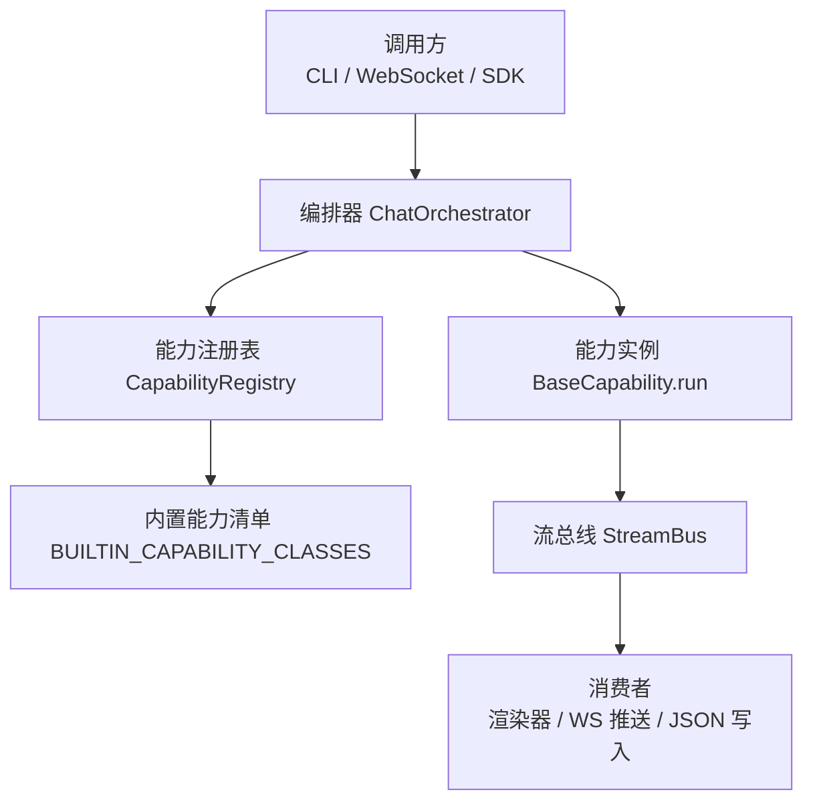
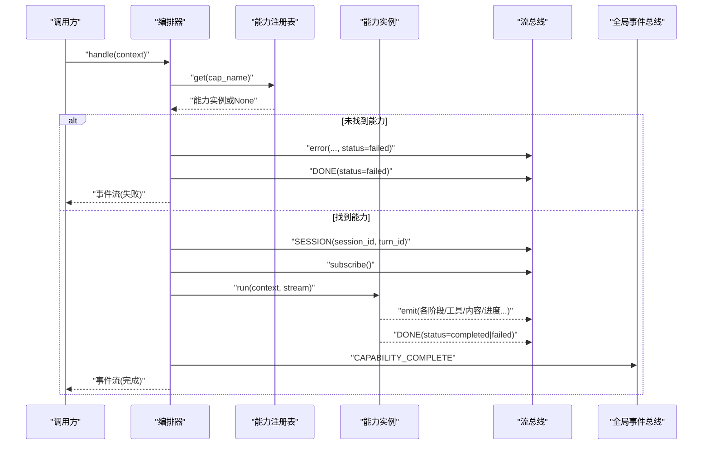
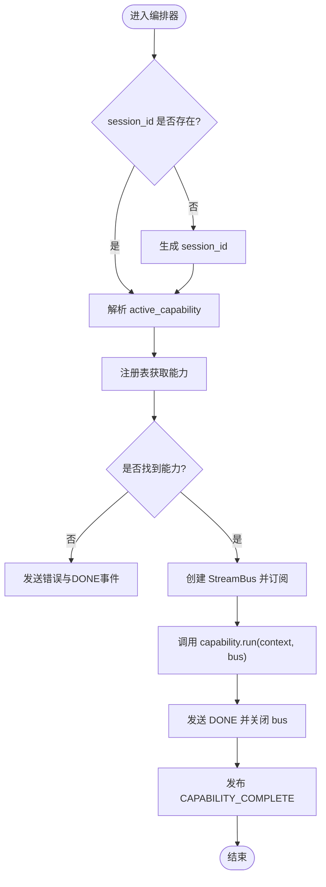
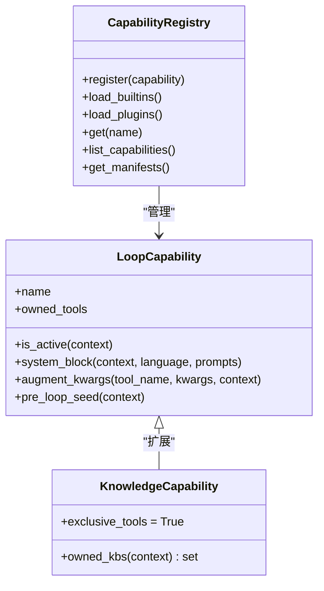
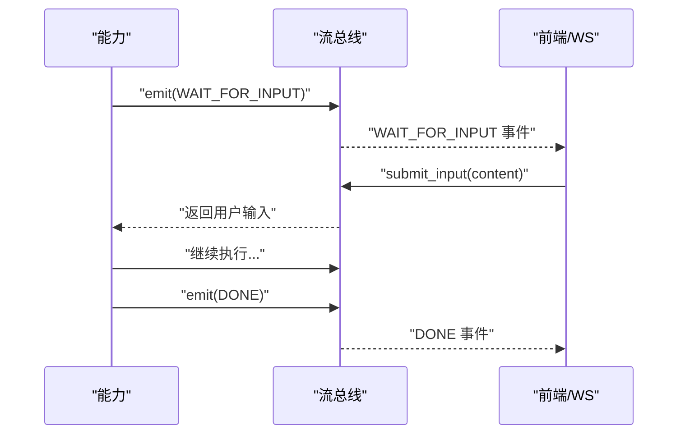
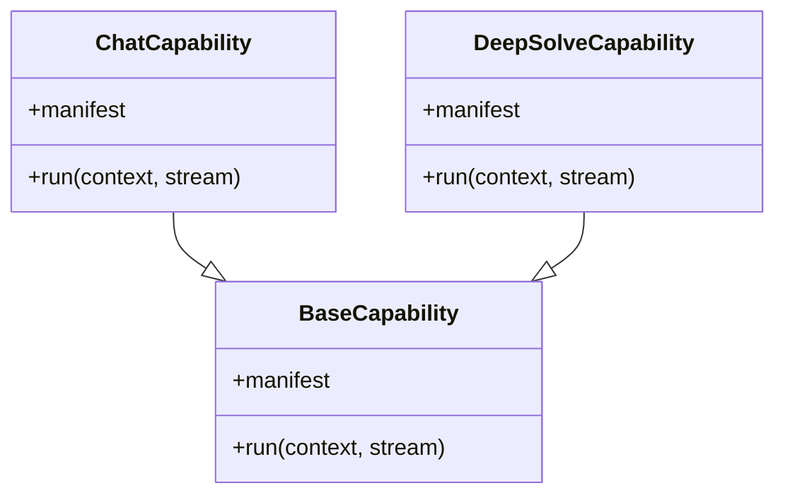
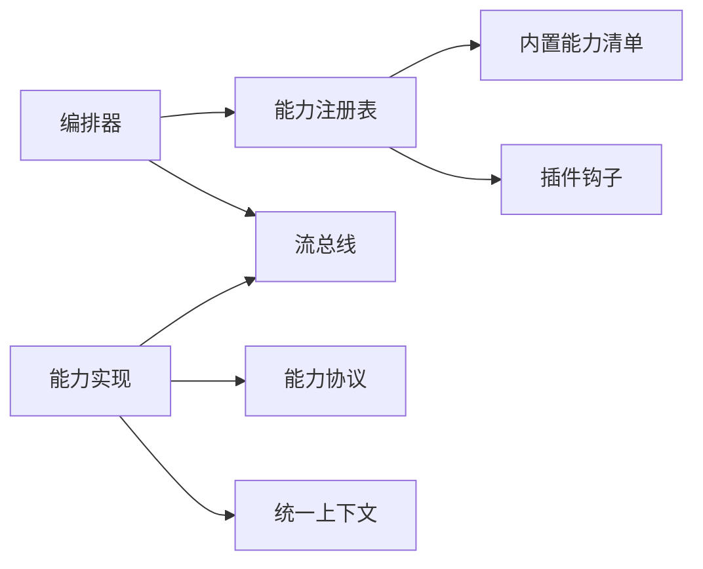

# 能力生命周期管理

<cite>
**本文引用的文件**
- [orchestrator.py](file://deeptutor/runtime/orchestrator.py)
- [capability_registry.py](file://deeptutor/runtime/registry/capability_registry.py)
- [builtin_capabilities.py](file://deeptutor/runtime/bootstrap/builtin_capabilities.py)
- [capability_protocol.py](file://deeptutor/core/capability_protocol.py)
- [context.py](file://deeptutor/core/context.py)
- [stream_bus.py](file://deeptutor/core/stream_bus.py)
- [protocol.py](file://deeptutor/capabilities/protocol.py)
- [registry.py](file://deeptutor/capabilities/registry.py)
- [capability.py](file://deeptutor/agents/chat/capability.py)
- [capability.py](file://deeptutor/capabilities/solve/capability.py)
</cite>

## 目录
1. [简介](#简介)
2. [项目结构](#项目结构)
3. [核心组件](#核心组件)
4. [架构总览](#架构总览)
5. [详细组件分析](#详细组件分析)
6. [依赖关系分析](#依赖关系分析)
7. [性能考量](#性能考量)
8. [故障排查指南](#故障排查指南)
9. [结论](#结论)
10. [附录](#附录)

## 简介
本文件系统性阐述 DeepTutor 中“能力”的生命周期管理，覆盖能力的启动、初始化与资源分配；运行时上下文与状态维护；能力间依赖解析与加载顺序；暂停、恢复与销毁机制；监控与健康检查；异常处理与故障恢复；热更新与动态重配置；以及性能监控与资源统计。文档面向不同技术背景的读者，提供从高层到代码级的逐步深入说明，并辅以图示帮助理解。

## 项目结构
DeepTutor 的能力体系围绕“注册—编排—执行—流式事件”的链路组织：
- 能力注册：集中管理内置与插件能力，支持按需发现与加载。
- 编排器：统一入口，根据上下文选择能力，管理流总线与完成事件。
- 能力协议：定义能力元数据与运行接口（run）。
- 上下文：贯穿一次用户请求的全量输入与状态载体。
- 流总线：能力内部与外部消费者之间的异步事件通道。
- 循环能力：在聊天循环中按轮次扩展工具与系统提示。

图表来源
- [orchestrator.py:26-147](file://deeptutor/runtime/orchestrator.py#L26-L147)
- [capability_registry.py:39-114](file://deeptutor/runtime/registry/capability_registry.py#L39-L114)
- [builtin_capabilities.py:1-12](file://deeptutor/runtime/bootstrap/builtin_capabilities.py#L1-L12)
- [capability_protocol.py:20-69](file://deeptutor/core/capability_protocol.py#L20-L69)
- [stream_bus.py:31-326](file://deeptutor/core/stream_bus.py#L31-L326)

章节来源
- [orchestrator.py:26-147](file://deeptutor/runtime/orchestrator.py#L26-L147)
- [capability_registry.py:39-114](file://deeptutor/runtime/registry/capability_registry.py#L39-L114)
- [builtin_capabilities.py:1-12](file://deeptutor/runtime/bootstrap/builtin_capabilities.py#L1-L12)
- [capability_protocol.py:20-69](file://deeptutor/core/capability_protocol.py#L20-L69)
- [stream_bus.py:31-326](file://deeptutor/core/stream_bus.py#L31-L326)

## 核心组件
- 编排器（ChatOrchestrator）：统一入口，负责路由到具体能力、创建与管理流总线、发布完成事件。
- 能力注册表（CapabilityRegistry）：集中注册与发现能力（内置与插件），提供清单与元数据查询。
- 能力协议（BaseCapability/CapabilityManifest）：定义能力静态元数据与 run 接口。
- 统一上下文（UnifiedContext）：承载会话、消息、工具开关、知识库、附件、语言、记忆/角色上下文等。
- 流总线（StreamBus）：能力内部事件通道，支持阶段、内容、思考、观察、工具调用/结果、进度、来源、结果、错误、等待输入等事件类型。
- 循环能力协议（LoopCapability/KnowledgeCapability）：为聊天循环提供可选扩展点，控制工具集与系统提示注入。

章节来源
- [orchestrator.py:26-147](file://deeptutor/runtime/orchestrator.py#L26-L147)
- [capability_registry.py:39-114](file://deeptutor/runtime/registry/capability_registry.py#L39-L114)
- [capability_protocol.py:20-69](file://deeptutor/core/capability_protocol.py#L20-L69)
- [context.py:15-85](file://deeptutor/core/context.py#L15-L85)
- [stream_bus.py:31-326](file://deeptutor/core/stream_bus.py#L31-L326)
- [protocol.py:19-116](file://deeptutor/capabilities/protocol.py#L19-L116)

## 架构总览
下图展示一次用户请求从进入编排器到能力执行、事件回传、完成的完整流程。

图表来源
- [orchestrator.py:36-147](file://deeptutor/runtime/orchestrator.py#L36-L147)
- [capability_registry.py:80-102](file://deeptutor/runtime/registry/capability_registry.py#L80-L102)
- [stream_bus.py:40-104](file://deeptutor/core/stream_bus.py#L40-L104)

## 详细组件分析

### 能力的启动、初始化与资源分配
- 启动入口：编排器 handle 接收 UnifiedContext，若未设置 session_id 则生成；根据 active_capability 或默认 chat 获取能力。
- 能力加载：注册表在首次获取时自动加载内置能力与插件能力；内置能力通过类路径动态导入并实例化。
- 资源分配：编排器为每次调用创建独立的 StreamBus，并在 finally 中确保 DONE 事件与关闭；将 bus 与 turn_id 绑定以便后续用户输入路由。
- 上下文准备：能力可读取/写入 context.metadata 以传递能力特定参数（如 solve_mode、solve_session_id、预算等）。

图表来源
- [orchestrator.py:36-147](file://deeptutor/runtime/orchestrator.py#L36-L147)
- [capability_registry.py:49-78](file://deeptutor/runtime/registry/capability_registry.py#L49-L78)
- [stream_bus.py:40-104](file://deeptutor/core/stream_bus.py#L40-L104)

章节来源
- [orchestrator.py:36-147](file://deeptutor/runtime/orchestrator.py#L36-L147)
- [capability_registry.py:49-78](file://deeptutor/runtime/registry/capability_registry.py#L49-L78)
- [stream_bus.py:40-104](file://deeptutor/core/stream_bus.py#L40-L104)

### 运行时上下文管理与状态维护
- UnifiedContext 作为单一数据对象贯穿 orchestrator、能力、工具与插件，包含会话、消息、历史、工具白名单、知识库、附件、配置覆盖、语言、记忆/角色上下文、技能清单、来源清单与元数据。
- 能力可通过 metadata 字段携带能力级状态（例如 solve 模式、会话键、预算限制），避免全局状态污染。
- 循环能力可在 is_active/system_block/augment_kwargs/pre_loop_seed 等钩子中基于上下文决定参与方式与工具注入。

章节来源
- [context.py:15-85](file://deeptutor/core/context.py#L15-L85)
- [protocol.py:19-116](file://deeptutor/capabilities/protocol.py#L19-L116)

### 能力间的依赖解析与加载顺序控制
- 能力注册：注册表集中管理所有能力，先加载内置，再加载插件；同名能力会跳过重复注册。
- 循环能力排序：LOOP_CAPABILITIES 固定顺序，active_loop_capabilities 按该顺序过滤出当前轮次激活的能力，保证稳定且可预期的行为。
- 独占能力：KnowledgeCapability 子类标记 exclusive_tools=True，当存在此类能力时，替换而非叠加工具表面，避免冲突。

图表来源
- [capability_registry.py:39-114](file://deeptutor/runtime/registry/capability_registry.py#L39-L114)
- [registry.py:13-44](file://deeptutor/capabilities/registry.py#L13-L44)
- [protocol.py:19-116](file://deeptutor/capabilities/protocol.py#L19-L116)

章节来源
- [capability_registry.py:39-114](file://deeptutor/runtime/registry/capability_registry.py#L39-L114)
- [registry.py:13-44](file://deeptutor/capabilities/registry.py#L13-L44)
- [protocol.py:19-116](file://deeptutor/capabilities/protocol.py#L19-L116)

### 能力的暂停、恢复与销毁机制
- 暂停：能力可通过 wait_for_input 向流总线发出 WAIT_FOR_INPUT 事件，阻塞执行直到前端提交输入或超时。
- 恢复：前端通过 submit_input 将用户输入投递到对应 turn 的 bus，能力继续执行。
- 销毁：编排器在 finally 块中发送 DONE 事件并关闭 bus，同时注销 turn_id 映射，释放资源。

图表来源
- [stream_bus.py:262-326](file://deeptutor/core/stream_bus.py#L262-L326)
- [orchestrator.py:83-113](file://deeptutor/runtime/orchestrator.py#L83-L113)

章节来源
- [stream_bus.py:262-326](file://deeptutor/core/stream_bus.py#L262-L326)
- [orchestrator.py:83-113](file://deeptutor/runtime/orchestrator.py#L83-L113)

### 能力监控与健康检查
- 阶段监控：能力使用 stage 上下文管理器输出 STAGE_START/STAGE_END，便于追踪多阶段执行。
- 工具调用监控：tool_call/tool_result 事件记录工具名称与参数/结果，结合 trace 元数据增强可观测性。
- 进度与来源：progress/sources/result/error 等事件用于进度反馈、来源引用、最终结果与错误上报。
- 健康检查：编排器在 handle 开始时发送 SESSION 事件，结束时发送 DONE 事件，可作为端到端健康信号。

章节来源
- [stream_bus.py:78-243](file://deeptutor/core/stream_bus.py#L78-L243)
- [orchestrator.py:69-103](file://deeptutor/runtime/orchestrator.py#L69-L103)

### 能力异常处理与故障恢复策略
- 捕获与上报：编排器在 try/except 中捕获能力执行异常，记录日志并通过 bus.error 发送错误事件，附带 turn_terminal 与 status=failed。
- 终态保障：finally 块始终发送 DONE 事件并关闭 bus，确保下游消费方不会无限等待。
- 未知能力：若能力不存在，直接发送错误与 DONE，避免悬挂任务。

章节来源
- [orchestrator.py:83-113](file://deeptutor/runtime/orchestrator.py#L83-L113)

### 能力热更新与动态重配置支持
- 动态加载：注册表支持 load_plugins，可从插件模块发现并加载新能力，无需重启服务即可扩展能力集合。
- 元数据暴露：get_manifests 提供能力描述、阶段、工具、请求 schema、配置默认值等，便于前端动态渲染与校验。
- 运行时切换：通过 context.active_capability 指定能力，实现同一进程内不同能力的即时切换。

章节来源
- [capability_registry.py:59-102](file://deeptutor/runtime/registry/capability_registry.py#L59-L102)
- [context.py:70-85](file://deeptutor/core/context.py#L70-L85)

### 能力性能监控与资源使用统计
- 阶段耗时：通过 STAGE_START/STAGE_END 事件的时间戳计算阶段耗时，形成阶段级性能指标。
- 工具开销：tool_call/tool_result 事件可用于统计工具调用次数、参数大小与返回长度，辅助识别瓶颈。
- 资源隔离：每个 turn 独立 StreamBus，避免跨请求干扰；bus.close 后不再投递，防止内存泄漏。
- 事件回放：subscribe 会回放历史事件，便于断线重连或延迟消费场景下的完整性保证。

章节来源
- [stream_bus.py:40-104](file://deeptutor/core/stream_bus.py#L40-L104)
- [stream_bus.py:157-243](file://deeptutor/core/stream_bus.py#L157-L243)

### 典型能力示例：聊天与深度求解
- 聊天能力：声明 stages=["exploring","responding"]，tools_used 为可选工具集合；run 中构造 AgenticChatPipeline 并执行。
- 深度求解能力：声明 stages=["responding"]，tools_used 包含 solve 工具与常用内置；run 中设置 solve_mode、会话键、预算，并转发配置到 pipeline。

图表来源
- [capability.py:12-28](file://deeptutor/agents/chat/capability.py#L12-L28)
- [capability.py:59-89](file://deeptutor/capabilities/solve/capability.py#L59-L89)
- [capability_protocol.py:33-69](file://deeptutor/core/capability_protocol.py#L33-L69)

章节来源
- [capability.py:12-28](file://deeptutor/agents/chat/capability.py#L12-L28)
- [capability.py:59-89](file://deeptutor/capabilities/solve/capability.py#L59-L89)
- [capability_protocol.py:33-69](file://deeptutor/core/capability_protocol.py#L33-L69)

## 依赖关系分析
- 编排器依赖注册表与流总线，解耦了能力选择与执行细节。
- 注册表依赖内置能力清单与插件钩子，支持可扩展的能力生态。
- 能力依赖协议与上下文，遵循统一的 run 接口与数据契约。
- 流总线依赖事件模型与追踪元数据合并，提供稳定的事件通道。

图表来源
- [orchestrator.py:26-147](file://deeptutor/runtime/orchestrator.py#L26-L147)
- [capability_registry.py:39-114](file://deeptutor/runtime/registry/capability_registry.py#L39-L114)
- [capability_protocol.py:20-69](file://deeptutor/core/capability_protocol.py#L20-L69)
- [stream_bus.py:31-326](file://deeptutor/core/stream_bus.py#L31-L326)

章节来源
- [orchestrator.py:26-147](file://deeptutor/runtime/orchestrator.py#L26-L147)
- [capability_registry.py:39-114](file://deeptutor/runtime/registry/capability_registry.py#L39-L114)
- [capability_protocol.py:20-69](file://deeptutor/core/capability_protocol.py#L20-L69)
- [stream_bus.py:31-326](file://deeptutor/core/stream_bus.py#L31-L326)

## 性能考量
- 事件回放与队列：StreamBus 在 subscribe 时回放历史事件，确保消费者一致性；注意在高吞吐场景下合理控制历史长度。
- 阶段粒度：将复杂逻辑拆分为多个 stage，有助于定位慢步骤与优化热点。
- 工具调用节流：通过 tools_used 与 allowed_builtin_tools 控制工具挂载范围，减少不必要的 I/O。
- 资源隔离：每 turn 独立 bus，避免跨请求共享状态导致的锁竞争与内存膨胀。
- 健康信号：SESSION/DONE 事件可作为端到端心跳，便于上层快速检测异常。

[本节为通用指导，不直接分析具体文件]

## 故障排查指南
- 能力未找到：检查 active_capability 是否正确，确认注册表中已加载；查看错误事件中的 available capabilities。
- 长时间无响应：检查是否处于 wait_for_input 阻塞；确认前端是否提交输入；关注 TIMEOUT 行为。
- 事件丢失：确认消费者是否正确订阅并处理历史回放；检查 bus 是否过早关闭。
- 异常中断：查看错误事件与日志，确认是否在 finally 中正确发送 DONE；必要时增加更细粒度的 stage 埋点。

章节来源
- [orchestrator.py:46-67](file://deeptutor/runtime/orchestrator.py#L46-L67)
- [stream_bus.py:262-326](file://deeptutor/core/stream_bus.py#L262-L326)

## 结论
DeepTutor 的能力生命周期管理以“注册—编排—执行—事件”为核心，通过统一上下文与流总线实现了高内聚、低耦合的可扩展架构。能力可按需加载、动态切换，具备完善的暂停/恢复/销毁机制与监控能力。借助阶段与工具事件，可实现精细的性能分析与问题定位。建议在生产环境中结合阶段耗时与工具调用统计进行持续优化，并充分利用动态加载与元数据暴露能力构建自服务的扩展生态。

[本节为总结性内容，不直接分析具体文件]

## 附录
- 最佳实践
  - 明确能力职责：每个能力聚焦单一领域，通过 tools_used 精确声明依赖工具。
  - 合理使用 stage：将长流程切分为可观测的阶段，便于监控与调试。
  - 谨慎使用全局状态：优先通过 context.metadata 传递能力级状态。
  - 健壮的错误处理：确保 finally 中发送 DONE 并关闭 bus，避免悬挂任务。
  - 利用动态加载：通过插件机制扩展能力，配合 get_manifests 动态渲染 UI。
- 常见问题
  - 端口冲突与服务就绪：参考启动器的端口探测与健康检查逻辑，确保前后端可用。
  - 插件加载失败：检查插件模块路径与入口函数，关注注册表的警告日志。
  - 前端无法输入：确认 turn_id 与 bus 的绑定是否正确，检查 submit_input 调用。

[本节为补充信息，不直接分析具体文件]