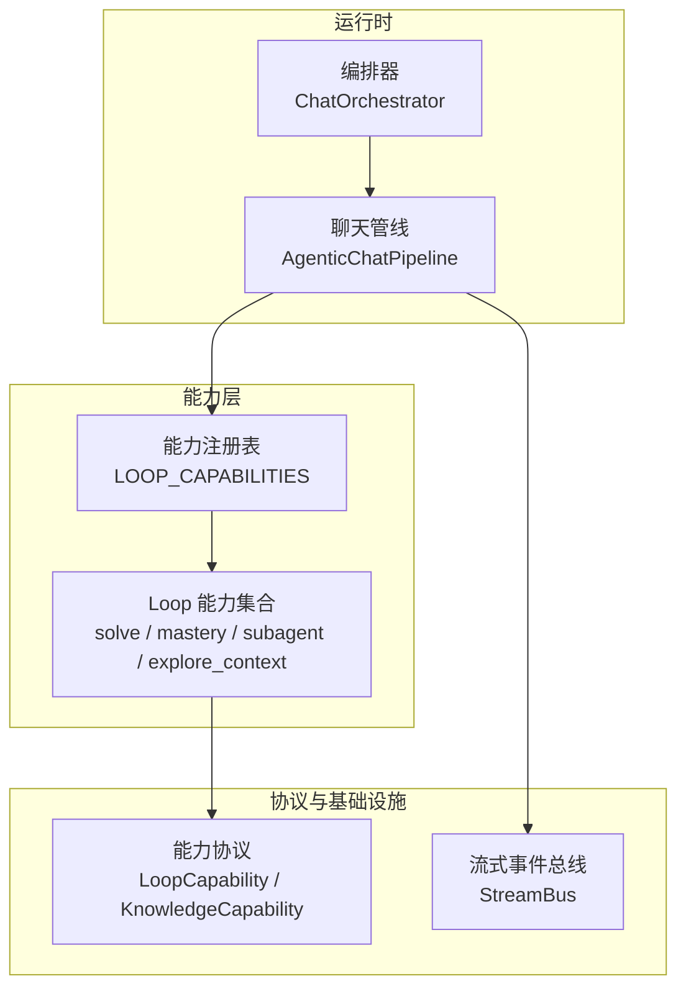
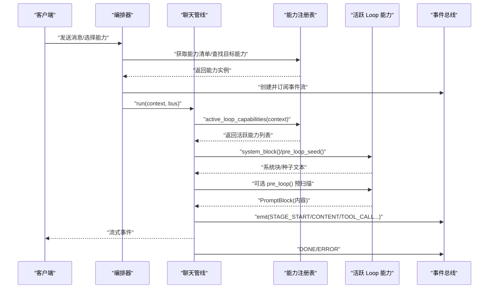
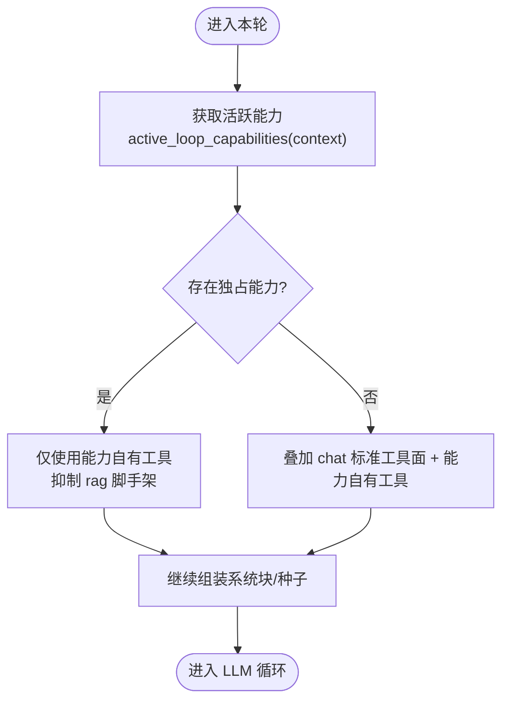
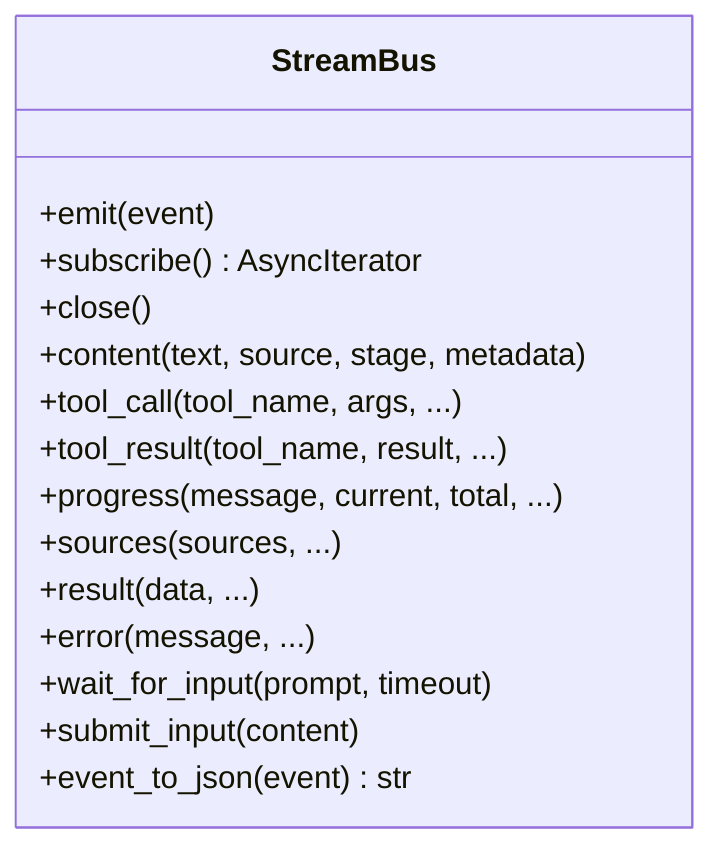
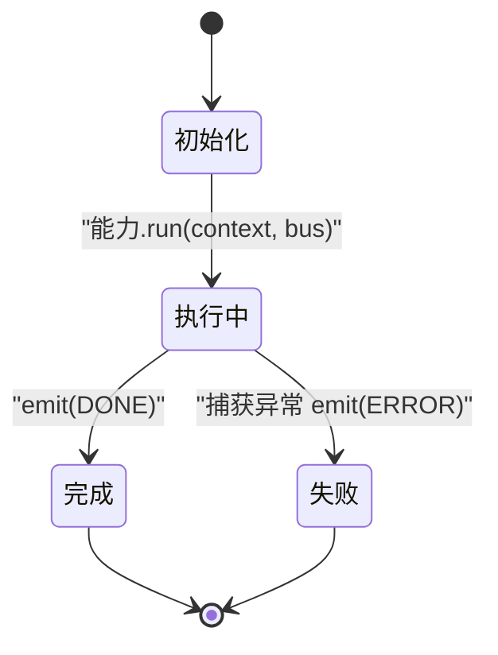
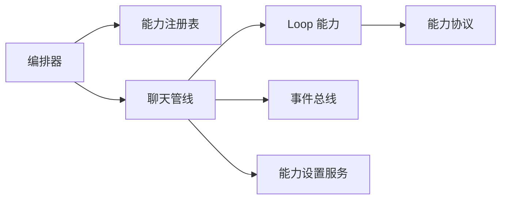

# 能力配置

<cite>
**本文引用的文件**   
- [deeptutor/capabilities/registry.py](file://deeptutor/capabilities/registry.py)
- [deeptutor/capabilities/protocol.py](file://deeptutor/capabilities/protocol.py)
- [deeptutor/core/capability_protocol.py](file://deeptutor/core/capability_protocol.py)
- [deeptutor/api/routers/capabilities_settings.py](file://deeptutor/api/routers/capabilities_settings.py)
- [deeptutor/services/config/capabilities_settings.py](file://deeptutor/services/config/capabilities_settings.py)
- [deeptutor/agents/chat/agentic_pipeline.py](file://deeptutor/agents/chat/agentic_pipeline.py)
- [deeptutor/agents/chat/context_budget.py](file://deeptutor/agents/chat/context_budget.py)
- [deeptutor/agents/chat/dsml_tool_calls.py](file://deeptutor/agents/chat/dsml_tool_calls.py)
- [deeptutor/core/stream_bus.py](file://deeptutor/core/stream_bus.py)
- [deeptutor/runtime/orchestrator.py](file://deeptutor/runtime/orchestrator.py)
- [deeptutor/capabilities/solve/capability.py](file://deeptutor/capabilities/solve/capability.py)
- [deeptutor/capabilities/mastery/capability.py](file://deeptutor/capabilities/mastery/capability.py)
- [deeptutor/capabilities/subagent/capability.py](file://deeptutor/capabilities/subagent/capability.py)
- [deeptutor/capabilities/explore_context/capability.py](file://deeptutor/capabilities/explore_context/capability.py)
</cite>

## 目录
1. [简介](#简介)
2. [项目结构](#项目结构)
3. [核心组件](#核心组件)
4. [架构总览](#架构总览)
5. [详细组件分析](#详细组件分析)
6. [依赖关系分析](#依赖关系分析)
7. [性能与资源限制](#性能与资源限制)
8. [故障排查指南](#故障排查指南)
9. [结论](#结论)
10. [附录：API 参考与自定义能力开发](#附录api-参考与自定义能力开发)

## 简介
本文件面向 DeepTutor 的“能力”体系，系统性说明能力的注册、发现、启用/禁用、优先级与依赖管理、通信协议与数据交换格式、生命周期管理与状态监控、性能优化与资源限制，以及通过 API 动态注册与管理能力的方法。文档同时提供自定义能力开发与集成的完整指南，帮助开发者在不破坏现有流水线的前提下扩展系统能力。

## 项目结构
DeepTutor 的能力体系由两层组成：
- Level 2 能力（BaseCapability）：以多阶段管线形式运行，典型如“深度解题”“掌握路径”等。
- Loop 能力（LoopCapability/KnowledgeCapability）：作为聊天循环的可选扩展点，按轮次决定是否参与当前对话回合，并可注入工具、系统提示或预扫描上下文。

关键目录与职责：
- capabilities：内置 Loop 能力实现与协议定义，包含 solve、mastery、subagent、explore_context 等。
- core：能力协议、上下文、流式事件总线等基础抽象。
- agents/chat：AgenticChatPipeline 将能力与工具组合起来，驱动实际执行。
- api/routers：对外暴露能力设置接口。
- services/config：能力设置的读取/写入与默认值合并。
- runtime：编排器负责路由到具体能力并管理事件流。

图表来源
- [deeptutor/runtime/orchestrator.py:26-147](file://deeptutor/runtime/orchestrator.py#L26-L147)
- [deeptutor/agents/chat/agentic_pipeline.py:626-697](file://deeptutor/agents/chat/agentic_pipeline.py#L626-L697)
- [deeptutor/capabilities/registry.py:13-44](file://deeptutor/capabilities/registry.py#L13-L44)
- [deeptutor/capabilities/protocol.py:19-116](file://deeptutor/capabilities/protocol.py#L19-L116)
- [deeptutor/core/stream_bus.py:31-326](file://deeptutor/core/stream_bus.py#L31-L326)

章节来源
- [deeptutor/runtime/orchestrator.py:26-147](file://deeptutor/runtime/orchestrator.py#L26-L147)
- [deeptutor/agents/chat/agentic_pipeline.py:626-697](file://deeptutor/agents/chat/agentic_pipeline.py#L626-L697)
- [deeptutor/capabilities/registry.py:13-44](file://deeptutor/capabilities/registry.py#L13-L44)
- [deeptutor/capabilities/protocol.py:19-116](file://deeptutor/capabilities/protocol.py#L19-L116)
- [deeptutor/core/stream_bus.py:31-326](file://deeptutor/core/stream_bus.py#L31-L326)

## 核心组件
- 能力协议与清单
  - BaseCapability/CapabilityManifest：声明能力名称、描述、阶段、使用工具、CLI 别名、请求模式与配置默认值。
  - LoopCapability/KnowledgeCapability：定义每轮可参与的扩展点，包括 owned_tools、is_active、system_block、augment_kwargs、pre_loop_seed，以及可选的 pre_loop 钩子；KnowledgeCapability 具备 exclusive_tools 标志，表示独占本轮工具面。
- 能力注册与发现
  - LOOP_CAPABILITIES：集中声明内置 Loop 能力实例顺序。
  - active_loop_capabilities：基于 UnifiedContext 过滤出本轮活跃能力。
  - any_exclusive_capability_active：判断是否存在独占工具面的能力，影响是否走“仅能力工具”分支。
  - capability_tool_owners：建立“能力拥有的工具名 → 能力名”映射，用于设置界面分组。
- 能力执行与组合
  - AgenticChatPipeline：组装工具面、能力系统块、预扫描种子，并驱动 LLM 循环；支持 per-turn 预算与上下文窗口保护。
  - ChatOrchestrator：统一入口，根据 context.active_capability 选择能力，管理 StreamBus 生命周期与完成事件。
- 能力设置与持久化
  - capabilities_settings_dict/save_capabilities_settings：从 agents.yaml 与 main config 中读取/写入能力可调参数（温度、最大 token、轮次预算、研究/问题探索参数等），并提供 UI 所需 schema。
  - get_solve_params：为 deep-solve 能力聚合 temperature/max_tokens/max_rounds/max_replans。

章节来源
- [deeptutor/core/capability_protocol.py:20-69](file://deeptutor/core/capability_protocol.py#L20-L69)
- [deeptutor/capabilities/protocol.py:19-116](file://deeptutor/capabilities/protocol.py#L19-L116)
- [deeptutor/capabilities/registry.py:13-44](file://deeptutor/capabilities/registry.py#L13-L44)
- [deeptutor/agents/chat/agentic_pipeline.py:218-313](file://deeptutor/agents/chat/agentic_pipeline.py#L218-L313)
- [deeptutor/runtime/orchestrator.py:26-147](file://deeptutor/runtime/orchestrator.py#L26-L147)
- [deeptutor/services/config/capabilities_settings.py:297-448](file://deeptutor/services/config/capabilities_settings.py#L297-L448)

## 架构总览
下图展示一次用户请求从编排器到能力、再到工具与流式事件的完整流程，并体现 Loop 能力如何影响工具面与系统提示。

图表来源
- [deeptutor/runtime/orchestrator.py:36-114](file://deeptutor/runtime/orchestrator.py#L36-L114)
- [deeptutor/agents/chat/agentic_pipeline.py:626-697](file://deeptutor/agents/chat/agentic_pipeline.py#L626-L697)
- [deeptutor/capabilities/registry.py:22-44](file://deeptutor/capabilities/registry.py#L22-L44)
- [deeptutor/core/stream_bus.py:40-243](file://deeptutor/core/stream_bus.py#L40-L243)

## 详细组件分析

### 能力注册表与发现机制
- 注册表维护固定顺序的 Loop 能力实例，确保行为稳定可预期。
- 通过 is_active(context) 在每轮决定能力是否参与；exclusive_tools 标记的知识类能力会替换工具面而非叠加。
- 工具归属映射便于前端将工具归类到其所属能力下。

图表来源
- [deeptutor/capabilities/registry.py:22-44](file://deeptutor/capabilities/registry.py#L22-L44)
- [deeptutor/capabilities/protocol.py:19-116](file://deeptutor/capabilities/protocol.py#L19-L116)
- [deeptutor/agents/chat/agentic_pipeline.py:626-644](file://deeptutor/agents/chat/agentic_pipeline.py#L626-L644)

章节来源
- [deeptutor/capabilities/registry.py:13-44](file://deeptutor/capabilities/registry.py#L13-L44)
- [deeptutor/capabilities/protocol.py:19-116](file://deeptutor/capabilities/protocol.py#L19-L116)
- [deeptutor/agents/chat/agentic_pipeline.py:626-644](file://deeptutor/agents/chat/agentic_pipeline.py#L626-L644)

### 智能体能力配置选项与参数
- 通用能力清单字段：name、description、stages、tools_used、cli_aliases、request_schema、config_defaults。
- Loop 能力字段：name、owned_tools、is_active、system_block、augment_kwargs、pre_loop_seed，可选 pre_loop。
- 知识类能力：exclusive_tools=True，可声明 owned_kbs 以排除被自身工具消费的 KB，避免与 rag 冲突。
- 能力设置（UI/持久化）：
  - chat：temperature、max_rounds、stage_budgets.exploring.max_tokens、stage_budgets.responding.max_tokens。
  - solve：temperature、max_tokens、max_rounds、max_replans。
  - research：researching.note_agent_mode、tool_timeout、tool_max_retries、paper_search_years_limit。
  - question：exploring.max_iterations、exploring.tool_summarizer.enabled/max_tokens。
  - co_writer/vision_solver/math_animator：temperature、max_tokens。

章节来源
- [deeptutor/core/capability_protocol.py:20-69](file://deeptutor/core/capability_protocol.py#L20-L69)
- [deeptutor/capabilities/protocol.py:19-116](file://deeptutor/capabilities/protocol.py#L19-L116)
- [deeptutor/services/config/capabilities_settings.py:43-89](file://deeptutor/services/config/capabilities_settings.py#L43-L89)
- [deeptutor/services/config/capabilities_settings.py:194-294](file://deeptutor/services/config/capabilities_settings.py#L194-L294)

### 启用/禁用、优先级与依赖管理
- 启用/禁用：通过 is_active(context) 控制；例如 ExploreContext 在有可读附件时激活；Subagent 在存在连接时激活。
- 优先级：LOOP_CAPABILITIES 中的顺序即为评估顺序；若多个能力同时活跃，它们依次贡献 system_block/pre_loop_seed 与 owned_tools。
- 依赖管理：
  - 工具依赖：通过 tools_used 声明能力使用的工具，便于校验与展示。
  - 知识依赖：KnowledgeCapability.owned_kbs 声明被能力工具消费的 KB，避免与 rag 冲突。
  - 运行时最小轮次：能力可通过 context.metadata["_min_loop_rounds"] 要求最低轮次预算（如 Subagent 需要咨询预算+收尾）。

章节来源
- [deeptutor/capabilities/explore_context/capability.py:68-91](file://deeptutor/capabilities/explore_context/capability.py#L68-L91)
- [deeptutor/capabilities/subagent/capability.py:32-63](file://deeptutor/capabilities/subagent/capability.py#L32-L63)
- [deeptutor/agents/chat/agentic_pipeline.py:292-305](file://deeptutor/agents/chat/agentic_pipeline.py#L292-L305)

### 能力间通信协议与数据交换格式
- 事件总线 StreamBus：统一的事件通道，支持 STAGE_START/END、CONTENT、THINKING、OBSERVATION、TOOL_CALL/RESULT、PROGRESS、SOURCES、RESULT、ERROR、WAIT_FOR_INPUT 等事件类型。
- 事件序列化：event_to_json 输出 NDJSON 单行 JSON，便于 WebSocket/CLI 消费。
- DSML 工具调用解析：当模型输出包含 DSML 标签时，可从文本中提取 tool_calls 并清理正文，保证工具调用与文本分离。
- 上下文与元数据：能力通过 augment_kwargs 注入私有参数；通过 system_block/pre_loop_seed 注入系统提示与用户消息种子；通过 context.metadata 传递轮次级状态（如 solve/session_id、_min_loop_rounds）。

图表来源
- [deeptutor/core/stream_bus.py:31-326](file://deeptutor/core/stream_bus.py#L31-L326)
- [deeptutor/agents/chat/dsml_tool_calls.py:67-113](file://deeptutor/agents/chat/dsml_tool_calls.py#L67-L113)

章节来源
- [deeptutor/core/stream_bus.py:31-326](file://deeptutor/core/stream_bus.py#L31-L326)
- [deeptutor/agents/chat/dsml_tool_calls.py:67-113](file://deeptutor/agents/chat/dsml_tool_calls.py#L67-L113)

### 能力生命周期管理与状态监控
- 生命周期：
  - 启动：编排器创建 StreamBus 并注册 turn_id，调用能力 run。
  - 执行：能力通过 pipeline 组装工具面、系统块、种子，进入 LLM 循环；期间持续 emit 事件。
  - 结束：能力完成后 emit DONE；异常则 emit ERROR 并标记失败状态；最后关闭总线并注销 turn_id。
- 状态监控：
  - 事件类型覆盖进度、思考、工具调用/结果、错误、结果等，供前端/CLI 渲染。
  - 完成事件发布至全局 EventBus，携带 capability/session_id/turn_id 等元信息。

图表来源
- [deeptutor/runtime/orchestrator.py:36-114](file://deeptutor/runtime/orchestrator.py#L36-L114)
- [deeptutor/core/stream_bus.py:40-243](file://deeptutor/core/stream_bus.py#L40-L243)

章节来源
- [deeptutor/runtime/orchestrator.py:36-114](file://deeptutor/runtime/orchestrator.py#L36-L114)
- [deeptutor/core/stream_bus.py:40-243](file://deeptutor/core/stream_bus.py#L40-L243)

### 内置能力详解
- Deep Solve（深度解题）
  - 通过 BaseCapability 声明 manifest，并在 run 中将 solve_mode 与 session id 写入 context，再调用 AgenticChatPipeline 执行。
  - 参数来源：get_solve_params 聚合 temperature/max_tokens/max_rounds/max_replans。
- Mastery Path（掌握路径）
  - 设置 mastery_mode 与 path id，复用聊天管线，挂载 mastery 工具集。
- Subagent（子代理）
  - KnowledgeCapability，独占工具面；注入 consult_subagent 工具；计算咨询预算并保证最小轮次；支持图片转发与会话延续。
- Explore Context（上下文探索）
  - 无答案循环工具；通过 pre_loop 钩子在首轮 LLM 调用前进行只读预扫描，产出客观摘要注入用户消息种子。

章节来源
- [deeptutor/capabilities/solve/capability.py:59-88](file://deeptutor/capabilities/solve/capability.py#L59-L88)
- [deeptutor/capabilities/mastery/capability.py:57-73](file://deeptutor/capabilities/mastery/capability.py#L57-L73)
- [deeptutor/capabilities/subagent/capability.py:32-117](file://deeptutor/capabilities/subagent/capability.py#L32-L117)
- [deeptutor/capabilities/explore_context/capability.py:82-141](file://deeptutor/capabilities/explore_context/capability.py#L82-L141)

## 依赖关系分析
- 能力与管线耦合：
  - AgenticChatPipeline 依赖 Loop 能力提供的 owned_tools/system_block/pre_loop_seed/pre_loop。
  - 编排器依赖能力注册表与工具注册表，解耦具体实现。
- 外部依赖：
  - 设置读写依赖 ConfigManager 与 YAML 文件。
  - 事件发布依赖全局 EventBus。
- 潜在循环依赖规避：
  - ExploreContext 延迟导入 explorer，避免在包导入阶段形成循环。

图表来源
- [deeptutor/runtime/orchestrator.py:26-147](file://deeptutor/runtime/orchestrator.py#L26-L147)
- [deeptutor/agents/chat/agentic_pipeline.py:626-697](file://deeptutor/agents/chat/agentic_pipeline.py#L626-L697)
- [deeptutor/services/config/capabilities_settings.py:297-448](file://deeptutor/services/config/capabilities_settings.py#L297-L448)

章节来源
- [deeptutor/runtime/orchestrator.py:26-147](file://deeptutor/runtime/orchestrator.py#L26-L147)
- [deeptutor/agents/chat/agentic_pipeline.py:626-697](file://deeptutor/agents/chat/agentic_pipeline.py#L626-L697)
- [deeptutor/services/config/capabilities_settings.py:297-448](file://deeptutor/services/config/capabilities_settings.py#L297-L448)

## 性能与资源限制
- 轮次与预算
  - 默认最大轮次 DEFAULT_MAX_ROUNDS=8；可通过 chat 配置或能力覆盖（如 solve 的 max_rounds）。
  - effective_max_rounds 会尊重能力要求的最低轮次（_min_loop_rounds）。
- Token 预算
  - exploring/responding 阶段分别有 max_tokens 上限；loop_max_tokens 提供合并后的单轮预算。
- 上下文窗口保护
  - 估算消息 token，超过阈值时对 tool 结果进行裁剪，并通过 progress 通知。
- 工具调用开销
  - 工具 schema 大小计入上下文；对 MCP 与系统工具分别统计，避免过大 schema 导致窗口溢出。
- 容器资源限制
  - 通过 Docker 配置限制进程数、内存等，保障稳定性。

章节来源
- [deeptutor/agents/chat/agentic_pipeline.py:98-103](file://deeptutor/agents/chat/agentic_pipeline.py#L98-L103)
- [deeptutor/agents/chat/agentic_pipeline.py:218-313](file://deeptutor/agents/chat/agentic_pipeline.py#L218-L313)
- [deeptutor/agents/chat/agentic_pipeline.py:1232-1267](file://deeptutor/agents/chat/agentic_pipeline.py#L1232-L1267)
- [deeptutor/agents/chat/context_budget.py:255-286](file://deeptutor/agents/chat/context_budget.py#L255-L286)

## 故障排查指南
- 未知能力错误
  - 现象：编排器返回“Unknown capability”，并列出可用能力。
  - 处理：检查 context.active_capability 是否正确设置；确认能力已注册。
- 能力执行异常
  - 现象：能力抛出异常，事件总线 emit ERROR，最终 DONE 状态为 failed。
  - 处理：查看日志与事件流中的错误消息；必要时降低温度或轮次预算重试。
- 预扫描失败
  - 现象：ExploreContext 的 pre_loop 钩子失败被吞掉，不影响主流程。
  - 处理：关注日志警告；检查附件是否可读。
- 上下文窗口溢出
  - 现象：触发上下文窗口保护，tool 结果被裁剪。
  - 处理：减少工具调用次数或缩短历史；调整模型上下文窗口配置。

章节来源
- [deeptutor/runtime/orchestrator.py:46-67](file://deeptutor/runtime/orchestrator.py#L46-L67)
- [deeptutor/runtime/orchestrator.py:83-103](file://deeptutor/runtime/orchestrator.py#L83-L103)
- [deeptutor/agents/chat/agentic_pipeline.py:666-697](file://deeptutor/agents/chat/agentic_pipeline.py#L666-L697)
- [deeptutor/agents/chat/agentic_pipeline.py:1232-1267](file://deeptutor/agents/chat/agentic_pipeline.py#L1232-L1267)

## 结论
DeepTutor 的能力体系通过清晰的协议、稳定的注册顺序与灵活的 per-turn 激活机制，实现了“聊天即能力”的统一执行模型。Loop 能力既能增强工具面，也能独占本轮，从而适配不同业务场景。配合完善的设置持久化、事件总线与上下文窗口保护，系统在可扩展性与稳定性之间取得良好平衡。

## 附录：API 参考与自定义能力开发

### 通过 API 动态管理能力设置
- GET /api/v1/capabilities/settings
  - 返回合并了默认值的能力设置 schema（chat、solve、research、question、co_writer、vision_solver、math_animator）。
- PUT /api/v1/capabilities/settings
  - 接收 payload，合并回 agents.yaml 与 main config，并返回新状态。

章节来源
- [deeptutor/api/routers/capabilities_settings.py:27-38](file://deeptutor/api/routers/capabilities_settings.py#L27-L38)
- [deeptutor/services/config/capabilities_settings.py:297-432](file://deeptutor/services/config/capabilities_settings.py#L297-L432)

### 自定义 Loop 能力开发指南
- 步骤概览
  1. 定义能力类并实现 LoopCapability 协议（或继承 KnowledgeCapability）。
  2. 声明 name、owned_tools、is_active；可选实现 system_block、augment_kwargs、pre_loop_seed。
  3. 如需预扫描，实现异步 pre_loop(context, stream, usage)，返回 PromptBlock。
  4. 将能力实例加入 LOOP_CAPABILITIES 或在注册表中注册（保持顺序稳定）。
  5. 在 settings 中暴露可调参数（如 temperature、max_tokens、轮次预算等）。
- 注意事项
  - 避免在包导入阶段引入重依赖，采用延迟导入（如 ExploreContext）。
  - 合理设置 owned_kbs 以避免与 rag 冲突（知识类能力）。
  - 通过 _min_loop_rounds 保证必要的最小轮次预算。
  - 使用 augment_kwargs 注入服务器端私有参数，不暴露给模型。

章节来源
- [deeptutor/capabilities/protocol.py:19-116](file://deeptutor/capabilities/protocol.py#L19-L116)
- [deeptutor/capabilities/explore_context/capability.py:118-141](file://deeptutor/capabilities/explore_context/capability.py#L118-L141)
- [deeptutor/capabilities/subagent/capability.py:32-117](file://deeptutor/capabilities/subagent/capability.py#L32-L117)
- [deeptutor/capabilities/registry.py:13-44](file://deeptutor/capabilities/registry.py#L13-L44)

### 能力间通信与事件消费
- 生产者：能力/工具通过 StreamBus 发出事件（内容、工具调用、进度、错误等）。
- 消费者：前端/CLI 订阅事件流，渲染思考过程、工具调用与结果。
- 输入交互：能力可等待用户输入（wait_for_input），由前端提交（submit_input）。

章节来源
- [deeptutor/core/stream_bus.py:40-298](file://deeptutor/core/stream_bus.py#L40-L298)

### 性能调优建议
- 调整温度与轮次预算：依据任务复杂度设置 temperature、max_rounds、stage max_tokens。
- 控制工具调用规模：减少不必要的工具调用，避免 schema 过大。
- 利用上下文窗口保护：关注 progress 通知，必要时裁剪历史或工具结果。
- 容器资源限制：结合部署环境设置 pids_limit、mem_limit 等。

章节来源
- [deeptutor/agents/chat/agentic_pipeline.py:218-313](file://deeptutor/agents/chat/agentic_pipeline.py#L218-L313)
- [deeptutor/agents/chat/context_budget.py:255-286](file://deeptutor/agents/chat/context_budget.py#L255-L286)