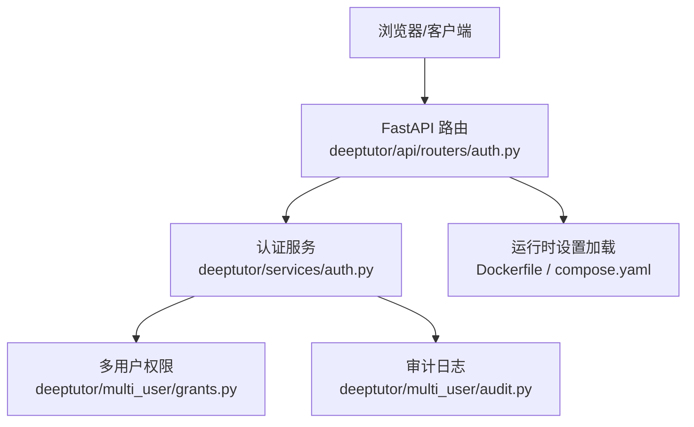
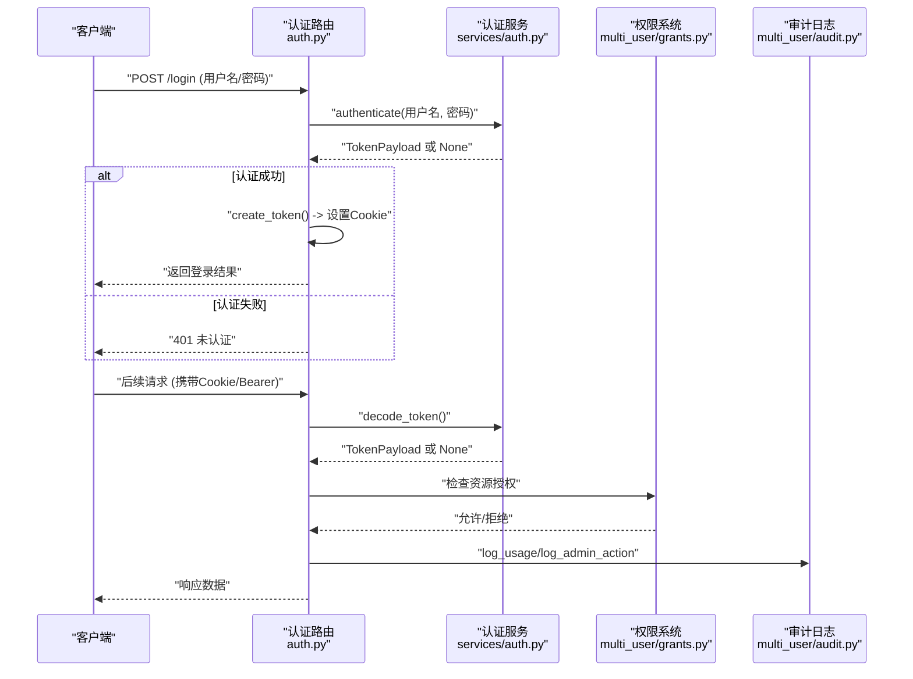
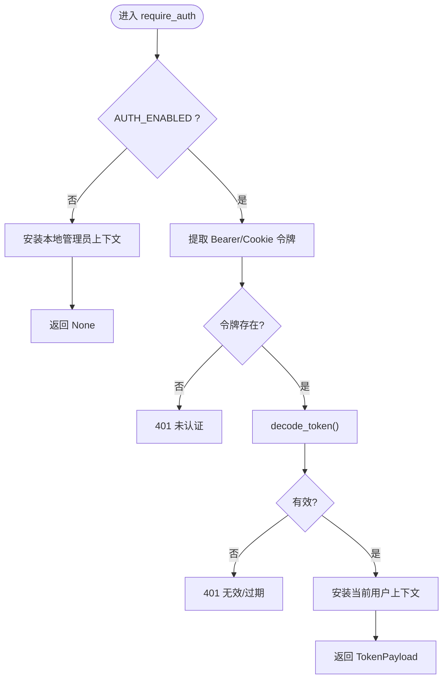
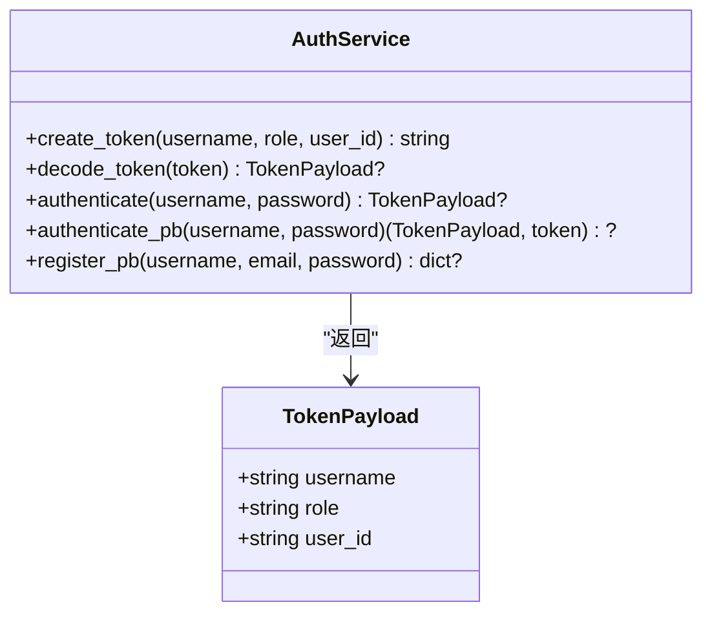
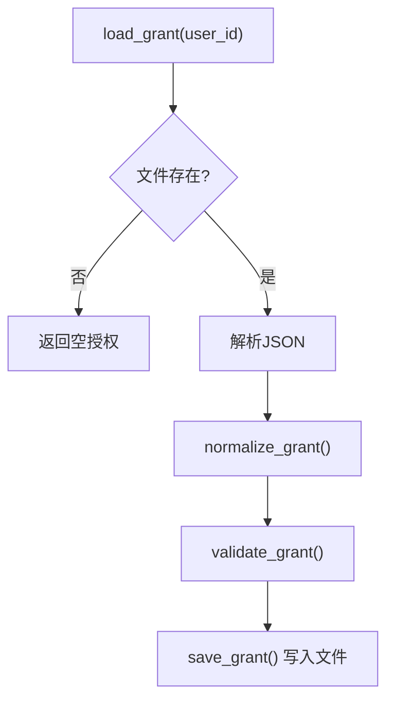
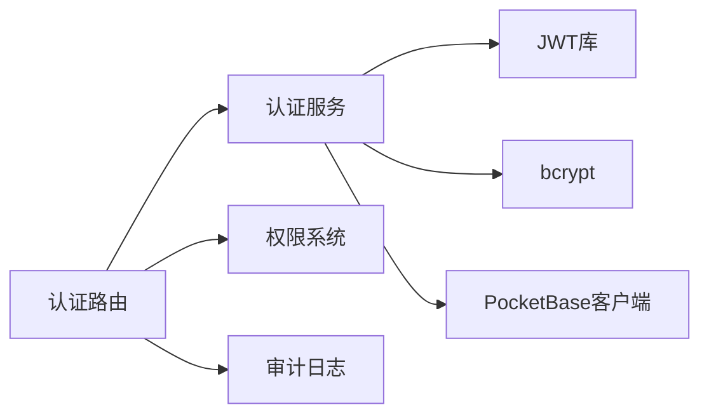

# 认证配置

<cite>
**本文引用的文件**
- [auth.py](file://deeptutor/api/routers/auth.py)
- [services/auth.py](file://deeptutor/services/auth.py)
- [grants.py](file://deeptutor/multi_user/grants.py)
- [audit.py](file://deeptutor/multi_user/audit.py)
- [Dockerfile](file://Dockerfile)
- [compose.yaml](file://compose.yaml)
</cite>

## 目录
1. [简介](#简介)
2. [项目结构](#项目结构)
3. [核心组件](#核心组件)
4. [架构总览](#架构总览)
5. [详细组件分析](#详细组件分析)
6. [依赖关系分析](#依赖关系分析)
7. [性能考虑](#性能考虑)
8. [故障排查指南](#故障排查指南)
9. [结论](#结论)
10. [附录](#附录)

## 简介
本文件面向DeepTutor的认证与授权配置，聚焦以下目标：
- 解释运行时认证配置文件（如 auth.json、integrations.json）的作用与字段含义
- 说明用户认证方式（本地JWT+bcrypt、PocketBase模式）的配置方法
- 介绍多用户环境下的权限控制与访问策略（角色、资源授权、工具白名单）
- 说明会话管理、令牌刷新与安全策略（Cookie安全、CORS等）
- 说明第三方认证集成（Codex OAuth/PocketBase）的设置方法
- 提供密码策略、账户锁定与审计日志配置建议
- 给出动态管理用户权限与角色的实践
- 汇总认证安全最佳实践与常见问题解决方案

## 项目结构
DeepTutor的认证与授权由API路由层、认证服务、多用户权限与审计模块共同实现。关键路径如下：
- API路由层：负责登录、注册、状态查询、个人资料、管理员操作等HTTP/WebSocket入口
- 认证服务：负责JWT签发与校验、密码哈希验证、PocketBase模式适配
- 多用户权限：负责非管理员用户的资源授权（模型、知识库、技能、工具、执行能力）
- 审计日志：记录资源访问与管理员操作
- 运行时设置：从data/user/settings/*.json加载并导出环境变量，驱动前端代理与后端行为

**图表来源**
- [auth.py:237-348](file://deeptutor/api/routers/auth.py#L237-L348)
- [services/auth.py:39-61](file://deeptutor/services/auth.py#L39-L61)
- [grants.py:16-44](file://deeptutor/multi_user/grants.py#L16-L44)
- [audit.py:13-27](file://deeptutor/multi_user/audit.py#L13-L27)
- [Dockerfile:369-402](file://Dockerfile#L369-L402)

**章节来源**
- [Dockerfile:369-402](file://Dockerfile#L369-L402)
- [compose.yaml:29-49](file://compose.yaml#L29-L49)

## 核心组件
- 认证路由（API路由层）
  - 提供登录、登出、状态、注册、个人资料、头像上传、用户管理等端点
  - 统一鉴权依赖：require_auth、ws_require_auth、require_admin
  - Cookie与Bearer Token双通道支持，兼容WebSocket
- 认证服务（JWT与PocketBase）
  - 本地模式：HS256 JWT + bcrypt密码哈希；自动创建或读取密钥
  - PocketBase模式：通过集成配置启用，登录/注册/校验委托给PocketBase
- 多用户权限（授权与访问策略）
  - 基于用户ID的资源授权文件（模型、知识库、技能、伙伴、工具、CLI应用、执行开关）
  - 默认拒绝原则（MCP工具、CLI应用），需管理员显式授权
- 审计日志
  - 记录普通用户对受管资源的访问与管理员写操作
  - 写入SYSTEM_ROOT/audit/usage.jsonl，失败不中断请求

**章节来源**
- [auth.py:86-182](file://deeptutor/api/routers/auth.py#L86-L182)
- [auth.py:237-348](file://deeptutor/api/routers/auth.py#L237-L348)
- [services/auth.py:68-75](file://deeptutor/services/auth.py#L68-L75)
- [services/auth.py:220-280](file://deeptutor/services/auth.py#L220-L280)
- [grants.py:16-44](file://deeptutor/multi_user/grants.py#L16-L44)
- [audit.py:29-80](file://deeptutor/multi_user/audit.py#L29-L80)

## 架构总览
下图展示认证流程的关键交互：客户端通过HTTP或WebSocket发起请求，路由层进行身份校验，必要时调用认证服务生成或校验JWT，结合多用户权限决定资源访问，同时记录审计日志。

**图表来源**
- [auth.py:436-491](file://deeptutor/api/routers/auth.py#L436-L491)
- [auth.py:237-348](file://deeptutor/api/routers/auth.py#L237-L348)
- [services/auth.py:220-280](file://deeptutor/services/auth.py#L220-L280)
- [grants.py:90-112](file://deeptutor/multi_user/grants.py#L90-L112)
- [audit.py:29-80](file://deeptutor/multi_user/audit.py#L29-L80)

## 详细组件分析

### 认证路由（HTTP与WebSocket）
- 统一鉴权依赖
  - require_auth：从Authorization头或Cookie提取令牌，校验后安装当前用户上下文；当AUTH_ENABLED=false时回退为本地管理员身份
  - ws_require_auth：在WebSocket升级前完成鉴权，失败直接关闭连接
  - require_admin：要求admin角色；当AUTH_ENABLED=false时视为管理员
- 登录/登出
  - POST /login：支持PocketBase模式与本地JWT模式；成功设置HttpOnly Cookie（SameSite根据Secure动态选择）
  - POST /logout：删除Cookie
- 状态与资料
  - GET /status：返回是否启用认证、是否已认证、用户信息
  - GET/PUT /profile：获取/更新头像标记；上传头像仅接受PNG/JPEG/WebP，限制大小，避免XSS
- 管理员接口
  - GET /users、POST /users、PUT /users/{username}/role：管理员可创建用户、修改角色

**图表来源**
- [auth.py:237-348](file://deeptutor/api/routers/auth.py#L237-L348)

**章节来源**
- [auth.py:237-348](file://deeptutor/api/routers/auth.py#L237-L348)
- [auth.py:436-491](file://deeptutor/api/routers/auth.py#L436-L491)
- [auth.py:609-744](file://deeptutor/api/routers/auth.py#L609-L744)

### 认证服务（JWT与PocketBase）
- 本地模式
  - 使用HS256算法签发JWT，包含sub、role、uid、exp、iat
  - 密码采用bcrypt哈希存储与校验
  - 首次启动时自动生成或读取认证密钥
- PocketBase模式
  - 当集成配置中存在pocketbase_url且启用认证时生效
  - 登录/注册委托PocketBase；令牌校验通过PocketBase的refresh端点（内存缓存）
  - 所有PocketBase用户默认角色为user（管理员通过PB管理面板）

**图表来源**
- [services/auth.py:68-75](file://deeptutor/services/auth.py#L68-L75)
- [services/auth.py:220-280](file://deeptutor/services/auth.py#L220-L280)
- [services/auth.py:288-342](file://deeptutor/services/auth.py#L288-L342)

**章节来源**
- [services/auth.py:39-61](file://deeptutor/services/auth.py#L39-L61)
- [services/auth.py:82-96](file://deeptutor/services/auth.py#L82-L96)
- [services/auth.py:220-280](file://deeptutor/services/auth.py#L220-L280)
- [services/auth.py:288-342](file://deeptutor/services/auth.py#L288-L342)

### 多用户权限与访问策略
- 授权文件（grants）
  - 每个非管理员用户拥有独立的授权文件，包含：
    - models.llm：允许的模型列表
    - knowledge_bases、skills、partners：允许的知识库、技能、伙伴
    - enabled_tools、mcp_tools、cli_apps：工具白名单（默认拒绝，需显式授权）
    - exec_enabled：执行能力开关（遵循部署策略，SYSTEM隔离下才生效）
- 规范化与校验
  - normalize_grant将历史格式归一化为v2
  - validate_grant禁止在授权中存放敏感字段（如api_key、secret、password、token、path、base_url）
- 读写路径
  - grant_path(user_id)指向SYSTEM_ROOT/grants/<user_id>.json
  - save_grant会校验用户存在且非管理员

**图表来源**
- [grants.py:55-112](file://deeptutor/multi_user/grants.py#L55-L112)
- [grants.py:115-133](file://deeptutor/multi_user/grants.py#L115-L133)

**章节来源**
- [grants.py:16-44](file://deeptutor/multi_user/grants.py#L16-L44)
- [grants.py:55-112](file://deeptutor/multi_user/grants.py#L55-L112)
- [grants.py:115-133](file://deeptutor/multi_user/grants.py#L115-L133)

### 审计日志
- 用途
  - log_usage：记录普通用户对受管资源的访问（跳过管理员自访问）
  - log_admin_action：记录管理员写操作（如授权变更、用户CRUD）
- 存储
  - 写入SYSTEM_ROOT/audit/usage.jsonl，失败不中断请求
- 字段
  - time、user_id/actor_id、username/actor_username、resource_type/resource_id、action、extra/summary

**章节来源**
- [audit.py:13-27](file://deeptutor/multi_user/audit.py#L13-L27)
- [audit.py:29-80](file://deeptutor/multi_user/audit.py#L29-L80)

### 运行时设置与第三方认证集成
- 运行时设置加载
  - Dockerfile在启动时通过export_runtime_settings_to_env将data/user/settings/*.json导出为环境变量（如DEEPTUTOR_API_BASE_URL、DEEPTUTOR_AUTH_ENABLED）
  - 前端代理在请求时读取这些变量以重写/api/*和/ws/*并重定向登录
- PocketBase集成
  - 当integrations.pocketbase_url存在且启用认证时，登录/注册/校验走PocketBase
  - 令牌校验通过PocketBase refresh端点（内存缓存60秒）
- Codex OAuth
  - 路由提供回调端点/openai-codex/callback用于接收OAuth回调
  - 第三方认证概念参考第三方声明（CSSwitch设计思路）

**章节来源**
- [Dockerfile:369-402](file://Dockerfile#L369-L402)
- [compose.yaml:29-49](file://compose.yaml#L29-L49)
- [auth.py:373-399](file://deeptutor/api/routers/auth.py#L373-L399)
- [services/auth.py:48-53](file://deeptutor/services/auth.py#L48-L53)
- [services/auth.py:248-261](file://deeptutor/services/auth.py#L248-L261)

## 依赖关系分析
- 组件耦合
  - 路由层依赖认证服务进行令牌处理，依赖多用户权限进行资源访问控制
  - 认证服务在PocketBase模式下依赖集成配置与外部服务
  - 审计日志独立于业务逻辑，确保不影响主流程
- 外部依赖
  - JWT库（PyJWT）用于本地模式签名与校验
  - bcrypt用于密码哈希
  - PocketBase客户端用于集成模式

**图表来源**
- [auth.py:237-348](file://deeptutor/api/routers/auth.py#L237-L348)
- [services/auth.py:220-280](file://deeptutor/services/auth.py#L220-L280)
- [grants.py:90-112](file://deeptutor/multi_user/grants.py#L90-L112)
- [audit.py:29-80](file://deeptutor/multi_user/audit.py#L29-L80)

**章节来源**
- [auth.py:237-348](file://deeptutor/api/routers/auth.py#L237-L348)
- [services/auth.py:220-280](file://deeptutor/services/auth.py#L220-L280)
- [grants.py:90-112](file://deeptutor/multi_user/grants.py#L90-L112)
- [audit.py:29-80](file://deeptutor/multi_user/audit.py#L29-L80)

## 性能考虑
- 令牌校验优化
  - PocketBase模式对令牌校验进行内存缓存（60秒），减少网络往返
- 最小化I/O
  - 审计日志写入失败不中断请求，避免影响主流程
- Cookie属性
  - SameSite与Secure根据运行环境动态调整，避免跨域问题与浏览器拒绝

[本节为通用指导，无需特定文件引用]

## 故障排查指南
- 无法登录
  - 确认AUTH_ENABLED与集成配置是否正确
  - 检查用户是否存在、密码哈希是否匹配
  - 查看登录端点返回的错误码与消息
- 令牌无效或过期
  - 检查Cookie是否被浏览器策略拒绝（SameSite/Secure）
  - 确认JWT密钥一致（本地模式）或PocketBase服务可用
- 权限不足
  - 检查用户授权文件是否包含所需资源（模型、知识库、工具等）
  - MCP工具与CLI应用默认拒绝，需管理员显式授权
- 审计日志缺失
  - 检查SYSTEM_ROOT/audit目录是否存在与可写
  - 注意审计失败不会中断请求，需单独排查文件系统权限

**章节来源**
- [auth.py:237-348](file://deeptutor/api/routers/auth.py#L237-L348)
- [services/auth.py:220-280](file://deeptutor/services/auth.py#L220-L280)
- [grants.py:115-133](file://deeptutor/multi_user/grants.py#L115-L133)
- [audit.py:13-27](file://deeptutor/multi_user/audit.py#L13-L27)

## 结论
DeepTutor的认证与授权体系以JWT为核心，支持本地与PocketBase两种模式，并通过细粒度的授权文件控制资源访问。路由层提供统一的鉴权依赖，确保HTTP与WebSocket的一致性。审计日志为运维与合规提供支撑。建议在部署时合理配置Cookie安全、令牌有效期与授权策略，并结合审计日志持续监控与优化。

[本节为总结性内容，无需特定文件引用]

## 附录

### 认证配置要点与建议
- 启用认证
  - 在运行时设置中启用认证，并根据部署选择本地JWT或PocketBase模式
- 密码策略
  - 本地模式使用bcrypt哈希；注册时强制最小长度（至少8位）
- 账户锁定
  - 当前未实现内置账户锁定；可通过外部机制（如IP限流、审计告警）增强
- 会话管理
  - 使用HttpOnly Cookie存储令牌，配合SameSite与Secure策略
  - 登出时删除Cookie；前端应在令牌过期时引导重新登录
- 第三方认证
  - PocketBase：配置pocketbase_url并启用认证
  - Codex OAuth：配置回调端点并完成授权流程
- 动态权限管理
  - 管理员通过授权文件为用户分配模型、知识库、技能、工具与执行能力
  - 遵循默认拒绝原则，仅授予必要权限

[本节为通用指导，无需特定文件引用]