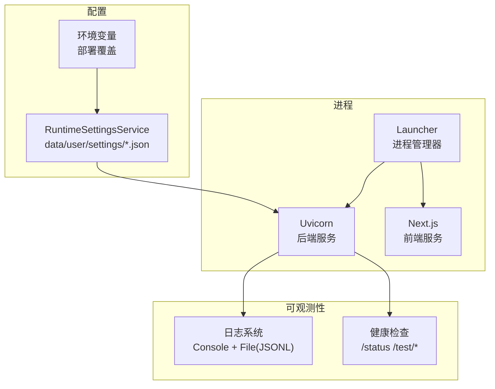
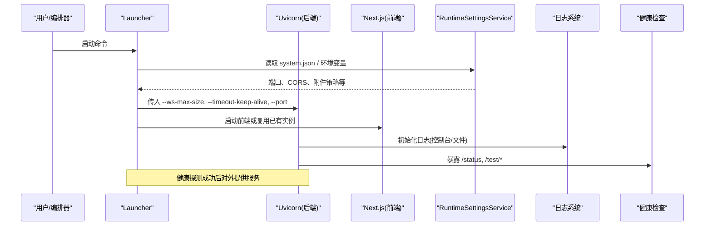
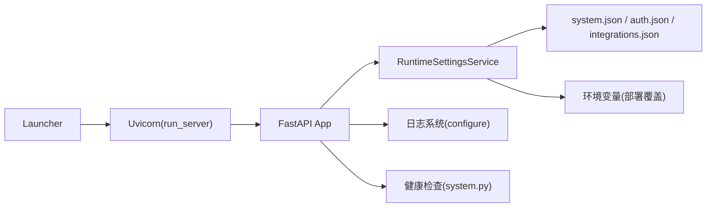

# 运行时设置

<cite>
**本文引用的文件**
- [launcher.py](file://deeptutor/runtime/launcher.py)
- [run_server.py](file://deeptutor/api/run_server.py)
- [runtime_settings.py](file://deeptutor/services/config/runtime_settings.py)
- [configure.py](file://deeptutor/logging/configure.py)
- [config.py](file://deeptutor/logging/config.py)
- [mode.py](file://deeptutor/runtime/mode.py)
- [system.py](file://deeptutor/api/routers/system.py)
- [memory_reclaim.py](file://deeptutor/runtime/memory_reclaim.py)
- [traffic_control.py](file://deeptutor/services/llm/traffic_control.py)
- [task_log_stream.py](file://deeptutor/api/utils/task_log_stream.py)
- [Dockerfile](file://Dockerfile)
</cite>

## 目录
1. [简介](#简介)
2. [项目结构](#项目结构)
3. [核心组件](#核心组件)
4. [架构总览](#架构总览)
5. [详细组件分析](#详细组件分析)
6. [依赖关系分析](#依赖关系分析)
7. [性能考虑](#性能考虑)
8. [故障排查指南](#故障排查指南)
9. [结论](#结论)
10. [附录](#附录)

## 简介
本文件面向生产与运维读者，系统化说明 DeepTutor 的“运行时设置”：从启动参数、进程管理、资源限制、并发控制、内存优化，到服务监控、健康检查、日志与调试模式，以及如何在不停机的情况下动态调整关键运行时参数。文档同时给出生产部署优化建议与常见问题的诊断方法。

## 项目结构
DeepTutor 的运行时由“前端（Next.js）+ 后端（FastAPI/Uvicorn）”组成，通过 launcher 统一编排；配置集中在 data/user/settings 下的 JSON 文件中，并通过环境变量进行部署级覆盖；日志、健康检查、并发与内存回收等能力分布在 logging、services/config、runtime 等模块中。

图表来源
- [launcher.py:193-211](file://deeptutor/runtime/launcher.py#L193-L211)
- [run_server.py:30-80](file://deeptutor/api/run_server.py#L30-L80)
- [runtime_settings.py:309-558](file://deeptutor/services/config/runtime_settings.py#L309-L558)
- [configure.py:37-77](file://deeptutor/logging/configure.py#L37-L77)
- [system.py:61-145](file://deeptutor/api/routers/system.py#L61-L145)

章节来源
- [launcher.py:193-211](file://deeptutor/runtime/launcher.py#L193-L211)
- [run_server.py:30-80](file://deeptutor/api/run_server.py#L30-L80)
- [runtime_settings.py:309-558](file://deeptutor/services/config/runtime_settings.py#L309-L558)
- [configure.py:37-77](file://deeptutor/logging/configure.py#L37-L77)
- [system.py:61-145](file://deeptutor/api/routers/system.py#L61-L145)

## 核心组件
- 启动器与进程管理：负责拉起并管理前后端子进程、端口冲突处理、健康探测与优雅关闭。
- 后端服务启动：基于 Uvicorn，注入日志、运行模式、WebSocket 帧大小、Keep-Alive 超时等关键运行时参数。
- 运行时配置中心：集中加载 data/user/settings/*.json，合并环境变量覆盖，导出为进程环境供子进程使用。
- 日志系统：支持控制台与滚动文件输出，JSONL 格式，便于采集与分析。
- 健康检查与监控：提供系统状态与组件连通性测试接口。
- 并发与流量控制：对 LLM 调用实施并发信号量与速率令牌控制。
- 内存回收：在重分配任务后触发 GC 与 glibc malloc_trim（Linux）。
- 任务日志流控：对任务日志缓冲进行字节与数量上限控制，避免 OOM。

章节来源
- [launcher.py:193-211](file://deeptutor/runtime/launcher.py#L193-L211)
- [run_server.py:30-80](file://deeptutor/api/run_server.py#L30-L80)
- [runtime_settings.py:309-558](file://deeptutor/services/config/runtime_settings.py#L309-L558)
- [configure.py:37-77](file://deeptutor/logging/configure.py#L37-L77)
- [system.py:61-145](file://deeptutor/api/routers/system.py#L61-L145)
- [traffic_control.py:78-125](file://deeptutor/services/llm/traffic_control.py#L78-L125)
- [memory_reclaim.py:17-41](file://deeptutor/runtime/memory_reclaim.py#L17-L41)
- [task_log_stream.py:149-207](file://deeptutor/api/utils/task_log_stream.py#L149-L207)

## 架构总览
下图展示了从 Launcher 启动到 Uvicorn 暴露 API 的关键流程，以及配置与环境变量的注入路径。

图表来源
- [launcher.py:1045-1074](file://deeptutor/runtime/launcher.py#L1045-L1074)
- [run_server.py:30-80](file://deeptutor/api/run_server.py#L30-L80)
- [runtime_settings.py:500-558](file://deeptutor/services/config/runtime_settings.py#L500-L558)
- [configure.py:37-77](file://deeptutor/logging/configure.py#L37-L77)
- [system.py:61-145](file://deeptutor/api/routers/system.py#L61-L145)

## 详细组件分析

### 启动参数与进程池配置
- 后端启动入口
  - 通过 run_server.py 以 Python API 方式启动 Uvicorn，避免 Windows 路径解析问题；强制无缓冲输出，设置事件循环策略（Windows 下 ProactorEventLoop）。
  - 关键参数：host=0.0.0.0、port 来自配置、dev reload 开关、access_log=False、ws_max_size 与 timeout_keep_alive 来自配置常量。
- 启动器进程管理
  - 子进程创建：跨平台进程组/会话隔离，标准输出管道化，UTF-8 编码与错误替换，守护线程转发输出。
  - 端口冲突检测与解决：交互式选择更换端口或终止占用进程；非 TTY 环境下直接报错退出。
  - 健康探测：HTTP 轮询等待后端/前端就绪，失败则抛出异常。
- Docker/容器化
  - Dockerfile 中通过 Python 计算 ws_max_size 与 keep-alive 值，再传给 uvicorn 命令行，确保与运行时配置一致。

章节来源
- [run_server.py:1-80](file://deeptutor/api/run_server.py#L1-L80)
- [launcher.py:193-211](file://deeptutor/runtime/launcher.py#L193-L211)
- [launcher.py:408-474](file://deeptutor/runtime/launcher.py#L408-L474)
- [Dockerfile:273-293](file://Dockerfile#L273-L293)

### 资源限制与 WebSocket 帧大小
- 聊天附件策略
  - 最大单文件大小、总大小、每文档字符数、每轮字符总数等，均受 system.json 约束，并在运行时生效。
- WebSocket 帧上限
  - get_ws_max_size() 根据附件策略计算，传递给 Uvicorn 的 --ws-max-size，避免大附件 base64 传输被截断。
- Keep-Alive 超时
  - HTTP_KEEP_ALIVE_TIMEOUT 默认 300s，避免与前端代理的 5s 空闲回收竞争导致连接重置。

章节来源
- [runtime_settings.py:15-49](file://deeptutor/services/config/runtime_settings.py#L15-L49)
- [runtime_settings.py:1014-1031](file://deeptutor/services/config/runtime_settings.py#L1014-L1031)
- [launcher.py:1045-1074](file://deeptutor/runtime/launcher.py#L1045-L1074)
- [run_server.py:70-80](file://deeptutor/api/run_server.py#L70-L80)

### 并发控制与线程管理
- LLM 流量控制
  - TrafficController 使用信号量控制并发槽位，并配合速率令牌限流；获取失败时记录告警并抛出超时；释放时归还槽位。
- 任务日志流控
  - 每个任务的日志缓冲有最大事件数与最大字节数限制；超大终端事件会被压缩保留关键信息，防止内存膨胀。
- 进程与线程
  - Launcher 使用子进程管理前后端；输出转发使用守护线程；Windows 下使用新进程组便于整树信号发送。

章节来源
- [traffic_control.py:78-125](file://deeptutor/services/llm/traffic_control.py#L78-L125)
- [task_log_stream.py:149-207](file://deeptutor/api/utils/task_log_stream.py#L149-L207)
- [launcher.py:193-211](file://deeptutor/runtime/launcher.py#L193-L211)

### 内存优化与回收
- 垃圾回收与堆释放
  - release_unused_memory() 执行 gc.collect()，在 Linux 上尝试调用 glibc malloc_trim 释放空闲堆页，降低 RSS。
- 调度回收
  - schedule_memory_reclaim() 在当前协程释放局部变量后延迟执行回收，避免阻塞热点路径；同一事件循环去重。
- 单用户分配器优化
  - 启动器为子进程设置 MALLOC_ARENA_MAX 与 MALLOC_TRIM_THRESHOLD_，减少 glibc arena 碎片。

章节来源
- [memory_reclaim.py:17-41](file://deeptutor/runtime/memory_reclaim.py#L17-L41)
- [memory_reclaim.py:44-70](file://deeptutor/runtime/memory_reclaim.py#L44-L70)
- [launcher.py:42-46](file://deeptutor/runtime/launcher.py#L42-L46)

### 服务监控与健康检查
- 系统拓扑与状态
  - /api/v1/system/status 返回后端在线状态、LLM/Embedding/Search 的配置与可用性；非管理员会隐去敏感字段。
- 组件连通性测试
  - /api/v1/system/test/llm、/test/embeddings、/test/search 分别对 LLM、Embedding、Search 发起最小请求验证连通性与响应质量。
- 前端/后端就绪探测
  - Launcher 通过 HTTP 探测确认服务就绪，超时则抛出异常。

章节来源
- [system.py:30-145](file://deeptutor/api/routers/system.py#L30-L145)
- [launcher.py:453-474](file://deeptutor/runtime/launcher.py#L453-L474)

### 日志级别、性能指标与调试模式
- 日志配置
  - configure_logging() 加载 LoggingConfig，支持控制台与滚动文件输出（JSONL），默认写入 data/user/logs；可强制重新配置。
  - LoggingConfig 包含 level、console_output、file_output、log_dir、max_bytes、backup_count。
- 调试模式
  - 通过 DEEPTUTOR_DEV_RELOAD 开启 Uvicorn 热重载（仅开发环境），并排除 venv、data、node_modules、.next、.git、scripts 等目录。
- 运行模式
  - mode.py 提供 CLI/SERVER 模式切换，影响模块导入与行为分支。

章节来源
- [configure.py:37-77](file://deeptutor/logging/configure.py#L37-L77)
- [config.py:9-49](file://deeptutor/logging/config.py#L9-L49)
- [run_server.py:64-80](file://deeptutor/api/run_server.py#L64-L80)
- [mode.py:13-48](file://deeptutor/runtime/mode.py#L13-L48)

### 动态调整运行时参数（无需重启）
- 可在运行时修改 system.json 中的附件策略、CORS、沙箱子进程开关等，部分设置在下次消息处理时立即生效（如附件字符预算）。
- 注意：WebSocket 帧上限（--ws-max-size）在 Uvicorn 启动时确定，修改附件总大小限制后需重启后端才能完全生效。
- 环境变量覆盖优先级高于配置文件，适合部署期锁定关键参数。

章节来源
- [runtime_settings.py:31-41](file://deeptutor/services/config/runtime_settings.py#L31-L41)
- [runtime_settings.py:500-558](file://deeptutor/services/config/runtime_settings.py#L500-L558)
- [launcher.py:1045-1074](file://deeptutor/runtime/launcher.py#L1045-L1074)

### 生产环境部署优化建议
- 网络与连接
  - 保持 HTTP_KEEP_ALIVE_TIMEOUT 足够长（默认 300s），避免与前端代理空闲回收竞争。
  - 将 BACKEND_HOST 设置为 0.0.0.0（容器桥接）或 127.0.0.1（宿主网络模式）。
- 上传与带宽
  - 根据业务需求调整 chat_attachment_max_file_mb 与 max_total_mb，并确保 --ws-max-size 与之匹配。
- 日志与存储
  - 合理设置 max_bytes 与 backup_count，结合外部日志收集系统（如 ELK/Loki）。
- 安全
  - 启用认证（auth.enabled）、设置 Cookie Secure、限制 CORS 源。
- 容器化
  - 使用 Dockerfile 提供的 uvicorn 启动命令，自动计算 ws_max_size 与 keep-alive。

章节来源
- [runtime_settings.py:1014-1031](file://deeptutor/services/config/runtime_settings.py#L1014-L1031)
- [Dockerfile:273-293](file://Dockerfile#L273-L293)
- [runtime_settings.py:500-558](file://deeptutor/services/config/runtime_settings.py#L500-L558)
- [configure.py:58-71](file://deeptutor/logging/configure.py#L58-L71)

## 依赖关系分析
- 启动链路
  - Launcher -> Uvicorn（run_server.py）-> FastAPI 应用 -> 各路由与服务
- 配置链路
  - RuntimeSettingsService -> system.json/auth.json/integrations.json -> 环境变量覆盖 -> 导出为进程环境
- 可观测性
  - 日志系统 -> 控制台/文件；健康检查 -> /status 与 /test/*

图表来源
- [launcher.py:1045-1074](file://deeptutor/runtime/launcher.py#L1045-L1074)
- [run_server.py:30-80](file://deeptutor/api/run_server.py#L30-L80)
- [runtime_settings.py:309-558](file://deeptutor/services/config/runtime_settings.py#L309-L558)
- [configure.py:37-77](file://deeptutor/logging/configure.py#L37-L77)
- [system.py:61-145](file://deeptutor/api/routers/system.py#L61-L145)

章节来源
- [launcher.py:1045-1074](file://deeptutor/runtime/launcher.py#L1045-L1074)
- [run_server.py:30-80](file://deeptutor/api/run_server.py#L30-L80)
- [runtime_settings.py:309-558](file://deeptutor/services/config/runtime_settings.py#L309-L558)
- [configure.py:37-77](file://deeptutor/logging/configure.py#L37-L77)
- [system.py:61-145](file://deeptutor/api/routers/system.py#L61-L145)

## 性能考虑
- 并发与限流
  - 使用 TrafficController 保护 LLM 调用，避免雪崩；合理设置 acquisition_timeout 与令牌速率。
- 内存与 I/O
  - 在重分配任务后调用 schedule_memory_reclaim() 释放堆页；对任务日志进行缓冲裁剪，避免大错误栈导致 OOM。
- 网络与连接
  - 增大 --ws-max-size 以支持大附件；延长 timeout_keep-alive 避免与前端代理竞争关闭连接。
- 构建与缓存
  - 前端生产构建产物缓存于 .next-deeptutor，避免重复构建；Node/npm 依赖按需安装。

章节来源
- [traffic_control.py:78-125](file://deeptutor/services/llm/traffic_control.py#L78-L125)
- [memory_reclaim.py:44-70](file://deeptutor/runtime/memory_reclaim.py#L44-L70)
- [task_log_stream.py:149-207](file://deeptutor/api/utils/task_log_stream.py#L149-L207)
- [launcher.py:646-697](file://deeptutor/runtime/launcher.py#L646-L697)

## 故障排查指南
- 端口冲突
  - 若后端/前端端口被占用，Launcher 会提示并允许更换端口或终止占用进程；在非交互模式下直接退出并提示端口占用。
- 服务未就绪
  - 健康探测超时会导致启动失败；检查后端日志与 /status 接口。
- 附件上传失败
  - 若超过 ws_max_size 会被断开；调整 system.json 的附件策略并重启后端。
- 日志过大
  - 调整 max_bytes 与 backup_count；检查是否有超大错误栈未被裁剪。
- 搜索/嵌入/LLM 不可用
  - 使用 /test/* 接口逐一验证；查看 status 中的 provider 与错误信息。

章节来源
- [launcher.py:408-474](file://deeptutor/runtime/launcher.py#L408-L474)
- [system.py:61-145](file://deeptutor/api/routers/system.py#L61-L145)
- [configure.py:58-71](file://deeptutor/logging/configure.py#L58-L71)
- [runtime_settings.py:1014-1031](file://deeptutor/services/config/runtime_settings.py#L1014-L1031)

## 结论
DeepTutor 的运行时设置围绕“集中配置 + 环境变量覆盖 + 进程级参数注入”展开，兼顾灵活性与安全性。通过健康的启动流程、完善的监控与日志、严格的并发与内存控制，能够在生产环境中稳定运行。建议在部署时明确附件策略、连接超时与日志策略，并结合健康检查与测试接口持续验证服务状态。

## 附录
- 常用环境变量（示例）
  - BACKEND_PORT、FRONTEND_PORT、NEXT_PUBLIC_API_BASE、CORS_ORIGIN、CORS_ORIGINS、DISABLE_SSL_VERIFY、CHAT_ATTACHMENT_DIR、DEEPTUTOR_SANDBOX_ALLOW_SUBPROCESS、AUTH_ENABLED、AUTH_USERNAME、AUTH_PASSWORD_HASH、AUTH_TOKEN_EXPIRE_HOURS、AUTH_COOKIE_SECURE、POCKETBASE_URL、POCKETBASE_PORT、POCKETBASE_EXTERNAL_URL、POCKETBASE_ADMIN_EMAIL、POCKETBASE_ADMIN_PASSWORD
- 关键配置项
  - 附件策略：chat_attachment_max_file_mb、chat_attachment_max_total_mb、chat_attachment_max_chars_per_doc、chat_attachment_max_chars_total
  - 连接与传输：HTTP_KEEP_ALIVE_TIMEOUT、ws_max_size
  - 日志：level、console_output、file_output、log_dir、max_bytes、backup_count

章节来源
- [runtime_settings.py:500-558](file://deeptutor/services/config/runtime_settings.py#L500-L558)
- [runtime_settings.py:1014-1031](file://deeptutor/services/config/runtime_settings.py#L1014-L1031)
- [config.py:9-49](file://deeptutor/logging/config.py#L9-L49)