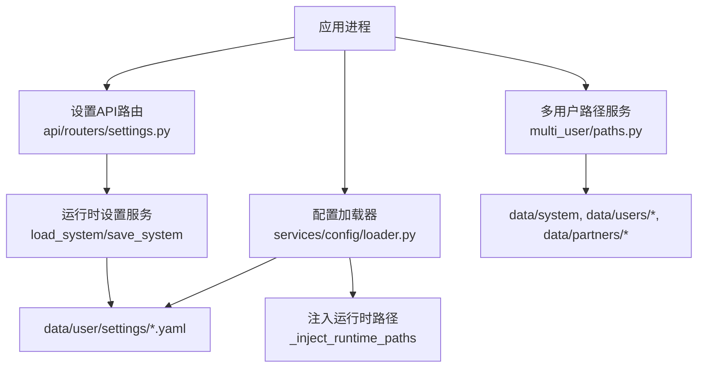
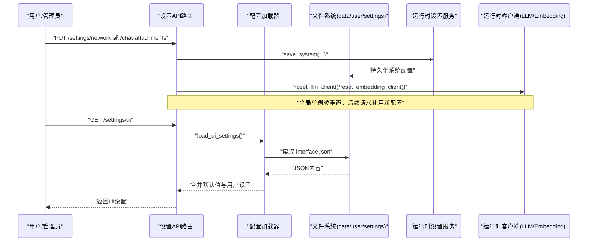
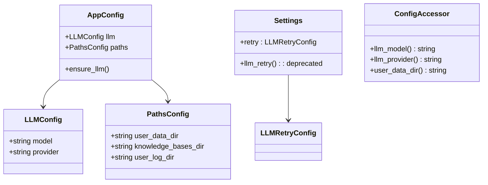
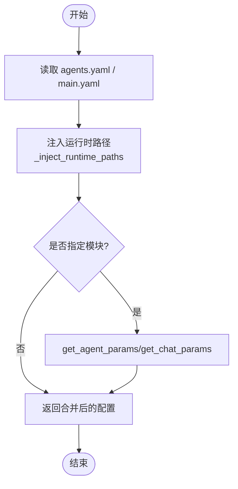
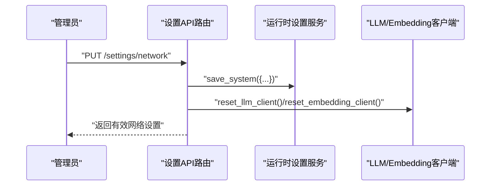
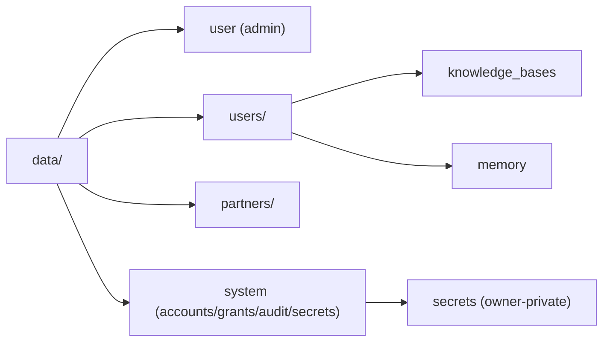
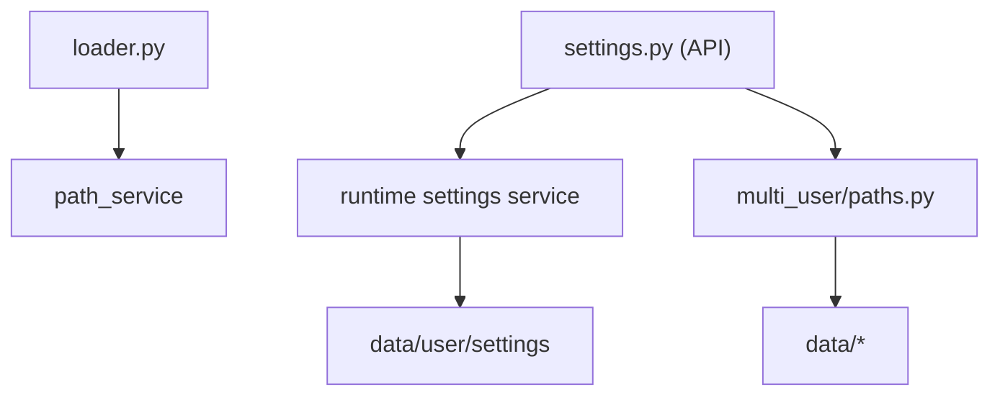

# 配置管理

<cite>
**本文引用的文件**
- [deeptutor/config/settings.py](file://deeptutor/config/settings.py)
- [deeptutor/config/schema.py](file://deeptutor/config/schema.py)
- [deeptutor/config/defaults.py](file://deeptutor/config/defaults.py)
- [deeptutor/config/accessors.py](file://deeptutor/config/accessors.py)
- [deeptutor/services/config/loader.py](file://deeptutor/services/config/loader.py)
- [deeptutor/api/routers/settings.py](file://deeptutor/api/routers/settings.py)
- [deeptutor/multi_user/paths.py](file://deeptutor/multi_user/paths.py)
</cite>

## 目录
1. [简介](#简介)
2. [项目结构](#项目结构)
3. [核心组件](#核心组件)
4. [架构总览](#架构总览)
5. [详细组件分析](#详细组件分析)
6. [依赖关系分析](#依赖关系分析)
7. [性能考量](#性能考量)
8. [故障排除指南](#故障排除指南)
9. [结论](#结论)
10. [附录](#附录)

## 简介
本文件面向DeepTutor的配置管理系统，系统性说明配置文件的结构与组织方式、运行时加载与热重载机制、环境变量与配置文件的关系、多用户环境下的配置隔离与权限控制、配置的验证迁移与备份方法，以及通过API动态修改配置的最佳实践与常见问题排查。目标读者包括运维工程师、平台管理员与开发者。

## 项目结构
DeepTutor的配置体系由“默认值 + 模式校验 + 统一加载器 + 运行时设置服务 + API路由”构成：
- 默认值与模式定义：位于 deeptutor/config 下，提供默认配置、Pydantic模型与迁移占位。
- 统一加载器：deeptutor/services/config/loader.py 负责从 data/user/settings 目录读取YAML配置，注入运行时路径，并提供语言解析、代理参数等工具函数。
- 运行时设置服务与API：deeptutor/api/routers/settings.py 暴露UI设置、网络设置、附件策略、文档解析引擎（如MinerU）等接口；内部调用运行时设置服务读写系统级配置。
- 多用户路径与隔离：deeptutor/multi_user/paths.py 定义数据根目录布局、用户工作区与系统目录的创建与权限，确保不同用户的配置与资源隔离。

图表来源
- [deeptutor/services/config/loader.py:23-78](file://deeptutor/services/config/loader.py#L23-L78)
- [deeptutor/api/routers/settings.py:505-546](file://deeptutor/api/routers/settings.py#L505-L546)
- [deeptutor/multi_user/paths.py:3-15](file://deeptutor/multi_user/paths.py#L3-L15)

章节来源
- [deeptutor/services/config/loader.py:23-78](file://deeptutor/services/config/loader.py#L23-L78)
- [deeptutor/api/routers/settings.py:505-546](file://deeptutor/api/routers/settings.py#L505-L546)
- [deeptutor/multi_user/paths.py:3-15](file://deeptutor/multi_user/paths.py#L3-L15)

## 核心组件
- 配置默认值与模式
  - 默认值：deeptutor/config/defaults.py 提供LLM与路径的默认值。
  - 模式与迁移：deeptutor/config/schema.py 定义AppConfig、PathsConfig、LLMConfig及CURRENT_SCHEMA_VERSION，并预留migrate_config用于未来版本迁移。
  - 访问器：deeptutor/config/accessors.py 提供对常用配置项的便捷读取（如llm_model、llm_provider、user_data_dir）。
  - 进程内设置：deeptutor/config/settings.py 使用pydantic-settings定义Settings（例如LLM重试），并通过环境变量前缀与分隔符注入。

- 统一配置加载器
  - 位置：deeptutor/services/config/loader.py
  - 功能：
    - 解析 data/user/settings 下的YAML配置。
    - 注入运行时路径（tools.run_code.workspace、paths.*）。
    - 提供 get_agent_params、get_chat_params、parse_language 等工具。
    - 支持异步加载与深度合并。

- 设置API路由
  - 位置：deeptutor/api/routers/settings.py
  - 能力：
    - UI设置读写（主题、语言、响应语言、侧边栏描述与导航顺序、代码块样式、可选工具开关、语音自动播放、聊天超时）。
    - 网络设置（后端端口、前端端口、公共API地址、CORS源）。
    - 聊天附件策略（文件大小、总量、字符预算）。
    - 文档解析引擎（以MinerU为例）配置与就绪性检查。
    - 模型目录与服务选择（catalog、providers）。
    - 运行时缓存失效（重置LLM/Embedding客户端）。

- 多用户路径与隔离
  - 位置：deeptutor/multi_user/paths.py
  - 能力：
    - 统一数据根：data/ 为部署唯一挂载点。
    - 用户工作区：data/users/<uid>，伙伴工作区：data/partners/<id>。
    - 系统目录：data/system（账户、授权、审计、索引、所有者密钥）。
    - 权限与迁移：一次性迁移旧布局，确保system目录与所有者密钥目录权限严格。

章节来源
- [deeptutor/config/defaults.py:1-18](file://deeptutor/config/defaults.py#L1-L18)
- [deeptutor/config/schema.py:1-39](file://deeptutor/config/schema.py#L1-L39)
- [deeptutor/config/accessors.py:1-19](file://deeptutor/config/accessors.py#L1-L19)
- [deeptutor/config/settings.py:1-51](file://deeptutor/config/settings.py#L1-L51)
- [deeptutor/services/config/loader.py:23-78](file://deeptutor/services/config/loader.py#L23-L78)
- [deeptutor/api/routers/settings.py:505-546](file://deeptutor/api/routers/settings.py#L505-L546)
- [deeptutor/multi_user/paths.py:3-15](file://deeptutor/multi_user/paths.py#L3-L15)

## 架构总览
下图展示了配置从默认值到运行时生效的整体流程，包括环境变量注入、YAML加载、路径注入、API写入与缓存失效。

图表来源
- [deeptutor/api/routers/settings.py:269-284](file://deeptutor/api/routers/settings.py#L269-L284)
- [deeptutor/api/routers/settings.py:505-546](file://deeptutor/api/routers/settings.py#L505-L546)
- [deeptutor/services/config/loader.py:23-78](file://deeptutor/services/config/loader.py#L23-L78)

## 详细组件分析

### 配置默认值与模式（schema/defaults/accessors）
- 默认值：
  - LLM默认模型与提供商、用户数据目录、知识库目录、日志目录等。
- 模式校验：
  - AppConfig要求llm.model必填，paths包含必要子项。
  - CURRENT_SCHEMA_VERSION标记当前配置版本，migrate_config预留迁移逻辑。
- 访问器：
  - 提供llm_model、llm_provider、user_data_dir等便捷读取，便于上层模块快速获取关键配置。

图表来源
- [deeptutor/config/schema.py:6-28](file://deeptutor/config/schema.py#L6-L28)
- [deeptutor/config/settings.py:19-46](file://deeptutor/config/settings.py#L19-L46)
- [deeptutor/config/accessors.py:4-18](file://deeptutor/config/accessors.py#L4-L18)

章节来源
- [deeptutor/config/schema.py:1-39](file://deeptutor/config/schema.py#L1-L39)
- [deeptutor/config/defaults.py:1-18](file://deeptutor/config/defaults.py#L1-L18)
- [deeptutor/config/accessors.py:1-19](file://deeptutor/config/accessors.py#L1-L19)
- [deeptutor/config/settings.py:1-51](file://deeptutor/config/settings.py#L1-L51)

### 统一配置加载器（loader）
- 配置目录：data/user/settings。
- 注入运行时路径：
  - tools.run_code.workspace指向独立执行工作空间。
  - paths.*映射到用户根、知识库根、日志根、性能日志、问答/研究/求解输出目录。
- 工具函数：
  - get_agent_params：按模块（solve/research/question/co_writer/visualize/brainstorm/vision_solver/math_animator/llm_probe）读取agents.yaml中的temperature与max_tokens，并与内置默认值深度合并。
  - get_chat_params：读取capabilities.chat，合并默认轮次与阶段token限制。
  - parse_language：标准化语言代码（en/zh/ja等）。
- 异步加载：load_config_with_main_async支持非阻塞读取。

图表来源
- [deeptutor/services/config/loader.py:29-78](file://deeptutor/services/config/loader.py#L29-L78)
- [deeptutor/services/config/loader.py:202-312](file://deeptutor/services/config/loader.py#L202-L312)

章节来源
- [deeptutor/services/config/loader.py:23-78](file://deeptutor/services/config/loader.py#L23-L78)
- [deeptutor/services/config/loader.py:202-312](file://deeptutor/services/config/loader.py#L202-L312)

### 设置API路由（settings）
- UI设置：
  - GET /settings/ui：返回界面主题、语言、响应语言、侧边栏描述与导航顺序、代码块样式、可选工具开关、语音自动播放、聊天超时。
  - PATCH/PUT /settings/ui：部分更新UI设置。
- 网络设置：
  - GET/PUT /settings/network：读取与更新后端端口、前端端口、公共API地址、CORS源；返回有效URL与跨域模式。
- 聊天附件策略：
  - GET/PUT /settings/chat-attachments：读取与更新单文件大小、总量、每文档字符数、总字符数；返回WebSocket帧上限与重启提示。
- 文档解析引擎（MinerU）：
  - GET/PUT /settings/mineru：读取与更新本地/云端模式、API基础地址、令牌、本地CLI路径、下载源、模型版本、语言、公式/表格启用、OCR开关、允许本地模型下载。
  - 就绪性检查：列出可用引擎与每个引擎的准备状态。
- 模型目录与提供者：
  - GET /settings/catalog：仅管理员可访问，返回模型目录。
  - GET /settings/providers：返回各服务类型的下拉选项（LLM、嵌入、搜索、TTS、STT、图像生成、视频生成）。
- 运行时缓存失效：
  - _invalidate_runtime_caches：在管理员应用目录后重置LLM/Embedding客户端，使新配置立即生效。

图表来源
- [deeptutor/api/routers/settings.py:269-284](file://deeptutor/api/routers/settings.py#L269-L284)
- [deeptutor/api/routers/settings.py:505-546](file://deeptutor/api/routers/settings.py#L505-L546)
- [deeptutor/api/routers/settings.py:614-635](file://deeptutor/api/routers/settings.py#L614-L635)
- [deeptutor/api/routers/settings.py:669-690](file://deeptutor/api/routers/settings.py#L669-L690)
- [deeptutor/api/routers/settings.py:769-800](file://deeptutor/api/routers/settings.py#L769-L800)

章节来源
- [deeptutor/api/routers/settings.py:505-546](file://deeptutor/api/routers/settings.py#L505-L546)
- [deeptutor/api/routers/settings.py:614-635](file://deeptutor/api/routers/settings.py#L614-L635)
- [deeptutor/api/routers/settings.py:669-690](file://deeptutor/api/routers/settings.py#L669-L690)
- [deeptutor/api/routers/settings.py:769-800](file://deeptutor/api/routers/settings.py#L769-L800)

### 多用户环境与配置隔离
- 数据根与布局：
  - data/user：管理员工作区。
  - data/users/<uid>：普通用户工作区。
  - data/partners/<id>：伙伴（合成用户）工作区。
  - data/system：部署状态（账户、授权、审计、索引、所有者密钥）。
- 路径服务与权限：
  - ensure_scope_workspace：为指定作用域创建工作区树（knowledge_bases、memory等）。
  - owner_secrets_dir：所有者密钥目录，严格权限，沙箱不可见。
  - migrate_legacy_multi_user_tree：一次性迁移旧布局至新结构。
- 作用域解析：
  - admin_scope/local_admin_user：管理员作用域。
  - scope_for_user/current_path_service：根据当前用户解析路径服务。
  - get_owner_path_service：针对所有者绑定的资产（如OAuth刷新令牌）解析到真实账户的工作区。

图表来源
- [deeptutor/multi_user/paths.py:3-15](file://deeptutor/multi_user/paths.py#L3-L15)
- [deeptutor/multi_user/paths.py:109-137](file://deeptutor/multi_user/paths.py#L109-L137)
- [deeptutor/multi_user/paths.py:211-245](file://deeptutor/multi_user/paths.py#L211-L245)

章节来源
- [deeptutor/multi_user/paths.py:3-15](file://deeptutor/multi_user/paths.py#L3-L15)
- [deeptutor/multi_user/paths.py:109-137](file://deeptutor/multi_user/paths.py#L109-L137)
- [deeptutor/multi_user/paths.py:211-245](file://deeptutor/multi_user/paths.py#L211-L245)

## 依赖关系分析
- 配置加载器依赖运行时家目录与路径服务，注入实际工作路径。
- 设置API路由依赖运行时设置服务进行系统级配置读写，并在必要时重置全局客户端以生效新配置。
- 多用户路径服务与设置API共同保证配置与资源的隔离与权限控制。

图表来源
- [deeptutor/services/config/loader.py:16-20](file://deeptutor/services/config/loader.py#L16-L20)
- [deeptutor/api/routers/settings.py:269-284](file://deeptutor/api/routers/settings.py#L269-L284)
- [deeptutor/multi_user/paths.py:3-15](file://deeptutor/multi_user/paths.py#L3-L15)

章节来源
- [deeptutor/services/config/loader.py:16-20](file://deeptutor/services/config/loader.py#L16-L20)
- [deeptutor/api/routers/settings.py:269-284](file://deeptutor/api/routers/settings.py#L269-L284)
- [deeptutor/multi_user/paths.py:3-15](file://deeptutor/multi_user/paths.py#L3-L15)

## 性能考量
- 配置读取：
  - 使用异步加载避免阻塞事件循环。
  - 深度合并仅在必要时进行，减少不必要的复制。
- 运行时客户端：
  - 全局单例（LLM/Embedding）在配置变更后需显式重置，避免陈旧连接影响后续请求。
- WebSocket上传：
  - 聊天附件大小上限受启动时WS帧上限约束，调整较大值需重启后端。

[本节为通用指导，不直接分析具体文件]

## 故障排除指南
- 配置未生效
  - 确认已通过API保存系统设置并触发了客户端重置。
  - 检查data/user/settings目录下对应文件是否存在且格式正确。
- CORS或网络设置问题
  - 使用GET /settings/network查看有效URL与跨域模式，确保浏览器API基址与实际后端一致。
- 附件上传失败
  - 若增大附件上限后仍失败，需重启后端以重新计算WS帧上限。
- MinerU解析不可用
  - 检查本地CLI路径是否正确、模型是否已下载；通过GET /settings/mineru查看就绪性与本地探针结果。
- 多用户权限异常
  - 确认用户工作区与system目录已创建且权限正确；检查所有者密钥目录是否仅所有者可写。

章节来源
- [deeptutor/api/routers/settings.py:505-546](file://deeptutor/api/routers/settings.py#L505-L546)
- [deeptutor/api/routers/settings.py:669-690](file://deeptutor/api/routers/settings.py#L669-L690)
- [deeptutor/api/routers/settings.py:769-800](file://deeptutor/api/routers/settings.py#L769-L800)
- [deeptutor/multi_user/paths.py:128-137](file://deeptutor/multi_user/paths.py#L128-L137)

## 结论
DeepTutor的配置管理采用“默认值 + 模式校验 + 统一加载器 + 运行时设置服务 + API路由”的分层设计，既保证了配置的强类型与可维护性，又提供了灵活的运行时动态修改能力。多用户路径与权限控制确保了配置与资源的安全隔离。通过API进行配置变更时，注意触发客户端重置与必要的重启，以确保新配置及时生效。

## 附录

### 配置文件与环境变量关系
- 环境变量注入：
  - 进程内设置（如LLM重试）通过pydantic-settings的环境前缀与分隔符注入（例如LLM_RETRY__MAX_RETRIES）。
- YAML配置：
  - 系统级配置保存在data/user/settings/*.yaml，由加载器统一读取并注入运行时路径。
- 关系说明：
  - 环境变量优先于默认值，YAML配置覆盖默认值；运行时路径由加载器注入，不视为用户编辑态。

章节来源
- [deeptutor/config/settings.py:1-51](file://deeptutor/config/settings.py#L1-L51)
- [deeptutor/services/config/loader.py:59-78](file://deeptutor/services/config/loader.py#L59-L78)

### 常见配置场景与最佳实践
- 切换LLM提供商与模型：
  - 通过API更新模型目录与提供者选择，随后触发客户端重置。
- 调整聊天附件策略：
  - 使用PUT /settings/chat-attachments设置大小与字符预算；如需更大上传，重启后端以扩大WS帧上限。
- 配置MinerU解析引擎：
  - 设置本地/云端模式、API基础地址与令牌；确保本地CLI路径正确并下载所需模型。
- 多用户隔离：
  - 确保data/users与data/system目录存在且权限正确；避免将所有者密钥写入共享工作区。

[本节为通用指导，不直接分析具体文件]

### 配置验证、迁移与备份
- 验证：
  - Pydantic模型对配置进行强类型校验，缺失必填字段会抛出错误。
- 迁移：
  - schema.py中CURRENT_SCHEMA_VERSION与migrate_config预留迁移入口，可在未来实现版本化迁移。
- 备份：
  - 建议定期备份data目录（包含user、users、partners、system），确保配置与资源完整恢复。

章节来源
- [deeptutor/config/schema.py:17-39](file://deeptutor/config/schema.py#L17-L39)
- [deeptutor/multi_user/paths.py:3-15](file://deeptutor/multi_user/paths.py#L3-L15)

### 通过API动态修改配置
- UI设置：
  - GET/PUT /settings/ui：读取与更新界面偏好。
- 网络设置：
  - GET/PUT /settings/network：读取与更新端口、公共API地址、CORS源。
- 聊天附件策略：
  - GET/PUT /settings/chat-attachments：读取与更新大小与字符预算。
- 文档解析引擎（MinerU）：
  - GET/PUT /settings/mineru：读取与更新引擎配置与就绪性。
- 模型目录与提供者：
  - GET /settings/catalog：管理员可访问模型目录。
  - GET /settings/providers：获取各服务类型下拉选项。

章节来源
- [deeptutor/api/routers/settings.py:505-546](file://deeptutor/api/routers/settings.py#L505-L546)
- [deeptutor/api/routers/settings.py:614-635](file://deeptutor/api/routers/settings.py#L614-L635)
- [deeptutor/api/routers/settings.py:669-690](file://deeptutor/api/routers/settings.py#L669-L690)
- [deeptutor/api/routers/settings.py:769-800](file://deeptutor/api/routers/settings.py#L769-L800)