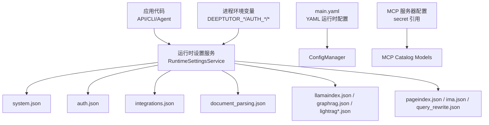
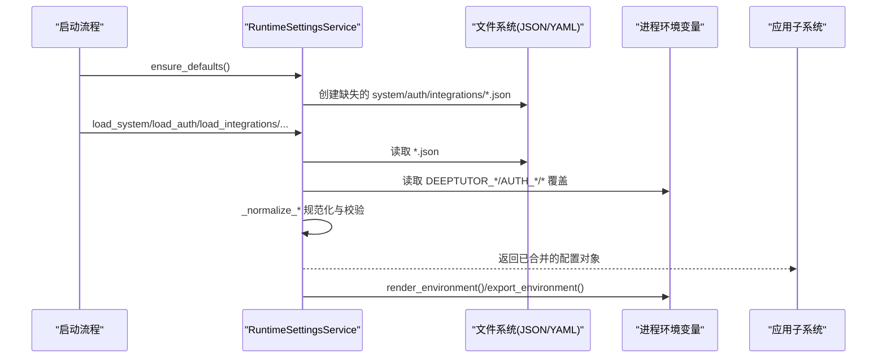
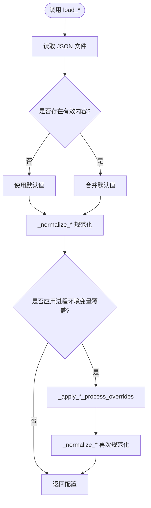
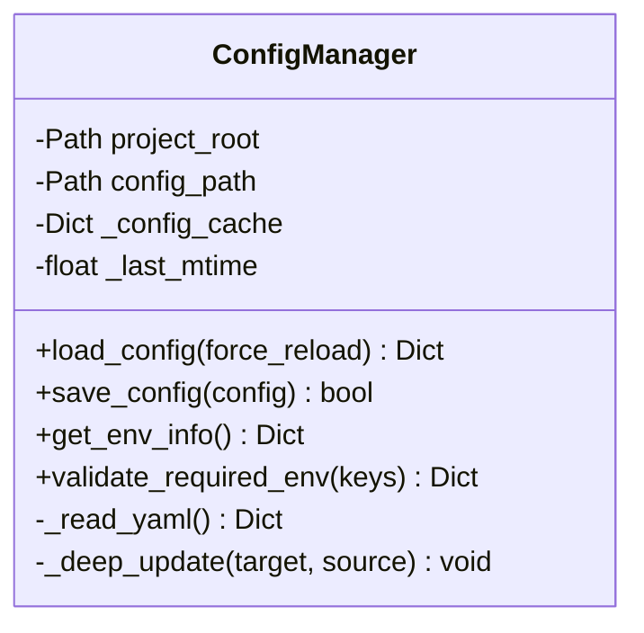
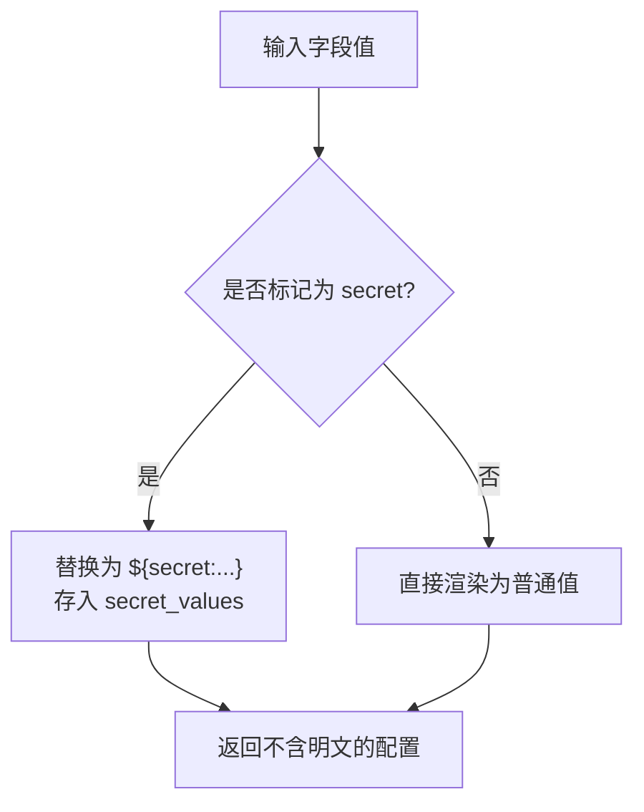
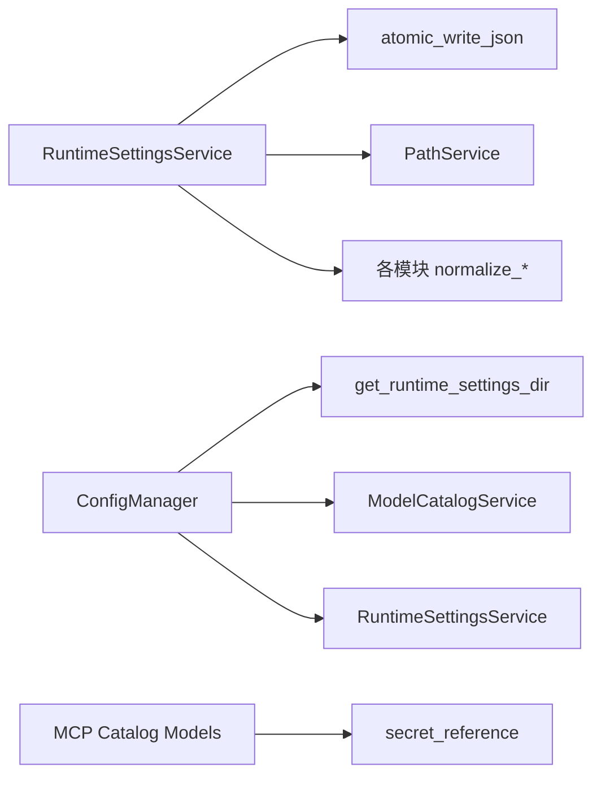

# 配置管理

<cite>
**本文引用的文件**   
- [deeptutor/services/config/runtime_settings.py](file://deeptutor/services/config/runtime_settings.py)
- [deeptutor/utils/config_manager.py](file://deeptutor/utils/config_manager.py)
- [deeptutor/services/mcp/catalog/models.py](file://deeptutor/services/mcp/catalog/models.py)
- [deeptutor/agents/loop/agent_loop.py](file://deeptutor/agents/loop/agent_loop.py)
- [deeptutor/api/run_server.py](file://deeptutor/api/run_server.py)
- [deeptutor/runtime/home.py](file://deeptutor/runtime/home.py)
- [deeptutor/runtime/mode.py](file://deeptutor/runtime/mode.py)
</cite>

## 目录
1. [简介](#简介)
2. [项目结构](#项目结构)
3. [核心组件](#核心组件)
4. [架构总览](#架构总览)
5. [详细组件分析](#详细组件分析)
6. [依赖关系分析](#依赖关系分析)
7. [性能与容量规划](#性能与容量规划)
8. [故障排查指南](#故障排查指南)
9. [结论](#结论)
10. [附录：环境变量与配置项清单](#附录环境变量与配置项清单)

## 简介
本文件面向 DeepTutor 的配置管理体系，系统性说明系统配置的层次、加载顺序、优先级与继承机制，覆盖环境变量、运行时 JSON/YAML 配置文件、默认值处理、校验与错误检查，以及安全与敏感信息管理。文档同时给出不同环境的最佳实践、模板建议与迁移策略，帮助开发者与运维人员稳定地部署和演进 DeepTutor。

## 项目结构
DeepTutor 的配置体系由以下部分组成：
- 运行时设置服务：以 data/user/settings 下的多个 JSON 文件为持久化载体，提供系统、认证、集成、文档解析、RAG 引擎等模块化的配置读写与规范化。
- 进程环境变量覆盖：通过一组 DEEPTUTOR_* / AUTH_* / POCKETBASE_* / MINERU_* / DOCLING_* / TIKA_* 等变量对运行时设置进行部署级覆盖。
- 主 YAML 配置：data/user/settings/main.yaml 作为轻量运行时 YAML 配置入口，用于 CLI 与部分工具读取。
- MCP 服务器配置：支持将敏感字段以引用形式存储，避免明文凭证落盘。

**图示来源**
- [deeptutor/services/config/runtime_settings.py:509-878](file://deeptutor/services/config/runtime_settings.py#L509-L878)
- [deeptutor/utils/config_manager.py:12-90](file://deeptutor/utils/config_manager.py#L12-L90)
- [deeptutor/services/mcp/catalog/models.py:238-263](file://deeptutor/services/mcp/catalog/models.py#L238-L263)

**章节来源**
- [deeptutor/services/config/runtime_settings.py:509-878](file://deeptutor/services/config/runtime_settings.py#L509-L878)
- [deeptutor/utils/config_manager.py:12-90](file://deeptutor/utils/config_manager.py#L12-L90)
- [deeptutor/services/mcp/catalog/models.py:238-263](file://deeptutor/services/mcp/catalog/models.py#L238-L263)

## 核心组件
- RuntimeSettingsService：负责所有运行时 JSON 设置的加载、合并、规范化、保存与环境渲染；提供 ensure_defaults 启动时初始化缺失文件。
- ConfigManager：负责 main.yaml 的轻量读写，缓存并基于 mtime 刷新。
- MCP Catalog Models：构建 MCP 服务器配置，敏感字段以 ${secret:...} 引用形式存储，避免明文落盘。

关键职责与行为：
- 默认值与规范化：每个模块都有 DEFAULT_* 常量与 _normalize_* 方法，确保非法值被裁剪或回退到安全默认。
- 进程环境变量覆盖：通过 _apply_*_process_overrides 将环境变量映射到对应配置键，支持布尔、端口、列表等类型转换。
- 版本与迁移：如 document_parsing 从 v1 mineru.json 迁移到 v2 document_parsing.json，保证升级兼容。
- 环境导出：render_environment/export_environment 将非模型设置渲染为子进程可用的环境变量，同时区分“内部导出”和“外部设置”，避免覆盖操作者显式设置的变量。

**章节来源**
- [deeptutor/services/config/runtime_settings.py:16-478](file://deeptutor/services/config/runtime_settings.py#L16-L478)
- [deeptutor/services/config/runtime_settings.py:509-878](file://deeptutor/services/config/runtime_settings.py#L509-L878)
- [deeptutor/utils/config_manager.py:12-90](file://deeptutor/utils/config_manager.py#L12-L90)
- [deeptutor/services/mcp/catalog/models.py:238-263](file://deeptutor/services/mcp/catalog/models.py#L238-L263)

## 架构总览
下图展示配置加载与生效的整体流程：启动时确保默认文件存在，随后按模块加载 JSON 设置，应用进程环境变量覆盖，规范化后供各子系统使用；同时将非敏感设置渲染为子进程环境变量。

**图示来源**
- [deeptutor/services/config/runtime_settings.py:752-832](file://deeptutor/services/config/runtime_settings.py#L752-L832)
- [deeptutor/services/config/runtime_settings.py:862-878](file://deeptutor/services/config/runtime_settings.py#L862-L878)

## 详细组件分析

### 运行时设置服务（RuntimeSettingsService）
- 设计要点
  - 单例模式按 settings_dir 隔离实例，支持测试注入 process_env。
  - 统一的路径生成 path_for(name)，自动补全 .json 后缀。
  - 统一的加载器 _load_or_create：若文件不存在则写入默认值；若存在则合并默认值并规范化，必要时写回。
  - 模块化加载：system、auth、integrations、document_parsing、pageindex、query_rewrite、ima、llamaindex、graphrag、lightrag/lightrag_server。
  - 进程环境变量覆盖：_apply_*_process_overrides 将环境变量映射到具体字段，支持布尔、端口、列表、字符串等类型转换。
  - 规范化器：_normalize_* 严格校验范围、枚举、长度，防止异常值破坏运行。
  - 环境渲染：render_environment 输出子进程所需的环境变量；export_environment 区分“内部导出”和“外部设置”，避免覆盖操作者显式设置的变量。

- 关键流程
  - 启动阶段：ensure_defaults 确保所有 JSON 文件存在且包含默认值。
  - 读取阶段：load_* 方法先加载 JSON，再可选应用进程环境变量覆盖。
  - 保存阶段：save_* 方法先合并默认值，再规范化并原子写入。

**图示来源**
- [deeptutor/services/config/runtime_settings.py:862-878](file://deeptutor/services/config/runtime_settings.py#L862-L878)
- [deeptutor/services/config/runtime_settings.py:901-1010](file://deeptutor/services/config/runtime_settings.py#L901-L1010)
- [deeptutor/services/config/runtime_settings.py:1024-1187](file://deeptutor/services/config/runtime_settings.py#L1024-L1187)
- [deeptutor/services/config/runtime_settings.py:1189-1478](file://deeptutor/services/config/runtime_settings.py#L1189-L1478)

**章节来源**
- [deeptutor/services/config/runtime_settings.py:509-878](file://deeptutor/services/config/runtime_settings.py#L509-L878)
- [deeptutor/services/config/runtime_settings.py:901-1010](file://deeptutor/services/config/runtime_settings.py#L901-L1010)
- [deeptutor/services/config/runtime_settings.py:1024-1187](file://deeptutor/services/config/runtime_settings.py#L1024-L1187)
- [deeptutor/services/config/runtime_settings.py:1189-1478](file://deeptutor/services/config/runtime_settings.py#L1189-L1478)

### 主 YAML 配置管理器（ConfigManager）
- 作用：维护 data/user/settings/main.yaml，提供线程安全的读取、深度合并与原子保存。
- 特性：
  - 单例 + RLock 保护并发访问。
  - 基于 mtime 的缓存刷新，避免频繁 IO。
  - 提供 get_env_info 与 validate_required_env，辅助 CLI 与工具链获取运行时上下文与校验必填环境变量。

**图示来源**
- [deeptutor/utils/config_manager.py:12-90](file://deeptutor/utils/config_manager.py#L12-L90)
- [deeptutor/utils/config_manager.py:99-124](file://deeptutor/utils/config_manager.py#L99-L124)

**章节来源**
- [deeptutor/utils/config_manager.py:12-90](file://deeptutor/utils/config_manager.py#L12-L90)
- [deeptutor/utils/config_manager.py:99-124](file://deeptutor/utils/config_manager.py#L99-L124)

### MCP 服务器配置与敏感信息保护
- 设计要点：
  - 构建服务器配置时，敏感字段不直接注入明文，而是替换为 ${secret:...} 引用，并在 secret_values 中单独返回原始值。
  - 这样持久化、显示与 diff 的配置不包含明文凭证，降低泄露风险。

**图示来源**
- [deeptutor/services/mcp/catalog/models.py:238-263](file://deeptutor/services/mcp/catalog/models.py#L238-L263)

**章节来源**
- [deeptutor/services/mcp/catalog/models.py:238-263](file://deeptutor/services/mcp/catalog/models.py#L238-L263)

### 其他运行时环境变量使用点
- 聊天引擎选择：DEEPTUTOR_CHAT_ENGINE 控制 Python 或 TypeScript 原生实现。
- 开发重载：DEEPTUTOR_DEV_RELOAD 控制 API 服务热重载。
- Chrome 可执行路径：DEEPTUTOR_CHROME_EXECUTABLE 影响视频课程布局检查。
- 工作区根目录：DEEPTUTOR_HOME 决定用户数据目录。
- 运行模式：DEEPTUTOR_MODE 标识当前运行模式。

这些变量在各自模块中直接读取 os.environ，属于“快速开关型”配置，通常不需要经过 RuntimeSettingsService。

**章节来源**
- [deeptutor/agents/loop/agent_loop.py:235-291](file://deeptutor/agents/loop/agent_loop.py#L235-L291)
- [deeptutor/api/run_server.py:68-68](file://deeptutor/api/run_server.py#L68-L68)
- [deeptutor/runtime/home.py:8-53](file://deeptutor/runtime/home.py#L8-L53)
- [deeptutor/runtime/mode.py:22-39](file://deeptutor/runtime/mode.py#L22-L39)

## 依赖关系分析
- RuntimeSettingsService 依赖：
  - 文件系统：atomic_write_json 原子写入 JSON。
  - PathService：确定 settings 目录位置（多用户场景下优先管理员路径）。
  - 各模块归一化函数：image_description、origins 等。
- ConfigManager 依赖：
  - loader.get_runtime_settings_dir：定位 settings 目录。
  - ModelCatalogService/RuntimeSettingsService：读取 model_catalog.json 与 system.json 以构造运行时键值。
- MCP Catalog Models 依赖：
  - secret_reference：生成 ${secret:...} 引用。

**图示来源**
- [deeptutor/services/config/runtime_settings.py:10-15](file://deeptutor/services/config/runtime_settings.py#L10-L15)
- [deeptutor/services/config/runtime_settings.py:1485-1495](file://deeptutor/services/config/runtime_settings.py#L1485-L1495)
- [deeptutor/utils/config_manager.py:9-10](file://deeptutor/utils/config_manager.py#L9-L10)
- [deeptutor/utils/config_manager.py:107-124](file://deeptutor/utils/config_manager.py#L107-L124)
- [deeptutor/services/mcp/catalog/models.py:238-263](file://deeptutor/services/mcp/catalog/models.py#L238-L263)

**章节来源**
- [deeptutor/services/config/runtime_settings.py:10-15](file://deeptutor/services/config/runtime_settings.py#L10-L15)
- [deeptutor/services/config/runtime_settings.py:1485-1495](file://deeptutor/services/config/runtime_settings.py#L1485-L1495)
- [deeptutor/utils/config_manager.py:9-10](file://deeptutor/utils/config_manager.py#L9-L10)
- [deeptutor/utils/config_manager.py:107-124](file://deeptutor/utils/config_manager.py#L107-L124)
- [deeptutor/services/mcp/catalog/models.py:238-263](file://deeptutor/services/mcp/catalog/models.py#L238-L263)

## 性能与容量规划
- WebSocket 帧上限：根据 chat_attachment_max_total_mb 计算 compute_ws_max_size，确保上传大附件不会因 uvicorn 帧限制失败。
- HTTP keep-alive：HTTP_KEEP_ALIVE_TIMEOUT=300，避免与前端代理池空闲回收冲突导致连接重置。
- 附件大小与字符预算：CHAT_ATTACHMENT_MAX_FILE_MB_RANGE、CHAT_ATTACHMENT_MAX_TOTAL_MB_RANGE、CHAT_ATTACHMENT_CHARS_RANGE 提供合理范围约束，防止极端值导致内存压力。
- LightRAG 超时与并发：llm_timeout 与 llm_model_max_async 控制索引与查询时的资源占用，需结合硬件能力调优。

**章节来源**
- [deeptutor/services/config/runtime_settings.py:1542-1593](file://deeptutor/services/config/runtime_settings.py#L1542-L1593)
- [deeptutor/services/config/runtime_settings.py:91-99](file://deeptutor/services/config/runtime_settings.py#L91-L99)
- [deeptutor/services/config/runtime_settings.py:389-417](file://deeptutor/services/config/runtime_settings.py#L389-L417)

## 故障排查指南
- 配置未生效
  - 确认 ensure_defaults 已调用，缺失的 JSON 文件会被创建。
  - 检查进程环境变量是否被 IGNORE_PROCESS_OVERRIDES_ENV 禁用。
  - 核对 _process_env_value 逻辑：仅当变量不是“内部导出”或“外部设置”时才覆盖。
- 端口或网络问题
  - BACKEND_PORT/FRONTEND_PORT/CORS_ORIGIN/CORS_ORIGINS/NEXT_PUBLIC_API_BASE 等变量是否正确设置。
  - DEEPTUTOR_API_BASE_URL 渲染逻辑优先 next_public_api_base_external，其次 next_public_api_base，最后回退到 127.0.0.1:backend_port。
- 附件上传失败
  - 检查 chat_attachment_max_file_mb/chat_attachment_max_total_mb 与 compute_ws_max_size 的关系。
  - 确认 uvicorn 启动参数已使用 ws_max_size。
- 文档解析异常
  - 确认 document_parsing.json 是否为 v2 结构，engine 是否在允许集合内。
  - 检查 MinerU/Docling/Tika 的模式与端点配置。
- MCP 配置泄露
  - 确认敏感字段以 ${secret:...} 引用形式存储，不在配置文件中出现明文。

**章节来源**
- [deeptutor/services/config/runtime_settings.py:752-832](file://deeptutor/services/config/runtime_settings.py#L752-L832)
- [deeptutor/services/config/runtime_settings.py:898-900](file://deeptutor/services/config/runtime_settings.py#L898-L900)
- [deeptutor/services/config/runtime_settings.py:800-814](file://deeptutor/services/config/runtime_settings.py#L800-L814)
- [deeptutor/services/config/runtime_settings.py:1189-1245](file://deeptutor/services/config/runtime_settings.py#L1189-L1245)
- [deeptutor/services/mcp/catalog/models.py:238-263](file://deeptutor/services/mcp/catalog/models.py#L238-L263)

## 结论
DeepTutor 的配置体系以 RuntimeSettingsService 为核心，采用“JSON 持久化 + 进程环境变量覆盖 + 严格规范化”的分层设计，既保证了默认值的健壮性，又提供了灵活的部署覆盖能力。配合 main.yaml 的轻量运行时配置与 MCP 的敏感信息引用机制，系统在安全性、可维护性与可扩展性之间取得良好平衡。建议在生产环境中优先使用环境变量进行部署级覆盖，并通过 ensure_defaults 与规范化器保障配置一致性。

## 附录：环境变量与配置项清单

### 系统设置（system.json）
- version_check_enabled：是否启用版本检查。
- backend_port：后端端口。
- backend_workers：后端工作进程数。
- frontend_port：前端端口。
- next_public_api_base_external：外部 API 基址。
- next_public_api_base：内部 API 基址。
- cors_origin/cors_origins：CORS 配置。
- disable_ssl_verify：是否禁用 SSL 验证。
- chat_attachment_dir：聊天附件目录。
- sandbox_allow_subprocess：是否允许受限子进程执行。
- capability_routing_enabled：是否启用能力路由。
- web_search_source_filtering：搜索引擎来源过滤策略。
- chat_attachment_max_file_mb/chat_attachment_max_total_mb：附件大小上限。
- chat_prior_image_reinject_max：历史图片重注入数量。
- chat_attachment_max_chars_per_doc/chat_attachment_max_chars_total：每文档/每轮字符预算。
- security_guard：速率限制、可信代理、白名单/黑名单等。

**章节来源**
- [deeptutor/services/config/runtime_settings.py:16-89](file://deeptutor/services/config/runtime_settings.py#L16-L89)
- [deeptutor/services/config/runtime_settings.py:1349-1434](file://deeptutor/services/config/runtime_settings.py#L1349-L1434)

### 认证设置（auth.json）
- enabled：是否启用认证。
- username/password_hash：用户名与密码哈希。
- token_expire_hours：令牌过期时间。
- cookie_secure：Cookie 安全标志。
- private_login_hosts：私有登录主机列表。

**章节来源**
- [deeptutor/services/config/runtime_settings.py:101-109](file://deeptutor/services/config/runtime_settings.py#L101-L109)
- [deeptutor/services/config/runtime_settings.py:1436-1445](file://deeptutor/services/config/runtime_settings.py#L1436-L1445)

### 集成设置（integrations.json）
- pocketbase_url/port/external_url/admin_email/admin_password：PocketBase 集成。
- turn_coordination.backend/redis_url/key_prefix/lease_ttl_seconds/renew_interval_seconds/recovery_interval_seconds/stream_retention_seconds：会话协调。

**章节来源**
- [deeptutor/services/config/runtime_settings.py:111-127](file://deeptutor/services/config/runtime_settings.py#L111-L127)
- [deeptutor/services/config/runtime_settings.py:1447-1478](file://deeptutor/services/config/runtime_settings.py#L1447-L1478)

### 文档解析设置（document_parsing.json）
- version/engine/image_caption/image_description_model/engines.*：多引擎解析配置（text_only/mineru/docling/markitdown/pymupdf4llm/liteparse/tika）。

**章节来源**
- [deeptutor/services/config/runtime_settings.py:129-283](file://deeptutor/services/config/runtime_settings.py#L129-L283)
- [deeptutor/services/config/runtime_settings.py:1189-1347](file://deeptutor/services/config/runtime_settings.py#L1189-L1347)

### RAG 与检索设置
- pageindex.json：PageIndex API Key。
- query_rewrite.json：查询重写策略与模型。
- ima.json：腾讯 IMA 凭据。
- llamaindex.json：本地 RAG 引擎检索与分块参数。
- graphrag.json：GraphRAG 响应风格与社区级别。
- lightrag.json/lightrag_server.json：LightRAG 查询与服务器连接。

**章节来源**
- [deeptutor/services/config/runtime_settings.py:289-417](file://deeptutor/services/config/runtime_settings.py#L289-L417)
- [deeptutor/services/config/runtime_settings.py:654-750](file://deeptutor/services/config/runtime_settings.py#L654-L750)
- [deeptutor/services/config/runtime_settings.py:1012-1187](file://deeptutor/services/config/runtime_settings.py#L1012-L1187)

### 进程环境变量覆盖（示例）
- 系统：DEEPTUTOR_VERSION_CHECK_ENABLED、BACKEND_PORT、FRONTEND_PORT、NEXT_PUBLIC_API_BASE_EXTERNAL、NEXT_PUBLIC_API_BASE、CORS_ORIGIN、CORS_ORIGINS、DISABLE_SSL_VERIFY、CHAT_ATTACHMENT_DIR、DEEPTUTOR_BACKEND_WORKERS、DEEPTUTOR_SANDBOX_ALLOW_SUBPROCESS、DEEPTUTOR_CAPABILITY_ROUTING_ENABLED、CHAT_ATTACHMENT_MAX_FILE_MB、CHAT_ATTACHMENT_MAX_TOTAL_MB、CHAT_ATTACHMENT_MAX_CHARS_PER_DOC、CHAT_ATTACHMENT_MAX_CHARS_TOTAL、CHAT_PRIOR_IMAGE_REINJECT_MAX、DEEPTUTOR_GUARD_*。
- 认证：AUTH_ENABLED、AUTH_USERNAME、AUTH_PASSWORD_HASH、AUTH_TOKEN_EXPIRE_HOURS、AUTH_COOKIE_SECURE、AUTH_PRIVATE_LOGIN_HOSTS。
- 集成：POCKETBASE_URL、POCKETBASE_PORT、POCKETBASE_EXTERNAL_URL、POCKETBASE_ADMIN_EMAIL、POCKETBASE_ADMIN_PASSWORD、DEEPTUTOR_TURN_COORDINATION_BACKEND、DEEPTUTOR_REDIS_URL、DEEPTUTOR_REDIS_KEY_PREFIX。
- 文档解析：MINERU_*、DOCLING_*、TIKA_SERVER_URL。
- RAG：DEEPTUTOR_QUERY_REWRITE_*、DEEPTUTOR_RAG_RETRIEVAL_PROFILE/RAG_RETRIEVAL_PROFILE。
- PageIndex/IMA：PAGEINDEX_API_KEY、IMA_CLIENT_ID、IMA_API_KEY。

**章节来源**
- [deeptutor/services/config/runtime_settings.py:419-437](file://deeptutor/services/config/runtime_settings.py#L419-L437)
- [deeptutor/services/config/runtime_settings.py:901-1010](file://deeptutor/services/config/runtime_settings.py#L901-L1010)
- [deeptutor/services/config/runtime_settings.py:1024-1187](file://deeptutor/services/config/runtime_settings.py#L1024-L1187)