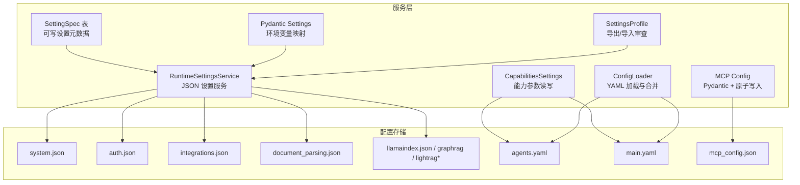
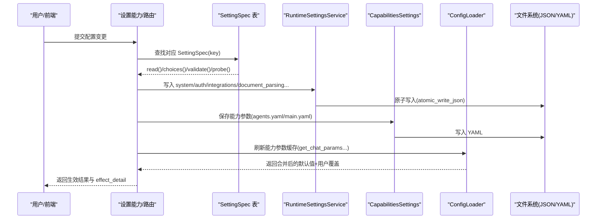
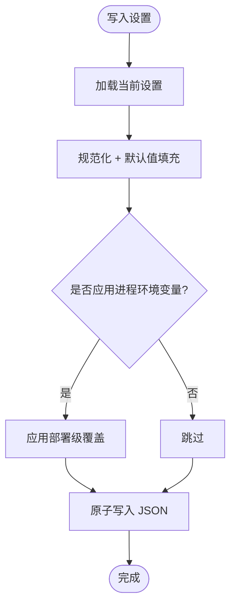
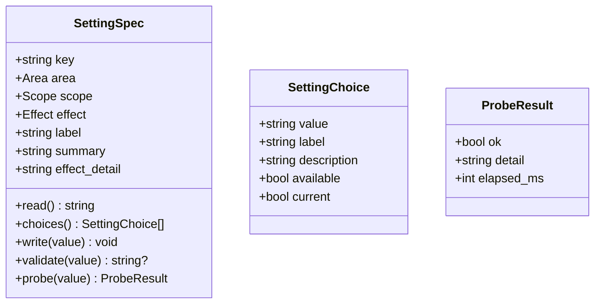
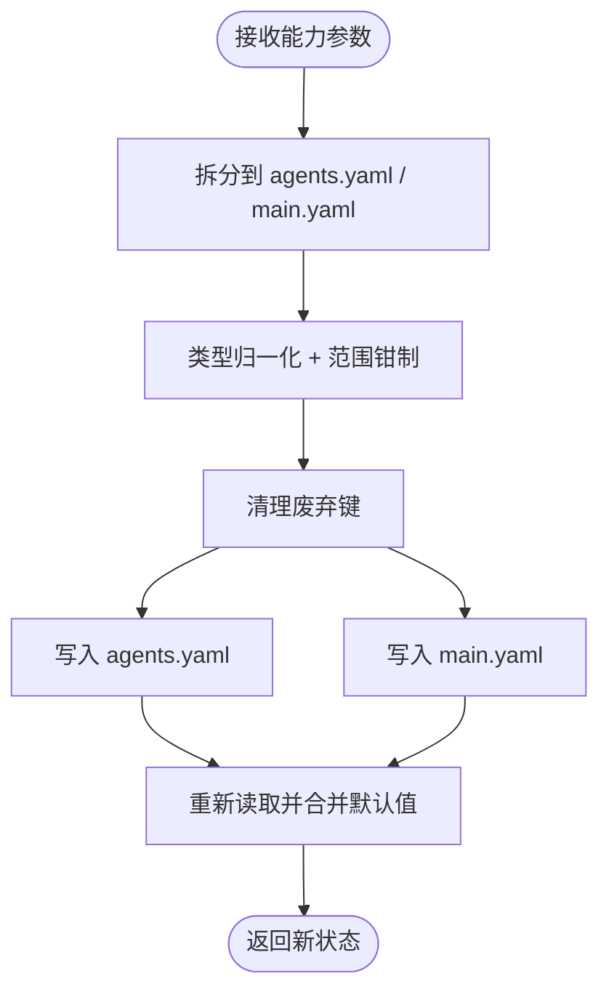
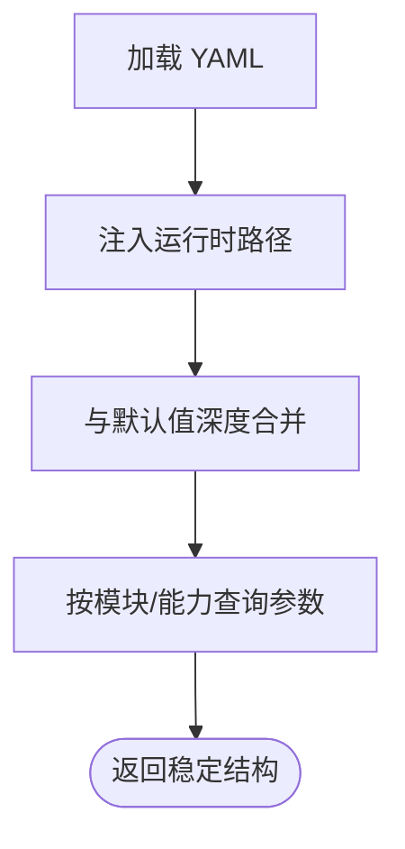
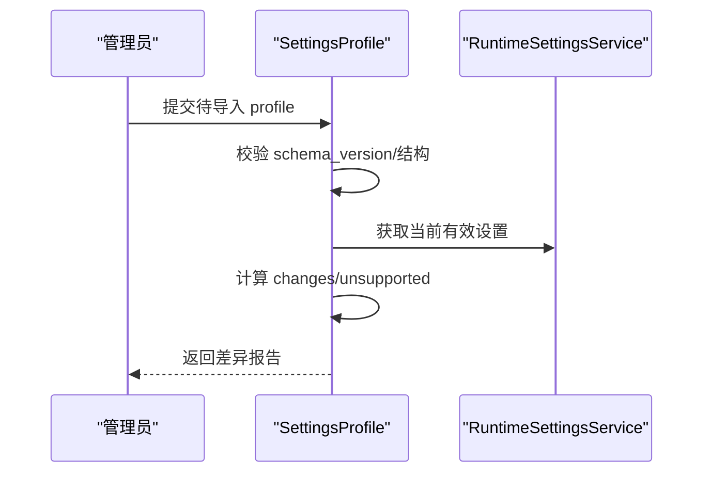
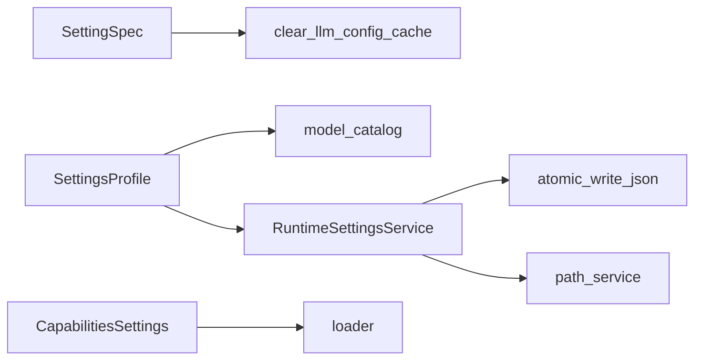

# 配置验证与迁移

<cite>
**本文引用的文件**   
- [deeptutor/services/config/loader.py](file://deeptutor/services/config/loader.py)
- [deeptutor/services/config/settings_spec.py](file://deeptutor/services/config/settings_spec.py)
- [deeptutor/services/config/runtime_settings.py](file://deeptutor/services/config/runtime_settings.py)
- [deeptutor/services/config/capabilities_settings.py](file://deeptutor/services/config/capabilities_settings.py)
- [deeptutor/services/config/settings_profile.py](file://deeptutor/services/config/settings_profile.py)
- [deeptutor/config/settings.py](file://deeptutor/config/settings.py)
- [deeptutor/services/mcp/config.py](file://deeptutor/services/mcp/config.py)
</cite>

## 目录
1. [简介](#简介)
2. [项目结构](#项目结构)
3. [核心组件](#核心组件)
4. [架构总览](#架构总览)
5. [详细组件分析](#详细组件分析)
6. [依赖关系分析](#依赖关系分析)
7. [性能与并发注意事项](#性能与并发注意事项)
8. [故障排查指南](#故障排查指南)
9. [结论](#结论)
10. [附录：配置键位与约束速查](#附录配置键位与约束速查)

## 简介
本文聚焦 DeepTutor 的配置验证、类型检查、约束条件、版本管理、向后兼容与迁移策略，以及配置错误检测、报告与恢复机制。同时说明配置热重载的实现要点、备份/恢复/同步工具、审计与合规性检查能力，以及配置冲突的解决策略与优先级规则。目标是帮助开发者与运维人员安全地演进配置结构，避免破坏现有部署。

## 项目结构
DeepTutor 的配置体系由多个层次组成：
- 运行时 JSON 设置服务：负责系统、认证、集成、文档解析、检索引擎等配置的加载、规范化、原子写入与环境变量注入。
- 可写设置规格表：以声明式方式描述“界面、模型、解析”三类可写配置项，包含读取、可选值、写入、校验与连通性探测。
- 能力参数读写：将 UI 暴露的能力参数拆分到 agents.yaml 与 main.yaml，并做严格类型归一化与范围钳制。
- 设置导出/导入 Profile：对非敏感配置进行脱敏导出，并提供只读差异审查，防止误改或泄露密钥。
- YAML 配置加载器：统一加载 agents.yaml/main.yaml，注入运行时路径，合并默认值，提供语言与能力参数查询。
- Pydantic 环境变量设置：通过 pydantic-settings 从环境变量加载 LLM 重试等全局设置。
- MCP 配置：使用 Pydantic 校验服务器名称，并以原子方式持久化。

**图表来源**
- [deeptutor/services/config/runtime_settings.py:509-763](file://deeptutor/services/config/runtime_settings.py#L509-L763)
- [deeptutor/services/config/settings_spec.py:94-114](file://deeptutor/services/config/settings_spec.py#L94-L114)
- [deeptutor/services/config/capabilities_settings.py:41-101](file://deeptutor/services/config/capabilities_settings.py#L41-L101)
- [deeptutor/services/config/loader.py:86-148](file://deeptutor/services/config/loader.py#L86-L148)
- [deeptutor/config/settings.py:19-50](file://deeptutor/config/settings.py#L19-L50)
- [deeptutor/services/mcp/config.py:102-153](file://deeptutor/services/mcp/config.py#L102-L153)
- [deeptutor/services/config/settings_profile.py:248-261](file://deeptutor/services/config/settings_profile.py#L248-L261)

**章节来源**
- [deeptutor/services/config/runtime_settings.py:509-763](file://deeptutor/services/config/runtime_settings.py#L509-L763)
- [deeptutor/services/config/settings_spec.py:94-114](file://deeptutor/services/config/settings_spec.py#L94-L114)
- [deeptutor/services/config/capabilities_settings.py:41-101](file://deeptutor/services/config/capabilities_settings.py#L41-L101)
- [deeptutor/services/config/loader.py:86-148](file://deeptutor/services/config/loader.py#L86-L148)
- [deeptutor/config/settings.py:19-50](file://deeptutor/config/settings.py#L19-L50)
- [deeptutor/services/mcp/config.py:102-153](file://deeptutor/services/mcp/config.py#L102-L153)
- [deeptutor/services/config/settings_profile.py:248-261](file://deeptutor/services/config/settings_profile.py#L248-L261)

## 核心组件
- RuntimeSettingsService：集中管理所有 JSON 配置文件的加载、规范化、默认值填充、进程环境变量覆盖与原子写入；提供 ensure_defaults 初始化与 render_environment 渲染子进程环境。
- SettingSpec 表：声明式定义可写配置项（key、area、scope、effect、read/write/choices/validate/probe/effect_detail），为设置能力提供统一的元数据驱动。
- CapabilitiesSettings：将 UI 暴露的能力参数拆写到 agents.yaml 与 main.yaml，并对 temperature/max_tokens/rounds 等字段做严格类型归一化与范围钳制。
- ConfigLoader：统一加载 YAML 配置，注入运行时路径，合并默认值，提供 get_agent_params/get_capability_params 等查询接口。
- SettingsProfile：导出非敏感配置快照，支持 schema_version 校验与差异审查，避免泄露密钥与部署地址。
- Pydantic Settings：基于 pydantic-settings 的环境变量映射，提供 LLM 重试等全局设置的强类型校验与弃用属性告警。
- MCP Config：使用 Pydantic 校验服务器名，并以临时文件+fsync+replace 实现原子写入，避免半写损坏导致全量失效。

**章节来源**
- [deeptutor/services/config/runtime_settings.py:509-763](file://deeptutor/services/config/runtime_settings.py#L509-L763)
- [deeptutor/services/config/settings_spec.py:94-114](file://deeptutor/services/config/settings_spec.py#L94-L114)
- [deeptutor/services/config/capabilities_settings.py:41-101](file://deeptutor/services/config/capabilities_settings.py#L41-L101)
- [deeptutor/services/config/loader.py:86-148](file://deeptutor/services/config/loader.py#L86-L148)
- [deeptutor/services/config/settings_profile.py:248-261](file://deeptutor/services/config/settings_profile.py#L248-L261)
- [deeptutor/config/settings.py:19-50](file://deeptutor/config/settings.py#L19-L50)
- [deeptutor/services/mcp/config.py:102-153](file://deeptutor/services/mcp/config.py#L102-L153)

## 架构总览
下图展示配置从“用户输入/UI/API”到“磁盘持久化与运行期生效”的完整链路，包括验证、迁移、探测与热更新。

**图表来源**
- [deeptutor/services/config/settings_spec.py:94-114](file://deeptutor/services/config/settings_spec.py#L94-L114)
- [deeptutor/services/config/runtime_settings.py:554-627](file://deeptutor/services/config/runtime_settings.py#L554-L627)
- [deeptutor/services/config/capabilities_settings.py:424-446](file://deeptutor/services/config/capabilities_settings.py#L424-L446)
- [deeptutor/services/config/loader.py:347-385](file://deeptutor/services/config/loader.py#L347-L385)

## 详细组件分析

### 运行时 JSON 设置服务（RuntimeSettingsService）
- 职责
  - 加载/保存 system、auth、integrations、document_parsing、pageindex、query_rewrite、ima、llamaindex、graphrag、lightrag 等 JSON 配置。
  - 规范化（normalize_*）与默认值填充，确保旧版本结构能平滑升级。
  - 进程环境变量覆盖（如 security_guard、MinerU/Docling/Tika 引擎），区分“部署级覆盖”和“文件级设置”。
  - ensure_defaults 在启动时预创建缺失文件；render_environment 将非敏感设置渲染为子进程环境变量。
- 类型与约束
  - 端口范围、布尔/整型强制转换、主机列表标准化、CORS origins 规范化。
  - 文档解析引擎白名单、图像格式白名单、LightRAG 角色结构校验。
- 迁移与兼容性
  - document_parsing.json 从 v1 MinerU 扁平结构迁移到 v2 多引擎结构，保留历史行为。
  - LightRAG 老文件自动补齐 version 与 roles 结构。
- 原子性与一致性
  - 使用 atomic_write_json 保证写入不产生半写文件。
  - 对无效 JSON 回退为空对象，避免崩溃。

**图表来源**
- [deeptutor/services/config/runtime_settings.py:554-627](file://deeptutor/services/config/runtime_settings.py#L554-L627)
- [deeptutor/services/config/runtime_settings.py:752-763](file://deeptutor/services/config/runtime_settings.py#L752-L763)

**章节来源**
- [deeptutor/services/config/runtime_settings.py:16-127](file://deeptutor/services/config/runtime_settings.py#L16-L127)
- [deeptutor/services/config/runtime_settings.py:442-507](file://deeptutor/services/config/runtime_settings.py#L442-L507)
- [deeptutor/services/config/runtime_settings.py:509-763](file://deeptutor/services/config/runtime_settings.py#L509-L763)
- [deeptutor/services/config/runtime_settings.py:765-800](file://deeptutor/services/config/runtime_settings.py#L765-L800)

### 可写设置规格表（SettingSpec）
- 设计要点
  - 每个可写配置项是一个 SettingSpec，包含 key、area、scope、effect、label、summary、read、choices、write、validate、probe、effect_detail。
  - scope=personal/global 决定写入位置（个人 interface.json vs 全局 runtime settings）。
  - effect=instant/restart/reindex 明确生效时机，指导用户后续操作。
  - probe 用于“提交前连通性探测”，失败则拒绝写入，避免把助手“断电”。
- 典型场景
  - 界面语言/主题：personal，instant。
  - 文档解析引擎：global，instant，validate 检查引擎可用性。
  - 聊天模型/嵌入模型：global，instant/reindex，probe 调用真实 LLM/Embedding 端点。
  - Web 搜索提供者：global，instant，检查 API Key 是否存在。

**图表来源**
- [deeptutor/services/config/settings_spec.py:66-114](file://deeptutor/services/config/settings_spec.py#L66-L114)

**章节来源**
- [deeptutor/services/config/settings_spec.py:66-114](file://deeptutor/services/config/settings_spec.py#L66-L114)
- [deeptutor/services/config/settings_spec.py:202-241](file://deeptutor/services/config/settings_spec.py#L202-L241)
- [deeptutor/services/config/settings_spec.py:249-342](file://deeptutor/services/config/settings_spec.py#L249-L342)
- [deeptutor/services/config/settings_spec.py:349-692](file://deeptutor/services/config/settings_spec.py#L349-L692)

### 能力参数读写（CapabilitiesSettings）
- 职责
  - 将 UI 暴露的能力参数（temperature、max_tokens、max_rounds、tool_timeout 等）拆分到两个文件：
    - agents.yaml：LLM 参数（temperature、各阶段 max_tokens）。
    - main.yaml：运行时行为（循环上限、工具超时、重试策略等）。
- 验证与约束
  - 对所有数值字段进行 float/int 强制转换与范围钳制（例如 temperature∈[0,2]，max_tokens∈[1,200000]，max_rounds∈[1,50]）。
  - 清理不再使用的旧键（如 chat 的 targeting/explore/act 等），避免污染配置。
  - 未知键直接丢弃，不会静默传播。
- 默认值与合并
  - 内置 DEFAULT_CHAT_PARAMS、_SIMPLE_LLM_DEFAULTS、_MAIN_YAML_RUNTIME_DEFAULTS，保证新增能力无需用户手动编辑即可拥有合理默认值。

**图表来源**
- [deeptutor/services/config/capabilities_settings.py:41-101](file://deeptutor/services/config/capabilities_settings.py#L41-L101)
- [deeptutor/services/config/capabilities_settings.py:158-183](file://deeptutor/services/config/capabilities_settings.py#L158-L183)
- [deeptutor/services/config/capabilities_settings.py:327-446](file://deeptutor/services/config/capabilities_settings.py#L327-L446)

**章节来源**
- [deeptutor/services/config/capabilities_settings.py:41-101](file://deeptutor/services/config/capabilities_settings.py#L41-L101)
- [deeptutor/services/config/capabilities_settings.py:158-183](file://deeptutor/services/config/capabilities_settings.py#L158-L183)
- [deeptutor/services/config/capabilities_settings.py:327-446](file://deeptutor/services/config/capabilities_settings.py#L327-L446)

### YAML 配置加载器（ConfigLoader）
- 职责
  - 统一加载 agents.yaml/main.yaml，注入运行时路径（workspace、user_data_dir、knowledge_bases_dir 等）。
  - 提供 get_agent_params/get_capability_params/get_chat_params 等查询接口，按能力/模块返回温度与 token 预算。
  - parse_language 统一语言代码归一化，支持多种别名。
- 默认值与合并
  - _deep_merge 递归合并基础配置与用户覆盖。
  - get_capability_params 仅允许已知 stage 键，未知键被丢弃，防止拼写错误造成越权覆盖。

**图表来源**
- [deeptutor/services/config/loader.py:29-78](file://deeptutor/services/config/loader.py#L29-L78)
- [deeptutor/services/config/loader.py:111-148](file://deeptutor/services/config/loader.py#L111-L148)
- [deeptutor/services/config/loader.py:202-285](file://deeptutor/services/config/loader.py#L202-L285)
- [deeptutor/services/config/loader.py:347-385](file://deeptutor/services/config/loader.py#L347-L385)

**章节来源**
- [deeptutor/services/config/loader.py:29-78](file://deeptutor/services/config/loader.py#L29-L78)
- [deeptutor/services/config/loader.py:86-148](file://deeptutor/services/config/loader.py#L86-L148)
- [deeptutor/services/config/loader.py:171-199](file://deeptutor/services/config/loader.py#L171-L199)
- [deeptutor/services/config/loader.py:202-285](file://deeptutor/services/config/loader.py#L202-L285)
- [deeptutor/services/config/loader.py:347-385](file://deeptutor/services/config/loader.py#L347-L385)

### 设置导出/导入 Profile（SettingsProfile）
- 职责
  - export_settings_profile：导出非敏感配置快照（schema_version、generated_at、profile.settings），不包含密钥与部署地址。
  - review_settings_profile_import：校验 schema_version，比较 proposed 与 current，输出 changes 与 unsupported 列表，供管理员审阅后再执行实际导入。
- 安全性
  - 识别 secret/deployment 字段，导出时替换为 presence 标记或空值。
  - 导入审查时拒绝未知字段、类型不匹配、列表长度变化等不安全变更。

**图表来源**
- [deeptutor/services/config/settings_profile.py:248-261](file://deeptutor/services/config/settings_profile.py#L248-L261)
- [deeptutor/services/config/settings_profile.py:364-407](file://deeptutor/services/config/settings_profile.py#L364-L407)

**章节来源**
- [deeptutor/services/config/settings_profile.py:248-261](file://deeptutor/services/config/settings_profile.py#L248-L261)
- [deeptutor/services/config/settings_profile.py:364-407](file://deeptutor/services/config/settings_profile.py#L364-L407)

### Pydantic 环境变量设置（LLM 重试）
- 通过 pydantic-settings 从环境变量加载 LLM 重试策略，提供强类型校验与弃用属性警告（settings.llm_retry -> settings.retry）。
- 适合部署侧通过环境变量快速调整重试次数、基础延迟与指数退避开关。

**章节来源**
- [deeptutor/config/settings.py:19-50](file://deeptutor/config/settings.py#L19-L50)

### MCP 配置（原子写入与校验）
- 使用 Pydantic 校验 MCP server 名称格式。
- save_mcp_config 采用 tmp 文件 + fsync + os.replace 实现原子写入，避免半写导致全部连接断开。

**章节来源**
- [deeptutor/services/mcp/config.py:102-153](file://deeptutor/services/mcp/config.py#L102-L153)

## 依赖关系分析
- RuntimeSettingsService 依赖 file_io.atomic_write_json 与 path_service.get_path_service，确保跨平台路径与原子写入。
- SettingSpec 通过 deferred imports 避免循环依赖，并在 write 后调用 clear_llm_config_cache 使热更新立即生效。
- CapabilitiesSettings 依赖 loader.PROJECT_ROOT 与 get_runtime_settings_dir，确保 YAML 路径一致。
- SettingsProfile 依赖 model_catalog 与 runtime_settings，导出/对比时保持结构与字段白名单一致。

**图表来源**
- [deeptutor/services/config/runtime_settings.py:509-553](file://deeptutor/services/config/runtime_settings.py#L509-L553)
- [deeptutor/services/config/settings_spec.py:476-488](file://deeptutor/services/config/settings_spec.py#L476-L488)
- [deeptutor/services/config/capabilities_settings.py:31-36](file://deeptutor/services/config/capabilities_settings.py#L31-L36)
- [deeptutor/services/config/settings_profile.py:15-23](file://deeptutor/services/config/settings_profile.py#L15-L23)

**章节来源**
- [deeptutor/services/config/runtime_settings.py:509-553](file://deeptutor/services/config/runtime_settings.py#L509-L553)
- [deeptutor/services/config/settings_spec.py:476-488](file://deeptutor/services/config/settings_spec.py#L476-L488)
- [deeptutor/services/config/capabilities_settings.py:31-36](file://deeptutor/services/config/capabilities_settings.py#L31-L36)
- [deeptutor/services/config/settings_profile.py:15-23](file://deeptutor/services/config/settings_profile.py#L15-L23)

## 性能与并发注意事项
- 原子写入：所有 JSON 设置均通过 atomic_write_json 写入，避免并发写入导致文件损坏。
- 缓存刷新：修改 catalog 选择后会清除 LLM 配置缓存，确保下一次请求使用新配置。
- 探测超时：LLM/Embedding 探测限制最大耗时（约 25 秒），避免长轮询阻塞对话。
- 环境变量渲染：render_environment 将非敏感设置渲染为子进程环境变量，减少重复解析开销。

**章节来源**
- [deeptutor/services/config/settings_spec.py:476-488](file://deeptutor/services/config/settings_spec.py#L476-L488)
- [deeptutor/services/config/settings_spec.py:511-579](file://deeptutor/services/config/settings_spec.py#L511-L579)
- [deeptutor/services/config/runtime_settings.py:765-800](file://deeptutor/services/config/runtime_settings.py#L765-L800)

## 故障排查指南
- 配置文件未找到
  - 现象：resolve_config_path 抛出 FileNotFoundError。
  - 处理：确认 data/user/settings 目录下存在目标 YAML 文件。
- 无效 JSON 或损坏文件
  - 现象：RuntimeSettingsService._json_object 捕获异常并返回空对象。
  - 处理：检查对应 JSON 文件语法；必要时删除重建或使用备份恢复。
- 引擎不可用
  - 现象：validate_parsing_engine 返回安装提示。
  - 处理：先安装解析引擎，再选择该引擎。
- 模型/嵌入端点不可达
  - 现象：probe_llm/probe_embedding 返回失败详情（含脱敏信息）。
  - 处理：检查 base_url/api_key/网络可达性；必要时降低 request_timeout 或更换 provider。
- 能力参数超出范围
  - 现象：coerce_float/coerce_int 钳制到边界值。
  - 处理：调整至允许范围（如 temperature∈[0,2]，max_tokens∈[1,200000]）。
- MCP 配置写入失败
  - 现象：save_mcp_config 中临时文件未清理或 replace 失败。
  - 处理：检查磁盘权限与空间；确认 tmp 文件已清理。

**章节来源**
- [deeptutor/services/config/loader.py:86-108](file://deeptutor/services/config/loader.py#L86-L108)
- [deeptutor/services/config/runtime_settings.py:478-485](file://deeptutor/services/config/runtime_settings.py#L478-L485)
- [deeptutor/services/config/settings_spec.py:306-318](file://deeptutor/services/config/settings_spec.py#L306-L318)
- [deeptutor/services/config/settings_spec.py:535-632](file://deeptutor/services/config/settings_spec.py#L535-L632)
- [deeptutor/services/config/capabilities_settings.py:158-183](file://deeptutor/services/config/capabilities_settings.py#L158-L183)
- [deeptutor/services/mcp/config.py:135-153](file://deeptutor/services/mcp/config.py#L135-L153)

## 结论
DeepTutor 的配置体系以“声明式规格 + 强类型校验 + 原子写入 + 探测前置”为核心，兼顾了易用性、安全性与可维护性。通过 RuntimeSettingsService 统一管理 JSON 配置，SettingSpec 驱动可写能力，CapabilitiesSettings 精确控制能力参数，ConfigLoader 统一 YAML 加载与默认值合并，SettingsProfile 提供安全的导出/导入审查，Pydantic Settings 与 MCP Config 强化环境变量与外部集成的健壮性。整体方案实现了清晰的版本管理、向后兼容与迁移策略，并为配置热重载提供了可靠保障。

## 附录：配置键位与约束速查
- 系统设置（system.json）
  - backend_port/frontend_port：端口范围 1-65535。
  - cors_origin/cors_origins：CORS 源规范化。
  - security_guard.*：速率限制、可信代理、白/黑名单。
  - chat_attachment_max_file_mb/total_mb/chars_per_doc/chars_total：附件大小与字符预算。
- 认证设置（auth.json）
  - enabled/token_expire_hours/cookie_secure/private_login_hosts。
- 集成设置（integrations.json）
  - turn_coordination.backend/url/key_prefix/lease_ttl_seconds/renew_interval_seconds/recovery_interval_seconds/stream_retention_seconds。
- 文档解析（document_parsing.json）
  - engine ∈ {text_only, mineru, docling, markitdown, pymupdf4llm, liteparse, tika}。
  - engines.mineru/docling/markitdown/pymupdf4llm/liteparse/tika.* 各引擎自有字段。
- 检索引擎
  - llamaindex：retrieval_profile/top_k/vector_index_type/chunk_size 等。
  - graphrag：response_type/community_level/dynamic_community_selection。
  - lightrag：top_k/response_type/llm_timeout/llm_profile_id/llm_model_id。
- 能力参数（agents.yaml/main.yaml）
  - temperature：float，通常钳制在 [0,2]。
  - max_tokens：int，通常钳制在 [1,200000]。
  - max_rounds：int，通常钳制在 [1,50]。
  - research.tool_timeout/tool_max_retries/paper_search_years_limit。
  - question.exploring.max_iterations/tool_summarizer.enabled/max_tokens。

**章节来源**
- [deeptutor/services/config/runtime_settings.py:16-127](file://deeptutor/services/config/runtime_settings.py#L16-L127)
- [deeptutor/services/config/runtime_settings.py:129-283](file://deeptutor/services/config/runtime_settings.py#L129-L283)
- [deeptutor/services/config/runtime_settings.py:300-417](file://deeptutor/services/config/runtime_settings.py#L300-L417)
- [deeptutor/services/config/capabilities_settings.py:54-101](file://deeptutor/services/config/capabilities_settings.py#L54-L101)
- [deeptutor/services/config/capabilities_settings.py:158-183](file://deeptutor/services/config/capabilities_settings.py#L158-L183)