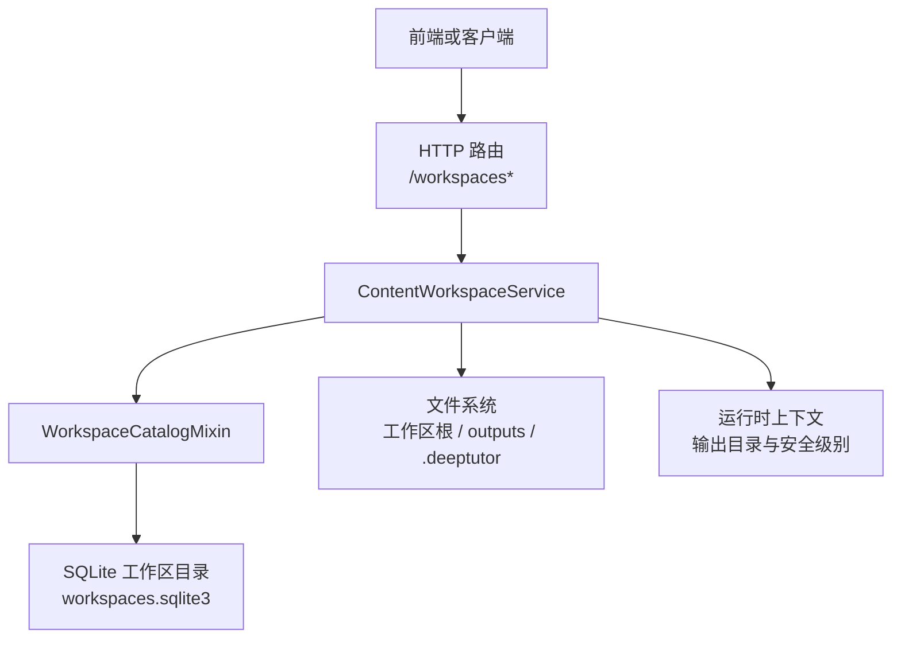
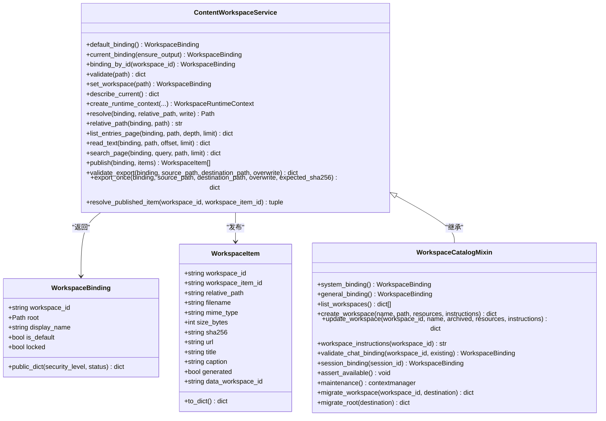
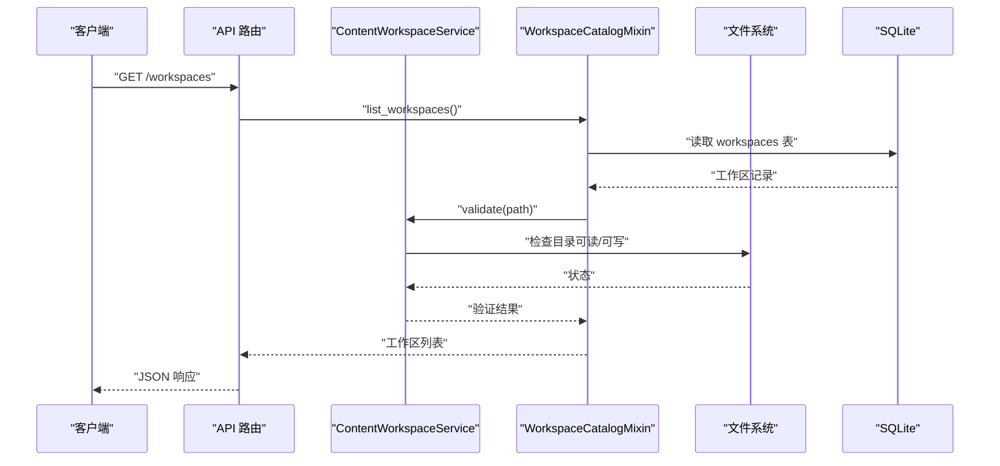
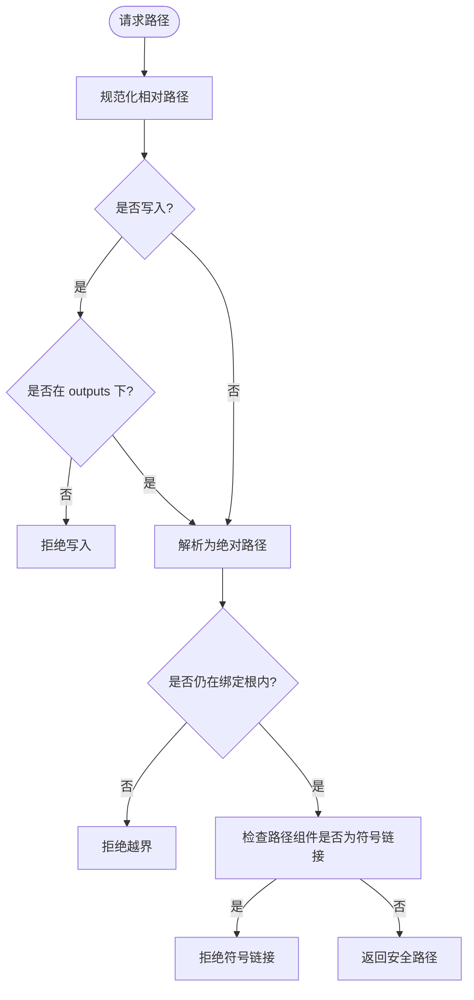
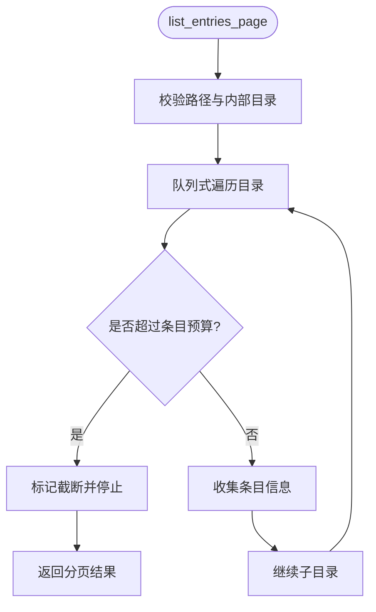
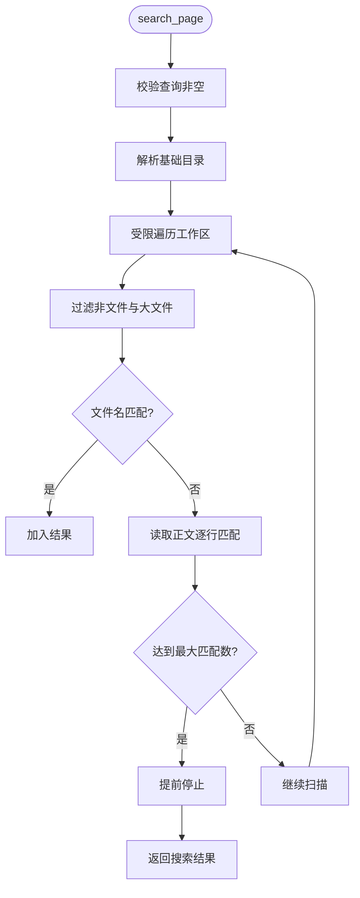
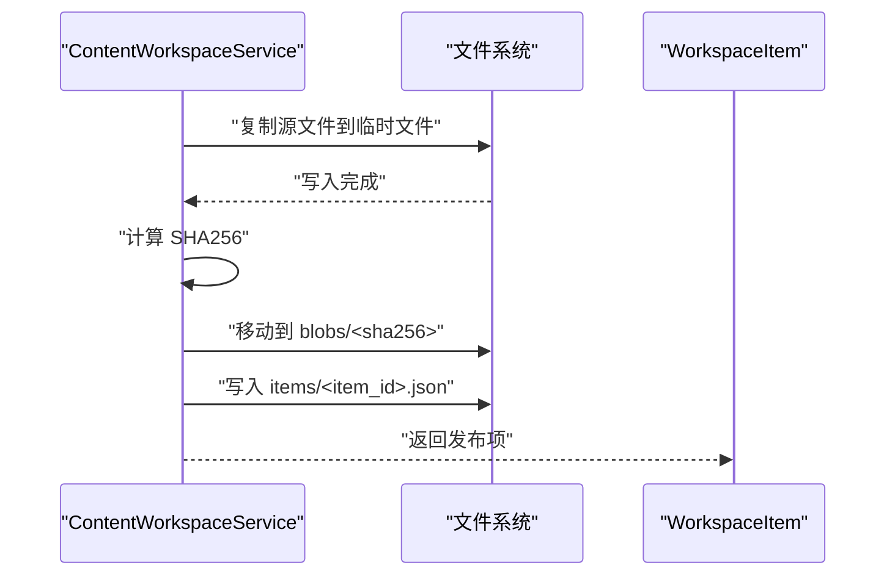
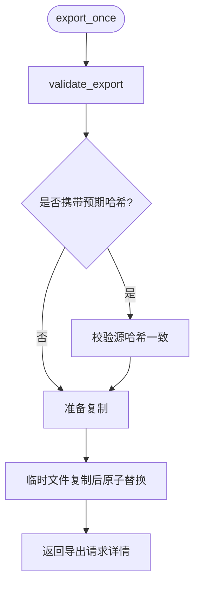
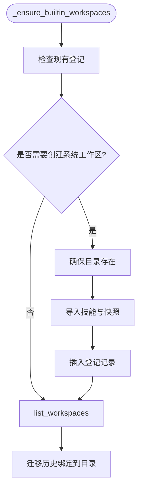
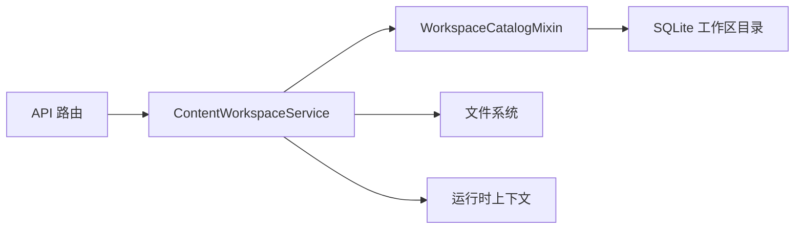

# 学习工作区系统

<cite>
**本文引用的文件**   
- [service.py](file://deeptutor/services/workspace/service.py)
- [catalog.py](file://deeptutor/services/workspace/catalog.py)
- [models.py](file://deeptutor/services/workspace/models.py)
- [workspaces.md](file://docs-for-dev/workspaces.md)
- [router_index.json](file://deeptutor/api/router_index.json)
</cite>

## 目录
1. [引言](#引言)
2. [项目结构](#项目结构)
3. [核心组件](#核心组件)
4. [架构总览](#架构总览)
5. [详细组件分析](#详细组件分析)
6. [依赖关系分析](#依赖关系分析)
7. [性能与资源控制](#性能与资源控制)
8. [故障排查指南](#故障排查指南)
9. [结论](#结论)

## 引言
本文件系统性梳理 DeepTutor 的“学习工作区系统”。该系统负责为用户隔离和编排学习内容：包括默认工作区、通用工作区、系统工作区以及用户自定义工作区；提供工作区注册、创建、切换、归档、迁移、文件浏览、文本读取、内容搜索、产物发布、导出校验与执行等能力。其设计强调路径安全、权限边界、可审计性与可扩展性，同时兼顾部署环境（本地、多用户、远程部署）的差异。

## 项目结构
学习工作区相关代码集中在 `deeptutor/services/workspace/`，并以 API 路由索引对外暴露 HTTP 接口。关键组织方式如下：
- 服务层：`ContentWorkspaceService` 负责路径解析、访问控制、文件操作、运行时上下文构建、产物发布与导出。
- 目录层：`WorkspaceCatalogMixin` 负责工作区登记、内置工作区初始化、元数据与迁移锁、工作区列表与更新。
- 模型层：`WorkspaceBinding`、`WorkspaceItem`、`WorkspaceError` 定义稳定值对象与错误类型。
- 文档层：`docs-for-dev/workspaces.md` 说明工作区用途、存放位置、迁移策略、CLI/SDK 用法与资源分配规则。
- 接口层：`deeptutor/api/router_index.json` 声明 `/workspaces*` 相关 HTTP 端点。

**图表来源**
- [router_index.json:2433-2489](file://deeptutor/api/router_index.json#L2433-L2489)
- [service.py:81-813](file://deeptutor/services/workspace/service.py#L81-L813)
- [catalog.py:47-545](file://deeptutor/services/workspace/catalog.py#L47-L545)

**章节来源**
- [workspaces.md:1-96](file://docs-for-dev/workspaces.md#L1-L96)
- [router_index.json:2433-2489](file://deeptutor/api/router_index.json#L2433-L2489)

## 核心组件
本节聚焦三个核心类及其职责边界。

| 组件 | 主要职责 | 关键行为 |
| --- | --- | --- |
| `ContentWorkspaceService` | 工作区绑定解析、路径约束、文件读写、搜索、产物发布、导出校验与执行、运行时上下文构造 | 校验允许根目录、限制写入到 `outputs`、生成逻辑输出路径、防符号链接逃逸、按会话/轮次隔离输出 |
| `WorkspaceCatalogMixin` | 工作区登记、内置工作区初始化、工作区列表与更新、迁移锁与维护模式 | SQLite 持久化、所有者隔离、系统/通用工作区快照、维护事务保护 |
| `WorkspaceBinding` / `WorkspaceItem` | 稳定值对象 | 绑定包含工作区 ID、根路径、显示名、是否默认、是否锁定；物品包含摘要、URL、来源工作区等 |

**图表来源**
- [models.py:12-52](file://deeptutor/services/workspace/models.py#L12-L52)
- [service.py:81-813](file://deeptutor/services/workspace/service.py#L81-L813)
- [catalog.py:47-545](file://deeptutor/services/workspace/catalog.py#L47-L545)

**章节来源**
- [models.py:12-52](file://deeptutor/services/workspace/models.py#L12-L52)
- [service.py:81-813](file://deeptutor/services/workspace/service.py#L81-L813)
- [catalog.py:47-545](file://deeptutor/services/workspace/catalog.py#L47-L545)

## 架构总览
工作区系统采用“服务 + 目录”分层：
- 服务层处理业务语义：绑定解析、权限校验、路径规范化、输出隔离、产物发布、导出授权。
- 目录层处理持久化：SQLite 存储工作区登记信息、元数据、迁移标记。
- 文件系统层承载实际数据：工作区根目录、`outputs` 产物目录、`.deeptutor` 内部目录、私有展示目录。
- API 层通过路由索引暴露工作区管理接口，供前端或 CLI/SDK 调用。

**图表来源**
- [router_index.json:2433-2489](file://deeptutor/api/router_index.json#L2433-L2489)
- [catalog.py:246-302](file://deeptutor/services/workspace/catalog.py#L246-L302)
- [service.py:236-255](file://deeptutor/services/workspace/service.py#L236-L255)

## 详细组件分析

### 工作区绑定与路径安全
- 绑定解析优先使用已登记工作区；若未登记则回退到当前设置中的活动工作区或默认工作区。
- 所有路径必须经过规范化与相对化校验，禁止越界路径、绝对路径、空路径及包含 `..` 的路径。
- 写入操作仅允许进入 `outputs`；其他写入需要显式授权流程。
- 对符号链接进行严格检查，防止通过软链接绕过工作区边界。
- 部署模式下可锁定工作区根目录，避免运行时切换。

**图表来源**
- [service.py:70-78](file://deeptutor/services/workspace/service.py#L70-L78)
- [service.py:350-369](file://deeptutor/services/workspace/service.py#L350-L369)
- [service.py:371-379](file://deeptutor/services/workspace/service.py#L371-L379)

**章节来源**
- [service.py:144-206](file://deeptutor/services/workspace/service.py#L144-L206)
- [service.py:350-379](file://deeptutor/services/workspace/service.py#L350-L379)

### 工作区目录扫描与分页
- 目录遍历不跟随符号链接，跳过 `.deeptutor` 内部目录。
- 支持深度与条目数上限，避免大目录导致性能问题。
- 返回结构化条目，包含路径、名称、类型、大小、修改时间，并明确标注是否被截断。

**图表来源**
- [service.py:410-448](file://deeptutor/services/workspace/service.py#L410-L448)
- [service.py:450-496](file://deeptutor/services/workspace/service.py#L450-L496)

**章节来源**
- [service.py:410-496](file://deeptutor/services/workspace/service.py#L410-L496)

### 文本读取与内容搜索
- 文本读取支持偏移与长度限制，自动检测 UTF-8 解码失败。
- 搜索在硬遍历预算内进行，文件名匹配优先，正文匹配限制文件大小，避免大文件阻塞。
- 搜索结果包含路径、行号与预览片段，并报告扫描条目数与截断状态。

**图表来源**
- [service.py:514-551](file://deeptutor/services/workspace/service.py#L514-L551)
- [service.py:553-623](file://deeptutor/services/workspace/service.py#L553-L623)

**章节来源**
- [service.py:514-623](file://deeptutor/services/workspace/service.py#L514-L623)

### 产物发布与引用解析
- 发布将源文件复制到私有展示目录的 `blobs`，以 SHA256 去重。
- 每个发布项生成稳定 ID，并写入 JSON manifest，同时生成公开 URL。
- 解析发布项时校验 manifest 与工作区归属，确保 blob 未被替换或越界。

**图表来源**
- [service.py:625-698](file://deeptutor/services/workspace/service.py#L625-L698)
- [service.py:782-813](file://deeptutor/services/workspace/service.py#L782-L813)

**章节来源**
- [service.py:625-698](file://deeptutor/services/workspace/service.py#L625-L698)
- [service.py:782-813](file://deeptutor/services/workspace/service.py#L782-L813)

### 导出授权与一次性执行
- 导出前需先校验：源必须在 `outputs`，目标不能是内部目录，目标不能是目录，且不允许覆盖未授权的目标。
- 校验通过后，执行一次性复制，再次校验 SHA256 与目标存在性，使用原子替换保证一致性。

**图表来源**
- [service.py:700-780](file://deeptutor/services/workspace/service.py#L700-L780)

**章节来源**
- [service.py:700-780](file://deeptutor/services/workspace/service.py#L700-L780)

### 工作区登记与内置工作区
- 系统工作区与通用工作区按需初始化，系统工作区会脱敏快照配置并导入技能。
- 工作区列表保留历史绑定，并在首次发现时登记到目录。
- 维护模式通过 SQLite 元数据标记迁移进程，防止并发迁移破坏数据。

**图表来源**
- [catalog.py:177-230](file://deeptutor/services/workspace/catalog.py#L177-L230)
- [catalog.py:246-302](file://deeptutor/services/workspace/catalog.py#L246-L302)

**章节来源**
- [catalog.py:177-230](file://deeptutor/services/workspace/catalog.py#L177-L230)
- [catalog.py:246-302](file://deeptutor/services/workspace/catalog.py#L246-L302)

## 依赖关系分析
- `ContentWorkspaceService` 继承 `WorkspaceCatalogMixin`，复用目录管理能力，同时扩展文件系统操作。
- 目录层依赖 SQLite 存储工作区登记与元数据，并通过所有者隔离避免跨用户污染。
- API 路由通过 `router_index.json` 声明 `/workspaces*` 端点，由上层路由加载器分发到具体处理器。
- 运行时上下文由服务根据能力、会话、轮次生成逻辑输出路径，确保不同任务互不干扰。

**图表来源**
- [router_index.json:2433-2489](file://deeptutor/api/router_index.json#L2433-L2489)
- [service.py:81-813](file://deeptutor/services/workspace/service.py#L81-L813)
- [catalog.py:47-545](file://deeptutor/services/workspace/catalog.py#L47-L545)

**章节来源**
- [router_index.json:2433-2489](file://deeptutor/api/router_index.json#L2433-L2489)
- [service.py:81-813](file://deeptutor/services/workspace/service.py#L81-L813)
- [catalog.py:47-545](file://deeptutor/services/workspace/catalog.py#L47-L545)

## 性能与资源控制
- 目录遍历与搜索均设置硬预算，避免大目录或大量文件导致长时间阻塞。
- 文本读取与搜索限制单次读取大小与匹配数量，减少内存占用与 CPU 消耗。
- 发布过程使用流式拷贝与 SHA256 去重，降低重复存储开销。
- 导出操作使用临时文件与原子替换，提高一致性与容错性。
- 维护模式通过进程存活探测与元数据标记，避免并发迁移造成数据损坏。

[本节为通用指导，不直接分析具体文件]

## 故障排查指南
常见错误与定位建议：
- “所选工作区文件夹不存在”：检查工作区根路径是否存在且为目录。
- “所选工作区文件夹不可读”：检查操作系统权限与符号链接。
- “工作区输出目录离开工作区”：检查 `outputs` 是否仍位于工作区根内。
- “工作区路径过长”：Windows 上可能触发 MAX_PATH 限制，缩短路径。
- “工作区不在管理员允许的根目录下”：检查环境变量与部署配置。
- “工作区正在迁移中”：等待迁移完成或清理残留迁移标记。
- “工作区项清单无效”：检查发布项 ID 与工作区归属是否匹配。

**章节来源**
- [service.py:208-234](file://deeptutor/services/workspace/service.py#L208-L234)
- [service.py:350-379](file://deeptutor/services/workspace/service.py#L350-L379)
- [catalog.py:466-500](file://deeptutor/services/workspace/catalog.py#L466-L500)
- [service.py:782-813](file://deeptutor/services/workspace/service.py#L782-L813)

## 结论
DeepTutor 的学习工作区系统通过稳定的绑定模型、严格的目录边界、可控的资源扫描与安全的导出机制，为多用户、多会话、多能力的学习场景提供了可靠的数据隔离与协作基础。目录层与服务层解耦，便于扩展新的工作区类型与集成外部存储；API 层提供清晰的接口契约，支撑前端、CLI 与 SDK 的统一体验。未来可在保持安全边界的前提下，进一步优化大规模目录检索与增量同步能力。