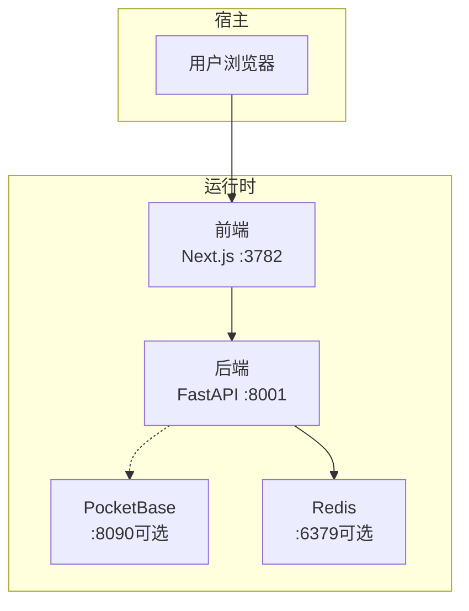
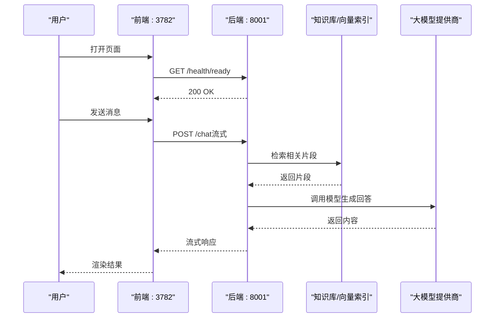
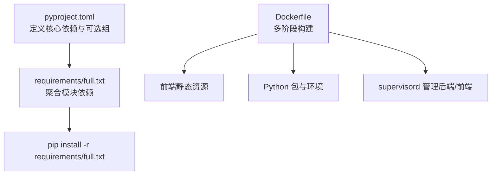

# 快速开始指南

<cite>
**本文引用的文件**   
- [pyproject.toml](file://pyproject.toml)
- [requirements.txt](file://requirements.txt)
- [requirements/full.txt](file://requirements/full.txt)
- [Dockerfile](file://Dockerfile)
- [compose.yaml](file://compose.yaml)
- [scripts/start_web.py](file://scripts/start_web.py)
- [deeptutor/api/run_server.py](file://deeptutor/api/run_server.py)
- [deeptutor_cli/__main__.py](file://deeptutor_cli/__main__.py)
</cite>

## 目录
1. [简介](#简介)
2. [项目结构](#项目结构)
3. [核心组件](#核心组件)
4. [架构总览](#架构总览)
5. [详细组件分析](#详细组件分析)
6. [依赖分析](#依赖分析)
7. [性能考虑](#性能考虑)
8. [故障排除指南](#故障排除指南)
9. [结论](#结论)
10. [附录](#附录)

## 简介
本指南面向首次接触 DeepTutor 的用户，目标是在 30 分钟内完成环境准备、安装配置、启动服务，并跑通第一个对话与知识库上传流程。文档同时提供最小化配置示例、验证步骤、常见问题排查以及开发调试技巧。

DeepTutor 是一个以智能体为核心的学习助手，支持多智能体协作与检索增强生成（RAG）。它包含：
- Python FastAPI 后端
- Next.js 前端
- 可选的 PocketBase 认证/存储侧车
- 可选 Redis 协调服务
- Docker/Podman 容器化部署方案

## 项目结构
仓库采用前后端分离与模块化组织方式：
- deeptutor：Python 后端核心代码、API、能力与工具
- web：Next.js 前端应用
- deeptutor_cli：命令行入口
- scripts：启动脚本与辅助工具
- requirements：模块依赖分组
- compose.yaml：Podman Compose 编排
- Dockerfile：多阶段构建镜像

图表来源
- [compose.yaml:67-206](file://compose.yaml#L67-L206)
- [Dockerfile:250-335](file://Dockerfile#L250-L335)

章节来源
- [compose.yaml:1-63](file://compose.yaml#L1-L63)
- [Dockerfile:1-16](file://Dockerfile#L1-L16)

## 核心组件
- 后端服务：FastAPI + Uvicorn，默认监听 8001 端口
- 前端服务：Next.js 独立服务器，默认监听 3782 端口
- 运行空间：data/user/workspace 作为工作区；data/user/settings 存放运行时设置
- 可选服务：PocketBase（认证/存储）、Redis（多 worker 协调）
- CLI：通过 deeptutor 命令或 python -m deeptutor_cli 启动

关键要点
- 生产镜像由 supervisord 管理后端与前端进程
- 运行时配置从 data/user/settings/*.json 加载，而非环境变量
- 前端在请求时根据 DEEPTUTOR_API_BASE_URL 重写 /api/* 和 /ws/*

章节来源
- [Dockerfile:250-335](file://Dockerfile#L250-L335)
- [Dockerfile:337-521](file://Dockerfile#L337-L521)
- [compose.yaml:137-206](file://compose.yaml#L137-L206)

## 架构总览
下图展示本地开发与容器化两种路径的服务关系与数据流向。

图表来源
- [Dockerfile:282-335](file://Dockerfile#L282-L335)
- [deeptutor/api/run_server.py:80-95](file://deeptutor/api/run_server.py#L80-L95)

## 详细组件分析

### 环境准备
- Python 3.11–3.14（推荐 3.11），Node.js 18+（构建前端需要 Node 22 用于镜像构建）
- Docker 或 Podman（推荐 Podman 4.1+ rootless）
- 可选：PocketBase（认证/存储）、Redis（多 worker 协调）

说明
- pyproject.toml 声明 requires-python >=3.11,<3.15
- Dockerfile 使用 node:22.23.4-slim 构建前端静态资源
- compose.yaml 为 Podman Compose 设计，默认绑定 127.0.0.1

章节来源
- [pyproject.toml:16-47](file://pyproject.toml#L16-L47)
- [Dockerfile:23-51](file://Dockerfile#L23-L51)
- [compose.yaml:1-21](file://compose.yaml#L1-L21)

### 安装流程（本地开发）
步骤
1. 克隆仓库并进入项目根目录
2. 创建并激活 Python 虚拟环境（建议 Python 3.11）
3. 安装依赖
   - 基础依赖：pip install -r requirements.txt
   - 完整功能：pip install -r requirements/full.txt
4. 初始化运行空间与默认配置
   - 运行 deeptutor init（若已安装 CLI）
   - 或直接运行 deeptutor start 自动初始化 data/user/settings
5. 启动服务
   - 开发模式：python scripts/start_web.py --dev
   - 生产模式：python scripts/start_web.py

提示
- 首次启动会创建 data/user/workspace 与 data/user/settings
- 前端默认 3782，后端默认 8001

章节来源
- [requirements.txt:1-3](file://requirements.txt#L1-L3)
- [requirements/full.txt:1-21](file://requirements/full.txt#L1-L21)
- [scripts/start_web.py:17-35](file://scripts/start_web.py#L17-L35)

### 安装流程（容器化）
步骤
1. 复制环境变量模板并编辑
   - cp .env.example .env
2. 启动服务
   - podman compose -f compose.yaml up -d
3. 查看状态与日志
   - podman compose -f compose.yaml ps
   - podman compose -f compose.yaml logs -f deeptutor
4. 停止与清理
   - 保留数据：podman compose -f compose.yaml down
   - 删除数据：podman compose -f compose.yaml down -v

注意
- 默认仅绑定 127.0.0.1，如需外网访问需修改端口映射
- 运行时配置通过 data/user/settings/*.json 修改后重启生效

章节来源
- [compose.yaml:13-26](file://compose.yaml#L13-L26)
- [compose.yaml:67-206](file://compose.yaml#L67-L206)

### 配置文件设置（最小化）
最小化系统设置（system.json）
- backend_port：后端端口（默认 8001）
- frontend_port：前端端口（默认 3782）
- cors_origins：允许的前端源（开发时可设为 ["http://localhost:3782"]）
- sandbox_allow_subprocess：是否允许受限子进程执行（默认开启）

模型目录（model_catalog.json）
- 添加一个可用的 LLM Provider Profile（如 OpenAI、Ollama、LM Studio）
- 确保 base_url、api_key 等字段正确

集成（integrations.json）
- 启用 PocketBase：integrations.pocketbase_url 指向 http://pocketbase:8090（容器内）或外部地址

认证（auth.json）
- 关闭认证：auth.enabled=false（开发环境）
- 启用内置认证：按界面引导设置用户名与密码哈希

章节来源
- [Dockerfile:481-514](file://Dockerfile#L481-L514)
- [compose.yaml:178-189](file://compose.yaml#L178-L189)

### 基本使用示例
启动服务
- 本地开发：python scripts/start_web.py --dev
- 容器化：podman compose -f compose.yaml up -d

访问界面
- 前端：http://localhost:3782
- 后端健康检查：http://localhost:8001/health/ready

创建第一个对话
- 在聊天界面输入任意问题，选择已配置的模型
- 观察流式输出与工具调用过程

上传知识库文档
- 打开“知识库”页面，选择文档（PDF/DOCX/XLSX/PPTX 等）
- 等待索引完成，随后在聊天中提问可触发 RAG 检索

章节来源
- [scripts/start_web.py:33-35](file://scripts/start_web.py#L33-L35)
- [Dockerfile:282-335](file://Dockerfile#L282-L335)
- [compose.yaml:161-177](file://compose.yaml#L161-L177)

### 验证安装是否成功
- 浏览器访问 http://localhost:3782，能正常加载页面
- 后端健康检查返回 200：curl http://localhost:8001/health/ready
- 发起一次聊天，得到流式回复
- 上传一份文档并完成索引，再次提问可命中知识库内容

章节来源
- [Dockerfile:526-548](file://Dockerfile#L526-L548)
- [compose.yaml:190-199](file://compose.yaml#L190-L199)

### 开发环境的调试技巧
- 后端热重载：设置环境变量 DEEPTUTOR_DEV_RELOAD=true 后启动后端
- 单 worker 限制：开发模式下 backend_workers 必须为 1
- 日志位置：data/user/logs/ai_tutor_*.log
- 前端开发：使用 scripts/start_web.py --dev 启动 Next.js 开发服务器
- Windows 事件循环：run_server.py 在 Windows 下切换为 ProactorEventLoop

章节来源
- [deeptutor/api/run_server.py:14-18](file://deeptutor/api/run_server.py#L14-L18)
- [deeptutor/api/run_server.py:68-79](file://deeptutor/api/run_server.py#L68-L79)
- [Dockerfile:590-618](file://Dockerfile#L590-L618)

### 常用命令
- 启动 Web（开发）：python scripts/start_web.py --dev
- 启动 Web（生产）：python scripts/start_web.py
- 直接启动后端：python deeptutor/api/run_server.py
- CLI 入口：deeptutor 或 python -m deeptutor_cli
- 容器化启动：podman compose -f compose.yaml up -d
- 查看容器日志：podman compose -f compose.yaml logs -f deeptutor

章节来源
- [scripts/start_web.py:33-35](file://scripts/start_web.py#L33-L35)
- [deeptutor/api/run_server.py:80-95](file://deeptutor/api/run_server.py#L80-L95)
- [deeptutor_cli/__main__.py:1-5](file://deeptutor_cli/__main__.py#L1-L5)
- [compose.yaml:13-21](file://compose.yaml#L13-L21)

## 依赖分析
- Python 依赖集中在 pyproject.toml 与 requirements 目录
- 完整依赖通过 requirements/full.txt 聚合各模块依赖
- Dockerfile 分阶段构建：前端构建、Node 运行时、Python 依赖、生产镜像

图表来源
- [pyproject.toml:19-94](file://pyproject.toml#L19-L94)
- [requirements/full.txt:1-21](file://requirements/full.txt#L1-L21)
- [Dockerfile:17-188](file://Dockerfile#L17-L188)

章节来源
- [pyproject.toml:19-94](file://pyproject.toml#L19-L94)
- [requirements/full.txt:1-21](file://requirements/full.txt#L1-L21)
- [Dockerfile:17-188](file://Dockerfile#L17-L188)

## 性能考虑
- 后端 workers：生产环境可按 CPU 核数调整 backend_workers；开发模式必须为 1
- WebSocket 帧大小：根据附件策略动态计算 ws_max_size，避免大附件被截断
- Keep-Alive：前后端代理与 uvicorn 保持一致的超时，减少连接竞争
- 内存回收：镜像内置 MALLOC_ARENA_MAX/MALLOC_TRIM_THRESHOLD_ 优化
- 文件系统：只读根文件系统 + tmpfs 提升安全性与稳定性

章节来源
- [Dockerfile:112-119](file://Dockerfile#L112-L119)
- [Dockerfile:282-335](file://Dockerfile#L282-L335)
- [deeptutor/api/run_server.py:80-95](file://deeptutor/api/run_server.py#L80-L95)

## 故障排除指南
常见问题与解决
- 端口冲突
  - 现象：启动时报端口占用
  - 处理：修改 system.json 中的 backend_port/frontend_port，或释放占用端口
- 无法访问前端
  - 现象：浏览器打不开 3782
  - 处理：确认前端进程已启动；检查防火墙与 127.0.0.1 绑定
- 后端健康检查失败
  - 现象：/health/ready 返回非 200
  - 处理：查看 data/user/logs 日志；检查 model_catalog.json 与 provider 配置
- 知识库索引失败
  - 现象：上传文档后索引卡住或报错
  - 处理：检查文档格式与大小；确认 embedding/RAG 相关依赖已安装
- 容器权限错误
  - 现象：写入 data 目录失败
  - 处理：确保 bind mount 目录由当前用户拥有；或使用 PUID/PGID 映射
- Windows 子进程异常
  - 现象：Math Animator 等子进程 API 不可用
  - 处理：run_server.py 已在 Windows 下切换为 ProactorEventLoop；确保 uvicorn 通过 run_server.py 启动

章节来源
- [Dockerfile:421-439](file://Dockerfile#L421-L439)
- [deeptutor/api/run_server.py:14-18](file://deeptutor/api/run_server.py#L14-L18)
- [compose.yaml:161-177](file://compose.yaml#L161-L177)

## 结论
通过本指南，你可以在 30 分钟内完成 DeepTutor 的环境准备、安装与首次对话。推荐使用容器化部署以获得一致体验；本地开发则可通过 scripts/start_web.py 快速迭代。运行时配置集中于 data/user/settings，便于管理与备份。遇到问题时优先检查端口、日志与模型配置。

## 附录
- 最小化配置清单
  - system.json：backend_port、frontend_port、cors_origins、sandbox_allow_subprocess
  - model_catalog.json：至少一个可用 Provider Profile
  - integrations.json：可选 PocketBase URL
  - auth.json：开发环境建议关闭认证
- 验证清单
  - 前端可访问：http://localhost:3782
  - 后端健康检查：http://localhost:8001/health/ready
  - 聊天流式输出正常
  - 知识库文档索引完成并可检索