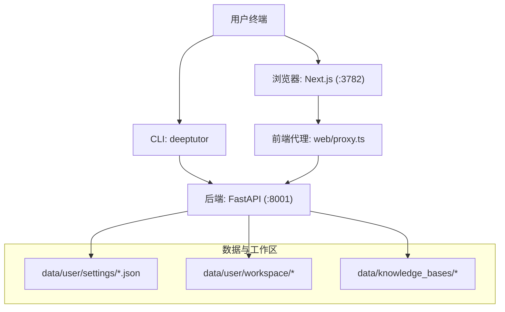
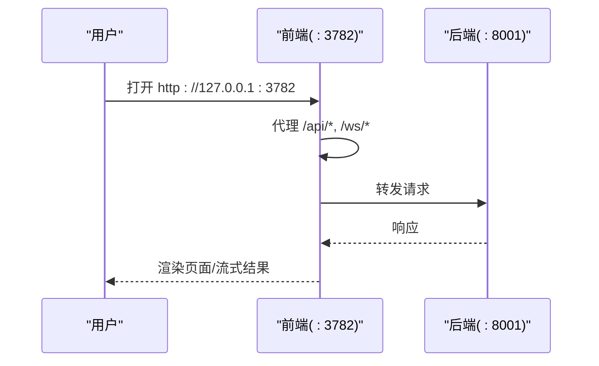

# 快速开始指南

<cite>
**本文引用的文件**
- [README.md](file://README.md)
- [pyproject.toml](file://pyproject.toml)
- [requirements.txt](file://requirements.txt)
- [Dockerfile](file://Dockerfile)
- [compose.yaml](file://compose.yaml)
- [CONTAINERIZATION.md](file://CONTAINERIZATION.md)
- [deeptutor_cli/__main__.py](file://deeptutor_cli/__main__.py)
- [deeptutor_cli/init_cmd.py](file://deeptutor_cli/init_cmd.py)
</cite>

## 目录
1. [简介](#简介)
2. [项目结构](#项目结构)
3. [核心组件](#核心组件)
4. [架构总览](#架构总览)
5. [详细安装与启动步骤](#详细安装与启动步骤)
6. [依赖分析](#依赖分析)
7. [性能注意事项](#性能注意事项)
8. [故障排除指南](#故障排除指南)
9. [结论](#结论)
10. [附录：最小化配置示例](#附录最小化配置示例)

## 简介
本指南面向首次使用 DeepTutor 的用户，提供四种安装方式的完整步骤：PyPI 安装、源码安装、Docker 容器化部署、纯 CLI 模式。每种方式均包含环境要求、依赖安装、配置设置和启动命令，并说明 workspace 目录结构与配置文件位置，帮助你快速体验核心功能并成功访问 Web 界面。

## 项目结构
DeepTutor 由后端（FastAPI）、前端（Next.js）与 CLI 组成。运行时配置统一位于工作区下的 data/user/settings/ 目录中；首次启动会创建默认目录与配置文件。容器镜像将前后端打包在一个容器中，通过 supervisord 管理进程。

图表来源
- [Dockerfile:174-189](file://Dockerfile#L174-L189)
- [Dockerfile:369-402](file://Dockerfile#L369-L402)
- [compose.yaml:147-157](file://compose.yaml#L147-L157)

章节来源
- [README.md:202-221](file://README.md#L202-L221)
- [Dockerfile:174-189](file://Dockerfile#L174-L189)
- [compose.yaml:147-157](file://compose.yaml#L147-L157)

## 核心组件
- CLI 入口：命令行工具，用于初始化、运行聊天、知识库管理等。
- 后端服务：FastAPI 提供 API 与 WebSocket 能力。
- 前端服务：Next.js 静态站点 + 服务端代理转发 /api/* 与 /ws/* 到后端。
- 配置系统：JSON/YAML 驱动，集中存放于 data/user/settings/。

章节来源
- [pyproject.toml:73-74](file://pyproject.toml#L73-L74)
- [deeptutor_cli/__main__.py:1-6](file://deeptutor_cli/__main__.py#L1-L6)
- [Dockerfile:263-315](file://Dockerfile#L263-L315)
- [Dockerfile:369-402](file://Dockerfile#L369-L402)

## 架构总览
- 单容器部署时，浏览器仅访问前端端口（默认 :3782），前端通过内嵌代理将 API/WS 请求转发至同容器内的后端（默认 :8001）。
- 配置读取顺序：entrypoint 在启动时从 data/user/settings/*.json 导出环境变量，供前端代理与后端使用。
- 数据持久化：通过卷挂载或绑定挂载 data 目录，确保重启后配置、会话、知识库等不丢失。

图表来源
- [Dockerfile:263-315](file://Dockerfile#L263-L315)
- [Dockerfile:369-402](file://Dockerfile#L369-L402)
- [CONTAINERIZATION.md:171-199](file://CONTAINERIZATION.md#L171-L199)

## 详细安装与启动步骤

### 通用前置条件
- Python 3.11–3.13（推荐 3.11 或 3.12）
- Node.js 20+（PyPI 安装需要）；源码开发建议 Node.js 22 LTS
- 可选：Docker/Podman（容器化部署）

章节来源
- [README.md:207-221](file://README.md#L207-L221)
- [README.md:225-244](file://README.md#L225-L244)
- [pyproject.toml:18-18](file://pyproject.toml#L18-L18)

### 方式一：PyPI 安装（Web + CLI）
- 环境要求：Python 3.11–3.13，PATH 中有 Node.js 20+
- 安装与初始化
  - 创建工作区目录并进入
  - 安装 deeptutor
  - 运行初始化向导（交互式设置端口、LLM 提供商、模型、可选 embedding）
- 启动
  - 运行 start，保持终端开启
  - 浏览器访问前端地址（默认 http://127.0.0.1:3782）
- 停止
  - 在终端按 Ctrl+C 停止前后端

章节来源
- [README.md:207-221](file://README.md#L207-L221)

### 方式二：源码安装（开发模式）
- 环境要求：Python 3.11–3.13，Node.js 22 LTS
- 克隆仓库并创建虚拟环境
- 安装后端与前端依赖
- 初始化并启动开发模式（支持热重载）
- 注意：首次构建会生成生产前端资源，--dev 启用 HMR

章节来源
- [README.md:225-244](file://README.md#L225-L244)
- [README.md:272-284](file://README.md#L272-L284)

### 方式三：Docker 容器化部署
- 镜像来源：ghcr.io/hkuds/deeptutor:latest（稳定版）或 pre（预发布）
- 运行容器
  - 映射前端端口 :3782（必需）
  - 可选映射后端端口 :8001（便于直接调用 API）
  - 挂载数据卷以持久化配置与工作区
- 首次启动
  - 浏览器访问 http://127.0.0.1:3782
  - 在 Web Settings → Models 中配置 LLM 提供商与模型
- 远程/反向代理
  - 单容器无需额外配置 API Base；浏览器相对路径由前端代理转发
  - 拆分部署需在 system.json 中设置 next_public_api_base
- 连接宿主本地模型服务
  - 使用 host.docker.internal 指向宿主的 Ollama/LM Studio/vLLM 等
- 安全与权限
  - 容器内进程以非 root 用户运行
  - 可通过 read_only + tmpfs 加固（Podman compose 示例）

章节来源
- [README.md:288-365](file://README.md#L288-L365)
- [CONTAINERIZATION.md:56-92](file://CONTAINERIZATION.md#L56-L92)
- [CONTAINERIZATION.md:171-247](file://CONTAINERIZATION.md#L171-L247)
- [Dockerfile:174-189](file://Dockerfile#L174-L189)
- [Dockerfile:263-315](file://Dockerfile#L263-L315)
- [compose.yaml:147-157](file://compose.yaml#L147-L157)

### 方式四：纯 CLI 模式（无 Web UI）
- 适用场景：不需要 Web 界面，仅需命令行交互或脚本调用
- 安装
  - 从源码可编辑安装 CLI-only 包
- 初始化
  - 运行 init --cli，跳过端口提示，embedding 默认关闭（可按需开启）
  - 写入完整的运行时布局（system.json、auth.json、integrations.json、model_catalog.json、main.yaml、agents.yaml）
- 常用命令
  - chat：交互式 REPL
  - run <capability> "<message>"：单次任务执行，支持 JSON 输出
  - kb：知识库管理
  - memory/config/session 等子命令

章节来源
- [README.md:367-405](file://README.md#L367-L405)
- [deeptutor_cli/init_cmd.py:412-549](file://deeptutor_cli/init_cmd.py#L412-L549)

## 依赖分析
- 运行时依赖
  - Python 核心依赖包括 FastAPI、uvicorn、websockets、LLM SDKs、RAG 相关库等
  - 前端依赖通过 npm 安装，构建为独立产物并在容器内运行
- 可选扩展
  - partners、matrix、math-animator、parse-* 等可选依赖按需安装
- 版本约束
  - Python 版本限制在 3.11–3.13（避免某些编译依赖在 3.14 上失败）

章节来源
- [pyproject.toml:21-71](file://pyproject.toml#L21-L71)
- [pyproject.toml:76-235](file://pyproject.toml#L76-L235)
- [requirements.txt:1-23](file://requirements.txt#L1-L23)

## 性能注意事项
- 大知识库检索
  - FAISS 向量存储可显著提升检索性能（默认懒加载，缺失时回退）
- 附件上传与 WebSocket
  - uvicorn 的 ws-max-size 与 keep-alive 超时根据配置动态计算，避免大附件被截断
- 内存与沙箱
  - 代码执行沙箱默认启用受限子进程；可在 system.json 中调整 sandbox_allow_subprocess
  - 容器化部署建议使用只读根文件系统 + tmpfs 提升安全性与稳定性

章节来源
- [pyproject.toml:47-51](file://pyproject.toml#L47-L51)
- [Dockerfile:281-292](file://Dockerfile#L281-L292)
- [README.md:408-429](file://README.md#L408-L429)

## 故障排除指南
- 前端无法连接后端
  - 检查后端是否启动成功；单容器下无需暴露 :8001，前端通过代理转发
  - 拆分部署需确认 next_public_api_base 正确
- 端口冲突或无法访问
  - 修改 system.json 中的 backend_port/frontend_port 后，需更新容器端口映射
- 权限问题（Podman/Docker）
  - 使用 bind mount 而非命名卷以避免 UID 映射导致的权限错误
  - 必要时使用 :U 后缀进行 chown
- 前端锁文件导致 dev 服务器卡住
  - 删除 .next/dev/lock 与 .next/lock 后重试
- 本地模型服务不可达（Docker）
  - 使用 host.docker.internal 或通过 --network=host 访问宿主服务

章节来源
- [CONTAINERIZATION.md:406-439](file://CONTAINERIZATION.md#L406-L439)
- [README.md:272-284](file://README.md#L272-L284)
- [README.md:338-363](file://README.md#L338-L363)

## 结论
通过以上四种安装方式，你可以快速搭建 DeepTutor 的运行环境并访问 Web 界面。推荐使用 PyPI 安装以获得最简流程；如需定制或开发，选择源码安装；生产或跨平台部署则优先 Docker/Podman。所有方式共享同一工作区与配置体系，便于迁移与扩展。

## 附录：最小化配置示例
- 目标：以最少的配置体验核心聊天能力
- 步骤
  - 初始化并配置一个 LLM 提供商（Base URL、API Key、模型）
  - 如不使用知识库/RAG，可跳过 embedding
  - 启动后在 Settings → Models 完成配置保存
- 验证
  - 打开 http://127.0.0.1:3782，发起一次对话
  - 若出现“后端不可达”，检查后端日志与代理转发配置

章节来源
- [README.md:207-221](file://README.md#L207-L221)
- [README.md:431-448](file://README.md#L431-L448)
- [Dockerfile:369-402](file://Dockerfile#L369-L402)