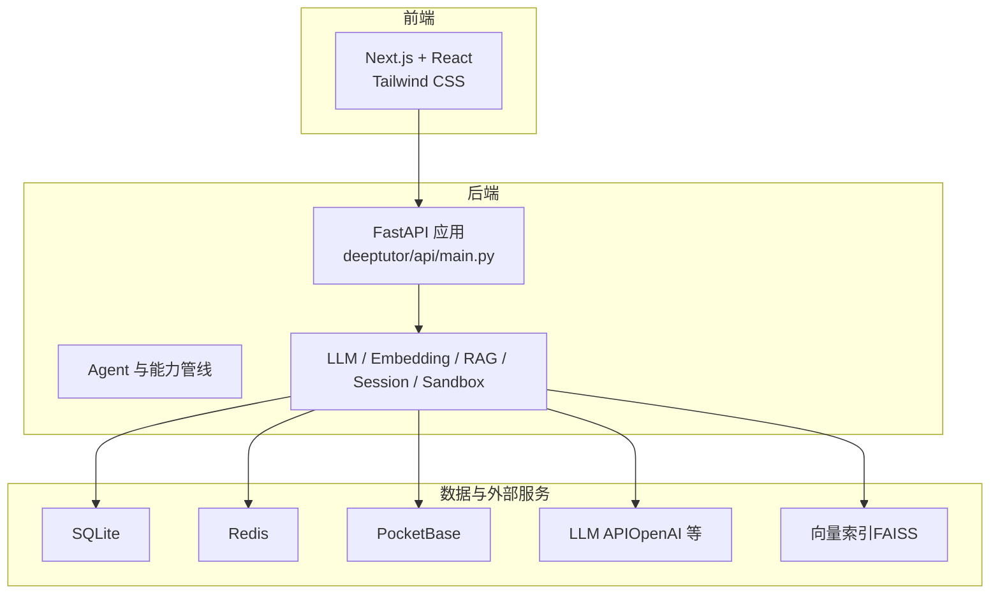
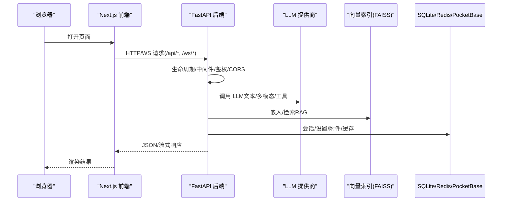
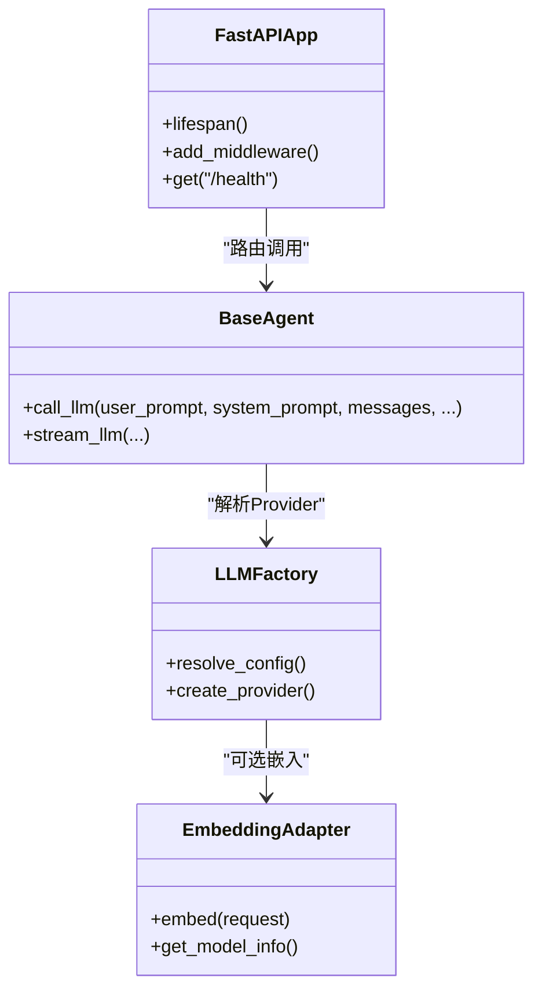
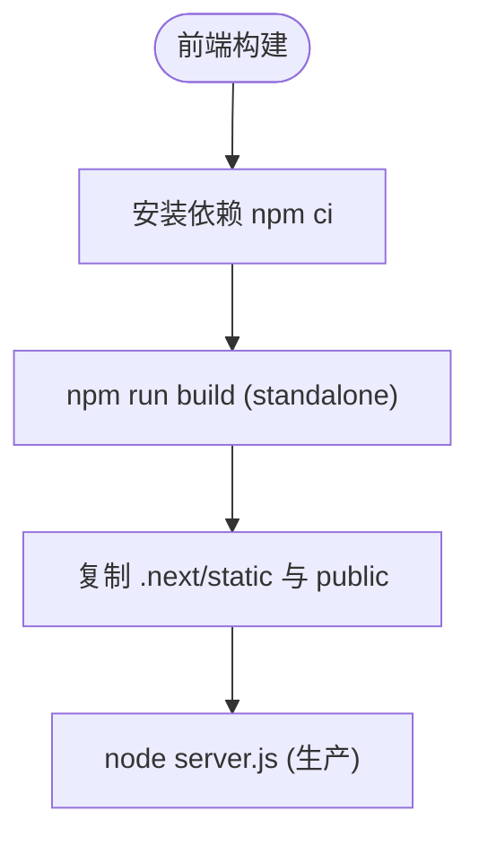
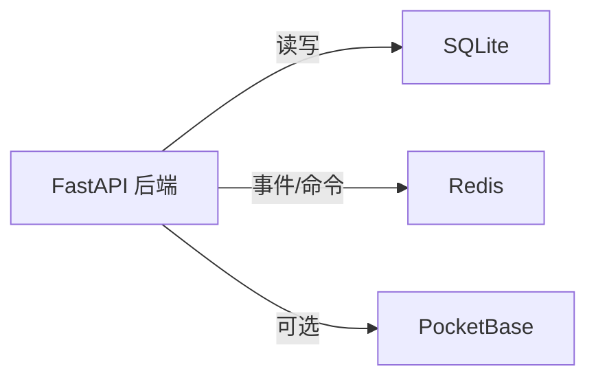
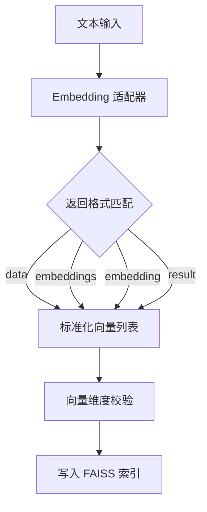
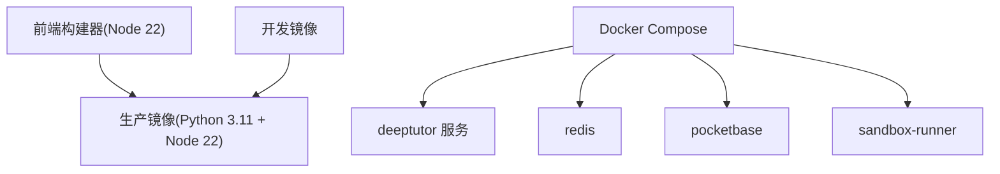
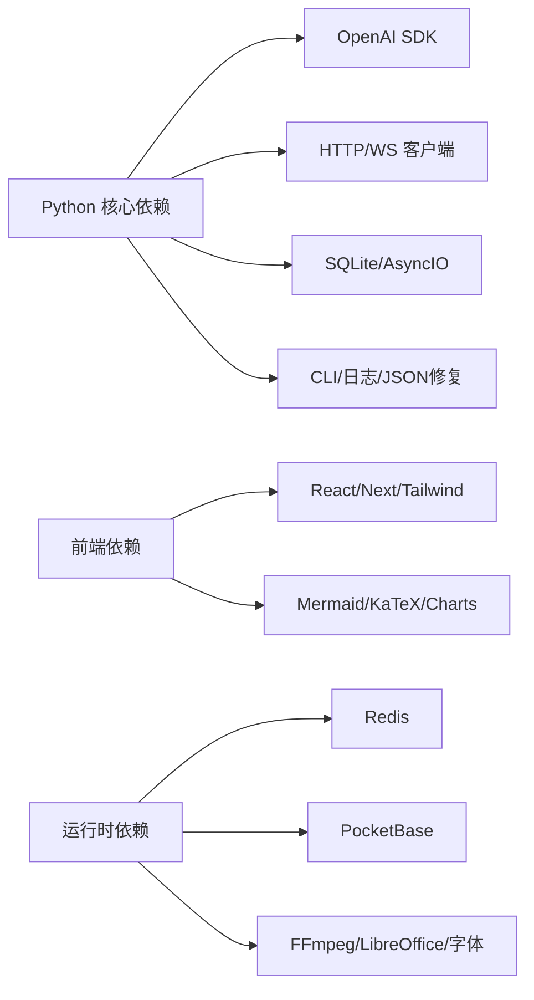

# 技术栈概览

<cite>
**本文引用的文件**   
- [pyproject.toml](file://pyproject.toml)
- [requirements.txt](file://requirements.txt)
- [web/package.json](file://web/package.json)
- [Dockerfile](file://Dockerfile)
- [docker-compose.yml](file://docker-compose.yml)
- [deeptutor/api/main.py](file://deeptutor/api/main.py)
- [deeptutor/agents/base_agent.py](file://deeptutor/agents/base_agent.py)
- [deeptutor/services/llm/factory.py](file://deeptutor/services/llm/factory.py)
- [deeptutor/services/embedding/adapters/openai_compatible.py](file://deeptutor/services/embedding/adapters/openai_compatible.py)
- [deeptutor/services/embedding/validation.py](file://deeptutor/services/embedding/validation.py)
- [deeptutor/services/rag/pipelines/llamaindex/vector_store.py](file://deeptutor/services/rag/pipelines/llamaindex/vector_store.py)
- [scripts/pb_setup.py](file://scripts/pb_setup.py)
</cite>

## 目录
1. [引言](#引言)
2. [项目结构](#项目结构)
3. [核心组件](#核心组件)
4. [架构总览](#架构总览)
5. [详细组件分析](#详细组件分析)
6. [依赖关系分析](#依赖关系分析)
7. [性能与可扩展性](#性能与可扩展性)
8. [故障排查指南](#故障排查指南)
9. [结论](#结论)
10. [附录：版本兼容性与演进规划](#附录版本兼容性与演进规划)

## 引言
本技术栈概览面向 DeepTutor 项目的后端、前端、数据库、AI/ML、容器化与部署、开发工具链及第三方服务集成，给出统一的技术视图。DeepTutor 采用 Python + FastAPI 作为后端 API 与服务编排层，Next.js + React + Tailwind CSS 构建前端界面；数据层以 SQLite 为主，可选 PocketBase 提供认证与存储能力；AI/ML 层通过 OpenAI SDK 与多厂商 LLM 适配、嵌入模型与向量检索（FAISS/LlamaIndex）实现 RAG；运行环境基于 Docker 多阶段镜像与 Compose 编排，支持本地与云端部署。

## 项目结构
仓库采用前后端同仓管理：
- deeptutor：Python 后端主包，包含 API、Agent、LLM/Embedding/RAG、会话、知识、技能、沙箱等模块。
- web：Next.js 前端应用，使用 React、Tailwind CSS、TypeScript。
- deeptutor_cli：命令行入口与配置向导。
- scripts：启动脚本、Docker Compose 辅助脚本、PocketBase 初始化脚本等。
- requirements/pyproject.toml：Python 依赖与可选功能集。
- Dockerfile/docker-compose.*：容器化与编排。

**图表来源**
- [Dockerfile:17-180](file://Dockerfile#L17-L180)
- [docker-compose.yml:26-142](file://docker-compose.yml#L26-L142)
- [deeptutor/api/main.py:364-517](file://deeptutor/api/main.py#L364-L517)

**章节来源**
- [Dockerfile:17-180](file://Dockerfile#L17-L180)
- [docker-compose.yml:26-142](file://docker-compose.yml#L26-L142)

## 核心组件
- 后端运行时
  - FastAPI 应用入口、生命周期管理、CORS、中间件、健康检查与路由加载。
  - Agent 框架与能力管线，统一 LLM 调用接口（非流式/流式）。
  - LLM 工厂与 Provider 解析，支持多厂商与本地网关。
  - Embedding 适配器（OpenAI 兼容），向量维度校验与错误处理。
  - RAG 向量存储（FAISS/LlamaIndex），HNSW/FlatIP 索引策略。
- 前端运行时
  - Next.js 生产构建与 Standalone 模式，Node 运行时由镜像注入。
  - React 组件生态、Tailwind CSS 样式体系、国际化与测试工具链。
- 数据与基础设施
  - SQLite 会话与附件存储；Redis 事件/命令流；PocketBase 可选认证与存储。
  - Docker 多阶段镜像、Supervisor 进程管理、Compose 编排与安全加固侧车。

**章节来源**
- [deeptutor/api/main.py:108-350](file://deeptutor/api/main.py#L108-L350)
- [deeptutor/agents/base_agent.py:348-556](file://deeptutor/agents/base_agent.py#L348-L556)
- [deeptutor/services/llm/factory.py:230-272](file://deeptutor/services/llm/factory.py#L230-L272)
- [deeptutor/services/embedding/adapters/openai_compatible.py:99-344](file://deeptutor/services/embedding/adapters/openai_compatible.py#L99-L344)
- [deeptutor/services/embedding/validation.py:95-128](file://deeptutor/services/embedding/validation.py#L95-L128)
- [deeptutor/services/rag/pipelines/llamaindex/vector_store.py:99-223](file://deeptutor/services/rag/pipelines/llamaindex/vector_store.py#L99-L223)
- [web/package.json:36-96](file://web/package.json#L36-L96)
- [Dockerfile:104-180](file://Dockerfile#L104-L180)
- [docker-compose.yml:26-142](file://docker-compose.yml#L26-L142)

## 架构总览
DeepTutor 的运行时由“前端静态站点 + FastAPI 后端”组成，通过反向代理或同源部署暴露统一入口。关键流程如下：

**图表来源**
- [deeptutor/api/main.py:364-517](file://deeptutor/api/main.py#L364-L517)
- [deeptutor/agents/base_agent.py:348-556](file://deeptutor/agents/base_agent.py#L348-L556)
- [deeptutor/services/rag/pipelines/llamaindex/vector_store.py:188-223](file://deeptutor/services/rag/pipelines/llamaindex/vector_store.py#L188-L223)
- [docker-compose.yml:77-142](file://docker-compose.yml#L77-L142)

## 详细组件分析

### 后端技术栈：Python + FastAPI + Pydantic + LangChain/LLM 生态
- FastAPI 应用
  - 生命周期管理：启动时初始化容器、迁移、事件总线、后台任务；关闭时释放 LLM 客户端池、MCP 连接等。
  - CORS 与访问日志：根据系统设置动态构建允许源，区分认证开启/关闭模式；选择性记录非 200 访问日志。
  - 健康检查：/health/live 与 /health/ready 返回就绪状态。
- Agent 与 LLM 调用
  - 统一 call_llm 与流式接口，封装 provider 选择、参数透传、附件与追踪元数据。
  - LLM 工厂解析 binding/provider_name/base_url/api_version 等，支持 Azure OpenAI、Anthropic 等后端。
- Pydantic 与配置
  - 通过 pydantic-settings 加载系统/认证/集成配置，环境变量覆盖与持久化 JSON 配置并存。
- 第三方 LLM SDK
  - 依赖 openai>=1.30.0，配合 httpx/aiohttp 进行异步网络调用。

**图表来源**
- [deeptutor/api/main.py:108-350](file://deeptutor/api/main.py#L108-L350)
- [deeptutor/agents/base_agent.py:348-556](file://deeptutor/agents/base_agent.py#L348-L556)
- [deeptutor/services/llm/factory.py:230-272](file://deeptutor/services/llm/factory.py#L230-L272)

**章节来源**
- [deeptutor/api/main.py:77-105](file://deeptutor/api/main.py#L77-L105)
- [deeptutor/api/main.py:364-517](file://deeptutor/api/main.py#L364-L517)
- [deeptutor/agents/base_agent.py:348-556](file://deeptutor/agents/base_agent.py#L348-L556)
- [deeptutor/services/llm/factory.py:230-272](file://deeptutor/services/llm/factory.py#L230-L272)

### 前端技术栈：Next.js + React + Tailwind CSS
- 构建与运行
  - 使用 Node 22 构建 Next.js 应用，输出 standalone 产物，生产镜像内直接运行 server.js。
  - 开发模式支持 dev.mjs 脚本与 Turbopack。
- 依赖与生态
  - React 19、Next 16、Tailwind CSS 3、i18next、Mermaid、KaTeX、Chart.js 等。
  - 测试与质量：Playwright、Vitest、ESLint、TypeScript。

**图表来源**
- [Dockerfile:23-51](file://Dockerfile#L23-L51)
- [Dockerfile:161-180](file://Dockerfile#L161-L180)
- [web/package.json:5-34](file://web/package.json#L5-L34)

**章节来源**
- [web/package.json:36-96](file://web/package.json#L36-L96)
- [Dockerfile:23-51](file://Dockerfile#L23-L51)
- [Dockerfile:161-180](file://Dockerfile#L161-L180)

### 数据库与缓存：SQLite、Redis、PocketBase
- SQLite
  - 会话、笔记、问答条目等结构化数据存储，轻量且无需额外服务。
- Redis
  - 内部协调状态、事件/命令流，AOF 持久化保证跨重启可用。
- PocketBase
  - 可选认证与存储侧车，提供集合/索引同步与用户数据管理。

**图表来源**
- [docker-compose.yml:26-73](file://docker-compose.yml#L26-L73)
- [scripts/pb_setup.py:1-107](file://scripts/pb_setup.py#L1-L107)

**章节来源**
- [docker-compose.yml:26-73](file://docker-compose.yml#L26-L73)
- [scripts/pb_setup.py:1-107](file://scripts/pb_setup.py#L1-L107)

### AI/ML 技术：OpenAI SDK、向量数据库、嵌入模型
- LLM 调用
  - 通过 OpenAI SDK 与多 Provider 抽象，支持云厂商与本地网关（base_url、binding）。
- 嵌入模型
  - OpenAI 兼容适配器，兼容多种返回格式（data/embeddings/embedding/result），并做维度一致性校验。
- 向量检索
  - FAISS 向量索引（HNSW/FlatIP），余弦相似度等价转换；LlamaIndex StorageContext 封装。

**图表来源**
- [deeptutor/services/embedding/adapters/openai_compatible.py:99-344](file://deeptutor/services/embedding/adapters/openai_compatible.py#L99-L344)
- [deeptutor/services/embedding/validation.py:95-128](file://deeptutor/services/embedding/validation.py#L95-L128)
- [deeptutor/services/rag/pipelines/llamaindex/vector_store.py:188-223](file://deeptutor/services/rag/pipelines/llamaindex/vector_store.py#L188-L223)

**章节来源**
- [deeptutor/services/embedding/adapters/openai_compatible.py:99-344](file://deeptutor/services/embedding/adapters/openai_compatible.py#L99-L344)
- [deeptutor/services/embedding/validation.py:95-128](file://deeptutor/services/embedding/validation.py#L95-L128)
- [deeptutor/services/rag/pipelines/llamaindex/vector_store.py:99-223](file://deeptutor/services/rag/pipelines/llamaindex/vector_store.py#L99-L223)

### 容器化与编排：Docker、Kubernetes 就绪
- 多阶段镜像
  - 前端构建阶段（Node 22）、Python 依赖构建阶段、生产镜像（Python 3.11 + Node 22）。
  - Supervisor 管理后端与前端进程，健康检查与端口映射。
- Compose 编排
  - Redis、PocketBase、主服务、沙箱侧车（只读文件系统、最小权限、资源限制）。
- Kubernetes 就绪
  - 健康检查、环境变量注入、卷挂载与网络隔离，便于在 K8s 中部署。

**图表来源**
- [Dockerfile:23-180](file://Dockerfile#L23-L180)
- [Dockerfile:250-335](file://Dockerfile#L250-L335)
- [docker-compose.yml:77-209](file://docker-compose.yml#L77-L209)

**章节来源**
- [Dockerfile:23-180](file://Dockerfile#L23-L180)
- [Dockerfile:250-335](file://Dockerfile#L250-L335)
- [docker-compose.yml:77-209](file://docker-compose.yml#L77-L209)

### 开发工具链与 CI/CD
- Python 工具链
  - Black、Ruff、pytest、mypy、bandit 等，pyproject.toml 集中配置。
- 前端工具链
  - ESLint、TypeScript、Vitest、Playwright、dependency-cruiser。
- Git 与协作
  - GitHub Actions 工作流、PR 模板、pre-commit 钩子。
- CI/CD
  - 构建镜像、运行测试、发布制品（参考 Dockerfile 与 compose 脚本）。

**章节来源**
- [pyproject.toml:127-237](file://pyproject.toml#L127-L237)
- [pyproject.toml:277-337](file://pyproject.toml#L277-L337)
- [web/package.json:74-96](file://web/package.json#L74-L96)

## 依赖关系分析
- Python 依赖
  - 核心：openai、httpx、aiohttp、requests、pydantic、aiosqlite、typer、rich、loguru、json-repair、psutil 等。
  - 可选：server、partners、matrix、math-animator、graphrag、rag-lightrag、guard 等。
- 前端依赖
  - next、react、tailwindcss、i18next、mermaid、katex、chart.js 等。
- 运行时依赖
  - Redis、PocketBase、FFmpeg、LibreOffice、字体等系统库。

**图表来源**
- [pyproject.toml:19-94](file://pyproject.toml#L19-L94)
- [web/package.json:36-96](file://web/package.json#L36-L96)
- [Dockerfile:140-159](file://Dockerfile#L140-L159)

**章节来源**
- [pyproject.toml:19-94](file://pyproject.toml#L19-L94)
- [web/package.json:36-96](file://web/package.json#L36-L96)
- [Dockerfile:140-159](file://Dockerfile#L140-L159)

## 性能与可扩展性
- 后端
  - Uvicorn workers 可配置，WebSocket 帧大小与 keep-alive 超时按配置计算，避免大附件与长连接问题。
  - LLM 客户端池与 MCP 连接在关闭时显式释放，减少资源泄漏。
- 前端
  - Standalone 构建减小体积，Node 运行时按需加载；静态资源与公共目录分离。
- 数据与向量
  - FAISS HNSW 索引提升检索速度；向量维度一致性校验避免混合维度导致的退化。
- 安全与隔离
  - sandbox-runner 侧车执行不受信代码，最小权限、只读根文件系统、内存与进程数限制。

[本节为通用指导，不直接分析具体文件]

## 故障排查指南
- 启动与健康检查
  - 检查 /health/ready 是否返回 ready；若 not_ready，查看协调器与容器状态。
- CORS 与跨域
  - 认证关闭时默认宽松模式；开启后需显式配置 allow_origins。
- LLM 调用失败
  - 检查 provider binding、base_url、api_key、model 配置；确认 LLM 工厂解析正确。
- 嵌入与向量
  - 若返回向量维度不一致，重新索引知识库；检查适配器返回格式与模型维度。
- PocketBase 初始化
  - 首次运行需执行 pb_setup.py，确保 integrations.pocketbase_* 配置正确。

**章节来源**
- [deeptutor/api/main.py:520-541](file://deeptutor/api/main.py#L520-L541)
- [deeptutor/api/main.py:77-105](file://deeptutor/api/main.py#L77-L105)
- [deeptutor/services/llm/factory.py:230-272](file://deeptutor/services/llm/factory.py#L230-L272)
- [deeptutor/services/embedding/validation.py:95-128](file://deeptutor/services/embedding/validation.py#L95-L128)
- [scripts/pb_setup.py:1-107](file://scripts/pb_setup.py#L1-L107)

## 结论
DeepTutor 以 FastAPI 为核心后端，结合 Next.js 前端，形成现代化全栈架构；通过 LLM 工厂与 Embedding 适配器对接多厂商服务，利用 FAISS 与 LlamaIndex 实现高效 RAG；容器化方案提供稳定、安全的运行环境，并通过 Compose 简化本地与生产部署。整体技术选型兼顾扩展性、可维护性与安全性，适合持续演进与规模化部署。

[本节为总结性内容，不直接分析具体文件]

## 附录：版本兼容性与演进规划
- Python 与核心依赖
  - requires-python >=3.11,<3.15；openai>=1.30.0；pydantic>=2.0.0；aiosqlite>=0.19.0；httpx>=0.27.0；aiohttp>=3.9.4。
- 前端依赖
  - next ^16.2.3；react ^19.0.0；tailwindcss ^3.4.17；typescript ^5。
- 运行时与系统库
  - Node 22；Python 3.11；FFmpeg、LibreOffice、Noto CJK 字体等。
- 演进方向
  - 继续扩展 Provider 支持与本地模型集成；优化向量索引与检索策略；增强安全与审计；完善多租户与权限控制。

**章节来源**
- [pyproject.toml:12-47](file://pyproject.toml#L12-L47)
- [web/package.json:36-96](file://web/package.json#L36-L96)
- [Dockerfile:64-95](file://Dockerfile#L64-L95)
- [Dockerfile:140-159](file://Dockerfile#L140-L159)