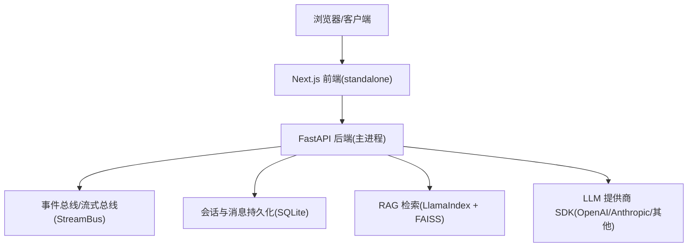
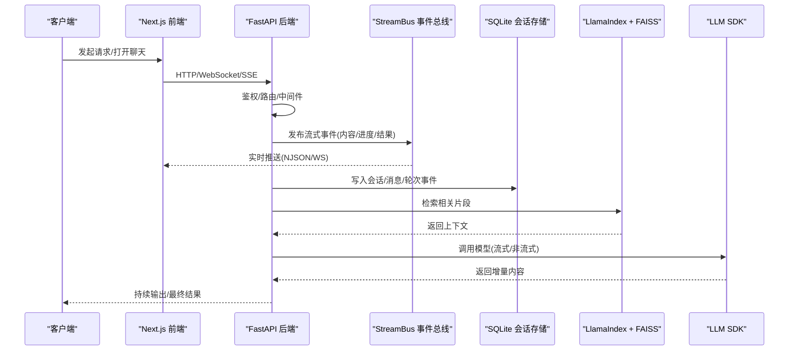
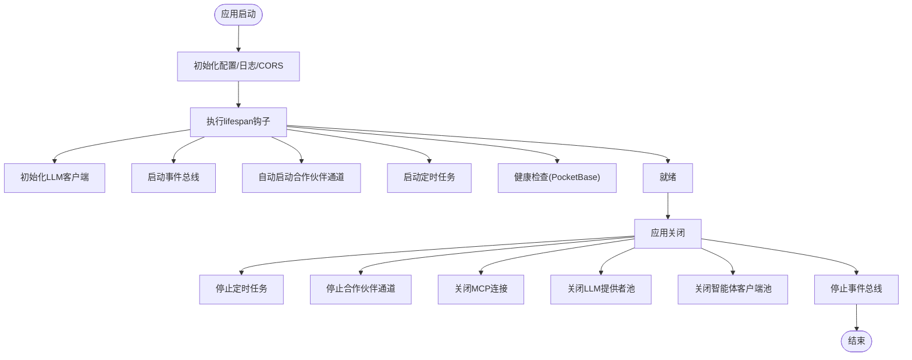
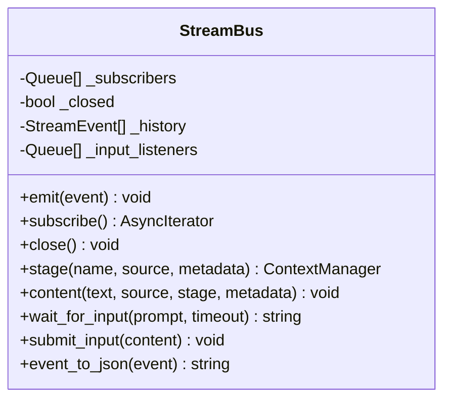
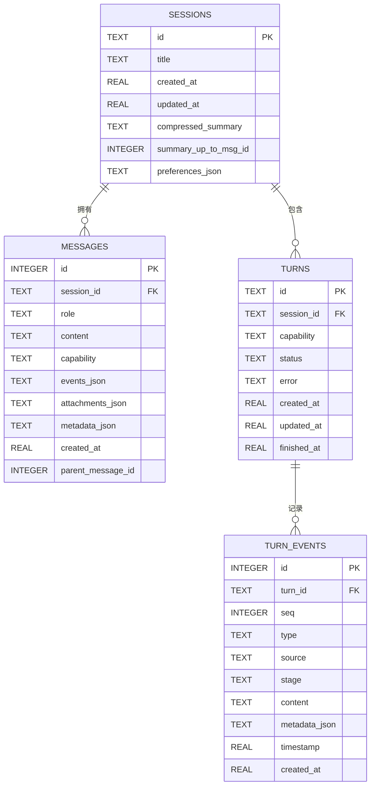
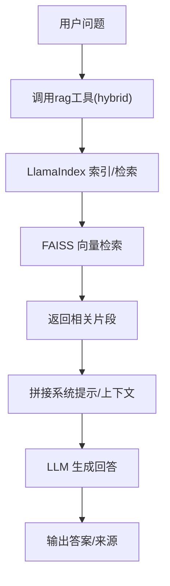
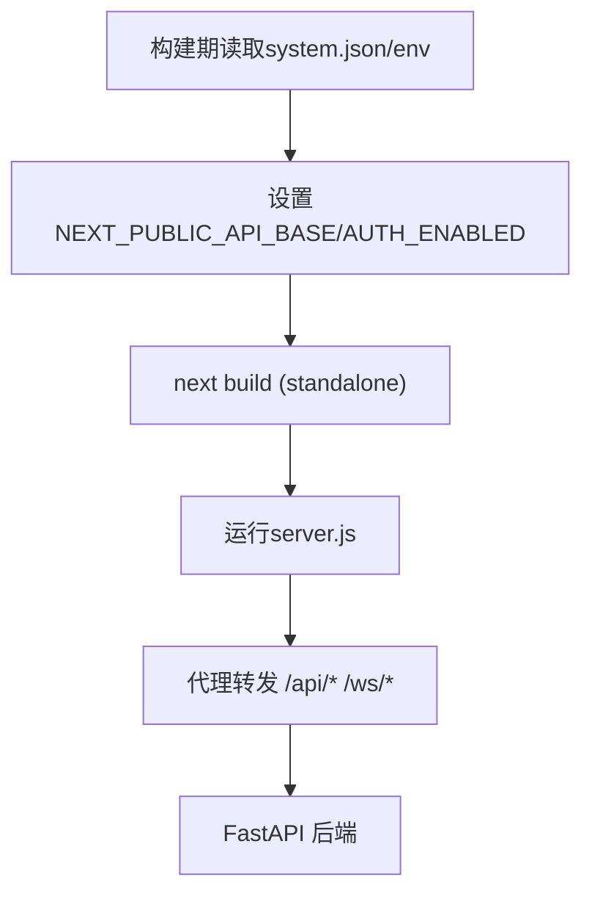
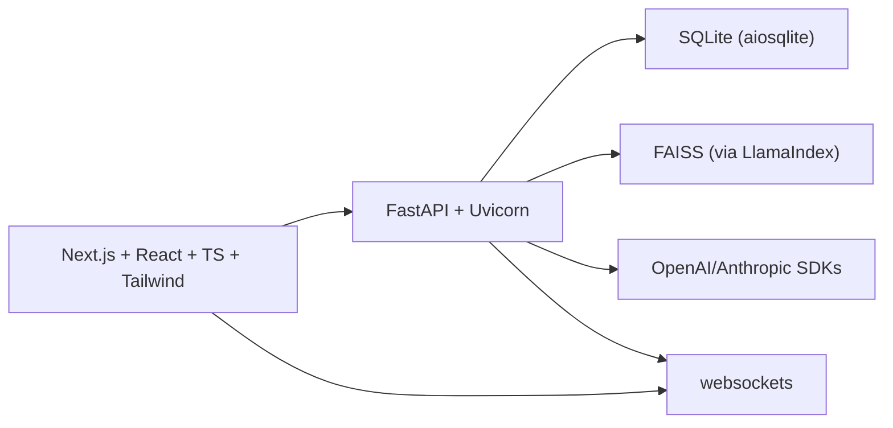

# 技术栈概览

<cite>
**本文引用的文件**
- [pyproject.toml](file://pyproject.toml)
- [requirements/server.txt](file://requirements/server.txt)
- [Dockerfile](file://Dockerfile)
- [deeptutor/api/main.py](file://deeptutor/api/main.py)
- [web/package.json](file://web/package.json)
- [web/next.config.js](file://web/next.config.js)
- [deeptutor/core/stream_bus.py](file://deeptutor/core/stream_bus.py)
- [deeptutor/services/session/sqlite_store.py](file://deeptutor/services/session/sqlite_store.py)
</cite>

## 目录
1. [简介](#简介)
2. [项目结构](#项目结构)
3. [核心组件](#核心组件)
4. [架构总览](#架构总览)
5. [详细组件分析](#详细组件分析)
6. [依赖关系分析](#依赖关系分析)
7. [性能考量](#性能考量)
8. [故障排查指南](#故障排查指南)
9. [结论](#结论)
10. [附录](#附录)

## 简介
本技术栈概览面向DeepTutor系统，聚焦后端与前端技术选型、数据存储、通信协议以及开发与部署工具链。后端基于Python 3.11+与FastAPI，使用Pydantic进行数据校验，采用LlamaIndex构建RAG检索增强生成能力，并集成OpenAI/Anthropic等模型SDK；前端采用Next.js 16 + React 19 + TypeScript + Tailwind CSS；数据库方案以SQLite（aiosqlite）为主，向量检索通过FAISS实现；实时通信采用WebSocket与SSE流式响应；开发与部署使用pip、npm与Docker多阶段构建。各组件协同工作，形成“前端界面—API网关—智能体/工具—RAG/LLM—存储”的完整链路。

## 项目结构
- 后端服务：FastAPI应用入口统一在API模块中注册路由、中间件与生命周期管理，启动时加载配置、初始化事件总线、合作伙伴通道、定时任务等。
- 前端应用：Next.js独立构建产物，生产环境以standalone模式运行，开发环境支持热重载与代理转发。
- 运行时容器化：Docker多阶段构建将前端静态资源与Python依赖打包进单一镜像，使用supervisord同时管理前后端进程。

图表来源
- [Dockerfile:23-51](file://Dockerfile#L23-L51)
- [Dockerfile:62-99](file://Dockerfile#L62-L99)
- [Dockerfile:102-164](file://Dockerfile#L102-L164)
- [deeptutor/api/main.py:116-257](file://deeptutor/api/main.py#L116-L257)
- [deeptutor/core/stream_bus.py:31-75](file://deeptutor/core/stream_bus.py#L31-L75)
- [deeptutor/services/session/sqlite_store.py:96-120](file://deeptutor/services/session/sqlite_store.py#L96-L120)

章节来源
- [Dockerfile:17-164](file://Dockerfile#L17-L164)
- [deeptutor/api/main.py:116-257](file://deeptutor/api/main.py#L116-L257)

## 核心组件
- 后端框架与运行时
  - Python 3.11+：兼容性与生态成熟度，满足编译型依赖（如faiss-cpu）的wheel可用性。
  - FastAPI + Uvicorn：高性能异步Web框架，原生支持WebSocket与SSE，适合流式响应与实时交互。
  - Pydantic：声明式数据校验与序列化，保障API输入输出契约稳定。
- RAG与向量检索
  - LlamaIndex：统一的索引与检索抽象，便于接入多种数据源与检索策略。
  - FAISS：高效近似最近邻检索，替代简单线性扫描，提升知识库规模下的查询性能。
- 模型与SDK
  - OpenAI/Anthropic等SDK：统一调用不同大模型，提供流式与非流式接口。
- 前端技术栈
  - Next.js 16：服务端渲染与静态导出并存，支持standalone部署，简化生产分发。
  - React 19：最新特性与性能优化，配合TypeScript提升类型安全与可维护性。
  - Tailwind CSS：原子化样式体系，快速构建一致UI。
- 数据存储
  - SQLite（aiosqlite）：轻量、零配置、单文件数据库，适合本地与容器化部署；具备事务与并发控制。
  - FAISS向量库：用于语义检索，支撑RAG的知识召回。
- 通信协议
  - WebSocket：双向实时通信，承载聊天、协作、状态同步等场景。
  - SSE（Server-Sent Events）：单向流式推送，适合长文本生成、进度更新等。
- 开发与部署
  - pip与npm：分别管理Python与Node依赖。
  - Docker多阶段构建：分离前端构建与后端运行环境，减小镜像体积，提高可移植性。

章节来源
- [pyproject.toml:8-71](file://pyproject.toml#L8-L71)
- [requirements/server.txt:11-32](file://requirements/server.txt#L11-L32)
- [web/package.json:23-61](file://web/package.json#L23-L61)
- [Dockerfile:17-164](file://Dockerfile#L17-L164)

## 架构总览
DeepTutor采用分层架构：前端通过Next.js提供用户界面与代理转发；后端FastAPI作为统一入口，负责鉴权、路由、中间件与生命周期管理；业务层由智能体、工具与能力组成，通过事件总线与流式总线协调；数据层包括SQLite会话存储与FAISS向量检索；外部依赖通过LLM SDK访问各类模型服务。

图表来源
- [deeptutor/api/main.py:248-311](file://deeptutor/api/main.py#L248-L311)
- [deeptutor/core/stream_bus.py:31-75](file://deeptutor/core/stream_bus.py#L31-L75)
- [deeptutor/services/session/sqlite_store.py:96-120](file://deeptutor/services/session/sqlite_store.py#L96-L120)
- [pyproject.toml:41-51](file://pyproject.toml#L41-L51)

## 详细组件分析

### 后端API与服务生命周期
- FastAPI应用创建、CORS配置、静态输出挂载与路由注册集中在入口模块。
- 生命周期钩子负责启动时初始化LLM客户端、事件总线、合作伙伴通道、定时任务，并在关闭时有序释放资源。
- 选择性访问日志仅记录非200响应，减少噪音。

图表来源
- [deeptutor/api/main.py:116-257](file://deeptutor/api/main.py#L116-L257)
- [deeptutor/api/main.py:282-311](file://deeptutor/api/main.py#L282-L311)

章节来源
- [deeptutor/api/main.py:116-257](file://deeptutor/api/main.py#L116-L257)
- [deeptutor/api/main.py:282-311](file://deeptutor/api/main.py#L282-L311)

### 流式事件总线（StreamBus）
- StreamBus为单次对话轮次的扇出事件通道，生产者（工具/能力）通过emit发送事件，消费者（CLI渲染器、WebSocket推送器、JSON写入器）订阅消费。
- 支持历史回放、阶段标记、等待用户输入与错误事件，保证端到端的实时性与一致性。

图表来源
- [deeptutor/core/stream_bus.py:31-75](file://deeptutor/core/stream_bus.py#L31-L75)
- [deeptutor/core/stream_bus.py:78-120](file://deeptutor/core/stream_bus.py#L78-L120)
- [deeptutor/core/stream_bus.py:271-305](file://deeptutor/core/stream_bus.py#L271-L305)

章节来源
- [deeptutor/core/stream_bus.py:31-75](file://deeptutor/core/stream_bus.py#L31-L75)
- [deeptutor/core/stream_bus.py:78-120](file://deeptutor/core/stream_bus.py#L78-L120)
- [deeptutor/core/stream_bus.py:271-305](file://deeptutor/core/stream_bus.py#L271-L305)

### 会话与消息持久化（SQLite）
- SQLiteSessionStore统一管理会话、消息、轮次与轮次事件，提供迁移、索引与批量写入能力。
- 通过事务与锁机制确保并发安全，支持按seq增量拉取事件，适配流式回放与断点续传。

图表来源
- [deeptutor/services/session/sqlite_store.py:119-234](file://deeptutor/services/session/sqlite_store.py#L119-L234)

章节来源
- [deeptutor/services/session/sqlite_store.py:96-120](file://deeptutor/services/session/sqlite_store.py#L96-L120)
- [deeptutor/services/session/sqlite_store.py:119-234](file://deeptutor/services/session/sqlite_store.py#L119-L234)
- [deeptutor/services/session/sqlite_store.py:657-704](file://deeptutor/services/session/sqlite_store.py#L657-L704)
- [deeptutor/services/session/sqlite_store.py:706-771](file://deeptutor/services/session/sqlite_store.py#L706-L771)

### RAG与向量检索（LlamaIndex + FAISS）
- LlamaIndex提供统一的索引与检索接口，支持混合检索模式；FAISS作为向量存储后端，提供高效的近似最近邻搜索，适用于大规模知识库。
- 智能体在对话过程中按需调用rag工具，获取相关片段注入上下文，提升回答质量与时效性。

图表来源
- [pyproject.toml:41-51](file://pyproject.toml#L41-L51)

章节来源
- [pyproject.toml:41-51](file://pyproject.toml#L41-L51)

### 前端工程与代理转发（Next.js）
- Next.js构建产物采用standalone模式，生产镜像直接运行server.js，无需完整node_modules。
- 构建期读取系统设置与环境变量，动态注入API基址与认证开关；开发期支持代理转发与跨域白名单。

图表来源
- [web/next.config.js:47-76](file://web/next.config.js#L47-L76)
- [web/next.config.js:93-120](file://web/next.config.js#L93-L120)

章节来源
- [web/package.json:23-61](file://web/package.json#L23-L61)
- [web/next.config.js:47-76](file://web/next.config.js#L47-L76)
- [web/next.config.js:93-120](file://web/next.config.js#L93-L120)

## 依赖关系分析
- 后端依赖
  - FastAPI/Uvicorn/websockets：提供HTTP/WS服务与流式响应能力。
  - Pydantic/pydantic-settings：配置与数据校验。
  - LlamaIndex/FAISS：RAG检索与向量存储。
  - OpenAI/Anthropic等SDK：模型调用。
  - aiosqlite/SQLite：会话与消息持久化。
- 前端依赖
  - Next.js/React/TypeScript/Tailwind：现代前端工程化与UI体系。
- 构建与部署
  - Docker多阶段构建：分离前端构建与后端运行环境，统一镜像交付。

图表来源
- [pyproject.toml:21-71](file://pyproject.toml#L21-L71)
- [requirements/server.txt:11-32](file://requirements/server.txt#L11-L32)
- [web/package.json:23-61](file://web/package.json#L23-L61)

章节来源
- [pyproject.toml:21-71](file://pyproject.toml#L21-L71)
- [requirements/server.txt:11-32](file://requirements/server.txt#L11-L32)
- [web/package.json:23-61](file://web/package.json#L23-L61)

## 性能考量
- 流式传输：通过StreamBus与WebSocket/SSE实现低延迟增量输出，避免整段阻塞。
- 向量检索：FAISS替代线性扫描，显著提升大规模知识库检索效率。
- 数据库写入：SQLiteSessionStore提供批量写入与事务合并，降低频繁fsync带来的I/O压力。
- 构建优化：Next.js standalone输出与Docker多阶段构建减少镜像体积与启动时间。

[本节为通用性能建议，不直接分析具体文件]

## 故障排查指南
- 启动失败
  - 检查FastAPI生命周期钩子中的LLM客户端、事件总线、合作伙伴通道与定时任务初始化是否成功。
  - 查看CORS配置与认证开关，确保前端代理与后端端口匹配。
- 实时通信异常
  - 确认WebSocket升级路径与最大帧大小配置；检查StreamBus订阅者是否正确注册与注销。
- 数据持久化问题
  - 验证SQLite表结构与索引是否存在；检查事务提交与锁机制是否生效。
- 构建与部署
  - 核对Docker多阶段构建顺序与依赖安装；确认环境变量注入与代理转发规则。

章节来源
- [deeptutor/api/main.py:116-257](file://deeptutor/api/main.py#L116-L257)
- [deeptutor/core/stream_bus.py:31-75](file://deeptutor/core/stream_bus.py#L31-L75)
- [deeptutor/services/session/sqlite_store.py:119-234](file://deeptutor/services/session/sqlite_store.py#L119-L234)
- [Dockerfile:263-315](file://Dockerfile#L263-L315)

## 结论
DeepTutor的技术栈以FastAPI为核心，结合LlamaIndex与FAISS实现高效RAG，使用SQLite进行轻量持久化，并通过WebSocket/SSE提供实时交互体验。前端采用Next.js与React现代化工程体系，Docker多阶段构建确保一致的部署体验。各组件职责清晰、耦合适度，能够支撑复杂的多智能体协作与个性化学习场景。

[本节为总结性内容，不直接分析具体文件]

## 附录
- 版本与兼容性
  - Python 3.11+，限制上限以避免部分依赖无法找到wheel导致构建失败。
  - Next.js 16与React 19提供最新特性与性能改进。
- 可选扩展
  - GraphRAG/LightRAG等高级知识图谱引擎可作为可选依赖引入，按需启用。
  - 文档解析引擎（markitdown/docling/pymupdf4llm）可按需安装，保持轻量默认安装。

[本节为补充信息，不直接分析具体文件]