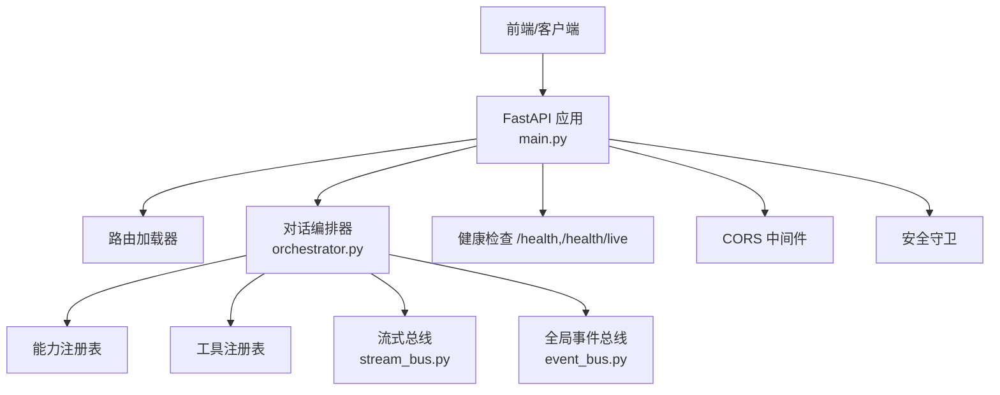
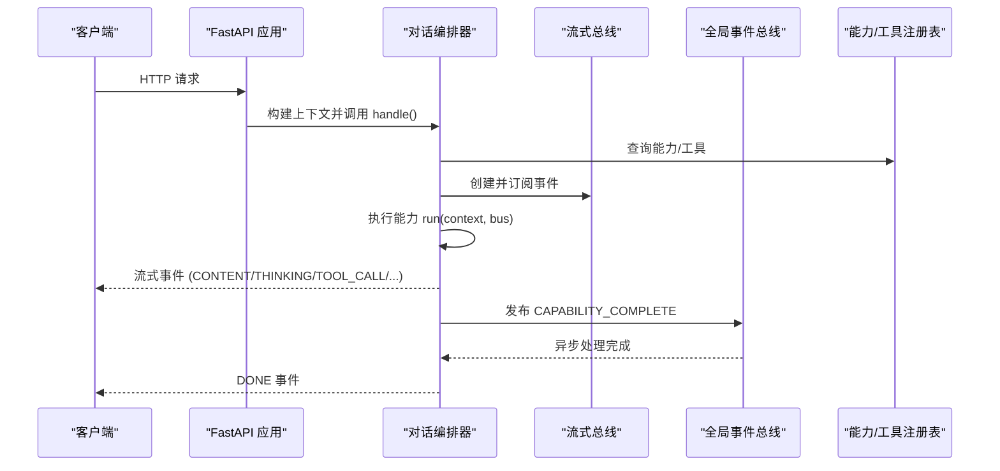
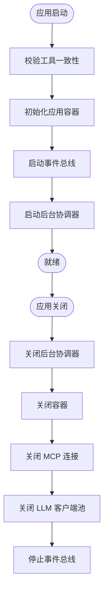
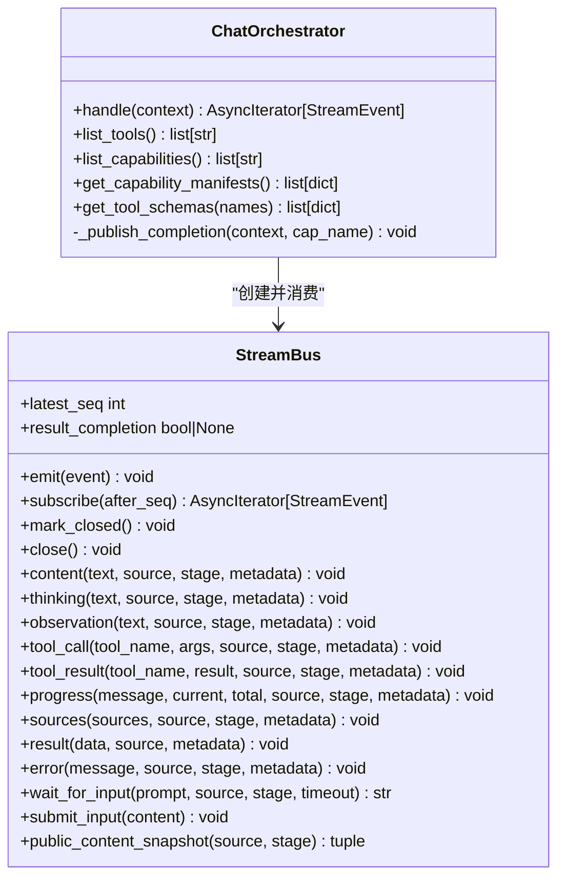
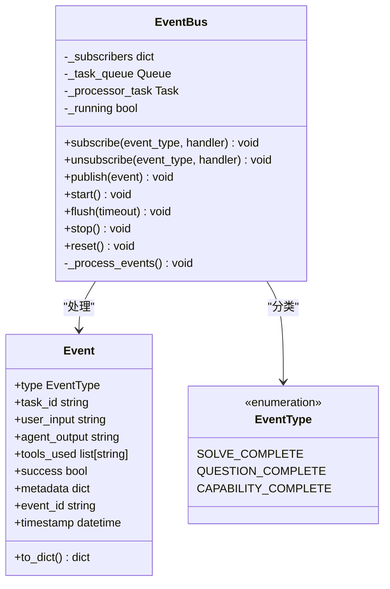
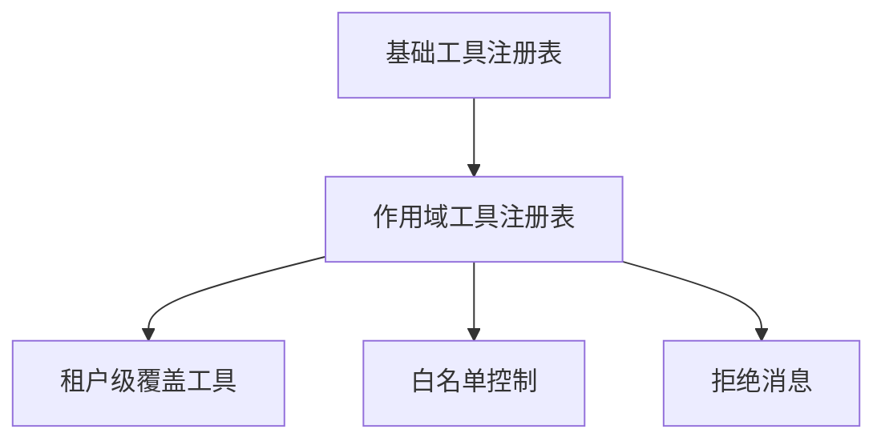
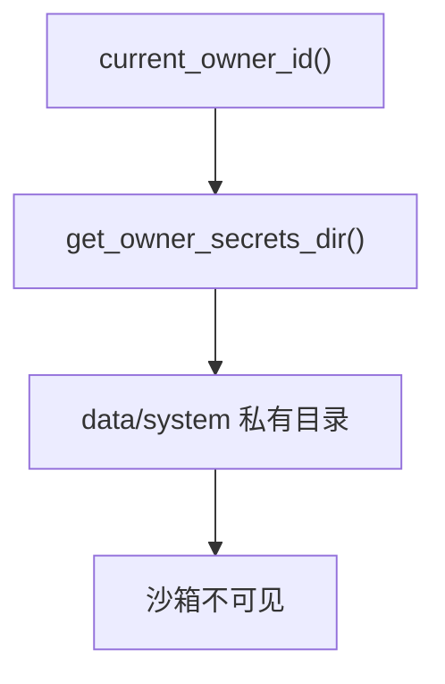
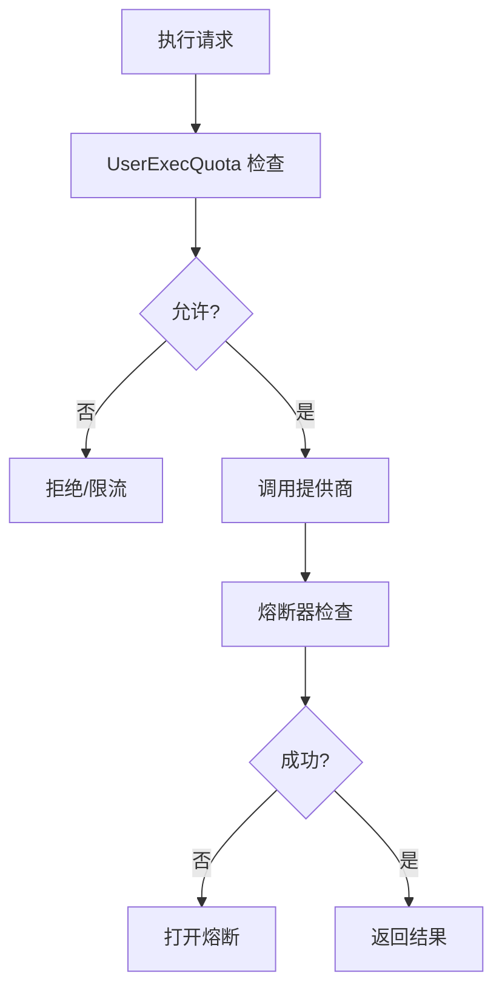
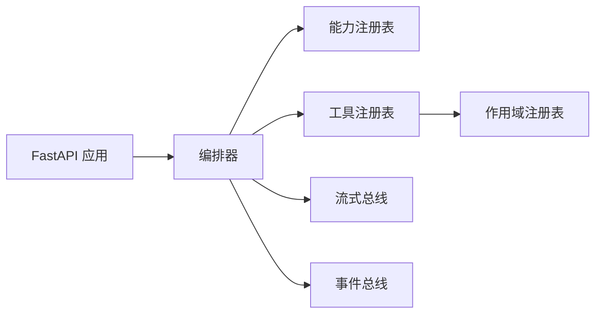

# 架构设计理念

<cite>
**本文引用的文件**   
- [deeptutor/api/main.py](file://deeptutor/api/main.py)
- [deeptutor/runtime/orchestrator.py](file://deeptutor/runtime/orchestrator.py)
- [deeptutor/events/event_bus.py](file://deeptutor/events/event_bus.py)
- [deeptutor/runtime/stream_bus.py](file://deeptutor/runtime/stream_bus.py)
- [deeptutor/runtime/registry/scoped_registry.py](file://deeptutor/runtime/registry/scoped_registry.py)
- [deeptutor/multi_user/paths.py](file://deeptutor/multi_user/paths.py)
- [deeptutor/services/sandbox/quota.py](file://deeptutor/services/sandbox/quota.py)
- [deeptutor/utils/network/circuit_breaker.py](file://deeptutor/utils/network/circuit_breaker.py)
</cite>

## 目录
1. [引言](#引言)
2. [项目结构](#项目结构)
3. [核心组件](#核心组件)
4. [架构总览](#架构总览)
5. [详细组件分析](#详细组件分析)
6. [依赖关系分析](#依赖关系分析)
7. [性能与可扩展性](#性能与可扩展性)
8. [多租户、水平扩展与高可用](#多租户水平扩展与高可用)
9. [故障排查指南](#故障排查指南)
10. [结论与演进方向](#结论与演进方向)

## 引言
本文件面向 DeepTutor 的架构设计理念，聚焦以下目标：
- 微服务化与模块化边界：以 FastAPI 应用为入口，通过模块注册、能力注册与工具注册实现“可插拔”的业务能力。
- 事件驱动通信：使用进程内异步事件总线进行跨模块解耦；使用流式总线承载单次对话的实时事件。
- 插件化扩展机制：基于能力与工具的注册表、作用域覆盖与白名单控制，支持运行时动态扩展与安全隔离。
- 分层职责分离：API 层、编排层、能力层、工具层、基础设施层清晰分离。
- 设计模式：工厂（容器/提供者）、观察者（事件总线）、策略（模型选择/能力路由）、限流与熔断等。
- 关键权衡：性能（流式输出、连接池、后台任务）、可扩展性（模块/能力/工具注册、作用域隔离）、安全性（CORS、访问控制、沙箱配额）。
- 部署拓扑：单进程 FastAPI + 外部 LLM/MCP/存储；未来可拆分为独立服务。

## 项目结构
DeepTutor 后端采用 Python FastAPI 应用作为统一入口，内部按功能划分为多个子系统：
- API 层：FastAPI 应用、中间件、路由加载、健康检查、CORS、安全守卫。
- 编排层：统一对话编排器，将用户消息路由到具体能力。
- 事件系统：全局事件总线（发布订阅）与流式总线（单次对话事件通道）。
- 能力与工具：能力注册表与工具注册表，支持作用域覆盖与白名单。
- 多租户与安全：所有者路径、权限与沙箱配额。
- 运行期：启动生命周期、后台任务协调、MCP/LLM 客户端管理。

**图示来源**
- [deeptutor/api/main.py:364-548](file://deeptutor/api/main.py#L364-L548)
- [deeptutor/runtime/orchestrator.py:54-278](file://deeptutor/runtime/orchestrator.py#L54-L278)
- [deeptutor/events/event_bus.py:61-210](file://deeptutor/events/event_bus.py#L61-L210)
- [deeptutor/runtime/stream_bus.py:32-421](file://deeptutor/runtime/stream_bus.py#L32-L421)

**章节来源**
- [deeptutor/api/main.py:108-350](file://deeptutor/api/main.py#L108-L350)
- [deeptutor/runtime/orchestrator.py:1-278](file://deeptutor/runtime/orchestrator.py#L1-L278)

## 核心组件
- FastAPI 应用与生命周期：负责启动校验、容器初始化、事件总线启动、后台协调器、MCP/LLM 资源关闭。
- 对话编排器：统一入口，解析上下文、选择能力、创建流式总线、执行能力并产出事件。
- 全局事件总线：异步发布订阅，用于跨模块通知（如能力完成）。
- 流式总线：单次对话的事件通道，支持内容、思考、观察、工具调用/结果、进度、来源、错误、等待输入等。
- 作用域工具注册表：在基础注册表之上叠加租户级工具，防止名称冲突，提供白名单与拒绝消息。
- 多租户路径与配额：所有者私有目录、沙箱配额（并发与速率限制）。

**章节来源**
- [deeptutor/api/main.py:108-350](file://deeptutor/api/main.py#L108-L350)
- [deeptutor/runtime/orchestrator.py:54-278](file://deeptutor/runtime/orchestrator.py#L54-L278)
- [deeptutor/events/event_bus.py:61-210](file://deeptutor/events/event_bus.py#L61-L210)
- [deeptutor/runtime/stream_bus.py:32-421](file://deeptutor/runtime/stream_bus.py#L32-L421)
- [deeptutor/runtime/registry/scoped_registry.py:48-80](file://deeptutor/runtime/registry/scoped_registry.py#L48-L80)
- [deeptutor/multi_user/paths.py:232-261](file://deeptutor/multi_user/paths.py#L232-L261)
- [deeptutor/services/sandbox/quota.py:1-39](file://deeptutor/services/sandbox/quota.py#L1-L39)

## 架构总览
DeepTutor 采用“单进程 FastAPI + 模块化能力”的微服务化形态，强调：
- 入口统一：所有请求经 FastAPI 进入，中间件处理 CORS、访问日志、安全守卫。
- 编排集中：对话编排器统一路由到能力，屏蔽下游差异。
- 事件解耦：全局事件总线用于跨模块通知；流式总线用于实时交互。
- 插件化：能力与工具通过注册表发现，支持作用域覆盖与白名单。
- 安全与隔离：多租户路径、沙箱配额、CORS 策略、访问错误统一返回 JSON。

**图示来源**
- [deeptutor/api/main.py:364-548](file://deeptutor/api/main.py#L364-L548)
- [deeptutor/runtime/orchestrator.py:64-278](file://deeptutor/runtime/orchestrator.py#L64-L278)
- [deeptutor/runtime/stream_bus.py:96-421](file://deeptutor/runtime/stream_bus.py#L96-L421)
- [deeptutor/events/event_bus.py:101-185](file://deeptutor/events/event_bus.py#L101-L185)

## 详细组件分析

### FastAPI 应用与生命周期
- 启动阶段：校验工具一致性、初始化应用容器、启动事件总线、启动后台协调器、迁移数据、初始化 LLM 客户端、Ping PocketBase。
- 中间件：工作区活动记录、JSON 错误边界、选择性访问日志、CORS、安全守卫。
- 健康检查：/health/live 与 /health/ready 区分存活与就绪状态。
- 关闭阶段：停止后台协调器、关闭容器、关闭 MCP 连接、关闭 LLM 客户端池、关闭事件总线。

**图示来源**
- [deeptutor/api/main.py:108-350](file://deeptutor/api/main.py#L108-L350)

**章节来源**
- [deeptutor/api/main.py:108-350](file://deeptutor/api/main.py#L108-L350)
- [deeptutor/api/main.py:364-548](file://deeptutor/api/main.py#L364-L548)

### 对话编排器与流式总线
- 编排器职责：
  - 解析上下文，确定会话 ID 与轮次 ID。
  - 根据 active_capability 或默认 chat 能力选择执行者。
  - 创建流式总线，注册 turn_id 以便用户输入路由。
  - 执行能力，捕获异常并标准化错误元数据。
  - 发布 CAPABILITY_COMPLETE 到全局事件总线。
- 流式总线职责：
  - 维护历史事件与订阅队列，支持跨事件循环投递。
  - 提供 content/thinking/observation/tool_call/tool_result/progress/sources/result/error/wait_for_input 等方法。
  - 支持序列号分配与公开内容快照。

**图示来源**
- [deeptutor/runtime/orchestrator.py:54-278](file://deeptutor/runtime/orchestrator.py#L54-L278)
- [deeptutor/runtime/stream_bus.py:32-421](file://deeptutor/runtime/stream_bus.py#L32-L421)

**章节来源**
- [deeptutor/runtime/orchestrator.py:64-278](file://deeptutor/runtime/orchestrator.py#L64-L278)
- [deeptutor/runtime/stream_bus.py:96-421](file://deeptutor/runtime/stream_bus.py#L96-L421)

### 全局事件总线（观察者模式）
- 设计要点：
  - 单例模式，延迟启动处理器任务。
  - 异步队列分发事件，非阻塞发布。
  - 支持 subscribe/unsubscribe/publish/start/stop/flush/reset。
- 应用场景：
  - 编排器在能力完成后发布 CAPABILITY_COMPLETE。
  - 其他模块订阅该事件进行审计、统计或联动。

**图示来源**
- [deeptutor/events/event_bus.py:22-210](file://deeptutor/events/event_bus.py#L22-L210)

**章节来源**
- [deeptutor/events/event_bus.py:61-210](file://deeptutor/events/event_bus.py#L61-L210)

### 插件化扩展机制（工厂/策略/作用域）
- 工厂模式：
  - 应用容器与提供者工厂负责实例化 LLM/MCP/能力等。
- 策略模式：
  - 能力路由策略（active_capability 或默认 chat）。
  - 模型选择策略（由服务层 provider 管理）。
- 作用域覆盖：
  - 作用域工具注册表在基础注册表上叠加租户级工具，避免名称冲突，并提供白名单与拒绝消息。

**图示来源**
- [deeptutor/runtime/registry/scoped_registry.py:48-80](file://deeptutor/runtime/registry/scoped_registry.py#L48-L80)

**章节来源**
- [deeptutor/runtime/registry/scoped_registry.py:48-80](file://deeptutor/runtime/registry/scoped_registry.py#L48-L80)

### 多租户与路径隔离
- 所有者私有目录：
  - 所有者密钥目录位于 data/system 下，沙箱不可见，避免 OAuth refresh token 泄露。
  - current_owner_id 决定当前作用域的所有者。
- 路径布局：
  - 与用户根目录一致的 private/<asset>/ 布局，便于存储适配。

**图示来源**
- [deeptutor/multi_user/paths.py:232-261](file://deeptutor/multi_user/paths.py#L232-L261)

**章节来源**
- [deeptutor/multi_user/paths.py:232-261](file://deeptutor/multi_user/paths.py#L232-L261)

### 执行配额与熔断（可靠性）
- 执行配额：
  - 每用户并发上限与滑动窗口速率限制，防止滥用与饥饿。
- 熔断器：
  - 对提供商调用进行错误率监控，自动打开/半开/关闭电路。

**图示来源**
- [deeptutor/services/sandbox/quota.py:1-39](file://deeptutor/services/sandbox/quota.py#L1-L39)
- [deeptutor/utils/network/circuit_breaker.py:13-42](file://deeptutor/utils/network/circuit_breaker.py#L13-L42)

**章节来源**
- [deeptutor/services/sandbox/quota.py:1-39](file://deeptutor/services/sandbox/quota.py#L1-L39)
- [deeptutor/utils/network/circuit_breaker.py:13-42](file://deeptutor/utils/network/circuit_breaker.py#L13-L42)

## 依赖关系分析
- 耦合关系：
  - API 层依赖编排器与中间件；编排器依赖能力/工具注册表与事件系统。
  - 事件总线与流式总线解耦：前者跨模块通知，后者单次对话实时事件。
  - 作用域注册表依赖基础注册表，叠加租户级覆盖。
- 外部依赖：
  - LLM 客户端、MCP 服务器、PocketBase、文件系统与沙箱。
- 潜在循环依赖：
  - 通过懒导入与模块启用开关降低耦合风险。

**图示来源**
- [deeptutor/api/main.py:364-548](file://deeptutor/api/main.py#L364-L548)
- [deeptutor/runtime/orchestrator.py:54-278](file://deeptutor/runtime/orchestrator.py#L54-L278)
- [deeptutor/runtime/registry/scoped_registry.py:48-80](file://deeptutor/runtime/registry/scoped_registry.py#L48-L80)

**章节来源**
- [deeptutor/api/main.py:364-548](file://deeptutor/api/main.py#L364-L548)
- [deeptutor/runtime/orchestrator.py:54-278](file://deeptutor/runtime/orchestrator.py#L54-L278)
- [deeptutor/runtime/registry/scoped_registry.py:48-80](file://deeptutor/runtime/registry/scoped_registry.py#L48-L80)

## 性能与可扩展性
- 性能考虑：
  - 流式输出减少首字节延迟；事件总线异步处理不阻塞发布者。
  - LLM/MCP 客户端池复用连接，避免频繁握手。
  - 健康检查区分存活与就绪，利于负载均衡与健康探测。
- 可扩展性设计：
  - 能力与工具注册表支持动态扩展；作用域覆盖支持租户定制。
  - 模块启用开关按需加载功能，降低冷启动成本。
  - 路由懒加载（typescript-native 模式）减少初始导入开销。
- 安全性考量：
  - CORS 严格模式（认证开启时）与显式来源列表。
  - 访问错误统一 JSON 返回，避免跨域透明失败。
  - 所有者私有目录与沙箱配额保护敏感信息与资源。

[本节为通用指导，无需特定文件引用]

## 多租户、水平扩展与高可用
- 多租户：
  - 通过 current_owner_id 与 get_owner_secrets_dir 实现所有者隔离。
  - 作用域工具注册表防止名称冲突，保障租户间工具可见性隔离。
- 水平扩展：
  - 当前配额为进程内实现，适合单容器；多副本需迁移至共享存储。
  - 事件总线为进程内队列，多副本需引入消息中间件（如 Redis/Kafka）。
- 高可用：
  - 健康检查 /health/ready 结合协调器健康探测。
  - 后台协调器支持恢复回调与领导选举（BackgroundLeaderSupervisor）。
  - 启动阶段幂等迁移与回滚友好（迁移报告与归档）。

**章节来源**
- [deeptutor/multi_user/paths.py:232-261](file://deeptutor/multi_user/paths.py#L232-L261)
- [deeptutor/runtime/registry/scoped_registry.py:48-80](file://deeptutor/runtime/registry/scoped_registry.py#L48-L80)
- [deeptutor/services/sandbox/quota.py:1-39](file://deeptutor/services/sandbox/quota.py#L1-L39)
- [deeptutor/api/main.py:520-548](file://deeptutor/api/main.py#L520-L548)

## 故障排查指南
- 常见问题定位：
  - 配置漂移：能力清单引用未注册工具会抛出运行时错误，需在启动阶段修复。
  - 能力未知：编排器返回包含可用能力的错误信息，检查能力注册。
  - 事件总线未启动：CAPABILITY_COMPLETE 发布失败会被忽略，检查生命周期启动顺序。
  - 流式总线未关闭：消费者提前断开可能导致任务未注销，检查取消逻辑。
- 建议步骤：
  - 查看健康检查 /health/ready 状态。
  - 检查事件总线 start/stop 日志。
  - 核对能力与工具清单一致性。
  - 确认 CORS 与访问日志是否记录预期请求。

**章节来源**
- [deeptutor/api/main.py:47-75](file://deeptutor/api/main.py#L47-L75)
- [deeptutor/runtime/orchestrator.py:116-134](file://deeptutor/runtime/orchestrator.py#L116-L134)
- [deeptutor/events/event_bus.py:167-185](file://deeptutor/events/event_bus.py#L167-L185)
- [deeptutor/runtime/stream_bus.py:238-247](file://deeptutor/runtime/stream_bus.py#L238-L247)

## 结论与演进方向
- 总结：
  - DeepTutor 以 FastAPI 为统一入口，通过编排器、能力/工具注册表、事件系统与流式总线构建清晰的层次与解耦。
  - 插件化与作用域隔离支撑多租户与可扩展性；配额与熔断提升可靠性。
- 演进方向：
  - 将事件总线与配额机制迁移至分布式中间件，支持多副本水平扩展。
  - 进一步拆分能力为独立微服务，通过消息队列与 gRPC/HTTP 接口协作。
  - 增强可观测性：统一追踪、指标采集与告警。
  - 强化安全：细粒度权限模型、审计日志与合规检查。

[本节为总结性内容，无需特定文件引用]