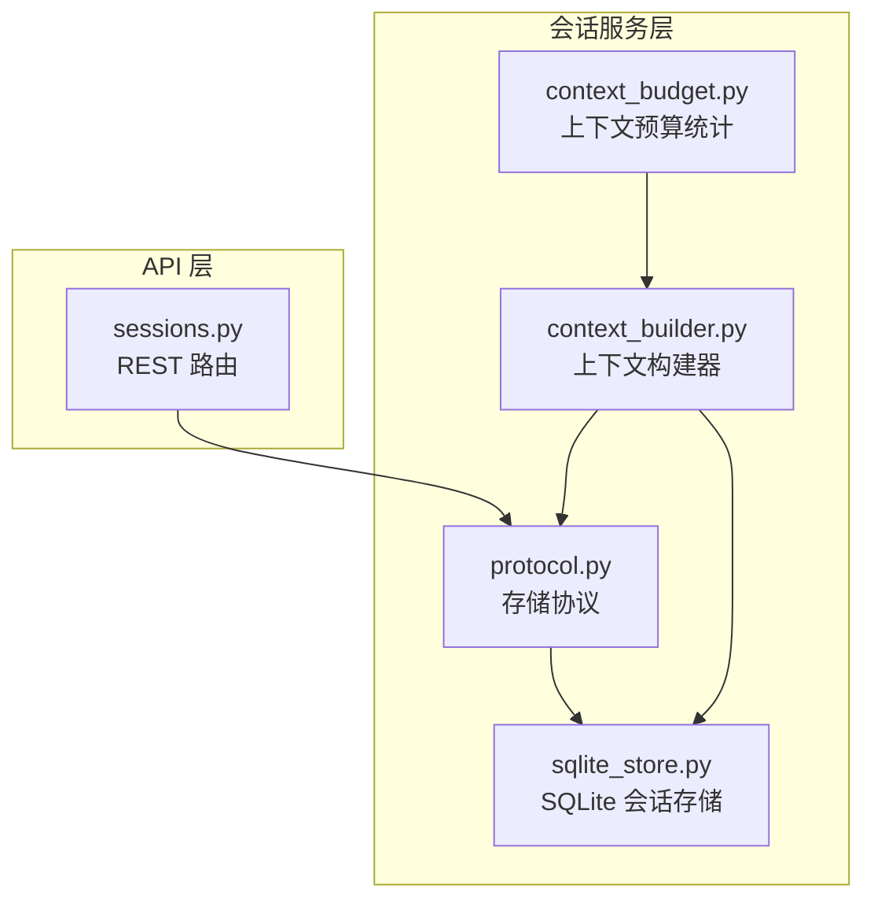
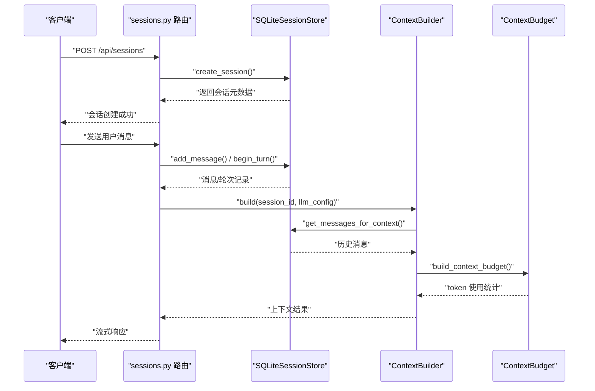
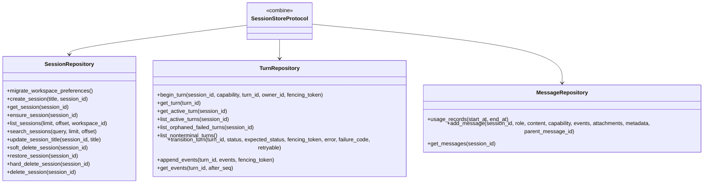
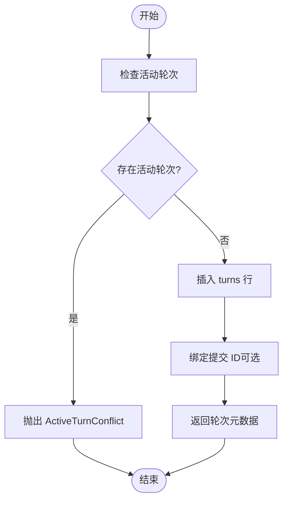
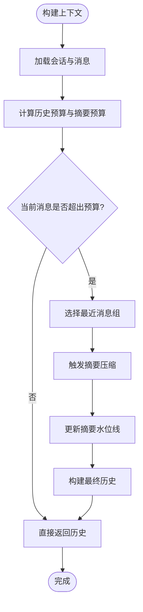
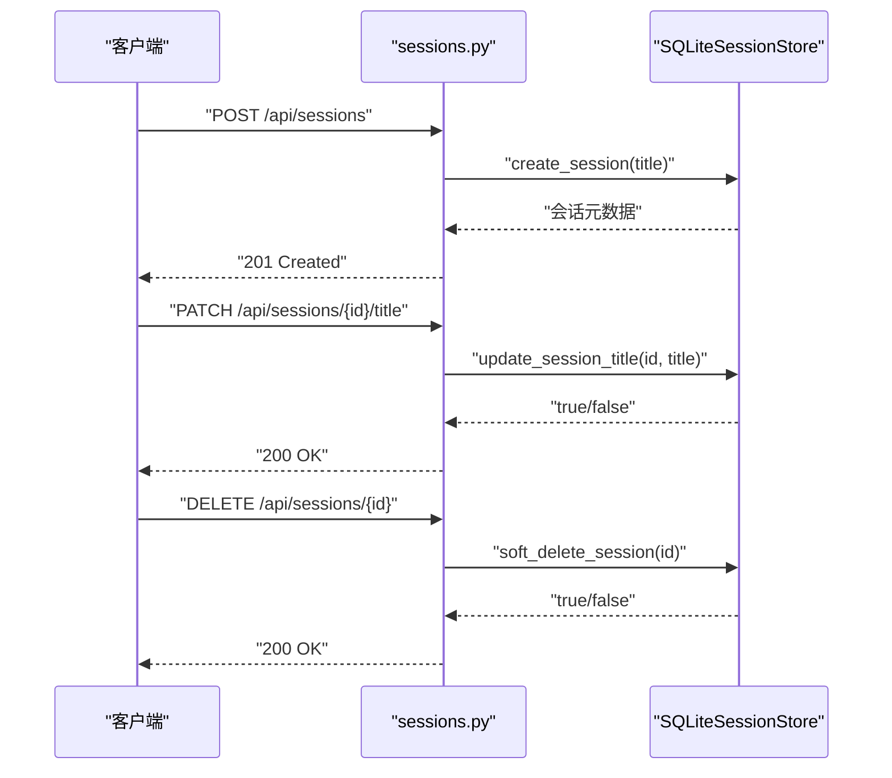
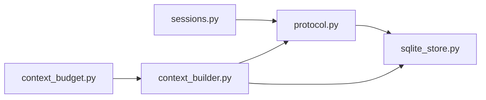

# 会话管理系统

<cite>
**本文引用的文件**   
- [sqlite_store.py](file://deeptutor/services/session/sqlite_store.py)
- [protocol.py](file://deeptutor/services/session/protocol.py)
- [context_builder.py](file://deeptutor/services/session/context_builder.py)
- [context_budget.py](file://deeptutor/agents/loop/context_budget.py)
- [sessions.py](file://deeptutor/api/routers/sessions.py)
</cite>

## 目录
1. [简介](#简介)
2. [项目结构](#项目结构)
3. [核心组件](#核心组件)
4. [架构总览](#架构总览)
5. [详细组件分析](#详细组件分析)
6. [依赖关系分析](#依赖关系分析)
7. [性能与优化](#性能与优化)
8. [故障排查指南](#故障排查指南)
9. [结论](#结论)

## 简介
本技术文档聚焦 DeepTutor 的会话管理系统，围绕以下目标展开：
- 会话生命周期管理：创建、状态维护、持久化存储与清理。
- 上下文预算控制算法：token 限制、历史消息裁剪与重要信息保留策略。
- 数据存储结构与查询优化：SQLite 实现、数据模型设计与索引策略。
- 代码级示例路径：如何创建会话、管理对话历史、恢复会话状态。
- 智能体交互模式：与聊天循环和工具调用的协作方式。
- 并发访问与一致性：多进程安全、活动轮次互斥、幂等提交。
- 性能优化技巧与常见问题解决方案。

## 项目结构
会话管理相关代码主要分布在 services/session 与 agents/loop 两个区域：
- services/session：会话存储协议、SQLite 实现、上下文构建器、上下文预算统计等。
- agents/loop：面向 LLM 请求的上下文窗口预算计算与分段统计。
- api/routers/sessions：对外暴露的会话 API 路由，负责接收前端请求并调用服务层。

**图表来源**
- [sessions.py:90-115](file://deeptutor/api/routers/sessions.py#L90-L115)
- [protocol.py:38-150](file://deeptutor/services/session/protocol.py#L38-L150)
- [sqlite_store.py:245-333](file://deeptutor/services/session/sqlite_store.py#L245-L333)
- [context_builder.py:267-316](file://deeptutor/services/session/context_builder.py#L267-L316)
- [context_budget.py:58-106](file://deeptutor/agents/loop/context_budget.py#L58-L106)

**章节来源**
- [sessions.py:90-115](file://deeptutor/api/routers/sessions.py#L90-L115)
- [protocol.py:38-150](file://deeptutor/services/session/protocol.py#L38-L150)
- [sqlite_store.py:245-333](file://deeptutor/services/session/sqlite_store.py#L245-L333)
- [context_builder.py:267-316](file://deeptutor/services/session/context_builder.py#L267-L316)
- [context_budget.py:58-106](file://deeptutor/agents/loop/context_budget.py#L58-L106)

## 核心组件
- 会话存储协议 SessionStoreProtocol：定义统一的会话、轮次（turn）与消息接口，屏蔽 SQLite 与 PocketBase 后端差异。
- SQLiteSessionStore：基于 SQLite 的会话与消息持久化实现，包含表结构、迁移、并发控制、事件追加与查询优化。
- ContextBuilder：根据 LLM 配置与预算策略，从存储中构建有界的历史上下文，支持摘要压缩与最近消息保留。
- ContextBudget：对一次真实 LLM 请求进行 token 使用统计，按系统提示、工具 schema、消息等维度拆分。
- API 路由 sessions.py：提供会话创建、获取、更新标题、软删除、硬删除等 REST 接口。

**章节来源**
- [protocol.py:38-150](file://deeptutor/services/session/protocol.py#L38-L150)
- [sqlite_store.py:245-333](file://deeptutor/services/session/sqlite_store.py#L245-L333)
- [context_builder.py:267-316](file://deeptutor/services/session/context_builder.py#L267-L316)
- [context_budget.py:58-106](file://deeptutor/agents/loop/context_budget.py#L58-L106)
- [sessions.py:90-115](file://deeptutor/api/routers/sessions.py#L90-L115)

## 架构总览
会话管理的整体流程如下：
- 客户端通过 API 路由发起会话操作。
- 路由调用存储协议，由 SQLiteSessionStore 或 PocketBaseSessionStore 实现具体逻辑。
- 聊天循环在每轮生成前，通过 ContextBuilder 构建有界历史上下文，并通过 ContextBudget 统计实际请求的 token 使用情况。
- 轮次（turn）状态与事件（events）持久化到 SQLite，保证可回放与可观测性。

**图表来源**
- [sessions.py:90-115](file://deeptutor/api/routers/sessions.py#L90-L115)
- [sqlite_store.py:1132-1173](file://deeptutor/services/session/sqlite_store.py#L1132-L1173)
- [sqlite_store.py:1450-1577](file://deeptutor/services/session/sqlite_store.py#L1450-L1577)
- [context_builder.py:595-794](file://deeptutor/services/session/context_builder.py#L595-L794)
- [context_budget.py:142-239](file://deeptutor/agents/loop/context_budget.py#L142-L239)

## 详细组件分析

### 会话存储协议与会话仓库
- SessionRepository：定义会话创建、获取、列表、搜索、软删除、恢复、硬删除等接口。
- TurnRepository：定义轮次开始、查询、活跃轮次、事件追加与查询等接口。
- MessageRepository：定义消息添加、查询、角色读取等接口。
- SessionStoreProtocol：组合上述三个仓库接口，统一对外暴露。

**图表来源**
- [protocol.py:38-150](file://deeptutor/services/session/protocol.py#L38-L150)
- [protocol.py:150-276](file://deeptutor/services/session/protocol.py#L150-L276)

**章节来源**
- [protocol.py:38-150](file://deeptutor/services/session/protocol.py#L38-L150)
- [protocol.py:150-276](file://deeptutor/services/session/protocol.py#L150-L276)

### SQLite 会话存储实现
- 表结构：
  - sessions：会话元数据，包括标题、时间戳、压缩摘要、偏好设置、回收站标记。
  - messages：消息行，支持编辑分支（parent_message_id）、能力标签、附件与元数据。
  - turns：轮次状态机，包括能力、状态、错误、所有者、围栏令牌、状态版本、失败码、重试标志、助手消息关联。
  - turn_submissions：提交去重与编辑替换，防止重复提交与冲突。
  - turn_events：轮次事件序列，用于回放与追踪。
  - notebook_entries / assessment_attempts：问答与评估相关扩展表。
- 并发与一致性：
  - 使用 BEGIN IMMEDIATE 事务与部分唯一索引 idx_turns_one_active_session 保证同一会话只有一个活动轮次。
  - ActiveTurnConflict 异常标识“会话忙”，便于上层处理。
  - append_events 批量写入，避免慢存储导致的最终化延迟。
- 查询优化：
  - 针对 sessions.updated_at、messages.session_id+created_at、turns.session_id+status、turn_events.turn_id+seq 建立索引。
  - get_messages_for_context 支持 leaf_message_id，仅加载编辑分支祖先链上的消息。

**图表来源**
- [sqlite_store.py:1450-1577](file://deeptutor/services/session/sqlite_store.py#L1450-L1577)
- [protocol.py:20-36](file://deeptutor/services/session/protocol.py#L20-L36)

**章节来源**
- [sqlite_store.py:274-529](file://deeptutor/services/session/sqlite_store.py#L274-L529)
- [sqlite_store.py:1132-1173](file://deeptutor/services/session/sqlite_store.py#L1132-L1173)
- [sqlite_store.py:1450-1577](file://deeptutor/services/session/sqlite_store.py#L1450-L1577)
- [sqlite_store.py:1776-1877](file://deeptutor/services/session/sqlite_store.py#L1776-L1877)
- [sqlite_store.py:2096-2188](file://deeptutor/services/session/sqlite_store.py#L2096-L2188)

### 上下文构建与预算控制
- ContextBuilder：
  - 根据 LLMConfig 计算有效上下文窗口与历史预算。
  - 选择最近消息组，必要时触发摘要压缩。
  - 支持原生历史构建（native_history）与回放历史（replay_history）。
  - 输出 ContextBuildResult，包含 conversation_history、conversation_summary、token_count、budget 等。
- ContextBudget：
  - 统计一次真实 LLM 请求的 token 使用，按 system_prompt、tool_manifest、messages 等维度拆分。
  - 支持估算上下文窗口与计数器名称探测。

**图表来源**
- [context_builder.py:267-316](file://deeptutor/services/session/context_builder.py#L267-L316)
- [context_builder.py:595-794](file://deeptutor/services/session/context_builder.py#L595-L794)
- [context_budget.py:142-239](file://deeptutor/agents/loop/context_budget.py#L142-L239)

**章节来源**
- [context_builder.py:267-316](file://deeptutor/services/session/context_builder.py#L267-L316)
- [context_builder.py:595-794](file://deeptutor/services/session/context_builder.py#L595-L794)
- [context_budget.py:142-239](file://deeptutor/agents/loop/context_budget.py#L142-L239)

### API 路由与会话操作
- sessions.py 定义了会话组织元数据结构与回复语言校验。
- 典型操作：
  - 创建会话：POST /api/sessions
  - 获取会话：GET /api/sessions/{session_id}
  - 更新会话标题：PATCH /api/sessions/{session_id}/title
  - 软删除/恢复/硬删除：DELETE /api/sessions/{session_id}

**图表来源**
- [sessions.py:90-115](file://deeptutor/api/routers/sessions.py#L90-L115)
- [sqlite_store.py:2018-2080](file://deeptutor/services/session/sqlite_store.py#L2018-L2080)

**章节来源**
- [sessions.py:90-115](file://deeptutor/api/routers/sessions.py#L90-L115)
- [sqlite_store.py:2018-2080](file://deeptutor/services/session/sqlite_store.py#L2018-L2080)

## 依赖关系分析
- API 路由依赖存储协议，不关心具体后端。
- SQLiteSessionStore 实现协议，提供完整的会话、轮次、消息与事件持久化能力。
- ContextBuilder 依赖存储协议读取消息，并依赖 LLM 配置与上下文预算模块。
- ContextBudget 依赖 tokenizer 与模型上下文窗口解析逻辑。

**图表来源**
- [sessions.py:90-115](file://deeptutor/api/routers/sessions.py#L90-L115)
- [protocol.py:38-150](file://deeptutor/services/session/protocol.py#L38-L150)
- [sqlite_store.py:245-333](file://deeptutor/services/session/sqlite_store.py#L245-L333)
- [context_builder.py:267-316](file://deeptutor/services/session/context_builder.py#L267-L316)
- [context_budget.py:58-106](file://deeptutor/agents/loop/context_budget.py#L58-L106)

**章节来源**
- [sessions.py:90-115](file://deeptutor/api/routers/sessions.py#L90-L115)
- [protocol.py:38-150](file://deeptutor/services/session/protocol.py#L38-L150)
- [sqlite_store.py:245-333](file://deeptutor/services/session/sqlite_store.py#L245-L333)
- [context_builder.py:267-316](file://deeptutor/services/session/context_builder.py#L267-L316)
- [context_budget.py:58-106](file://deeptutor/agents/loop/context_budget.py#L58-L106)

## 性能与优化
- SQLite 性能优化：
  - WAL 模式提升读写并发。
  - busy_timeout 与 foreign_keys 开启保证事务一致性与锁等待可控。
  - 关键索引：sessions.updated_at、messages.session_id+created_at、turns.session_id+status、turn_events.turn_id+seq。
- 轮次与事件：
  - append_events 批量写入减少 fsync 次数，避免慢存储导致的最终化延迟。
  - 使用 fencing_token 与 state_version 防止并发覆盖。
- 上下文构建：
  - 历史预算与摘要预算分离，避免大窗口模型下摘要过大。
  - 图像 token 估算独立于文本计数，避免视觉内容耗尽文本预算。
  - 原生历史构建（native_history）与回放历史（replay_history）结合，降低重复计算。
- 预算统计：
  - ContextBudget 按系统提示、工具 schema、消息维度拆分，确保读出的 token 数与实际请求一致。

**章节来源**
- [sqlite_store.py:274-333](file://deeptutor/services/session/sqlite_store.py#L274-L333)
- [sqlite_store.py:1776-1877](file://deeptutor/services/session/sqlite_store.py#L1776-L1877)
- [context_builder.py:41-64](file://deeptutor/services/session/context_builder.py#L41-L64)
- [context_builder.py:291-316](file://deeptutor/services/session/context_builder.py#L291-L316)
- [context_budget.py:142-239](file://deeptutor/agents/loop/context_budget.py#L142-L239)

## 故障排查指南
- 活动轮次冲突：
  - 现象：抛出 ActiveTurnConflict，提示会话已有活动轮次。
  - 原因：同一会话同时开始多个轮次，违反部分唯一索引约束。
  - 解决：确保同一会话串行开始轮次；检查上游调度逻辑。
- 提交冲突：
  - 现象：提交 ID 被覆盖或属于不同会话/工作区。
  - 原因：重复提交或编辑替换未正确标记 superseded_by。
  - 解决：确保 client_submission_id 唯一；编辑时使用新 submission_id。
- 事件冲突：
  - 现象：append_events 抛出事件冲突，seq 重复但内容不一致。
  - 原因：并发写入导致 seq 分配冲突。
  - 解决：确保事件顺序稳定；使用 fencing_token 保护轮次。
- 摘要压缩失败：
  - 现象：上下文构建降级为仅保留最近消息，不推进摘要水位线。
  - 原因：LLM 调用失败或输出异常。
  - 解决：检查 LLM 配置与网络；查看日志中的 context_builder 错误。

**章节来源**
- [protocol.py:20-36](file://deeptutor/services/session/protocol.py#L20-L36)
- [sqlite_store.py:1450-1577](file://deeptutor/services/session/sqlite_store.py#L1450-L1577)
- [sqlite_store.py:1776-1877](file://deeptutor/services/session/sqlite_store.py#L1776-L1877)
- [context_builder.py:751-774](file://deeptutor/services/session/context_builder.py#L751-L774)

## 结论
DeepTutor 的会话管理系统以协议抽象为核心，SQLite 实现提供高可靠、高性能的持久化能力，配合 ContextBuilder 与 ContextBudget 实现精细化的上下文预算控制。通过活动轮次互斥、提交去重、事件序列与索引优化，系统在并发场景下保持数据一致性与可观测性。对于大规模对话与长上下文，系统采用摘要压缩与最近消息保留策略，在保证用户体验的同时控制 token 成本。