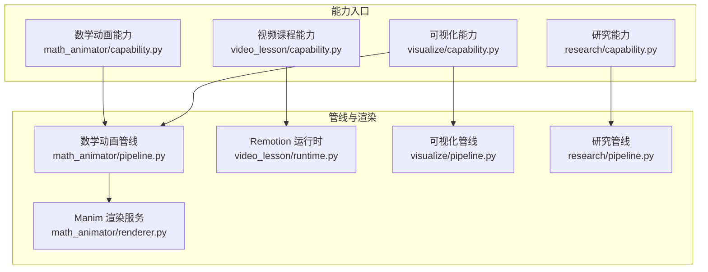
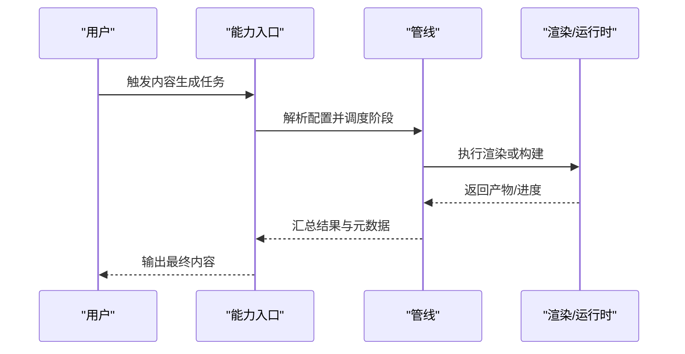
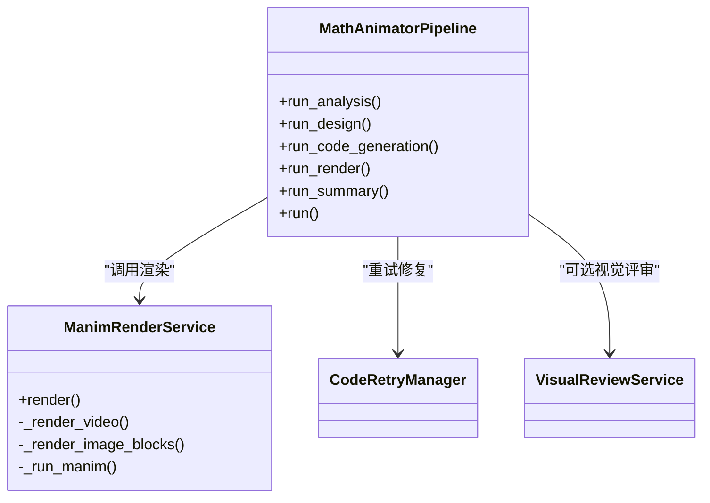
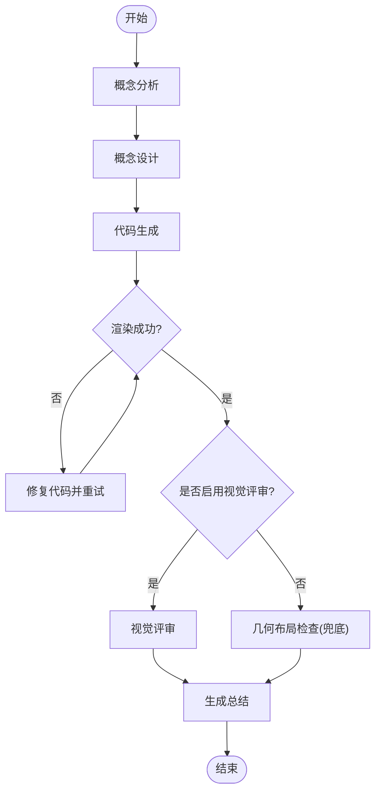
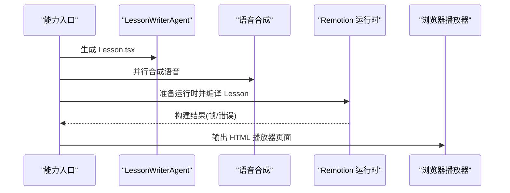
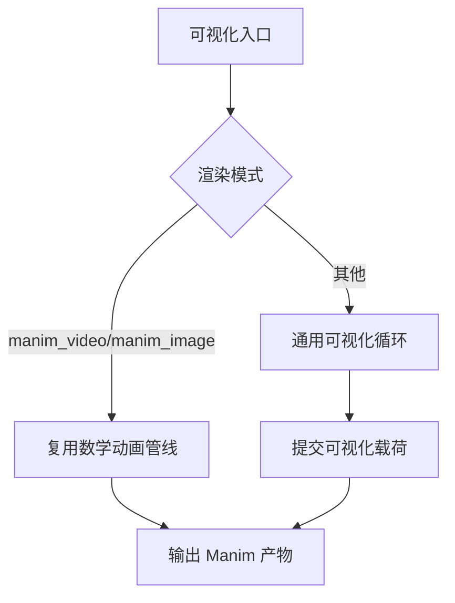
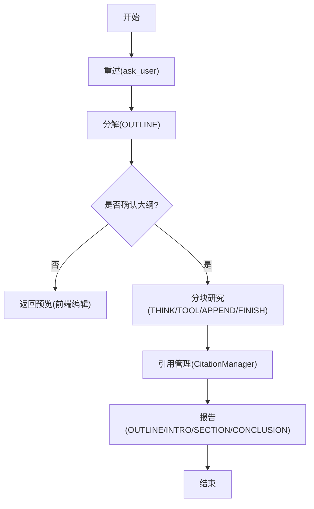
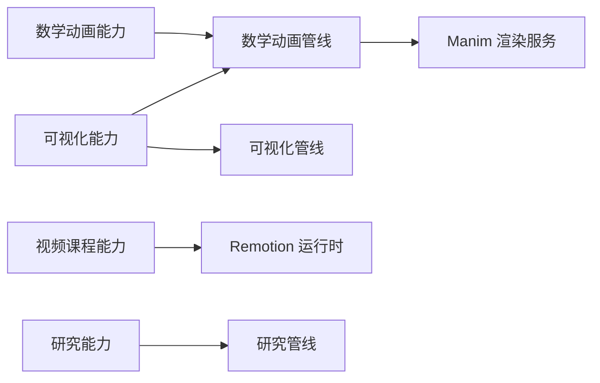

# 内容生成引擎

<cite>
**本文引用的文件**   
- [capability.py](file://deeptutor/agents/math_animator/capability.py)
- [pipeline.py](file://deeptutor/agents/math_animator/pipeline.py)
- [renderer.py](file://deeptutor/agents/math_animator/renderer.py)
- [capability.py](file://deeptutor/agents/video_lesson/capability.py)
- [runtime.py](file://deeptutor/agents/video_lesson/runtime.py)
- [capability.py](file://deeptutor/agents/visualize/capability.py)
- [pipeline.py](file://deeptutor/agents/visualize/pipeline.py)
- [capability.py](file://deeptutor/agents/research/capability.py)
- [pipeline.py](file://deeptutor/agents/research/pipeline.py)
</cite>

## 目录
1. [引言](#引言)
2. [项目结构](#项目结构)
3. [核心组件](#核心组件)
4. [架构总览](#架构总览)
5. [详细组件分析](#详细组件分析)
6. [依赖关系分析](#依赖关系分析)
7. [性能与质量优化](#性能与质量优化)
8. [故障排查指南](#故障排查指南)
9. [结论](#结论)
10. [附录：使用示例与自定义](#附录使用示例与自定义)

## 引言
本技术文档面向 DeepTutor 的内容生成引擎，聚焦以下能力：
- 数学动画生成器：从概念分析、视觉设计到代码生成与 Manim 渲染的完整流水线。
- 视频课程制作：脚本生成、语音合成、Remotion 编译与浏览器端播放编排。
- 可视化工具：图表生成、数据可视化效果与交互式演示（含 Manim 子路径）。
- 研究智能体：文献检索、摘要生成与引用管理。
同时给出各生成器的协作方式、可定制点、质量优化建议与性能调优指南。

## 项目结构
DeepTutor 将“内容生成”拆分为多个能力（Capability），每个能力由入口编排、内部管线与外部渲染/运行时组成：
- 数学动画：`math_animator` 能力通过 `MathAnimatorPipeline` 串联概念分析、设计、代码生成、Manim 渲染与总结。
- 视频课程：`video_lesson` 能力驱动 Lesson 脚本生成、语音合成、Remotion 构建与 HTML 播放器输出。
- 可视化：`visualize` 能力支持通用可视化（基于聊天循环）与 Manim 子路径复用。
- 研究：`research` 能力实现多阶段研究流程与引用管理。

**图示来源**
- [capability.py:19-50](file://deeptutor/agents/math_animator/capability.py#L19-L50)
- [pipeline.py:30-90](file://deeptutor/agents/math_animator/pipeline.py#L30-L90)
- [renderer.py:36-81](file://deeptutor/agents/math_animator/renderer.py#L36-L81)
- [capability.py:25-68](file://deeptutor/agents/video_lesson/capability.py#L25-L68)
- [runtime.py:99-121](file://deeptutor/agents/video_lesson/runtime.py#L99-L121)
- [capability.py:89-126](file://deeptutor/agents/visualize/capability.py#L89-L126)
- [pipeline.py:13-45](file://deeptutor/agents/visualize/pipeline.py#L13-L45)
- [capability.py:37-74](file://deeptutor/agents/research/capability.py#L37-L74)
- [pipeline.py:341-563](file://deeptutor/agents/research/pipeline.py#L341-L563)

**章节来源**
- [capability.py:19-50](file://deeptutor/agents/math_animator/capability.py#L19-L50)
- [capability.py:25-68](file://deeptutor/agents/video_lesson/capability.py#L25-L68)
- [capability.py:89-126](file://deeptutor/agents/visualize/capability.py#L89-L126)
- [capability.py:37-74](file://deeptutor/agents/research/capability.py#L37-L74)

## 核心组件
- 数学动画管线：负责概念分析、视觉设计、代码生成、Manim 渲染重试与结果汇总。
- Manim 渲染服务：封装 Manim 进程调用、进度流式输出、错误处理与产物归档。
- 视频课程运行时：安装 Remotion 工具链、编译 Lesson、在 WASM 沙箱中校验帧并输出 HTML 播放器。
- 可视化管线：分析需求、生成可视化代码、审查修复；当选择 Manim 时复用数学动画管线。
- 研究管线：四阶段流程（重述、分解、分块研究、报告），集成引用管理与动态主题队列。

**章节来源**
- [pipeline.py:30-90](file://deeptutor/agents/math_animator/pipeline.py#L30-L90)
- [renderer.py:36-81](file://deeptutor/agents/math_animator/renderer.py#L36-L81)
- [runtime.py:99-121](file://deeptutor/agents/video_lesson/runtime.py#L99-L121)
- [pipeline.py:13-45](file://deeptutor/agents/visualize/pipeline.py#L13-L45)
- [pipeline.py:341-563](file://deeptutor/agents/research/pipeline.py#L341-L563)

## 架构总览
下图展示用户请求如何进入不同能力，并在各自管线中完成生成与渲染。

该图是概念性流程图，用于帮助理解整体交互，不直接映射具体源码文件。

## 详细组件分析

### 数学动画生成器
数学动画生成器以 `MathAnimatorPipeline` 为核心，串联五个阶段：概念分析、概念设计、代码生成、渲染与总结。渲染阶段内置重试与可选视觉评审，支持图像与视频两种输出模式。

**图示来源**
- [pipeline.py:30-90](file://deeptutor/agents/math_animator/pipeline.py#L30-L90)
- [pipeline.py:157-261](file://deeptutor/agents/math_animator/pipeline.py#L157-L261)
- [renderer.py:36-81](file://deeptutor/agents/math_animator/renderer.py#L36-L81)

关键流程要点：
- 概念分析与设计：分别由分析代理与设计代理完成，产出结构化分析与设计说明。
- 代码生成：根据分析、设计与目标时长提示生成 Manim 脚本。
- 渲染与重试：Manim 渲染失败时，通过修复代理对代码进行针对性编辑并重试，最多若干轮。
- 视觉评审：若启用视觉评审，则结合渲染产物与当前代码让视觉评审代理给出改进建议；否则在无视觉模型时进行几何布局检查作为兜底。
- 工作区产物发布：将最终 Manim 源文件与渲染产物发布到统一呈现层，供前端展示。

**图示来源**
- [pipeline.py:306-370](file://deeptutor/agents/math_animator/pipeline.py#L306-L370)
- [pipeline.py:157-261](file://deeptutor/agents/math_animator/pipeline.py#L157-L261)

渲染细节：
- 视频模式：提取场景类名，调用 Manim 导出 MP4。
- 图像模式：要求代码包含特定锚点块，逐个渲染 PNG。
- 进程管理：使用线程读取子进程 stdout/stderr，异步队列转发进度，超时保护与进程树清理。
- 错误处理：Manim 非零退出码会抛出渲染异常，附带裁剪后的错误信息与源代码片段以便修复。

**章节来源**
- [capability.py:19-50](file://deeptutor/agents/math_animator/capability.py#L19-L50)
- [pipeline.py:30-90](file://deeptutor/agents/math_animator/pipeline.py#L30-L90)
- [pipeline.py:157-261](file://deeptutor/agents/math_animator/pipeline.py#L157-L261)
- [pipeline.py:306-370](file://deeptutor/agents/math_animator/pipeline.py#L306-L370)
- [renderer.py:36-81](file://deeptutor/agents/math_animator/renderer.py#L36-L81)
- [renderer.py:83-134](file://deeptutor/agents/math_animator/renderer.py#L83-L134)
- [renderer.py:136-229](file://deeptutor/agents/math_animator/renderer.py#L136-L229)

### 视频课程制作流程
视频课程能力生成 Remotion 动画脚本，并行合成语音，编译为 JS 包并在浏览器中播放，无需服务器端编码视频。

**图示来源**
- [capability.py:25-68](file://deeptutor/agents/video_lesson/capability.py#L25-L68)
- [capability.py:100-129](file://deeptutor/agents/video_lesson/capability.py#L100-L129)
- [runtime.py:99-121](file://deeptutor/agents/video_lesson/runtime.py#L99-L121)
- [runtime.py:139-162](file://deeptutor/agents/video_lesson/runtime.py#L139-L162)

关键点：
- 脚本生成：LessonWriterAgent 生成 TSX 脚本，支持多次尝试与快速修复代理。
- 语音合成：与运行时准备并行执行，减少首屏等待。
- 运行时准备：检测 Node.js/npm，安装固定版本依赖，隔离运行环境。
- 构建与校验：在受限子进程中编译 Lesson，并通过 WASM 沙箱采样帧验证。
- 布局检查：对已构建的 Lesson 进行重叠检测，必要时反馈给 Writer 修正。
- 输出产物：生成自包含 HTML 播放器页面，浏览器端实时播放。

**章节来源**
- [capability.py:25-68](file://deeptutor/agents/video_lesson/capability.py#L25-L68)
- [capability.py:100-129](file://deeptutor/agents/video_lesson/capability.py#L100-L129)
- [capability.py:186-206](file://deeptutor/agents/video_lesson/capability.py#L186-L206)
- [runtime.py:99-121](file://deeptutor/agents/video_lesson/runtime.py#L99-L121)
- [runtime.py:139-162](file://deeptutor/agents/video_lesson/runtime.py#L139-L162)
- [runtime.py:186-195](file://deeptutor/agents/video_lesson/runtime.py#L186-L195)

### 可视化工具
可视化能力提供两条路径：
- 通用可视化：基于聊天循环的分析-生成-审查流程，最终通过工具调用提交可视化载荷。
- Manim 子路径：复用数学动画管线，生成 Manim 图像或视频。

**图示来源**
- [capability.py:89-126](file://deeptutor/agents/visualize/capability.py#L89-L126)
- [capability.py:260-316](file://deeptutor/agents/visualize/capability.py#L260-L316)
- [pipeline.py:13-45](file://deeptutor/agents/visualize/pipeline.py#L13-L45)

要点：
- 通用可视化：设置上下文标记与允许工具集，调用 AgenticChatPipeline 进行多轮交互，最终产出 canvas payload。
- Manim 子路径：构造 `MathAnimatorRequestConfig`，复用 `MathAnimatorPipeline` 完成分析与渲染。
- 工具调用诊断：若模型不支持工具调用，提前发出警告并给出修复指引。

**章节来源**
- [capability.py:89-126](file://deeptutor/agents/visualize/capability.py#L89-L126)
- [capability.py:260-316](file://deeptutor/agents/visualize/capability.py#L260-L316)
- [capability.py:178-187](file://deeptutor/agents/visualize/capability.py#L178-L187)
- [pipeline.py:13-45](file://deeptutor/agents/visualize/pipeline.py#L13-L45)

### 研究智能体
研究能力采用四阶段流程：
- 重述：通过 ask_user 工具澄清主题。
- 分解：生成子主题大纲。
- 分块研究：动态主题队列驱动 THINK/TOOL/APPEND/FINISH 循环，聚合证据。
- 报告：按章节顺序生成报告，注入引用。

**图示来源**
- [capability.py:37-74](file://deeptutor/agents/research/capability.py#L37-L74)
- [pipeline.py:341-563](file://deeptutor/agents/research/pipeline.py#L341-L563)
- [pipeline.py:565-721](file://deeptutor/agents/research/pipeline.py#L565-L721)

要点：
- 两阶段交互：首次返回子主题预览，用户确认后再次调用进入研究与报告。
- 工具策略：复用聊天工具组合策略，限制研究块仅使用只读工具。
- 引用管理：记录可引用工具的输出，支撑报告中的锚点注入。
- 并发控制：支持并行主题与队列长度上限，避免资源耗尽。

**章节来源**
- [capability.py:37-74](file://deeptutor/agents/research/capability.py#L37-L74)
- [pipeline.py:341-563](file://deeptutor/agents/research/pipeline.py#L341-L563)
- [pipeline.py:565-721](file://deeptutor/agents/research/pipeline.py#L565-L721)

## 依赖关系分析
- 能力入口依赖 LLM 配置、工作区路径与服务注册表。
- 数学动画管线依赖 Manim 渲染服务与可选视觉评审服务。
- 视频课程能力依赖 Remotion 运行时与语音合成模块。
- 可视化能力可选择通用可视化循环或复用数学动画管线。
- 研究能力依赖工具注册表、LLM 客户端与引用管理器。

**图示来源**
- [capability.py:19-50](file://deeptutor/agents/math_animator/capability.py#L19-L50)
- [pipeline.py:30-90](file://deeptutor/agents/math_animator/pipeline.py#L30-L90)
- [renderer.py:36-81](file://deeptutor/agents/math_animator/renderer.py#L36-L81)
- [capability.py:25-68](file://deeptutor/agents/video_lesson/capability.py#L25-L68)
- [runtime.py:99-121](file://deeptutor/agents/video_lesson/runtime.py#L99-L121)
- [capability.py:89-126](file://deeptutor/agents/visualize/capability.py#L89-L126)
- [capability.py:37-74](file://deeptutor/agents/research/capability.py#L37-L74)

**章节来源**
- [capability.py:19-50](file://deeptutor/agents/math_animator/capability.py#L19-L50)
- [capability.py:25-68](file://deeptutor/agents/video_lesson/capability.py#L25-L68)
- [capability.py:89-126](file://deeptutor/agents/visualize/capability.py#L89-L126)
- [capability.py:37-74](file://deeptutor/agents/research/capability.py#L37-L74)

## 性能与质量优化
- 数学动画
  - 合理设置质量等级与输出模式：低质量更快但清晰度较低；图像模式适合静态图解。
  - 启用视觉评审可提升布局与可读性，但会增加一轮 LLM 调用。
  - 利用目标时长提示，使动画节奏更贴合讲解。
  - 控制重试次数，避免长时间卡住；必要时关闭视觉评审以提升稳定性。
- 视频课程
  - 并行合成语音与准备运行时，缩短首屏时间。
  - 使用快速修复代理进行布局修正，降低主模型成本。
  - 调整最大尝试次数与布局轮数，平衡质量与耗时。
  - 确保 Node.js 与 npm 可用，避免重复安装开销。
- 可视化
  - 对于本地模型，开启工具调用以避免“无有效画布载荷”。
  - 适当提高可视化能力的最大 token 数，防止推理过程截断工具参数。
  - 选择合适渲染模式，Manim 适合复杂动画，SVG/ChartJS/Mermaid 适合轻量图表。
- 研究
  - 合理设置并行主题数与队列长度，避免资源争用。
  - 使用只读工具组合，减少副作用与冲突。
  - 关注部分未完成块的处理，必要时增加迭代预算或拆分主题。

[本节为通用指导，不直接分析具体文件]

## 故障排查指南
- 数学动画
  - Manim 未安装：能力入口会抛出缺失依赖错误，需安装可选依赖。
  - 渲染失败：查看渲染日志与错误信息，确认场景类名与输出模式正确；必要时调整质量或禁用视觉评审。
  - 布局问题：启用几何布局检查或视觉评审，获取修复建议。
- 视频课程
  - Node.js/npm 缺失：运行时会抛出运行时错误，需安装 Node.js 22+ 与 npm。
  - 构建超时：检查 Lesson 复杂度与依赖大小，必要时简化动画或增加超时阈值。
  - 布局重叠：查看布局检查结果，修正元素位置或层级。
- 可视化
  - 工具调用不可用：启用模型的工具调用能力，或改用支持工具调用的后端。
  - 无有效载荷：提高最大 token 数，确保工具参数不被截断。
- 研究
  - 部分块未完成：查看未完成块标题与错误信息，调整迭代预算或并行度。
  - 工具超时：长尾工具（如 RAG/搜索）可能较慢，适当提高工具超时与重试策略。

**章节来源**
- [capability.py:22-28](file://deeptutor/agents/math_animator/capability.py#L22-L28)
- [renderer.py:136-229](file://deeptutor/agents/math_animator/renderer.py#L136-L229)
- [runtime.py:53-59](file://deeptutor/agents/video_lesson/runtime.py#L53-L59)
- [runtime.py:99-121](file://deeptutor/agents/video_lesson/runtime.py#L99-L121)
- [capability.py:131-198](file://deeptutor/agents/visualize/capability.py#L131-L198)
- [pipeline.py:660-721](file://deeptutor/agents/research/pipeline.py#L660-L721)

## 结论
DeepTutor 的内容生成引擎通过清晰的能力分层与管线化设计，将数学动画、视频课程、可视化与研究四大能力解耦又协同：
- 数学动画以 Manim 为核心，具备稳健的重试与评审机制。
- 视频课程以 Remotion 为核心，强调浏览器端播放与布局自检。
- 可视化兼顾通用与专业路径，灵活适配不同场景。
- 研究能力以多阶段流程与引用管理保障学术严谨性。
通过合理的配置与优化，可在质量、速度与稳定性之间取得良好平衡。

[本节为总结性内容，不直接分析具体文件]

## 附录：使用示例与自定义

### 触发不同类型的内容生成任务
- 数学动画
  - 输入：自然语言描述数学概念与期望风格。
  - 输出：Manim 代码、MP4/PNG 产物、分析与设计摘要。
  - 参考：能力入口与管线调用。
- 视频课程
  - 输入：课程主题与讲解要点。
  - 输出：HTML 播放器页面、TSX 脚本、语音轨道。
  - 参考：能力入口与运行时。
- 可视化
  - 输入：数据与可视化意图（自动或指定渲染类型）。
  - 输出：Canvas 载荷或 Manim 产物。
  - 参考：能力入口与管线。
- 研究
  - 输入：研究主题与深度/模式配置。
  - 输出：结构化报告与引用列表。
  - 参考：能力入口与管线。

**章节来源**
- [capability.py:19-50](file://deeptutor/agents/math_animator/capability.py#L19-L50)
- [capability.py:25-68](file://deeptutor/agents/video_lesson/capability.py#L25-L68)
- [capability.py:89-126](file://deeptutor/agents/visualize/capability.py#L89-L126)
- [capability.py:37-74](file://deeptutor/agents/research/capability.py#L37-L74)

### 自定义生成规则与样式
- 数学动画
  - 通过请求配置设置输出模式、质量与风格提示。
  - 启用视觉评审以获得更严格的视觉反馈。
- 视频课程
  - 调整最大尝试次数与布局轮数，控制修复强度。
  - 通过语音模块注入旁白，增强讲解体验。
- 可视化
  - 指定渲染模式（如 manim_video/manim_image）以走专用路径。
  - 调整温度与最大 token 数以平衡创造性与稳定性。
- 研究
  - 配置并行主题数、队列长度与工具超时。
  - 使用只读工具组合，保证研究过程的只读性与安全性。

**章节来源**
- [capability.py:35-50](file://deeptutor/agents/math_animator/capability.py#L35-L50)
- [capability.py:79-168](file://deeptutor/agents/video_lesson/capability.py#L79-L168)
- [capability.py:178-187](file://deeptutor/agents/visualize/capability.py#L178-L187)
- [pipeline.py:411-473](file://deeptutor/agents/research/pipeline.py#L411-L473)