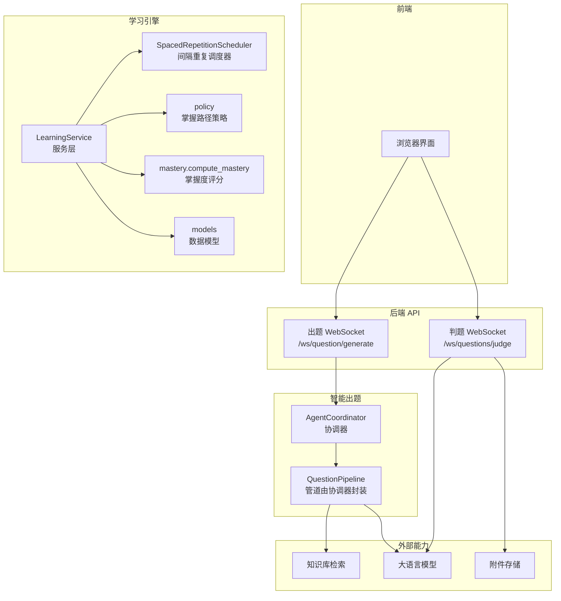
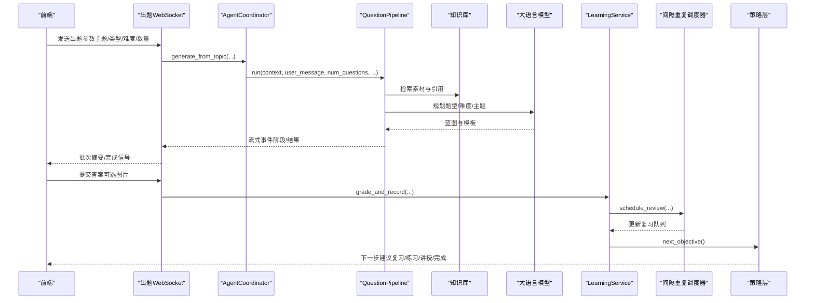
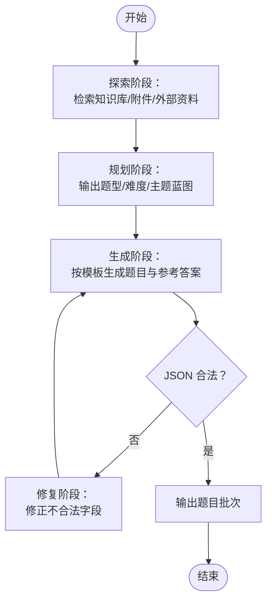
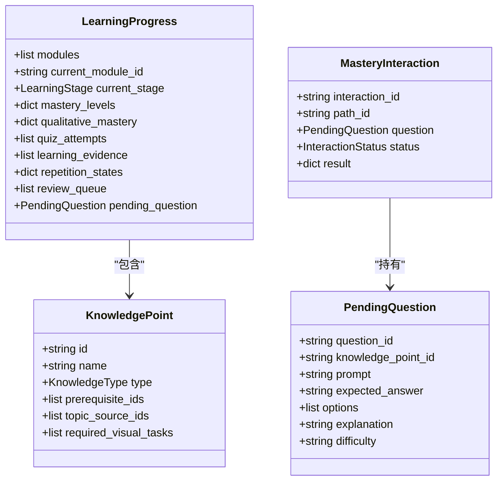
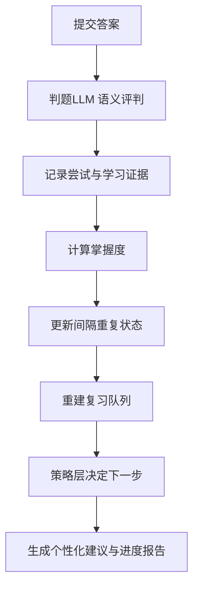
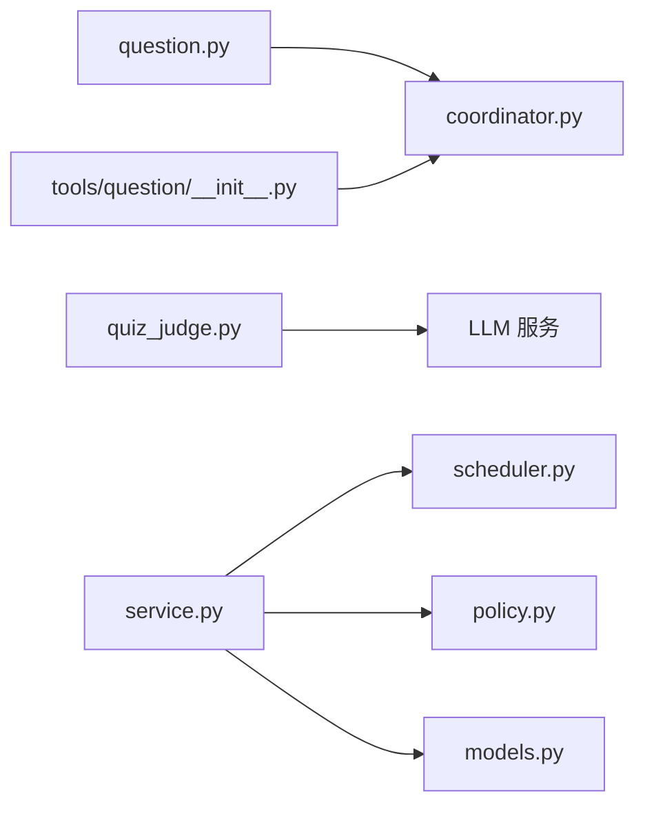

# 学习评估系统

<cite>
**本文引用的文件**   
- [deeptutor/learning/models.py](file://deeptutor/learning/models.py)
- [deeptutor/learning/mastery.py](file://deeptutor/learning/mastery.py)
- [deeptutor/learning/service.py](file://deeptutor/learning/service.py)
- [deeptutor/learning/scheduler.py](file://deeptutor/learning/scheduler.py)
- [deeptutor/learning/policy.py](file://deeptutor/learning/policy.py)
- [deeptutor/agents/question/coordinator.py](file://deeptutor/agents/question/coordinator.py)
- [deeptutor/api/routers/question.py](file://deeptutor/api/routers/question.py)
- [deeptutor/api/routers/quiz_judge.py](file://deeptutor/api/routers/quiz_judge.py)
- [deeptutor/tools/question/__init__.py](file://deeptutor/tools/question/__init__.py)
- [deeptutor/learning/prompts/zh.yaml](file://deeptutor/learning/prompts/zh.yaml)
</cite>

## 目录
1. [引言](#引言)
2. [项目结构](#项目结构)
3. [核心组件](#核心组件)
4. [架构总览](#架构总览)
5. [详细组件分析](#详细组件分析)
6. [依赖关系分析](#依赖关系分析)
7. [性能与准确性考量](#性能与准确性考量)
8. [故障诊断指南](#故障诊断指南)
9. [结论](#结论)
10. [附录：API 调用示例](#附录api-调用示例)

## 引言
本技术文档聚焦 DeepTutor 的学习评估系统，围绕智能问题生成、掌握度追踪、复习调度、评估反馈与教学优化展开。系统以“掌握路径”为核心，将知识点建模为可评估目标，通过测验、解释、费曼检验、错误诊断与间隔复习形成闭环；同时提供基于 WebSocket 的实时出题与判题流，并与知识库、会话系统、学习记录深度集成。

## 项目结构
学习评估相关代码主要分布在以下模块：
- 数据模型与状态：`deeptutor/learning/models.py`
- 掌握度评分策略：`deeptutor/learning/mastery.py`
- 服务编排与持久化边界：`deeptutor/learning/service.py`
- 间隔重复调度器：`deeptutor/learning/scheduler.py`
- 掌握路径策略（下一步决策）：`deeptutor/learning/policy.py`
- 智能出题协调器与管道适配：`deeptutor/agents/question/coordinator.py`
- 出题与判题 API：`deeptutor/api/routers/question.py`、`deeptutor/api/routers/quiz_judge.py`
- 工具入口与 PDF 解析复用：`deeptutor/tools/question/__init__.py`
- 中文提示词模板：`deeptutor/learning/prompts/zh.yaml`

**图示来源**
- [deeptutor/api/routers/question.py:361-581](file://deeptutor/api/routers/question.py#L361-L581)
- [deeptutor/api/routers/quiz_judge.py:324-563](file://deeptutor/api/routers/quiz_judge.py#L324-L563)
- [deeptutor/agents/question/coordinator.py:31-243](file://deeptutor/agents/question/coordinator.py#L31-L243)
- [deeptutor/learning/service.py:328-666](file://deeptutor/learning/service.py#L328-L666)
- [deeptutor/learning/scheduler.py:147-643](file://deeptutor/learning/scheduler.py#L147-L643)
- [deeptutor/learning/policy.py:281-389](file://deeptutor/learning/policy.py#L281-L389)
- [deeptutor/learning/mastery.py:24-40](file://deeptutor/learning/mastery.py#L24-L40)
- [deeptutor/learning/models.py:81-800](file://deeptutor/learning/models.py#L81-L800)

**章节来源**
- [deeptutor/api/routers/question.py:361-581](file://deeptutor/api/routers/question.py#L361-L581)
- [deeptutor/api/routers/quiz_judge.py:324-563](file://deeptutor/api/routers/quiz_judge.py#L324-L563)
- [deeptutor/agents/question/coordinator.py:31-243](file://deeptutor/agents/question/coordinator.py#L31-L243)
- [deeptutor/learning/service.py:328-666](file://deeptutor/learning/service.py#L328-L666)
- [deeptutor/learning/scheduler.py:147-643](file://deeptutor/learning/scheduler.py#L147-L643)
- [deeptutor/learning/policy.py:281-389](file://deeptutor/learning/policy.py#L281-L389)
- [deeptutor/learning/mastery.py:24-40](file://deeptutor/learning/mastery.py#L24-L40)
- [deeptutor/learning/models.py:81-800](file://deeptutor/learning/models.py#L81-L800)

## 核心组件
- 数据模型与状态
  - 知识点、学习模块、学习进度、测验尝试、错误记录、学习证据、间隔重复状态、复习任务等统一在 `models.py` 中定义，支撑掌握路径全生命周期。
- 掌握度评分
  - `mastery.py` 提供基于近期正确率的加权准确率算法，并设置低置信度上限，避免单次幸运作答即“掌握”。
- 学习服务
  - `service.py` 是掌握路径的核心编排者：登记题目、判定答案、更新掌握度、写入学习证据、驱动间隔重复调度、维护复习队列。
- 间隔重复调度器
  - `scheduler.py` 实现遗忘曲线、稳定性/可提取性、难度估计、复习优先级与队列构建，支持自定义复习策略绑定。
- 掌握路径策略
  - `policy.py` 决定下一步动作：待答题、复习、探测、讲授、练习、定性评估或完成；并提供地图摘要与目标报告。
- 智能出题协调器
  - `coordinator.py` 作为旧接口适配器，委托 `QuestionPipeline` 执行探索、规划、生成与修复流程，并通过 StreamBus 向前端推送事件。
- API 路由
  - `question.py` 暴露出题 WebSocket，支持从主题或试卷模板批量生成题目，并回传日志与结果。
  - `quiz_judge.py` 暴露判题 WebSocket，支持多模态输入（文本+图片），按语言返回结构化评判与反馈。
- 工具入口
  - `tools/question/__init__.py` 导出 PDF 解析与模拟试卷生成入口，供上层工具链复用。

**章节来源**
- [deeptutor/learning/models.py:81-800](file://deeptutor/learning/models.py#L81-L800)
- [deeptutor/learning/mastery.py:1-40](file://deeptutor/learning/mastery.py#L1-L40)
- [deeptutor/learning/service.py:328-666](file://deeptutor/learning/service.py#L328-L666)
- [deeptutor/learning/scheduler.py:147-643](file://deeptutor/learning/scheduler.py#L147-L643)
- [deeptutor/learning/policy.py:1-582](file://deeptutor/learning/policy.py#L1-L582)
- [deeptutor/agents/question/coordinator.py:31-243](file://deeptutor/agents/question/coordinator.py#L31-L243)
- [deeptutor/api/routers/question.py:361-581](file://deeptutor/api/routers/question.py#L361-L581)
- [deeptutor/api/routers/quiz_judge.py:324-563](file://deeptutor/api/routers/quiz_judge.py#L324-L563)
- [deeptutor/tools/question/__init__.py:1-39](file://deeptutor/tools/question/__init__.py#L1-L39)

## 架构总览
学习评估系统采用“出题—作答—判分—掌握度更新—复习调度—路径推进”的闭环架构：
- 前端通过 WebSocket 发起出题请求，协调器驱动管道进行知识检索与 LLM 生成，实时推送阶段日志。
- 学习者提交答案后，判题 WebSocket 调用 LLM 进行语义级评判，返回结论与反馈。
- 学习服务将答案与评判结果写入持久化状态，计算掌握度，更新间隔重复状态，重建复习队列。
- 策略层根据当前进度与复习队列决定下一步动作，指导教学与练习。

**图示来源**
- [deeptutor/api/routers/question.py:361-581](file://deeptutor/api/routers/question.py#L361-L581)
- [deeptutor/agents/question/coordinator.py:66-92](file://deeptutor/agents/question/coordinator.py#L66-L92)
- [deeptutor/learning/service.py:535-666](file://deeptutor/learning/service.py#L535-L666)
- [deeptutor/learning/scheduler.py:282-489](file://deeptutor/learning/scheduler.py#L282-L489)
- [deeptutor/learning/policy.py:281-389](file://deeptutor/learning/policy.py#L281-L389)

## 详细组件分析

### 智能问题生成器
- 题型支持
  - 选择题、概念判断、填空、简答、论述、编程等类型由管道模板与校验规则约束，确保选项长度风格一致、正确答案唯一且可信。
- 难度调节
  - 支持用户指定难度或自动选择；模板规划阶段保证每道题的难度与主题差异最大化。
- 内容质量控制
  - 探索阶段优先使用知识库与附件素材，减少外部检索噪声；生成阶段对历史已生成题目去重；失败时触发修复流程。
- 与知识库和会话系统集成
  - 协调器注入会话上下文与启用工具列表；管道根据素材与 source-id 引用生成有据可依的题目。

**图示来源**
- [deeptutor/agents/question/coordinator.py:66-92](file://deeptutor/agents/question/coordinator.py#L66-L92)
- [deeptutor/api/routers/question.py:361-581](file://deeptutor/api/routers/question.py#L361-L581)

**章节来源**
- [deeptutor/agents/question/coordinator.py:31-243](file://deeptutor/agents/question/coordinator.py#L31-L243)
- [deeptutor/api/routers/question.py:361-581](file://deeptutor/api/routers/question.py#L361-L581)

### 掌握度追踪算法
- 学习路径规划
  - 策略层依据掌握门限与复习队列决定下一步动作，跳过已掌握目标，优先处理待答题与到期复习。
- 知识点关联
  - 知识点包含前置依赖与可视化任务要求；掌握判定需满足可视化任务成就。
- 技能评估模型
  - 定量类型（记忆/程序）使用加权准确率阈值；定性类型（概念/设计）通过费曼解释与教师判定。

**图示来源**
- [deeptutor/learning/models.py:81-500](file://deeptutor/learning/models.py#L81-L500)
- [deeptutor/learning/policy.py:82-107](file://deeptutor/learning/policy.py#L82-L107)

**章节来源**
- [deeptutor/learning/policy.py:82-107](file://deeptutor/learning/policy.py#L82-L107)
- [deeptutor/learning/models.py:81-500](file://deeptutor/learning/models.py#L81-L500)

### 评估结果的分析与反馈机制
- 个性化学习建议
  - 策略层根据掌握状态与复习风险给出下一步动作说明，包括复习、练习、讲授或完成。
- 进度报告生成
  - 提供地图摘要与目标报告，展示各知识点状态、掌握分数、阈值、尝试历史、复习详情与错误记录。
- 错误诊断
  - 错误类型分类（结构性、理解偏差、应用错误、元认知型）用于后续针对性补救与复习强化。

**图示来源**
- [deeptutor/api/routers/quiz_judge.py:324-563](file://deeptutor/api/routers/quiz_judge.py#L324-L563)
- [deeptutor/learning/service.py:535-666](file://deeptutor/learning/service.py#L535-L666)
- [deeptutor/learning/policy.py:391-582](file://deeptutor/learning/policy.py#L391-L582)

**章节来源**
- [deeptutor/api/routers/quiz_judge.py:324-563](file://deeptutor/api/routers/quiz_judge.py#L324-L563)
- [deeptutor/learning/service.py:535-666](file://deeptutor/learning/service.py#L535-L666)
- [deeptutor/learning/policy.py:391-582](file://deeptutor/learning/policy.py#L391-L582)

## 依赖关系分析
- 组件耦合
  - 出题协调器依赖管道与知识库；判题路由依赖 LLM 与附件存储；学习服务依赖调度器、策略层与数据模型。
- 直接依赖
  - `service.py` 导入 `grading`、`mastery`、`models`、`objective_relations`、`storage`。
  - `scheduler.py` 定义保留率调度协议与默认序列，被服务层调用。
  - `policy.py` 读取 `models` 中的进度与知识点信息，输出下一步动作。
- 潜在循环
  - 协调器与管道之间通过适配器解耦；工具入口延迟导入以避免循环依赖。

**图示来源**
- [deeptutor/api/routers/question.py:361-581](file://deeptutor/api/routers/question.py#L361-L581)
- [deeptutor/api/routers/quiz_judge.py:324-563](file://deeptutor/api/routers/quiz_judge.py#L324-L563)
- [deeptutor/agents/question/coordinator.py:31-243](file://deeptutor/agents/question/coordinator.py#L31-L243)
- [deeptutor/learning/service.py:1-35](file://deeptutor/learning/service.py#L1-L35)
- [deeptutor/tools/question/__init__.py:1-39](file://deeptutor/tools/question/__init__.py#L1-L39)

**章节来源**
- [deeptutor/api/routers/question.py:361-581](file://deeptutor/api/routers/question.py#L361-L581)
- [deeptutor/api/routers/quiz_judge.py:324-563](file://deeptutor/api/routers/quiz_judge.py#L324-L563)
- [deeptutor/agents/question/coordinator.py:31-243](file://deeptutor/agents/question/coordinator.py#L31-L243)
- [deeptutor/learning/service.py:1-35](file://deeptutor/learning/service.py#L1-L35)
- [deeptutor/tools/question/__init__.py:1-39](file://deeptutor/tools/question/__init__.py#L1-L39)

## 性能与准确性考量
- 掌握度评分
  - 近期权重递增，低样本置信度上限防止误判“掌握”，提升稳健性。
- 间隔重复
  - 基于稳定性与可提取性的指数遗忘模型，结合错误重试与同会话短间隔练习，避免重复稳定增长导致复习时间漂移。
- 判题质量
  - 多模态支持（文本+图片），当模型不支持视觉时降级为纯文本判题，保证用户体验。
- 资源隔离
  - 出题与判题均通过 WebSocket 独立会话，日志与任务 ID 绑定，便于追踪与调试。

[本节为通用指导，不涉及具体文件分析]

## 故障诊断指南
- 常见错误
  - 无待答题却提交答案：应检查 `pending_question` 是否存在。
  - 过期交互：提交的答案对应的问题已被替换，需重新获取最新问题。
  - 判题超时：LLM 流式响应超过两分钟限制，需重试或简化输入。
  - 图片无法解析：附件存储路径不可达或模型不支持视觉，需回退到文本判题。
- 定位方法
  - 查看 WebSocket 事件流（status/batch_summary/complete/error）。
  - 检查学习证据与尝试记录是否匹配，必要时重建复习队列。
  - 核对知识点指纹与 ID 分配，避免历史证据污染。

**章节来源**
- [deeptutor/learning/service.py:309-326](file://deeptutor/learning/service.py#L309-L326)
- [deeptutor/api/routers/quiz_judge.py:534-563](file://deeptutor/api/routers/quiz_judge.py#L534-L563)
- [deeptutor/api/routers/question.py:529-581](file://deeptutor/api/routers/question.py#L529-L581)

## 结论
DeepTutor 学习评估系统以掌握路径为核心，融合智能出题、语义判题、间隔重复与策略决策，形成可持续优化的教学闭环。通过明确的数据模型、可插拔的评分与调度策略，以及健壮的 API 与 WebSocket 流，系统在准确性、可解释性与可扩展性方面具备良好基础。未来可通过更丰富的 IRT/BKT 模型、更精细的多模态判题与自适应复习策略进一步提升效果。

[本节为总结性内容，不涉及具体文件分析]

## 附录：API 调用示例
以下为典型调用流程与数据结构说明（不含具体代码片段）：

- 创建测验（出题）
  - 连接 WebSocket `/ws/question/generate`
  - 发送消息：
    - `requirement`: 包含 `knowledge_point`、`preference`、`difficulty`、`question_type`
    - `kb_name`: 知识库名称
    - `count`: 题目数量
  - 接收事件：
    - `task_id`: 任务标识
    - `status`: 启动状态
    - `batch_summary`: 批次摘要（请求数、完成数、失败数）
    - `complete`: 完成信号
  - 参考实现位置：
    - [deeptutor/api/routers/question.py:361-581](file://deeptutor/api/routers/question.py#L361-L581)
    - [deeptutor/agents/question/coordinator.py:66-92](file://deeptutor/agents/question/coordinator.py#L66-L92)

- 提交答案（判题）
  - 连接 WebSocket `/ws/questions/judge`
  - 发送消息：
    - `question`: 题干
    - `question_type`: 题型
    - `options`: 选项字典（选择题）
    - `correct_answer`: 参考答案
    - `explanation`: 参考解析
    - `user_answer`: 文字作答
    - `user_answer_images`: 图片数组（base64 或 url）
    - `language`: 判题语言（zh/en/de/uk/vi/fr/tr）
  - 接收事件：
    - `started`: 开始
    - `text`: 流式反馈片段
    - `done`: 完成
    - `error`: 错误信息
  - 参考实现位置：
    - [deeptutor/api/routers/quiz_judge.py:324-563](file://deeptutor/api/routers/quiz_judge.py#L324-L563)

- 获取评估结果与进度
  - 通过服务层方法：
    - `calculate_mastery(progress, kp_id)`：计算知识点掌握度
    - `grade_and_record(...)`：评分并记录尝试、证据与复习状态
    - `next_objective(progress)`：获取下一步动作与建议
    - `map_summary(progress)`：生成路径地图摘要
    - `objective_report(progress, kp_id)`：生成目标详细报告
  - 参考实现位置：
    - [deeptutor/learning/service.py:522-666](file://deeptutor/learning/service.py#L522-L666)
    - [deeptutor/learning/policy.py:281-582](file://deeptutor/learning/policy.py#L281-L582)

- 与知识库和会话系统集成
  - 协调器注入会话上下文与启用工具列表，管道根据素材与 source-id 引用生成题目。
  - 学习服务在呈现源页面时验证 exact-source 并记录 exposure，防止泄露答案。
  - 参考实现位置：
    - [deeptutor/agents/question/coordinator.py:151-170](file://deeptutor/agents/question/coordinator.py#L151-L170)
    - [deeptutor/learning/service.py:714-794](file://deeptutor/learning/service.py#L714-L794)

- 利用学习数据进行教学优化
  - 通过 `objective_report` 与 `review_reason` 分析错误类型、复习原因与遗忘风险，调整教学策略与复习目标。
  - 参考实现位置：
    - [deeptutor/learning/policy.py:491-582](file://deeptutor/learning/policy.py#L491-L582)
    - [deeptutor/learning/scheduler.py:413-447](file://deeptutor/learning/scheduler.py#L413-L447)

**章节来源**
- [deeptutor/api/routers/question.py:361-581](file://deeptutor/api/routers/question.py#L361-L581)
- [deeptutor/api/routers/quiz_judge.py:324-563](file://deeptutor/api/routers/quiz_judge.py#L324-L563)
- [deeptutor/agents/question/coordinator.py:66-170](file://deeptutor/agents/question/coordinator.py#L66-L170)
- [deeptutor/learning/service.py:522-794](file://deeptutor/learning/service.py#L522-L794)
- [deeptutor/learning/policy.py:281-582](file://deeptutor/learning/policy.py#L281-L582)
- [deeptutor/learning/scheduler.py:413-447](file://deeptutor/learning/scheduler.py#L413-L447)