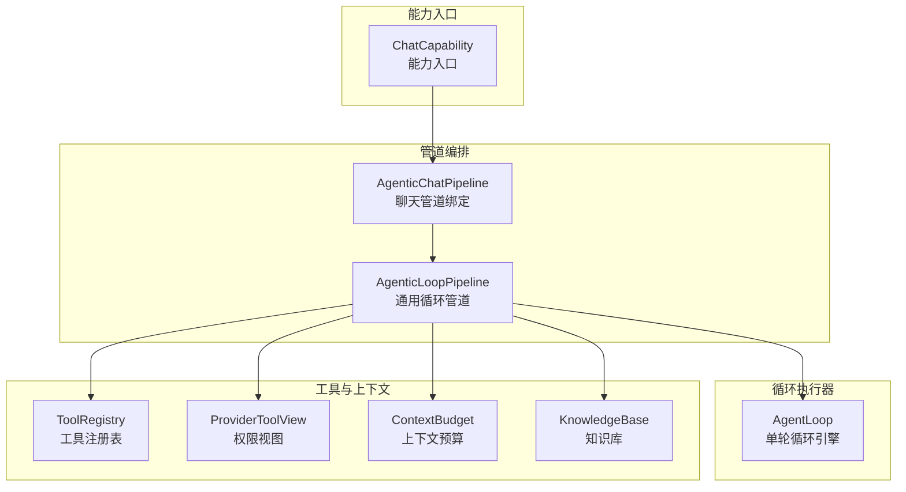
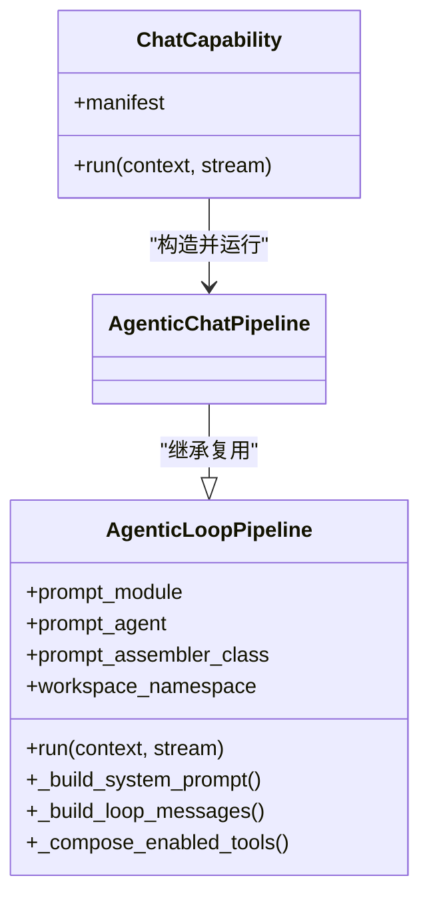
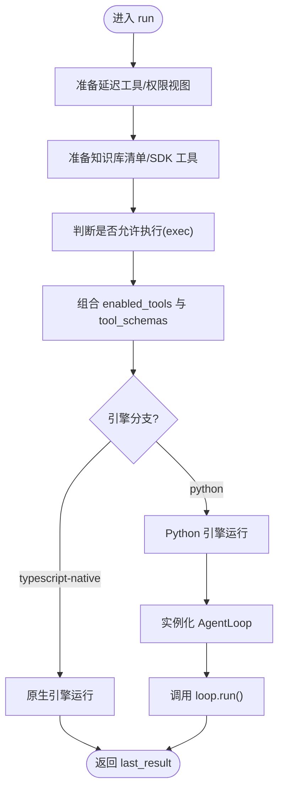
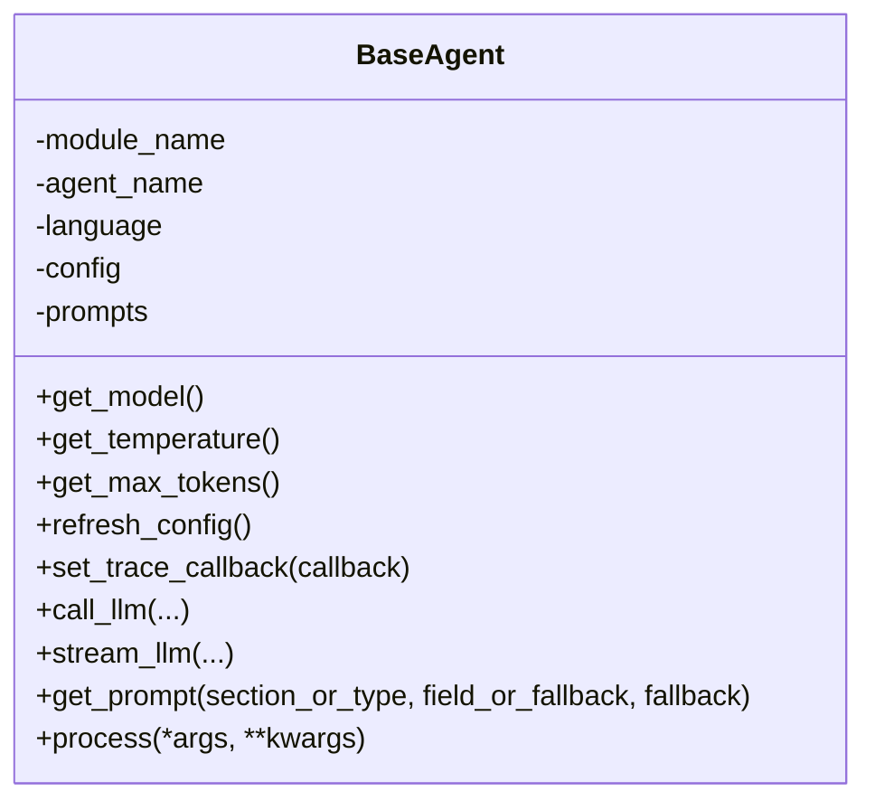
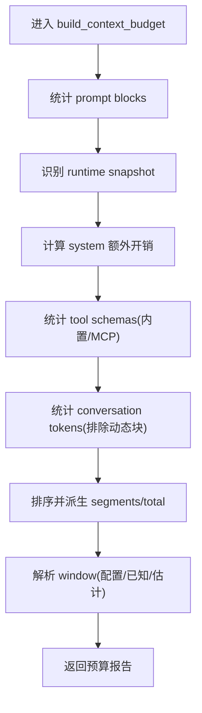
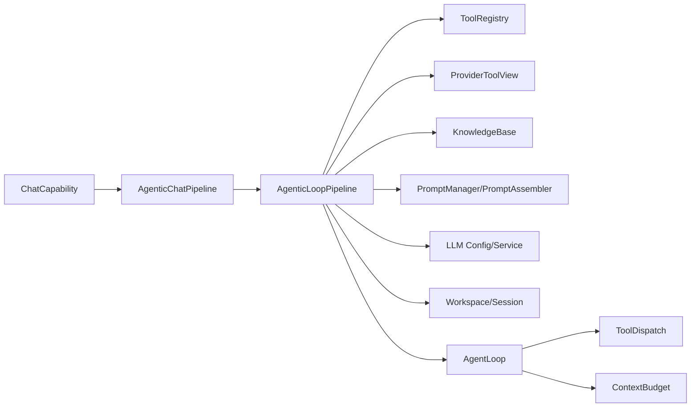

# 智能对话系统

<cite>
**本文引用的文件**   
- [agents/chat/agentic_pipeline.py](file://deeptutor/agents/chat/agentic_pipeline.py)
- [agents/chat/capability.py](file://deeptutor/agents/chat/capability.py)
- [agents/base_agent.py](file://deeptutor/agents/base_agent.py)
- [agents/__init__.py](file://deeptutor/agents/__init__.py)
- [agents/loop/pipeline.py](file://deeptutor/agents/loop/pipeline.py)
- [agents/loop/agent_loop.py](file://deeptutor/agents/loop/agent_loop.py)
- [agents/loop/context_budget.py](file://deeptutor/agents/loop/context_budget.py)
</cite>

## 目录
1. [简介](#简介)
2. [项目结构](#项目结构)
3. [核心组件](#核心组件)
4. [架构总览](#架构总览)
5. [详细组件分析](#详细组件分析)
6. [依赖关系分析](#依赖关系分析)
7. [性能与优化](#性能与优化)
8. [故障排查指南](#故障排查指南)
9. [结论](#结论)
10. [附录：示例与最佳实践](#附录示例与最佳实践)

## 简介
本技术文档面向 DeepTutor 的智能对话系统，重点解释聊天智能体的架构设计、多智能体协作机制、上下文管理、消息路由与流式响应处理。文档深入剖析 agentic_pipeline 的工作流程，包括请求处理、工具调用、结果聚合等核心环节；说明基础智能体基类的设计模式与扩展方法；给出创建自定义智能体、配置对话参数和处理不同类型用户输入的实践路径；并说明与知识库、会话管理的集成方式及性能优化策略，最后提供常见问题排查指南与最佳实践建议。

## 项目结构
DeepTutor 的对话能力由“能力入口 → 管道编排 → 循环执行器 → 工具与上下文”的分层结构组成：
- 能力入口：将一次对话轮次绑定到具体协议（如 chat）。
- 管道编排：负责组装提示词、工具清单、上下文快照、工作区与知识库种子等。
- 循环执行器：驱动单轮探索式循环，协调 LLM 流式输出、工具调度与结算阶段。
- 工具与上下文：统一注册表、延迟加载工具、权限视图、上下文预算与窗口保护。



**图表来源**
- [agents/chat/capability.py:12-17](file://deeptutor/agents/chat/capability.py#L12-L17)
- [agents/chat/agentic_pipeline.py:36-38](file://deeptutor/agents/chat/agentic_pipeline.py#L36-L38)
- [agents/loop/pipeline.py:200-228](file://deeptutor/agents/loop/pipeline.py#L200-L228)
- [agents/loop/agent_loop.py:173-195](file://deeptutor/agents/loop/agent_loop.py#L173-L195)
- [agents/loop/context_budget.py:58-67](file://deeptutor/agents/loop/context_budget.py#L58-L67)

**章节来源**
- [agents/chat/capability.py:1-18](file://deeptutor/agents/chat/capability.py#L1-L18)
- [agents/chat/agentic_pipeline.py:1-49](file://deeptutor/agents/chat/agentic_pipeline.py#L1-L49)
- [agents/loop/pipeline.py:1-112](file://deeptutor/agents/loop/pipeline.py#L1-L112)
- [agents/loop/agent_loop.py:1-29](file://deeptutor/agents/loop/agent_loop.py#L1-L29)
- [agents/loop/context_budget.py:1-28](file://deeptutor/agents/loop/context_budget.py#L1-L28)

## 核心组件
- ChatCapability：将一次对话轮次映射为聊天协议，构造 AgenticChatPipeline 并启动运行。
- AgenticChatPipeline：聊天协议的管道绑定，复用通用循环管道 AgenticLoopPipeline 的能力。
- AgenticLoopPipeline：通用循环管道，负责提示词装配、工具组合、上下文快照、工作区与知识库注入、LLM 客户端构建与预算控制。
- AgentLoop：单轮循环引擎，驱动 LLM 流式输出、工具调用、结算阶段与最终回答聚合。
- ContextBudget：对每次真实模型请求进行上下文窗口占用统计与分段展示。
- BaseAgent：统一的智能体基类，封装 LLM 配置、参数、提示词加载、非流式/流式调用接口、Token 追踪与日志。

**章节来源**
- [agents/chat/capability.py:12-17](file://deeptutor/agents/chat/capability.py#L12-L17)
- [agents/chat/agentic_pipeline.py:36-38](file://deeptutor/agents/chat/agentic_pipeline.py#L36-L38)
- [agents/loop/pipeline.py:200-323](file://deeptutor/agents/loop/pipeline.py#L200-L323)
- [agents/loop/agent_loop.py:173-333](file://deeptutor/agents/loop/agent_loop.py#L173-L333)
- [agents/loop/context_budget.py:58-67](file://deeptutor/agents/loop/context_budget.py#L58-L67)
- [agents/base_agent.py:33-46](file://deeptutor/agents/base_agent.py#L33-L46)

## 架构总览
下图展示了从 API 到 LLM 的一次完整对话轮次的数据流与控制流：

```mermaid
sequenceDiagram
participant Client as "客户端"
participant API as "API 路由"
participant Cap as "ChatCapability"
participant Pipe as "AgenticChatPipeline / AgenticLoopPipeline"
participant Loop as "AgentLoop"
participant Tools as "工具注册表/权限视图"
participant KB as "知识库"
participant LLM as "LLM 提供商"
Client->>API : 发送对话请求
API->>Cap : 调用 run(context, stream)
Cap->>Pipe : 构造管道(language)
Pipe->>Pipe : 准备工具/上下文/工作区/知识库种子
Pipe->>Loop : 启动单轮循环(run)
Loop->>LLM : 流式请求(messages, tools, options)
LLM-->>Loop : 文本片段/工具调用
Loop->>Tools : 调度工具调用(并行/串行)
Tools-->>Loop : 工具结果
Loop->>LLM : 追加结果继续对话
LLM-->>Loop : 最终回答或结束
Loop-->>Pipe : 聚合结果/元数据
Pipe-->>Client : 流式输出内容/进度/来源
```

**图表来源**
- [agents/chat/capability.py:15-17](file://deeptutor/agents/chat/capability.py#L15-L17)
- [agents/loop/pipeline.py:403-451](file://deeptutor/agents/loop/pipeline.py#L403-L451)
- [agents/loop/agent_loop.py:208-305](file://deeptutor/agents/loop/agent_loop.py#L208-L305)
- [agents/loop/agent_loop.py:640-758](file://deeptutor/agents/loop/agent_loop.py#L640-L758)

## 详细组件分析

### 聊天能力与管道绑定
- ChatCapability 作为 TurnCapability 的实现，负责在运行时根据 UnifiedContext 的语言设置构造 AgenticChatPipeline，并通过 StreamBus 推送事件。
- AgenticChatPipeline 是聊天协议的轻量绑定，直接复用 AgenticLoopPipeline 的全部能力，仅暴露必要的常量与导出符号，便于测试与 capability 模块引用。



**图表来源**
- [agents/chat/capability.py:12-17](file://deeptutor/agents/chat/capability.py#L12-L17)
- [agents/chat/agentic_pipeline.py:36-38](file://deeptutor/agents/chat/agentic_pipeline.py#L36-L38)
- [agents/loop/pipeline.py:200-228](file://deeptutor/agents/loop/pipeline.py#L200-L228)

**章节来源**
- [agents/chat/capability.py:1-18](file://deeptutor/agents/chat/capability.py#L1-L18)
- [agents/chat/agentic_pipeline.py:1-49](file://deeptutor/agents/chat/agentic_pipeline.py#L1-L49)

### 通用循环管道 AgenticLoopPipeline
职责概览：
- 提示词装配：通过 PromptAssembler 将 system/user 消息、工具清单、知识库摘要、工作区说明、能力块等合并为稳定可重放的提示块列表。
- 工具组合：基于用户启用的工具、可选白名单、伙伴/科学场景标志等，生成 enabled_tools 列表，并构建 provider 侧的工具 schema。
- 上下文与预算：维护每轮 token 预算、回合上限、推理预算恢复策略，并在必要时触发强制收尾。
- 工作区与知识库：为当前 turn 创建工作区上下文，注入知识库种子与 PageIndex SDK 工具包。
- LLM 客户端：构建 OpenAI 兼容客户端，支持线程会话 ID、流式选项、工具选择与缓存断点。

关键流程要点：
- run(context, stream)：准备延迟工具、知识库、执行权限、工具组合、schema 排序、原生/Python 引擎分支、实例化 AgentLoop 并运行。
- _build_system_prompt/_build_loop_messages：稳定地构建 system 与 user 消息，附加历史、快照与附件。
- _compose_enabled_tools：结合模块开关、伙伴/科学场景、用户启用项与可选白名单，决定本轮可用工具。
- _prepare_deferred_tools：构建 ProviderToolView，过滤授权、叠加 PageIndex 工具、记录 manifest 与池化工具。



**图表来源**
- [agents/loop/pipeline.py:403-451](file://deeptutor/agents/loop/pipeline.py#L403-L451)
- [agents/loop/pipeline.py:463-583](file://deeptutor/agents/loop/pipeline.py#L463-L583)
- [agents/loop/pipeline.py:644-747](file://deeptutor/agents/loop/pipeline.py#L644-L747)
- [agents/loop/pipeline.py:782-800](file://deeptutor/agents/loop/pipeline.py#L782-L800)

**章节来源**
- [agents/loop/pipeline.py:200-323](file://deeptutor/agents/loop/pipeline.py#L200-L323)
- [agents/loop/pipeline.py:403-451](file://deeptutor/agents/loop/pipeline.py#L403-L451)
- [agents/loop/pipeline.py:463-583](file://deeptutor/agents/loop/pipeline.py#L463-L583)
- [agents/loop/pipeline.py:644-747](file://deeptutor/agents/loop/pipeline.py#L644-L747)
- [agents/loop/pipeline.py:782-800](file://deeptutor/agents/loop/pipeline.py#L782-L800)

### 单轮循环引擎 AgentLoop
职责概览：
- 驱动一轮探索式对话：每轮一次 LLM 调用，文本流式输出，工具调用结果回写对话。
- 预算与结算：当探索预算耗尽时进入有界结算阶段，保持工具可用以完成必要后续，最终强制无工具收尾。
- 流式处理：累积文本、思考内容、工具调用、使用量与提供者状态，支持 ask_user 暂停与恢复。
- 结果聚合：将最终文本、轮次、工具步骤、上下文预算等元数据通过能力结果通道发出。

关键流程要点：
- run()：准备能力简报、知识库种子、构建 messages，按引擎调度 _run_loop，保存 model_turn 与 provider_response_state，发出 sources 与 capability result。
- _run_loop：委托给 host 运行循环，传入探索预算、结算预算与空回复恢复预算。
- _call_llm：构建 kwargs、指纹与缓存、流式迭代、工具调用累加、重试与超时保护、最终收尾。

```mermaid
sequenceDiagram
participant Loop as "AgentLoop"
participant Host as "LoopHost"
participant LLM as "LLM 提供商"
participant Tools as "工具调度"
Loop->>Host : run_loop_with_host(...)
Host->>LLM : 流式请求(messages, tools, options)
LLM-->>Host : 文本片段/工具调用
Host->>Tools : 调度工具调用
Tools-->>Host : 工具结果
Host->>LLM : 追加结果继续对话
LLM-->>Host : 最终回答或结束
Host-->>Loop : 返回 LoopOutcome
Loop->>Loop : 聚合 final_text/tool_steps/budget
```

**图表来源**
- [agents/loop/agent_loop.py:208-305](file://deeptutor/agents/loop/agent_loop.py#L208-L305)
- [agents/loop/agent_loop.py:312-333](file://deeptutor/agents/loop/agent_loop.py#L312-L333)
- [agents/loop/agent_loop.py:640-758](file://deeptutor/agents/loop/agent_loop.py#L640-L758)

**章节来源**
- [agents/loop/agent_loop.py:1-29](file://deeptutor/agents/loop/agent_loop.py#L1-L29)
- [agents/loop/agent_loop.py:208-305](file://deeptutor/agents/loop/agent_loop.py#L208-L305)
- [agents/loop/agent_loop.py:312-333](file://deeptutor/agents/loop/agent_loop.py#L312-L333)
- [agents/loop/agent_loop.py:640-758](file://deeptutor/agents/loop/agent_loop.py#L640-L758)

### 基础智能体基类 BaseAgent
设计要点：
- 统一 LLM 配置与参数：从环境与服务中读取 api_key、base_url、model、binding、reasoning_effort 等，并提供 get_model/get_temperature/get_max_tokens 等方法。
- 提示词加载：通过 PromptManager 按 module_name/agent_name/language 加载提示词，支持嵌套字段与 fallback。
- 非流式/流式调用：call_llm 与 stream_llm 统一封装，支持 response_format、attachments、trace 事件与 Token 追踪。
- 追踪与统计：支持外部 TokenTracker 与共享 LLMStats，记录每次调用的输入输出与时长。

扩展方法：
- 子类必须实现 process 抽象方法，用于承载业务逻辑。
- 可通过 set_trace_callback 注册结构化追踪回调，配合 UI 或审计。



**图表来源**
- [agents/base_agent.py:33-46](file://deeptutor/agents/base_agent.py#L33-L46)
- [agents/base_agent.py:152-207](file://deeptutor/agents/base_agent.py#L152-L207)
- [agents/base_agent.py:349-517](file://deeptutor/agents/base_agent.py#L349-L517)
- [agents/base_agent.py:519-693](file://deeptutor/agents/base_agent.py#L519-L693)
- [agents/base_agent.py:699-746](file://deeptutor/agents/base_agent.py#L699-L746)
- [agents/base_agent.py:769-776](file://deeptutor/agents/base_agent.py#L769-L776)

**章节来源**
- [agents/base_agent.py:33-46](file://deeptutor/agents/base_agent.py#L33-L46)
- [agents/base_agent.py:152-207](file://deeptutor/agents/base_agent.py#L152-L207)
- [agents/base_agent.py:349-517](file://deeptutor/agents/base_agent.py#L349-L517)
- [agents/base_agent.py:519-693](file://deeptutor/agents/base_agent.py#L519-L693)
- [agents/base_agent.py:699-746](file://deeptutor/agents/base_agent.py#L699-L746)
- [agents/base_agent.py:769-776](file://deeptutor/agents/base_agent.py#L769-L776)

### 上下文预算与窗口保护
- LLMRequestSnapshot：记录一次真实模型请求携带的消息与工具 schema，避免后续追加导致统计漂移。
- build_context_budget：对 prompt blocks、tool schemas、messages 进行分段统计，输出 window/used/free/segments 等指标。
- 动态快照：区分 runtime snapshot 与稳定 block，确保统计与实际发送一致。



**图表来源**
- [agents/loop/context_budget.py:58-67](file://deeptutor/agents/loop/context_budget.py#L58-L67)
- [agents/loop/context_budget.py:142-171](file://deeptutor/agents/loop/context_budget.py#L142-L171)
- [agents/loop/context_budget.py:174-239](file://deeptutor/agents/loop/context_budget.py#L174-L239)
- [agents/loop/context_budget.py:242-337](file://deeptutor/agents/loop/context_budget.py#L242-L337)

**章节来源**
- [agents/loop/context_budget.py:1-28](file://deeptutor/agents/loop/context_budget.py#L1-L28)
- [agents/loop/context_budget.py:58-67](file://deeptutor/agents/loop/context_budget.py#L58-L67)
- [agents/loop/context_budget.py:142-171](file://deeptutor/agents/loop/context_budget.py#L142-L171)
- [agents/loop/context_budget.py:174-239](file://deeptutor/agents/loop/context_budget.py#L174-L239)
- [agents/loop/context_budget.py:242-337](file://deeptutor/agents/loop/context_budget.py#L242-L337)

## 依赖关系分析
- ChatCapability 依赖 AgenticChatPipeline，后者继承 AgenticLoopPipeline。
- AgenticLoopPipeline 依赖：
  - 工具注册表与权限视图（ToolRegistry/ProviderToolView）
  - 知识库清单与 PageIndex SDK 工具
  - PromptManager 与 PromptAssembler
  - LLM 配置与服务（get_llm_config、prepare_multimodal_messages）
  - 工作区服务与会话历史
- AgentLoop 依赖：
  - LLM 流式接口与工具调度
  - 上下文预算与使用量统计
  - 能力结果通道（emit_capability_result）



**图表来源**
- [agents/chat/capability.py:12-17](file://deeptutor/agents/chat/capability.py#L12-L17)
- [agents/chat/agentic_pipeline.py:36-38](file://deeptutor/agents/chat/agentic_pipeline.py#L36-L38)
- [agents/loop/pipeline.py:31-90](file://deeptutor/agents/loop/pipeline.py#L31-L90)
- [agents/loop/pipeline.py:403-451](file://deeptutor/agents/loop/pipeline.py#L403-L451)
- [agents/loop/agent_loop.py:208-305](file://deeptutor/agents/loop/agent_loop.py#L208-L305)

**章节来源**
- [agents/chat/capability.py:1-18](file://deeptutor/agents/chat/capability.py#L1-L18)
- [agents/chat/agentic_pipeline.py:1-49](file://deeptutor/agents/chat/agentic_pipeline.py#L1-L49)
- [agents/loop/pipeline.py:31-90](file://deeptutor/agents/loop/pipeline.py#L31-L90)
- [agents/loop/pipeline.py:403-451](file://deeptutor/agents/loop/pipeline.py#L403-L451)
- [agents/loop/agent_loop.py:208-305](file://deeptutor/agents/loop/agent_loop.py#L208-L305)

## 性能与优化
- 流式输出与增量渲染：AgentLoop 对 LLM 输出进行分片累积，边生成边流式推送，降低首字延迟。
- 工具调用并行与限流：通过工具调度器限制最大并行度，避免资源争用。
- 提示词缓存断点：对支持 prompt caching 的绑定添加 cache_control 断点，提升重复请求命中率。
- 上下文预算可视化：通过 context_budget 输出 used/free/segments，帮助定位过长 history 或过大 tool schema。
- 推理预算恢复：当模型内部推理消耗过多 token 时，采用恢复策略与强制收尾，避免无限循环。
- 图片去重与模态降级：对多图输入去重，并在不支持图像时自动降级为纯文本。

[本节为通用指导，不直接分析具体文件]

## 故障排查指南
- 模型未配置：BaseAgent.get_model 会抛出异常，检查 Settings > Language models 是否激活模型。
- 工具不可用：若工具不在 prompt 中，会被拒绝；检查权限视图与用户启用项，确认 MCP/CLI 工具已正确加载。
- 流式超时：Provider 连接建立后长时间无 chunk 会触发传输错误；检查网络与 Provider 端点。
- 推理预算耗尽：当模型只产出内部推理而无答案时，会抛出专用异常；建议降低 reasoning_effort 或拆分任务。
- 上下文窗口溢出：通过 context_budget 查看 segments，缩短 history 或减少 tool schema 数量。
- 强制收尾失败：若必需交互未完成，能力 finish 被拒绝；需检查 ask_user 是否得到用户回复。

**章节来源**
- [agents/base_agent.py:152-179](file://deeptutor/agents/base_agent.py#L152-L179)
- [agents/loop/agent_loop.py:408-517](file://deeptutor/agents/loop/agent_loop.py#L408-L517)
- [agents/loop/context_budget.py:142-171](file://deeptutor/agents/loop/context_budget.py#L142-L171)

## 结论
DeepTutor 的智能对话系统以 ChatCapability 为入口，通过 AgenticChatPipeline 与 AgenticLoopPipeline 将聊天协议与通用循环引擎解耦，再由 AgentLoop 驱动单轮探索式对话，结合工具调度、上下文预算与流式输出，形成高内聚、低耦合的可扩展架构。BaseAgent 为各模块智能体提供统一的 LLM 调用与追踪能力。该设计既保证了聊天体验的一致性，又为不同协议与能力提供了灵活的扩展点。

[本节为总结性内容，不直接分析具体文件]

## 附录：示例与最佳实践

- 创建自定义智能体
  - 继承 BaseAgent，实现 process 方法，使用 call_llm/stream_llm 进行 LLM 调用，并通过 get_prompt 加载提示词。
  - 参考路径：[agents/base_agent.py:33-46](file://deeptutor/agents/base_agent.py#L33-L46)、[agents/base_agent.py:769-776](file://deeptutor/agents/base_agent.py#L769-L776)。

- 配置对话参数
  - 通过 settings 与 agents.yaml 配置 temperature、max_tokens、max_retries 等；BaseAgent 提供 get_temperature/get_max_tokens/get_max_retries。
  - 参考路径：[agents/base_agent.py:181-207](file://deeptutor/agents/base_agent.py#L181-L207)。

- 处理不同类型的用户输入
  - 支持纯文本与结构化问答（answers），管道层会将 answers 转换为可读格式注入 user message。
  - 参考路径：[agents/loop/pipeline.py:125-170](file://deeptutor/agents/loop/pipeline.py#L125-L170)。

- 与知识库集成
  - 管道层注入知识库种子与 PageIndex SDK 工具，增强 grounding 与检索能力。
  - 参考路径：[agents/loop/pipeline.py:463-583](file://deeptutor/agents/loop/pipeline.py#L463-L583)、[agents/loop/pipeline.py:712-747](file://deeptutor/agents/loop/pipeline.py#L712-L747)。

- 与会话管理集成
  - 管道层维护 model_history/conversation_history，并在 run 结束时规范化 model_turn 与 provider_response_state。
  - 参考路径：[agents/loop/pipeline.py:493-583](file://deeptutor/agents/loop/pipeline.py#L493-L583)、[agents/loop/agent_loop.py:252-273](file://deeptutor/agents/loop/agent_loop.py#L252-L273)。

- 性能优化最佳实践
  - 开启 prompt caching（支持绑定时）、合理设置 max_rounds/exploring_max_tokens/respond_max_tokens、控制 tool schema 规模、使用上下文预算监控。
  - 参考路径：[agents/loop/agent_loop.py:593-638](file://deeptutor/agents/loop/agent_loop.py#L593-L638)、[agents/loop/context_budget.py:142-171](file://deeptutor/agents/loop/context_budget.py#L142-L171)。

**章节来源**
- [agents/base_agent.py:33-46](file://deeptutor/agents/base_agent.py#L33-L46)
- [agents/base_agent.py:181-207](file://deeptutor/agents/base_agent.py#L181-L207)
- [agents/base_agent.py:769-776](file://deeptutor/agents/base_agent.py#L769-L776)
- [agents/loop/pipeline.py:125-170](file://deeptutor/agents/loop/pipeline.py#L125-L170)
- [agents/loop/pipeline.py:463-583](file://deeptutor/agents/loop/pipeline.py#L463-L583)
- [agents/loop/pipeline.py:712-747](file://deeptutor/agents/loop/pipeline.py#L712-L747)
- [agents/loop/agent_loop.py:252-273](file://deeptutor/agents/loop/agent_loop.py#L252-L273)
- [agents/loop/agent_loop.py:593-638](file://deeptutor/agents/loop/agent_loop.py#L593-L638)
- [agents/loop/context_budget.py:142-171](file://deeptutor/agents/loop/context_budget.py#L142-L171)