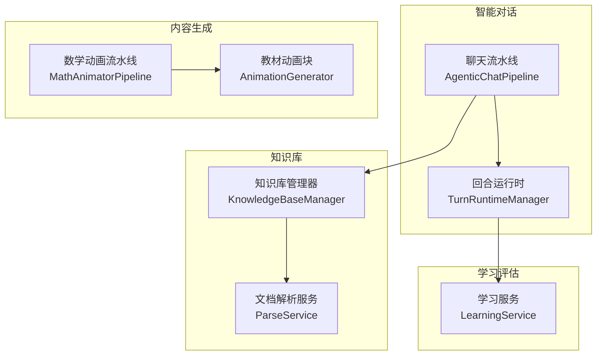
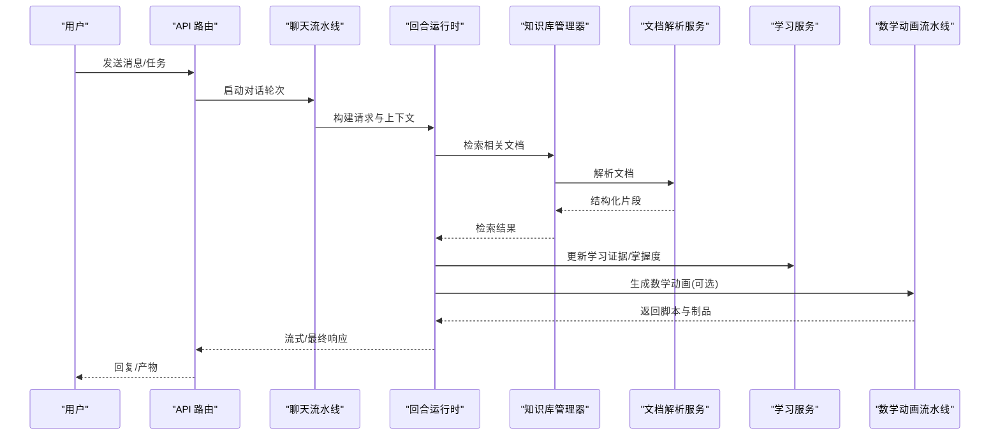
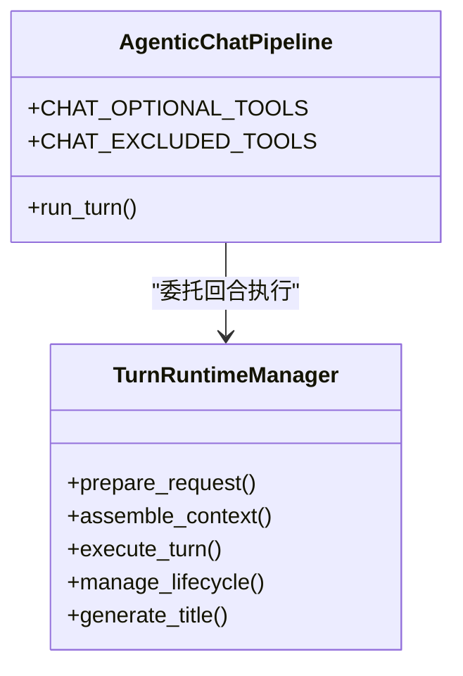
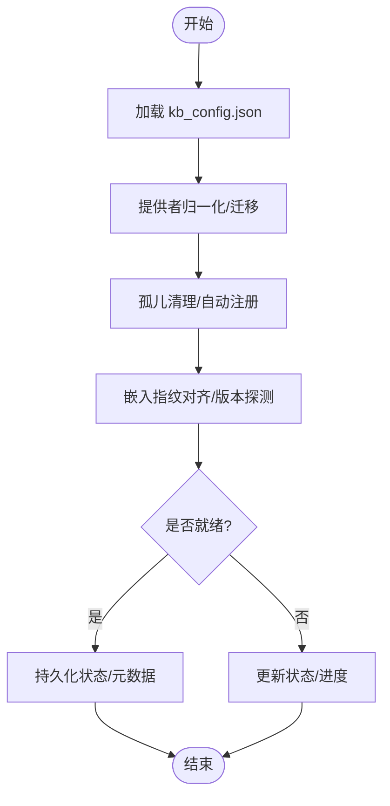
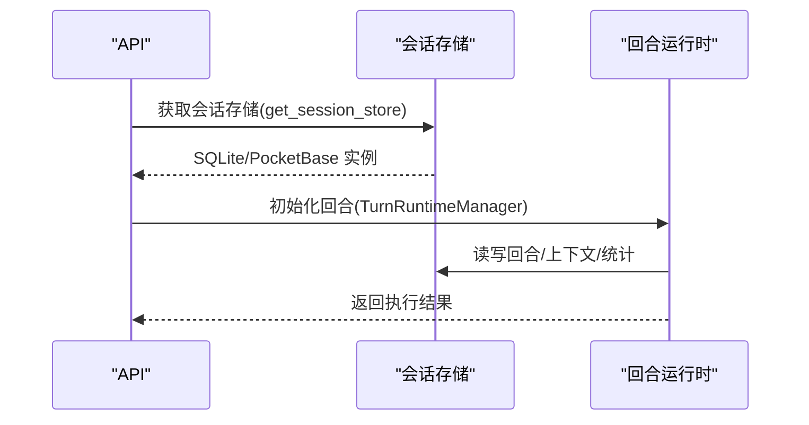
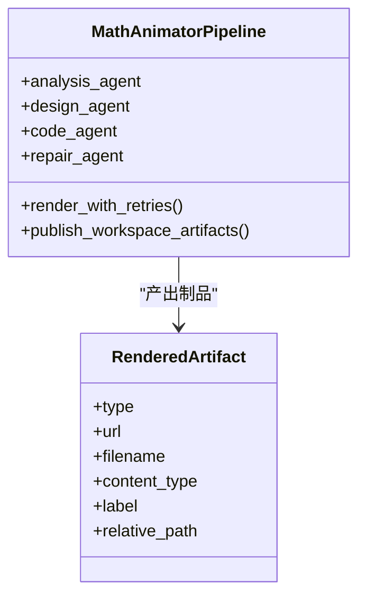
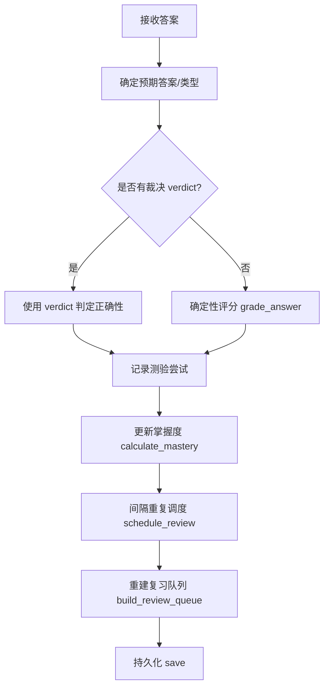
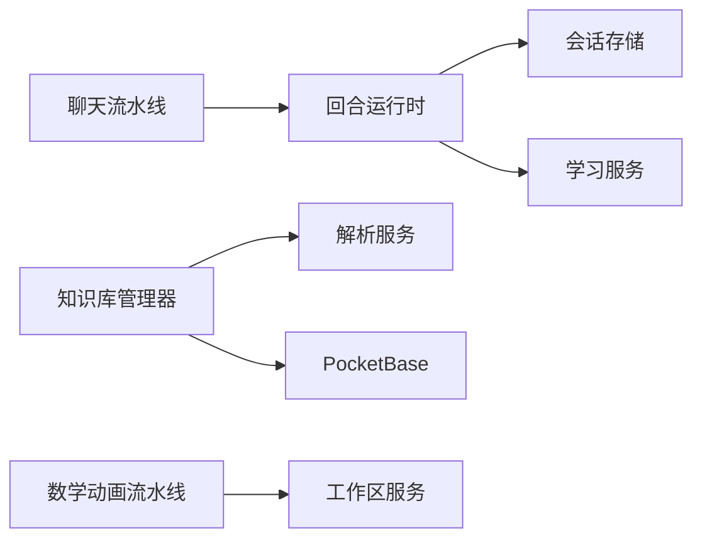

# 核心功能特性

<cite>
**本文引用的文件**   
- [agentic_pipeline.py](file://deeptutor/agents/chat/agentic_pipeline.py)
- [turn_runtime.py](file://deeptutor/services/session/turn_runtime.py)
- [__init__.py](file://deeptutor/services/session/__init__.py)
- [manager.py](file://deeptutor/knowledge/manager.py)
- [pipeline.py](file://deeptutor/agents/math_animator/pipeline.py)
- [models.py](file://deeptutor/agents/math_animator/models.py)
- [service.py](file://deeptutor/learning/service.py)
- [capability_settings.py](file://deeptutor/services/config/capabilities_settings.py)
- [__init__.py](file://deeptutor/services/parsing/__init__.py)
- [animation.py](file://deeptutor/book/blocks/animation.py)
</cite>

## 目录
1. [引言](#引言)
2. [项目结构](#项目结构)
3. [核心组件](#核心组件)
4. [架构总览](#架构总览)
5. [详细组件分析](#详细组件分析)
6. [依赖关系分析](#依赖关系分析)
7. [性能与扩展性](#性能与扩展性)
8. [故障排查指南](#故障排查指南)
9. [结论](#结论)

## 引言
本文件面向 DeepTutor 的五大核心功能模块，系统性说明其工作原理、技术实现、配置选项与使用方式，并给出跨模块协作和数据流转的可视化说明。五个模块分别为：
- 智能对话系统：聊天智能体与多智能体协作
- 知识库管理：RAG、文档解析与向量索引
- 会话管理：上下文预算与历史持久化
- 内容生成引擎：数学动画与视频课程
- 学习评估系统：智能问题生成与掌握度追踪

## 项目结构
DeepTutor 采用按能力域划分的后端结构：
- agents：各能力的智能体与流水线（聊天、数学动画、可视化、研究、问题等）
- services：通用服务（会话、RAG、LLM、解析、存储、设置等）
- knowledge：知识库注册、状态管理与版本探测
- learning：掌握路径、评分、调度与学习证据
- api：对外路由与协议
- book：教材编译与块级内容生成（含动画）

图表来源
- [agentic_pipeline.py:36-48](file://deeptutor/agents/chat/agentic_pipeline.py#L36-L48)
- [turn_runtime.py:26-55](file://deeptutor/services/session/turn_runtime.py#L26-L55)
- [manager.py:322-467](file://deeptutor/knowledge/manager.py#L322-L467)
- [pipeline.py:30-67](file://deeptutor/agents/math_animator/pipeline.py#L30-L67)
- [service.py:328-444](file://deeptutor/learning/service.py#L328-L444)

章节来源
- [agentic_pipeline.py:1-48](file://deeptutor/agents/chat/agentic_pipeline.py#L1-L48)
- [turn_runtime.py:1-55](file://deeptutor/services/session/turn_runtime.py#L1-L55)
- [manager.py:322-467](file://deeptutor/knowledge/manager.py#L322-L467)
- [pipeline.py:30-67](file://deeptutor/agents/math_animator/pipeline.py#L30-L67)
- [service.py:328-444](file://deeptutor/learning/service.py#L328-L444)

## 核心组件
- 智能对话系统
  - 聊天流水线将一次用户消息封装为“探索型智能体循环”，复用统一的工具集与提示包，支持可选工具白名单与排除列表。
  - 回合运行时组合请求准备、上下文组装、学习适配、执行与生命周期管理，并通过会话存储进行持久化。
- 知识库管理
  - 统一管理多个知识库，负责注册、状态更新、版本探测、嵌入指纹对齐与 PocketBase 同步。
  - 通过可插拔解析层统一产出结构化文档，供 RAG 索引与下游消费。
- 会话管理
  - 提供 SQLite 或 PocketBase 两种后端；按作用域缓存实例，保证并发安全与隔离。
  - 回合运行时对上下文预算、标题生成、资源复用等进行集中编排。
- 内容生成引擎
  - 数学动画流水线包含概念分析、场景设计、代码生成、修复与渲染阶段，输出 Manim 脚本与制品。
  - 教材动画块在编译期调用数学动画能力，结合章节目标与风格提示生成教学动画。
- 学习评估系统
  - 维护学习进度、知识目标、测验尝试、错误记录、间隔重复与复习队列，提供掌握度计算与策略调度。

章节来源
- [agentic_pipeline.py:30-48](file://deeptutor/agents/chat/agentic_pipeline.py#L30-L48)
- [turn_runtime.py:26-55](file://deeptutor/services/session/turn_runtime.py#L26-L55)
- [manager.py:322-467](file://deeptutor/knowledge/manager.py#L322-L467)
- [pipeline.py:30-67](file://deeptutor/agents/math_animator/pipeline.py#L30-L67)
- [service.py:328-444](file://deeptutor/learning/service.py#L328-L444)

## 架构总览
下图展示从用户输入到最终产出的端到端流程：对话触发回合运行，回合运行调用知识库检索与学习服务，同时可触发数学动画生成，最终结果回写会话与学习进度。

图表来源
- [agentic_pipeline.py:36-48](file://deeptutor/agents/chat/agentic_pipeline.py#L36-L48)
- [turn_runtime.py:26-55](file://deeptutor/services/session/turn_runtime.py#L26-L55)
- [manager.py:322-467](file://deeptutor/knowledge/manager.py#L322-L467)
- [pipeline.py:30-67](file://deeptutor/agents/math_animator/pipeline.py#L30-L67)
- [service.py:328-444](file://deeptutor/learning/service.py#L328-L444)

## 详细组件分析

### 智能对话系统（聊天智能体、多智能体协作）
- 工作原理
  - 聊天流水线继承统一智能体循环，复用工具与提示模板，以“探索-响应”两阶段组织对话轮次。
  - 回合运行时聚合请求准备、上下文组装、学习适配、执行与生命周期管理，并提供会话标题生成。
- 技术实现
  - 聊天流水线暴露可选工具与排除工具常量，确保模式不会静默移除用户启用的工具。
  - 回合运行时组合多个职责类，并通过会话存储获取器按作用域创建单例。
- 配置选项
  - 聊天能力参数包括温度、最大轮数与各阶段 token 预算，由能力设置模块合并默认值与用户配置。
- 使用示例
  - 通过 API 路由发起聊天轮次，内部自动走聊天流水线与回合运行时。
- 扩展性
  - 新增工具只需加入可选工具白名单；新增阶段可通过能力设置扩展 stage_budgets。

图表来源
- [agentic_pipeline.py:30-48](file://deeptutor/agents/chat/agentic_pipeline.py#L30-L48)
- [turn_runtime.py:26-55](file://deeptutor/services/session/turn_runtime.py#L26-L55)

章节来源
- [agentic_pipeline.py:1-48](file://deeptutor/agents/chat/agentic_pipeline.py#L1-L48)
- [turn_runtime.py:1-55](file://deeptutor/services/session/turn_runtime.py#L1-L55)
- [capability_settings.py:188-223](file://deeptutor/services/config/capabilities_settings.py#L188-L223)

### 知识库管理（RAG、文档解析、向量索引）
- 工作原理
  - 知识库管理器维护 kb_config.json，负责注册、状态更新、版本探测、嵌入指纹对齐与外部同步。
  - 文档解析服务作为桥接层，统一产出 ParsedDocument，供 RAG 索引与下游消费。
- 技术实现
  - 加载配置时进行提供者归一化、遗留字段迁移、缺失目录孤儿清理与就绪状态判定。
  - 就绪后写入 embedding 指纹与 index_versions，便于 UI 显示版本芯片。
- 配置选项
  - rag_provider、embedding_model/dim/signature、status、progress、needs_reindex 等字段控制行为。
- 使用示例
  - 通过 API 添加文档、触发索引、查询状态与列出知识库。
- 扩展性
  - 新增解析引擎或 RAG 提供者需注册到解析服务与 RAG 工厂，并在管理器中识别。

图表来源
- [manager.py:378-467](file://deeptutor/knowledge/manager.py#L378-L467)
- [manager.py:500-625](file://deeptutor/knowledge/manager.py#L500-L625)
- [__init__.py:1-34](file://deeptutor/services/parsing/__init__.py#L1-L34)

章节来源
- [manager.py:322-467](file://deeptutor/knowledge/manager.py#L322-L467)
- [manager.py:500-625](file://deeptutor/knowledge/manager.py#L500-L625)
- [__init__.py:1-34](file://deeptutor/services/parsing/__init__.py#L1-L34)

### 会话管理（上下文预算、历史持久化）
- 工作原理
  - 会话存储根据 integrations.pocketbase_url 选择 PocketBase 或 SQLite 后端，并按作用域缓存实例。
  - 回合运行时组合请求准备、上下文组装、学习适配、执行与生命周期管理，并生成会话标题。
- 技术实现
  - get_session_store 返回当前作用域的会话存储；get_turn_runtime_manager 按 store_scope 缓存 TurnRuntimeManager。
- 配置选项
  - integrations.pocketbase_url 决定是否启用远程存储；其他上下文预算由能力设置与回合运行时共同决定。
- 使用示例
  - 通过 API 路由访问会话列表、读取/写入回合、恢复使用统计。
- 扩展性
  - 新增存储后端需实现 SessionStoreProtocol，并在 get_session_store 中接入。

图表来源
- [__init__.py:15-38](file://deeptutor/services/session/__init__.py#L15-L38)
- [turn_runtime.py:43-55](file://deeptutor/services/session/turn_runtime.py#L43-L55)

章节来源
- [__init__.py:1-51](file://deeptutor/services/session/__init__.py#L1-L51)
- [turn_runtime.py:1-55](file://deeptutor/services/session/turn_runtime.py#L1-L55)

### 内容生成引擎（数学动画、视频课程）
- 工作原理
  - 数学动画流水线依次执行概念分析、场景设计、代码生成、修复与渲染，输出 Manim 脚本与制品。
  - 教材动画块在编译期结合章节摘要、学习目标与风格提示，调用数学动画能力生成教学动画。
- 技术实现
  - MathAnimatorPipeline 构造多个子代理（分析、设计、代码、修复），并通过重试管理器渲染。
  - RenderedArtifact 描述输出类型、URL、文件名与相对路径，用于工作区呈现。
- 配置选项
  - api_key/base_url/api_version/language/enable_visual_review/workspace_output_dir/workspace_root/workspace_id。
- 使用示例
  - 通过 API 提交数学主题与质量要求，获得动画脚本与渲染产物。
- 扩展性
  - 新增渲染后端或视觉评审逻辑可在 pipeline 与 models 中扩展。

图表来源
- [pipeline.py:30-67](file://deeptutor/agents/math_animator/pipeline.py#L30-L67)
- [pipeline.py:250-280](file://deeptutor/agents/math_animator/pipeline.py#L250-L280)
- [models.py:46-57](file://deeptutor/agents/math_animator/models.py#L46-L57)

章节来源
- [pipeline.py:30-67](file://deeptutor/agents/math_animator/pipeline.py#L30-L67)
- [pipeline.py:250-280](file://deeptutor/agents/math_animator/pipeline.py#L250-L280)
- [models.py:1-57](file://deeptutor/agents/math_animator/models.py#L1-L57)
- [animation.py:37-66](file://deeptutor/book/blocks/animation.py#L37-L66)

### 学习评估系统（智能问题生成、掌握度追踪）
- 工作原理
  - 学习服务维护学习进度、知识目标、测验尝试、错误记录、间隔重复与复习队列，提供掌握度计算与策略调度。
  - 答案评分通过后，更新尝试、证据、掌握度与复习队列，并持久化。
- 技术实现
  - grade_and_record/_apply_grade 串联评分、错误分类、证据记录、掌握度更新与调度。
  - set_pending_question/clear_pending_question 管理待回答问题的生命周期。
- 配置选项
  - 学习策略、期望保留率、知识类型映射由模型与策略模块定义。
- 使用示例
  - 通过 API 提交问题与答案，系统自动评分、更新掌握度与复习计划。
- 扩展性
  - 可替换掌握度策略与评分规则，扩展学习阶段与证据类型。

图表来源
- [service.py:535-666](file://deeptutor/learning/service.py#L535-L666)

章节来源
- [service.py:328-444](file://deeptutor/learning/service.py#L328-L444)
- [service.py:535-666](file://deeptutor/learning/service.py#L535-L666)

## 依赖关系分析
- 聊天流水线依赖回合运行时，回合运行时依赖会话存储与学习服务。
- 知识库管理器依赖解析服务与 RAG 工厂，并与 PocketBase 同步。
- 数学动画流水线与工作区服务交互，产出制品供上层呈现。
- 学习服务与存储层解耦，通过事务与快照保证一致性。

图表来源
- [agentic_pipeline.py:36-48](file://deeptutor/agents/chat/agentic_pipeline.py#L36-L48)
- [turn_runtime.py:26-55](file://deeptutor/services/session/turn_runtime.py#L26-L55)
- [manager.py:322-467](file://deeptutor/knowledge/manager.py#L322-L467)
- [pipeline.py:250-280](file://deeptutor/agents/math_animator/pipeline.py#L250-L280)

## 性能与扩展性
- 性能要点
  - 知识库配置加载使用原子写入与共享锁，避免竞态；目录扫描与版本探测有缓存与宽限时间。
  - 数学动画渲染使用重试机制，修复代理针对脚本微调，降低大模型修复成本。
  - 回合运行时按作用域缓存实例，减少对象创建开销。
- 扩展建议
  - 新增解析引擎：注册到解析服务，保持 ParsedDocument 契约。
  - 新增 RAG 提供者：在 RAG 工厂与知识库管理器中注册，并处理版本探测。
  - 新增会话存储：实现 SessionStoreProtocol，并在 get_session_store 中接入。
  - 新增能力阶段：在能力设置中扩展 stage_budgets，并在流水线中消费。

## 故障排查指南
- 知识库状态异常
  - 检查 kb_config.json 中的 status、needs_reindex、embedding_mismatch 与 index_versions。
  - 若 provider 不匹配或嵌入指纹不一致，触发重新索引。
- 会话无法持久化
  - 确认 integrations.pocketbase_url 配置是否正确；若未配置则回退至 SQLite。
  - 检查 get_session_store 返回的后端是否与预期一致。
- 数学动画渲染失败
  - 查看重试次数与错误信息；必要时调整 quality 与 output_mode。
  - 检查工作区输出目录与 workspace_id 是否有效。
- 学习评估不一致
  - 核对 pending_question 是否存在且未被覆盖；检查 quiz_attempts 与 learning_evidence 的一致性。
  - 关注 assistance_used/hints_used 对独立性与质量分的影响。

章节来源
- [manager.py:378-467](file://deeptutor/knowledge/manager.py#L378-L467)
- [manager.py:500-625](file://deeptutor/knowledge/manager.py#L500-L625)
- [__init__.py:15-38](file://deeptutor/services/session/__init__.py#L15-L38)
- [pipeline.py:250-280](file://deeptutor/agents/math_animator/pipeline.py#L250-L280)
- [service.py:535-666](file://deeptutor/learning/service.py#L535-L666)

## 结论
DeepTutor 的核心功能围绕“对话—知识—会话—内容—评估”五环展开：对话驱动学习与内容生产，知识库提供可靠依据，会话保障上下文与持久化，内容生成丰富教学体验，学习评估闭环提升掌握度。各模块通过清晰的接口与可插拔设计，具备良好的扩展性与可维护性。