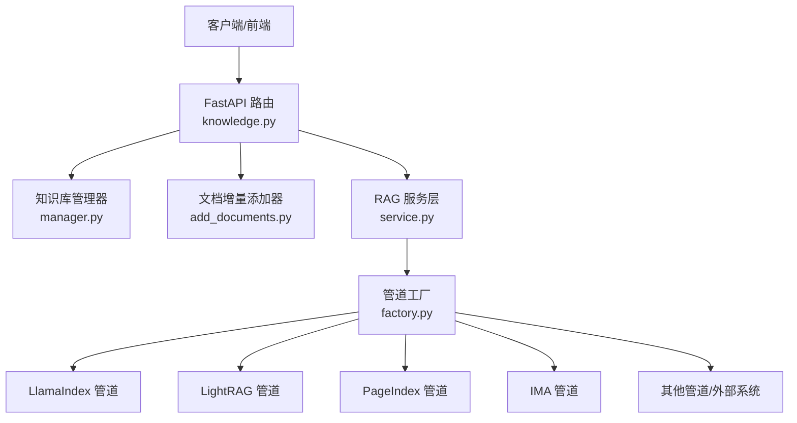
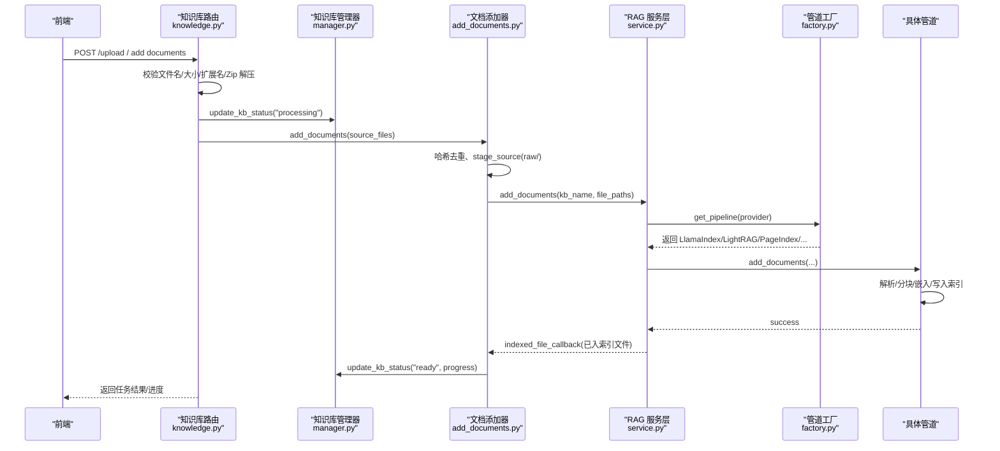
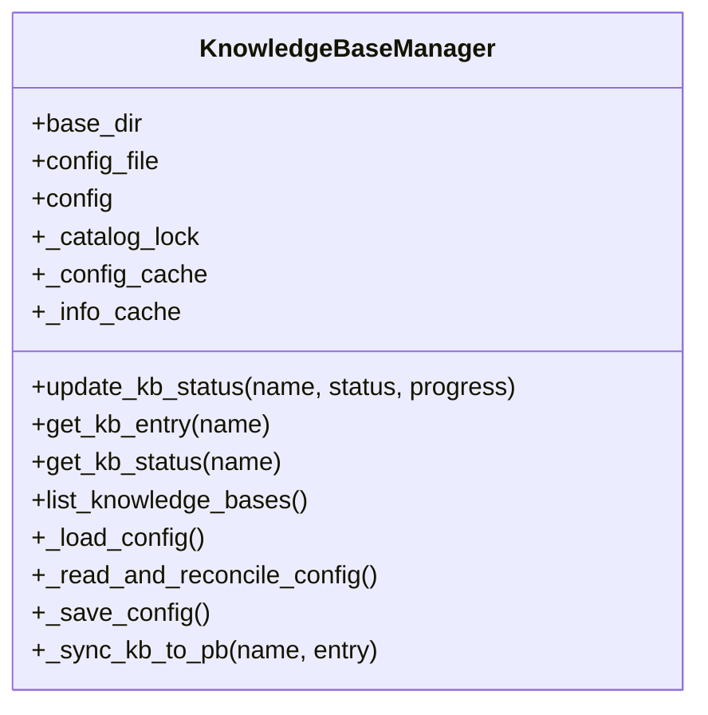
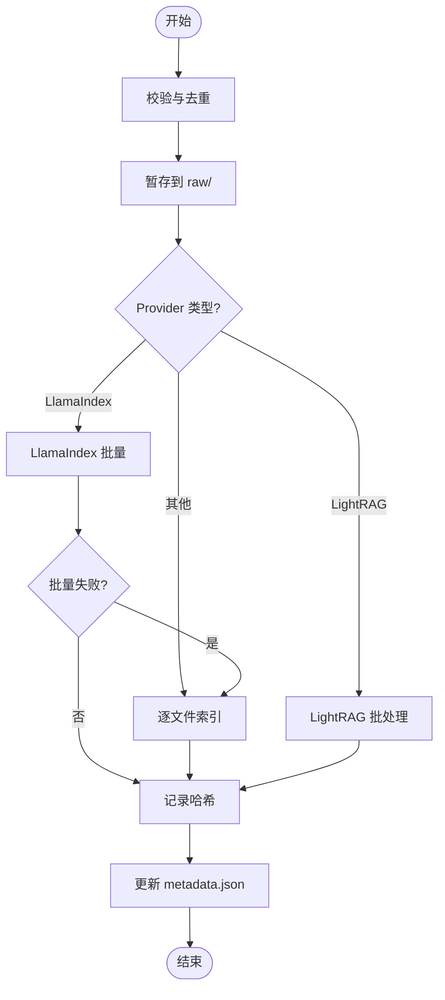
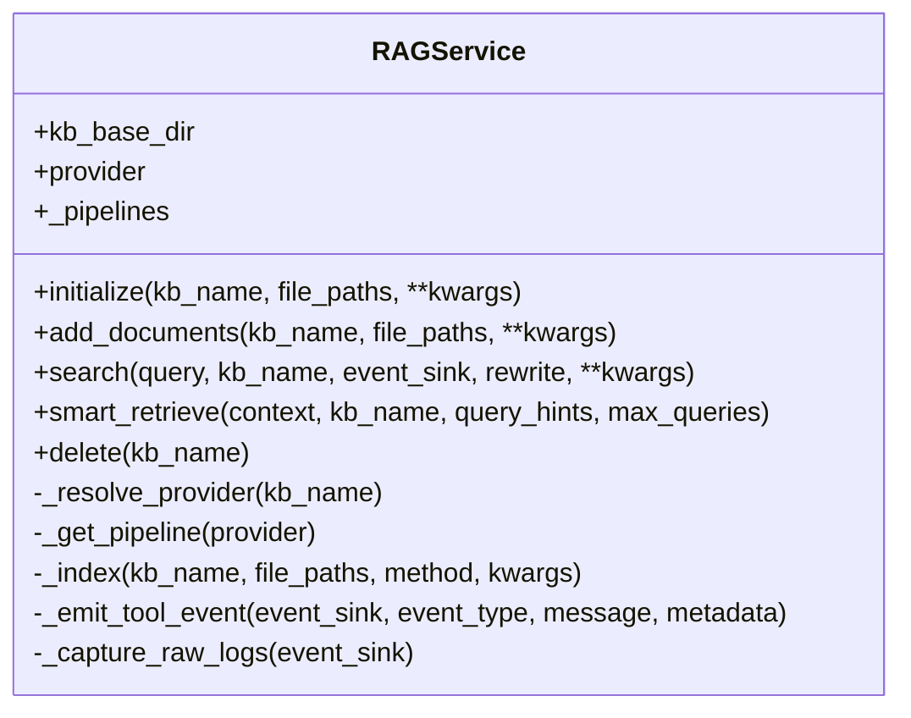
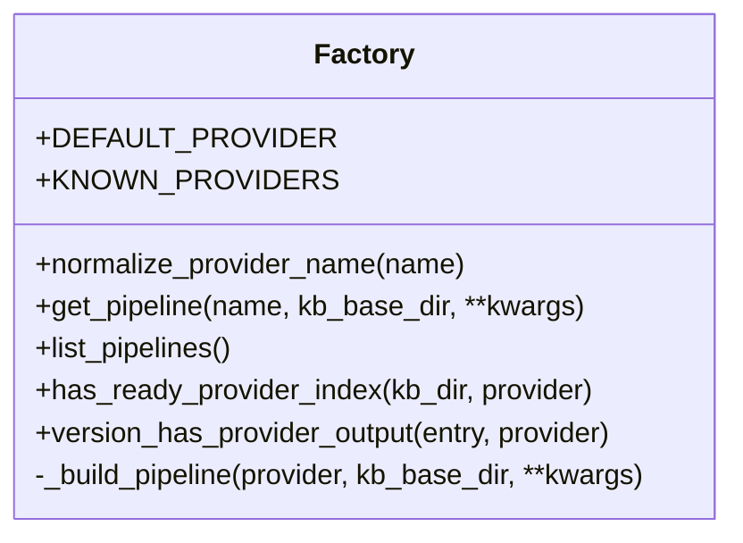
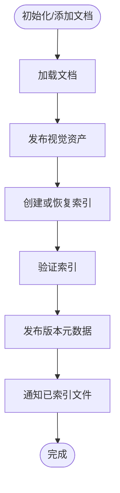
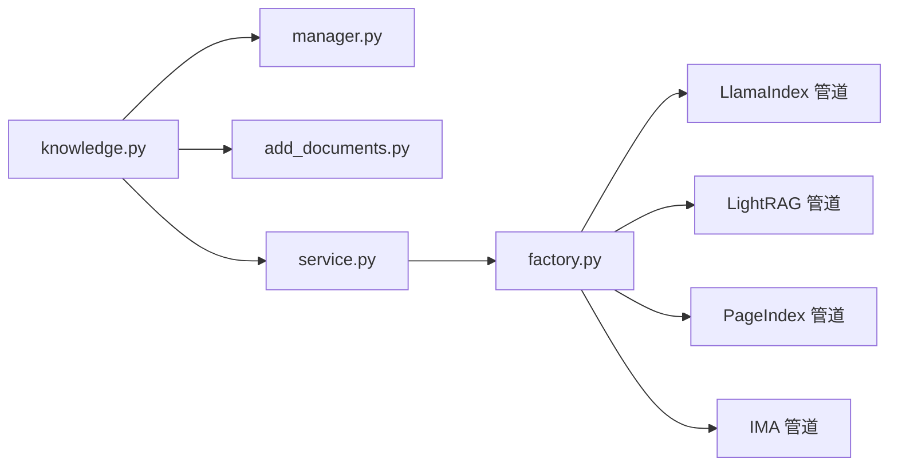

# 知识库管理系统

<cite>
**本文引用的文件**   
- [knowledge.py](file://deeptutor/api/routers/knowledge.py)
- [manager.py](file://deeptutor/knowledge/manager.py)
- [add_documents.py](file://deeptutor/knowledge/add_documents.py)
- [initializer.py](file://deeptutor/knowledge/initializer.py)
- [service.py](file://deeptutor/services/rag/service.py)
- [factory.py](file://deeptutor/services/rag/factory.py)
- [pipeline.py（LlamaIndex）](file://deeptutor/services/rag/pipelines/llamaindex/pipeline.py)
- [pipeline.py（PageIndex）](file://deeptutor/services/rag/pipelines/pageindex/pipeline.py)
- [client.py（IMA）](file://deeptutor/services/rag/pipelines/ima/client.py)
- [rag_tool.py](file://deeptutor/tools/rag_tool.py)
</cite>

## 目录
1. [简介](#简介)
2. [项目结构](#项目结构)
3. [核心组件](#核心组件)
4. [架构总览](#架构总览)
5. [详细组件分析](#详细组件分析)
6. [依赖关系分析](#依赖关系分析)
7. [性能与优化](#性能与优化)
8. [故障排除指南](#故障排除指南)
9. [结论](#结论)
10. [附录：API 使用示例](#附录api-使用示例)

## 简介
本技术文档面向 DeepTutor 的知识库管理系统，重点说明 RAG（检索增强生成）在系统中的完整实现路径：从文档解析、向量化、索引构建到语义搜索。文档还解释知识管理器如何管理多个知识库、处理元数据、版本控制与同步机制，并给出向量数据库与检索引擎的选择策略、优化方法、API 调用示例以及与智能对话系统的集成方式。

## 项目结构
DeepTutor 的知识库相关代码主要分布在以下模块：
- API 路由层：负责接收前端请求、权限校验、参数校验、任务进度广播和错误封装。
- 知识库管理层：负责知识库注册、状态更新、配置持久化、多用户访问控制和外部资源连接。
- 文档增量添加层：负责文件校验、暂存、去重、分批次索引和失败回退。
- RAG 服务层：统一入口，按知识库绑定选择具体管道，封装查询重写、事件追踪和日志捕获。
- 管道工厂：根据 provider 名称实例化 LlamaIndex、LightRAG、GraphRAG、PageIndex、IMA、WeKnora、Kiwix 等后端。
- 各管道实现：各自负责解析、分块、嵌入、存储、检索和删除等操作。

**图示来源**
- [knowledge.py:1-120](file://deeptutor/api/routers/knowledge.py#L1-L120)
- [manager.py:1-60](file://deeptutor/knowledge/manager.py#L1-L60)
- [add_documents.py:1-40](file://deeptutor/knowledge/add_documents.py#L1-L40)
- [service.py:1-60](file://deeptutor/services/rag/service.py#L1-L60)
- [factory.py:1-60](file://deeptutor/services/rag/factory.py#L1-L60)

**章节来源**
- [knowledge.py:1-120](file://deeptutor/api/routers/knowledge.py#L1-L120)
- [manager.py:1-60](file://deeptutor/knowledge/manager.py#L1-L60)
- [add_documents.py:1-40](file://deeptutor/knowledge/add_documents.py#L1-L40)
- [service.py:1-60](file://deeptutor/services/rag/service.py#L1-L60)
- [factory.py:1-60](file://deeptutor/services/rag/factory.py#L1-L60)

## 核心组件
- FastAPI 知识库路由：提供知识库列表、详情、上传、文件夹管理、文件预览、删除、外部系统连接探测与连接等接口；负责将请求委派给知识库管理器、文档添加器和 RAG 服务。
- 知识库管理器：维护 kb_config.json，负责知识库注册、自动发现、孤儿清理、状态与进度更新、PocketBase 同步、嵌入指纹与版本兼容性检查。
- 文档增量添加器：对源文件进行哈希去重、安全暂存到 raw/，按 provider 特性批量或逐文件索引，记录已索引文件哈希，支持 LightRAG 的写所有权快照。
- RAG 服务层：统一 initialize、add_documents、search、smart_retrieve、delete 等能力；按知识库绑定选择管道；封装查询重写、事件 sink、原始日志捕获。
- 管道工厂：根据 provider 名称返回对应管道实例，并提供可用管道描述、就绪性探测和默认值归一化。
- LlamaIndex 管道：本地向量检索 + BM25 混合融合，支持可恢复索引、版本发布、嵌入签名匹配、作业停滞保护。
- PageIndex 管道：云端或本地 OSS 模式，通过 SDK/MCP 工具读取文档，不复制本地索引。
- IMA 管道：腾讯 IMA 知识库远程检索，分页拉取文档与文件夹。

**章节来源**
- [knowledge.py:180-240](file://deeptutor/api/routers/knowledge.py#L180-L240)
- [manager.py:322-470](file://deeptutor/knowledge/manager.py#L322-L470)
- [add_documents.py:162-336](file://deeptutor/knowledge/add_documents.py#L162-L336)
- [service.py:22-125](file://deeptutor/services/rag/service.py#L22-L125)
- [factory.py:37-110](file://deeptutor/services/rag/factory.py#L37-L110)
- [pipeline.py（LlamaIndex）:181-320](file://deeptutor/services/rag/pipelines/llamaindex/pipeline.py#L181-L320)
- [pipeline.py（PageIndex）:77-101](file://deeptutor/services/rag/pipelines/pageindex/pipeline.py#L77-L101)
- [client.py（IMA）:109-140](file://deeptutor/services/rag/pipelines/ima/client.py#L109-L140)

## 架构总览
下图展示一次“添加文档并建立索引”的典型流程：前端上传文件 → 路由校验与安全保存 → 文档添加器暂存与去重 → RAG 服务选择管道 → 管道执行解析、分块、嵌入、写入索引 → 发布版本并更新知识库状态。

**图示来源**
- [knowledge.py:429-558](file://deeptutor/api/routers/knowledge.py#L429-L558)
- [add_documents.py:266-336](file://deeptutor/knowledge/add_documents.py#L266-L336)
- [service.py:67-125](file://deeptutor/services/rag/service.py#L67-L125)
- [factory.py:193-209](file://deeptutor/services/rag/factory.py#L193-L209)
- [pipeline.py（LlamaIndex）:230-310](file://deeptutor/services/rag/pipelines/llamaindex/pipeline.py#L230-L310)

## 详细组件分析

### 知识库管理器（KnowledgeBaseManager）
职责：
- 加载与缓存 kb_config.json，原子写入避免并发损坏。
- 列出知识库、自动注册磁盘上存在但未登记的知识库、清理孤儿条目。
- 更新知识库状态与进度，并在启用 PocketBase 时镜像元数据。
- 检测嵌入模型指纹与版本兼容性，标记 needs_reindex 或 embedding_mismatch。
- 支持多种 provider 的兼容性与迁移逻辑。

关键行为：
- _load_config/_read_and_reconcile_config：加载配置、规范化 provider、清理旧字段、触发嵌入标志对齐。
- update_kb_status：写入 status、progress、last_completed_at、embedding_signature、index_versions 等。
- list_knowledge_bases/_list_knowledge_bases：扫描磁盘、合并可见资源、异步非阻塞。

**图示来源**
- [manager.py:322-470](file://deeptutor/knowledge/manager.py#L322-L470)
- [manager.py:500-625](file://deeptutor/knowledge/manager.py#L500-L625)
- [manager.py:651-740](file://deeptutor/knowledge/manager.py#L651-L740)

**章节来源**
- [manager.py:322-470](file://deeptutor/knowledge/manager.py#L322-L470)
- [manager.py:500-625](file://deeptutor/knowledge/manager.py#L500-L625)
- [manager.py:651-740](file://deeptutor/knowledge/manager.py#L651-L740)

### 文档增量添加器（DocumentAdder）
职责：
- 校验与暂存文件到 raw/，保留文件夹结构。
- 基于 content_hash 去重，避免重复索引。
- 按 provider 特性选择批量或逐文件索引策略。
- 记录已索引文件的哈希，便于后续同步与增量识别。
- 为 LightRAG 提供 accepted_indexing_snapshot 以持有写所有权。

关键行为：
- add_documents：遍历 source_files，计算哈希，判断是否已索引，决定 stage 或原地索引。
- process_new_documents：LightRAG 走专用批处理；LlamaIndex 优先批量，失败回退单文件；其他 provider 逐文件。
- _process_llamaindex_batch：一次性 publish，回调确认实际入索引文件。
- _process_provider_files_one_by_one：逐个调用 RAGService.add_documents，记录成功与失败。
- _record_successful_hash：持久化 metadata.json 中的 file_hashes。

**图示来源**
- [add_documents.py:266-336](file://deeptutor/knowledge/add_documents.py#L266-L336)
- [add_documents.py:337-493](file://deeptutor/knowledge/add_documents.py#L337-L493)
- [add_documents.py:549-586](file://deeptutor/knowledge/add_documents.py#L549-L586)

**章节来源**
- [add_documents.py:266-336](file://deeptutor/knowledge/add_documents.py#L266-L336)
- [add_documents.py:337-493](file://deeptutor/knowledge/add_documents.py#L337-L493)
- [add_documents.py:549-586](file://deeptutor/knowledge/add_documents.py#L549-L586)

### RAG 服务层（RAGService）
职责：
- 统一入口：initialize、add_documents、search、smart_retrieve、delete。
- 按知识库绑定选择 provider，缓存管道实例。
- 封装查询重写、事件 sink、原始日志捕获。
- 保证索引输出通过 readiness check，记录 usable_version。

关键行为：
- _resolve_provider：优先显式 provider，否则从 KB 绑定解析。
- _index：包装 IndexingRun，跟踪 phase、document 状态、progress 回调。
- search：对 PageIndex 系列提示需使用 Reasoning as Retrieval；普通 provider 走 pipeline.search。
- _capture_raw_logs：过滤噪音日志，转发 lightrag/graphrag 等底层日志。

**图示来源**
- [service.py:22-125](file://deeptutor/services/rag/service.py#L22-L125)
- [service.py:126-250](file://deeptutor/services/rag/service.py#L126-L250)
- [service.py:252-333](file://deeptutor/services/rag/service.py#L252-L333)

**章节来源**
- [service.py:22-125](file://deeptutor/services/rag/service.py#L22-L125)
- [service.py:126-250](file://deeptutor/services/rag/service.py#L126-L250)
- [service.py:252-333](file://deeptutor/services/rag/service.py#L252-L333)

### 管道工厂（Factory）
职责：
- 定义已知 provider 常量与默认值。
- normalize_provider_name：未知 provider 回退到默认。
- get_pipeline：按 provider 与 kb_base_dir 创建或缓存管道实例。
- list_pipelines：返回 UI 可用的管道描述与就绪性信息。

关键行为：
- _build_pipeline：根据 provider 动态导入并实例化对应管道类。
- has_ready_provider_index/version_has_provider_output：辅助判断索引就绪。

**图示来源**
- [factory.py:37-110](file://deeptutor/services/rag/factory.py#L37-L110)
- [factory.py:136-209](file://deeptutor/services/rag/factory.py#L136-L209)
- [factory.py:212-348](file://deeptutor/services/rag/factory.py#L212-L348)

**章节来源**
- [factory.py:37-110](file://deeptutor/services/rag/factory.py#L37-L110)
- [factory.py:136-209](file://deeptutor/services/rag/factory.py#L136-L209)
- [factory.py:212-348](file://deeptutor/services/rag/factory.py#L212-L348)

### LlamaIndex 管道
职责：
- 本地向量检索 + BM25 混合融合。
- 支持可恢复索引、版本发布、嵌入签名匹配。
- 作业停滞保护：监控进度心跳，超时抛出 IndexingStallError。
- 精确练习查找：针对编号练习题的结构化检索。

关键行为：
- initialize：加载文档、发布视觉资产、创建/恢复索引、验证并发布版本。
- search：若无匹配索引则返回 needs_reindex；否则检索节点并组装 sources。
- add_documents：批量插入或新建索引，发布 verified 版本。

**图示来源**
- [pipeline.py（LlamaIndex）:230-310](file://deeptutor/services/rag/pipelines/llamaindex/pipeline.py#L230-L310)
- [pipeline.py（LlamaIndex）:322-418](file://deeptutor/services/rag/pipelines/llamaindex/pipeline.py#L322-L418)
- [pipeline.py（LlamaIndex）:492-556](file://deeptutor/services/rag/pipelines/llamaindex/pipeline.py#L492-L556)

**章节来源**
- [pipeline.py（LlamaIndex）:230-310](file://deeptutor/services/rag/pipelines/llamaindex/pipeline.py#L230-L310)
- [pipeline.py（LlamaIndex）:322-418](file://deeptutor/services/rag/pipelines/llamaindex/pipeline.py#L322-L418)
- [pipeline.py（LlamaIndex）:492-556](file://deeptutor/services/rag/pipelines/llamaindex/pipeline.py#L492-L556)

### PageIndex 管道
职责：
- 云端或本地 OSS 模式，通过 SDK/MCP 工具读取文档。
- 不复制本地索引，按需检索。

关键行为：
- client 构造：OSS 模式需要 Local Library 路径；云端模式使用配置提供者。
- processing_mode：从 KB 配置中读取 pageindex_mode。

**章节来源**
- [pipeline.py（PageIndex）:77-101](file://deeptutor/services/rag/pipelines/pageindex/pipeline.py#L77-L101)

### IMA 管道
职责：
- 远程检索腾讯 IMA 知识库，分页拉取文档与文件夹。

关键行为：
- search_knowledge：分页获取文档、文件夹、未验证文档数量，直到达到 limit 或结束。

**章节来源**
- [client.py（IMA）:109-140](file://deeptutor/services/rag/pipelines/ima/client.py#L109-L140)

## 依赖关系分析
- 路由层依赖知识库管理器、文档添加器、RAG 服务、进度广播、任务 ID 管理、多用户访问控制、PocketBase 客户端、外部管道探针。
- 知识库管理器依赖嵌入签名、索引版本探测、provider 绑定、workspace 上下文。
- 文档添加器依赖 RAG 服务、provider 绑定、数据卷权限检查。
- RAG 服务依赖管道工厂、索引版本探测、KB 路径解析、内存 trace。
- 管道工厂依赖各管道实现与就绪性探测。

**图示来源**
- [knowledge.py:1-120](file://deeptutor/api/routers/knowledge.py#L1-L120)
- [manager.py:1-60](file://deeptutor/knowledge/manager.py#L1-L60)
- [add_documents.py:1-40](file://deeptutor/knowledge/add_documents.py#L1-L40)
- [service.py:1-60](file://deeptutor/services/rag/service.py#L1-L60)
- [factory.py:1-60](file://deeptutor/services/rag/factory.py#L1-L60)

**章节来源**
- [knowledge.py:1-120](file://deeptutor/api/routers/knowledge.py#L1-L120)
- [manager.py:1-60](file://deeptutor/knowledge/manager.py#L1-L60)
- [add_documents.py:1-40](file://deeptutor/knowledge/add_documents.py#L1-L40)
- [service.py:1-60](file://deeptutor/services/rag/service.py#L1-L60)
- [factory.py:1-60](file://deeptutor/services/rag/factory.py#L1-L60)

## 性能与优化
- 并发与阻塞控制：
  - 上传与文件写入使用线程池执行，避免阻塞事件循环。
  - LlamaIndex 索引步骤运行在 executor 中，并通过停滞守护监控进度心跳，防止无限等待。
- 索引版本与缓存：
  - 管道工厂缓存管道实例，减少重复构建开销。
  - 知识库管理器缓存配置与 info，缩短频繁读取路径。
- 渐进式索引与重试：
  - LlamaIndex 支持可恢复索引与批量失败回退单文件，提升鲁棒性。
  - PageIndex/GraphRAG 走逐文件路径，避免大失败影响整体。
- 日志与追踪：
  - RAG 服务捕获底层日志并过滤噪音，便于诊断而不污染前端流。
- 外部系统优化：
  - PageIndex/IMA/WeKnora/Kiwix 等外部系统无需本地索引，降低存储与索引成本。

[本节为通用指导，不直接分析具体文件]

## 故障排除指南
常见问题与定位建议：
- 索引停滞：
  - 现象：索引长时间无进度，抛出 IndexingStallError。
  - 排查：检查嵌入端点连通性、网络稳定性；等待前次 worker 完成或重启服务。
  - 参考：LlamaIndex 管道的停滞守护逻辑。
- 权限问题：
  - 现象：DataVolumePermissionError。
  - 排查：确认数据卷 UID/GID 与挂载权限；确保 kb_dir 可写。
  - 参考：文档添加器的权限检查与错误格式化。
- 嵌入模型不匹配：
  - 现象：needs_reindex 或 embedding_mismatch。
  - 排查：切换回之前使用的嵌入模型或重新索引。
  - 参考：知识库管理器的嵌入标志对齐与 LlamaIndex 的 mismatch 警告。
- 外部系统连接失败：
  - 现象：Probe 失败、认证失败、限流。
  - 排查：检查 API Key、server_url、knowledge_base_id；查看 probe 返回的错误码。
  - 参考：路由层的 probe/connect 接口与 IMA/PageIndex 客户端错误处理。

**章节来源**
- [pipeline.py（LlamaIndex）:106-179](file://deeptutor/services/rag/pipelines/llamaindex/pipeline.py#L106-L179)
- [add_documents.py:376-387](file://deeptutor/knowledge/add_documents.py#L376-L387)
- [manager.py:158-319](file://deeptutor/knowledge/manager.py#L158-L319)
- [knowledge.py:2369-2420](file://deeptutor/api/routers/knowledge.py#L2369-L2420)

## 结论
DeepTutor 的知识库管理系统通过清晰的分层架构实现了完整的 RAG 流程：路由层负责请求治理与进度反馈，知识库管理层维护状态与版本，文档添加器保障文件安全与去重，RAG 服务层统一调度管道，管道工厂灵活选择后端。系统支持多种向量与图检索引擎，兼顾本地与外部系统，具备完善的错误处理、性能优化与可观测性。

[本节为总结性内容，不直接分析具体文件]

## 附录：API 使用示例
以下为常用知识库操作示例（以 HTTP 形式示意）：

- 列出知识库
  - GET /api/knowledge-bases
  - 返回知识库列表，包含名称、状态、统计、进度等。

- 获取知识库详情
  - GET /api/knowledge-bases/{kb_name}
  - 返回单个知识库详细信息。

- 上传文件并索引
  - POST /api/knowledge-bases/upload
  - 表单字段：files[]、folder_path（可选）、rel_paths[]（可选）。
  - 服务端会校验文件类型、大小、Zip 解压、路径安全，保存到 raw/，然后调用 DocumentAdder 与 RAGService 进行索引。

- 列出 raw 文件
  - GET /api/knowledge-bases/{kb_name}/files
  - 递归列出 raw/ 下的文件与文件夹。

- 移动/创建文件夹
  - POST /api/knowledge-bases/{kb_name}/folders
  - POST /api/knowledge-bases/{kb_name}/files/move

- 删除文件
  - DELETE /api/knowledge-bases/{kb_name}/files/{filename:path}
  - 删除 raw 文件，必要时调用特定管道移除索引项。

- 删除知识库
  - DELETE /api/knowledge-bases/{kb_name}
  - 或 POST /api/knowledge-bases/delete（body: name）

- 连接外部系统
  - POST /api/knowledge-bases/probe-lightrag-server
  - POST /api/knowledge-bases/connect-lightrag-server
  - POST /api/knowledge-bases/probe-ima
  - POST /api/knowledge-bases/connect-ima
  - POST /api/knowledge-bases/probe-kiwix
  - POST /api/knowledge-bases/connect-kiwix

- 搜索知识库
  - 通过智能对话系统集成 RAG 工具：
    - tools.rag_tool.rag_search(query, kb_name, top_k=...)
    - 内部调用 RAGService.search，按 KB 绑定选择管道。

**章节来源**
- [knowledge.py:2810-2994](file://deeptutor/api/routers/knowledge.py#L2810-L2994)
- [knowledge.py:3097-3348](file://deeptutor/api/routers/knowledge.py#L3097-L3348)
- [knowledge.py:2369-2420](file://deeptutor/api/routers/knowledge.py#L2369-L2420)
- [knowledge.py:2694-2770](file://deeptutor/api/routers/knowledge.py#L2694-L2770)
- [knowledge.py:2610-2663](file://deeptutor/api/routers/knowledge.py#L2610-L2663)
- [rag_tool.py:45-95](file://deeptutor/tools/rag_tool.py#L45-L95)