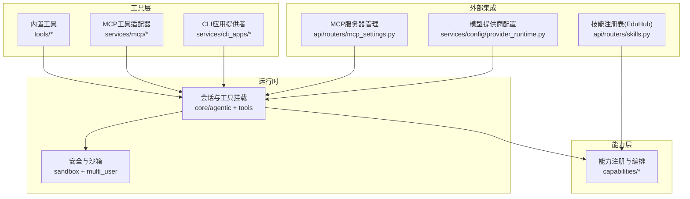
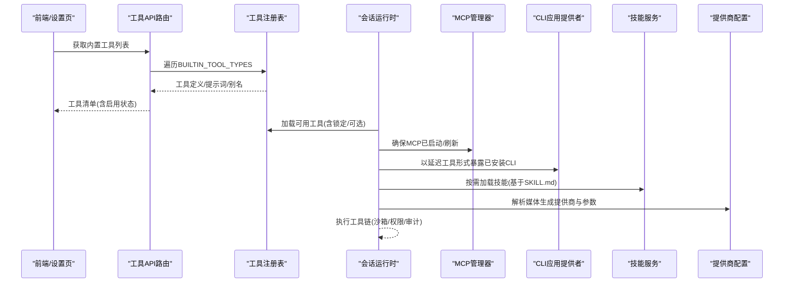
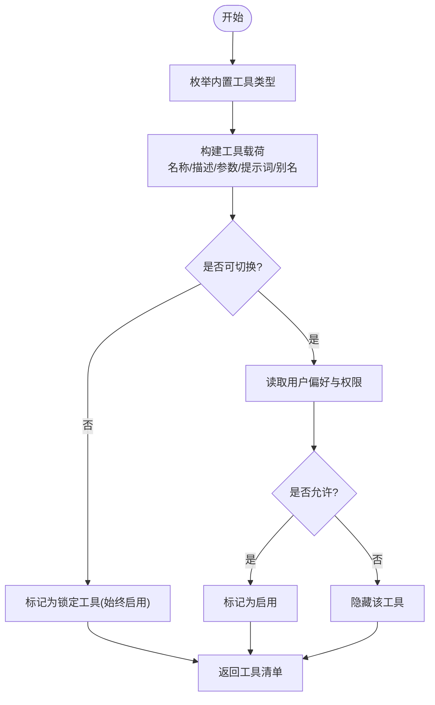
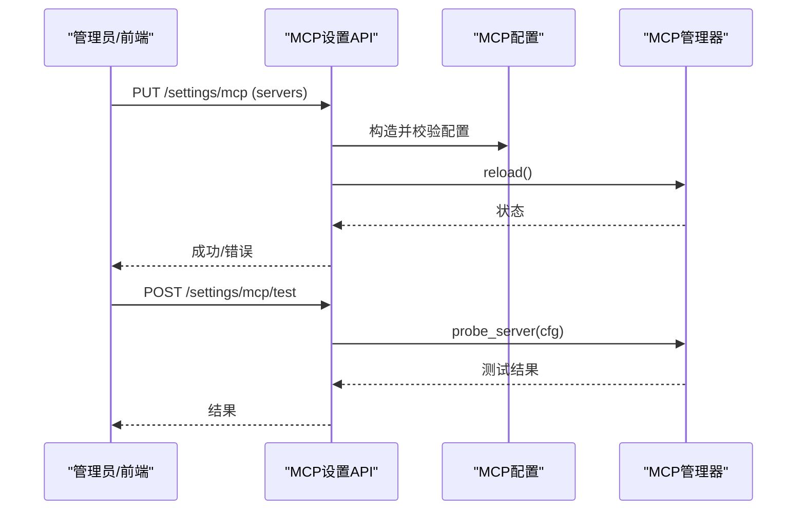
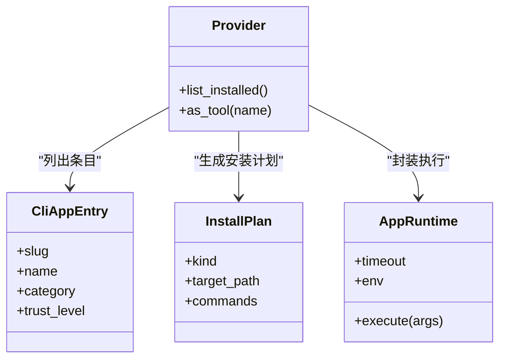
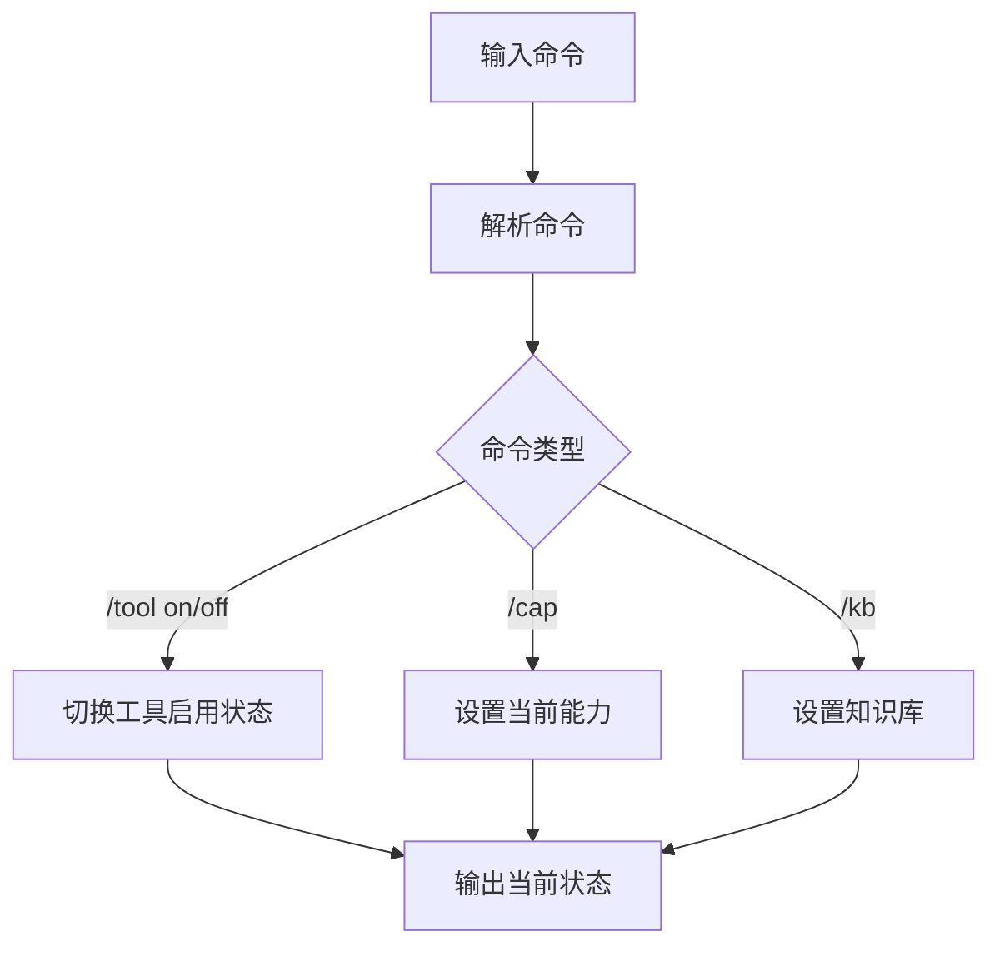
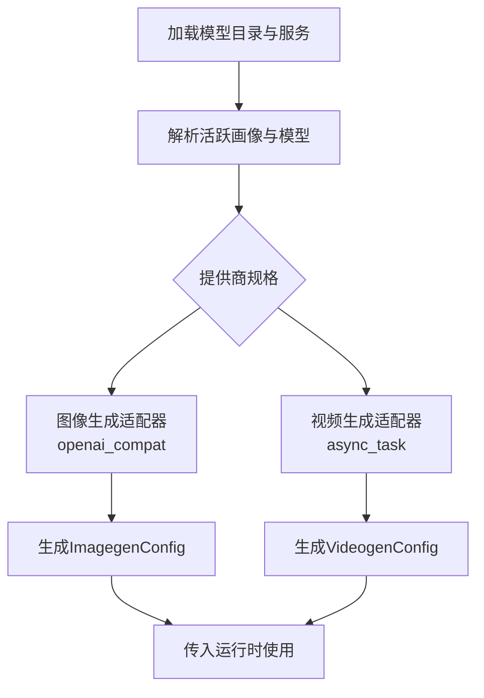
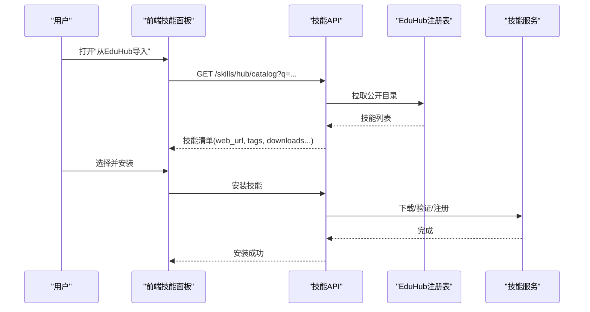
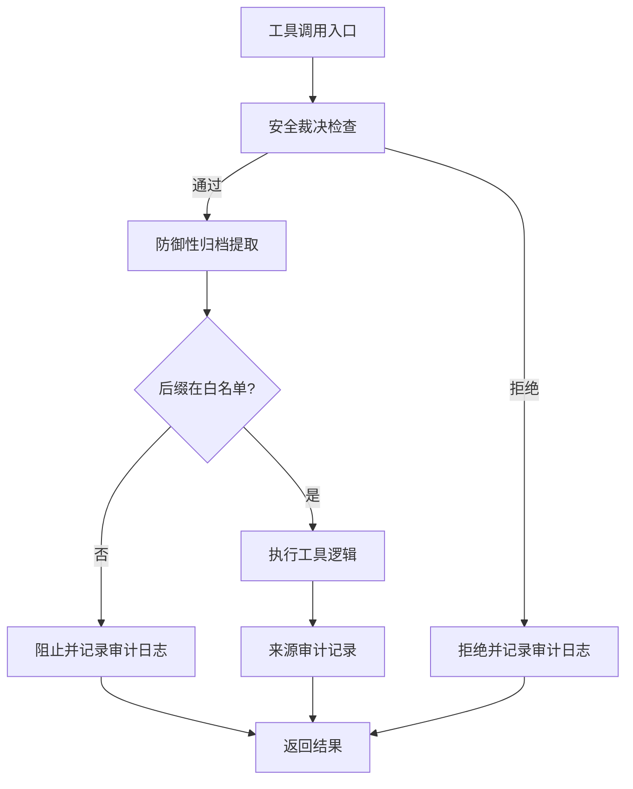
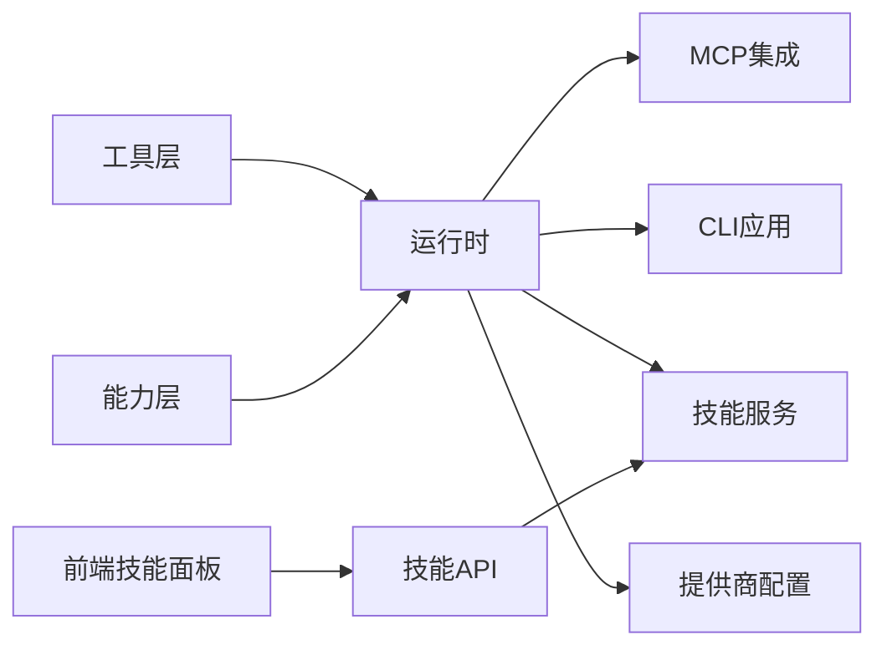

# 可扩展的工具和技能系统

<cite>
**本文引用的文件**
- [deeptutor/tools/__init__.py](file://deeptutor/tools/__init__.py)
- [deeptutor/api/routers/tools.py](file://deeptutor/api/routers/tools.py)
- [tests/api/test_tools_router.py](file://tests/api/test_tools_router.py)
- [deeptutor/services/mcp/__init__.py](file://deeptutor/services/mcp/__init__.py)
- [deeptutor/api/routers/mcp_settings.py](file://deeptutor/api/routers/mcp_settings.py)
- [tests/api/test_mcp_settings_auth.py](file://tests/api/test_mcp_settings_auth.py)
- [deeptutor/services/cli_apps/__init__.py](file://deeptutor/services/cli_apps/__init__.py)
- [deeptutor_cli/chat.py](file://deeptutor_cli/chat.py)
- [deeptutor/services/config/provider_runtime.py](file://deeptutor/services/config/provider_runtime.py)
- [web/lib/skills-api.ts](file://web/lib/skills-api.ts)
- [deeptutor/api/routers/skills.py](file://deeptutor/api/routers/skills.py)
- [deeptutor/services/skill/__init__.py](file://deeptutor/services/skill/__init__.py)
- [assets/README/README_TH.md](file://assets/README/README_TH.md)
- [assets/README/README_JA.md](file://assets/README/README_JA.md)
</cite>

## 目录
1. [简介](#简介)
2. [项目结构](#项目结构)
3. [核心组件](#核心组件)
4. [架构总览](#架构总览)
5. [详细组件分析](#详细组件分析)
6. [依赖关系分析](#依赖关系分析)
7. [性能考虑](#性能考虑)
8. [故障排查指南](#故障排查指南)
9. [结论](#结论)
10. [附录](#附录)

## 简介
本文件面向DeepTutor的可扩展工具与技能系统，系统性说明：
- 内置工具的发现、注册与启用机制（文件操作、网络请求、代码执行、搜索等）
- MCP服务器集成（社区MCP服务器的安装、配置与管理）
- CLI应用系统（从CLI-Anything目录安装命令行工具，以及聊天智能体的直接调用）
- 图像、视频、语音生成模型的集成方式（提供商配置与参数调优）
- 技能系统（基于Agent-Skills格式的SKILL.md剧本，支持从EduHub社区注册表安装教育导向技能）
- 安全门机制（安全裁决检查、防御性归档提取、后缀白名单与来源审计）
- 自定义工具开发、技能发布与第三方服务集成的实践示例
- 插件化设计如何支撑持续扩展与社区贡献

## 项目结构
围绕“工具—能力—运行时”的分层组织如下：
- 工具层：提供可被智能体调用的原子能力（如搜索、RAG、推理、网页抓取、代码执行等），通过统一协议暴露定义与提示词。
- 能力层：将一组工具编排为面向场景的能力（如解题、掌握度评估、笔记分析等）。
- 运行时：在会话中根据上下文动态挂载工具，结合沙箱、权限与安全策略执行。
- 外部集成：MCP服务器、CLI应用、模型提供商（图像/视频/语音）、技能注册表（EduHub）。

图表来源
- [deeptutor/api/routers/tools.py:169-223](file://deeptutor/api/routers/tools.py#L169-L223)
- [deeptutor/services/mcp/__init__.py:1-33](file://deeptutor/services/mcp/__init__.py#L1-L33)
- [deeptutor/services/cli_apps/__init__.py:1-53](file://deeptutor/services/cli_apps/__init__.py#L1-L53)
- [deeptutor/api/routers/mcp_settings.py:37-133](file://deeptutor/api/routers/mcp_settings.py#L37-L133)
- [deeptutor/api/routers/skills.py:124-154](file://deeptutor/api/routers/skills.py#L124-L154)
- [deeptutor/services/config/provider_runtime.py:322-344](file://deeptutor/services/config/provider_runtime.py#L322-L344)

章节来源
- [deeptutor/api/routers/tools.py:169-223](file://deeptutor/api/routers/tools.py#L169-L223)
- [deeptutor/services/mcp/__init__.py:1-33](file://deeptutor/services/mcp/__init__.py#L1-L33)
- [deeptutor/services/cli_apps/__init__.py:1-53](file://deeptutor/services/cli_apps/__init__.py#L1-L53)

## 核心组件
- 工具发现与枚举：通过API路由收集所有内置工具类型，序列化其定义、多语言提示词、别名、是否可切换、是否即将上线等元数据，供前端设置页展示与选择。
- 工具启用策略：区分“锁定工具”（始终可用，受上下文或沙箱限制）与“可选工具”（用户可在设置中开关），并尊重多租户权限控制。
- MCP集成：全局MCP服务器配置、连接管理与工具适配；支持SSE/Streamable HTTP传输的URL校验与测试。
- CLI应用系统：管理员安装、按账户启用、沙箱执行，并以延迟工具形式暴露给聊天轮次。
- 技能系统：基于Agent-Skills的SKILL.md剧本，支持从EduHub浏览、下载、安装与本地管理。
- 媒体生成：统一的提供商规格与运行时解析，支持图像与视频生成的不同适配器与参数映射。

章节来源
- [deeptutor/api/routers/tools.py:169-223](file://deeptutor/api/routers/tools.py#L169-L223)
- [tests/api/test_tools_router.py:97-109](file://tests/api/test_tools_router.py#L97-L109)
- [deeptutor/services/mcp/__init__.py:1-33](file://deeptutor/services/mcp/__init__.py#L1-L33)
- [deeptutor/services/cli_apps/__init__.py:1-53](file://deeptutor/services/cli_apps/__init__.py#L1-L53)
- [deeptutor/api/routers/skills.py:124-154](file://deeptutor/api/routers/skills.py#L124-L154)
- [deeptutor/services/config/provider_runtime.py:322-344](file://deeptutor/services/config/provider_runtime.py#L322-L344)

## 架构总览
下图展示了“工具—能力—运行时—外部集成”的整体交互：

图表来源
- [deeptutor/api/routers/tools.py:169-223](file://deeptutor/api/routers/tools.py#L169-L223)
- [deeptutor/services/mcp/__init__.py:1-33](file://deeptutor/services/mcp/__init__.py#L1-L33)
- [deeptutor/services/cli_apps/__init__.py:1-53](file://deeptutor/services/cli_apps/__init__.py#L1-L53)
- [deeptutor/services/skill/__init__.py:1-16](file://deeptutor/services/skill/__init__.py#L1-L16)
- [deeptutor/services/config/provider_runtime.py:322-344](file://deeptutor/services/config/provider_runtime.py#L322-L344)

## 详细组件分析

### 内置工具发现与启用
- 工具枚举：API路由遍历内置工具类型集合，实例化每个工具，序列化其定义、参数、多语言提示词、别名，并标注是否可切换、是否即将上线、所属能力等。
- 启用策略：
  - “锁定工具”始终启用（如代码执行、RAG、网页抓取等），但实际可用性受上下文或沙箱约束。
  - “可选工具”由用户在设置中开启/关闭，并在多租户权限下进一步过滤。
- 测试覆盖：验证web_search、reason等可选工具默认启用状态，以及code_execution、rag、web_fetch等锁定工具的状态。

图表来源
- [deeptutor/api/routers/tools.py:169-223](file://deeptutor/api/routers/tools.py#L169-L223)
- [tests/api/test_tools_router.py:97-109](file://tests/api/test_tools_router.py#L97-L109)

章节来源
- [deeptutor/api/routers/tools.py:169-223](file://deeptutor/api/routers/tools.py#L169-L223)
- [tests/api/test_tools_router.py:97-109](file://tests/api/test_tools_router.py#L97-L109)

### MCP服务器集成
- 配置与校验：支持SSE与Streamable HTTP两种传输类型，对URL进行合法性校验；提供测试端点用于连通性探测。
- 生命周期管理：全局MCP管理器负责启动、重载与状态查询；设置更新后自动reload。
- 安全与访问控制：服务端名需合法，非法名称将被拒绝；测试用例覆盖命名校验。

图表来源
- [deeptutor/api/routers/mcp_settings.py:37-133](file://deeptutor/api/routers/mcp_settings.py#L37-L133)
- [deeptutor/services/mcp/__init__.py:1-33](file://deeptutor/services/mcp/__init__.py#L1-L33)
- [tests/api/test_mcp_settings_auth.py:117-127](file://tests/api/test_mcp_settings_auth.py#L117-L127)

章节来源
- [deeptutor/api/routers/mcp_settings.py:37-133](file://deeptutor/api/routers/mcp_settings.py#L37-L133)
- [tests/api/test_mcp_settings_auth.py:117-127](file://tests/api/test_mcp_settings_auth.py#L117-L127)

### CLI应用系统（从CLI-Anything安装）
- 分层设计：模型→目录快照→路径→状态→安装器→运行器→提供者（延迟工具）。
- 管理员安装：仅管理员可执行安装/移除操作；安装后按账户启用。
- 智能体调用：以延迟工具形式呈现给聊天轮次，内部通过沙箱执行，保证隔离与可控。

图表来源
- [deeptutor/services/cli_apps/__init__.py:1-53](file://deeptutor/services/cli_apps/__init__.py#L1-L53)

章节来源
- [deeptutor/services/cli_apps/__init__.py:1-53](file://deeptutor/services/cli_apps/__init__.py#L1-L53)

### 聊天智能体中的CLI工具调用
- 在CLI聊天环境中，可通过命令快速启用/禁用特定工具，便于调试与演示。
- 典型命令包括：/tool on/off、/cap切换能力、/kb切换知识库等。

图表来源
- [deeptutor_cli/chat.py:182-221](file://deeptutor_cli/chat.py#L182-L221)

章节来源
- [deeptutor_cli/chat.py:182-221](file://deeptutor_cli/chat.py#L182-L221)

### 图像、视频、语音生成模型集成
- 提供商规格：统一抽象图像/视频生成提供商的标签、默认API基址、适配器类型、认证风格、默认模型、是否本地等元信息。
- 运行时解析：从模型目录与服务中解析活跃画像与模型，映射到具体配置（如OpenAI兼容适配器、异步任务适配器）。
- 参数调优：支持size、quality、style、response_format等模型级参数，以及extra_headers、api_version等接口级参数。

图表来源
- [deeptutor/services/config/provider_runtime.py:322-344](file://deeptutor/services/config/provider_runtime.py#L322-L344)
- [deeptutor/services/config/provider_runtime.py:1003-1033](file://deeptutor/services/config/provider_runtime.py#L1003-L1033)

章节来源
- [deeptutor/services/config/provider_runtime.py:322-344](file://deeptutor/services/config/provider_runtime.py#L322-L344)
- [deeptutor/services/config/provider_runtime.py:1003-1033](file://deeptutor/services/config/provider_runtime.py#L1003-L1033)

### 技能系统（Agent-Skills与EduHub）
- 技能格式：基于Agent-Skills的SKILL.md剧本，描述技能元数据、步骤与工具调用。
- 注册表与浏览：后端代理EduHub公开目录，前端可直接在DeepTutor界面浏览、搜索与一键下载技能。
- 安装与管理：支持从EduHub安装、本地列出、登录与发布技能；CLI命令涵盖search/install/list/login/publish/update。

图表来源
- [web/lib/skills-api.ts:155-222](file://web/lib/skills-api.ts#L155-L222)
- [deeptutor/api/routers/skills.py:124-154](file://deeptutor/api/routers/skills.py#L124-L154)
- [deeptutor/services/skill/__init__.py:1-16](file://deeptutor/services/skill/__init__.py#L1-L16)

章节来源
- [web/lib/skills-api.ts:155-222](file://web/lib/skills-api.ts#L155-L222)
- [deeptutor/api/routers/skills.py:124-154](file://deeptutor/api/routers/skills.py#L124-L154)
- [assets/README/README_TH.md:611-620](file://assets/README/README_TH.md#L611-L620)
- [assets/README/README_JA.md:611-628](file://assets/README/README_JA.md#L611-L628)

### 安全门机制（安全裁决、归档提取、后缀白名单、来源审计）
- 安全裁决：在工具执行前后进行策略检查，依据上下文、权限与风险等级决定是否放行。
- 防御性归档提取：对外部资源（如压缩包）进行安全解压，限制路径穿越与危险后缀。
- 后缀白名单：仅允许受信任的文件后缀写入或执行，降低恶意脚本注入风险。
- 来源审计：记录工具调用来源、参数与结果摘要，便于追踪与回溯。

[本节为概念性流程说明，不直接对应具体源码文件]

## 依赖关系分析
- 工具层与能力层解耦：工具通过统一协议暴露定义与提示词，能力层按需组合。
- 运行时依赖外部集成：MCP、CLI应用、技能服务与提供商配置均作为可插拔模块接入。
- 前端与后端契约：技能浏览与安装通过明确的数据结构（HubCatalog、HubSkillDetail等）进行通信。

图表来源
- [deeptutor/api/routers/tools.py:169-223](file://deeptutor/api/routers/tools.py#L169-L223)
- [web/lib/skills-api.ts:155-222](file://web/lib/skills-api.ts#L155-L222)
- [deeptutor/services/skill/__init__.py:1-16](file://deeptutor/services/skill/__init__.py#L1-L16)

章节来源
- [deeptutor/api/routers/tools.py:169-223](file://deeptutor/api/routers/tools.py#L169-L223)
- [web/lib/skills-api.ts:155-222](file://web/lib/skills-api.ts#L155-L222)

## 性能考虑
- 延迟加载：工具与技能采用懒加载，避免冷启动开销。
- 批量枚举：工具列表一次性返回，减少前端多次请求。
- 缓存与去重：工具清单构建时进行去重，避免重复注册。
- 超时与限流：CLI应用与MCP调用应设置合理超时与重试策略，防止阻塞主线程。
- 资源隔离：沙箱执行限制CPU/内存/IO，保障稳定性。

[本节提供通用指导，不直接分析具体文件]

## 故障排查指南
- 工具不可见：检查是否为“即将上线”或“可选工具未启用”，并确认多租户权限允许。
- MCP配置失败：确认传输类型与URL合法；使用测试端点验证连通性；检查服务器名称是否符合规范。
- CLI应用无法执行：确认已安装且账户已启用；检查沙箱环境与权限；查看执行日志。
- 技能安装失败：核对EduHub源可达性；检查技能包完整性与版本兼容性；查看安装日志。
- 媒体生成失败：检查提供商配置（API Key、Base URL、模型名）；确认适配器与参数匹配；查看错误码与响应头。

章节来源
- [tests/api/test_tools_router.py:97-109](file://tests/api/test_tools_router.py#L97-L109)
- [deeptutor/api/routers/mcp_settings.py:37-133](file://deeptutor/api/routers/mcp_settings.py#L37-L133)
- [tests/api/test_mcp_settings_auth.py:117-127](file://tests/api/test_mcp_settings_auth.py#L117-L127)

## 结论
DeepTutor的工具与技能系统以插件化为核心，实现了：
- 工具的统一发现、声明与启用控制
- 外部能力的标准化接入（MCP、CLI应用、技能、媒体生成）
- 安全与可观测性贯穿执行链路
- 前端友好的配置与浏览体验
通过清晰的层次与契约，系统具备良好的可扩展性与社区协作基础。

## 附录
- 自定义工具开发要点：
  - 实现工具定义（名称、描述、参数）与提示词（多语言）
  - 注册到内置工具集合或通过能力层暴露
  - 遵循安全门与沙箱约定
- 技能发布流程：
  - 编写SKILL.md，打包技能
  - 登录EduHub，发布与更新版本
  - 通过CLI或前端导入使用
- 第三方服务集成：
  - 使用MCP协议暴露工具，配置传输与URL
  - 在提供商配置中新增适配器与参数映射
  - 在前端设置页中提供可视化配置

[本节为实践指引，不直接分析具体文件]