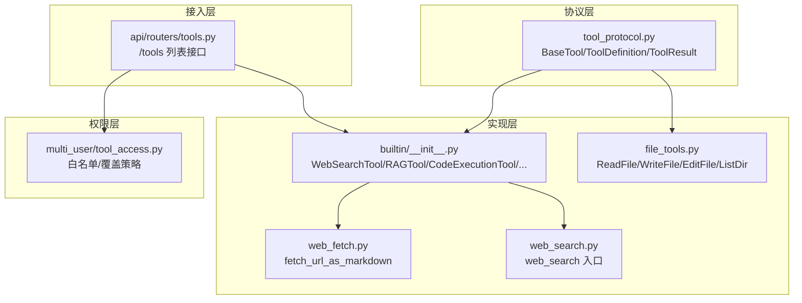
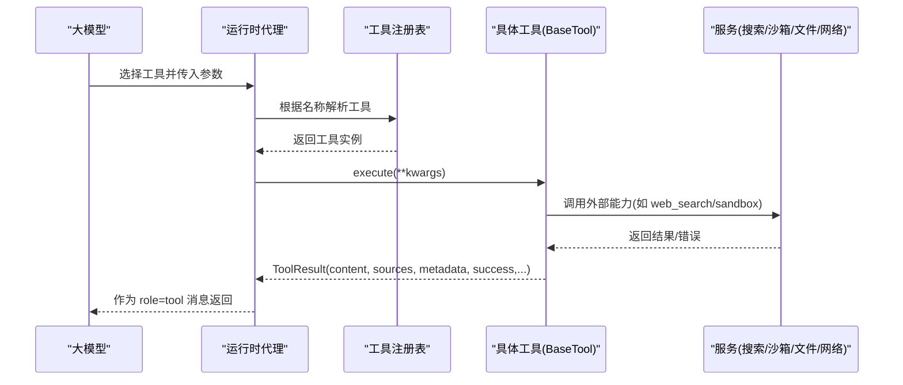
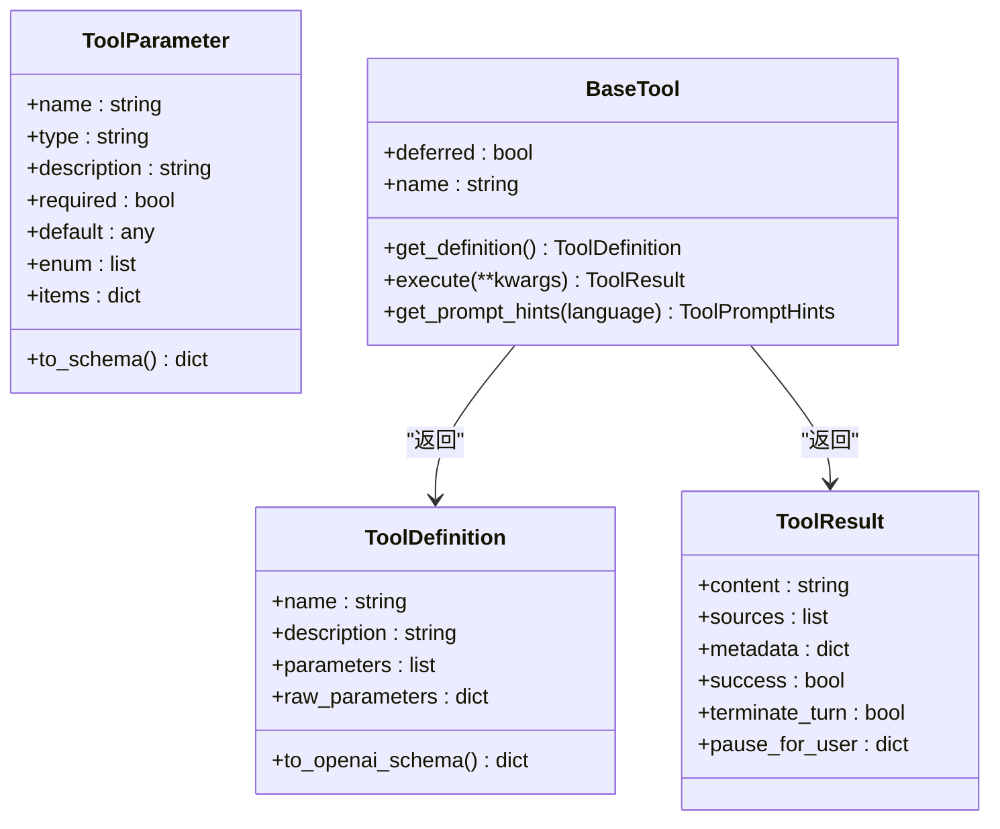
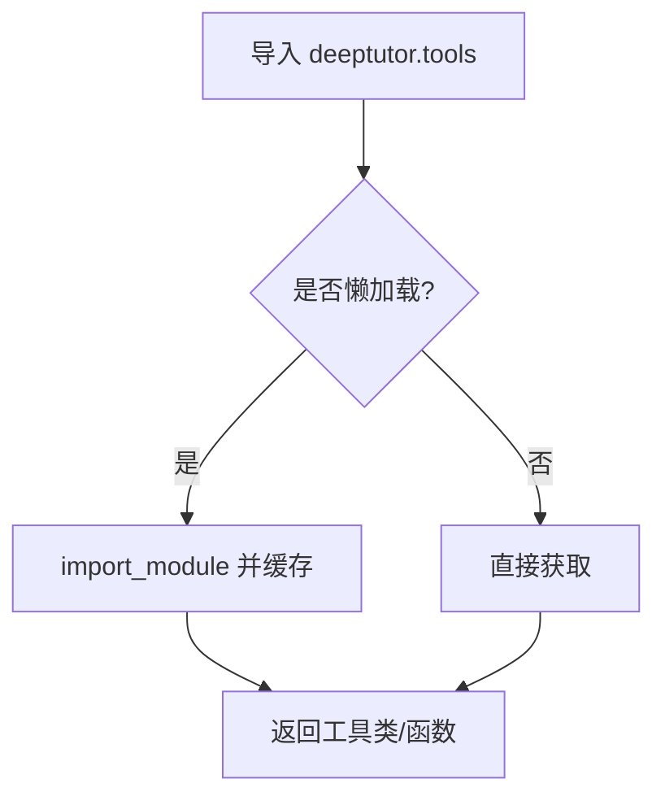
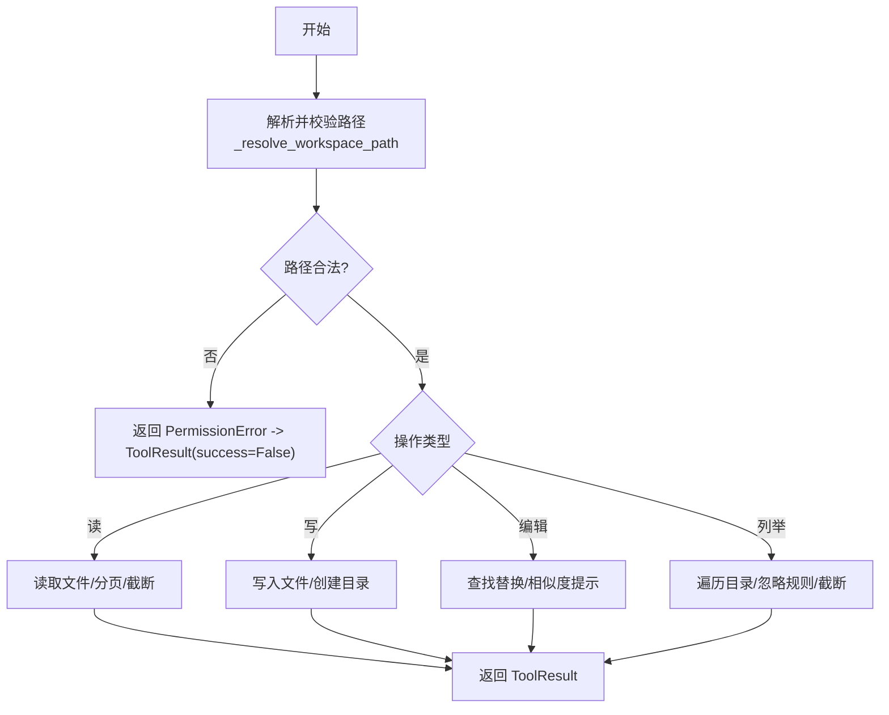
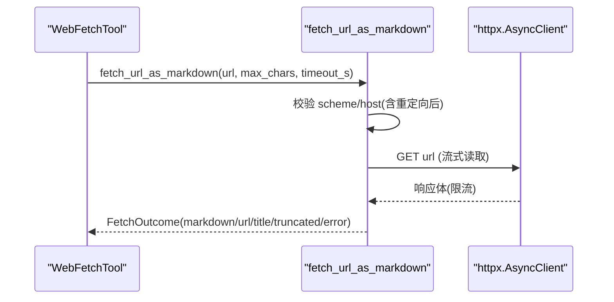
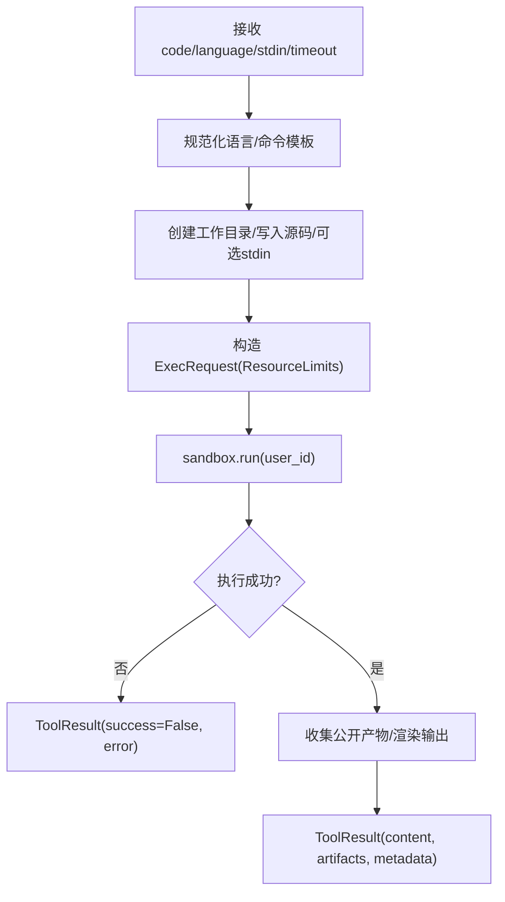
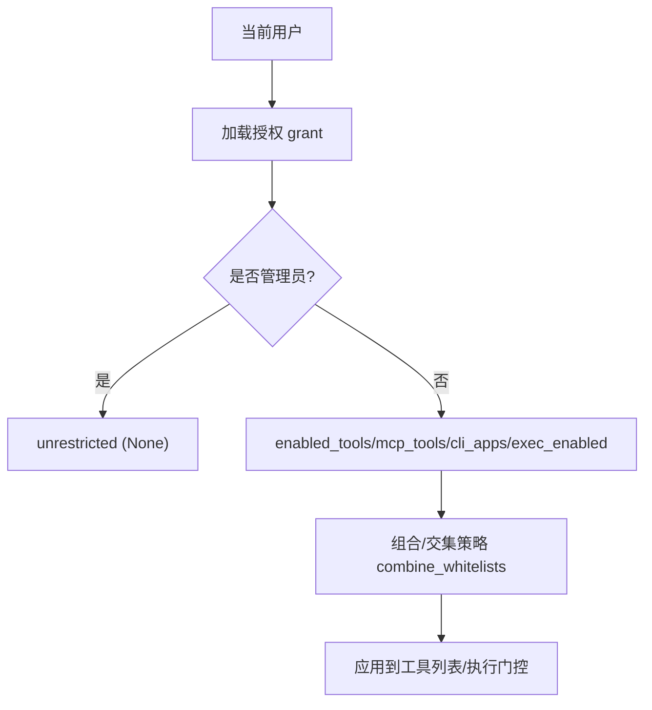
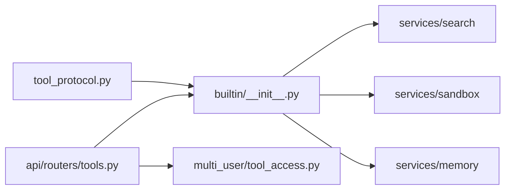

# 工具系统

<cite>
**本文引用的文件**
- [deeptutor/core/tool_protocol.py](file://deeptutor/core/tool_protocol.py)
- [deeptutor/tools/__init__.py](file://deeptutor/tools/__init__.py)
- [deeptutor/tools/builtin/__init__.py](file://deeptutor/tools/builtin/__init__.py)
- [deeptutor/api/routers/tools.py](file://deeptutor/api/routers/tools.py)
- [deeptutor/tools/file_tools.py](file://deeptutor/tools/file_tools.py)
- [deeptutor/tools/web_fetch.py](file://deeptutor/tools/web_fetch.py)
- [deeptutor/tools/web_search.py](file://deeptutor/tools/web_search.py)
- [deeptutor/multi_user/tool_access.py](file://deeptutor/multi_user/tool_access.py)
</cite>

## 目录
1. [简介](#简介)
2. [项目结构](#项目结构)
3. [核心组件](#核心组件)
4. [架构总览](#架构总览)
5. [详细组件分析](#详细组件分析)
6. [依赖关系分析](#依赖关系分析)
7. [性能考虑](#性能考虑)
8. [故障排查指南](#故障排查指南)
9. [结论](#结论)
10. [附录：自定义工具开发示例](#附录自定义工具开发示例)

## 简介
本文件为 DeepTutor 工具系统的权威技术文档，聚焦以下目标：
- 工具的注册与发现机制、参数校验与错误处理
- 内置工具能力说明（文件操作、网络请求、代码执行、搜索等）
- 工具协议定义（输入输出格式、异步调用、流式响应支持）
- 权限控制（用户权限检查、资源访问限制与安全策略）
- 如何开发自定义工具（函数定义、参数注解、错误处理与测试）
- 插件化设计与第三方工具集成方式

## 项目结构
DeepTutor 的工具系统采用分层设计：
- 协议层：统一抽象 BaseTool、ToolDefinition、ToolParameter、ToolResult 等，定义工具元数据与执行契约
- 实现层：内置工具集合（web_search、rag、code_execution、文件读写、知识检索等）
- 接入层：API Router 暴露工具清单与提示词片段，供前端设置页展示
- 权限层：按用户/角色进行可选工具、MCP/CLI 工具、exec 能力的白名单控制
- 服务层：网络抓取、搜索、沙箱执行、知识库检索等具体能力由 services 提供

**图表来源**
- [deeptutor/core/tool_protocol.py:16-275](file://deeptutor/core/tool_protocol.py#L16-L275)
- [deeptutor/tools/builtin/__init__.py:43-800](file://deeptutor/tools/builtin/__init__.py#L43-L800)
- [deeptutor/tools/file_tools.py:13-291](file://deeptutor/tools/file_tools.py#L13-L291)
- [deeptutor/tools/web_fetch.py:55-263](file://deeptutor/tools/web_fetch.py#L55-L263)
- [deeptutor/tools/web_search.py:1-69](file://deeptutor/tools/web_search.py#L1-L69)
- [deeptutor/api/routers/tools.py:94-223](file://deeptutor/api/routers/tools.py#L94-L223)
- [deeptutor/multi_user/tool_access.py:36-114](file://deeptutor/multi_user/tool_access.py#L36-L114)

**章节来源**
- [deeptutor/core/tool_protocol.py:16-275](file://deeptutor/core/tool_protocol.py#L16-L275)
- [deeptutor/tools/__init__.py:1-43](file://deeptutor/tools/__init__.py#L1-L43)
- [deeptutor/tools/builtin/__init__.py:1-800](file://deeptutor/tools/builtin/__init__.py#L1-L800)
- [deeptutor/api/routers/tools.py:1-223](file://deeptutor/api/routers/tools.py#L1-L223)
- [deeptutor/tools/file_tools.py:1-291](file://deeptutor/tools/file_tools.py#L1-L291)
- [deeptutor/tools/web_fetch.py:1-263](file://deeptutor/tools/web_fetch.py#L1-L263)
- [deeptutor/tools/web_search.py:1-69](file://deeptutor/tools/web_search.py#L1-L69)
- [deeptutor/multi_user/tool_access.py:1-114](file://deeptutor/multi_user/tool_access.py#L1-L114)

## 核心组件
- 工具协议
  - ToolParameter：描述单个参数的类型、是否必填、默认值、枚举、数组项 schema
  - ToolDefinition：工具名称、描述、参数列表或原始 JSON Schema；可转换为 OpenAI function-calling 格式
  - ToolResult：统一返回体，包含内容、引用来源、元数据、成功标志、终止轮次/暂停等待用户等控制字段
  - BaseTool：抽象基类，要求实现 get_definition 与 execute；支持 deferred 延迟加载与提示词片段
- 工具注册与发现
  - tools/__init__.py 通过懒加载导出常用工具，避免循环依赖与冷启动开销
  - builtin/__init__.py 集中实现内置工具并复用提示词片段加载器
- API 暴露
  - api/routers/tools.py 提供 /tools 只读接口，序列化工具定义、多语言提示、别名、开关状态与所属能力

**章节来源**
- [deeptutor/core/tool_protocol.py:16-275](file://deeptutor/core/tool_protocol.py#L16-L275)
- [deeptutor/tools/__init__.py:1-43](file://deeptutor/tools/__init__.py#L1-L43)
- [deeptutor/tools/builtin/__init__.py:36-800](file://deeptutor/tools/builtin/__init__.py#L36-L800)
- [deeptutor/api/routers/tools.py:94-223](file://deeptutor/api/routers/tools.py#L94-L223)

## 架构总览
工具系统以“协议 + 实现 + 接入 + 权限”的分层解耦。LLM 通过 function-calling 选择工具，运行时将参数注入到 BaseTool.execute，工具内部调用 services 完成实际工作，最终返回 ToolResult。

**图表来源**
- [deeptutor/core/tool_protocol.py:206-254](file://deeptutor/core/tool_protocol.py#L206-L254)
- [deeptutor/tools/builtin/__init__.py:234-447](file://deeptutor/tools/builtin/__init__.py#L234-L447)
- [deeptutor/tools/web_search.py:28-69](file://deeptutor/tools/web_search.py#L28-L69)

## 详细组件分析

### 工具协议与执行契约
- 参数与模式
  - ToolParameter.to_schema 生成 JSON Schema 属性；数组类型需指定 items，否则回退为字符串数组
  - ToolDefinition.to_openai_schema 生成 OpenAI function-calling 兼容结构；支持 raw_parameters 透传上游 JSON Schema
- 执行与事件
  - BaseTool.execute 必须异步返回 ToolResult；可通过 event_sink 推送进度事件（Protocol 已定义）
  - ToolResult.success=false 表示显式失败路径；terminate_turn/pause_for_user 用于流程控制
- 提示词与别名
  - ToolPromptHints/ToolAlias 提供“何时使用/输入格式/阶段”等提示，便于动态组装系统提示

**图表来源**
- [deeptutor/core/tool_protocol.py:16-254](file://deeptutor/core/tool_protocol.py#L16-L254)

**章节来源**
- [deeptutor/core/tool_protocol.py:16-254](file://deeptutor/core/tool_protocol.py#L16-L254)

### 工具注册与发现
- 懒加载导出：tools/__init__.py 维护 _LAZY_EXPORTS 映射，按需 import 模块并缓存，减少启动成本
- 内置工具集合：builtin/__init__.py 集中实现多种工具，并通过 _PromptHintsMixin 复用提示词加载逻辑
- API 暴露：api/routers/tools.py 遍历 BUILTIN_TOOL_TYPES，序列化定义、提示、别名、开关状态，并过滤不可见工具

**图表来源**
- [deeptutor/tools/__init__.py:7-38](file://deeptutor/tools/__init__.py#L7-L38)

**章节来源**
- [deeptutor/tools/__init__.py:1-43](file://deeptutor/tools/__init__.py#L1-L43)
- [deeptutor/tools/builtin/__init__.py:36-800](file://deeptutor/tools/builtin/__init__.py#L36-L800)
- [deeptutor/api/routers/tools.py:169-223](file://deeptutor/api/routers/tools.py#L169-L223)

### 内置工具详解

#### 文件操作工具（读写文件、目录管理）
- ReadFileTool：读取工作区文本文件，支持行号分页与最大字符截断
- WriteFileTool：写入 UTF-8 文本文件，自动创建父目录
- EditFileTool：基于 old_text/new_text 替换，支持 replace_all；找不到时给出相似度提示
- ListDirTool：列出工作区目录，支持递归与条目上限，忽略常见构建目录
- 安全边界：所有路径通过 _resolve_workspace_path 校验，确保在 turn workspace 允许范围内

**图表来源**
- [deeptutor/tools/file_tools.py:13-291](file://deeptutor/tools/file_tools.py#L13-L291)

**章节来源**
- [deeptutor/tools/file_tools.py:13-291](file://deeptutor/tools/file_tools.py#L13-L291)

#### 网络请求工具（网页抓取、API 调用）
- WebFetchTool（封装 fetch_url_as_markdown）：仅允许 http/https，拒绝私有/环回/链路本地地址，限制响应大小与提取文本长度，支持重定向后二次校验
- WebSearchTool：调用 services.search 的统一搜索入口，聚合多个搜索引擎并提供引用

**图表来源**
- [deeptutor/tools/web_fetch.py:55-263](file://deeptutor/tools/web_fetch.py#L55-L263)

**章节来源**
- [deeptutor/tools/web_fetch.py:1-263](file://deeptutor/tools/web_fetch.py#L1-L263)
- [deeptutor/tools/web_search.py:1-69](file://deeptutor/tools/web_search.py#L1-L69)

#### 代码执行工具（沙箱环境、安全限制）
- CodeExecutionTool：在隔离沙箱中编译/运行 Python/C/C++ 代码，限制超时、标准输入、工作目录与挂载；收集产物并排除源码/二进制等敏感文件
- 安全要点：每个调用独立子目录；通过 ExecRequest/ResourceLimits 约束；无沙箱后端时不可用

**图表来源**
- [deeptutor/tools/builtin/__init__.py:274-447](file://deeptutor/tools/builtin/__init__.py#L274-L447)

**章节来源**
- [deeptutor/tools/builtin/__init__.py:274-447](file://deeptutor/tools/builtin/__init__.py#L274-L447)

#### 搜索工具（搜索引擎集成、结果过滤）
- WebSearchTool：调用 services.search.web_search，返回答案与引用；支持多提供商（Brave/Tavily/Jina/SearXNG/DuckDuckGo/Perplexity）
- PaperSearchToolWrapper：arXiv 预印本检索，异常时降级友好提示

**章节来源**
- [deeptutor/tools/builtin/__init__.py:234-271](file://deeptutor/tools/builtin/__init__.py#L234-L271)
- [deeptutor/tools/builtin/__init__.py:488-565](file://deeptutor/tools/builtin/__init__.py#L488-L565)
- [deeptutor/tools/web_search.py:1-69](file://deeptutor/tools/web_search.py#L1-L69)

#### 其他内置工具
- RAGTool：从知识基检索段落，附带来源引用；查询与 kb_name 必填校验
- KbFilesTool：列出知识基文件清单与计数，支持模式匹配与上限控制
- ReasonTool：深度推理专用 LLM 调用
- GeoGebraAnalysisTool：数学题图像分析与可视化指令生成
- ReadSourceTool/ReadMemoryTool/WriteMemoryTool：上下文源与记忆读写

**章节来源**
- [deeptutor/tools/builtin/__init__.py:95-220](file://deeptutor/tools/builtin/__init__.py#L95-L220)
- [deeptutor/tools/builtin/__init__.py:450-486](file://deeptutor/tools/builtin/__init__.py#L450-L486)
- [deeptutor/tools/builtin/__init__.py:568-674](file://deeptutor/tools/builtin/__init__.py#L568-L674)
- [deeptutor/tools/builtin/__init__.py:677-800](file://deeptutor/tools/builtin/__init__.py#L677-L800)

### 工具协议定义（输入输出、异步与流式）
- 输入：ToolDefinition.parameters/raw_parameters 描述参数；OpenAI function-calling 格式由 to_openai_schema 生成
- 输出：ToolResult.content 作为 role=tool 消息体；sources 提供引用；metadata 承载结构化 UI 提示
- 异步：BaseTool.execute 为 async；工具内部可使用 asyncio.to_thread 包装阻塞 IO
- 流式：ToolEventSink Protocol 允许工具推送中间事件；部分工具通过 event_sink 传递进度

**章节来源**
- [deeptutor/core/tool_protocol.py:16-204](file://deeptutor/core/tool_protocol.py#L16-L204)
- [deeptutor/tools/builtin/__init__.py:114-141](file://deeptutor/tools/builtin/__init__.py#L114-L141)

### 权限控制（用户权限、资源访问、安全策略）
- 可选工具白名单：allowed_optional_tools 决定用户可见/可切换的内置工具
- MCP/CLI 工具白名单：allowed_mcp_tools/allowed_cli_apps 默认 deny-by-default（非管理员）
- exec 覆盖：exec_override 可在用户层面覆盖部署级 exec 策略
- 文件工具路径限制：_resolve_workspace_path 强制在工作区允许目录下操作
- 网络抓取安全：禁止私有/环回/链路本地主机，限制响应大小与文本长度

**图表来源**
- [deeptutor/multi_user/tool_access.py:36-114](file://deeptutor/multi_user/tool_access.py#L36-L114)

**章节来源**
- [deeptutor/multi_user/tool_access.py:36-114](file://deeptutor/multi_user/tool_access.py#L36-L114)
- [deeptutor/tools/file_tools.py:13-25](file://deeptutor/tools/file_tools.py#L13-L25)
- [deeptutor/tools/web_fetch.py:107-141](file://deeptutor/tools/web_fetch.py#L107-L141)

## 依赖关系分析
- 工具协议层被所有工具实现依赖
- 内置工具依赖 services（search、sandbox、memory、path_service 等）
- API Router 依赖内置工具类型与权限模块，负责对外暴露
- 懒加载模块降低耦合与启动成本

**图表来源**
- [deeptutor/core/tool_protocol.py:206-254](file://deeptutor/core/tool_protocol.py#L206-L254)
- [deeptutor/tools/builtin/__init__.py:95-447](file://deeptutor/tools/builtin/__init__.py#L95-L447)
- [deeptutor/api/routers/tools.py:169-223](file://deeptutor/api/routers/tools.py#L169-L223)
- [deeptutor/multi_user/tool_access.py:36-114](file://deeptutor/multi_user/tool_access.py#L36-L114)

**章节来源**
- [deeptutor/core/tool_protocol.py:206-254](file://deeptutor/core/tool_protocol.py#L206-L254)
- [deeptutor/tools/builtin/__init__.py:95-447](file://deeptutor/tools/builtin/__init__.py#L95-L447)
- [deeptutor/api/routers/tools.py:169-223](file://deeptutor/api/routers/tools.py#L169-L223)
- [deeptutor/multi_user/tool_access.py:36-114](file://deeptutor/multi_user/tool_access.py#L36-L114)

## 性能考虑
- 懒加载：tools/__init__.py 按需导入，减少冷启动与内存占用
- 并行检索：RAG 调用建议一次一个 kb，系统会并行执行
- 资源限制：web_fetch 限制响应字节与文本长度；code_execution 限制超时与输出大小
- I/O 优化：文件读取分页与截断，避免一次性加载大文件

[本节为通用指导，不直接分析具体文件]

## 故障排查指南
- 参数缺失或类型错误
  - 现象：工具返回 success=False 或抛出 ValueError
  - 定位：检查 ToolDefinition.parameters 与 execute 中的参数校验
  - 参考路径：[deeptutor/tools/builtin/__init__.py:114-141](file://deeptutor/tools/builtin/__init__.py#L114-L141), [deeptutor/tools/builtin/__init__.py:347-371](file://deeptutor/tools/builtin/__init__.py#L347-L371)
- 网络抓取失败
  - 现象：FetchOutcome.error 提示不支持 scheme/私有主机/HTTP 错误
  - 定位：检查 URL scheme、host 解析与重定向目标
  - 参考路径：[deeptutor/tools/web_fetch.py:90-141](file://deeptutor/tools/web_fetch.py#L90-L141)
- 文件操作越权
  - 现象：PermissionError 提示路径不在工作区
  - 定位：确认 _workspace_dir/_allowed_dir 注入是否正确
  - 参考路径：[deeptutor/tools/file_tools.py:13-25](file://deeptutor/tools/file_tools.py#L13-L25)
- 沙箱执行失败
  - 现象：ToolResult.metadata.sandbox_error/timed_out
  - 定位：检查超时、命令模板、工作目录与挂载
  - 参考路径：[deeptutor/tools/builtin/__init__.py:347-447](file://deeptutor/tools/builtin/__init__.py#L347-L447)
- 权限导致工具不可见/不可用
  - 现象：设置页隐藏或运行时无法调用
  - 定位：检查 allowed_optional_tools/allowed_mcp_tools/exec_override
  - 参考路径：[deeptutor/multi_user/tool_access.py:44-96](file://deeptutor/multi_user/tool_access.py#L44-L96)

**章节来源**
- [deeptutor/tools/builtin/__init__.py:114-141](file://deeptutor/tools/builtin/__init__.py#L114-L141)
- [deeptutor/tools/builtin/__init__.py:347-447](file://deeptutor/tools/builtin/__init__.py#L347-L447)
- [deeptutor/tools/web_fetch.py:90-141](file://deeptutor/tools/web_fetch.py#L90-L141)
- [deeptutor/tools/file_tools.py:13-25](file://deeptutor/tools/file_tools.py#L13-L25)
- [deeptutor/multi_user/tool_access.py:44-96](file://deeptutor/multi_user/tool_access.py#L44-L96)

## 结论
DeepTutor 工具系统通过清晰的协议抽象、严格的参数校验与安全边界、完善的权限控制与可扩展的插件化设计，为智能体提供了稳定可靠的执行能力。内置工具覆盖了文件、网络、代码执行与搜索等关键场景，API 层则面向前端提供一致的工具清单与提示词信息。遵循本文档规范开发自定义工具，可无缝融入现有生态并支持社区贡献。

[本节为总结性内容，不直接分析具体文件]

## 附录：自定义工具开发示例
以下步骤展示如何开发一个自定义工具，使其能被系统发现、校验参数并在执行中返回结构化结果。

- 步骤 1：继承 BaseTool 并实现 get_definition
  - 使用 ToolParameter 声明参数类型、必填、默认值、枚举等
  - 使用 ToolDefinition 描述工具名称与说明
  - 参考路径：[deeptutor/core/tool_protocol.py:16-94](file://deeptutor/core/tool_protocol.py#L16-L94)

- 步骤 2：实现异步 execute
  - 校验输入参数，必要时抛出 ValueError 或返回 ToolResult(success=False)
  - 调用 services 完成业务逻辑
  - 返回 ToolResult，包含 content、sources、metadata
  - 参考路径：[deeptutor/core/tool_protocol.py:206-254](file://deeptutor/core/tool_protocol.py#L206-L254)

- 步骤 3：注册与发现
  - 在 tools/__init__.py 的 _LAZY_EXPORTS 中添加懒加载映射
  - 或在 builtin/__init__.py 中集中实现并加入工具类型列表
  - 参考路径：[deeptutor/tools/__init__.py:7-38](file://deeptutor/tools/__init__.py#L7-L38), [deeptutor/tools/builtin/__init__.py:36-800](file://deeptutor/tools/builtin/__init__.py#L36-L800)

- 步骤 4：权限与安全
  - 如需受限能力（如 exec），遵循 multi_user/tool_access.py 的策略
  - 对文件/网络访问实施严格边界检查
  - 参考路径：[deeptutor/multi_user/tool_access.py:36-114](file://deeptutor/multi_user/tool_access.py#L36-L114), [deeptutor/tools/file_tools.py:13-25](file://deeptutor/tools/file_tools.py#L13-L25), [deeptutor/tools/web_fetch.py:90-141](file://deeptutor/tools/web_fetch.py#L90-L141)

- 步骤 5：测试方法
  - 单元测试：mock services 或注入 client_factory/host_validator
  - 端到端：通过 /tools 接口验证工具清单与提示词
  - 参考路径：[deeptutor/tools/web_fetch.py:72-141](file://deeptutor/tools/web_fetch.py#L72-L141), [deeptutor/api/routers/tools.py:169-223](file://deeptutor/api/routers/tools.py#L169-L223)

**章节来源**
- [deeptutor/core/tool_protocol.py:16-254](file://deeptutor/core/tool_protocol.py#L16-L254)
- [deeptutor/tools/__init__.py:7-38](file://deeptutor/tools/__init__.py#L7-L38)
- [deeptutor/tools/builtin/__init__.py:36-800](file://deeptutor/tools/builtin/__init__.py#L36-L800)
- [deeptutor/multi_user/tool_access.py:36-114](file://deeptutor/multi_user/tool_access.py#L36-L114)
- [deeptutor/tools/file_tools.py:13-25](file://deeptutor/tools/file_tools.py#L13-L25)
- [deeptutor/tools/web_fetch.py:72-141](file://deeptutor/tools/web_fetch.py#L72-L141)
- [deeptutor/api/routers/tools.py:169-223](file://deeptutor/api/routers/tools.py#L169-L223)