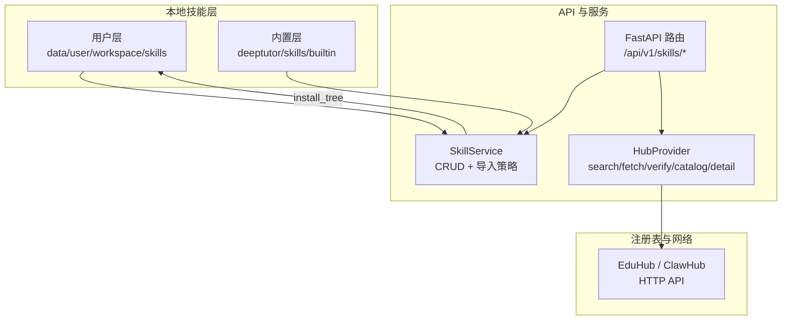
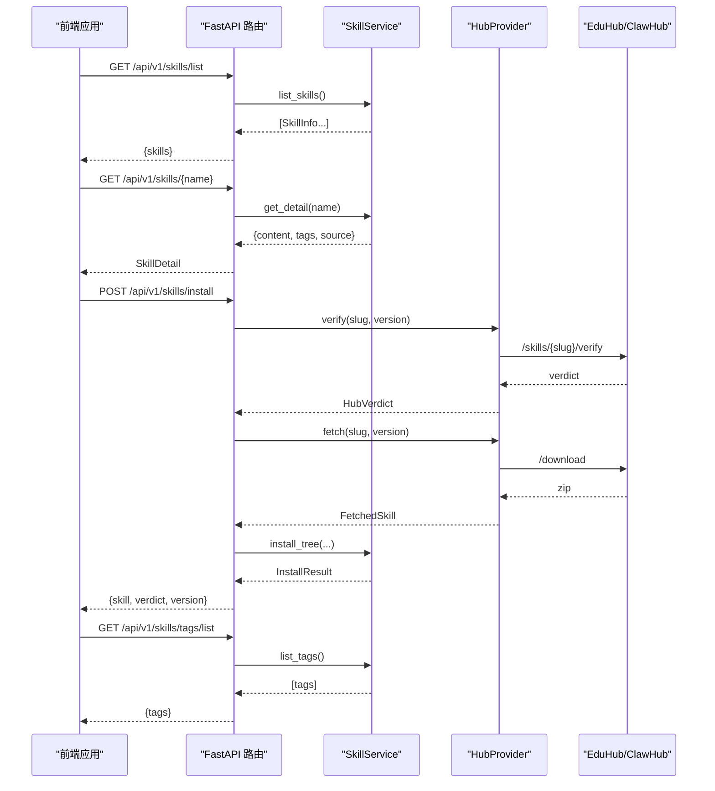
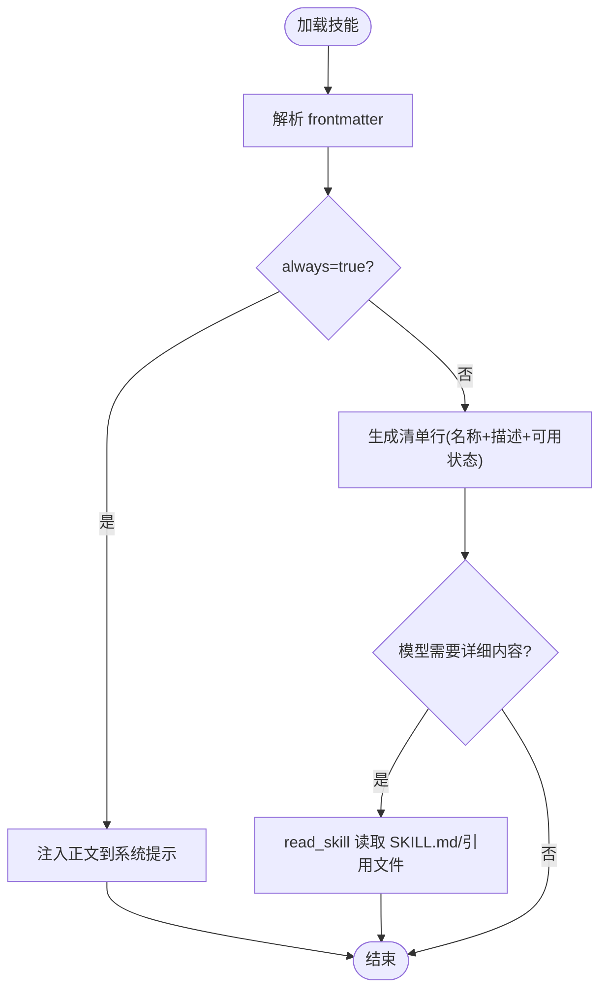
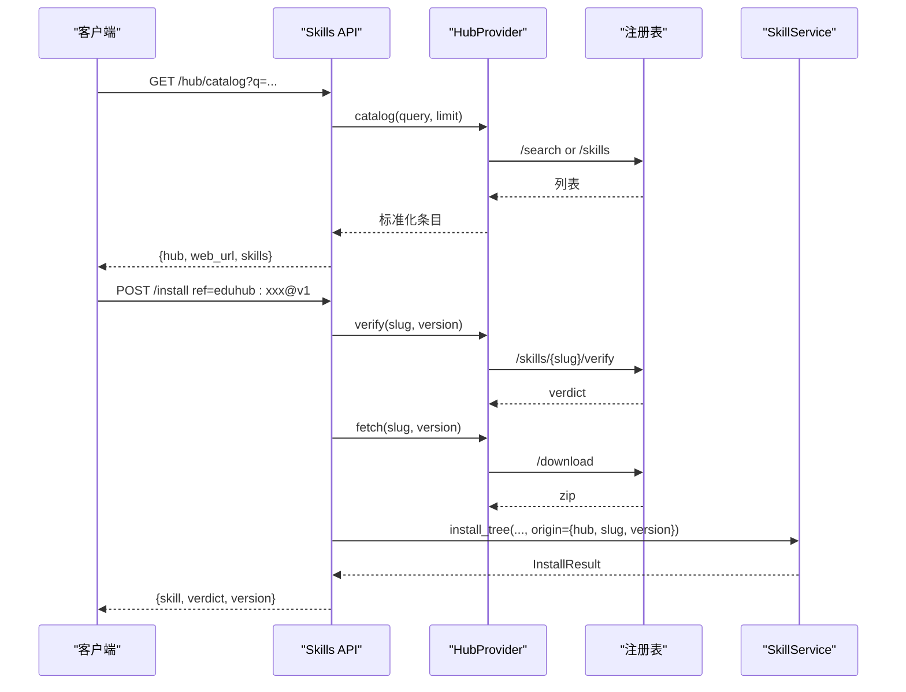
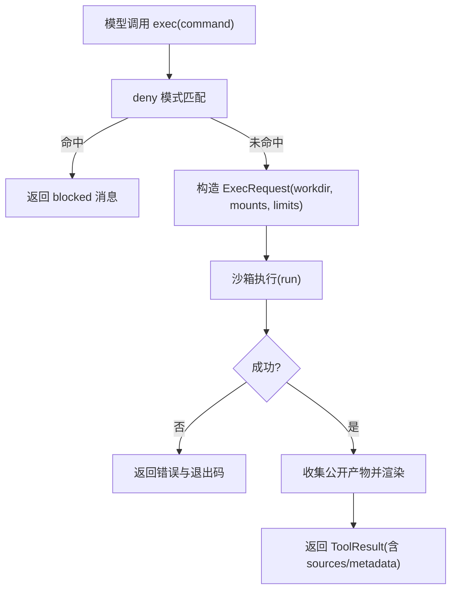
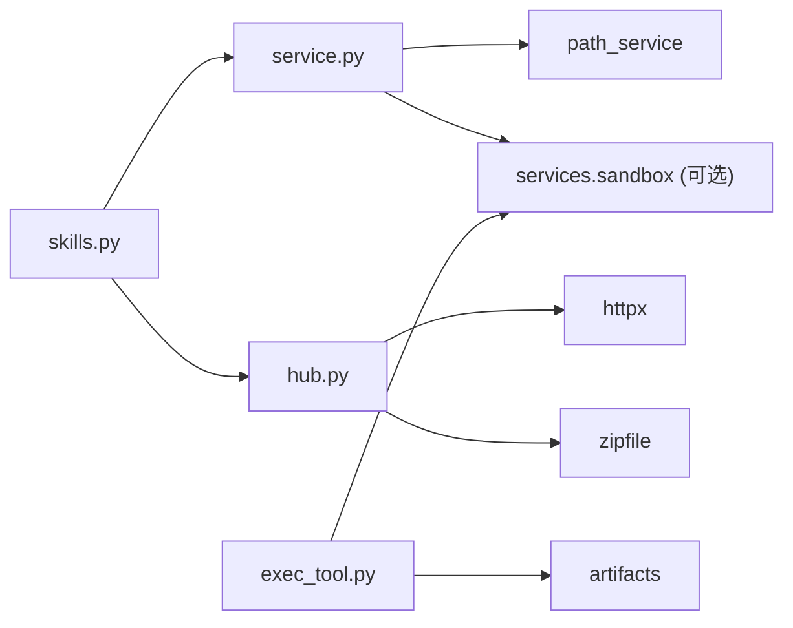

# 技能生态系统

<cite>
**本文引用的文件**
- [SKILL.md](file://SKILL.md)
- [skills.py](file://deeptutor/api/routers/skills.py)
- [service.py](file://deeptutor/services/skill/service.py)
- [hub.py](file://deeptutor/services/skill/hub.py)
- [taxonomy.py](file://deeptutor/services/skill/taxonomy.py)
- [exec_tool.py](file://deeptutor/tools/exec_tool.py)
- [skills-api.ts](file://web/lib/skills-api.ts)
</cite>

## 目录
1. [简介](#简介)
2. [项目结构](#项目结构)
3. [核心组件](#核心组件)
4. [架构总览](#架构总览)
5. [详细组件分析](#详细组件分析)
6. [依赖关系分析](#依赖关系分析)
7. [性能考量](#性能考量)
8. [故障排查指南](#故障排查指南)
9. [结论](#结论)
10. [附录](#附录)

## 简介
本文件为 DeepTutor 的“技能生态系统”提供系统化文档，围绕基于 Agent-Skills 格式的 SKILL.md 剧本、技能发现与版本管理、EduHub/ClawHub 社区注册表的使用、教育导向的技能分类体系、执行环境与资源隔离，以及面向教学场景的定制化能力展开。内容既覆盖后端服务实现，也涵盖前端 API 调用与 CLI 使用方式，帮助开发者快速理解并扩展技能系统。

## 项目结构
DeepTutor 的技能系统由三层组成：
- 用户层（user）：位于工作区 skills 目录，支持创建、更新、删除与标签管理。
- 内置层（builtin）：随产品分发，只读，用于提供通用能力。
- 外部注册表（hub）：通过 EduHub/ClawHub 等来源安装、搜索、浏览与发布。

图表来源
- [skills.py:124-167](file://deeptutor/api/routers/skills.py#L124-L167)
- [service.py:215-431](file://deeptutor/services/skill/service.py#L215-L431)
- [hub.py:238-449](file://deeptutor/services/skill/hub.py#L238-L449)

章节来源
- [skills.py:124-167](file://deeptutor/api/routers/skills.py#L124-L167)
- [service.py:215-431](file://deeptutor/services/skill/service.py#L215-L431)
- [hub.py:238-449](file://deeptutor/services/skill/hub.py#L238-L449)

## 核心组件
- SKILL.md 剧本与元数据：每个技能是一个目录，包含 SKILL.md（YAML frontmatter + Markdown 正文），可选 references/ 与 scripts/。frontmatter 支持 name、description、tags、requires（bins/env/sandbox）、always 等字段。
- SkillService：负责本地技能的 CRUD、清单渲染、always 注入、读取安全限制、导入策略（大小/后缀/数量限制、符号链接拒绝、原子替换）。
- HubProvider：封装对注册表的搜索、详情、下载、安全校验（verdict）、目录浏览与发布；默认内置 eduhub 与 clawhub。
- Skills API：暴露 /list、/create、/update、/delete、/install、/tags/*、/hub/catalog、/hub/detail 等端点，统一权限与错误处理。
- 执行工具：exec 工具在沙箱中运行命令，结合 deny 模式与资源限制，保障脚本执行安全。
- 分类体系：taxonomy.py 定义 track/language/stage/form/audience/domains 等维度，保证与 Web 上传表单一致。

章节来源
- [service.py:27-47](file://deeptutor/services/skill/service.py#L27-L47)
- [service.py:105-163](file://deeptutor/services/skill/service.py#L105-L163)
- [service.py:627-708](file://deeptutor/services/skill/service.py#L627-L708)
- [hub.py:65-94](file://deeptutor/services/skill/hub.py#L65-L94)
- [skills.py:37-72](file://deeptutor/api/routers/skills.py#L37-L72)
- [exec_tool.py:49-153](file://deeptutor/tools/exec_tool.py#L49-L153)
- [taxonomy.py:49-255](file://deeptutor/services/skill/taxonomy.py#L49-L255)

## 架构总览
下图展示从前端到后端再到注册表的完整调用链，包括技能列表、详情、安装与标签管理。

图表来源
- [skills.py:124-167](file://deeptutor/api/routers/skills.py#L124-L167)
- [skills.py:169-187](file://deeptutor/api/routers/skills.py#L169-L187)
- [skills.py:233-267](file://deeptutor/api/routers/skills.py#L233-L267)
- [hub.py:288-354](file://deeptutor/services/skill/hub.py#L288-L354)
- [service.py:627-708](file://deeptutor/services/skill/service.py#L627-L708)

## 详细组件分析

### SKILL.md 剧本结构与元数据
- 位置与组织：每个技能一个目录，根目录必须包含 SKILL.md；可选 references/ 存放参考材料，scripts/ 存放可被 exec 工具调用的脚本。
- Frontmatter 字段：
  - name：技能标识（小写字母数字与连字符）。
  - description：简要说明，用于清单显示。
  - tags：用户可见的组织标签，独立词汇表管理。
  - requires：可用性门控，支持 bins（CLI 二进制）、env（环境变量）、sandbox（执行沙箱类型）。
  - always：是否将正文急切注入系统提示（仅用于全局规则类技能）。
- 运行时行为：
  - 默认不注入全文，仅在清单中展示一行摘要，模型按需通过 read_skill 工具获取内容。
  - always: true 的技能会在上下文构建时提前注入正文。
  - read_skill 有最大字符限制，防止大文件污染上下文窗口。

图表来源
- [service.py:488-539](file://deeptutor/services/skill/service.py#L488-L539)
- [service.py:448-472](file://deeptutor/services/skill/service.py#L448-L472)

章节来源
- [service.py:27-47](file://deeptutor/services/skill/service.py#L27-L47)
- [service.py:346-390](file://deeptutor/services/skill/service.py#L346-L390)
- [service.py:488-539](file://deeptutor/services/skill/service.py#L488-L539)
- [service.py:448-472](file://deeptutor/services/skill/service.py#L448-L472)

### 技能发现机制（本地加载、社区同步、版本管理）
- 本地加载：
  - 扫描 user 层与 builtin 层，合并去重，按名称排序输出清单。
  - 支持 always 注入与可用性检查（bins/env/sandbox）。
- 社区注册表同步：
  - 通过 hub catalog/detail 接口浏览与检索，支持查询过滤与分页。
  - 安装流程：verify → fetch → install_tree，记录来源与版本信息。
- 版本管理：
  - 引用格式 <hub>:<slug>[@version]，未指定版本时取 latest。
  - 安装结果返回 verdict（ok/suspicious/unknown）与版本号，便于 UI 提示与回滚。

图表来源
- [skills.py:143-167](file://deeptutor/api/routers/skills.py#L143-L167)
- [skills.py:169-187](file://deeptutor/api/routers/skills.py#L169-L187)
- [skills.py:233-267](file://deeptutor/api/routers/skills.py#L233-L267)
- [hub.py:288-354](file://deeptutor/services/skill/hub.py#L288-L354)
- [service.py:627-708](file://deeptutor/services/skill/service.py#L627-L708)

章节来源
- [service.py:408-431](file://deeptutor/services/skill/service.py#L408-L431)
- [hub.py:65-94](file://deeptutor/services/skill/hub.py#L65-L94)
- [hub.py:288-354](file://deeptutor/services/skill/hub.py#L288-L354)
- [skills.py:233-267](file://deeptutor/api/routers/skills.py#L233-L267)

### EduHub 社区注册表使用（搜索、安装、更新、卸载）
- 搜索：/hub/catalog 支持 query 与 limit，返回 web_url 以便“在 EduHub 查看”。
- 安装：/install 接收 ref（默认 eduhub），进行安全校验与下载，写入用户层。
- 更新：重复安装同名技能需 force；origin 记录来源与版本，便于后续升级路径。
- 卸载：/delete 移除用户层技能，同时清理 .hub-lock.json 中的来源记录。

章节来源
- [skills.py:143-187](file://deeptutor/api/routers/skills.py#L143-L187)
- [skills.py:233-267](file://deeptutor/api/routers/skills.py#L233-L267)
- [skills.py:294-306](file://deeptutor/api/routers/skills.py#L294-L306)
- [hub.py:673-719](file://deeptutor/services/skill/hub.py#L673-L719)

### 技能分类体系（教育导向标准与标签）
- 必填维度：track（学业辅导/成长陪伴/兴趣与技能/教育者工具）。
- 可选维度：language（中文/英文/日文/其他）、stage（学前至成人）、form（讲解答疑/练习陪练/批改反馈/测评诊断/规划方法/人格陪伴/实用工具/资料内容）、audience（学习者/教师/家长）。
- 领域树：两层级 domains（如 arts.instruments），更细粒度使用自由 tags。
- 作用：确保发布与 Web 表单一致，便于检索与推荐。

章节来源
- [taxonomy.py:49-255](file://deeptutor/services/skill/taxonomy.py#L49-L255)

### 技能执行环境（上下文注入、工具调用限制、资源隔离）
- 上下文注入：
  - always: true 的技能正文在构建上下文时注入；其余通过清单 + read_skill 按需加载。
  - read_skill 限制最大读取字符数，避免上下文溢出。
- 工具调用限制：
  - exec 工具通过 deny 模式阻止危险命令（如 rm -rf、格式化磁盘、关机、修改用户等）。
  - 超时与输出长度受 ResourceLimits 控制，防止资源滥用。
- 资源隔离：
  - 命令在沙箱中执行，挂载当前工作目录为读写，禁止访问系统关键路径。
  - 产物收集与公开 artifact 渲染，便于结果可视化。

图表来源
- [exec_tool.py:30-43](file://deeptutor/tools/exec_tool.py#L30-L43)
- [exec_tool.py:80-153](file://deeptutor/tools/exec_tool.py#L80-L153)

章节来源
- [exec_tool.py:30-43](file://deeptutor/tools/exec_tool.py#L30-L43)
- [exec_tool.py:80-153](file://deeptutor/tools/exec_tool.py#L80-L153)
- [service.py:448-472](file://deeptutor/services/skill/service.py#L448-L472)

### 开发教育导向技能示例（脚本编写、测试、发布）
- 编写：
  - 创建目录与 SKILL.md，填写 frontmatter（name/description/tags/requires/always）。
  - 如需脚本，放在 scripts/ 并通过 exec 工具调用；引用材料放 references/。
- 测试：
  - 使用 /list 与 /{name} 验证清单与详情；必要时用 read_skill 读取引用文件。
  - 通过 exec 工具在沙箱内运行脚本，观察输出与产物。
- 发布：
  - 使用 hub catalog/detail 预览；通过 /install 安装到本地；发布到注册表需 token 与 zip 包。
  - 发布前可进行预检（文件大小、数量、危险扩展名），减少服务端拒绝概率。

章节来源
- [service.py:551-617](file://deeptutor/services/skill/service.py#L551-L617)
- [skills.py:214-231](file://deeptutor/api/routers/skills.py#L214-L231)
- [skills.py:233-267](file://deeptutor/api/routers/skills.py#L233-L267)
- [hub.py:776-800](file://deeptutor/services/skill/hub.py#L776-L800)

## 依赖关系分析
- API 路由依赖 SkillService 与 HubProvider，负责权限校验、参数绑定与错误映射。
- SkillService 依赖路径服务与可选沙箱服务，完成本地文件操作与可用性检查。
- HubProvider 依赖 httpx 与 zipfile，封装网络请求与安全解压。
- exec 工具依赖沙箱服务与产物收集模块，实现命令执行与结果渲染。

图表来源
- [skills.py:124-167](file://deeptutor/api/routers/skills.py#L124-L167)
- [service.py:215-224](file://deeptutor/services/skill/service.py#L215-L224)
- [hub.py:238-255](file://deeptutor/services/skill/hub.py#L238-L255)
- [exec_tool.py:93-118](file://deeptutor/tools/exec_tool.py#L93-L118)

章节来源
- [skills.py:124-167](file://deeptutor/api/routers/skills.py#L124-L167)
- [service.py:215-224](file://deeptutor/services/skill/service.py#L215-L224)
- [hub.py:238-255](file://deeptutor/services/skill/hub.py#L238-L255)
- [exec_tool.py:93-118](file://deeptutor/tools/exec_tool.py#L93-L118)

## 性能考量
- 清单渲染与 always 注入：
  - 仅对 always: true 的技能注入正文，减少系统提示体积。
  - summary_entries 会评估 requires，避免不可用技能占用空间。
- 读取限制：
  - read_skill 限制最大字符数，防止大文件影响上下文。
- 导入策略：
  - 文件后缀白名单、单文件大小与总数上限、压缩包条目与解压比限制，避免恶意或过大包拖慢系统。
- 网络 I/O：
  - hub catalog/detail 使用异步线程池执行，避免阻塞事件循环。

[本节为通用指导，无需具体文件来源]

## 故障排查指南
- 技能不存在或名称非法：
  - 检查名称是否符合正则；确认 user/builtin 层是否存在 SKILL.md。
- 安装失败（suspicious/unknown）：
  - 查看 verdict 详情；必要时使用 allow_unverified 并谨慎评估风险。
- 导入被跳过文件：
  - 检查后缀是否在允许列表；确认文件大小与总数限制。
- 执行命令被阻断：
  - 检查命令是否命中 deny 模式；调整命令以避免危险关键字。
- 标签错误：
  - 标签需符合命名规范；注意去重与大小写归一化。

章节来源
- [skills.py:190-211](file://deeptutor/api/routers/skills.py#L190-L211)
- [skills.py:233-267](file://deeptutor/api/routers/skills.py#L233-L267)
- [service.py:627-708](file://deeptutor/services/skill/service.py#L627-L708)
- [exec_tool.py:80-92](file://deeptutor/tools/exec_tool.py#L80-L92)

## 结论
DeepTutor 的技能生态系统以 SKILL.md 为核心，通过分层存储、严格的安全导入策略与注册表集成，实现了可扩展、可治理的教育能力装配。配合分类体系与执行沙箱，既能满足学科知识、教学策略与学习评估的多样化需求，又能保障系统稳定与安全。建议开发者遵循 frontmatter 规范与标签体系，充分利用 hub 生态与沙箱能力，构建高质量的教育导向技能。

[本节为总结性内容，无需具体文件来源]

## 附录
- 前端 API 封装：
  - 提供 list/get/create/update/delete、hub catalog/detail、install、tags 管理等函数，支持缓存失效与错误处理。
- CLI 使用：
  - 通过 deeptutor skill search/install/list/remove 等命令管理技能；支持 hub 前缀与版本选择。

章节来源
- [skills-api.ts:68-153](file://web/lib/skills-api.ts#L68-L153)
- [skills-api.ts:155-222](file://web/lib/skills-api.ts#L155-L222)
- [SKILL.md:86-96](file://SKILL.md#L86-L96)