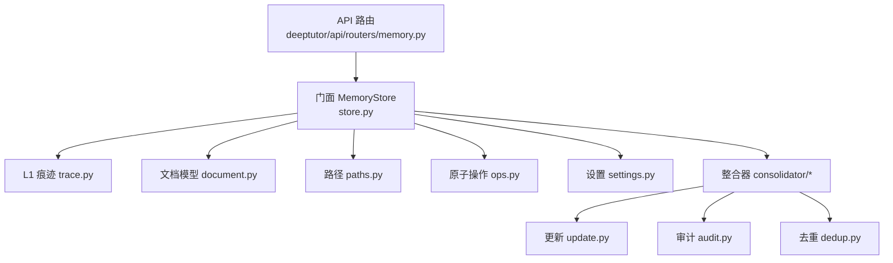
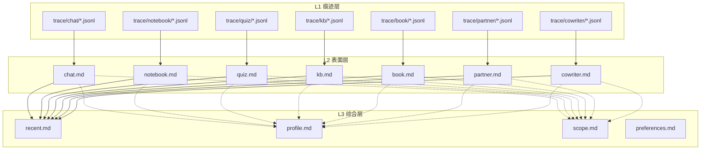
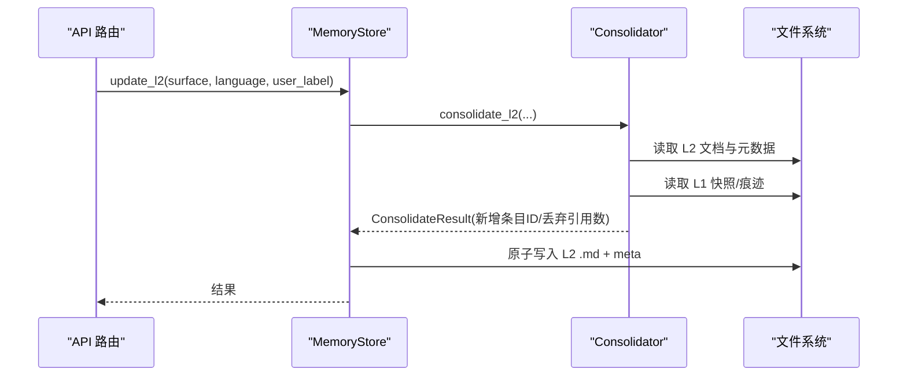
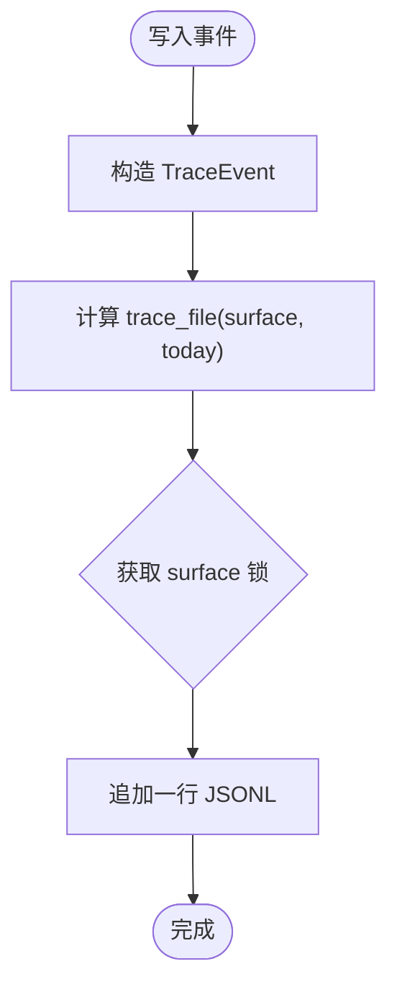
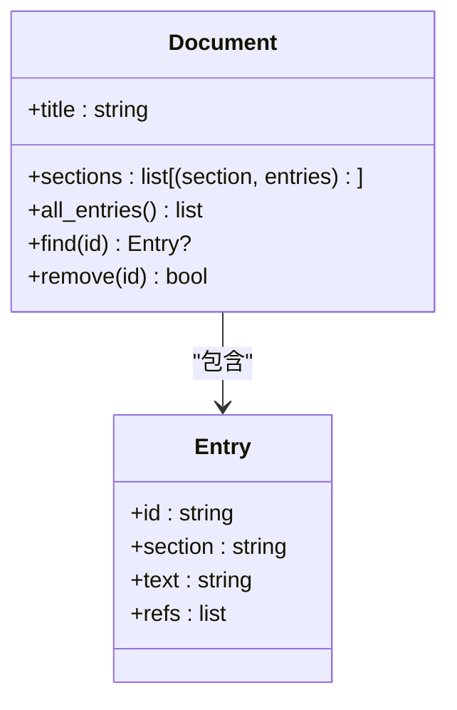
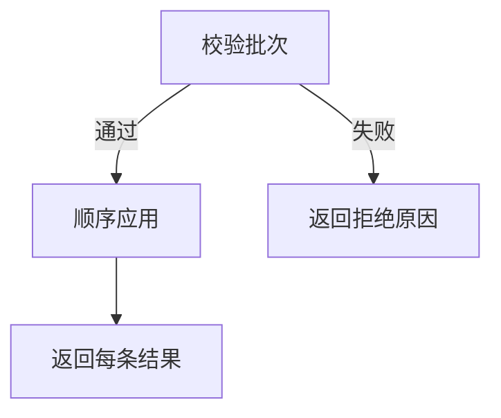
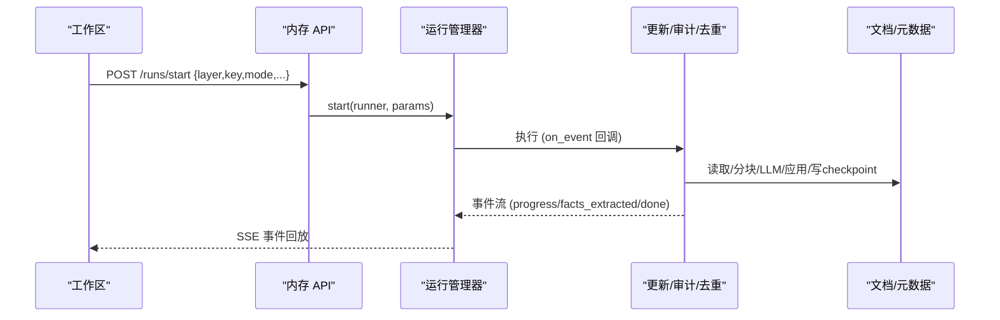
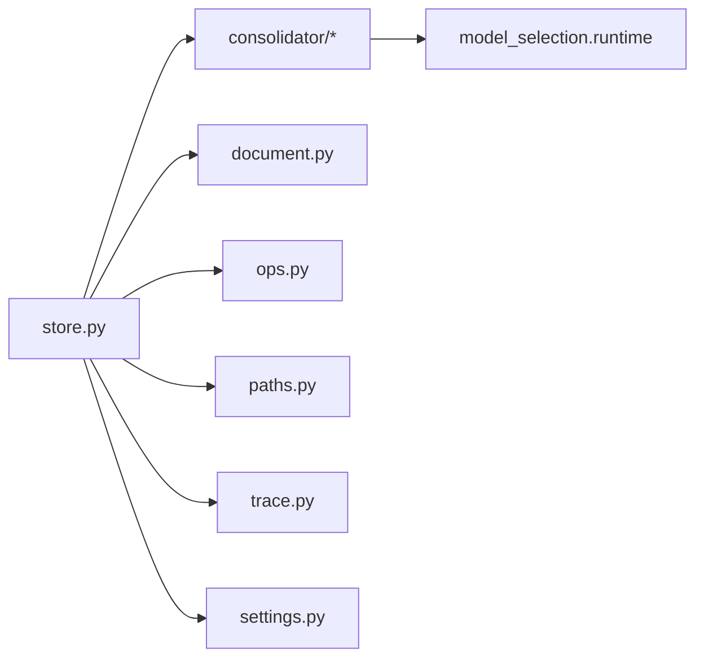

# 可检查的记忆系统

<cite>
**本文引用的文件**
- [deeptutor/services/memory/__init__.py](file://deeptutor/services/memory/__init__.py)
- [deeptutor/services/memory/store.py](file://deeptutor/services/memory/store.py)
- [deeptutor/services/memory/trace.py](file://deeptutor/services/memory/trace.py)
- [deeptutor/services/memory/document.py](file://deeptutor/services/memory/document.py)
- [deeptutor/services/memory/paths.py](file://deeptutor/services/memory/paths.py)
- [deeptutor/services/memory/ops.py](file://deeptutor/services/memory/ops.py)
- [deeptutor/services/memory/settings.py](file://deeptutor/services/memory/settings.py)
- [deeptutor/services/memory/consolidator/__init__.py](file://deeptutor/services/memory/consolidator/__init__.py)
- [deeptutor/services/memory/consolidator/modes/update.py](file://deeptutor/services/memory/consolidator/modes/update.py)
- [deeptutor/services/memory/consolidator/modes/audit.py](file://deeptutor/services/memory/consolidator/modes/audit.py)
- [deeptutor/services/memory/consolidator/modes/dedup.py](file://deeptutor/services/memory/consolidator/modes/dedup.py)
- [deeptutor/api/routers/memory.py](file://deeptutor/api/routers/memory.py)
</cite>

## 目录
1. [简介](#简介)
2. [项目结构](#项目结构)
3. [核心组件](#核心组件)
4. [架构总览](#架构总览)
5. [详细组件分析](#详细组件分析)
6. [依赖关系分析](#依赖关系分析)
7. [性能与预算](#性能与预算)
8. [故障排查指南](#故障排查指南)
9. [结论](#结论)
10. [附录：使用示例](#附录使用示例)

## 简介
本文件为 DeepTutor 的“可检查记忆系统”提供全面文档。该系统采用三层记忆架构：
- L1 痕迹层：按表面（surface）和 UTC 日期追加写入原始事件，不可变、可审计。
- L2 表面层：每个工作区表面一份策展事实文档，引用 L1 原始事件。
- L3 综合层：跨表面的合成摘要（近期、用户画像、知识范围、偏好），引用 L2 文档。

通过“更新/审计/去重/合并”四种模式，系统实现自动整合、冲突解决与存储优化；通过严格的引用链（L3→L2→L1）确保任何个人档案内容都可追溯、可审计。前端工作区提供可视化与编辑能力，用户完全可控地管理个性化体验。

## 项目结构
记忆子系统位于 services/memory，对外暴露统一门面 MemoryStore；API 路由在 api/routers/memory.py；路径解析、文档模型、操作原子化、设置项等模块职责清晰分离。

图表来源
- [deeptutor/api/routers/memory.py:1-786](file://deeptutor/api/routers/memory.py#L1-L786)
- [deeptutor/services/memory/store.py:1-460](file://deeptutor/services/memory/store.py#L1-L460)
- [deeptutor/services/memory/trace.py:1-154](file://deeptutor/services/memory/trace.py#L1-L154)
- [deeptutor/services/memory/document.py:1-236](file://deeptutor/services/memory/document.py#L1-L236)
- [deeptutor/services/memory/paths.py:1-104](file://deeptutor/services/memory/paths.py#L1-L104)
- [deeptutor/services/memory/ops.py:1-150](file://deeptutor/services/memory/ops.py#L1-L150)
- [deeptutor/services/memory/settings.py:1-199](file://deeptutor/services/memory/settings.py#L1-L199)
- [deeptutor/services/memory/consolidator/__init__.py:1-63](file://deeptutor/services/memory/consolidator/__init__.py#L1-L63)
- [deeptutor/services/memory/consolidator/modes/update.py:1-707](file://deeptutor/services/memory/consolidator/modes/update.py#L1-L707)
- [deeptutor/services/memory/consolidator/modes/audit.py:1-485](file://deeptutor/services/memory/consolidator/modes/audit.py#L1-L485)
- [deeptutor/services/memory/consolidator/modes/dedup.py:1-229](file://deeptutor/services/memory/consolidator/modes/dedup.py#L1-L229)

章节来源
- [deeptutor/services/memory/__init__.py:1-43](file://deeptutor/services/memory/__init__.py#L1-L43)
- [deeptutor/services/memory/paths.py:1-104](file://deeptutor/services/memory/paths.py#L1-L104)
- [deeptutor/api/routers/memory.py:1-786](file://deeptutor/api/routers/memory.py#L1-L786)

## 核心组件
- 门面 MemoryStore：统一读写 L2/L3，封装并发锁、原子写入、概览统计、迁移工具。
- L1 痕迹 trace：每表面每日 JSONL 追加写入，线程安全、失败吞错、可迭代查询。
- 文档模型 Document：Markdown + 脚注引用格式，支持新旧两种布局互转，保留条目 ID。
- 原子操作 ops：Add/Edit/Delete 批处理校验与应用，保证一致性。
- 路径 paths：per-user 根目录、L1/L2/L3 文件定位、目录初始化。
- 设置 settings：用户可调参数（预算、去重迭代、分块策略、引用校验等）。
- 整合器 consolidator：LLM 驱动的增量更新、审计、去重、合并流水线。

章节来源
- [deeptutor/services/memory/store.py:1-460](file://deeptutor/services/memory/store.py#L1-L460)
- [deeptutor/services/memory/trace.py:1-154](file://deeptutor/services/memory/trace.py#L1-L154)
- [deeptutor/services/memory/document.py:1-236](file://deeptutor/services/memory/document.py#L1-L236)
- [deeptutor/services/memory/ops.py:1-150](file://deeptutor/services/memory/ops.py#L1-L150)
- [deeptutor/services/memory/paths.py:1-104](file://deeptutor/services/memory/paths.py#L1-L104)
- [deeptutor/services/memory/settings.py:1-199](file://deeptutor/services/memory/settings.py#L1-L199)
- [deeptutor/services/memory/consolidator/__init__.py:1-63](file://deeptutor/services/memory/consolidator/__init__.py#L1-L63)

## 架构总览
三层记忆与可视化金字塔：
- 中心：L3 综合层（recent/profile/scope/preferences）
- 中间环：L2 表面层（chat/notebook/quiz/kb/book/partner/cowriter）
- 外部：L1 痕迹层（按 surface 与日期的追加事件）

图表来源
- [deeptutor/services/memory/paths.py:1-104](file://deeptutor/services/memory/paths.py#L1-L104)
- [deeptutor/services/memory/trace.py:1-154](file://deeptutor/services/memory/trace.py#L1-L154)
- [deeptutor/services/memory/document.py:1-236](file://deeptutor/services/memory/document.py#L1-L236)

## 详细组件分析

### 门面 MemoryStore：统一入口与生命周期管理
- 读取：read_doc/read_raw/read_l3_concat
- 写入：overwrite_doc/delete_entry/write_preference
- 整合：update_l2/update_l3 调用 consolidator 并落盘
- 概览：overview 返回各文档状态与 L1 backlog
- 迁移：migrate_v1_if_needed、migrate_partner_surface_if_needed
- 并发：按文件路径分配 asyncio.Lock，原子写入 tmp+replace

图表来源
- [deeptutor/services/memory/store.py:125-163](file://deeptutor/services/memory/store.py#L125-L163)
- [deeptutor/services/memory/consolidator/modes/update.py:140-357](file://deeptutor/services/memory/consolidator/modes/update.py#L140-L357)
- [deeptutor/services/memory/consolidator/modes/_runtime.py](file://deeptutor/services/memory/consolidator/modes/_runtime.py)

章节来源
- [deeptutor/services/memory/store.py:1-460](file://deeptutor/services/memory/store.py#L1-L460)

### L1 痕迹层：追加事件与可审计性
- TraceEvent：id/ts/surface/kind/payload/session_id/turn_id
- append：按 surface+date 追加 JSONL，失败日志化不抛错
- iter_since/count_since/latest_ts：时间过滤与计数
- 并发：每 surface 一个 asyncio.Lock

图表来源
- [deeptutor/services/memory/trace.py:35-87](file://deeptutor/services/memory/trace.py#L35-L87)

章节来源
- [deeptutor/services/memory/trace.py:1-154](file://deeptutor/services/memory/trace.py#L1-L154)

### 文档模型与引用链：L3→L2→L1
- Document/Entry：标题、分区、条目、引用
- parse/serialize：兼容新旧布局，保留 m_xxx 条目 ID，重建脚注编号
- 引用链：L3 条目引用 L2 文档（以 surface 名或 L2 条目级联），L2 条目引用 L1 事件（surface:id）

图表来源
- [deeptutor/services/memory/document.py:64-103](file://deeptutor/services/memory/document.py#L64-L103)
- [deeptutor/services/memory/document.py:105-236](file://deeptutor/services/memory/document.py#L105-L236)

章节来源
- [deeptutor/services/memory/document.py:1-236](file://deeptutor/services/memory/document.py#L1-L236)

### 原子操作：增删改与冲突检测
- AddOp/EditOp/DeleteOp：字段校验（长度、分区、引用合法性、目标存在性）
- apply：批量校验通过后原子应用，冲突（同 id 同时 edit/delete）拒绝整批

图表来源
- [deeptutor/services/memory/ops.py:23-150](file://deeptutor/services/memory/ops.py#L23-L150)

章节来源
- [deeptutor/services/memory/ops.py:1-150](file://deeptutor/services/memory/ops.py#L1-L150)

### 设置与预算：更新/审计/去重/合并/分块/引用
- UpdateSettings：L2/L3 预算（条数）
- AuditSettings：L2/L3 预算
- DedupSettings：迭代次数、是否自动触发
- MergeSettings：是否在更新/审计/去重后自动合并
- ChunkingSettings：重叠率、边界、最小/最大字符数
- ReferenceSettings：是否强制要求引用、是否丢弃无效引用

章节来源
- [deeptutor/services/memory/settings.py:1-199](file://deeptutor/services/memory/settings.py#L1-L199)

### 整合器：更新/审计/去重/合并
- 更新 run_update：增量抽取新事实，按预算分块，逐块 LLM 提取→校验引用→追加到文档→写 checkpoint→可选自动去重/合并
- 审计 run_audit：行号视图+证据标注，LLM 建议 edit/delete，反向行序应用，写 checkpoint→可选自动合并
- 去重 run_dedup：全量行号视图，迭代执行 replace/delete，零编辑收敛即停→可选自动合并
- 合并 run_merge：无 LLM 的脚注合并（重复引用折叠）

图表来源
- [deeptutor/api/routers/memory.py:240-350](file://deeptutor/api/routers/memory.py#L240-L350)
- [deeptutor/services/memory/consolidator/modes/update.py:80-135](file://deeptutor/services/memory/consolidator/modes/update.py#L80-L135)
- [deeptutor/services/memory/consolidator/modes/audit.py:75-124](file://deeptutor/services/memory/consolidator/modes/audit.py#L75-L124)
- [deeptutor/services/memory/consolidator/modes/dedup.py:52-84](file://deeptutor/services/memory/consolidator/modes/dedup.py#L52-L84)

章节来源
- [deeptutor/services/memory/consolidator/__init__.py:1-63](file://deeptutor/services/memory/consolidator/__init__.py#L1-L63)
- [deeptutor/services/memory/consolidator/modes/update.py:1-707](file://deeptutor/services/memory/consolidator/modes/update.py#L1-L707)
- [deeptutor/services/memory/consolidator/modes/audit.py:1-485](file://deeptutor/services/memory/consolidator/modes/audit.py#L1-L485)
- [deeptutor/services/memory/consolidator/modes/dedup.py:1-229](file://deeptutor/services/memory/consolidator/modes/dedup.py#L1-L229)

### API 与工作区集成
- 概览/读/写/删除：/overview, /doc/{layer}/{key}, /apply, /entry/{id}
- 运行控制：/runs/start, /runs/{id}, /runs/{id}/events, /cancel, /undo
- 设置：/settings GET/PUT
- 痕迹浏览：/trace/{surface}, 按日删除
- 快照：/snapshot/{surface} 及其刷新/变更列表

章节来源
- [deeptutor/api/routers/memory.py:1-786](file://deeptutor/api/routers/memory.py#L1-L786)

## 依赖关系分析
- 低耦合：store 仅依赖 consolidator、document、ops、paths、trace、settings
- 路径隔离：paths 通过 PathService 上下文变量切换 per-user 根目录，支持伙伴运行时覆盖
- 事件驱动：consolidator 通过 on_event 回调向 API 推送进度，便于前端实时反馈
- 外部依赖：model_selection 用于临时激活 LLM 配置，避免全局污染

图表来源
- [deeptutor/services/memory/store.py:1-460](file://deeptutor/services/memory/store.py#L1-L460)
- [deeptutor/services/memory/consolidator/modes/update.py:96-135](file://deeptutor/services/memory/consolidator/modes/update.py#L96-L135)

章节来源
- [deeptutor/services/memory/store.py:1-460](file://deeptutor/services/memory/store.py#L1-L460)
- [deeptutor/services/memory/consolidator/modes/update.py:80-135](file://deeptutor/services/memory/consolidator/modes/update.py#L80-L135)

## 性能与预算
- 预算控制：Update/Audit 分别对 L2/L3 设置预算，限制每次处理的 chunk 数量
- 分块策略：overlap_ratio、boundary（段落/句子）、min/max_chunk_chars 控制切分粒度
- 去重收敛：dedup 迭代上限，若一轮无编辑则提前停止，节省 token
- 自动合并：可在更新/审计/去重后自动折叠重复引用，减少冗余
- 原子写入：tmp 文件 + replace，避免部分写入导致损坏
- 并发安全：按文件/表面加锁，防止并发写入交错

[本节为通用指导，无需特定文件来源]

## 故障排查指南
- 痕迹写入失败：append 捕获异常并记录日志，不影响上层流程；检查磁盘空间与权限
- 未知表面/L3 槽位：API 会返回 404；确认 key 属于 SURFACES/L3_SLOTS
- preferences 保护：preferences.md 不由自动整合写入，需通过 write_memory 工具或手动编辑
- 重置文档：需先取消活跃运行；否则返回 409
- 设置非法值：会被钳制到安全范围，不会崩溃；检查 memory.* 配置树
- 运行冲突：同一 doc 上并发运行会拒绝；先 cancel 再重试

章节来源
- [deeptutor/api/routers/memory.py:62-78](file://deeptutor/api/routers/memory.py#L62-L78)
- [deeptutor/api/routers/memory.py:169-219](file://deeptutor/api/routers/memory.py#L169-L219)
- [deeptutor/api/routers/memory.py:308-350](file://deeptutor/api/routers/memory.py#L308-L350)
- [deeptutor/services/memory/settings.py:113-184](file://deeptutor/services/memory/settings.py#L113-L184)
- [deeptutor/services/memory/trace.py:66-87](file://deeptutor/services/memory/trace.py#L66-L87)

## 结论
DeepTutor 的可检查记忆系统通过三层架构与严格引用链实现了高透明度的个性化记忆管理。L1 提供不可变的原始证据，L2 维护表面级事实，L3 进行跨表面合成。结合更新/审计/去重/合并流水线与用户可调预算，系统在准确性、可解释性与性能之间取得平衡。工作区可视化与编辑能力让用户完全掌控自己的记忆演化过程。

[本节为总结性内容，无需特定文件来源]

## 附录：使用示例
以下示例展示如何在工作区查看、编辑与管理不同层的记忆内容（以 API 调用为例）：

- 查看概览与 L1 积压
  - GET /overview → 返回所有文档状态与 backlog
  - GET /trace/{surface}?limit=200&offset=0 → 分页查看 L1 事件

- 读取与编辑 L2/L3 文档
  - GET /doc/{layer}/{key} → 获取 Markdown 原文
  - PUT /doc/{layer}/{key} → 保存用户编辑
  - DELETE /doc/{layer}/{key}/entry/{id} → 删除指定条目

- 启动整合任务并观察事件
  - POST /runs/start → {layer, key, mode="update"/"audit"/"dedup", budget, iterations, llm_selection}
  - GET /runs/{run_id}/events?since=N → SSE 回放进度与结果

- 应用预览后的操作
  - POST /doc/{layer}/{key}/apply → 提交一组 ops（如 add/edit/delete）

- 清理与恢复
  - DELETE /trace/{surface}/day/{YYYY-MM-DD} → 删除某日痕迹
  - POST /runs/{run_id}/undo → 撤销最近一次写入

- 快照与变更
  - GET /snapshot/{surface} → 当前实体列表与 pending_changes
  - POST /snapshot/{surface}/refresh → 刷新并记录差异
  - GET /snapshot/{surface}/changes → 分页查看变更历史

章节来源
- [deeptutor/api/routers/memory.py:84-92](file://deeptutor/api/routers/memory.py#L84-L92)
- [deeptutor/api/routers/memory.py:140-166](file://deeptutor/api/routers/memory.py#L140-L166)
- [deeptutor/api/routers/memory.py:308-453](file://deeptutor/api/routers/memory.py#L308-L453)
- [deeptutor/api/routers/memory.py:649-674](file://deeptutor/api/routers/memory.py#L649-L674)
- [deeptutor/api/routers/memory.py:680-722](file://deeptutor/api/routers/memory.py#L680-L722)
- [deeptutor/api/routers/memory.py:728-785](file://deeptutor/api/routers/memory.py#L728-L785)