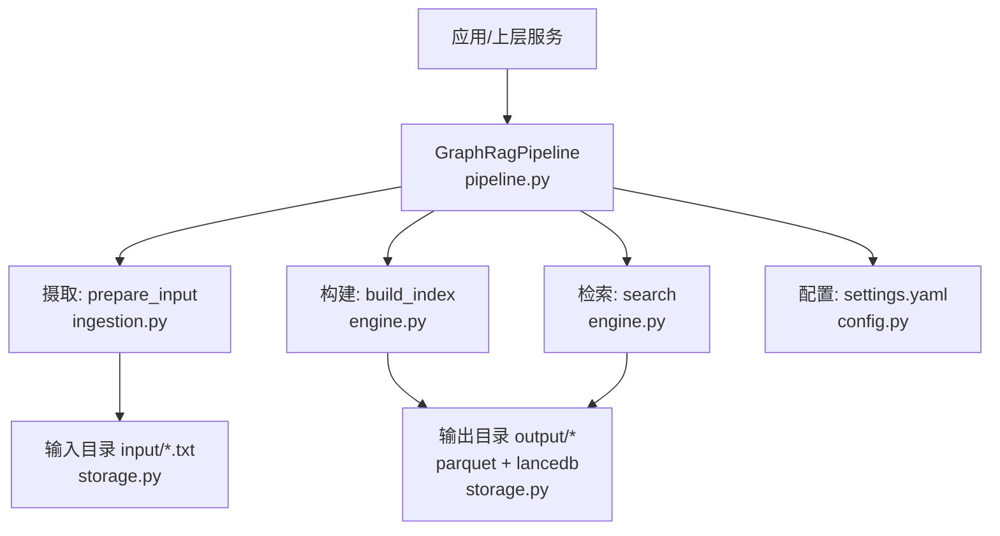
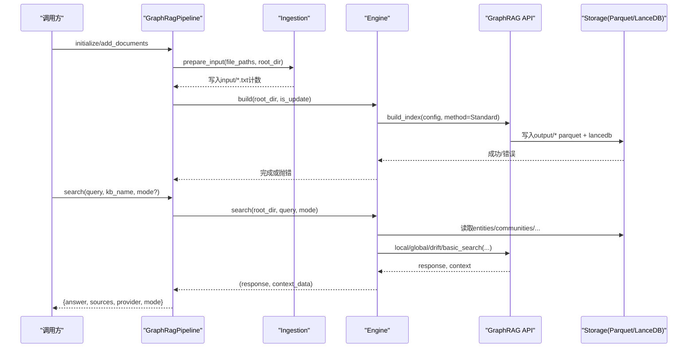
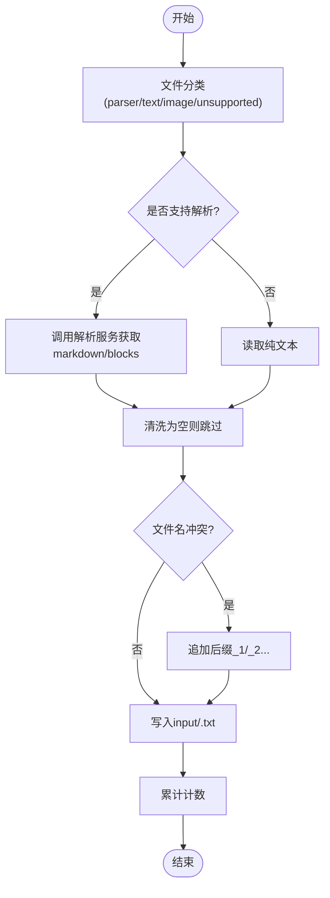
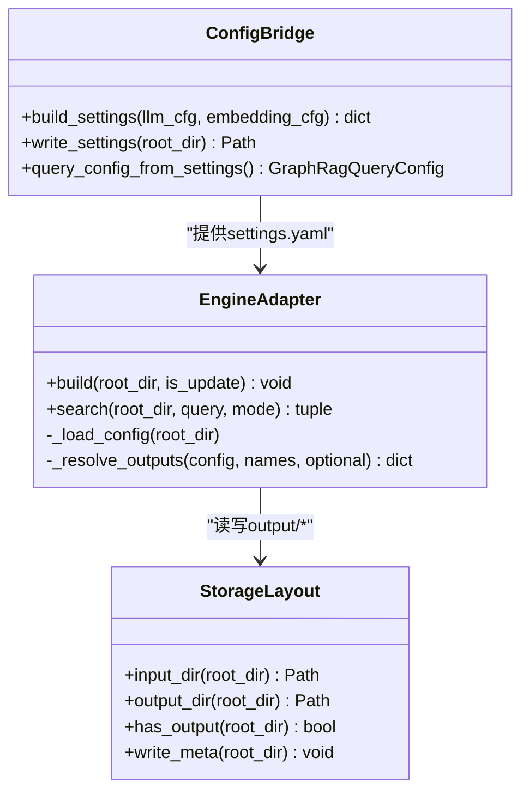
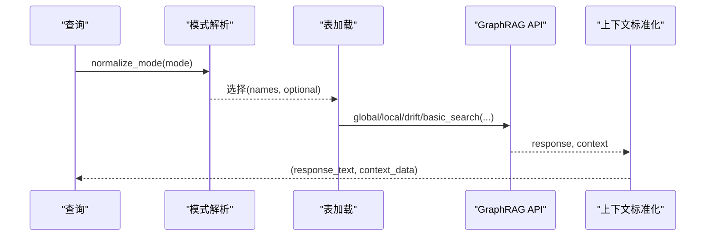
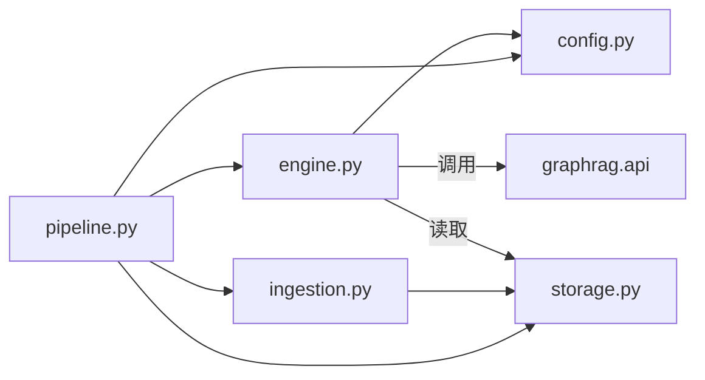

# GraphRAG管道

<cite>
**本文引用的文件**
- [pipeline.py](file://deeptutor/services/rag/pipelines/graphrag/pipeline.py)
- [engine.py](file://deeptutor/services/rag/pipelines/graphrag/engine.py)
- [config.py](file://deeptutor/services/rag/pipelines/graphrag/config.py)
- [ingestion.py](file://deeptutor/services/rag/pipelines/graphrag/ingestion.py)
- [storage.py](file://deeptutor/services/rag/pipelines/graphrag/storage.py)
- [knowledge.py](file://deeptutor/api/routers/knowledge.py)
- [test_graphrag_pipeline.py](file://tests/services/rag/test_graphrag_pipeline.py)
</cite>

## 目录
1. [简介](#简介)
2. [项目结构](#项目结构)
3. [核心组件](#核心组件)
4. [架构总览](#架构总览)
5. [详细组件分析](#详细组件分析)
6. [依赖关系分析](#依赖关系分析)
7. [性能考量](#性能考量)
8. [故障排查指南](#故障排查指南)
9. [结论](#结论)
10. [附录](#附录)

## 简介
本文件面向DeepTutor中的GraphRAG管道，系统性说明从原始文档到结构化知识图谱的构建流程、检索与查询执行机制、存储层设计以及配置与调优方法。GraphRAG在DeepTutor中作为可选能力提供：当未安装graphrag时，相关功能会被优雅降级并给出明确提示；当已安装并正确配置后，系统会基于本地microsoft/graphrag（3.x）完成索引与检索。

## 项目结构
GraphRAG管道位于services/rag/pipelines/graphrag下，围绕“摄取—构建—检索”的主线组织：
- ingestion.py：将各类文档解析为纯文本，写入input/*.txt供GraphRAG消费
- config.py：将DeepTutor的LLM与Embedding配置桥接为GraphRAG settings.yaml，并管理查询参数
- engine.py：封装对graphrag.api的调用，负责索引构建与多模式检索
- pipeline.py：对外暴露initialize/add_documents/search等生命周期接口，编排摄取与构建
- storage.py：定义版本化KB的磁盘布局与就绪标记

图表来源
- [pipeline.py:73-133](file://deeptutor/services/rag/pipelines/graphrag/pipeline.py#L73-L133)
- [engine.py:84-195](file://deeptutor/services/rag/pipelines/graphrag/engine.py#L84-L195)
- [config.py:116-205](file://deeptutor/services/rag/pipelines/graphrag/config.py#L116-L205)
- [storage.py:47-62](file://deeptutor/services/rag/pipelines/graphrag/storage.py#L47-L62)

章节来源
- [pipeline.py:1-227](file://deeptutor/services/rag/pipelines/graphrag/pipeline.py#L1-L227)
- [engine.py:1-199](file://deeptutor/services/rag/pipelines/graphrag/engine.py#L1-L199)
- [config.py:1-223](file://deeptutor/services/rag/pipelines/graphrag/config.py#L1-L223)
- [ingestion.py:1-113](file://deeptutor/services/rag/pipelines/graphrag/ingestion.py#L1-L113)
- [storage.py:1-99](file://deeptutor/services/rag/pipelines/graphrag/storage.py#L1-L99)

## 核心组件
- GraphRagPipeline：统一入口，负责初始化知识库、增量添加文档、搜索与删除。内部通过配置检查、摄取、构建与检索编排完整流程，并对错误进行归一化处理。
- Engine：对graphrag.api的薄封装，隔离事件循环、加载配置、按模式选择输出表并调用global/local/drift/basic检索。
- Config：生成settings.yaml，注入completion_models与embedding_models、输入输出路径、缓存与向量库配置；提供查询参数读取与模式规范化。
- Ingestion：复用DeepTutor解析服务，将PDF/Markdown/文本等多格式转为纯文本，去重写入input目录。
- Storage：维护KB版本目录结构、检测输出是否就绪、写入meta.json以兼容上层UI。

章节来源
- [pipeline.py:36-193](file://deeptutor/services/rag/pipelines/graphrag/pipeline.py#L36-L193)
- [engine.py:48-195](file://deeptutor/services/rag/pipelines/graphrag/engine.py#L48-L195)
- [config.py:78-205](file://deeptutor/services/rag/pipelines/graphrag/config.py#L78-L205)
- [ingestion.py:27-113](file://deeptutor/services/rag/pipelines/graphrag/ingestion.py#L27-L113)
- [storage.py:30-85](file://deeptutor/services/rag/pipelines/graphrag/storage.py#L30-L85)

## 架构总览
GraphRAG管道采用“配置驱动+外部引擎”的解耦设计：
- 配置层：将DeepTurtor运行时模型与嵌入配置转换为GraphRAG可识别的settings.yaml，确保LiteLLM后端、向量维度、输入输出路径一致。
- 摄取层：仅处理“文档→文本”，不引入额外解析器，保持与现有解析管线一致。
- 构建层：调用graphrag.api.build_index，产出entities/communities/community_reports/text_units/relationships等Parquet表及lancedb向量索引。
- 检索层：根据模式加载对应表，调用graphrag.api的检索函数，并将上下文数据标准化为引用来源。

图表来源
- [pipeline.py:73-173](file://deeptutor/services/rag/pipelines/graphrag/pipeline.py#L73-L173)
- [engine.py:84-195](file://deeptutor/services/rag/pipelines/graphrag/engine.py#L84-L195)
- [storage.py:55-62](file://deeptutor/services/rag/pipelines/graphrag/storage.py#L55-L62)

## 详细组件分析

### 摄取管道：从原始文档到结构化文本
- 文件分类：使用FileTypeRouter将输入文件分为parser_files、text_files、image_files、unsupported。
- 解析策略：parser_files走DeepTutor解析服务，提取markdown或blocks拼接为文本；text_files直接读取；图片与不支持类型被跳过并记录日志。
- 写入策略：目标目录为root_dir/input，文件名去重避免冲突；空内容文档被跳过。
- 返回统计：返回成功写入的非空文档数量，便于上层判断是否需要继续构建。

图表来源
- [ingestion.py:27-113](file://deeptutor/services/rag/pipelines/graphrag/ingestion.py#L27-L113)

章节来源
- [ingestion.py:1-113](file://deeptutor/services/rag/pipelines/graphrag/ingestion.py#L1-L113)

### 构建过程：实体识别、关系抽取与图结构生成
- 配置生成：config.py将DeepTutor的LLM与Embedding配置写入settings.yaml，包含completion_models、embedding_models、input/output、cache、vector_store等。
- 索引构建：engine.py调用graphrag.api.build_index，使用Standard方法，传入is_update标志以支持增量更新。
- 错误处理：若任一工作流失败，聚合前3个错误信息抛出异常，由上层清理未完成版本目录。
- 图结构产物：output目录下生成entities、communities、community_reports、text_units、relationships等Parquet表，以及lancedb向量存储。

图表来源
- [config.py:116-205](file://deeptutor/services/rag/pipelines/graphrag/config.py#L116-L205)
- [engine.py:48-125](file://deeptutor/services/rag/pipelines/graphrag/engine.py#L48-L125)
- [storage.py:47-85](file://deeptutor/services/rag/pipelines/graphrag/storage.py#L47-L85)

章节来源
- [config.py:1-223](file://deeptutor/services/rag/pipelines/graphrag/config.py#L1-L223)
- [engine.py:84-125](file://deeptutor/services/rag/pipelines/graphrag/engine.py#L84-L125)
- [storage.py:36-85](file://deeptutor/services/rag/pipelines/graphrag/storage.py#L36-L85)

### 检索执行：多跳查询与聚合
- 模式选择：默认local，支持global、drift、basic；可通过KB配置或调用参数覆盖。
- 输出表加载：根据模式选择需要加载的Parquet表（entities、communities、community_reports、text_units、relationships、covariates）。
- 检索调用：分别调用graphrag.api.global_search/local_search/drift_search/basic_search，传入社区粒度、响应类型、动态社区选择等参数。
- 上下文标准化：使用reformat_context_data将context转为统一字典结构，再映射为DeepTutor的sources引用格式。

图表来源
- [engine.py:128-195](file://deeptutor/services/rag/pipelines/graphrag/engine.py#L128-L195)
- [pipeline.py:137-173](file://deeptutor/services/rag/pipelines/graphrag/pipeline.py#L137-L173)

章节来源
- [engine.py:128-195](file://deeptutor/services/rag/pipelines/graphrag/engine.py#L128-L195)
- [pipeline.py:137-173](file://deeptutor/services/rag/pipelines/graphrag/pipeline.py#L137-L173)

### 存储层设计：图数据库与查询优化
- 存储布局：每个KB版本目录包含settings.yaml、input、output、cache、logs；output下存放Parquet与lancedb向量库。
- 就绪判定：通过检测output下核心Parquet表是否存在来判断索引是否构建完成。
- 元数据标记：write_meta写入meta.json，携带provider、signature、created_at与嵌入签名，便于上层UI显示与兼容性校验。
- 向量库：使用lancedb，并在settings.yaml中设置vector_size以匹配当前Embedding维度，避免维度不匹配导致的检索失败。

章节来源
- [storage.py:1-99](file://deeptutor/services/rag/pipelines/graphrag/storage.py#L1-L99)
- [config.py:186-191](file://deeptutor/services/rag/pipelines/graphrag/config.py#L186-L191)

### 配置示例：图谱构建参数、实体类型与关系权重
- 模型与端点：通过config.py将LLM与Embedding模型名称、base_url、api_key写入settings.yaml，使用openai提供者与LiteLLM对接任意OpenAI兼容服务。
- 查询参数：GraphRagQueryConfig包含response_type、community_level、dynamic_community_selection，可从运行时设置加载。
- 检索模式：SUPPORTED_MODES包括local/global/drift/basic，DEFAULT_MODE为local；normalize_mode将非标准值回退到默认。
- 外部API：knowledge.py提供GET/PUT /rag-pipelines/graphrag/config用于读取与更新GraphRAG查询参数。

注意：GraphRAG的实体类型定义与关系权重属于graphrag自身配置范畴；DeepTutor当前通过settings.yaml注入模型与存储布局，其他细粒度图构建参数遵循graphrag默认行为。如需自定义实体/关系schema或权重，应在graphrag侧配置并通过settings.yaml生效。

章节来源
- [config.py:78-100](file://deeptutor/services/rag/pipelines/graphrag/config.py#L78-L100)
- [config.py:116-205](file://deeptutor/services/rag/pipelines/graphrag/config.py#L116-L205)
- [knowledge.py:1178-1207](file://deeptutor/api/routers/knowledge.py#L1178-L1207)

## 依赖关系分析
- 模块耦合：
  - pipeline.py依赖config、ingestion、engine、storage，承担编排职责
  - engine.py依赖config与graphrag.api，屏蔽版本差异与事件循环问题
  - config.py依赖DeepTutor配置与yaml，生成settings.yaml
  - ingestion.py依赖parsing与file_routing，专注文本转换
  - storage.py提供统一的目录与就绪检测
- 外部依赖：
  - graphrag（可选）：索引与检索核心
  - lancedb：向量存储
  - pyyaml：写入settings.yaml
- 潜在环依赖：无直接循环导入；所有graphrag相关导入均在函数内延迟加载，避免启动开销与事件循环冲突。

图表来源
- [pipeline.py:21-30](file://deeptutor/services/rag/pipelines/graphrag/pipeline.py#L21-L30)
- [engine.py:20-21](file://deeptutor/services/rag/pipelines/graphrag/engine.py#L20-L21)
- [ingestion.py:20-22](file://deeptutor/services/rag/pipelines/graphrag/ingestion.py#L20-L22)

章节来源
- [pipeline.py:1-227](file://deeptutor/services/rag/pipelines/graphrag/pipeline.py#L1-L227)
- [engine.py:1-199](file://deeptutor/services/rag/pipelines/graphrag/engine.py#L1-L199)
- [ingestion.py:1-113](file://deeptutor/services/rag/pipelines/graphrag/ingestion.py#L1-L113)

## 性能考量
- 事件循环隔离：engine._run_isolated在独立线程与默认asyncio事件中运行graphrag，避免uvloop与nest_asyncio冲突，提升稳定性。
- 按需加载：graphrag相关导入延迟至调用时，减少启动成本与内存占用。
- 增量构建：add_documents支持is_update=true，避免全量重建，提高大规模数据下的吞吐。
- 向量维度匹配：settings.yaml中vector_size需与实际Embedding维度一致，防止检索失败与无效计算。
- 模式选择：local模式通常更经济且适合实体中心查询；global模式适合全局综述；drift与basic适用于特定场景。
- 输入预处理：尽量保证input/*.txt质量高、长度适中，有助于后续图构建与检索效率。

[本节为通用指导，不直接分析具体文件]

## 故障排查指南
- 未安装graphrag：
  - 现象：initialize/search抛出GraphRagNotAvailableError或返回error_type="not_configured"
  - 处理：安装可选依赖deeptutor[graphrag]
- 缺少模型配置：
  - 现象：build_settings抛出GraphRagNotConfiguredError，提示未配置聊天模型或嵌入模型/维度
  - 处理：在设置中配置有效的LLM与Embedding模型及base_url、api_key
- 无索引可查：
  - 现象：search返回needs_reindex=True，answer提示尚未建立索引
  - 处理：先执行initialize或add_documents构建索引
- 事件循环冲突：
  - 现象：首次导入graphrag时报错或索引无法启动
  - 处理：确认通过engine._run_isolated调用，避免在主事件循环中直接import
- 向量维度不匹配：
  - 现象：检索静默失败或结果异常
  - 处理：确保settings.yaml中vector_size与实际Embedding维度一致

章节来源
- [pipeline.py:45-50](file://deeptutor/services/rag/pipelines/graphrag/pipeline.py#L45-L50)
- [pipeline.py:137-173](file://deeptutor/services/rag/pipelines/graphrag/pipeline.py#L137-L173)
- [engine.py:54-81](file://deeptutor/services/rag/pipelines/graphrag/engine.py#L54-L81)
- [config.py:135-149](file://deeptutor/services/rag/pipelines/graphrag/config.py#L135-L149)
- [test_graphrag_pipeline.py:129-149](file://tests/services/rag/test_graphrag_pipeline.py#L129-L149)

## 结论
DeepTutor的GraphRAG管道以配置驱动和外部引擎为核心，实现了从文档摄取、图构建到检索的完整链路。通过settings.yaml桥接模型与存储、通过Parquet与lancedb持久化图结构、通过多模式检索满足不同查询需求。该实现具备良好的可扩展性与容错性，适合在大规模知识管理中稳定运行。

[本节为总结性内容，不直接分析具体文件]

## 附录
- 关键API与路径
  - 初始化与添加文档：pipeline.initialize / add_documents
  - 检索：pipeline.search
  - 配置读取/更新：knowledge.py GET/PUT /rag-pipelines/graphrag/config
- 测试参考
  - 配置桥接与事件循环隔离：test_graphrag_pipeline.py
  - 摄取与存储行为：test_graphrag_pipeline.py

章节来源
- [knowledge.py:1178-1207](file://deeptutor/api/routers/knowledge.py#L1178-L1207)
- [test_graphrag_pipeline.py:78-191](file://tests/services/rag/test_graphrag_pipeline.py#L78-L191)
- [test_graphrag_pipeline.py:219-295](file://tests/services/rag/test_graphrag_pipeline.py#L219-L295)
- [test_graphrag_pipeline.py:332-466](file://tests/services/rag/test_graphrag_pipeline.py#L332-L466)