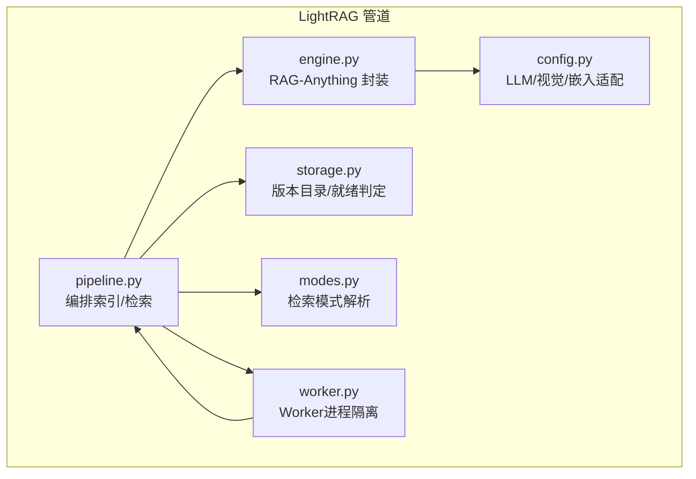
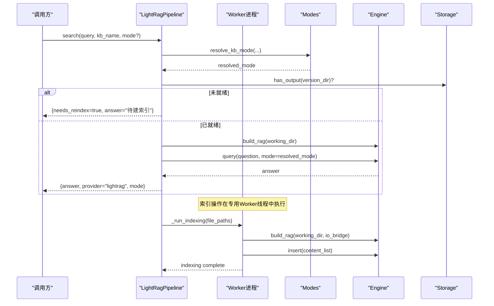
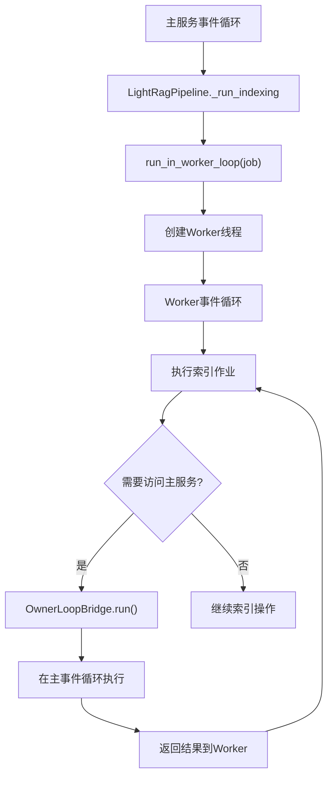
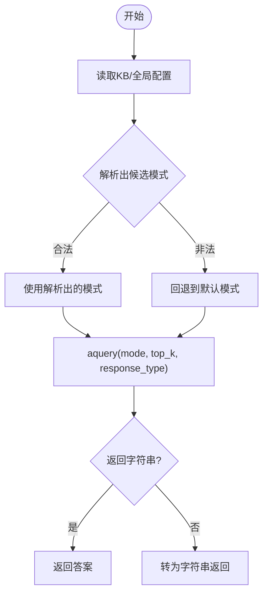
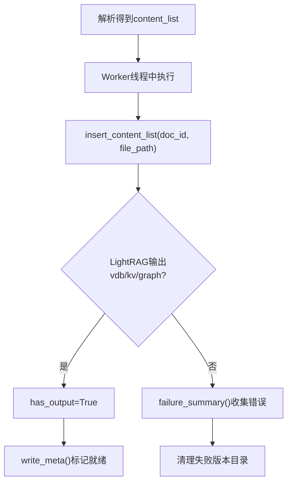
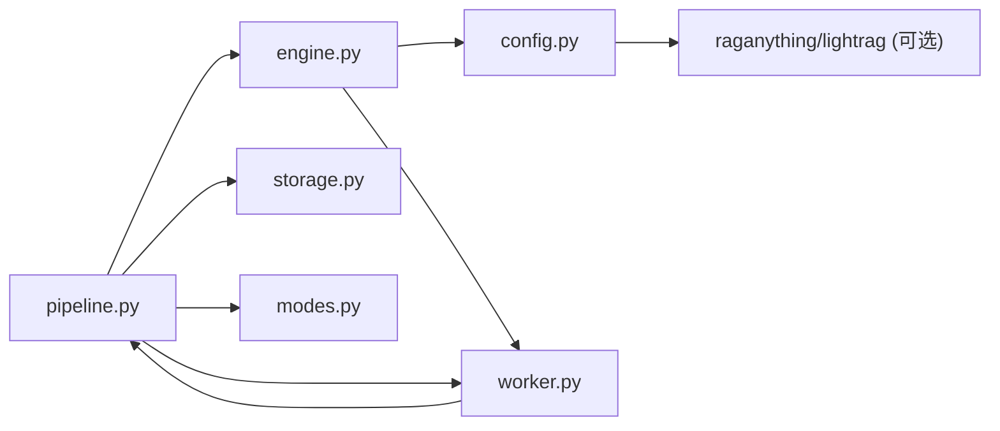

# LightRAG管道

<cite>
**本文引用的文件**
- [pipeline.py](file://deeptutor/services/rag/pipelines/lightrag/pipeline.py)
- [engine.py](file://deeptutor/services/rag/pipelines/lightrag/engine.py)
- [config.py](file://deeptutor/services/rag/pipelines/lightrag/config.py)
- [storage.py](file://deeptutor/services/rag/pipelines/lightrag/storage.py)
- [worker.py](file://deeptutor/services/rag/pipelines/lightrag/worker.py)
- [modes.py](file://deeptutor/services/rag/pipelines/modes.py)
- [test_lightrag_pipeline.py](file://tests/services/rag/test_lightrag_pipeline.py)
</cite>

## 更新摘要
**变更内容**
- 新增Worker进程隔离机制，防止同步图合并阻塞API请求和LLM处理
- 更新索引流程架构，增加专用工作线程和事件循环
- 增强异步I/O桥接能力，确保网络调用在正确的事件循环中执行
- 完善错误处理和取消机制，支持优雅的资源清理

## 目录
1. [简介](#简介)
2. [项目结构](#项目结构)
3. [核心组件](#核心组件)
4. [架构总览](#架构总览)
5. [详细组件分析](#详细组件分析)
6. [依赖关系分析](#依赖关系分析)
7. [性能与基准](#性能与基准)
8. [故障排查指南](#故障排查指南)
9. [结论](#结论)
10. [附录：配置与迁移](#附录配置与迁移)

## 简介
LightRAG管道基于 RAG-Anything/LightRAG，提供以图为核心的检索增强生成能力。它通过"轻量级知识图谱 + 向量索引"的混合检索策略，结合关键词匹配与语义相似度，实现更稳健、可解释的知识问答。**最新改进**：引入Worker进程隔离机制，使用专用工作线程和事件循环处理本地索引操作，防止同步图合并阻塞API请求和LLM处理。该管道复用 DeepTutor 的统一解析层，将文档解析为多模态 content_list 后直接注入 LightRAG，避免重复解析；查询阶段支持多种模式（naive/local/global/hybrid/mix），默认采用 hybrid 以获得更好的召回与回答质量。存储层按 KB 版本目录组织，包含向量库、KV 存储与图数据，并通过元数据标记就绪状态。

## 项目结构
LightRAG 相关代码位于 services/rag/pipelines/lightrag 下，围绕五个职责清晰的模块组织：
- pipeline：编排索引与检索流程，对接统一解析层与版本化存储
- engine：对 RAG-Anything/LightRAG 的薄封装，仅在此处引入外部依赖
- config：桥接 LLM/视觉/嵌入模型，暴露可用性与模式工具函数
- storage：定义版本目录布局、就绪判定与元数据写入
- **worker**：**新增** Worker进程隔离和事件循环管理，防止同步操作阻塞主服务

**图表来源**
- [pipeline.py:36-153](file://deeptutor/services/rag/pipelines/lightrag/pipeline.py#L36-L153)
- [engine.py:29-60](file://deeptutor/services/rag/pipelines/lightrag/engine.py#L29-L60)
- [config.py:89-182](file://deeptutor/services/rag/pipelines/lightrag/config.py#L89-L182)
- [storage.py:44-177](file://deeptutor/services/rag/pipelines/lightrag/storage.py#L44-L177)
- [worker.py:24-137](file://deeptutor/services/rag/pipelines/lightrag/worker.py#L24-L137)
- [modes.py:19-49](file://deeptutor/services/rag/pipelines/modes.py#L19-L49)

**章节来源**
- [pipeline.py:1-302](file://deeptutor/services/rag/pipelines/lightrag/pipeline.py#L1-L302)
- [engine.py:1-109](file://deeptutor/services/rag/pipelines/lightrag/engine.py#L1-L109)
- [config.py:1-197](file://deeptutor/services/rag/pipelines/lightrag/config.py#L1-L197)
- [storage.py:1-177](file://deeptutor/services/rag/pipelines/lightrag/storage.py#L1-L177)
- [worker.py:1-138](file://deeptutor/services/rag/pipelines/lightrag/worker.py#L1-L138)
- [modes.py:1-49](file://deeptutor/services/rag/pipelines/modes.py#L1-L49)

## 核心组件
- LightRagPipeline：实现统一的 RAG 管道接口，负责初始化、增量添加文档、检索与删除；解析失败或无内容时进行清理与提示。
- Engine：构建 RAG-Anything 实例，执行插入与查询；在查询前确保 LightRAG 已初始化，并兼容旧版参数差异。
- Config：提供可用性检测、检索模式归一化、查询参数读取（top_k/response_type）以及 LLM/视觉/嵌入适配器。
- Storage：维护 version-N 目录布局，判断是否产出有效索引（向量/KV/图），记录文档错误摘要，并写入 meta.json 作为就绪标记。
- **Worker**：**新增** 提供Worker进程隔离，使用专用线程和事件循环运行索引操作，通过OwnerLoopBridge安全地访问主服务资源。
- Modes：解析检索模式的优先级（显式 > KB 配置 > 全局默认 > 引擎内置默认）。

**章节来源**
- [pipeline.py:43-302](file://deeptutor/services/rag/pipelines/lightrag/pipeline.py#L43-L302)
- [engine.py:34-109](file://deeptutor/services/rag/pipelines/lightrag/engine.py#L34-L109)
- [config.py:43-197](file://deeptutor/services/rag/pipelines/lightrag/config.py#L43-L197)
- [storage.py:44-177](file://deeptutor/services/rag/pipelines/lightrag/storage.py#L44-L177)
- [worker.py:24-137](file://deeptutor/services/rag/pipelines/lightrag/worker.py#L24-L137)
- [modes.py:19-49](file://deeptutor/services/rag/pipelines/modes.py#L19-L49)

## 架构总览
LightRAG 管道通过"解析层 → Worker隔离 → 注入 LightRAG → 混合检索 → 合成回答"的流程工作。**关键改进**：索引操作现在在专用Worker线程中执行，避免阻塞主服务的事件循环。检索模式由 modes 解析，查询参数来自配置；存储层保证版本隔离与就绪判定。

**图表来源**
- [pipeline.py:128-153](file://deeptutor/services/rag/pipelines/lightrag/pipeline.py#L128-L153)
- [pipeline.py:157-191](file://deeptutor/services/rag/pipelines/lightrag/pipeline.py#L157-L191)
- [worker.py:92-137](file://deeptutor/services/rag/pipelines/lightrag/worker.py#L92-L137)
- [engine.py:34-60](file://deeptutor/services/rag/pipelines/lightrag/engine.py#L34-L60)
- [storage.py:49-68](file://deeptutor/services/rag/pipelines/lightrag/storage.py#L49-L68)

## 详细组件分析

### Worker进程隔离机制
**新增功能**：为防止RAG-Anything的同步图合并操作阻塞主服务的事件循环，引入了专门的Worker进程隔离机制。

- **Worker线程**：每个索引操作在独立的线程中运行，拥有自己的事件循环
- **OwnerLoopBridge**：提供安全的方式从Worker线程访问主服务的异步资源
- **上下文传播**：保持请求级别的上下文变量在工作线程中可用
- **优雅取消**：支持请求取消时的协调停止，避免资源泄漏

**图表来源**
- [pipeline.py:128-153](file://deeptutor/services/rag/pipelines/lightrag/pipeline.py#L128-L153)
- [worker.py:92-137](file://deeptutor/services/rag/pipelines/lightrag/worker.py#L92-L137)
- [worker.py:24-89](file://deeptutor/services/rag/pipelines/lightrag/worker.py#L24-L89)

**章节来源**
- [worker.py:1-138](file://deeptutor/services/rag/pipelines/lightrag/worker.py#L1-L138)
- [pipeline.py:128-153](file://deeptutor/services/rag/pipelines/lightrag/pipeline.py#L128-L153)

### 混合检索策略与优化
- 检索模式：支持 naive/local/global/hybrid/mix，默认 hybrid（图+向量），兼顾精确与召回。
- 模式解析：优先使用显式 mode，其次 KB 配置中的 search_mode，再回退到全局 provider_modes，最后使用引擎默认。
- 查询参数：从 lightrag 设置中读取 top_k 与 response_type，透传到 aquery；若底层拒绝额外参数则降级为仅模式查询。
- 嵌入角色映射：根据 context 区分 query/document，避免将查询误标为 passage，提升相似度排序质量。

**图表来源**
- [modes.py:19-49](file://deeptutor/services/rag/pipelines/modes.py#L19-L49)
- [config.py:66-83](file://deeptutor/services/rag/pipelines/lightrag/config.py#L66-L83)
- [engine.py:86-105](file://deeptutor/services/rag/pipelines/lightrag/engine.py#L86-L105)

**章节来源**
- [modes.py:19-49](file://deeptutor/services/rag/pipelines/modes.py#L19-L49)
- [config.py:66-83](file://deeptutor/services/rag/pipelines/lightrag/config.py#L66-L83)
- [engine.py:86-105](file://deeptutor/services/rag/pipelines/lightrag/engine.py#L86-L105)

### 轻量级知识图谱的构建与维护
- 构建：通过解析层产出 content_list（含文本/多模态块），调用 insert_content_list 注入 LightRAG；LightRAG 内部会构建 chunk/entity/relation 图与向量索引。
- 就绪判定：当存在向量/KV 文件或文档状态显示成功时，认为索引已就绪；否则视为失败并清理临时版本目录。
- 维护：add_documents 支持增量更新；delete 直接删除 KB 目录；write_meta 写入 meta.json 以标记版本就绪。
- **Worker隔离**：所有索引操作现在在专用Worker线程中执行，避免阻塞主服务。

**图表来源**
- [pipeline.py:78-126](file://deeptutor/services/rag/pipelines/lightrag/pipeline.py#L78-L126)
- [pipeline.py:128-153](file://deeptutor/services/rag/pipelines/lightrag/pipeline.py#L128-L153)
- [storage.py:49-113](file://deeptutor/services/rag/pipelines/lightrag/storage.py#L49-L113)
- [storage.py:145-166](file://deeptutor/services/rag/pipelines/lightrag/storage.py#L145-L166)

**章节来源**
- [pipeline.py:78-126](file://deeptutor/services/rag/pipelines/lightrag/pipeline.py#L78-L126)
- [pipeline.py:128-153](file://deeptutor/services/rag/pipelines/lightrag/pipeline.py#L128-L153)
- [storage.py:49-113](file://deeptutor/services/rag/pipelines/lightrag/storage.py#L49-L113)
- [storage.py:145-166](file://deeptutor/services/rag/pipelines/lightrag/storage.py#L145-L166)

### 存储层实现（向量化索引与元数据存储）
- 目录布局：每个 KB 的 version-N 目录即为 LightRAG working_dir，包含 kv_store_*.json、vdb_*.json、graph_chunk_entity_relation.graphml 等。
- 就绪信号：优先检查 kv_store_doc_status.json 的成功/失败状态；若无，则扫描 vdb/kv 文件是否存在且非空。
- 元数据：write_meta 写入 meta.json，携带 provider、signature、layout、创建时间以及嵌入签名字段，便于外部链接与兼容性校验。

**章节来源**
- [storage.py:1-177](file://deeptutor/services/rag/pipelines/lightrag/storage.py#L1-L177)

### 与标准 LlamaIndex 管道的差异与优势场景
- 差异点
  - 检索范式：LightRAG 以图为核心，支持 local/global/hybrid/mix 等多模式；LlamaIndex 通常以向量为主，辅以关键词或重排。
  - 注入方式：LightRAG 接收预解析的 content_list，避免重复解析；LlamaIndex 通常自行加载/切分文档。
  - 存储形态：LightRAG 将 KV、向量与图同目录管理；LlamaIndex 依赖外部向量库与可选图存储。
  - **Worker隔离**：LightRAG 现在使用专用Worker线程处理索引，提供更好的并发性能。
- 优势场景
  - 需要强关系推理与跨实体关联的场景（如概念间关系、步骤链）。
  - 多模态内容（图文混排）需保持上下文一致性的知识库。
  - 希望以 hybrid 模式平衡召回与精度的通用问答。
  - **高并发场景**：Worker隔离确保大量索引操作不会阻塞API响应。

[本节为概念性对比，不直接分析具体文件]

## 依赖关系分析
- 可选依赖：LightRAG/RAG-Anything 为可选安装；不可用时提供明确错误提示与 UI 隐藏逻辑。
- 内部耦合：pipeline 依赖 engine、storage、modes、**worker**；engine 依赖 config、**worker**；config 仅在构造时引入外部库，降低启动开销。
- 外部集成：统一 LLM/视觉/嵌入客户端，嵌入维度与 token 上限由配置决定。

**图表来源**
- [pipeline.py:34-36](file://deeptutor/services/rag/pipelines/lightrag/pipeline.py#L34-L36)
- [engine.py:21-29](file://deeptutor/services/rag/pipelines/lightrag/engine.py#L21-L29)
- [config.py:47-54](file://deeptutor/services/rag/pipelines/lightrag/config.py#L47-L54)
- [worker.py:1-20](file://deeptutor/services/rag/pipelines/lightrag/worker.py#L1-L20)

**章节来源**
- [pipeline.py:34-36](file://deeptutor/services/rag/pipelines/lightrag/pipeline.py#L34-L36)
- [engine.py:21-29](file://deeptutor/services/rag/pipelines/lightrag/engine.py#L21-L29)
- [config.py:47-54](file://deeptutor/services/rag/pipelines/lightrag/config.py#L47-L54)
- [worker.py:1-20](file://deeptutor/services/rag/pipelines/lightrag/worker.py#L1-L20)

## 性能与基准
- 当前仓库未包含针对 LightRAG 的独立基准脚本或结果表。建议在实际环境中按以下维度评估：
  - 指标：准确率/召回率、F1、响应延迟、吞吐、内存占用。
  - 数据集：领域内问答集、长文档问答、多模态问答。
  - 变量：top_k、response_type、检索模式（hybrid vs mix）、嵌入维度与模型。
  - 方法：固定测试集，对比不同配置下的指标变化，记录回归情况。
- 优化建议：
  - 调整 top_k 与 response_type 以平衡速度与质量。
  - 选择合适的检索模式（hybrid 一般更稳健）。
  - 监控嵌入维度与模型一致性，避免维度不匹配导致静默失败。
  - **利用Worker隔离**：在高并发场景下，Worker隔离可以显著提升整体吞吐量，避免索引操作阻塞API响应。

[本节提供通用指导，不包含具体文件分析]

## 故障排查指南
- 未安装 LightRAG：search/initialize 会抛出"未安装"的错误类型，需在环境安装可选依赖。
- 无索引：search 返回 needs_reindex=true，需先执行 initialize/add_documents。
- 解析失败：parse 异常会被记录并跳过，最终可能因无有效文档而失败；检查日志与 content_list 是否为空。
- 文档处理失败：storage.failure_summary 可汇总最近失败原因；document_error 可定位单个 doc_id 的错误信息。
- 初始化检查：build_rag 会跳过 RAG-Anything 的默认解析器安装检查，避免无关依赖导致的硬失败。
- **Worker相关问题**：如果遇到Worker线程异常，检查OwnerLoopBridge的使用是否正确，确保网络调用通过bridge.run()执行。

**章节来源**
- [pipeline.py:52-57](file://deeptutor/services/rag/pipelines/lightrag/pipeline.py#L52-L57)
- [pipeline.py:157-191](file://deeptutor/services/rag/pipelines/lightrag/pipeline.py#L157-L191)
- [storage.py:92-129](file://deeptutor/services/rag/pipelines/lightrag/storage.py#L92-L129)
- [engine.py:34-60](file://deeptutor/services/rag/pipelines/lightrag/engine.py#L34-L60)
- [worker.py:38-49](file://deeptutor/services/rag/pipelines/lightrag/worker.py#L38-L49)

## 结论
LightRAG 管道通过图与向量的混合检索、版本化存储与健壮的错误处理，提供了稳定且可扩展的知识问答能力。**最新改进**：Worker进程隔离机制确保了索引操作不会阻塞主服务的事件循环，显著提升了系统的并发性能和响应性。其设计强调解耦与可插拔：解析、模型与存储均通过适配层接入，便于在不同部署环境下灵活配置与演进。对于需要关系推理与多模态一致性的场景，LightRAG 具有明显优势。

[本节为总结性内容，不包含具体文件分析]

## 附录：配置与迁移

### 检索参数与模式配置
- 检索模式
  - 支持：naive、local、global、hybrid、mix；默认 hybrid。
  - 解析顺序：显式 mode > KB 配置中的 search_mode > 全局 provider_modes[provider] > 引擎默认。
- 查询参数
  - top_k：控制返回片段数量，默认值来自 lightrag 设置。
  - response_type：控制回答格式，默认 Multiple Paragraphs。
- 嵌入配置
  - 必须配置有效的嵌入模型并声明维度；否则构建 embedding_func 时会报错。
  - 嵌入函数会根据 context 区分 query/document，避免角色误标。

**章节来源**
- [modes.py:19-49](file://deeptutor/services/rag/pipelines/modes.py#L19-L49)
- [config.py:66-83](file://deeptutor/services/rag/pipelines/lightrag/config.py#L66-L83)
- [config.py:136-168](file://deeptutor/services/rag/pipelines/lightrag/config.py#L136-L168)

### 与 LlamaIndex 的差异与切换要点
- 差异要点
  - 注入数据：LightRAG 使用预解析 content_list；LlamaIndex 通常自行加载/切分。
  - 检索模式：LightRAG 提供多种图/向量组合模式；LlamaIndex 多以向量为主。
  - 存储形态：LightRAG 将 KV/向量/图置于同一版本目录；LlamaIndex 依赖外部存储。
  - **Worker隔离**：LightRAG 现在使用专用Worker线程处理索引，提供更好的并发性能。
- 切换建议
  - 保留现有解析产物（content_list），直接替换检索后端。
  - 将检索模式从向量优先调整为 hybrid/mix，观察效果变化。
  - 关注嵌入维度与模型一致性，必要时重建索引。

[本节为概念性指导，不包含具体文件分析]

### 迁移指南（从其他 RAG 引擎到 LightRAG）
- 前置条件
  - 安装可选依赖以启用 LightRAG。
  - 确保已配置 LLM/视觉/嵌入客户端，且嵌入维度已知。
- 步骤
  - 使用统一解析层将文档解析为 content_list。
  - 调用 initialize/add_documents 将 content_list 注入 LightRAG。
  - 通过 search 指定检索模式与参数（top_k/response_type）。
  - 如需回退，可在搜索失败时自动降级为仅模式查询。
- 验证
  - 检查 storage.has_output 确认索引就绪。
  - 使用 failure_summary/document_error 排查文档级错误。
  - **Worker验证**：确认索引操作在专用Worker线程中执行，不影响主服务响应。

**章节来源**
- [pipeline.py:157-239](file://deeptutor/services/rag/pipelines/lightrag/pipeline.py#L157-L239)
- [engine.py:86-105](file://deeptutor/services/rag/pipelines/lightrag/engine.py#L86-L105)
- [storage.py:49-113](file://deeptutor/services/rag/pipelines/lightrag/storage.py#L49-L113)
- [worker.py:92-137](file://deeptutor/services/rag/pipelines/lightrag/worker.py#L92-L137)

### 行为验证（测试用例参考）
- 模式归一化：空/无效输入回退到 hybrid。
- 嵌入函数：返回 numpy 数组，context 映射正确。
- LLM/视觉适配：保留 messages，丢弃 LightRAG 内部参数。
- 初始化检查：跳过不必要的解析器安装检查。
- 生命周期：无内容返回 false；失败清理版本目录；search 在未就绪时返回 needs_reindex。
- **Worker隔离验证**：确认索引操作在独立线程中执行，主服务事件循环保持响应。

**章节来源**
- [test_lightrag_pipeline.py:56-70](file://tests/services/rag/test_lightrag_pipeline.py#L56-L70)
- [test_lightrag_pipeline.py:179-229](file://tests/services/rag/test_lightrag_pipeline.py#L179-L229)
- [test_lightrag_pipeline.py:232-297](file://tests/services/rag/test_lightrag_pipeline.py#L232-L297)
- [test_lightrag_pipeline.py:299-373](file://tests/services/rag/test_lightrag_pipeline.py#L299-L373)
- [test_lightrag_pipeline.py:436-587](file://tests/services/rag/test_lightrag_pipeline.py#L436-L587)
- [test_lightrag_pipeline.py:455-571](file://tests/services/rag/test_lightrag_pipeline.py#L455-L571)