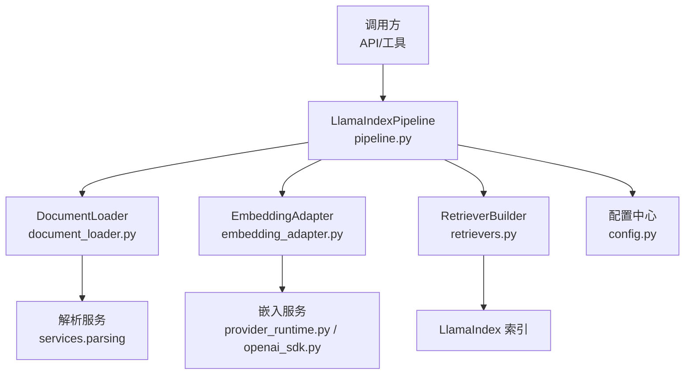
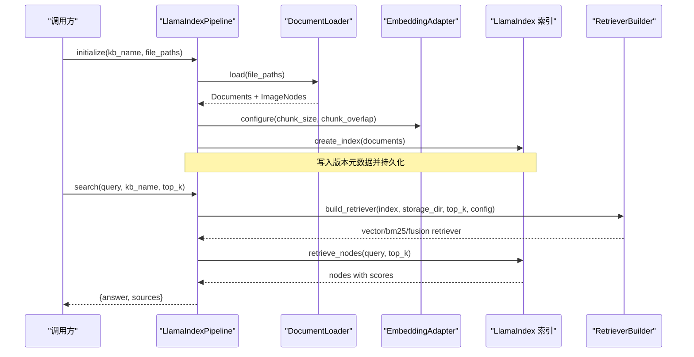
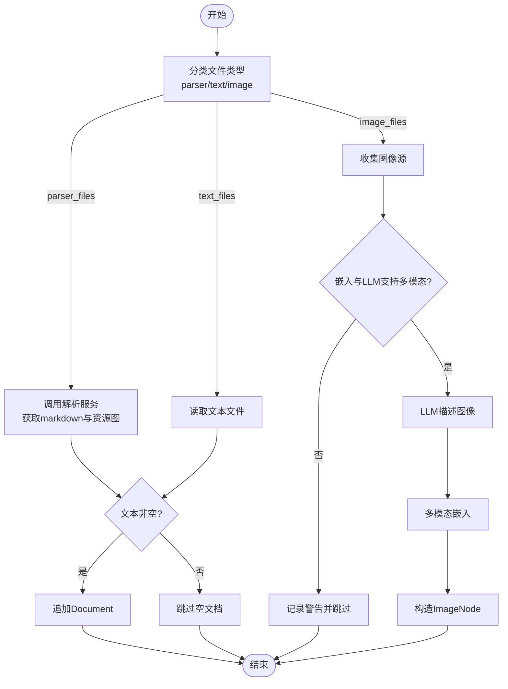
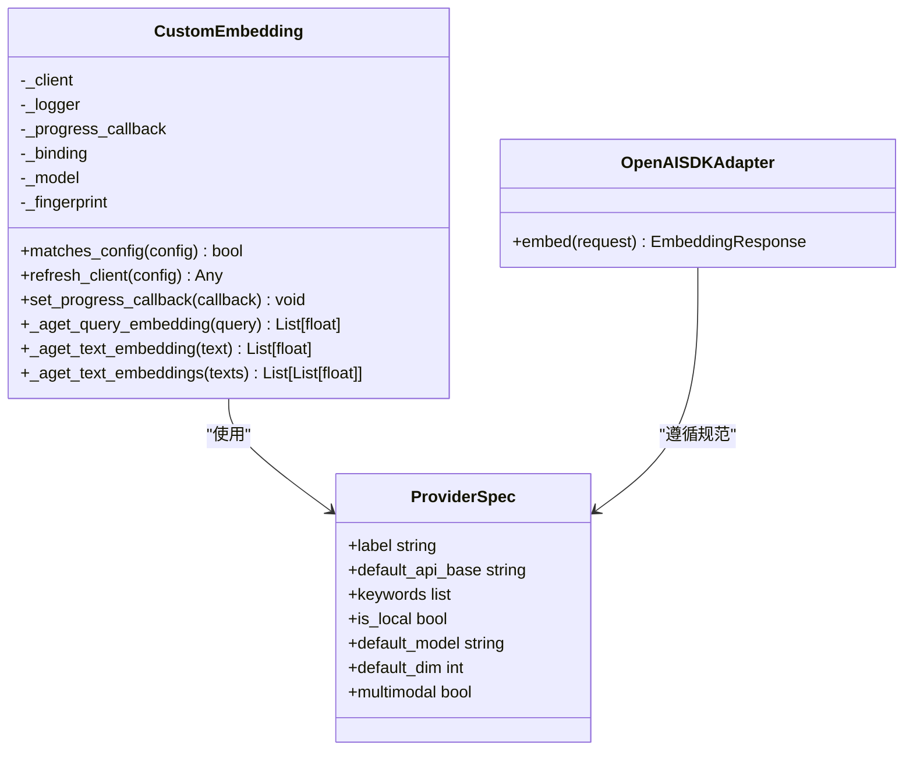
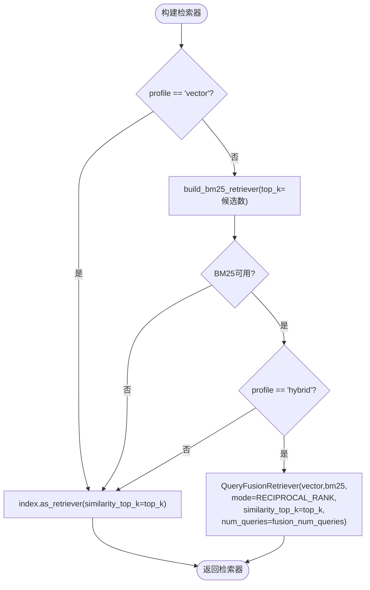
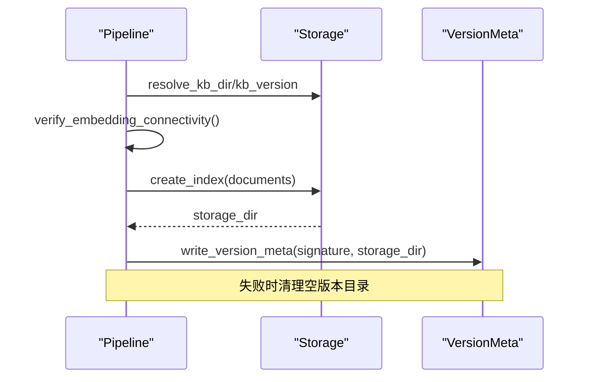
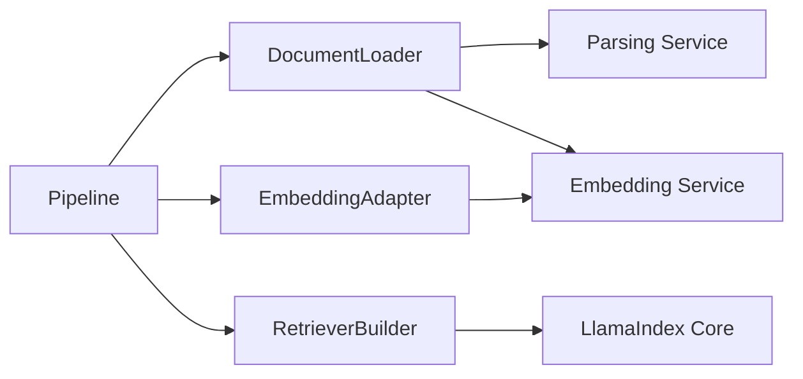

# LlamaIndex管道

<cite>
**本文引用的文件**
- [pipeline.py](file://deeptutor/services/rag/pipelines/llamaindex/pipeline.py)
- [document_loader.py](file://deeptutor/services/rag/pipelines/llamaindex/document_loader.py)
- [retrievers.py](file://deeptutor/services/rag/pipelines/llamaindex/retrievers.py)
- [embedding_adapter.py](file://deeptutor/services/rag/pipelines/llamaindex/embedding_adapter.py)
- [config.py](file://deeptutor/services/rag/pipelines/llamaindex/config.py)
- [provider_runtime.py](file://deeptutor/services/config/provider_runtime.py)
- [openai_sdk.py](file://deeptutor/services/embedding/adapters/openai_sdk.py)
- [test_llamaindex_storage_layout.py](file://tests/services/rag/test_llamaindex_storage_layout.py)
</cite>

## 目录
1. [简介](#简介)
2. [项目结构](#项目结构)
3. [核心组件](#核心组件)
4. [架构总览](#架构总览)
5. [详细组件分析](#详细组件分析)
6. [依赖关系分析](#依赖关系分析)
7. [性能与内存优化](#性能与内存优化)
8. [故障排除指南](#故障排除指南)
9. [结论](#结论)
10. [附录：配置示例](#附录：配置示例)

## 简介
本文件为 DeepTutor 中基于 LlamaIndex 的检索增强生成（RAG）管道的全面技术文档。内容覆盖文档加载器对多种格式的支持、文本提取策略、嵌入适配器的设计（支持 OpenAI、Gemini、Cohere、Jina、Azure OpenAI 等）、检索器实现（向量检索、BM25 混合检索、相似度阈值控制），以及分块大小、重叠策略、检索参数的配置方法。同时提供性能优化建议、内存管理策略和常见问题排查指引，帮助读者快速理解并高效使用该系统。

## 项目结构
LlamaIndex 管道位于 services/rag/pipelines/llamaindex 目录下，主要包含以下模块：
- pipeline.py：编排索引构建、查询、增量添加与删除等流程
- document_loader.py：将源文件转换为 LlamaIndex Document/ImageNode，并通过统一解析层处理多格式文档
- retrievers.py：组合向量检索与 BM25 检索，支持混合检索与持久化
- embedding_adapter.py：封装自定义嵌入模型，对接系统嵌入服务，设置分块参数与连通性校验
- config.py：检索配置（profile、top_k、multiplier、fusion_num_queries）与分块几何参数读取

图表来源
- [pipeline.py:38-122](file://deeptutor/services/rag/pipelines/llamaindex/pipeline.py#L38-L122)
- [document_loader.py:56-90](file://deeptutor/services/rag/pipelines/llamaindex/document_loader.py#L56-L90)
- [retrievers.py:119-151](file://deeptutor/services/rag/pipelines/llamaindex/retrievers.py#L119-L151)
- [embedding_adapter.py:137-161](file://deeptutor/services/rag/pipelines/llamaindex/embedding_adapter.py#L137-L161)
- [config.py:13-25](file://deeptutor/services/rag/pipelines/llamaindex/config.py#L13-L25)

章节来源
- [pipeline.py:38-122](file://deeptutor/services/rag/pipelines/llamaindex/pipeline.py#L38-L122)
- [document_loader.py:56-90](file://deeptutor/services/rag/pipelines/llamaindex/document_loader.py#L56-L90)
- [retrievers.py:119-151](file://deeptutor/services/rag/pipelines/llamaindex/retrievers.py#L119-L151)
- [embedding_adapter.py:137-161](file://deeptutor/services/rag/pipelines/llamaindex/embedding_adapter.py#L137-L161)
- [config.py:13-25](file://deeptutor/services/rag/pipelines/llamaindex/config.py#L13-L25)

## 核心组件
- LlamaIndexPipeline：负责知识库初始化、搜索、增量添加与删除；在异步上下文中调度阻塞的索引创建与检索操作，并处理版本元数据与错误清理。
- LlamaIndexDocumentLoader：通过统一解析服务将 PDF、DOCX、PPTX、XLSX、TXT、Markdown、代码、JSON、XML、CSV 等格式转为 LlamaIndex 文档或图像节点；支持图片描述与多模态嵌入。
- EmbeddingAdapter（CustomEmbedding）：将系统嵌入客户端桥接到 LlamaIndex 的 BaseEmbedding，支持批量嵌入、进度回调、连通性检查与分块参数设置。
- RetrieverBuilder：根据配置选择纯向量检索或混合检索（向量+BM25），支持候选 top_k 倍增、融合模式与 BM25 持久化。
- RetrievalConfig：定义检索 profile（vector/hybrid）、各子检索器的候选 top_k 倍数、融合查询次数等运行时参数。

章节来源
- [pipeline.py:38-122](file://deeptutor/services/rag/pipelines/llamaindex/pipeline.py#L38-L122)
- [document_loader.py:56-90](file://deeptutor/services/rag/pipelines/llamaindex/document_loader.py#L56-L90)
- [embedding_adapter.py:31-134](file://deeptutor/services/rag/pipelines/llamaindex/embedding_adapter.py#L31-L134)
- [retrievers.py:54-151](file://deeptutor/services/rag/pipelines/llamaindex/retrievers.py#L54-L151)
- [config.py:13-25](file://deeptutor/services/rag/pipelines/llamaindex/config.py#L13-L25)

## 架构总览
下图展示了从文件到检索结果的端到端流程：文档加载器解析多格式文件，嵌入适配器将文本/图像编码为向量，索引构建后由检索器按配置进行向量或混合检索，最终返回上下文与来源。

图表来源
- [pipeline.py:75-122](file://deeptutor/services/rag/pipelines/llamaindex/pipeline.py#L75-L122)
- [pipeline.py:123-177](file://deeptutor/services/rag/pipelines/llamaindex/pipeline.py#L123-L177)
- [document_loader.py:62-90](file://deeptutor/services/rag/pipelines/llamaindex/document_loader.py#L62-L90)
- [embedding_adapter.py:137-161](file://deeptutor/services/rag/pipelines/llamaindex/embedding_adapter.py#L137-L161)
- [retrievers.py:119-151](file://deeptutor/services/rag/pipelines/llamaindex/retrievers.py#L119-L151)

## 详细组件分析

### 文档加载器与文本提取策略
- 支持的格式与策略
  - 二进制办公格式：PDF、DOCX、XLSX、PPTX，通过统一解析服务（ParserService）进行解析，可切换 text-only、MinerU、Docling、markitdown、PyMuPDF4LLM 等引擎。
  - 文本类格式：TXT、Markdown、源代码、JSON、XML、CSV 等，直接读取文本并按多编码回退链解码。
  - 图像：独立图片或解析过程中提取的图片，若嵌入与 LLM 均支持多模态，则生成 ImageNode 并嵌入。
- 文本提取细节
  - PDF：优先尝试 pymupdf（fitz），否则回退到 pypdf；加密 PDF 会抛出损坏错误。
  - DOCX：优先 python-docx，失败时走 OOXML 纯 Python 解析，抽取段落与页眉页脚、注释等。
  - XLSX/PPTX：分别通过 openpyxl/python-pptx 解析表格/幻灯片文本。
  - 文本类：按扩展名路由读取，空内容会被跳过。
- 图像多模态路径
  - 需要同时满足：嵌入模型支持 multimodal contents，且 LLM 支持图像输入。
  - 使用 LLM 生成图像描述，再调用多模态嵌入接口得到向量，构造 ImageNode 并附带元数据。

图表来源
- [document_loader.py:62-90](file://deeptutor/services/rag/pipelines/llamaindex/document_loader.py#L62-L90)
- [document_loader.py:92-145](file://deeptutor/services/rag/pipelines/llamaindex/document_loader.py#L92-L145)
- [document_loader.py:147-237](file://deeptutor/services/rag/pipelines/llamaindex/document_loader.py#L147-L237)

章节来源
- [document_loader.py:62-90](file://deeptutor/services/rag/pipelines/llamaindex/document_loader.py#L62-L90)
- [document_loader.py:92-145](file://deeptutor/services/rag/pipelines/llamaindex/document_loader.py#L92-L145)
- [document_loader.py:147-237](file://deeptutor/services/rag/pipelines/llamaindex/document_loader.py#L147-L237)

### 嵌入适配器设计
- 自定义嵌入模型 CustomEmbedding
  - 继承 LlamaIndex 的 BaseEmbedding，内部持有系统嵌入客户端，支持同步/异步嵌入调用。
  - 支持批量嵌入与进度回调，便于长任务进度上报。
  - 通过指纹匹配当前嵌入配置，避免重复创建实例。
- 配置与连通性
  - 配置 LlamaIndex Settings 的 embed_model、chunk_size、chunk_overlap。
  - 启动前执行连通性测试，确保网络与凭据正确。
- 提供商支持
  - 通过 provider_runtime 注册多个提供商（OpenAI、Gemini、Azure OpenAI、Cohere、Jina 等）。
  - OpenAI SDK 适配器明确不支持 multimodal contents，需选择支持多模态的提供商。

图表来源
- [embedding_adapter.py:31-134](file://deeptutor/services/rag/pipelines/llamaindex/embedding_adapter.py#L31-L134)
- [provider_runtime.py:83-121](file://deeptutor/services/config/provider_runtime.py#L83-L121)
- [openai_sdk.py:65-83](file://deeptutor/services/embedding/adapters/openai_sdk.py#L65-L83)

章节来源
- [embedding_adapter.py:31-134](file://deeptutor/services/rag/pipelines/llamaindex/embedding_adapter.py#L31-L134)
- [provider_runtime.py:83-121](file://deeptutor/services/config/provider_runtime.py#L83-L121)
- [openai_sdk.py:65-83](file://deeptutor/services/embedding/adapters/openai_sdk.py#L65-L83)

### 检索器实现（向量、BM25 混合、相似度阈值）
- 纯向量检索
  - index.as_retriever(similarity_top_k=top_k)
- BM25 检索
  - 可选依赖 llama-index-retrievers-bm25；若未安装则自动降级为纯向量检索。
  - 支持持久化 BM25 侧索引以提升后续检索速度。
  - 对小语料库做 top_k 上限保护，避免 k>N 报错。
- 混合检索（Reciprocal Rank Fusion）
  - 组合向量检索与 BM25 检索，使用 QueryFusionRetriever 以 RECIPROCAL_RANK 模式融合结果。
  - 支持 candidate_top_k 倍增（vector_top_k_multiplier、bm25_top_k_multiplier）与 num_queries。
- 相似度阈值控制
  - 通过 similarity_top_k 控制返回数量；BM25 构建时也会设置该值。
  - 可在检索配置中调整 profile 与 multiplier 来平衡召回与精度。

图表来源
- [retrievers.py:54-83](file://deeptutor/services/rag/pipelines/llamaindex/retrievers.py#L54-L83)
- [retrievers.py:119-151](file://deeptutor/services/rag/pipelines/llamaindex/retrievers.py#L119-L151)
- [test_llamaindex_storage_layout.py:122-162](file://tests/services/rag/test_llamaindex_storage_layout.py#L122-L162)

章节来源
- [retrievers.py:54-83](file://deeptutor/services/rag/pipelines/llamaindex/retrievers.py#L54-L83)
- [retrievers.py:119-151](file://deeptutor/services/rag/pipelines/llamaindex/retrievers.py#L119-L151)
- [test_llamaindex_storage_layout.py:122-162](file://tests/services/rag/test_llamaindex_storage_layout.py#L122-L162)

### 管道编排与版本管理
- 初始化流程
  - 验证嵌入连通性 → 加载文档 → 创建索引 → 持久化存储 → 写入版本元数据（含嵌入签名）。
- 搜索流程
  - 根据当前嵌入签名解析存储目录 → 检索节点 → 组装答案与来源 → 检测嵌入模型不匹配并提示重新索引。
- 增量添加与删除
  - 支持向现有索引插入新文档或重建新索引；删除知识库目录。

图表来源
- [pipeline.py:75-122](file://deeptutor/services/rag/pipelines/llamaindex/pipeline.py#L75-L122)
- [pipeline.py:225-279](file://deeptutor/services/rag/pipelines/llamaindex/pipeline.py#L225-L279)

章节来源
- [pipeline.py:75-122](file://deeptutor/services/rag/pipelines/llamaindex/pipeline.py#L75-L122)
- [pipeline.py:225-279](file://deeptutor/services/rag/pipelines/llamaindex/pipeline.py#L225-L279)

## 依赖关系分析
- 外部依赖
  - LlamaIndex 核心与检索器（QueryFusionRetriever、MockLLM、BM25Retriever 可选）。
  - 文档解析库（pymupdf、pypdf、python-docx、openpyxl、python-pptx）。
  - 嵌入提供商（OpenAI、Gemini、Cohere、Jina、Azure OpenAI 等）。
- 内部依赖
  - 解析服务（services.parsing）统一文档解析入口。
  - 嵌入服务（services.embedding）提供客户端与配置。
  - 配置中心（services.config）提供运行期设置与环境变量。

图表来源
- [document_loader.py:62-90](file://deeptutor/services/rag/pipelines/llamaindex/document_loader.py#L62-L90)
- [embedding_adapter.py:137-161](file://deeptutor/services/rag/pipelines/llamaindex/embedding_adapter.py#L137-L161)
- [retrievers.py:119-151](file://deeptutor/services/rag/pipelines/llamaindex/retrievers.py#L119-L151)

章节来源
- [document_loader.py:62-90](file://deeptutor/services/rag/pipelines/llamaindex/document_loader.py#L62-L90)
- [embedding_adapter.py:137-161](file://deeptutor/services/rag/pipelines/llamaindex/embedding_adapter.py#L137-L161)
- [retrievers.py:119-151](file://deeptutor/services/rag/pipelines/llamaindex/retrievers.py#L119-L151)

## 性能与内存优化
- 分块策略
  - 通过 chunk_geometry 读取 chunk_size 与 chunk_overlap，默认 512/50；合理增大 overlap 有助于跨块语义连贯，但会增加向量数量与内存占用。
- 检索参数
  - 使用 hybrid profile 提升召回质量；通过 vector_top_k_multiplier 与 bm25_top_k_multiplier 调节候选规模，再以 fusion 合并。
  - 小语料库场景下，BM25 会自动限制 top_k 以避免异常。
- 并行与异步
  - 索引创建与检索在 executor 中运行，避免阻塞事件循环；嵌入批量调用减少 API 往返。
- 内存管理
  - 图像多模态路径仅在必要条件下启用，避免不必要的图像负载。
  - 失败版本目录自动清理，防止残留占用磁盘。
  - 建议在生产环境限制并发与批大小，结合硬件资源调优。

[本节为通用性能指导，不直接分析具体文件]

## 故障排除指南
- 嵌入连通性问题
  - 现象：初始化时报错无法连接嵌入 API。
  - 处理：检查绑定、模型、base_url/api_version；确认网络与凭据；查看连通性测试结果。
- 文档解析失败
  - 现象：某些文件格式被跳过或报 ParserError。
  - 处理：在“设置→文档解析”中切换解析引擎；确认依赖库已安装；检查文件是否损坏或加密。
- 混合检索不可用
  - 现象：hybrid profile 下退化为纯向量检索。
  - 处理：安装 llama-index-retrievers-bm25；或接受降级行为；检查 BM25 持久化目录权限。
- 图像索引失败
  - 现象：图像被跳过并记录警告。
  - 处理：确认嵌入与 LLM 均支持多模态；检查图像大小与格式；查看 LLM 描述返回是否为空。
- 嵌入模型不匹配
  - 现象：搜索返回 warning 提示需重新索引。
  - 处理：切换回原嵌入模型或对知识库重新索引。

章节来源
- [embedding_adapter.py:170-191](file://deeptutor/services/rag/pipelines/llamaindex/embedding_adapter.py#L170-L191)
- [document_loader.py:92-113](file://deeptutor/services/rag/pipelines/llamaindex/document_loader.py#L92-L113)
- [retrievers.py:54-83](file://deeptutor/services/rag/pipelines/llamaindex/retrievers.py#L54-L83)
- [pipeline.py:179-197](file://deeptutor/services/rag/pipelines/llamaindex/pipeline.py#L179-L197)

## 结论
DeepTutor 的 LlamaIndex 管道提供了统一的文档加载、嵌入与检索能力，支持多种格式与多提供商嵌入，具备灵活的检索策略与健壮的错误处理。通过合理的分块与检索参数配置，可以在不同规模的知识库上取得良好的召回与响应质量。生产部署时应关注依赖安装、网络连通性与资源限制，以获得稳定高效的检索体验。

[本节为总结性内容，不直接分析具体文件]

## 附录：配置示例
以下为常见配置项与说明，用于调整分块、重叠与检索行为。实际值来自运行期设置或环境变量，默认值见下方说明。

- 分块与重叠
  - chunk_size：默认 512
  - chunk_overlap：默认 50
  - 读取方式：通过 retrieval_config_from_settings 或 chunk_geometry 获取
- 检索配置
  - retrieval_profile：默认 "hybrid"，可选 "vector"
  - vector_top_k_multiplier：默认 2
  - bm25_top_k_multiplier：默认 2
  - fusion_num_queries：默认 1（融合检索时使用 MockLLM，无需真实 LLM）
  - top_k：默认 5（检索返回的片段数）
- 环境变量
  - DEEPTUTOR_RAG_RETRIEVAL_PROFILE 或 RAG_RETRIEVAL_PROFILE：设置检索 profile
- 提供商与模型
  - 通过 provider_runtime 注册的提供商包括 OpenAI、Gemini、Azure OpenAI、Cohere、Jina 等
  - OpenAI SDK 适配器不支持多模态 contents，需选择支持多模态的提供商

章节来源
- [config.py:13-25](file://deeptutor/services/rag/pipelines/llamaindex/config.py#L13-L25)
- [config.py:36-48](file://deeptutor/services/rag/pipelines/llamaindex/config.py#L36-L48)
- [config.py:58-82](file://deeptutor/services/rag/pipelines/llamaindex/config.py#L58-L82)
- [config.py:85-95](file://deeptutor/services/rag/pipelines/llamaindex/config.py#L85-L95)
- [provider_runtime.py:83-121](file://deeptutor/services/config/provider_runtime.py#L83-L121)
- [openai_sdk.py:65-83](file://deeptutor/services/embedding/adapters/openai_sdk.py#L65-L83)